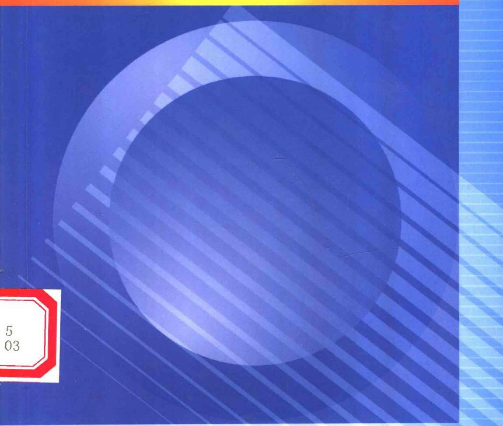

# 00-封面与前言目录

[返回全书目录](../../README.md)

> PDF 页码：1–18

<!-- page: 1 -->

高等学校教材

# 复变函数论

（第三版）

钟玉泉 编

高等教育出版社

<!-- page: 2 -->

高等学校教材

### 复变函数论

# 第三版

钟玉泉 编

高等教育出版社

<!-- page: 3 -->

图书在版编目（CIP）数据

复变函数论 / 钟玉泉编. —3 版. —北京: 高等教育出版社, 2004.1

ISBN 7-04-012943-4

Ⅰ. 复... Ⅱ. 钟... Ⅲ. 复变函数 - 高等学校 -

教材 Ⅳ. O174.5

中国版本图书馆 CIP 数据核字（2003）第 095839 号

出版发行 高等教育出版社

购书热线 010-64054588

社址 北京市西城区德外大街4号

免费咨询 800-810-0598

邮政编码 100011

网址 http://www.hep.edu.cn

总机010-82028899

http://www.hep.com.cn

经销新华书店北京发行所

印刷 高等教育出版社印刷厂

开本  $ 850 \times 1168 $ 1/32

版 次 1979 年 8 月 第 1 版

2004年1月第3版

印 张 12.375

印次 2004 年 4 月第 3 次印刷

字数 310 000

定 价 18.70 元

本书如有缺页、倒页、脱页等质量问题，请到所购图书销售部门联系调换。

期权所有侵权必究

<!-- page: 4 -->

##### 内容提要

本书第三版是在第二版的基础上，集撷作者多年教学心得和科研成果，并根据1988年全国复变函数编写提纲讨论会精神修订的。此次修订着眼于进一步提高质量，更加适应多数学校的教学需要，保留第二版阐述细致，便于自学的特点，对已发现的错误和不妥之处，予以改正。

本书内容包括：复数与复变函数、解析函数、复变函数的积分、解析函数的幂级数表示法、解析函数的洛朗展式与孤立奇点、留数理论及其应用、共形映射、解析延拓和调和函数共九章。对于加上 * 号内容，供学有余力的学生选学。

本书可作为高等师范院校数学系的教材，也可为其他理工院校、教育学院所选用。

<!-- page: 5 -->

### 第三版序

本书第二版自1988年5月出版以来，迄今已重印22次，累计印数达45万余册。使用后普遍反映良好。为使教材能与时俱进，不断提高质量，遂对第二版进行了修订。修订中集撷了本人的若干教学和科研成果[见附1~7]，针对规范的数学名词已颁布，顺便作了规范化勘正。修订的另一重要依据是1988年11月底的郑州全国复变函数编写提纲讨论会精神。

我们在修订中所掌握的具体原则是：

1. 使原书中涉及的数学名词规范化；

2. 一般不增删原书的章、节、例题（只增了例 4.5(5)）、习题（只增了第一章习题（二） $ ^{*} $12）和图；

3. 对原书作进一步修整，并在一些地方适当引入[附1~7]的部分成果，以使其叙述更清楚、更精确、更易教易学，而基本理论又更扎实。

此外，拙编《复变函数学习指导书》，为国家教委“八五”高校规划教材，是拙编教材《复变函数论》(第二版)的配套教学用书，读者仍可以与第三版教材对照参考阅读。

编者于四川大学数学学院

2003年6月

<!-- page: 6 -->

附 1. 一个解析函数定理的推广. 四川大学学报(自然科学版),1990,27(1):86~87;

2. 一族与对称函数有关的解析函数的开始多项式.西南师范大学学报(自然科学版),1990,15(1):125~131;

3. 解析函数的单叶半径. 四川大学学报(自然科学版), 1991, 28(4): 545~547;

4. 解析函数的星象半径. 四川大学学报(自然科学版), 1993, 30(3): 405~407;

5. 解析函数的  $ \beta $ 级星象半径. 四川大学学报(自然科学版), 1995,32(2):121~127;

6. 复变函数学习指导书. 北京: 高等教育出版社, 1996 年 4 月;

7. 关于复变函数的教材改革与建设.香港:《现代教学论坛》杂志,2000年1期.

#### 书中符号说明

为了方便，我们引入以下符号：

“ $ \forall x $”表示“对每一个x”；

“ $ \exists x $”表示“存在 x”；

“ $ \exists 1x $”表示“惟一存在 x”；

“——→——”表示“若——，则——”；

“——⇔——”表示“——当且仅当——”；

“ $ \Rightarrow $”表示“必要性”；

“⇐”表示“充分性”.

<!-- page: 7 -->

### 第二版 序

本书自1979年出版以来已重印了八次，采用它作教材的学校，除一些综合大学、师范院校外，还有一些理工院校的应用数学专业、计算专业、师资班和研究生班等。许多教师和读者来信表示关切和鼓励，并对书中存在的不妥和错误之处予以指正，在此特向他们表示感谢。

这次修订着眼于进一步提高质量，更加适应多数学校的教学需要，保留第一版阐述细致，便于自学的特点，对已经发现的错误和不妥之处，予以改正。除此之外，第二版与第一版的主要区别可概括如下：

1. 将第二章§2解析函数与调和函数的关系后移至第三章，这样既可相对减轻第二章因讨论多值函数所引起的内容偏重，又可避免提前引用第三章中“解析函数”无穷可微性”。

2. 将共形映射这一章的前四节编成第七章列在解析延拓之前，把剩下的第5节对称原理及多角形区域的共形映射纳入解析延拓这一章，避免了原来将对称原理切成两段，分属两章.

3. 将施瓦茨引理从第八章提前到第五章，放在可去奇点之后，这样既可使它与第四章末的最大模原理靠近，又可让读者早些熟悉、掌握函数论中这两个重要的有关联的定理。

4. 含点 $ \infty $的区域上的柯西积分定理与柯西积分公式，原在第三章习题中，现后移至第五章习题中。因为这时已介绍了函数在点 $ \infty $解析的意义，读者就可以借助函数在点 $ \infty $去心邻域内的洛朗展式简捷地证明它们。

<!-- page: 8 -->

5. 为了第九章解单位圆内狄利克雷问题的需要，这一版在第三章§3末添了一小段柯西型积分，并加上*号。另外，由于综合大学数学专业复变函数教学大纲中列有单值性定理，这次也补写了一段，列入解析延拓这一章。

6. 出于教学方法上的考虑，以这几年的教学实践为基础，我改写了第二章初等多值函数以及第六章应用多值函数的积分，目的在于使读者更加易于接受，使多值函数这一教学难点能有所突破。至于其他改写之处，各章都有，就不在这里一一道及了。

7. 考虑到不同层次的学校与不同程度的学生在学习上的多种需要，我以这几年的教学实践为基础，对原有习题作了些调整之后将其编入各章习题（一）；另外，又适当慎选了一些较难的习题及与之相应的例题。新添的题目，将其编入各章习题（二）。经多次试用，它们虽较难些，但仍是紧扣教材的，有助于培养与增强学生的能力，学生可以根据自己的情况适当选作。

8. 根据综合大学数学专业复变函数教学大纲，在这一版中将解析函数对平面场的应用及多角形区域的共形映射公式这些节都加上 $ ^{*} $号，并对第一版中排小字的内容全都改排大字，除柯西积分定理的古莎证明外，其余改排大字的部分都加上 $ ^{*} $号。其他院校和其他专业，在使用本教材时，可根据各自的教学大纲决定取舍。

9. 这一版删去了第一版中的附录，整函数与亚纯函数近代理论简介，因为国内已有这方面的专著出版了。 $ ^{①} $

根据我的教学实践，教师使用本教材不必全讲，只需按教学大纲要求控制各章讲授学时和讲授内容，讲清楚基本理论、基本方法、重点和难点，其余还需要学生掌握的内容和例题就指定留给学生自学。这对于开发学生智力，培养学生能力是大有裨益的。

<!-- page: 9 -->

加 $ ^{*} $号的内容，自修的读者可以先不读它.

编者

1987年元旦

<!-- page: 10 -->

### 第一版序

本书是根据1977年理科数学教材会议上制订的复变函数教材编写大纲，在历年主讲该课使用的自编讲义基础上改编成的。全书系统地介绍了单复变函数的基本理论和基本方法。

考虑到复变函数论是数学专业的一门重要基础课，又是数学分析的后继课，在编写本书时，注意了下列几点：

1. 对与数学分析中平行的概念，如极限、连续、微分等，既指出其相似之处，更强调其不同之点，以免初学者疏忽。

2. 对复变函数论中的基本定理和重要定理，如柯西积分定理和关于本性奇点的魏尔斯特拉斯定理等，从叙述、证明到推广，均注意了科学性和严密性。这不仅反映了复变函数理论本身的系统性和严谨性，同时也可藉以锻炼读者思考问题和逻辑推理的能力。

3. 对多值解析函数这个教学上的难点，为使读者较易接受，本书把它分散在第二章、第六章及第七章内.并在第二章内，把求根式函数 $ \sqrt[n]{2} $的单值解析分支的方法写得较细，这样做或许能使读者举一反三.

4. 对解析函数在流体力学、机翼理论及电学等方面的应用，本书作了简明的介绍，藉以使读者了解复变函数论方法在解决实际问题上的重要性。

5. 配备了大量的例题和习题，习题大都附有答案或提示，以供教师选用，也便于读者自学.

6. 因限于篇幅或工具知识而不能给出证明的定理，大都指出参考资料.用小字排印的部分，对初学者可不作要求.

<!-- page: 11 -->

附录中简单介绍了我国青年数学家杨乐、张广厚的出色工作，以适应有些缺乏这方面资料的读者的要求。

使用本书作教材，大体可按6、10、8、8、8、10、6、12、4的顺序来分配各章讲授学时。如讲授学时少于72学时，教师可斟酌删去一些次要及较深部分的内容。例如，可删去克里斯托费尔——施瓦茨公式及最末一章等。

本书由武汉大学路见可教授主审。武汉大学、北京大学、南开大学、吉林大学、南京大学、上海师范大学、西南师范学院、四川师范学院、四川大学的同志参加了审查。他们提出了许多宝贵的意见，在此表示衷心感谢。特别是路见可教授不惮其烦，为编者复审修改了全部稿件，使原稿得到了很大改进，编者对他的这种负责精神表示敬佩和学习。

本书初稿曾经四川大学蒲保明教授和周纪溥、张茂孝两同志审阅，也在此一并致谢。

但限于编者水平，谬误之处仍然难免，敬请读者提出来批评指正。

编者于四川大学数学系

1978.9.

<!-- page: 12 -->

## 目录

引言 ..... 1    
第一章 复数与复变函数 ..... 3    
§1. 复数 ..... 3    
1. 复数域(3) 2. 复平面(5) 3. 复数的模与辐角(7)    
4. 复数的乘幂与方根(13) 5. 共轭复数(16)    
6. 复数在几何上的应用举例(18)    
§2. 复平面上的点集 ..... 21    
1. 平面点集的几个基本概念(21) 2. 区域与若尔当(Jordan)曲线(22)    
§3. 复变函数 ..... 28    
1. 复变函数的概念(28) 2. 复变函数的极限与连续性(33)    
§4. 复球面与无穷远点 ..... 38    
1. 复球面(38) 2. 扩充复平面上的几个概念(40)    
    
第一章习题 ..... 42    
第二章 解析函数 ..... 47    
§1. 解析函数的概念与柯西-黎曼方程 ..... 47    
1. 复变函数的导数与微分(47) 2. 解析函数及其简单性质(49) 3. 柯西-黎曼方程(51)    
§2. 初等解析函数 ..... 58    
1. 指数函数(58) 2. 三角函数与双曲函数(60)    
§3. 初等多值函数 ..... 64

<!-- page: 13 -->

1. 根式函数(65) 2. 对数函数(73) 3. 一般幂函数与一般指数函数(78) 4. 具有多个有限支点的情形(80) 5. 反三角函数与反双曲函数(87)    
    
第二章 习题 ..... 90    
第三章 复变函数的积分 ..... 96    
§1. 复积分的概念及其简单性质 ..... 96    
1. 复变函数积分的定义(96) 2. 复变函数积分的计算问题(99) 3. 复变函数积分的基本性质(100)    
§2. 柯西积分定理 ..... 103    
1. 柯西积分定理(103) 2. 柯西积分定理的古莎证明(106) 3. 不定积分(112) 4. 柯西积分定理的推广(114) 5. 柯西积分定理推广到复周线的情形(116)    
§3. 柯西积分公式及其推论 ..... 119    
1. 柯西积分公式(119) 2. 解析函数的无穷可微性(123) 3. 柯西不等式与刘维尔(Liouville)定理(126) 4. 摩勒拉(Morera)定理(128) *5. 柯西型积分(130)    
§4. 解析函数与调和函数的关系 ..... 131    
§5. 平面向量场——解析函数的应用(一) ..... 136    
1. 流量与环量(137) 2. 无源、漏的无旋流动(139) 3. 复势(139)    
    
第三章 习题 ..... 141    
第四章 解析函数的幂级数表示法 ..... 147    
§1. 复级数的基本性质 ..... 147    
1. 复数项级数(147) 2. 一致收敛的复函数项级数(150) 3. 解析函数项级数(153)    
§2. 幂级数 ..... 154    
1. 幂级数的敛散性(154) 2. 收敛半径 R 的求法、柯西－阿达马(Hadamard)公式(157) 3. 幂级数和的解析性(158)

<!-- page: 14 -->

§3. 解析函数的泰勒(Taylor)展式 …… 159    
1. 泰勒定理(159) 2. 幂级数的和函数在其收敛圆周上的状况(162) 3. 一些初等函数的泰勒展式(164)    
§4. 解析函数零点的孤立性及唯一性定理 …… 170    
1. 解析函数零点的孤立性(170) 2. 惟一性定理(173)    
3. 最大模原理(175)    
    
第四章习题 …… 178    
第五章 解析函数的洛朗(Laurent)展式与孤立奇点 … 184    
§1. 解析函数的洛朗展式 …… 184    
1. 双边幂级数(184) 2. 解析函数的洛朗展式(185)    
3. 洛朗级数与泰勒级数的关系(188) 4. 解析函数在孤立奇点邻域内的洛朗展式(189)    
§2. 解析函数的孤立奇点 …… 193    
1. 孤立奇点的三种类型(193) 2. 可去奇点(194)    
3. 施瓦茨(Schwarz)引理(195) 4. 极点(197) 5. 本质奇点(199) 6. 皮卡(Picard)定理(200)    
§3. 解析函数在无穷远点的性质 …… 203    
§4. 整函数与亚纯函数的概念 …… 209    
1. 整函数(209) 2. 亚纯函数(210)    
§5. 平面向量场——解析函数的应用(二) …… 212    
1. 奇点的流体力学意义(212) 2. 在电场中的应用举例(214)    
    
第五章习题 …… 217    
第六章 留数理论及其应用 …… 225    
§1. 留数 …… 225    
1. 留数的定义及留数定理(225) 2. 留数的求法(227)    
3. 函数在无穷远点的留数(231)    
§2. 用留数定理计算实积分 …… 234

<!-- page: 15 -->

1. 计算  $ \int_{0}^{2\pi} R(\cos\theta, \sin\theta) d\theta $ 型积分(234)    
2. 计算  $ \int_{-\infty}^{+\infty} \frac{P(x)}{Q(x)} dx $ 型积分(239)    
3. 计算  $ \int_{-\infty}^{+\infty} \frac{P(x)}{Q(x)} e^{i m x} dx $ 型积分(243)    
4. 计算积分路径上有奇点的积分(245) 5. 杂例(247)    
6. 应用多值函数的积分(251)    
§3. 辐角原理及其应用 ..... 259    
1. 对数函数(259) 2. 辐角原理(261)    
3. 儒歇(Rouché)定理(265)    
    
第六章习题 ..... 269    
    
第七章 共形映射 ..... 277    
§1. 解析变换的特性 ..... 277    
1. 解析变换的保域性(277) 2. 解析变换的保角性——导数的几何意义(279) 3. 单叶解析变换的共形性(283)    
§2. 分式线性变换 ..... 285    
1. 分式线性变换及其分解(285) 2. 分式线性变换的共形性(289) 3. 分式线性变换的保交比性(290)    
4. 分式线性变换的保圆周(圆)性(292) 5. 分式线性变换的保对称点性(294) 6. 分式线性变换的应用(296)    
§3. 某些初等函数所构成的共形映射 ..... 301    
1. 幂函数与根式函数(301) 2. 指数函数与对数函数(303) 3. 由圆弧构成的两角形区域的共形映射(306) *4. 机翼剖面函数及其反函数所构成的共形映射(308) 5. 儒可夫斯基函数的单叶性区域(311)    
§4. 关于共形映射的黎曼存在定理和边界对应定理 ..... 312    
1. 黎曼存在定理(312) 2. 边界对应定理(315)    
    
第七章习题 ..... 317

<!-- page: 16 -->

第八章 解析延拓 ..... 324    
§1. 解析延拓的概念与幂级数延拓 ..... 324    
1. 解析延拓的概念(324) 2. 解析延拓的幂级数方法(328)    
§2. 透弧解析延拓、对称原理 ..... 334    
1. 透弧直接解析延拓(334) 2. 黎曼－施瓦茨对称原理(335)    
§3. 完全解析函数及黎曼面的概念 ..... 341    
1. 完全解析函数(341) 2. 单值性定理(342)    
3. 黎曼面概念(345)    
* §4. 多角形区域的共形映射 ..... 350    
1. 克里斯托费尔(Christoffel)－施瓦茨变换(351)    
2. 退化情形(356) 3. 广义多角形举例(359)    
    
第八章习题 ..... 363    
第九章 调和函数 ..... 367    
§1. 平均值定理与极值原理 ..... 367    
1. 平均值定理(367) 2. 极值原理(368)    
§2. 泊松积分公式与狄利克雷问题 ..... 369    
1. 泊松积分公式(369) 2. 狄利克雷问题(370) 3. 单位圆内狄利克雷问题的解(371) 4. 上半平面内狄利克雷问题的解(374)    
    
第九章习题 ..... 377

<!-- page: 17 -->

## 引言

我们知道，在解实系数一元二次方程

 $$ a x^{2}+b x+c=0(a\neq0) $$ 

时, 如果判别式  $ b^{2}-4ac<0 $, 就会遇到负数开平方的问题. 最简单的一个例子, 是在解方程

 $$ x^{2}+1=0 $$ 

时，就会遇到 -1 开平方的问题.

16世纪中叶，意大利卡尔丹 $ ^{①} $在1545年解三次方程时，首先产生了负数开平方的思想。他把40看作 $ 5+\sqrt{-15} $与 $ 5-\sqrt{-15} $的乘积，然而这只不过是一种纯形式 $ ^{②} $的表示而已。当时，谁也说不上这样表示究竟有什么好处。

为了使负数开平方有意义，也就是要使上述这类方程有解，我们需要再一次扩大数系，于是，就引进了虚数，使实数域扩大到复数域。但最初，由于对复数的有关概念及性质了解得不清楚，用它们进行计算又得到一些矛盾，因而，长期以来，人们把复数看作不能接受的“虚数”。直到17世纪和18世纪，随着微积分的发明与发展，情况才逐渐有了改变。另外的原因，是由于这个时期复数有了几何的解释，并把它与平面向量对应起来解决实际问题的缘故。

关于复数理论最系统的叙述，是由瑞士数学家欧拉(Euler)作出的。他在1777年系统地建立了复数理论，发现了复指数函数和三角函数间的关系，创立了复变函数论的一些基本定理，并开始把

<!-- page: 18 -->

它们用到水力学和地图制图图学上。用符号“i”作为虚数的单位，也是他首创的。此后，复数才被人们广泛承认和使用。

在复数域内考虑问题往往比较方便.例如,一元 n 次方程

 $$ a_{0}x^{n}+a_{1}x^{n-1}+\cdots+a_{n-1}x+a_{n}=0\quad\left(a_{0}\neq0\right), $$ 

在复数域内恒有解，其中系数  $ a_{0}, a_{1}, \cdots, a_{n} $ 都是复数。这就是著名的代数学基本定理，它用复变函数理论来证明，是非常简洁的。又如，在实数域内负数的对数无意义，而在复数域内，我们就可以定义负数的对数。

在 19 世纪，复变函数的理论经过法国数学家柯西（Cauchy）、德国数学家黎曼（Riemann）和魏尔斯特拉斯（Weierstrass）的巨大努力，已经形成了非常系统的理论，并且深刻地渗入到代数学、解析数论、微分方程、概率统计、计算数学和拓扑学等数学分支；同时，它在热力学、流体力学和电学等方面也有很多的应用。

20世纪以来，复变函数已被广泛地应用在理论物理、弹性理论和天体力学等方面，与数学中其他分支的联系也日益密切。致使经典的复变函数理论，如整函数与亚纯函数理论、解析函数的边值问题等有了新的发展和应用。并且，还开辟了一些新的分支，如复变函数逼近论、黎曼曲面、单叶解析函数论、多复变函数论、广义解析函数论和拟共形映射等。另外，在种种抽象空间的理论中，复变函数还常常为我们提供新思想的模型。

复变函数研究的中心对象是所谓解析函数，因此，复变函数论又称为解析函数论，简称函数论.

复变函数是我国数学工作者从事研究最早也最有成效的数学分支之一.我国老一辈的数学家在单复变函数及多复变函数方面做过许多重要的工作,不少成果均已达到当时的国际水平.而今,在他们的热忱帮助下,我国许多中青年数学工作者,正在健康成长,不少人已在数学的各个领域中做出了许多优异的成绩.

