# 01-第一章 复数与复变函数

[返回全书目录](../../README.md)

> PDF 页码：19–62

<!-- page: 19 -->

## 第一章 复数与复变函数

复变函数就是自变量为复数的函数.复变函数论是分析学的一个分支，故又称复分析.我们研究的主要对象，是在某种意义下可导的复变函数，通常称为解析函数.为建立这种解析函数的理论基础，在这一章中，我们首先引入复数域与复平面的概念；其次引入复平面上的点集、区域、若尔当曲线以及复变函数的极限与连续等概念；最后，还要引入复球面与无穷远点的概念.这门学科的一切讨论都是在复数范围内进行的.

#### §1. 复. 数

### 1. 复数域 形如

 $$ z=x+iy 或 z=x+yi $$ 

的数，称为复数，其中 x 和 y 是任意的实数，实数单位为 1.i 满足  $ i^{2} = -1 $，称为虚数单位。电工学里是例外，在那里习惯用 j 表示，而不是用 i。

实数 x 和 y 分别称为复数 z 的实部和虚部，常记为：

 $$ x=\mathrm{R e}z^{\prime},\quad y=\mathrm{I m}z. $$ 

复数  $ z_{1}=x_{1}+iy_{1} $ 及  $ z_{2}=x_{2}+iy_{2} $ 相等，是指它们的实部与实部相等，虚部与虚部相等，即

 $$ x_{1}+\mathrm{i}y_{1}=x_{2}+\mathrm{i}y_{2} $$

<!-- page: 20 -->

必须且只须

 $$ x_{1}=x_{2},\quad y_{1}=y_{2}. $$ 

虚部为零的复数就可看作实数，即  $ x + i \cdot 0 = x $；因此，全体实数是全体复数的一部分。特别， $ 0 + i \cdot 0 = 0 $。

虚部不为零的复数称为虚数；实部为零且虚部不为零的复数称为纯虚数.

复数  $ x + iy $ 和 x - iy 称为互为共轭复数，即  $ x + iy $ 是 x - iy 的共轭复数，或 x - iy 是  $ x + iy $ 的共轭复数。复数 z 的共轭复数常记为  $ \overline{z} $，于是

 $$ x-iy=\overline{x+iy}. $$ 

对于这样定义的复数.我们必须规定其运算方法.由于实数是复数的特例,规定复数运算的一个基本要求是:复数运算的法则施行于实数特例时,能够和实数运算的结果相符合,同时也要求复数运算能够满足实数运算的一般定律.

复数的加(减)法可按实部与实部相加(减)，虚部与虚部相加(减).即复数  $ z_{1}=x_{1}+iy_{1}, z_{2}=x_{2}+iy_{2} $ 相加(减)的法则是：

 $$ \boldsymbol{z}_{1}\pm\boldsymbol{z}_{2}=\left(x_{1}\pm x_{2}\right)+\mathrm{i}\left(y_{1}\pm y_{2}\right), $$ 

结果仍是复数. 我们称复数  $ z_{1} + z_{2} $ 是复数  $ z_{1} $ 与  $ z_{2} $ 的和, 称复数  $ z_{1} - z_{2} $ 是复数  $ z_{1} $ 与  $ z_{2} $ 的差.

复数的加法遵守交换律与结合律，而且减法是加法的逆运算，这些都很容易验证.

两个复数  $ z_{1}=x_{1}+iy_{1} $ 及  $ z_{2}=x_{2}+iy_{2} $ 相乘，可按多项式乘法法则进行，只需将结果中的  $ i^{2} $ 换成 -1，即

 $$ z_{1}z_{2}=\left(x_{1}x_{2}-y_{1}y_{2}\right)+\mathrm{i}\left(x_{1}y_{2}+y_{1}x_{2}\right), $$ 

结果仍是复数,我们称它为  $ z_{1} $ 与  $ z_{2} $ 的积.

也易验证，复数的乘法遵守交换律与结合律，且遵守乘法对于加法的分配律.

两个复数  $ z_{1}=x_{1}+iy_{1} $ 及  $ z_{2}=x_{2}+iy_{2} $ 相除（除数 $ \neq0 $）时，可

<!-- page: 21 -->

先把它写成分式的形式,然后分子分母同乘以分母的共轭复数,再进行简化,即

 $$ \frac{z_{1}}{z_{2}}=\frac{x_{1}x_{2}+y_{1}y_{2}}{x_{2}^{2}+y_{2}^{2}}+\mathrm{i}\frac{y_{1}x_{2}-x_{1}y_{2}}{x_{2}^{2}+y_{2}^{2}}\quad\left(z_{2}\neq0\right), $$ 

结果仍是复数,我们称它为  $ z_{1} $ 与  $ z_{2} $ 的商.这里除法是乘法的逆运算.

全体复数并引进上述运算后就称为复数域，常用 C 表示。在复数域内，我们熟知的一切代数恒等式，如

 $$ \begin{aligned}\boldsymbol{a}^{2}-\boldsymbol{b}^{2}&=\left(\boldsymbol{a}+\boldsymbol{b}\right)\left(\boldsymbol{a}-\boldsymbol{b}\right),\\\boldsymbol{a}^{3}-\boldsymbol{b}^{3}&=\left(\boldsymbol{a}-\boldsymbol{b}\right)\left(\boldsymbol{a}^{2}+\boldsymbol{a}\boldsymbol{b}+\boldsymbol{b}^{2}\right)\end{aligned} $$ 

等等,仍然成立.实数域和复数域都是代数学中所研究的“域”的实例.和实数域不同的是,在复数域中不能规定复数像实数那样的大小关系.事实上,若有像实数那样的大小关系,由于非零实数的平方大于零,而  $ i \neq 0 $ 时,则应有  $ i^{2} > 0 $,即 -1 > 0,这是不可能的.

2. 复平面 一个复数  $ z = x + iy $ 本质上由一对有序实数  $ (x, y) $ 惟一确定， $ (x, y) $ 就称为复数 z 的实数对形式。于是能够建立平面上全部的点和全体复数间的一一对应关系。换句话说，我们可以借助于横坐标为 x、纵坐标为 y 的点来表示复数  $ z = x + iy $（图 1.1）。

由于 x 轴上的点对应着实数，故 x 轴称为实轴；y 轴上的非原点的点对应着纯虚数，故 y 轴称为虚轴。这样表示复数 z 的平

面积为复平面或 z 平面.复平面也常用 C 表示.

引进了复平面之后，我们在“数”和“点”之间建立了联系。以后在研究复变函数时，常可借助于几何直观，还可采用几何术语。这也为复变函数应用于实际提供了条件，丰富了复变函数论的内容。为了方便起见，今后我们不再区分“数”和

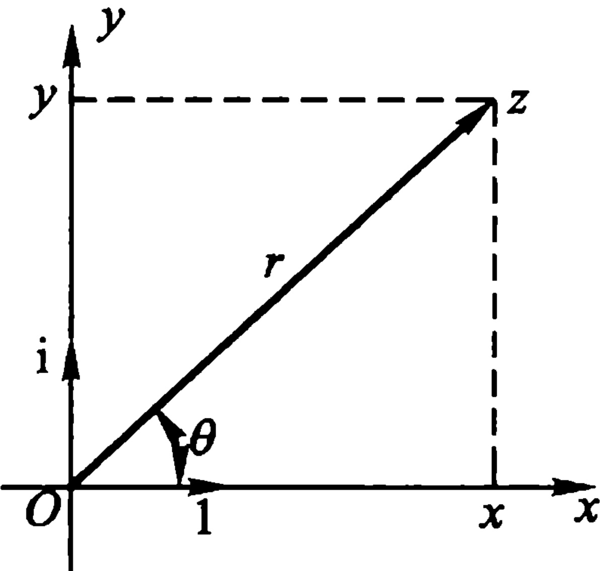

图1.1
 

<!-- page: 22 -->

“点”、“数集”和“点集”，说到“点”可以指它所代表的“数”，说到“数”也可以指这个数代表的“点”。例如，我们常说“点 $ 1+i $”，“顶点为 $ z_{1} $， $ z_{2} $， $ z_{3} $的三角形”等等。

在复平面上，从原点到点  $ z = x + iy $ 所引的向量与这个复数 z 也构成一一对应关系（复数 0 对应着零向量），这种对应关系使复数的加（减）法与向量的加（减）法之间保持一致。

例如，设  $ z_{1}=x_{1}+\mathrm{i}y_{1}, z_{2}=x_{2}+\mathrm{i}y_{2} $，则

 $$ \boldsymbol{z}_{1}+\boldsymbol{z}_{2}=\left(x_{1}+x_{2}\right)+\mathrm{i}\left(y_{1}+y_{2}\right). $$ 

由图 1.2 可以看出， $ z_{1} + z_{2} $ 所对应的向量，就是  $ z_{1} $ 所对应的向量与  $ z_{2} $ 所对应的向量的和向量.

又如，将  $ z_{1}-z_{2} $ 表成  $ z_{1}+(-z_{2}) $，可以看出， $ z_{1}-z_{2} $ 所对应的向量就是  $ z_{1} $ 所对应的向量与  $ (-z_{2}) $ 所对应的向量的和向量，也就是从  $ z_{2} $ 到  $ z_{1} $ 的向量（图 1.3）.

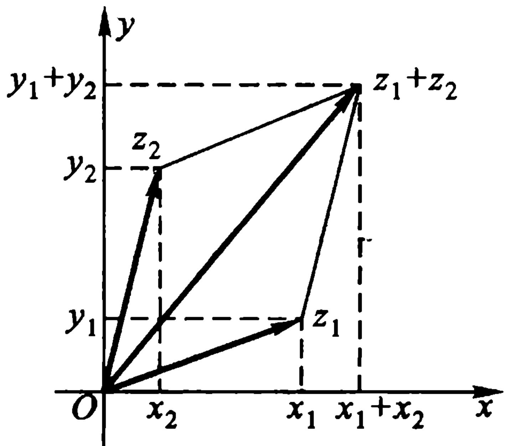

图1.2
 

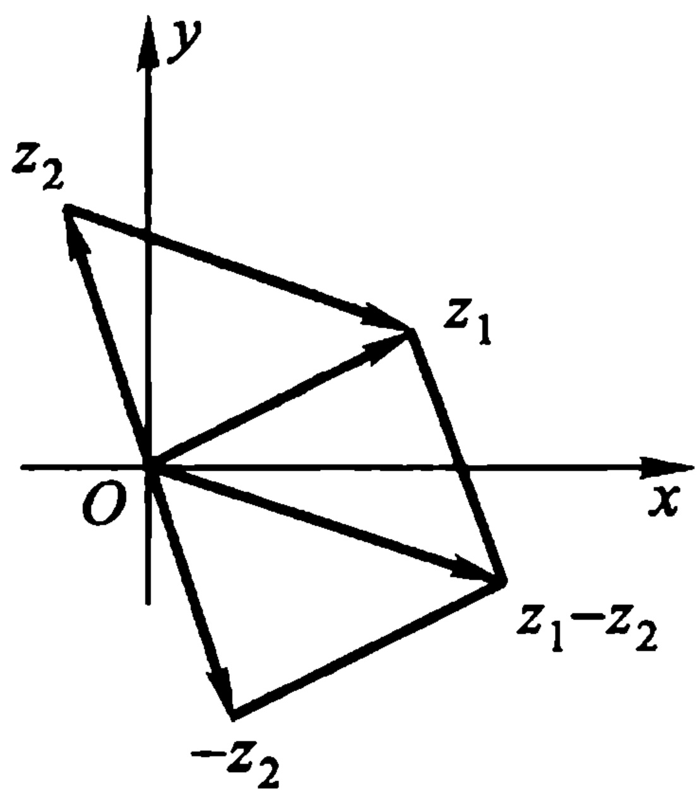

图 1.3
 

例 1.1 考虑一条江面上的水在某时刻的流动. 假定在江面上取好一坐标系 xOy, 我们把江面上任意一点 P 的速度 v 的两个分量记为  $ v_{x} $ 与  $ v_{y} $, 则我们可以把速度向量 v 写成复数 (图 1.4)

 $$ v^{i}=v_{x}+\mathrm{i}v_{y}. $$ 

人们经过长期的摸索与研究发现,对于很多的平面问题(如流体力学与弹性力学中的平面问题等)来说,用复数及复变函数作工

<!-- page: 23 -->

具是十分有效的,这正是由于复数可以表示平面向量的缘故.

3. 复数的模与辐角 表示复数 z 的位置，也可以借助于点 z 的极坐标 r 和  $ \theta $ 来确定（图 1.1）. 这里使原点与直角坐标系的原点重合，极轴与正实轴重合.

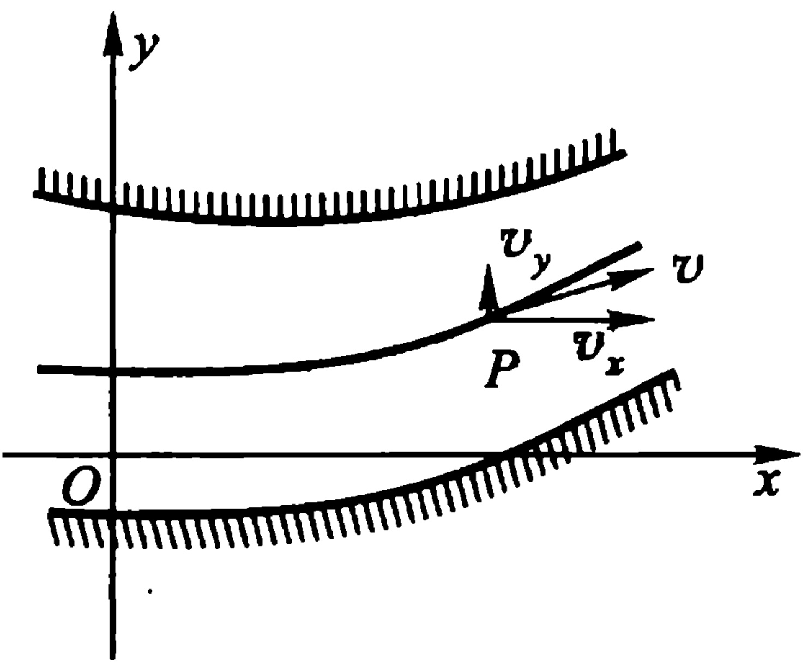

上面我们用向量 $ \overrightarrow{Oz} $来表示复数 $ z=x+iy $，其中x,y顺次等于 $ \overrightarrow{Oz} $沿x

图1.4
 

轴与 y 轴的分量. 向量  $ \overrightarrow{Oz} $ 的长度称为复数 z 的模或绝对值, 以符号  $ \left|z\right| $ 或 r 表示, 因而有

 $$ r=\mid z\mid=\sqrt{x^{2}+y^{2}}\geqslant0, $$ 

且 $ \left|z\right|=0 $的充要条件是z=0.

这里引进的模的概念与对于实数的绝对值的概念是一致的。由于复数 z 的模  $ |z| $ 是非负实数，所以能够比较大小。同样，复数的实、虚部也能够比较大小。

根据图 1.1, 我们有不等式

 $$ \begin{array}{l}\mid x\mid\leqslant\mid z\mid,\mid y\mid\leqslant\mid z\mid,\mid z\mid\leqslant\mid x\mid+\mid y\mid,\\ -\mid z\mid\leqslant\mathrm{Re}z\leqslant\mid z\mid,-\mid z\mid\leqslant\mathrm{Im}z\leqslant\mid z\mid.\end{array} $$ 

及

根据图 1.2, 我们有不等式

$$  \begin{aligned}&\left|z_{1}+z_{2}\right|\leqslant\left|z_{1}\right|+\left|z_{2}\right|,\\&( 三角形两边之和大于第三边 )\end{aligned}   \tag*{(1.2)}$$

它称为三角不等式.

此外，根据图 1.3，我们还有不等式

$$  \mid\mid z_{1}\mid-\mid z_{2}\mid\mid\leqslant\mid z_{1}-z_{2}\mid.   \tag*{(1.3)}$$

（三角形两边之差小于第三边）

(1.2)及(1.3)中等号成立的几何意义是:复数  $ z_{1} $、 $ z_{2} $ 所表示的两个向量共线且同向.即

<!-- page: 24 -->

$$ z_{1}\ne0,z_{2}\ne0\  时 \ ,z_{1}=kz_{2}\left(k>0\right). $$ 

用数学归纳法可得推广了的三角不等式

$$  \mid\boldsymbol{z}_{1}+\boldsymbol{z}_{2}+\cdots+\boldsymbol{z}_{n}\mid\leqslant\mid\boldsymbol{z}_{1}\mid+\mid\boldsymbol{z}_{2}\mid+\cdots\div\mid\boldsymbol{z}_{n}\mid.   \tag*{(1.2)  ^{\prime} }$$

由图 1.3 可见， $ \left|z_{1}-z_{2}\right| $ 表示点  $ z_{1} $ 与点  $ z_{2} $ 的距离，记为

 $$ d\left(z_{1},z_{2}\right)=\left|z_{1}-z_{2}\right|. $$ 

两复数差的模的这个几何意义是非常重要的. 它还可以借助解析

几何中两点间的距离公式用解析方法得出：

 $$ \begin{aligned}\left|z_{1}-z_{2}\right|&=\left|\left(x_{1}+\mathrm{i}y_{1}\right)-\left(x_{2}+\mathrm{i}y_{2}\right)\right|\\&=\sqrt{\left(x_{1}-x_{2}\right)^{2}+\left(y_{1}-y_{2}\right)^{2}}.\end{aligned} $$ 

实轴正向到非零复数  $ z = x + iy $ 所对应的向量  $ \overrightarrow{Oz} $ 间的夹角  $ \theta $ 介于

 $$ \tan\theta=\frac{y}{x}, $$ 

称为复数 z 的辐角 (Argument)，记为

 $$ \theta=\mathrm{A r g}z. $$ 

我们知道，任一非零复数 z 有无穷多个辐角，今以  $ \underbrace{\arg z} $ 表示其中的一个特定值，并称合条件

$$  -\pi<\arg z\leq\pi   \tag*{(1.4)}$$

的一个为  $ \operatorname{Arg} z $ 的主值，或称之为 z 的主辐角. 于是

$$  \begin{aligned}\theta&=\operatorname{Arg}z=\arg z+2k\pi.\\&\left(k=0,\pm1,\pm2,\cdots\right)\end{aligned}   \tag*{(1.5)}$$

注意 当 z=0 时，辐角无意义.

当  $ \arg z (z \neq 0) $ 表  $ z $ 的主辐角时，它与反正切  $ \operatorname{Arctan} \frac{y}{x} $ 的主值  $ \arctan \frac{y}{x} $ 有如下关系（图 1.5, 1.6）（注意  $ -\pi < \arg z \leq \pi, -\frac{\pi}{2} < \arctan \frac{y}{x} < \frac{\pi}{2} $）：

<!-- page: 25 -->

$$ \begin{aligned}&\arg z=\left\{\begin{aligned}\\ &\arctan\frac{y}{x},& 当 x>0,y\leqslant0;\\&\frac{\pi}{2},& 当 x=0,y>0;\\&\arctan\frac{y}{x}+\pi, 当 x<0,y\geqslant0;\\&(z\neq0)\\&\arctan\frac{y}{x}-\pi, 当 x<0,y<0;\\&-\frac{\pi}{2},& 当 x=0,y<0.\\ &\end{aligned}\right.\\ \end{aligned} $$ 

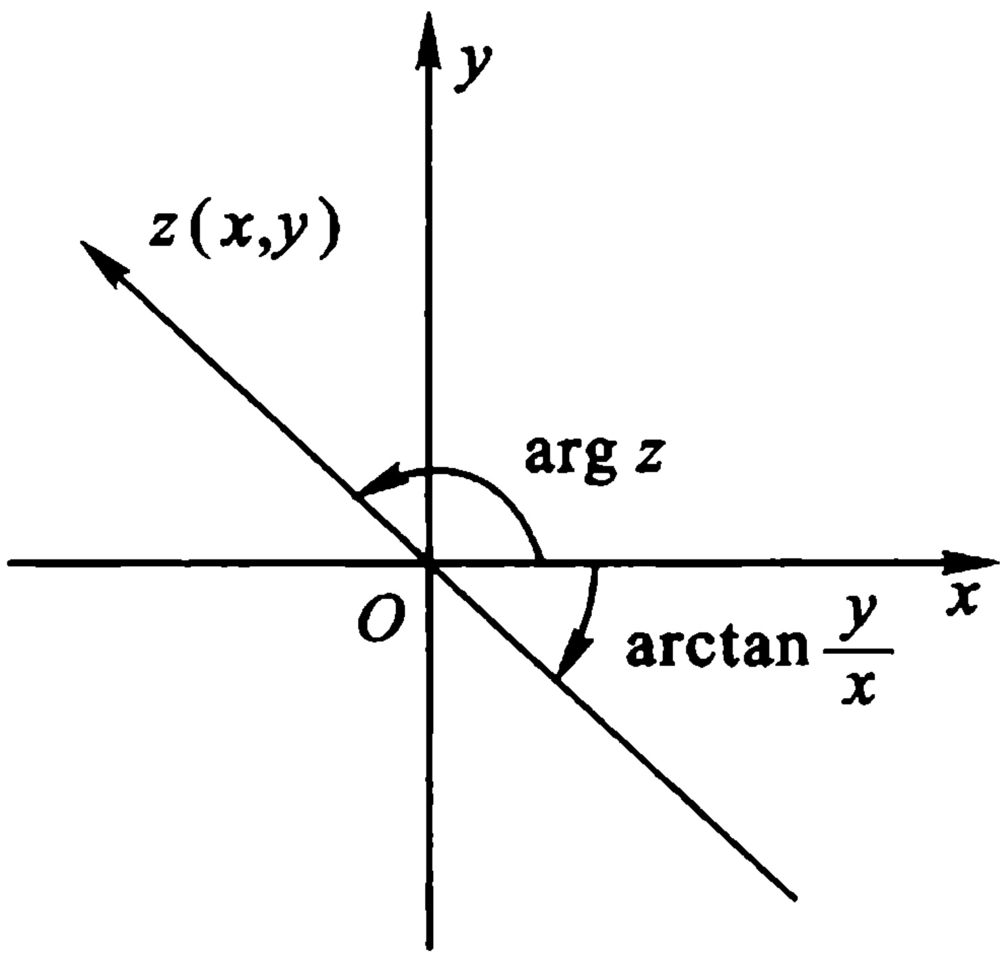

图 1.5
 

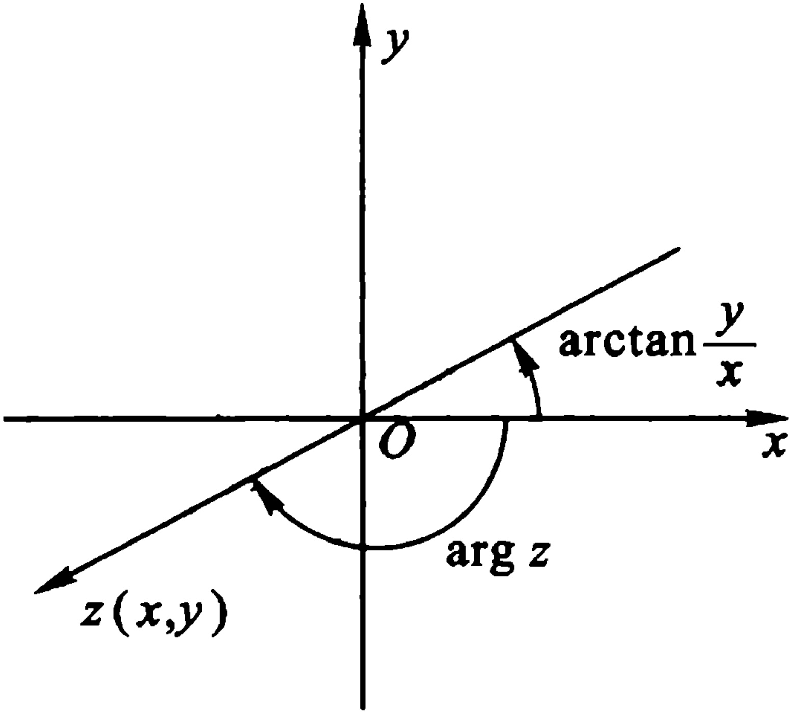

图1.6
 

例 1.2 求  $ \operatorname{Arg}(2-2i) $ 及  $ \operatorname{Arg}(-3+4i) $.

 $$ \begin{array}{l}\operatorname{Arg}(2-2i)=\arg(2-2i)+2k\pi\\=\arctan\frac{-2}{2}+2k\pi\\=-\frac{\pi}{4}+2k\pi.\end{array} $$ 

 $$ (k=0,\pm1,\pm2,\cdots) $$ 

 $$ \begin{array}{r l r}{\mathrm{A r g}(-3+4\mathrm{i})}&{=\mathrm{a r g}(-3+4\mathrm{i})+2k\pi}\\ &{}&\\ &{,}&{=\arctan{\frac{4}{-3}}+\pi+2k\pi}\end{array} $$

<!-- page: 26 -->

$$ \begin{aligned}&=(2k+1)\pi-\arctan\frac{4}{3}.\\&(k=0,\pm1,\pm2,\cdots)\end{aligned} $$ 

例 1.3 已知流体在某点 M 的速度  $ v = -1 - i $，求其大小和方向.

解 大小： $ |v| = \sqrt{2} $;

 $$  方向 :\arg v=\arctan\frac{-1}{-1}-\pi=-\frac{3\pi}{4}. $$ 

从直角坐标与极坐标的关系,我们可以用复数的模与辐角来表示非零复数z,即(由图1.1)

$$  z=r\left(\cos\theta+\mathrm{i}\sin\theta\right).   \tag*{(1.6)}$$

特别，当 r=1 时有

 $$ z=\cos\theta+\mathrm{~i~}\sin\theta, $$ 

这种复数称为单位复数.

我们引出熟知的欧拉公式：

$$  \mathrm{e}^{\mathrm{i}\theta}=\cos\theta+\mathrm{i}\sin\theta,   \tag*{(1.7)}$$

并且容易验证

$$  \left.\begin{array}{l}{\mathrm{e}^{\mathrm{i}\theta_{1}}\mathrm{e}^{\mathrm{i}\theta_{2}}=\mathrm{e}^{\mathrm{i}\left(\theta_{1}+\theta_{2}\right)}\mathrm{~,~}}\\ {\frac{\mathrm{e}^{\mathrm{i}\theta_{1}}}{\mathrm{e}^{\mathrm{i}\theta_{2}}}=\mathrm{e}^{\mathrm{i}\left(\theta_{1}-\theta_{2}\right)}\mathrm{~.~}}\end{array}\right\}   \tag*{(1.8)}$$

利用公式(1.7)，就可以把(1.6)改写成

$$  z=r\mathrm{e}^{\mathrm{i}\theta}.   \tag*{(1.9)}$$

也就是说，任一非零复数 z 总可以表成

$$  z=\mid z\mid\mathrm{e}^{\mathrm{i a r g}z},   \tag*{(1.9)'}$$

这里的  $ \arg z $ 不必取主值.

我们分别称(1.6)及(1.9)(或(1.9) $ ^{1} $)式为非零复数 z 的三角形式和指数形式，并称  $ z = x + iy $ 为复数 z 的代数形式。复数的这三种表示法，可以互相转换，以适应讨论不同问题时的需要，且使用起来各有其便。

<!-- page: 27 -->

例 1.4

 $$ \begin{array}{c}1+\mathrm{i}=\sqrt{2}\left(\cos\frac{\pi}{4}+\mathrm{i}\sin\frac{\pi}{4}\right)=\sqrt{2}\mathrm{e}^{\frac{\pi}{4}\mathrm{i}};\\\mathrm{i}=1\cdot\left(\cos\frac{\pi}{2}+\mathrm{i}\sin\frac{\pi}{2}\right)=\mathrm{e}^{\frac{\pi}{2}\mathrm{i}};\\1=1\cdot(\cos0+\mathrm{i}\sin0)=\mathrm{e}^{0\cdot\mathrm{i}};\\-2=2(\cos\pi+\mathrm{i}\sin\pi)=2\mathrm{e}^{\pi\mathrm{i}};\\-3\mathrm{i}=3\left[\cos\left(-\frac{\pi}{2}\right)+\mathrm{i}\sin\left(-\frac{\pi}{2}\right)\right]=3\mathrm{e}^{-\frac{\pi}{2}\mathrm{i}}.\end{array} $$ 

还有  $ e^{-\frac{\pi}{2}i} = -i, e^{\pi i} = -1, e^{2k\pi i} = 1 $ (k 为整数).

例 1.5 将复数

 $$ 1-\cos\varphi+\mathrm{i}\sin\varphi\quad(0<\varphi\leqslant\pi) $$ 

化为指数形式.

 $$ \begin{aligned} 解 \quad 原式 &=2\sin^{2}\frac{\varphi}{2}+2i\sin\frac{\varphi}{2}\cos\frac{\varphi}{2}\\&=2\sin\frac{\varphi}{2}\left[\sin\frac{\varphi}{2}+i\cos\frac{\varphi}{2}\right]\\&=2\sin\frac{\varphi}{2}\left[\cos\left(\frac{\pi}{2}-\frac{\varphi}{2}\right)+i\sin\left(\frac{\pi}{2}-\frac{\varphi}{2}\right)\right]\\&=2\sin\frac{\varphi}{2}e^{\left(\frac{\pi}{2}-\frac{\varphi}{2}\right)i}.\end{aligned} $$ 

当  $ z = x + iy \neq 0 $，记  $ \arg z = \theta $（主值），则

 $$ \tan\frac{\theta}{2}=\frac{\sin\theta}{1+\cos\theta}=\frac{r\sin\theta}{r+r\cos\theta}=\frac{y}{x+\sqrt{x^{2}+y^{2}}}, $$ 

所以  $ \arg z = \theta $ (主值) =  $ 2\arctan \frac{y}{x + \sqrt{x^{2} + y^{2}}} $.

对于  $ z_{1}=r_{1}e^{\mathrm{i}\theta_{1}} $， $ z_{2}=r_{2}e^{\mathrm{i}\theta_{2}} $，则

 $ z_{1}=z_{2}\Leftrightarrow r_{1}=r_{2},\theta_{1}=\theta_{2} $（或  $ \theta_{1}=\theta_{2}+2k\pi,k $ 为整数）.

利用复数的指数形式作乘除法较简单. 因由(1.8)可立得

<!-- page: 28 -->

$$  \left.\begin{array}{l}{\mathcal{Z}_{1}\mathcal{Z}_{2}=r_{1}\mathrm{e}^{\mathrm{i}\theta_{1}}\;r_{2}\mathrm{e}^{\mathrm{i}\theta_{2}}=r_{1}r_{2}\mathrm{e}^{\mathrm{i}\left(\theta_{1}+\theta_{2}\right)}\;,}\\ {\displaystyle\frac{\mathcal{Z}_{1}}{\mathcal{Z}_{2}}=\frac{r_{1}\mathrm{e}^{\mathrm{i}\theta_{1}}}{r_{2}\mathrm{e}^{\mathrm{i}\theta_{2}}}=\frac{r_{1}}{r_{2}}\mathrm{e}^{\mathrm{i}\left(\theta_{1}-\theta_{2}\right)}\;,}\end{array}\right\}   \tag*{(1.10)}$$

所以

$$  \begin{align*}\left|z_{1}z_{2}\right|&=\left|z_{1}\right|\left|z_{2}\right|,\left|\frac{z_{1}}{z_{2}}\right|=\frac{\left|z_{1}\right|}{\left|z_{2}\right|}\left(z_{2}\neq0\right),\\\mathrm{Arg}\left(z_{1}z_{2}\right)&=\mathrm{Arg}z_{1}+\mathrm{Arg}z_{2},\\\mathrm{Arg}\frac{z_{1}}{z_{2}}&=\mathrm{Arg}z_{1}-\mathrm{Arg}z_{2}.\end{align*}   \tag*{(1.11)}$$

公式(1.10)的第一式说明， $ z_{1}z_{2} $所对应的向量是把 $ z_{1} $所对应

的向量伸缩  $ r_{2} = |z_{2}| $ 倍，然后再旋转一个角度  $ \theta_{2} = \arg z_{2} $ 得到的（图1.7）.

特别是，当  $ |z_{2}| = 1 $ 时，只需旋转一个角度  $ \theta_{2} = \arg z_{2} $ 就行了。这就是说，以单位复数乘任何数，几何上相当于将此数所对应的向量旋转一个角度。

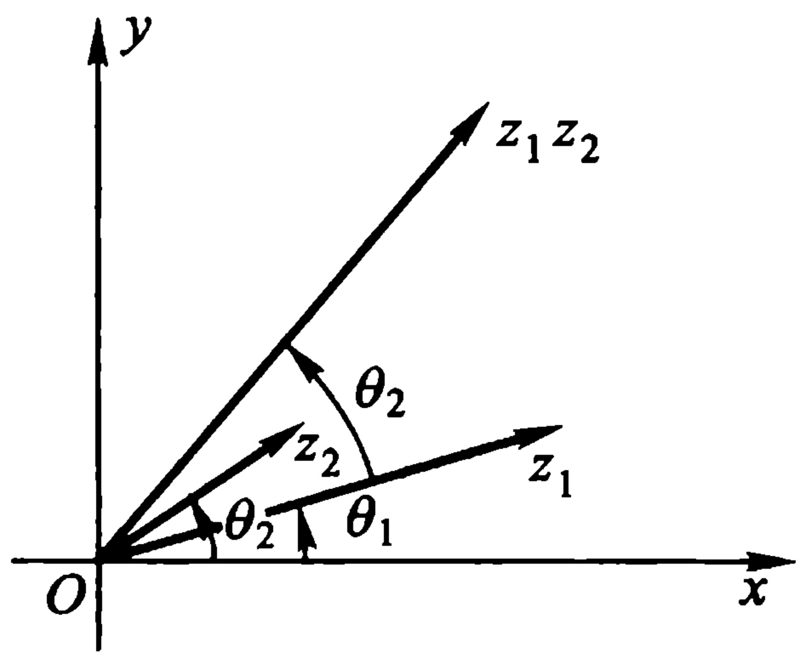

图1.7
 

特别，iz 相当于将 z 所对应的向量  $ \overrightarrow{Oz} $ 沿反时针方向旋转  $ \frac{\pi}{2} $. 这里 i 称为旋转乘数, 另外.

 $$ \arg\left(\alpha z\right)=\arg z\quad\left(\alpha>0\right). $$ 

注1 在复平面上，一直线绕其上一定点旋转，可有两种旋转方向，一种是“反时针”的，一种是“顺时针”的。按惯例，我们规定反时针方向旋转的角度为正，顺时针方向旋转的角度为负。

注2 当把复数作为向量看待时,复数的乘法既不同于向量的点积(或纯量积),也不同于向量的叉积(或向量积).

上面关于辐角的两个等式(1.12)，两边各是无穷多个数(角度)的数集.例如，设(1.12)第一个等式右边

 $$ \mathrm{A r g}z_{1}=\left\{\frac{\pi}{6}+2n\pi\right\}_{n=0,\pm1,\cdots}, $$

<!-- page: 29 -->

$$ \mathrm{A r g}z_{2}=\left\{\frac{\pi}{4}+2m\pi\right\}_{m=0,\pm1,\cdots}, $$ 

则左边

 $$ \mathrm{A r g}z_{1}z_{2}=\left\{\frac{5\pi}{12}+2k\pi\right\}_{k=0,\pm1,\cdots}, $$ 

(1.12)的第一个等式意味着,在等式左边取出一个数值(相当于取定一个k值),等式右边也可以相应地分别找出m与n的值,使得右边的和数等于左边之值;反过来,也对.

注意 公式(1.12)的  $ \operatorname{Arg} z $ 可以换成  $ \arg z $，但  $ \arg z $ 应理解为辐角的某个特定值，不必是主值；若均理解为主值，则两端允许相差  $ 2\pi $ 的整倍数。即有

$$  \left.\begin{array}{l}{\arg z_{1}z_{2}=\arg z_{1}+\arg z_{2}+2k_{1}\pi,}\\ {\quad}\\ {\arg\frac{z_{1}}{z_{2}}=\cdot\arg z_{1}-\arg z_{2}+2k_{2}\pi,}\end{array}\right\}   \tag*{(1.12)  ^{\prime} }$$

其中  $ k_{1} $、 $ k_{2} $ 各表示某个适当整数， $ \arg z $ 表示主值.

例 1.6 对于复数  $ \alpha $、 $ \beta $，若  $ \alpha\beta=0 $，则  $ \alpha $、 $ \beta $ 至少有一为零。试证之。

证 若  $ \alpha\beta=0 $，则必  $ \left|\alpha\beta\right|=0 $，因而

 $$ \mid\alpha\mid\mid\beta\mid=0. $$ 

由实数域中的对应结果知  $ |\alpha| $、 $ |\beta| $ 至少有一为零。所以  $ \alpha $、 $ \beta $ 至少有一为零。

4. 复数的乘幂与方根 作为乘积的特例, 我们考虑非零复数 z 的正整数次幂  $ z^{n} $, 它是 n 个相同因子的乘积. 设  $ z = re^{i\theta} $, 则

 $$ z^{n}=r^{n}\mathrm{e}^{\mathrm{i}n\theta}=r^{n}\left(\cos n\theta+\mathrm{i}\sin n\theta\right), $$ 

从而有

 $$ |\mathrm{~z~}^{n}|=|\mathrm{~z~}|^{n}, $$ 

 $$ \operatorname{A r g}z^{n}=n\operatorname{A r g}z. $$ 

当 r=1 时，则得棣莫弗(De Moivre)公式

 $$ \left(\cos\theta+\mathrm{i}\sin\theta\right)^{n}=\cos n\theta+\mathrm{i}\sin n\theta. $$ 

求非零复数 z 的 n 次方根，相当于解二项方程

<!-- page: 30 -->

$$  w^{n}=z\quad(n\geqslant2, 整数 ).   \tag*{(1.13)}$$

今记其根的总体为 $ \sqrt[n]{z} $，下面我们来求它们.

设  $ z = re^{\mathrm{i}\theta} $,  $ w = \rho e^{\mathrm{i}\varphi} $，则(1.13)变形为

 $$ \rho^{n}\mathrm{e}^{\mathrm{i}n\varphi}=r\mathrm{e}^{\mathrm{i}\theta}\mathrm{,} $$ 

从而得两个方程

 $$ \rho^{n}=r,n\varphi=\theta+2k\pi, $$ 

解出得

 $$ \rho=\sqrt[n]{r}\left( 取算术根 \right),\varphi=\frac{\theta+2k\pi}{n}, $$ 

从而有

 $$ \left|\sqrt[n]{z}\right|=\sqrt[n]{|z|}, $$ 

 $$ \mathrm{A r g}\sqrt[n]{z}=\frac{\mathrm{A r g}z}{n}. $$ 

因此 z 的  $ n $ 次方根为

$$  \begin{align*}\mathcal{W}_{k}&=\left(\sqrt[n]{z}\right)_{k}=\sqrt[n]{r}\mathrm{e}^{\mathrm{i}\frac{\theta+2k\pi}{n}}\\&=\mathrm{e}^{\mathrm{i}\frac{2k\pi}{n}}\cdot\sqrt[n]{r}\mathrm{e}^{\mathrm{i}\frac{\theta}{n}}.\end{align*}   \tag*{(1.14)}$$

这里 k 表面上可以取  $ 0, \pm 1, \pm 2\cdots $，但实际上只要取  $ k=0,1,\cdots $，n-1 就可得出 (1.13) 的总共 n 个不同的根。所以记号  $ \sqrt[n]{z} $ 与记号  $ \left(\sqrt[n]{z}\right)_{k}(k=0,1,2,\cdots,n-1) $ 是一致的。

现在.我们将(1.14)表为

 $$ \begin{array}{r}{\varpi_{k}=\left(\sqrt[n]{\mathcal{z}}\right)_{k}=\mathrm{e}^{\mathrm{i}\frac{2k\pi}{n}}\cdot\varpi_{0},}\end{array} $$ 

其中  $ \omega_{0}=\sqrt[n]{r}\mathrm{e}^{\mathrm{i}\frac{\theta}{n}} $ 。为了在复数平面上表示  $ \sqrt[n]{z} $ 的不同值  $ \omega_{k} $，可由  $ \omega_{0} $ 依次绕原点旋转

 $$ \frac{2\pi}{n},2\cdot\frac{2\pi}{n},3\cdot\frac{2\pi}{n},\cdots, $$ 

但当 k 取到 n 时，又与  $ w_{0} $ 重合了。故非零复数 z 的 n 次方根共有 n 个，它们沿中心在原点、半径为  $ \sqrt[n]{r} $（取算术根）的圆周均匀地分布着，即它们是内接于该圆周的正 n 边形的 n 个顶点（图 1.8 是 n

<!-- page: 31 -->

=6 的情形).

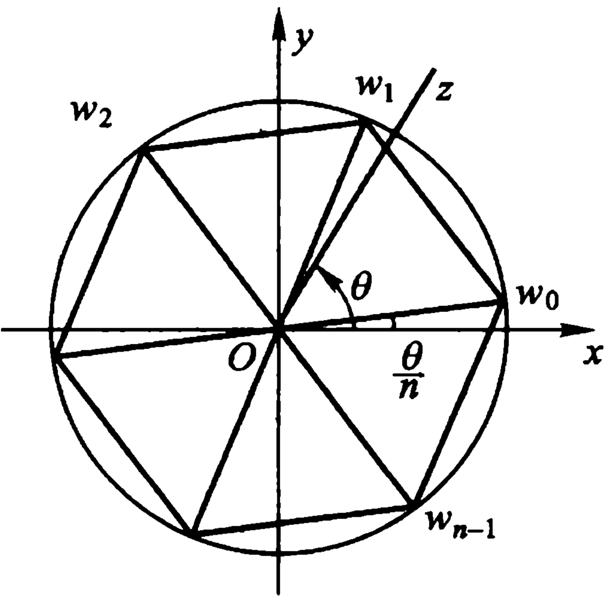

图1.8
 

(1.14)中  $ \mathrm{e}^{\mathrm{i}\frac{2k\pi}{n}}(k=0,1,2,\cdots,n-1) $ 为 1 的 n 个  $ n $ 次方根，通常记为  $ 1,\omega,\omega^{2},\cdots,\omega^{n-1} $ ( $ \omega=\mathrm{e}^{\mathrm{i}\frac{2\pi}{n}} $). 从而  $ z\neq0 $ 的 n 个 n 次方根为：

 $$ \begin{array}{r}{\mathcal{w}_{0},\omega\mathcal{w}_{0},\omega^{2}\mathcal{w}_{0},\cdots,\omega^{n-1}\mathcal{w}_{0}.}\end{array} $$ 

还有  $ 1 + \omega + \omega^{2} + \cdots + \omega^{n-1} = 0, \omega^{n} = 1 $.

因为  $ \omega $ 为二项方程  $ w^{n}=1 $ 之根，即

 $$ \omega^{n}=1\Longleftrightarrow(1-\omega)\left(1+\omega+\omega^{2}+\cdots+\omega^{n-1}\right)=0. $$ 

特别，当 n=3 时， $ \omega=e^{\frac{2\pi}{3}\mathrm{i}}=-\frac{1}{2}+\frac{\sqrt{3}}{2}\mathrm{i} $

且有  $ \omega^{3}=1,1+\omega+\omega^{2}=0 $.

例 1.7 求  $ \cos 3\theta $ 及  $ \sin 3\theta $ 用  $ \cos \theta $ 与  $ \sin \theta $ 表示的式子.

解 由棣莫弗公式

 $$ \begin{aligned}\cos3\theta+\mathrm{i}\sin3\theta&=(\cos\theta+\mathrm{i}\sin\theta)^{3}\\&=\cos^{3}\theta+3\mathrm{i}\cos^{2}\theta\cdot\sin\theta-3\cos\theta\cdot\sin^{2}\theta-\mathrm{i}\sin^{3}\theta,\end{aligned} $$ 

因此  $ \cos 3\theta = \cos^{3}\theta - 3\cos\theta \cdot \sin^{2}\theta = 4\cos^{3}\theta - 3\cos\theta $,

及  $ \sin 3\theta = 3\cos^{2}\theta\sin\theta - \sin^{3}\theta = 3\sin\theta - 4\sin^{3}\theta $

例 1.8 计算  $ \sqrt[3]{-8} $.

<!-- page: 32 -->

解 因 -8 = 8 ( $ \cos \pi + i \sin \pi $), 故

 $$ \begin{aligned}\left(\sqrt[3]{-8}\right)_{k}=&\sqrt[3]{8}\left(\cos\frac{\pi+2k\pi}{3}+\mathrm{i}\sin\frac{\pi+2k\pi}{3}\right).\\&\left(k=0,1,2\right)\end{aligned} $$ 

当 k=0 时， $ \left(\sqrt[3]{-8}\right)_{0}=\sqrt[3]{8}\left(\cos\frac{\pi}{3}+i\sin\frac{\pi}{3}\right) $

 $ =2\left(\frac{1}{2}+\frac{\sqrt{3}}{2}i\right)=1+\sqrt{3}i; $

当 k=1 时， $ \left(\sqrt[3]{-8}\right)_{1}=2\left(\cos\pi+\mathrm{i}\sin\pi\right)=-2 $;

 $$ \begin{aligned}\left(\sqrt[3]{-8}\right)_{2}&=2\left(\cos\frac{5\pi}{3}+\mathrm{i}\sin\frac{5\pi}{3}\right)\\&=2\left(\cos\frac{\pi}{3}-\mathrm{i}\sin\frac{\pi}{3}\right)\\&=1-\sqrt{3}\mathrm{i}.\end{aligned} $$ 

注 在实数域内，规定 -8 的三次方根为 -2，即规定  $ \sqrt[3]{-8} = -\sqrt[3]{8} = -2 $。这时  $ \sqrt[3]{-8} $ 就只取上述三值之一的实值  $ \left(\sqrt[3]{-8}\right)_{1} $。

5. 共轭复数 设  $ z = x + iy $，则 z 的共轭复数为  $ \overline{z} = x - \langle  $ 显然

$$  \mid\overline{z}\mid=\mid z\mid,\operatorname{Arg}\overline{z}=-\operatorname{Arg}z.   \tag*{(1.15)}$$

这表明在复平面上,z 与  $ \overline{z} $ 两点对于实轴是对称点.

我们也容易验证下列公式：

(1)  $ \overline{(\overline{z})}=z $,  $ \overline{z_{1}\pm z_{2}}=\overline{z_{1}\pm z_{2}} $.

(2)

 $$ \overline{{z_{1}z_{2}}}=\overline{{z_{1}}}\overline{{z_{2}}},\overline{{\left(\frac{z_{1}}{z_{2}}\right)}}=\frac{\overline{{z_{1}}}}{\overline{{z_{2}}}}\quad\left(z_{2}\neq0\right). $$ 

(3)  $ \left|z\right|^{2}=zz $, Re  $ z=\frac{z+z}{2} $, Im  $ z=\frac{z-z}{2i} $.

（4）设  $ R(a, b, c, \cdots) $ 表示对于复数 a, b, c, c,  $ \cdots $ 的任一有理运算；则

 $$ \overline{R(a,b,c,\cdots)}=R(\overline{a},\overline{b},\overline{c},\cdots). $$

<!-- page: 33 -->

熟练、灵活地运用这些简单公式，对化简计算、解答问题都会带来方便.

例 1.9 求复数

 $$ w=\frac{1+z}{1-z}\quad( 复数 z\neq1) $$ 

的实部、虚部和模.

解 （1）因为

 $$ \begin{aligned}w&=\frac{1+z}{1-z}=\frac{(1+z)(1-\overline{z})}{(1-z)\overline{(1-z)}}=\frac{1-z\overline{z}+z-\overline{z}}{|1-z|^2}\\&=\frac{1-|z|^2+2i\mathrm{Im}z}{|1-z|^2},\end{aligned} $$ 

所以

 $$ \mathrm{R e}~\omega=\frac{1-|z|^{2}}{|1-z|^{2}},\qquad\mathrm{I m}~\omega=\frac{2\mathrm{I m}~z}{|1-z|^{2}}. $$ 

（2）因为

 $$ \begin{aligned}|\boldsymbol{w}|^{2}&=\boldsymbol{w}\overline{\boldsymbol{w}}=\frac{1+z}{1-z}\cdot\frac{1+\overline{z}}{1-z}=\frac{1+z\overline{z}+z+\overline{z}}{|1-z|^{2}}\\&=\frac{1+|z|^{2}+2\mathrm{Re}z}{|1-z|^{2}},\end{aligned} $$ 

所以

 $$ \mid\mathrm{~w~}\mid=\frac{\sqrt{1+\mid z\mid^{2}+2\mathrm{R e}z}}{1-z}. $$ 

例 1.10 设  $ z_{1} $ 及  $ z_{2} $ 是两个复数，试证

 $$ \mid z_{1}+z_{2}\mid^{2}=\mid z_{1}\mid^{2}+\mid z_{2}\mid^{2}+2\mathrm{R e}\left(z_{1}\overline{z_{2}}\right), $$ 

并应用此等式证明三角不等式(1.2).

证

 $$ \begin{align*}\left|z_{1}+z_{2}\right|^{2}&=\left(z_{1}+z_{2}\right)\overline{\left(z_{1}+z_{2}\right)}\\&=\left(z_{1}+z_{2}\right)\overline{\left(z_{1}+\overline{z_{2}}\right)}\\&=\overline{z_{1}z_{1}}+z_{2}\overline{z_{2}}+z_{1}\overline{z_{2}}+\overline{z_{1}z_{2}}\\&=\left|z_{1}\right|^{2}+\left|z_{2}\right|^{2}+z_{1}\overline{z_{2}}+\overline{z_{1}z_{2}}\\&=\left|z_{1}\right|^{2}+\left|z_{2}\right|^{2}+2\mathrm{Re}\left(z_{1}\overline{z_{2}}\right).\end{align*} $$

<!-- page: 34 -->

其次，由所证等式以及

 $$ \mathbf{R e}\left(\boldsymbol{z}_{1}\overline{\boldsymbol{z}_{2}}\right)\leqslant\left|\boldsymbol{z}_{1}\overline{\boldsymbol{z}_{2}}\right|=\left|\boldsymbol{z}_{1}\right|\left|\boldsymbol{z}_{2}\right| $$ 

就可导出三角不等式(1.2).

例 1.11 若  $ \left|a\right|<1,\left|b\right|<1 $ ，试证

 $$ \left|\frac{a-b}{1-\overline{ab}}\right|<1. $$ 

证 两端平方，比较  $ \left|\frac{a-b}{1-ab}\right|^{2} $ 与 1 的大小，即比较  $ \left|a-b\right|^{2} $ 与  $ \left|1-\overline{ab}\right|^{2} $ 的大小. 由上例可知

 $$ |a-b|^{2}=|a|^{2}+|b|^{2}-2\mathrm{R e}(\overline{ab}), $$ 

 $$ \mid1-\overline{ab}\mid^{2}=1+\mid a\mid^{2}\mid b\mid^{2}-2\mathrm{Re}(\overline{ab}), $$ 

则

 $$ \begin{aligned}I&=|\boldsymbol{1}-\overline{\boldsymbol{a}}\boldsymbol{b}|^{2}-|\boldsymbol{a}-\boldsymbol{b}|^{2}\\&=1+|\boldsymbol{a}|^{2}|\boldsymbol{b}|^{2}-|\boldsymbol{a}|^{2}-|\boldsymbol{b}|^{2}\\&=\left(\boldsymbol{1}-\mid\boldsymbol{a}\mid^{2}\right)\left(\boldsymbol{1}-\mid\boldsymbol{b}\mid^{2}\right).\end{aligned} $$ 

由假设  $ \left|a\right|<1,\left|b\right|<1 $ ,则 I>0 ,故得证.

6. 复数在几何上的应用举例 下面我们举例说明两方面的问题:怎样用复数所适合的方程(或不等式)来刻画适合某种几何条件的平面图形;怎样从复数所适合的方程(或不等式)来确定平面图形的特征.

（1）曲线的复数方程 $ ^{①} $

例 1.12 连接  $ z_{1} $ 及  $ z_{2} $ 两点的线段的参数方程为

 $$ z=z_{1}+t\left(z_{2}-z_{1}\right)\quad\left(0\leqslant t\leqslant1\right). $$ 

过  $ z_{1} $ 及  $ z_{2} $ 两点的直线(图 1.9)的参数方程为

 $$ z=z_{1}+t\left(z_{2}-z_{1}\right)\quad\left(-\infty<t<+\infty\right). $$ 

由此可知，三点  $ z_{1} $、 $ z_{2} $、 $ z_{3} $ 共线的充要条件为

 $$ \frac{z_{3}-z_{1}}{z_{2}-z_{1}}=t\ (t\  为一非零实数 ). $$

<!-- page: 35 -->

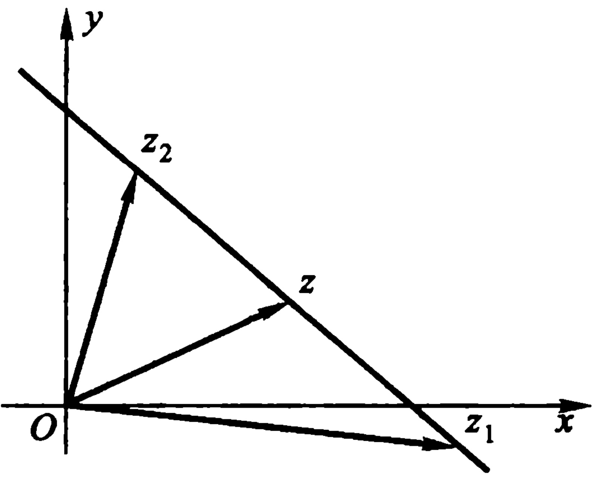

图1.9
 

 $$ \left(\Leftrightarrow\operatorname{Im}\left(\frac{\mathcal{Z}_{3}-\mathcal{Z}_{1}}{\mathcal{Z}_{2}-\mathcal{Z}_{1}}\right)=0.\right) $$ 

例 1.13 z 平面上以原点为心, R 为半径的圆周的方程为

 $$ \left|z\right|=R\quad\left( 图 1.10(a)\right). $$ 

z 平面上以  $ z_{0} \neq 0 $ 为心，R 为半径的圆周的方程为

 $$ \left|z-z_{0}\right|=R\quad\left( 图 1.10(b)\right). $$ 

z 平面上实轴的方程为  $ \text{Im } z = 0 $;

虚轴的方程为  $ \mathrm{Re} z = 0 $.

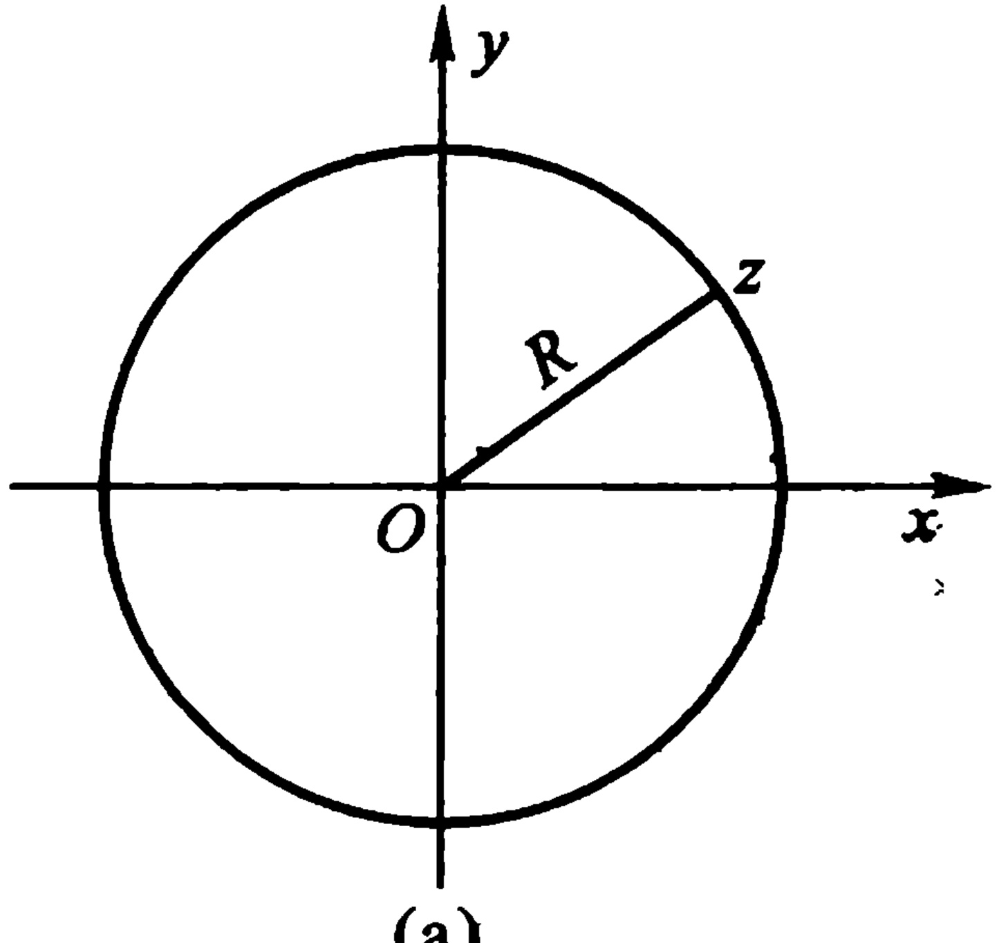

(a)
 

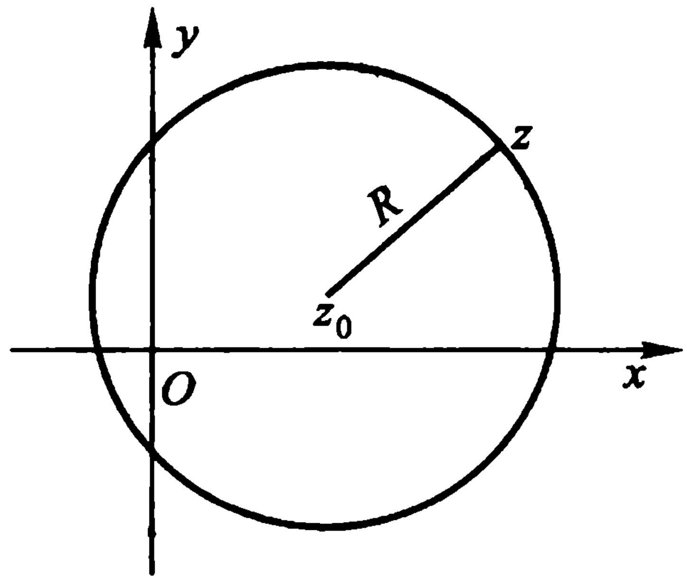

(b)
 

图 1.10
 

注 由本章习题(一)7、8、10 可见，直线和圆周等平面曲线皆可用多种形式给出其方程.

<!-- page: 36 -->

##### （2）应用复数证明几何问题

例 1.14 求证: 三个复数  $ z_{1}, z_{2}, z_{3} $ 成为一个等边三角形的三顶点的充要条件是它们适合等式

 $$ \begin{array}{r}{\boldsymbol{z}_{1}^{2}+\boldsymbol{z}_{2}^{2}+\boldsymbol{z}_{3}^{2}=\boldsymbol{z}_{2}\boldsymbol{z}_{3}+\boldsymbol{z}_{3}\boldsymbol{z}_{1}+\boldsymbol{z}_{1}\boldsymbol{z}_{2}.}\end{array} $$ 

证  $ \triangle z_{1}z_{2}z_{3} $ 是等边三角形的充要条件为: 向量  $ \overrightarrow{z_{1}z_{2}} $ 绕  $ z_{1} $ 旋转  $ \frac{\pi}{3} $ 或  $ -\frac{\pi}{3} $ 即得向量  $ \overrightarrow{z_{1}z_{3}} $，也就是

 $$ z_{3}-z_{1}=\left(z_{2}-z_{1}\right)\mathrm{e}^{\pm\frac{\pi}{3}\mathrm{i}}, $$ 

即

 $$ \frac{z_{3}-z_{1}}{z_{2}-z_{1}}=\frac{1}{2}\pm\frac{\sqrt{3}}{2}\mathrm{i}, $$ 

即

 $$ \frac{z_{3}-z_{1}}{z_{2}-z_{1}}-\frac{1}{2}=\pm\frac{\sqrt{3}}{2}\mathrm{i}, $$ 

两端平方化简，即得

 $$ \boldsymbol{z}_{1}^{2}+\boldsymbol{z}_{2}^{2}+\boldsymbol{z}_{3}^{2}=\boldsymbol{z}_{2}\boldsymbol{z}_{3}+\boldsymbol{z}_{3}\boldsymbol{z}_{1}+\boldsymbol{z}_{1}\boldsymbol{z}_{2}. $$ 

例 1.15 证明三角形的内角和等于  $ \pi $.

证 设三角形的三个顶点分别为  $ z_{1}, z_{2}, z_{3} $; 对应的三个顶角分别为  $ \alpha, \beta, \gamma $ (如图 1.11). 于是

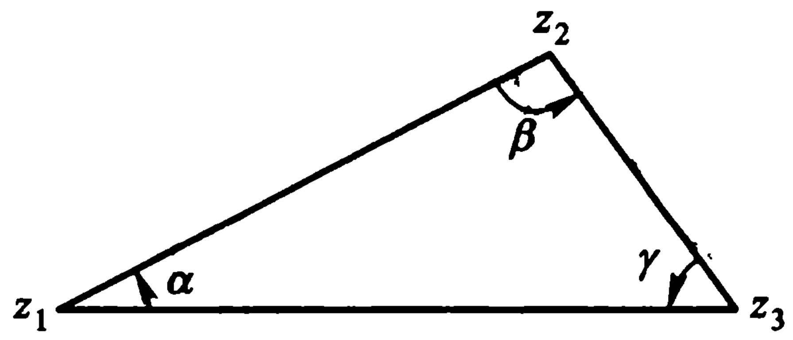

图 1.11
 

 $$ \alpha=\arg\frac{z_{2}-z_{1}}{z_{3}-z_{1}}, $$

<!-- page: 37 -->

$$ \beta=\arg\frac{\dot{z}_{3}-\dot{z}_{2}}{z_{1}-\dot{z}_{2}}, $$ 

 $$ \gamma=\arg\frac{z_{1}-z_{3}}{z_{2}-z_{3}}. $$ 

由于

 $$ \frac{z_{2}-z_{1}}{z_{3}-z_{1}}\bullet\frac{z_{3}-z_{2}}{z_{1}-z_{2}}\bullet\frac{z_{1}-z_{3}}{z_{2}-z_{3}}=-1, $$ 

根据公式 $  (1.12)^{\prime}  $,

 $$ \begin{aligned}&\arg\frac{z_{2}-z_{1}}{z_{3}-z_{1}}+\arg\frac{z_{3}-z_{2}}{z_{1}-z_{2}}+\arg\frac{z_{1}-z_{3}}{z_{2}-z_{3}}\\ &=\arg(-1)+2k\pi=\pi+2k\pi(k 为某个整数 ).\\ \end{aligned} $$ 

由假设  $ 0 < \alpha < \pi, 0 < \beta < \pi, 0 < \gamma < \pi $，所以

 $$ 0<\alpha+\beta+\gamma<3\pi, $$ 

故必 k=0 ，因而  $ \alpha + \beta + \gamma = \pi $.

#### §2. 复平面上的点集

我们在上节中提到的复平面上的线段、直线和圆周等都是复平面上的点集。今后，我们的研究对象——解析函数，其定义域和值域都是复平面上的某个点集。

### 1. 平面点集的几个基本概念

定义 1.1 由不等式  $ \left|z - z_{0}\right| < \rho $ 所确定的平面点集（以后平面点集均简称点集），就是以  $ z_{0} $ 为心，以  $ \rho $ 为半径的圆，称为点  $ z_{0} $ 的  $ \rho $ - 邻域，常记为  $ N_{\rho}(z_{0}) $；并称  $ 0 < |z - z_{0}| < \rho $ 为点  $ z_{0} $ 的去心  $ \rho $ 邻域，常记为  $ N_{\rho}(z_{0}) - \{z_{0}\} $。它们是复数列和复变函数极限论的基础。

定义 1.2 考虑点集 E. 若平面上一点  $ z_{0} $ (不必属于 E) 的任意邻域都有 E 的无穷多个点，则称  $ z_{0} $ 为 E 的聚点或极限点；若  $ z_{0} $ 属于 E，但非 E 的聚点，则称  $ z_{0} $ 为 E 的孤立点；若  $ z_{0} $ 不属于 E，又

<!-- page: 38 -->

非 E 的聚点，则称  $ z_{0} $ 为 E 的外点.

点集 E 的全部聚点所成集用  $ E' $ 表示.

定义 1.3 若点集 E 的每个聚点皆属于 E，即  $ E^{\prime} \subseteq E $，则称 E 为闭集；若点集 E 的点  $ z_{0} $ 有一邻域全含于 E 内，则称  $ z_{0} $ 为 E 的内点；若点集 E 的点皆为内点，则称 E 为开集；若在点  $ z_{0} $ 的任意邻域内，同时有属于点集 E 和不属于 E 的点，则称  $ z_{0} $ 为 E 的边界点；点集 E 的全部边界点所组成的点集称为 E 的边界。

点集 E 的边界常记成  $ \partial E $.

点集 E 的孤立点必是 E 的边界点.

定义 1.4 若有正数 M，对于点集 E 内的点 z 皆合  $ |z| \leq M $，即若 E 全含于一圆之内，则称 E 为有界集，否则称 E 为无界集。

以下五种说法是彼此等价的：

（1） $ z_{0} $ 为 E 的聚点或极限点；

(2)  $ z_{0} $ 的任一邻域含有 E 的无穷多个点 ( $ z_{0} $ 不必属于 E);

（3） $ z_{0} $的任一邻域含有异于 $ z_{0} $而属于E的一个点；

（4） $ z_{0} $ 的任一邻域含有 E 的两个点；

(5) 可从 E 取出点列  $ z_{1}, z_{2}, \cdots, z_{n} \cdots $，而以  $ z_{0} $ 为极限。即对任给  $ \varepsilon > 0 $，存在正整数 N = N ( $ \varepsilon $)，使当 n > N 时，恒有  $ \left|z_{n} - z_{0}\right| < \varepsilon $。

2. 区域与若尔当(Jordan)曲线 复变函数论的基础几何概念

之一是区域的概念.

定义 1.5 具备下列性质的非空

点集 D 称为区域:

（1）D 为开集.

（2）D 中任意两点可用全在 D 中的折线连接（图 1.12）.

定义 1.6 区域 D 加上它的边界 C 称为闭域, 记为

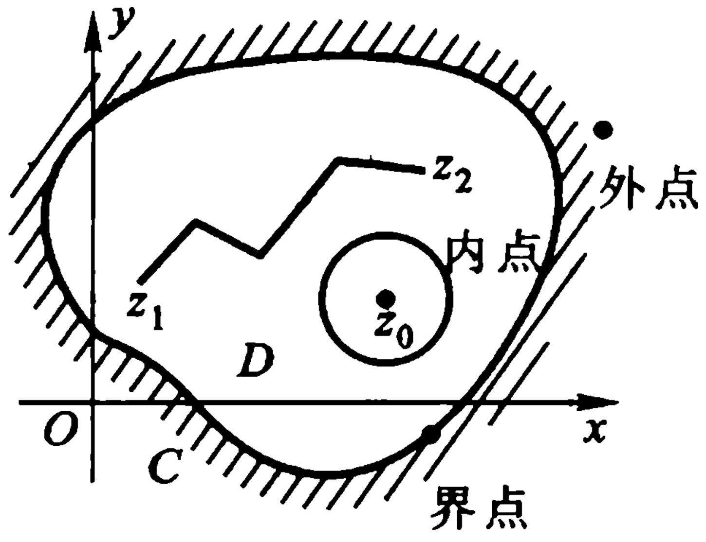

图 1.12
 

<!-- page: 39 -->

$$ \overline{D}=D+C. $$ 

注意 区域都是开的,不包含它的边界点.

例 1.16 试证: 点集 E 的边界  $ \partial E $ 是闭集. 即证

 $$ (\partial E)^{\prime}\subseteq\partial E. $$ 

 $ ^{*} $ 证 设  $ z $ 为  $ \partial E $ 的聚点。取  $ z $ 的任意  $ \varepsilon $ 邻域  $ N_{\varepsilon}(z) $，则存在  $ z_{0}(\neq z) $ 使得  $ N_{\varepsilon}(z)\ni z_{0}\in\partial E $。在  $ N_{\varepsilon}(z) $ 内能画出以  $ z_{0} $ 为心，充分小半径的圆。这时由  $ z_{0}\in\partial E $ 可见，在此圆内属于 E 的点和不属于 E 的点都存在。于是，在  $ N_{\varepsilon}(z) $ 内属于 E 的点和不属于 E 的点都存在，故  $ z\in\partial E $。因此  $ \partial E $ 是闭集。

应用关于复数 z 的不等式来表示 z 平面上的区域,有时是很方便的.

例 1.17 z 平面上以原点为心，R 为半径的圆（即圆形区域）：

 $$ \left|z\right|<R, $$ 

以及 z 平面上以原点为心，R 为半径的闭圆（即圆形闭域）：

 $$ |z|\leqslant R, $$ 

它们都以圆周  $ |z|=R $ 为边界,且都是有界的.

我们称

 $$ \left|z\right|<1\quad 为单位圆； $$ 

 $$ \left|z\right|=1\quad 为单位圆周 . $$ 

例 1.18 z 平面上以实轴  $ \mathrm{Im} z = 0 $ 为边界的两个无界区域是

 $$  上半 z 平面 \operatorname{Im}z>0, $$ 

及

 $$ \begin{aligned}& 下半 z 平面 \operatorname{Im}z<0.\end{aligned} $$ 

z 平面上以虚轴 Re z=0 为边界的两个无界区域是

 $$  左半 z 平面 \operatorname{Re}z<0, $$ 

 $$  右半 z 平面 \operatorname{Re}z>0. $$ 

例 1.19 图 1.13 所示为单位圆周的外部含在上半 z 平面的部分,表为

<!-- page: 40 -->

$$ \left\{\begin{array}{l}\left|z\right|>1,\\ \\ \operatorname{I m}z>0.\end{array}\right. $$ 

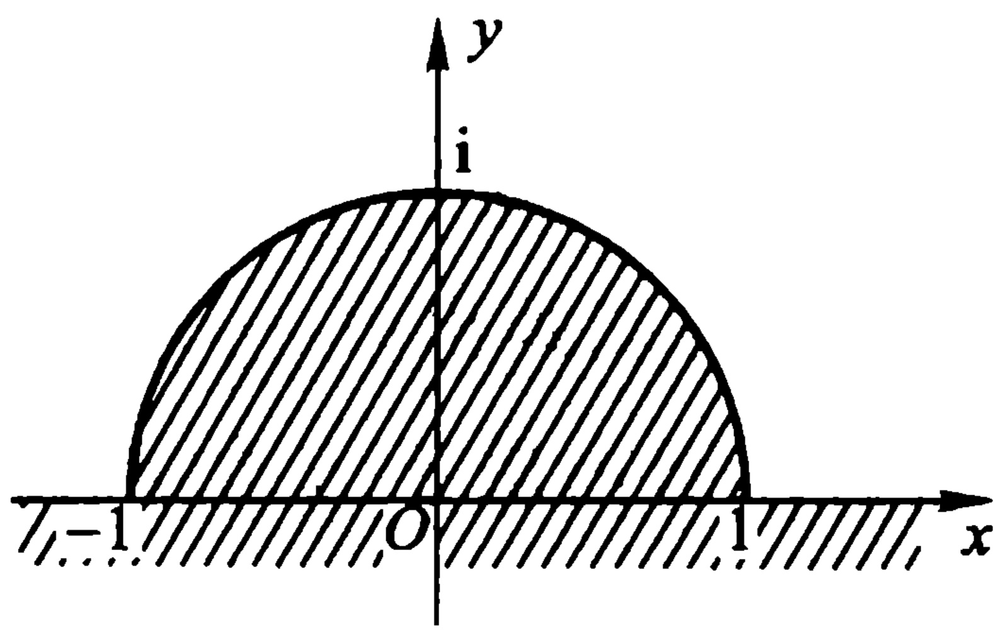

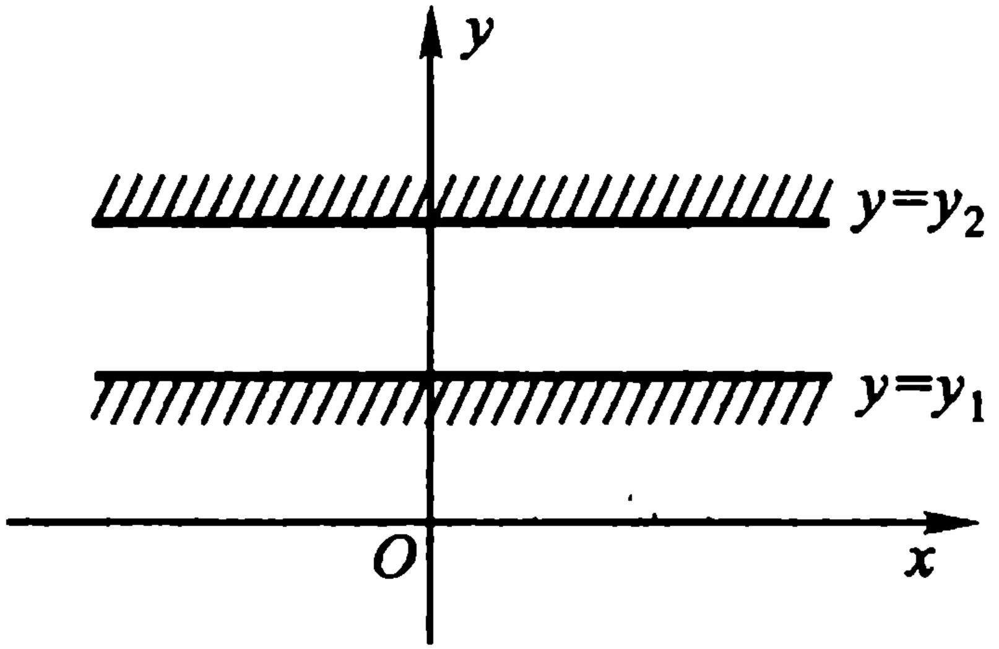

图 1.13
 

图 1.14
 

例 1.20 图 1.14 所示的带形区域表为

 $$ y_{1}<\mathrm{I m}z<y_{2}. $$ 

例 1.21 图 1.15 所示的同心圆环（即圆环形区域）表为

 $$ r<|z|<R. $$ 

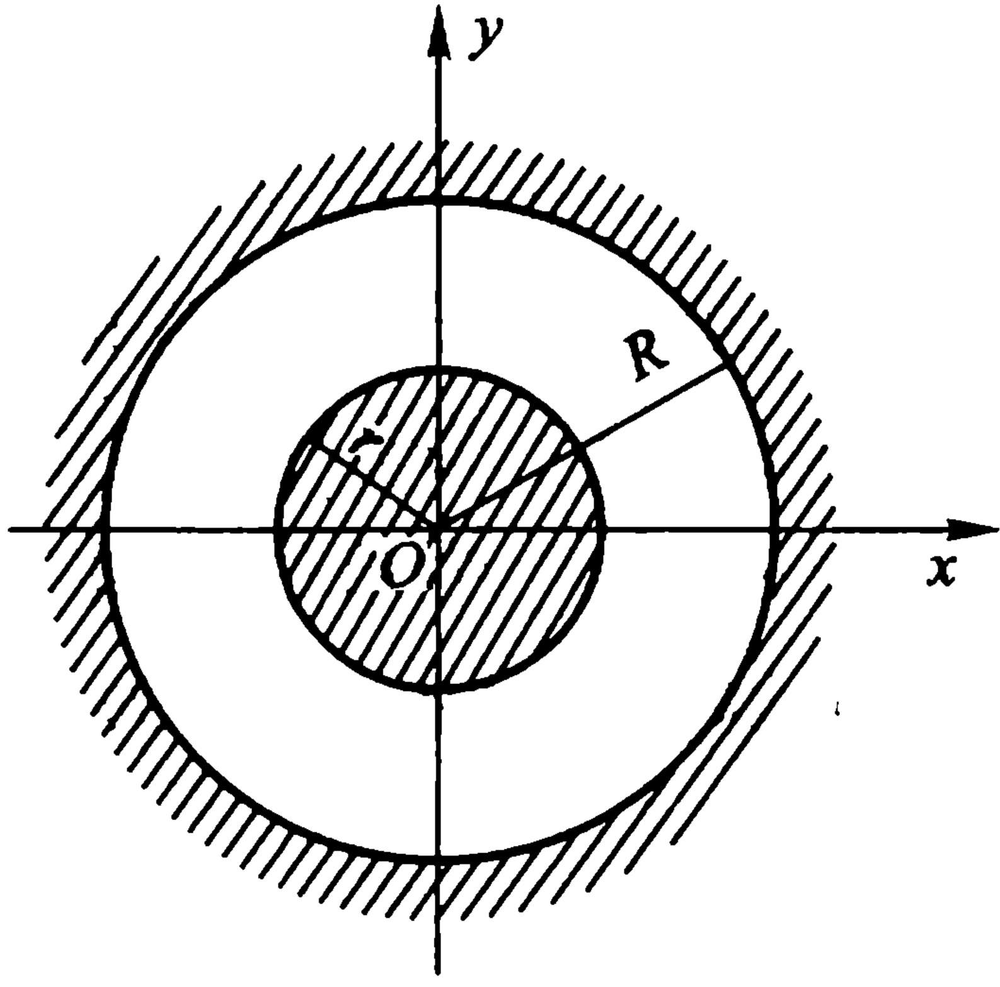

图 1.15
 

我们定义有界集 E 的直径为

 $$ d\left(E\right)=\sup\left\{\mid z-z_{i}^{^{\prime}}\mid\mid z\in E,z^{^{\prime}}\in E\right\}. $$ 

复变函数的基础几何概念还有曲线.

定义 1.7 设  $ x(t) $ 及  $ y(t) $ 是实变数 t 的两个实函数，在闭区

<!-- page: 41 -->

间 $ [\alpha,\beta] $上连续，则由方程组

 $$ \left\{\begin{aligned}x&=x\left(t\right),\\ y&=y\left(t\right),\end{aligned}\right.\qquad\left(\alpha\leqslant t\leqslant\beta\right) $$ 

或由复数方程

$$  \begin{aligned}z=x\left(t\right)+i y\left(t\right)\quad&\left(\alpha\leqslant t\leqslant\beta\right)\ $  简记为 z=z\left(t\right))\quad&\cdot\end{aligned}   \tag*{(1.16)}$$

所决定的点集 C，称为 z 平面上的一条连续曲线。式(1.16)称为 C 的参数方程， $ z(\alpha) $ 及  $ z(\beta) $ 分别称为 C 的起点和终点；对满足  $ \alpha < t_{1} < \beta $， $ \alpha \leq t_{2} \leq \beta $， $ t_{1} \neq t_{2} $ 的  $ t_{1} $ 及  $ t_{2} $，当  $ z(t_{1}) = z(t_{2}) $ 成立时，点  $ z(t_{1}) $ 称为此曲线 C 的重点；凡无重点的连续曲线，称为简单曲线或若尔当曲线； $ z(\alpha) = z(\beta) $ 的简单曲线称为简单闭曲线。

简单曲线是 z 平面上的一个有界闭集.

例如，线段、圆弧和抛物线弧段等都是简单曲线；圆周和椭圆周等都是简单闭曲线。

定义 1.8 设连续弧 AB 的参数方程为

 $$ z=z\left(t\right),\left(a\leqslant t\leqslant\beta\right) $$ 

任取实数列  $ \{t_{n}\} $:

$$  \alpha=t_{0}<t_{1}<t_{2}<\cdots<t_{n-1}<t_{n}=\beta,   \tag*{(1.17)}$$

并且考虑 AB 弧上对应的点列：

 $$ z_{j}=z\left(t_{j}\right)\quad\left(j=0,1,2,\cdots,n\right), $$ 

将它们用一折线  $ Q_{n} $ 连接起来， $ Q_{n} $ 的长度

 $$ I_{n}=\sum_{j=1}^{n}\left|z(t_{j})-z(t_{j-1})\right|. $$ 

如果对于所有的数列(1.17)， $ I_{n} $有上界，则 AB 孤称为可求长的.

上确界  $ L = \sup I_{n} $ 称为 AB 弧的长度.

定义 1.9 设简单(或简单闭)曲线 C 的参数方程为

 $$ z=x\left(t\right)+\mathrm{i}y\left(t\right)\quad\left(\alpha\leqslant t\leqslant\beta\right), $$

<!-- page: 42 -->

又在  $ a \leqslant t \leqslant \beta $ 上， $ x'(t) $ 及  $ y'(t) $ 存在、连续且不全为零 $ ^{①} $，则 C 称为光滑(闭) $ ^{②} $曲线.

光滑(闭)曲线 C 具有连续转动的切线.

定义 1.10 由有限条光滑曲线衔接而成的连续曲线称为逐段光滑曲线.

特别，简单折线是逐段光滑曲线.

逐段光滑曲线必是可求长曲线,但简单曲线(或简单闭曲线)却不一定可求长.

 $ ^{*} $例1.22 设简单曲线J的参数方程为

 $$ \left\{\begin{aligned}x&=x\left(t\right)=t\\ y&=y\left(t\right)=\left\{\begin{aligned}&t\sin\frac{1}{t},t\neq0 时 ,\\ &0,\end{aligned}\quad\begin{aligned}&(0\leqslant t\leqslant1)\end{aligned}\right.\end{aligned}\right. $$ 

显然  $ A_{n}\left(\frac{1}{2n\pi+\frac{\pi}{2}},\frac{1}{2n\pi+\frac{\pi}{2}}\right) $， $ B_{n}\left(\frac{1}{2n\pi},0\right) $皆为曲线 J 上的点，且连接  $ A_{n} $ 及  $ B_{n} $ 两点线段之长

 $$ \begin{align*}\overline{A_{n} B_{n}}&=\sqrt{\left(\frac{1}{2n\pi+\frac{\pi}{2}}-\frac{1}{2n\pi}\right)^{2}+\left(\frac{1}{2n\pi+\frac{\pi}{2}}\right)^{2}}\\&\geq\frac{1}{\left(2n+\frac{1}{2}\right)\pi}=\frac{1}{2\left(n+\frac{1}{4}\right)\pi}>\frac{1}{2(n+1)\pi},\end{align*} $$ 

因为 $ \sum_{n=1}^{\infty}\frac{1}{n} $是发散的，所以 $ \sum_{n=1}^{\infty}\overline{A_{n}B_{n}} $也是发散的，从而知简单曲线 $ J $是不可求长的.

我们容易看出，圆周  $ |z| = R $ 把 z 平面分为两个不相连接的

<!-- page: 43 -->

区域 $ \{z\}<R $和 $ \{z\}>R $。这个结果是下面所谓若尔当定理的特例。

定理1.1（若尔当定理）任一简单闭曲线 C 将 z 平面惟一地分成 C、I(C) 及 E(C) 三个点集（图 1.16），它们具有如下性质：

（1）彼此不交；

(2) $ \cdot I(C) $是一个有界区域(称为C的内部);

(3)  $ E(C) $ 是一个无界区域(称为 C 的外部);

(4) 若简单折线 P 的一个端点属于  $ I(C) $，另一个端点属于  $ E(C) $，则 P 必与 C 有交点.

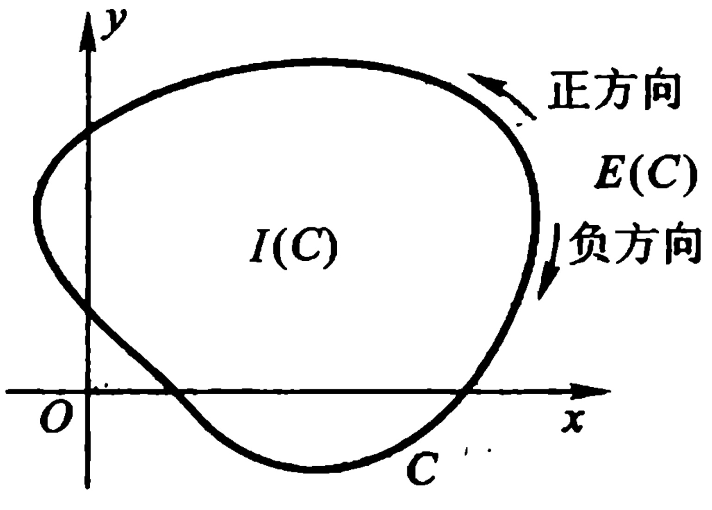

图 1.16
 

此定理的证明 $ ^{①②} $虽有多种，但都包含若干拓扑学的知识和术语，非简短篇幅所能说明。因此略去证明。不过这个定理的直观意义是很清楚的。

沿着一条简单闭曲线 C 有两个相反的方向，其中一个方向是：当观察者顺此方向沿 C 前进一周时，C 的内部一直在 C 的左方，即“反时针”方向，称为正方向；另一个方向是：当观察者顺此方向沿 C 前进一周时，C 的外部一直在 C 的左方，即“顺时针”方向，称为负方向（图 1.16）。

在简单闭曲线 C 的内部  $ I(C) $ 无论怎样画简单闭曲线  $ \Gamma $，则  $ \Gamma $ 的内部  $ I(\Gamma) $ 必全含于  $ I(C) $。这一性质的一般化，即是

定义 1.11 设 D 为复平面上的区域. 若在 D 内无论怎样画简单闭曲线, 其内部仍全含于 D, 则称 D 为单连通区域; 非单连通的区域称为多连通区域.

<!-- page: 44 -->

所含不止一个点的闭集 E，如果不能划分为两个无公共点的非空闭集，则称 E 为连续点集。空集与所含只有一个点的集，称为退化连续点集。

若区域 D 的边界为一个连续点集（包括退化情形），则称 D 为单连通区域（也就是所谓没有“洞”的区域，这个说法与前面关于单连通区域的定义是等价的）；非单连通的区域称为多连通区域。

若区域 D 的边界是互不相交的两个、三个、 $ \cdots $、n 个连续点集，则分别称 D 为二连通、三连通、 $ \cdots $、n 连通的区域.

简单闭曲线 C 的内部  $ I(C) $ 就是单连通区域。我们在例 1.17 至例 1.20 中所列举的区域也是单连通的。而例 1.21 所列举的圆环形区域  $ D: r < |z| < R $ ( $ r \geqslant 0, R \leqslant +\infty $)——它包括去心的圆  $ (r = 0, R < +\infty) $、一个圆周的外部  $ (r > 0, R = +\infty) $、去掉原点的  $ z $ 平面  $ (r = 0, R = +\infty) $ 三种特例——就不是单连通的，因为，如果取  $ \Gamma $ 为圆周  $ |z| = \rho (r < \rho < R) $，它的内部就不能全含于这个圆环形区域内（请读者自己作图思考）。还因为它们的边界都是两个不相交的连续点集，所以都是二连通的。

注 若实数集不囿于上(下)，则称“广义的数”+ $ \infty $(- $ \infty $)为它们的上(下)界，关于这些“广义的”数或“无穷的”数，我们有

 $$ \begin{aligned}&-\infty<+\infty\quad 及 \quad-\infty<a<+\infty,\end{aligned} $$ 

其中  $ \alpha $ 是不论怎样的（有限的）实数.

符号 $ +\infty $和 $ -\infty $读着“正无穷”和“负无穷”.

#### §3. 复变函数

1. 复变函数的概念 复变函数的定义, 形式上和数学分析中单元函数的定义一样, 不过自变量和函数都取复数值(当然也包括取实数值).

定义 1.12 设 E 为一复数集，若对 E 内每一复数 z，有惟一确定的复数 w 与之对应，则称在 E 上确定了一个单值函数  $ w =  $

<!-- page: 45 -->

$ f(z)(z\in E) $.如对 E 内每一复数 z，有几个或无穷多个 w 与之对应，则称在 E 上确定了一个多值函数  $ w=f(z)(z\in E) $.E 称为函数  $ w=f(z) $ 的定义域.对于 E，w 值的全体所成集 M 称为函数  $ w=f(z) $ 的值域.

例 1.23  $ \omega = |z| $,  $ \omega = \overline{z} $,  $ \omega = z^{2} $ 及

 $$ w=\frac{z+1}{z-1}\quad(z\neq1) $$ 

均为 z 的单值函数；

 $$ w=\sqrt[n]{z}\quad(z\neq0,n\geqslant2 整数 ) $$ 

及

 $$ w=\arg z\quad(z\neq0) $$ 

均为z的多值函数.

注 今后如不特别声明，所提到的函数都指单值函数.

设  $ w = f(z) $ 是定义于点集 E 上的单值或多值函数，并令

 $$ z=x+\mathrm{i}y,w=u+\mathrm{i}v, $$ 

则 u、v 皆随 x, y 而确定，因而  $ w = f(z) $ 又常写成

$$  \boldsymbol{w}=\boldsymbol{u}(\boldsymbol{x},\boldsymbol{y})+\mathrm{i}\boldsymbol{v}(\boldsymbol{x},\boldsymbol{y}),   \tag*{(1.18)}$$

其中  $ u(x,y) $ 及  $ v(x,y) $ 是二元实函数.

如将 z 表为指数形式  $ z = re^{i\theta} $，函数  $ w = f(z) $ 又可表为

 $$ \begin{array}{r}{\mathcal{w}=P(r,\theta)+\mathrm{i}Q(r,\theta).}\end{array} $$ 

可见，单复变的复函数

$$  w=f(z)   \tag*{(1.19)}$$

等价于两个相应的二元实函数

$$  u=\phi(x,y),v=\psi(x,y).   \tag*{(1.20)}$$

既然如此，究竟为什么我们还要去考虑一元复函数呢？实函数不是更为人所熟知吗？如果一个复函数等价于一对实函数，那么引进较不熟悉的复函数，其目的在哪里？

如果两个实函数 u 与 v 是随意选定的，二者之间没有什么特别联系，那么确实没有必要将它们结合起来作为一个复函数。然而，在两个实函数是紧密相关的一些情况下，把两个关系式(1.20)

<!-- page: 46 -->

缩写成一个关系式(1.19)更为有利.

例 1.24 设函数  $ w = z^{2} + 2 $，当 z = x + iy 时，w 可以写成

 $$ \begin{array}{r}{\dot{w}=\dot{x}^{2}-\dot{y}^{2}+2+2x\dot{y}\mathrm{i},}\end{array} $$ 

因而

 $$ u\left(x,y\right)=x^{2}-y^{2}+2,v\left(x,y\right)=2xy. $$ 

当  $ z = re^{i\theta} $ 时，w 又可以写成

 $$ \begin{array}{r}{\omega=r^{2}(\cos2\theta+\mathrm{~i~}\sin2\theta)+2,}\end{array} $$ 

因而  $ P(r,\theta)=r^{2}\cos 2\theta+2, Q(r,\theta)=r^{2}\sin 2\theta. $

在数学分析中，我们常常把函数用几何图形表示出来，在研究函数的性质时，这些几何图形给我们很多直观的帮助。现在，我们就不能借助于同一个平面或同一个三维空间中的几何图形来表示复变函数。因由(1.18)式， $ f(x+iy)=u+iv $，要描出 $ w=f(z) $的图形，必须采用四维空间，也就是 $ (u,v,x,y) $空间，为了避免这个困难，我们取两张复平面，分别称为z平面和w平面（在个别情形下，为了方便，也可将它们叠成一张平面，如图1.8）。注意到，在复平面上不区分“点”和“数”，也不再区分“点集”和“数集”，我们把复变函数理解为两个复平面上的点集间的对应（映射或变换）。具体地说，复变函数 $ w=f(z) $给出了从z平面上的点集E到w平面上的点集F间的一个对应关系（图1.17）。与点 $ z\in E $对应的点 $ w=f(z) $称为点z的像点，同时点z就称为点 $ w=f(z) $的原像。为了方便，以后也不再区分函数、映射和变换。

必须指出，像点的原像可能不只一点，例如  $ w = z^{2} $，则  $ z = \pm 1 $ 的像点均为 w = 1，因此 w = 1 的原像是两个点  $ z = \pm 1 $.

定义 1.13 如对 z 平面上点集 E 的任一点 z，有 w 平面上点集 F 的点 w，使得  $ w = f(z) $，则称  $ w = f(z) $ 把 E 变（映）入 F（简记为  $ f(E) \subseteq F $，或称 w = f(z) 是 E 到 F 的入变换.

定义 1.14 如果  $ f(E) \subseteq F $，且对 F 的任一点 w，有 E 的点 z，使得  $ w = f(z) $，则称  $ w = f(z) $ 把  $ \dot{E} $ 变（映）成  $ F $（简记为  $ f(E) = F $），或称  $ w = f(z) $ 是  $ \cdot E $ 到 F 的满变换.

对于满变换这种对应关系  $ w = f(z) $，F 就是  $ w = f(z) $ 能取

<!-- page: 47 -->

到的所有值所构成的点集，它显然具有下列两条性质：

（1）对于点集 E 中的每一点 z，相应的点  $ w = f(z) $ 是点集 F 中的一个点；

(2) 对于点集 F 中的每一点 w，在 E 中至少有一个点 z 与之对应，即满足  $ w = f(z) $.

定义 1.15 若  $ w = f(z) $ 是点集 E 到 F 的满变换，且对 F 中的每一点 w，在 E 中有一个（或至少有两个）点与之相对应，则在 F 上确定了一个单值（或多值）函数，记作  $ z = f^{-1}(w) $，它就称为函数  $ w = f(z) $ 的反函数或称为变换  $ w = f(z) $ 的逆变换；若 z =  $ f^{-1}(w) $ 也是 F 到 E 的单值变换，则称 w = f(z) 是 E 到 F 的双方单值变换或一一变换。

从上述反函数的定义可以看出,对于任意的  $ w \in F $,有

 $$ \begin{array}{r}{\omega=f\left[f^{-1}\left(\omega\right)\right],}\end{array} $$ 

且当反函数也是单值函数时，还有

 $$ z=f^{-1}\left[f(z)\right],z\in E. $$ 

上面映射这一概念的引入，对于复变函数论的进一步发展，特别是在解析函数的几何理论方面起到重要作用，因为它给出了函数的分析表示和几何表示的综合。这个综合是函数论发展的基础和新问题不断出现的源泉之一，在物理学的许多领域有着重要的应用。

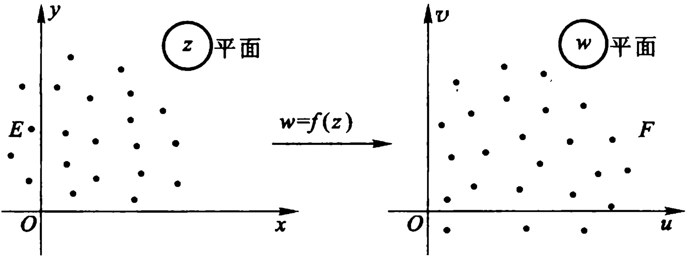

图1.17
 

<!-- page: 48 -->

例 1.25 设有函数  $ w = z^{2} $，试问它把  $ z $ 平面上的下列曲线分别变成  $ w $ 平面上的何种曲线？

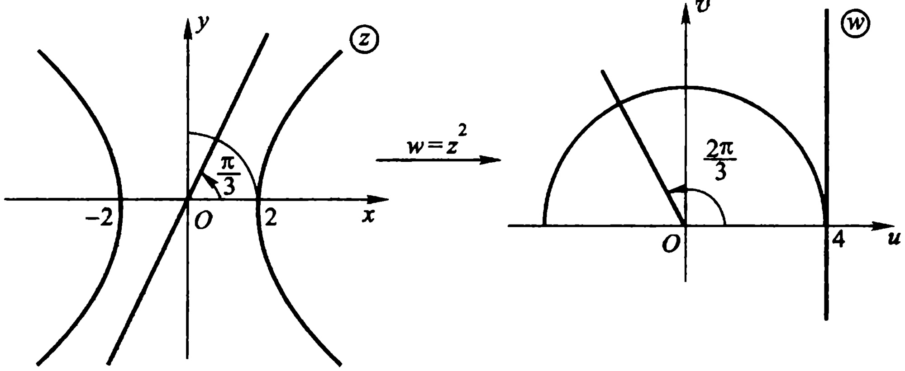

图 1.18
 

（1）以原点为心，2为半径，在第一象限里的圆弧；

(2) 倾角  $ \theta = \frac{\pi}{3} $ 的直线 (可以看成两条射线  $ \arg z = \frac{\pi}{3} $ 及  $ \arg z = \pi + \frac{\pi}{3} $);

（3）双曲线  $ x^{2}-y^{2}=4 $.

解 设  $ z = x + i y = r (\cos \theta + i \sin \theta) $,

 $$ w=u+\mathrm{i}v=R\left(\cos\varphi+\mathrm{i}\sin\varphi\right), $$ 

则

 $$ R=r^{2},\varphi=2\theta, $$ 

由此，(1)(如图1.18)当z的模为2，辐角由0变至 $ \frac{\pi}{2} $时，对应的w的模为4，辐角由0变至 $ \pi $。故在w平面上i的对应图形为：以原点为心，4为半径，在u轴上方的半圆周。

(2) 倾角  $ \theta = \frac{\pi}{3} $ 的直线在 w 平面上对应的图形为射线  $ \varphi = \frac{2\pi}{3} $.

（3）因  $ w = z^{2} = x^{2} - y^{2} + 2xyi $，故

 $$ u=x^{2}-y^{2}, $$

<!-- page: 49 -->

所以 z 平面上的双曲线  $ x^{2}-y^{2}=4 $ 在 w 平面上的像为直线 u=4.

### 2. 复变函数的极限与连续性

定义 1.16 设函数  $ w = f(z) $ 于点集 E 上有定义,  $ z_{0} $ 为 E 的聚点. 如存在一复数  $ w_{0} $, 使对任给的  $ \varepsilon > 0 $, 有  $ \delta > 0 $, 只要  $ 0 < |z - z_{0}| < \delta $,  $ z \in E $, 就有

 $$ |f(z)-w_{0}|<\varepsilon, $$ 

则称函数 $ f(z) $沿E于 $ z_{0} $有极限 $ \omega_{0} $，并记为

 $$ \begin{array}{l}\lim\limits_{z\to z_{0}}f(z)=\varpi_{0}.\ \\ \scriptstyle z\in E\end{array} $$ 

我们可以这样来理解极限概念的几何意义: 当变点 z 进入  $ z_{0} $ 的充分小的  $ \delta $ 去心邻域时, 它们的像点就落入  $ w_{0} $ 的一个给定的  $ \varepsilon $ - 邻域内 (图 1.19).

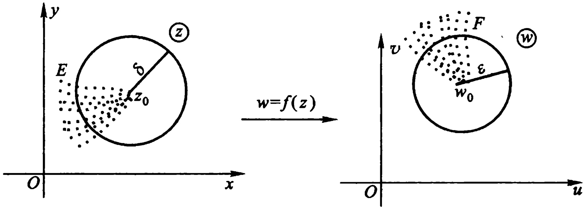

图 1.19
 

由于复变函数极限的定义与数学分析中一元实变函数的极限定义相似,我们可以仿照证明而有下述结论:

（1）若极限存在，必然惟一；

(2) 若  $ f(z) $、 $ g(z) $ 沿点集 E 在点  $ z_{0} $ 有极限，则其和、差、积、商（在商的情形，要求分母的极限不等于零）沿点集 E 在点  $ z_{0} $ 仍然有极限，并且其极限值等于  $ f(z) $、 $ g(z) $ 在点  $ z_{0} $ 的极限值的和、差、

<!-- page: 50 -->

积、商.

注 极限  $ \lim_{f(z)\to z_0} f(z) $ 与 z 趋于  $ z_0 $ 的方式无关。通俗地说，就是指

 $ z \to z_0 $

 $ z \in E $

在 E 上，z 要沿着从四面八方通向  $ z_0 $ 的任何路径趋于  $ z_0 $。对比数学分析中一元实变函数  $ f(x) $ 的极限  $ \lim_{x \to x_0} f(x) $， $ x \to x_0 $ 指在 x 轴上 x 只沿  $ x_0 $ 的左右两个方向，我们这里对复变函数极限存在的要求，显然苛刻得多。这正是复变分析与实变分析不同的根源。

下述定理给出了复变函数极限与其实部和虚部极限的关系：

定理 1.2 设函数  $ f(z) = u(x, y) + \mathrm{i}v(x, y) $ 于点集 E 上有定义,  $ z_{0} = x_{0} + \mathrm{i}y_{0} $ 为 E 的聚点, 则

 $$ \lim\limits_{\substack{z\to z_{0}\\ z\in E}}f(z)=\eta=a+\mathrm{i}b $$ 

的充要条件是

 $$ \lim\limits_{\substack{(x,y)\to(x_{0},y_{0})\\ (x,y)\in E}}u\left(x,y\right)=a,\lim\limits_{\substack{(x,y)\to(x_{0},y_{0})\\ (x,y)\in E}}v\left(x,y\right)=b. $$ 

证 因为

 $$ f(z)-\eta=u(x,y)-a+\mathrm{i}\left[v(x,y)-b\right], $$ 

由不等式(1.1)得

$$  \begin{array}{l}\left|u(x,y)-a\right|\leqslant\left|f(z)-\eta\right|,\\ \left|v(x,y)-b\right|\leqslant\left|f(z)-\eta\right|,\end{array}   \tag*{(1.21)}$$

及

$$  |f(z)-\eta|\leqslant|u(x,y)-a|+|v(x,y)-b|.   \tag*{(1.22)}$$

根据极限的定义,由(1.21)可得必要性部分的证明,由(1.22)可得充分性部分的证明.

另外，复变函数的极限论在复分析中诱导出复变函数的连续性、可微性（第二章）、可积性（第三章）及复级数的收敛性（第四章）.

下面引入复变函数连续性的概念.

<!-- page: 51 -->

定义 1.17 设函数  $ w = f(z) $ 于点集 E 上有定义,  $ z_{0} $ 为 E 的聚点, 且  $ z_{0} \in E $. 若

 $$ \begin{array}{l}\lim\limits_{z\to z_{0}}\limits_{z\in E}f(z)=f(z_{0}),\end{array} $$ 

即对任给的  $ \varepsilon>0 $，有  $ \delta>0 $，只要  $ \left|z-z_{0}\right|<\delta, z\in E $，就有

 $$ |f(z)-f(z_{0})|<\varepsilon, $$ 

则称  $ f(z) $ 沿 E 于  $ z_{0} $ 连续.

这里，复变函数连续性的定义与数学分析中一元实变函数连续性的定义相似，我们可以仿照证明而有下述结论：

(1) 如  $ f(z) $、 $ g(z) $ 沿点集 E 于点  $ z_{0} $ 连续，则其和、差、积、商（在商的情形，要求分母在  $ z_{0} $ 不为零）沿点集 E 于点  $ z_{0} $ 连续.

(2) 如函数  $ \eta = f(z) $ 沿点集 E 于点  $ z_{0} $ 连续，且  $ f(E) \subseteq G $，函数  $ w = g(\eta) $ 沿点集 G 于点  $ \eta_{0} = f(z_{0}) $ 连续，则复合函数  $ w = g[f(z)] = F(z) $ 沿点集 E 于点  $ z_{0} $ 连续.

定理 1.3 设函数  $ f(z) = u(x, y) + iv(x, y) $ 于点集 E 上有定义,  $ z_{0} \in E $, 则  $ f(z) $ 沿 E 在点  $ z_{0} = x_{0} + iy_{0} $ 连续的充要条件是: 二元实变函数  $ u(x, y) $、 $ v(x, y) $ 沿 E 于点  $ (x_{0}, y_{0}) $ 连续.

证 由于连续性是借助于极限概念来定义的. 只要注意到定理1.2中的a就是这里的 $ u(x_{0},y_{0}),b $就是这里的 $ v'(x_{0},y_{0}) $，就可以得到证明.

注 为了简单起见，今后在说到极限、连续时，凡上下文明确，均不必提到“沿什么集”的话，而极限符号也可以省写为  $ \lim $ 。

 $$ z\to z_{0} $$ 

例 1.26 设

 $$ f(z)=\frac{1}{2\mathrm{i}}\left(\frac{z}{z}-\frac{\overline{z}}{z}\right)(z\neq0), $$ 

试证  $ f(z) $ 在原点无极限，从而在原点不连续.

证 令变点  $ z = r (\cos \theta + i \sin \theta) $，则

<!-- page: 52 -->

$$ \begin{align*}f(z)&=\frac{1}{2i}\cdot\frac{z^2-\overline{z^2}}{z\overline{z}}=\frac{1}{2i}\cdot\frac{(z+\overline{z})(z-\overline{z})}{r^2}\\&=\frac{1}{2i r^2}\cdot2r\cos\theta\cdot2r i\sin\theta\\&=\sin2\theta,\end{align*} $$ 

从而

 $$ \lim_{z\to0}f(z)=0\quad\left( 沿正实轴 \theta=0\right), $$ 

 $$ \lim_{z\to0}f(z)=1\quad\left( 沿第一象限的平分角线 \theta=\frac{\pi}{4}\right), $$ 

故  $ f(z) $ 在原点无确定的极限,从而在原点不连续.

注上述例子说明: 当 z 依某一特定方式趋于  $ z_{0} $ 时, 函数虽有极限存在, 但不足以说明它在该点有极限存在. 只有当函数  $ f(z) $ 在一点  $ z_{0} $ 的极限存在的条件下, 才能使 z 依某种特定的方程式趋于  $ z_{0} $ 简单地求得此极限.

在对  $ z \rightarrow z_{0} $ 的这种要求上，单复变函数的极限与二元实函数的极限相似。事实上，因  $ z \rightarrow z_{0} $ 与  $ (x, y) \rightarrow (x_{0}, y_{0}) $，从复数的实数对形式看，二者是一样的。

定义 1.18 如函数  $ f(z) $ 在点集 E 上各点均连续，则称  $ f(z) $ 在 E 上连续.

特别情形 （1）若 E 为实轴上的线段  $ [\alpha, \beta] $，则连续曲线 (1.16) 就是  $ [\alpha, \beta] $ 上的连续函数  $ z = z(t) $.

(2) 若 E 为闭域  $ \overline{D} $，则其上每一点均为其聚点，故对在  $ \overline{D} $ 上有定义的函数，均可考查连续性，不过对于边界上的点  $ z_{0}, z \rightarrow z_{0} $ 只能沿  $ \overline{D} $ 上的点 z 来取.

易知,借助于连续变换  $ w = f(z) $, z 平面上的一条连续曲线也被变成 w 平面上的一条连续曲线.

例 1.27 设  $ \lim_{z \to z_0} f(z) = \eta $，则函数  $ f(z) $ 在点  $ z_0 $ 的某一去心邻域内是有界的.

<!-- page: 53 -->

证 因

 $$ \operatorname*{l i m}_{z\to z_{0}}f(z)=\eta, $$ 

则对任给的  $ \varepsilon > 0 $，有  $ \delta > 0 $，只要  $ 0 < |z - z_{0}| < \delta $，就有

 $$ |f(z)-\eta|<\varepsilon, $$ 

更有

 $$ |f(z)|-|\eta|<\varepsilon, $$ 

于是

 $$ |f(z)|<|\eta|+\varepsilon, $$ 

所以，在点  $ z_{0} $ 的去心邻域  $ N_{\delta}(z_{0}) - \{z_{0}\} $ 内  $ f(z) $ 是有界的.

例 1.28 设函数  $ f(z) $ 在点  $ z_{0} $ 连续，且  $ f(z_{0}) \neq 0 $，则  $ f(z) $ 在点  $ z_{0} $ 的某一邻域内恒不为零.

证 因  $ f(z) $ 在点  $ z_{0} $ 连续，则对任给的  $ \varepsilon>0 $，有  $ \delta>0 $，只要  $ \left|z-z_{0}\right|<\delta $，就有

 $$ |f(z)-f(z_{0})|<\varepsilon. $$ 

特别,取  $ \varepsilon=\frac{|f(z_{0})|}{2}>0 $,则由上面的不等式得

 $ \left|f(z)\right|>\left|f(z_{0})\right|-\varepsilon=\left|f(z_{0})\right|-\frac{\left|f(z_{0})\right|}{2}=\frac{\left|f(z_{0})\right|}{2}>0, $

因此， $ f(z) $在点 $ z_{0} $的 $ \delta $邻域 $ N_{\delta}(z_{0}) $内就恒不为零.

上面两例的结果以后常会用到.

下列三个定理常用.数学分析里已证过.

定理 1.4 [波尔查诺(Bolzano) - 魏尔斯特拉斯定理] 每一个有界无穷点集，至少有一个聚点.

定理 1.5 （闭集套定理） 设无穷闭集列  $ \{\overline{F}_{n}\} $，至少一个为有界且  $ \overline{F}_{n} \supseteq \overline{F}_{n+1} $， $ \lim_{n \to \infty} d(\overline{F}_{n}) = 0 $， $ (d(\overline{F}_{n}) $ 是  $ \overline{F}_{n} $ 的直径)，则必有惟一的一点  $ z_{0} \in \overline{F}_{n} $ ( $ n = 1, 2, \cdots $)。

定理 1.6 [海涅－波莱尔(Heine－Borel)覆盖定理] 设有界闭集 E 的每一点 z 都是圆  $ K_{z} $ 的圆心，则这些圆  $ \{K_{z}\} $ 中必有有限个圆把 E 盖住，换句话说，E 的每一点至少属于这有限个圆中的一个.

<!-- page: 54 -->

我们在数学分析中知道，在闭区间上的连续函数有三个重要性质：有界性、达到最大值与最小值的性质及一致连续性。对于复变连续函数，也有与此平行的性质。

定理 1.7 在有界闭集 E 上连续的函数  $ f(z) $，具有下列三个性质：

(1) 在 E 上  $ f(z) $ 有界. 即有常数 M > 0, 使

 $$ |f(z)|\leqslant M\quad(z\in E); $$ 

(2)  $ \left|f(z)\right| $ 在 E 上有最大值与最小值. 即在 E 上有两点  $ z_{1} $ 和  $ z_{2} $ 使

 $$ |f(z)|\leqslant|f(z_{1})|,|f(z)|\geqslant|f(z_{2})|\quad(z\in E); $$ 

(3)  $ f(z) $ 在 E 上一致连续，即任给  $ \varepsilon>0 $，有  $ \delta>0 $，使对 E 上满足  $ \left|z_{1}-z_{2}\right|<\delta $ 的任意两点  $ z_{1} $ 及  $ z_{2} $，均有

 $$ |f(z_{1})-f(z_{2})|<\varepsilon. $$ 

证 由定理 1.3 可知,二元实值函数

 $$ |f(z)|=\sqrt{u^{2}(x,y)+v^{2}(x,y)} $$ 

在有界闭集 E 上连续，由数学分析中二元连续函数的性质，即知(1)、(2)为真.

参照不等式(1.22)可以看出， $ f(z) $的一致连续性，可由 u(x, y) 及  $ v(x, y) $ 的一致连续性推出.

思考题 本定理对于区域 D 不一定成立. 建议读者在单位圆  $ |z|<1 $ 内考虑函数

 $$ f(z)=\frac{1}{1-z}, $$ 

看看本定理的结论(1)是否为真.

#### §4. 复球面与无穷远点

1. 复球面 复数还有一种几何表示法，它是借用地图图学

<!-- page: 55 -->

中将地球投影到平面上的测地投影法，建立复平面与球面上的点的对应，着重说明引入无穷远点的合理性.

取一个在原点 O 与 z 平面相切的球面，通过点 O 作一垂直于 z 平面的直线与球面交于点 N，N 称为北极，O 称为南极（图 1.20）。现在用直线段将 N 与 z 平面上一点 z 相连，此线段交球面于一点 P(z)，这样就建立起球面上的点（不包括北极点 N）与复平面上的点间的一一对应。

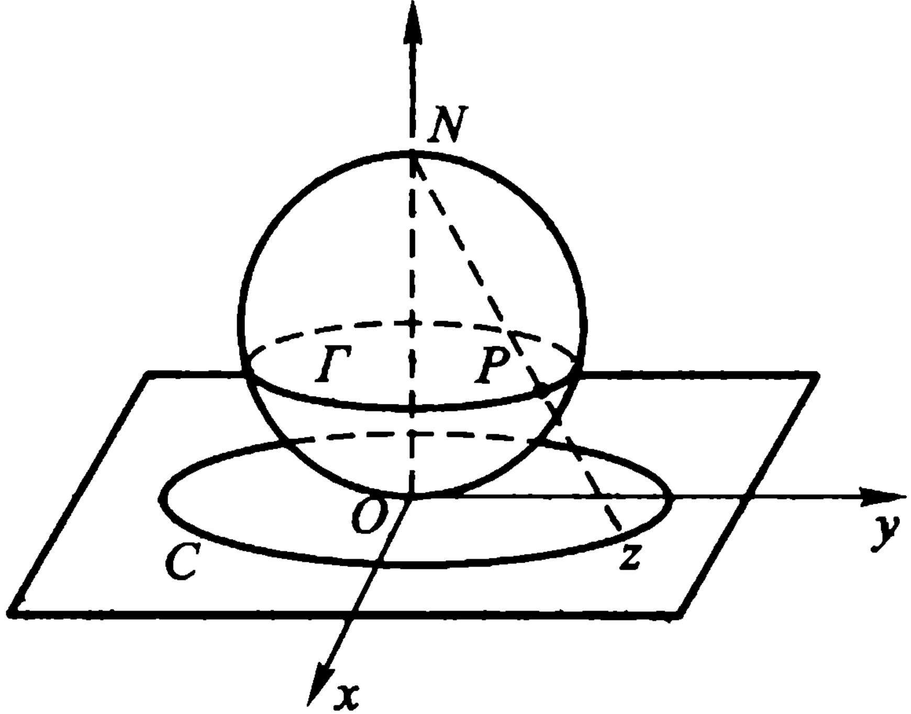

图 1.20
 

考虑 z 平面上一个以原点为中心的圆周 C，在球面上对应的也是一个圆周  $ \Gamma $ (即是纬线). 当圆周 C 的半径越大时，圆周  $ \Gamma $ 就越趋于北极 N. 因此，北极 N 可以看成是与 z 平面上的一个模为无穷大的假想点相对应，这个假想点称为无穷远点，并记为  $ \infty $. 复平面加上点  $ \infty $ 后称为扩充复平面，常记作  $ C_{\infty}, C_{\infty} = C + \{\infty\} $. 与它对应的就是整个球面，称为复球面. 简单说来，扩充复平面的一个几何模型就是复球面.

关于新“数”$\infty$（读作无穷）还需作如下几点规定：

(1) 运算  $ \infty \pm \infty, 0 \cdot \infty, \frac{\infty}{\infty}, \frac{0}{0} $ 无意义；

(2)  $ a \neq \infty $ 时， $ \frac{\infty}{a} = \infty, \frac{a}{\infty} = 0 $.

<!-- page: 56 -->

$$ \infty\pm a=a\pm\infty=\infty； $$ 

(3)  $ b \neq 0 $ (但可为  $ \infty $) 时,  $ \infty \cdot b = b \cdot \infty = \infty $,  $ \frac{b}{0} = \infty $;

（4） $ \infty $的实部、虚部及辐角都无意义， $ \left|\infty\right|=+\infty $。

(5) 复平面上每一条直线都通过点  $ \infty $，同时，没有一个半平面包含点  $ \infty $。并注意，直线不是简单闭曲线。

### 2. 扩充复平面上的几个概念

（1）扩充复平面上，无穷远点的邻域（对照定义1.1）应理解为以原点为心的某圆周的外部，即 $ \uwave{\text{∞的 $ \varepsilon $ - 邻域}} $  $ N_{\varepsilon} $（∞）是指合于条件 $ |z|>\frac{1}{\varepsilon} $的点集，它正好对应着复球面上以北极点N为心的一个球盖。 $ \infty $的去心 $ \varepsilon $邻域是指 $ \frac{1}{\varepsilon}<|z|<+\infty $，它正好对应着去掉北极点N的一个球盖。对照定义1.2及定义1.3，在扩充复平面上，聚点、内点和边界点等概念均可以推广到点 $ \infty $。于是，复平面以 $ \infty $为其唯一的边界点；扩充复平面以 $ \infty $为内点，且它是惟一的无边界的区域。

任一简单闭曲线 C，将扩充 z 平面分为两个不相连接的区域，一个是有界区域  $ I(C) $，另一个是无界区域  $ E(C) $，它们都以 C 为边界（若尔当定理）.

(2) 单连通区域的概念也可以推广到扩充复平面上的区域。对照定义1.11, 我们有定义: 设 D 为扩充复平面上的区域, 若在 D 内无论怎样画简单闭曲线, 其内部或外部(包含无穷远点)仍全含于 D, 则称 D 为单连通区域.

注意 在扩充复平面上，一个圆周的外部（这里把 $ \infty $算作这个区域的内点）就是一个单连通区域。所以，一个无界区域，考虑它是否单连通，首先要考虑是在通常的复平面上还是在扩充复平面上讲的（在扩充复平面上时，还要问 $ \infty $是否算在这个区域内）。

注 如∞在无界区域的边界上,也就是区域的边界曲线延伸到∞,则不论在通常复平面上还是在扩充复平面上,区域是否为单

<!-- page: 57 -->

连通必定是一致的. 例 1.18 的半平面及例 1.20 的带形区域就总是单连通的.

（3）在扩充复平面上，点 $ \infty $可以包含在函数的定义域中，函数值也可以取到 $ \infty $。因此，函数的极限与连续性的概念可以有所推广。在关系式

 $$ \lim_{z\to z_{0}}f(z)=f(z_{0}) $$ 

中，如果  $ z_{0} $ 及  $ f(z_{0}) $ 之一或者它们同时取  $ \infty $，就称  $ f(z) $ 在点  $ z_{0} $ 为广义连续的，极限就称为广义极限。在这种广义的意义下，极限和连续性的  $ \varepsilon - \delta $ 说法要相应修改。

例如，在  $ z_{0}=\infty, f(\infty)\neq\infty $ 时， $ f(z) $ 在  $ z_{0}=\infty $ 连续的  $ \varepsilon-\delta $ 说法应该修改为：

任给  $ \varepsilon>0 $，存在  $ \delta>0 $，只要  $ \left|z\right|>\frac{1}{\delta} $ 时就有

 $$ |f(z)-f(\infty)|<\varepsilon. $$ 

例 1.29 函数  $ f(z)=\frac{1}{z}(f(0)=\infty,f(\infty)=0) $ 在扩充 z 平面上广义连续.

证 因为  $ \frac{1}{z} $ 在  $ z \neq 0 $ 及  $ z \neq \infty $ 时，作为两个连续函数的商是连续的。而在 z = 0 及 z =  $ \infty $ 的连续性可以根据下式得出

 $$ \begin{array}{l}\lim\limits_{z\to\infty}f(z)=0\pm f(\infty),\\\lim\limits_{z\to0}f(z)=\infty=f(0).\end{array} $$ 

注 以后涉及到扩充复平面时，一定强调“扩充”二字，凡是没有强调的地方，均指通常的复平面；以后提到区域及其连通性时，如不加说明，都将限于通常复平面上来考虑；以后提到极限、连续时，如不加说明，均按通常意义去理解。

<!-- page: 58 -->

## 第一章习题

## (一)

1 设  $ z = \frac{1 - \sqrt{3}i}{2} $，求  $ \left| z \right| $ 及  $ \arg z $.

答： $ \left|z\right|=1,\mathrm{Arg}z=-\frac{\pi}{3}+2k\pi,k=0,\pm1,\cdots $

2 设  $ z_{1}=\frac{1+i}{\sqrt{2}} $,  $ z_{2}=\sqrt{3}-i $，试用指数形式表  $ z_{1}z_{2} $ 及  $ \frac{z_{1}}{z_{2}} $

答： $ z_{1}z_{2}=2\mathrm{e}^{\frac{\pi}{12}i},\frac{z_{1}}{z_{2}}=\frac{1}{2}\mathrm{e}^{\frac{5\pi}{12}i} $

3 解二项方程  $ z^{4}+a^{4}=0 $ （ $ a>0 $）.

答： $ \frac{a}{\sqrt{2}}(\pm1+\mathrm{i}),\frac{a}{\sqrt{2}}(\pm1-\mathrm{i}) $.

4 证明  $ \left|z_{1}+z_{2}\right|^{2}+\left|z_{1}-z_{2}\right|^{2}=2\left(\left|z_{1}\right|^{2}+\left|z_{2}\right|^{2}\right) $，并说明其几何意义.

提示 利用公式  $ \left|z\right|^{2}=z\bar{z} $.

5 设  $ z_{1} $、 $ z_{2} $、 $ z_{3} $ 三点适合条件：

 $$ z_{1}+z_{2}+z_{3}=0\  及 \left|z_{1}\right|=\left|z_{2}\right|=\left|z_{3}\right|=1. $$ 

试证明  $ z_{1} $、 $ z_{2} $、 $ z_{3} $ 是一个内接于单位圆周  $ |z|=1 $ 的正三角形的顶点.

6 下列关系表示的点 z 的轨迹的图形是什么？它是不是区域？

(1)  $ \left|z-z_{1}\right|=\left|z-z_{2}\right|,\left(z_{1}\neq z_{2}\right) $;

(2)  $ |z| \leqslant |z - 4| $;

(3) $ \left|\frac{z-1}{z+1}\right|<1; $

(4)  $ 0 < \arg(z - 1) < \frac{\pi}{4} $ 且  $ 2 \leq \mathrm{Re} z \leq 3 $;

(5) $ |z|>2 $ 且  $ |z-3|>1 $;

(6) Im z > 1 且 |z| < 2;

(7)  $ |z| < 2 $ 且  $ 0 < \arg z < \frac{\pi}{4} $;

<!-- page: 59 -->

(8) $ \left|z-\frac{\mathrm{i}}{2}\right|>\frac{1}{2} $且 $ \left|z-\frac{3\mathrm{i}}{2}\right|>\frac{1}{2} $.

7 证明: z 平面上的直线方程可以写成  $ az + \bar{a}z = c $.

(a 是非零复常数, c 是实常数)

8 证明: z 平面上的圆周可以写成

 $$ A z\bar{z}+\beta\bar{z}+\bar{\beta}z+C=0. $$ 

其中 A、C 为实数， $ A \neq 0 $， $ \beta $ 为复数，且  $ \left|\beta\right|^{2} > AC $.

9 试证:复平面上三点  $ a + bi, 0, \frac{1}{-a + bi} $ 共直线.

10 求下列方程 (t 是实参数) 给出的曲线：

(1)  $  z = (1 + i)t  $;

(2)  $ z = a \cos t + i b \sin t $;

(3)  $ z = t + \frac{i}{t} $;

(4)  $ z = t^{2} + \frac{i}{t^{2}} $

答: (1) 直线 y = x; (2) 椭圆周  $ \frac{x^{2}}{a^{2}} + \frac{y^{2}}{b^{2}} = 1 $;

(3) 双曲线  $ y = \frac{1}{x} $;

（4）双曲线  $ y=\frac{1}{x} $ 在 I 象限的一支.

11 函数  $ w = \frac{1}{z} $ 将 z 平面上的下列曲线变成 w 平面上的什么曲线  $ (z = x + iy, w = u + iv) $?

(1)  $ x^{2} + y^{2} = 4 $; (2) y = x;

(3) x = 1; (4)  $ (x - 1)^{2} + y^{2} = 1 $.

答: (1)  $ u^{2} + v^{2} = \frac{1}{4} $; (2) v = -u;

(3)  $ \left(u - \frac{1}{2}\right)^2 + v^2 = \frac{1}{4} $; (4)  $ u = \frac{1}{2} $.

12 试证：

(1) 多项式  $ p(z) = a_{0} z^{n} + a_{1} z^{n-1} + \cdots + a_{n} (a_{0} \neq 0) $ 在 z 平面上连续；

（2）有理分式函数

<!-- page: 60 -->

$$ f(z)=\frac{a_{0}z^{n}+a_{1}z^{n-1}+\cdots+a_{n}}{b_{0}z^{m}+b_{1}z^{m-1}+\cdots+b_{m}} $$ 

 $ (a_{0}\neq0,b_{0}\neq0) $在z平面上除使分母为零的点外都连续.

13 试证:  $ \arg z(-\pi < \arg z \leq \pi) $ 在负实轴上 (包括原点) 不连续, 除此而外在 z 平面上处处连续.

注 若  $ 0 \leq \arg z < 2\pi $，则  $ \arg z $ 在正实轴（包括原点）上不连续，在  $ z' $ 平面上其他点处处连续.

14 命函数  $ f(z)=\left\{\begin{aligned}&\frac{xy}{x^{2}+y^{2}},& 若 z\neq0,\\&0,& 若 z=0,\end{aligned}\right. $

试证:  $ f(z) $ 在原点不连续.

15 试证：函数  $ f(z)=\bar{z} $ 在 z 平面上处处连续.

16 试问函数  $ f(z)=\frac{1}{1-z} $ 在单位圆  $ \left|z\right|<1 $ 内是否连续？是否一致连续？

答: 连续但非一致连续.

17 一个复数列  $ z_{n}=x_{n}+iy_{n} $ ( $ n=1,2,\cdots $) 以  $ z_{0}=x_{0}+iy_{0} $ 为极限的定义为：任给  $ \varepsilon>0 $，存在一个正整数 N=N( $ \varepsilon $)，使当 n>N 时，恒有

 $$ \mid z_{n}-z_{0}\mid<\varepsilon, $$ 

试证:复数列 $ \{z_{n}\} $以 $ z_{0}=x_{0}+iy_{0} $为极限的充要条件为实数列 $ \{x_{n}\} $及 $ \{y_{n}\} $分别以 $ x_{0} $及 $ y_{0} $为极限.(这是一个定理.)

提示 一方面从  $ \left|x_{n}-x_{0}\right|\leqslant\left|z_{n}-z_{0}\right| $ 及  $ \left|y_{n}-y_{0}\right|\leqslant\left|z_{n}-z_{0}\right| $ 推出条件的必要性；另一方面，从  $ \left|z_{n}-z_{0}\right|\leqslant\left|x_{n}-x_{0}\right|+\left|y_{n}-y_{0}\right| $ 推出条件的充分性.

注 本题的定理有如下的三角表示:复数列  $ z_{n}=r_{n}(\cos\theta_{n}+i\sin\theta_{n})(n=1,2,\cdots) $ 以  $ z_{0}=r_{0}(\cos\theta_{0}+i\sin\theta_{0})(z_{0}\neq0,z_{0}\neq\infty) $ 为极限的充要条件是实数列  $ \{r_{n}\} $ 及  $ \{\theta_{n}\} $ 分别以  $ r_{0} $ 及  $ \theta_{0} $ 为极限（必要性证明只要适当选择  $ \theta_{n} $ 及  $ \theta_{0} $ 的值）.

18 一个复数列  $ z_{n}=x_{n}+\mathrm{i}y_{n}(n=1,2,\cdots) $ 有极限的充要条件（即柯西准则）是：任给  $ \varepsilon>0 $，存在正整数 N=N( $ \varepsilon $)，使当 n>N 时，恒有

 $$ |z_{n+p}-z_{n}|<\varepsilon\quad(p=1,2,\cdots). $$ 

提示 利用上题、不等式(1.1)及实数情形的柯西准则.

<!-- page: 61 -->

19 试证: 任何有界的复数列必有一个收敛的子数列.

20 如果复数列  $ \{z_{n}\} $ 合于  $ \lim z_{n}=z_{0}\neq\infty $，试证

 $$ \lim_{n\to+\infty}\frac{z_{1}+z_{2}+\cdots+z_{n}}{n}=z_{0} $$ 

当  $ z_{0}=\infty $ 时，结论是否正确？

## (二)

### 1 将复数

 $$ \frac{(\cos5\varphi+\mathrm{i}\sin5\varphi)^{2}}{(\cos3\varphi-\mathrm{i}\sin3\varphi)^{3}} $$ 

化为指数形式和三角形式.(答: $ e^{19\varphi i} $)

2 如果  $ z = e^{it} $，试证：

 $$ z^{n}+\frac{1}{z^{n}}=2\cos\ n t\;; $$ 

 $$ z^{n}-\frac{1}{z^{n}}=2\mathrm{i}\ \sin\ n t $$ 

其中 n 为正整数.

3 设  $ x_{n} + \mathrm{i}y_{n} = (1 - \mathrm{i}\sqrt{3})^{n} $ ( $ x_{n}, y_{n} $ 为实数; n 为正整数).

试证： $ x_{n}y_{n-1}-x_{n-1}y_{n}=4^{n-1}\cdot\sqrt{3} $

4 设  $ z = x + iy $，试证：

 $$ \frac{\left|x\right|+\left|y\right|}{\sqrt{2}}\leqslant\left|z\right|\leqslant\left|x\right|+\left|y\right|. $$ 

5 设  $ z_{1} $ 及  $ z_{2} $ 是两个复数，试证：

 $$ \mid z_{1}-z_{2}\mid\geqslant\mid\mid z_{1}\mid-\mid z_{2}\mid\mid. $$ 

6 设  $ |z| = 1 $，试证：

 $$ \left|\frac{az+b}{\overline{b}z+\overline{a}}\right|=1. $$ 

7 已知正方形  $ z_{1} z_{2} z_{3} z_{4} $ 的相对顶点  $ z_{1}(0,-1) $ 和  $ z_{3}(2,5) $，求顶点  $ z_{2} $ 和  $ z_{4} $ 的坐标.

答: 如图 1.21,  $ z_{2}(4,1) $,  $ z_{4}(-2,3) $.

8 试证：以  $ z_{1}, z_{2}, z_{3} $ 为顶点的三角

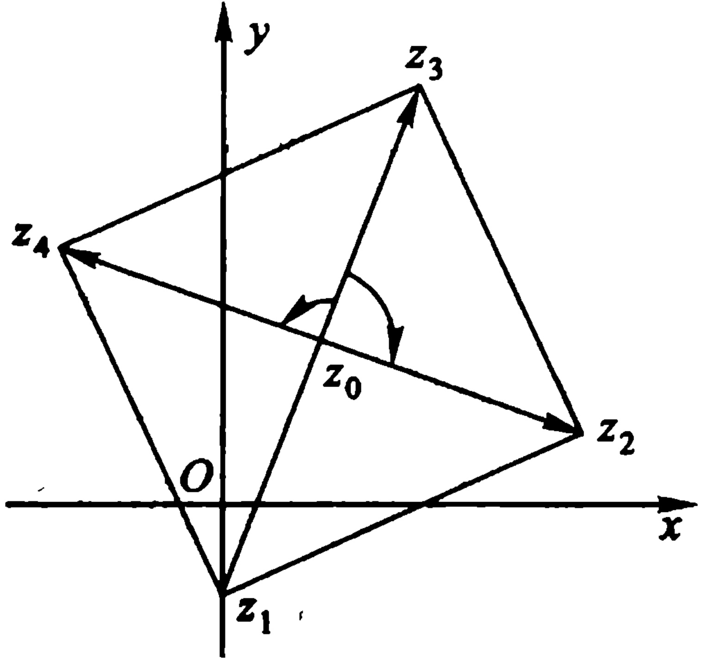

图 1.21
 

<!-- page: 62 -->

形和以  $ w_{1}, w_{2}, w_{3} $ 为顶点的三角形同向相似的充要条件为

 $$ \left|\begin{array}{l l l}{z_{1}}&{w_{1}}&{1}\\ {z_{2}}&{w_{2}}&{1}\\ {z_{3}}&{w_{3}}&{1}\end{array}\right|=0. $$ 

9 试证: 四个相异点  $ z_{1}, z_{2}, z_{3}, z_{4} $ 共圆周或共直线的充要条件是

 $ \frac{z_{1}-z_{4}}{z_{1}-z_{2}}:\frac{z_{3}-z_{4}}{z_{3}-z_{2}} $为实数（如图1.22）.

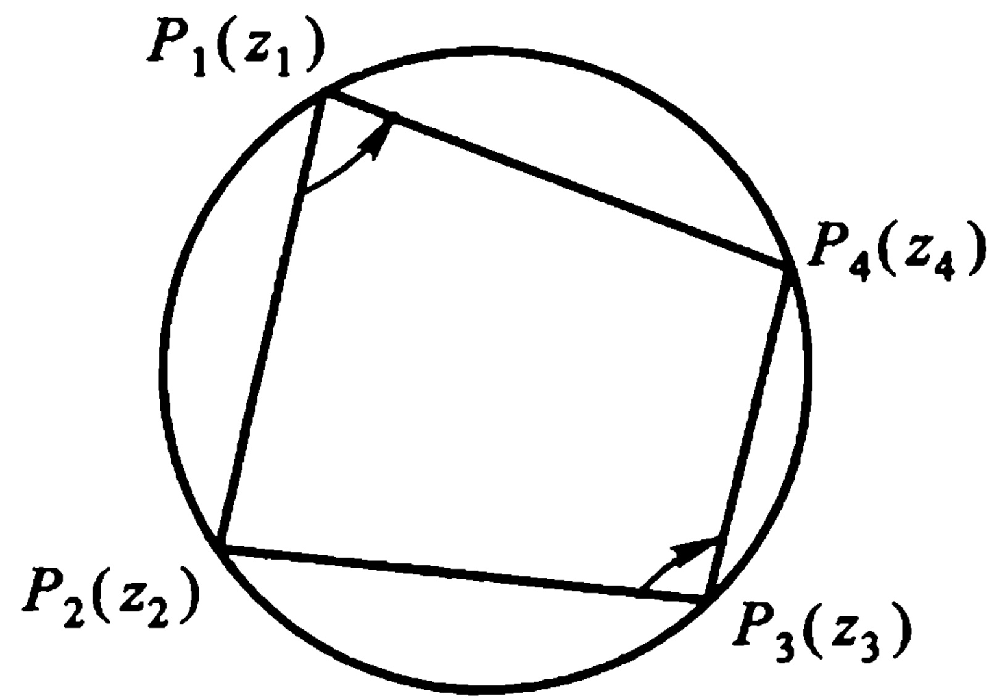

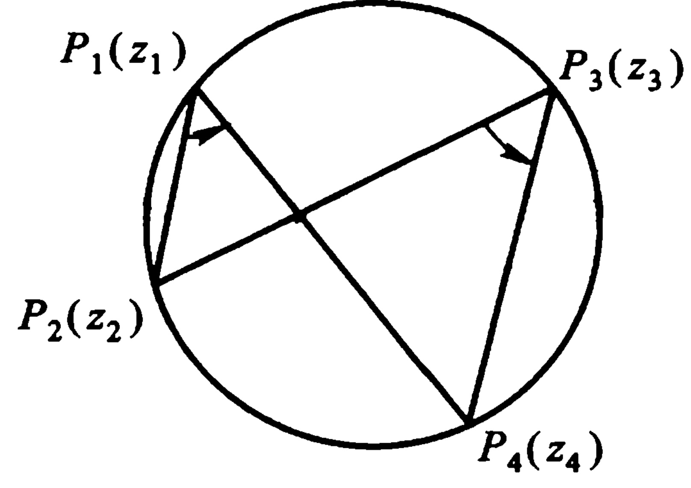

图 1.22
 

10 试证:两向量  $ \overrightarrow{Oz_{1}}(z_{1}=x_{1}+iy_{1}) $ 与  $ \overrightarrow{Oz_{2}}(z_{2}=x_{2}+iy_{2}) $ 互相垂直的充要条件是

 $$ \boldsymbol{z}_{1}\;\overline{{\boldsymbol{z}}}_{2}+\overline{{\boldsymbol{z}}}_{1}\;\boldsymbol{z}_{2}=0. $$ 

11 试证：方程

 $$ \left|\frac{z-z_{1}}{z-z_{2}}\right|=k(0<k\neq1,z_{1}\neq z_{2}) $$ 

表示 z 平面上一个圆周，其圆心为  $ z_{0} $，半径为  $ \rho $，且

 $$ z_{0}=\frac{z_{1}-k^{2}z_{2}}{1-k^{2}},\rho=\frac{k\mid z_{1}-z_{2}\mid}{\mid1-k^{2}\mid}. $$ 

 $ ^{*} $12 试证

 $$ \mathrm{R e}z{>}0\leftrightarrow\left|\frac{1-z}{1+z}\right|<1, $$ 

并能从几何意义上来读本题.

