# 02-第二章 解析函数

[返回全书目录](../../README.md)

> PDF 页码：63–111

<!-- page: 63 -->

## 第二章 解析函数

这一章，研究复变函数的微分法.

解析函数是复变函数论研究的主要对象，它是一类具有某种特性的可微函数。我们首先引入判断函数可微和解析的主要条件——柯西-黎曼方程；其次，把我们在实数域上熟知的初等函数推广到复数域上来，并研究其性质。

#### §1. 解析函数的概念与柯西－黎曼方程

1. 复变函数的导数与微分 复变函数的导数定义, 形式上和数学分析中一元函数的导数定义一致. 因此, 微分学中几乎所有的求导基本公式, 都可不加更改地推广到复变函数上来.

定义 2.1 设函数  $ w = f(z) $ 在点  $ z_{0} $ 的邻域内或包含  $ z_{0} $ 的区域 D 内有定义, 考虑比值

 $$ \frac{\Delta w}{\Delta z}=\frac{f(z)-f(z_{0})}{z-z_{0}}=\frac{f(z_{0}+\Delta z)-f(z_{0})}{\Delta z}\quad(\Delta z\neq0), $$ 

如果当 z 按任意方式趋于  $ z_{0} $ 时，即当  $ \Delta z $ 按任意方式趋于零时，比值  $ \Delta w / \Delta z $ 的极限都存在，且其值有限，则称此极限为函数  $ f(z) $ 在点  $ z_{0} $ 的导数，并记为  $ f'(z_{0}) $，即

$$  f^{\prime}(z_{0})=\operatorname*{l i m}_{\Delta z\to0}\frac{\Delta w}{\Delta z}=\operatorname*{l i m}_{z\to z_{0}}\frac{f(z)-f(z_{0})}{z-z_{0}},   \tag*{(2.1)}$$

<!-- page: 64 -->

这时称函数  $ f(z) $ 于点  $ z_{0} $ 可导.

式(2.1)的极限存在要求与  $ \Delta z $ 趋于零的方式无关，对于函数的这一限制，要比对于实变量 x 的实值函数  $ y = \varphi(x) $ 的类似限制严得多。事实上，实变函数导数存在性的要求意味着：当点  $ x_{0} + \Delta x $ 由左  $ (\Delta x < 0) $ 及右  $ (\Delta x > 0) $ 两个方向趋于  $ x_{0} $ 时，比值  $ \Delta y / \Delta x $ 的极限都存在且相等。而复变函数导数存在性的要求意味着：当点  $ z_{0} + \Delta z $ 沿连接点  $ z_{0} $ 的任意路径趋于点  $ z_{0} $ 时，比值  $ \Delta w / \Delta z $ 的极限都存在，并且这些极限都相等。

和导数的情形一样,复变函数的微分定义,形式上与实变函数的微分定义一致.

设函数  $ w = f(z) $ 在点 z 可导. 于是

 $$ \lim_{\Delta z\to0}\frac{\Delta w}{\Delta z}=f^{\prime}(z), $$ 

即是

 $$ \frac{\Delta w}{\Delta z}=f^{\prime}(z)+\eta,\operatorname*{l i m}_{\Delta z\to0}\eta=0, $$ 

 $$ \Delta w=f^{\prime}(z)\Delta z+\varepsilon, $$ 

其中 $ \left|\varepsilon\right|=\left|\eta\cdot\Delta z\right| $为比 $ \left|\Delta z\right| $高阶的无穷小.

称  $ f'(z)\Delta z $ 为 w = f(z) 在点 z 的微分. 记为 dw 或 df(z), 此时也称 f(z) 在点 z 可微. 即

$$  \mathrm{d}w=f^{\prime}(z)\Delta z.   \tag*{(2.2)}$$

特别，当  $ f(z)=z $ 时， $ \mathrm{d}z=\Delta z $。于是式(2.2)变为

 $$ \mathrm{d}w=f^{\prime}(z)\mathrm{d}z, $$ 

即

 $$ f^{\prime}(z)=\frac{\mathrm{d}w}{\mathrm{d}z}. $$ 

由此可见： $ f(z) $在点z可导与 $ f(z) $在点z可微是等价的.

函数  $ f(z) $ 在点 z 可微，显然  $ f(z) $ 在点 z 连续。但  $ f(z) $ 在点 z 连续却不一定在点 z 可微。并且在复变函数中，处处连续又处处

<!-- page: 65 -->

不可微的函数几乎随手可得，比如

 $$ f(z)=\bar{z},Re z,Im z 及 \mid z\mid $$ 

等等.而在实变函数中,要造一个这种函数就不是容易的事.

例 2.1 函数  $ f(z)=\bar{z} $ 在 z 平面上处处不可微.

证 由第一章习题(一)15 题知此函数在 z 平面上处处连续.

但

 $$ \frac{\Delta f}{\Delta z}=\frac{\overline{z+\Delta z}-\overline{z}}{\Delta z}=\frac{\overline{z}+\overline{\Delta z}-\overline{z}}{\Delta z}=\frac{\overline{\Delta z}}{\Delta z}, $$ 

当  $ \Delta z \rightarrow 0 $ 时，上式极限不存在。因为让  $ \Delta z $ 取实数而趋于零时，其极限为 1； $ \Delta z $ 取纯虚数而趋于零时，其极限为 -1。

例 2.2 试证: 函数  $ f(z) = z^{n} $ (n 为正整数) 在 z 平面上处处可微, 且  $ \frac{\mathrm{d}}{\mathrm{d}z}z^{n} = nz^{n-1} $.

证 设 z 是随意固定的点, 我们有

 $$ \begin{aligned}&\lim_{\Delta z\to0}\frac{\left(z+\Delta z\right)^{n}-z^{n}}{\Delta z}\\=&\lim_{\Delta z\to0}\left[nz^{n-1}+\frac{n(n-1)}{2}z^{n-2}\Delta z+\cdots+(\Delta z)^{n-1}\right]\\=&nz^{n-1}.\end{aligned} $$ 

如函数  $ f(z) $ 在区域 D 内处处可微，则称  $ f(z) $ 在区域  $ D $ 内可微.

### 2. 解析函数及其简单性质

定义 2.2 如果函数  $ w = f(z) $ 在区域 D 内可微，则称  $ f(z) $ 为区域 D 内的解析函数，或称  $ f(z) $ 在区域 D 内解析.

解析函数这一重要概念，是与相伴区域密切联系的。以后，我们说函数  $ f(z) $ 在某点解析，其意义是指  $ f(z) $ 在该点的某一邻域内解析；说函数  $ f(z) $ 在闭域  $ \overline{D} $ 上解析，其意义是指  $ f(z) $ 在包含  $ \overline{D} $ 的某区域内解析。

区域 D 内的解析函数也称为 D 内的全纯函数或正则函数.

容易看出，函数  $ f(z) $ 在区域 D 内解析与函数  $ f(z) $ 在区域 D

<!-- page: 66 -->

内处处解析的说法是等价的.

定义 2.3 若函数  $ f(z) $ 在点  $ z_{0} $ 不解析，但在  $ z_{0} $ 的任一邻域内总有  $ f(z) $ 的解析点，则称  $ z_{0} $ 为函数  $ f(z) $ 的奇点.

例如，w=1/z 在 z 平面上以 z=0 为奇点.

通常泛称的解析函数是容许有奇点的，但更主要的是，它在复平面上总有解析点。所以它不包含像 $ \bar{z} $这种处处不解析的函数。解析函数是复变函数研究的主要对象，它具有很好的性质。例如，由函数在一点解析（注意，只是在该点的邻域内可微！）就可推出其各阶导数也在该点解析（本书第三章定理3.14），并且就可以展成幂级数（本书第四章定理4.14）。这在一元实变函数是绝对不可能的。因为一元实变函数在一个区间上的导数存在，甚至不可能保证其导数连续。

把数学分析中有关求导法则推广到复变函数，就有：

（1）如函数  $ f_{1}(z) $、 $ f_{2}(z) $ 在区域 D 内解析，则其和、差、积、商（在商的情形，要求分母在 D 内不为零）在 D 内解析，并且

 $$ \begin{align*}&\left[f_{1}(z)\pm f_{2}(z)\right]^{\prime}=f_{1}^{\prime}(z)\pm f_{2}^{\prime}(z),\\&\left[f_{1}(z)f_{2}(z)\right]^{\prime}=f_{1}^{\prime}(z)f_{2}(z)+f_{1}(z)f_{2}^{\prime}(z),\\&\left[\frac{f_{1}(z)}{f_{2}(z)}\right]^{\prime}=\frac{f_{1}^{\prime}(z)f_{2}(z)-f_{1}(z)f_{2}^{\prime}(z)}{\left[f_{2}(z)\right]^{2}}\quad(f_{2}(z)\neq0).\end{align*} $$ 

(2) (复合函数的求导法则) 设函数  $ \xi = f(z) $ 在区域 D 内解析，函数  $ w = g(\xi) $ 在区域 G 内解析。若对于 D 内每一点 z，函数  $ f(z) $ 的值  $ \xi $ 均属于 G，则  $ w = g[f(z)] $ 在 D 内解析，且

 $$ \frac{\mathrm{d}g\left[f(z)\right]}{\mathrm{d}z}=\frac{\mathrm{d}g(\xi)}{\mathrm{d}\xi}\cdot\frac{\mathrm{d}f(z)}{\mathrm{d}z}. $$ 

例 2.3 设多项式  $ P(z) = a_{0} z^{n} + a_{1} z^{n-1} + \cdots + a_{n} (a_{0} \neq 0) $，由例 2.2 及上述求导法则(1)知， $ P(z) $ 在 z 平面上解析，且

 $$ P^{\prime}(z)=n a_{0}z^{n-1}+\left(n-1\right)a_{1}z^{n-2}+\cdots+2a_{n-2}z+a_{n-1}. $$ 

##### 例 2.4 设有理分式函数

<!-- page: 67 -->

$$ \frac{P(z)}{Q(z)}=\frac{a_{0}z^{n}+a_{1}z^{n-1}+\cdots+a_{n}}{b_{0}z^{m}+b_{1}z^{m-1}+\cdots+b_{m}}\quad(a_{0}\neq0,b_{0}\neq0), $$ 

由前例及上述求导法则(1)知,此函数在 z 平面上除使分母 Q(z)=0 的各点外解析,而使 Q(z)=0 的各点就是此有理分式函数的奇点.

例 2.5 设函数  $ f(z) = (3z^{2} - 4z + 5)^{11} $，则由例 2.2 及上述复合函数的求导法则，有

 $$ \begin{aligned}f^{\prime}(z)&=11(3z^{2}-4z+5)^{10}\cdot\frac{\mathrm{d}}{\mathrm{d}z}(3z^{2}-4z^{\prime}+5)\\&=11(3z^{2}-4z+5)^{10}(6z-4)\\&=22(3z-2)(3z^{2}-4z+5)^{10}.\end{aligned} $$ 

对于实变复值函数  $ z(t)=x(t)+iy(t) $ ( $ t\in[\alpha,\beta] $)，其求导法则可直接由定义 2.1 得到，即

 $$ z^{\prime}(t)=x^{\prime}(t)+\mathrm{i}y^{\prime}(t)\quad(t\in[\alpha,\beta]). $$ 

3. 柯西 - 黎曼方程（简称 C. - R. 方程） 假设

 $$ \boldsymbol{w}=\boldsymbol{f}(\boldsymbol{z})=\boldsymbol{u}(\boldsymbol{x},\boldsymbol{y})+\mathrm{i}\boldsymbol{v}(\boldsymbol{x},\boldsymbol{y}) $$ 

是复变函数  $ z = x + iy $ 的一个定义在区域 D 内的函数. 当二元实函数  $ u(x, y) $ 及  $ v(x, y) $ 给定时, 此函数也就完全确定. 一般说来, 如果函数  $ u(x, y) $ 与  $ v(x, y) $ 互相独立, 即使函数  $ u(x, y) $ 及  $ v(x, y) $ 对 x 与 y 所有偏导数都存在, 函数  $ f(z) $ 通常仍是不可微的. 例如,  $ w = \bar{z} = x - iy $ 处处连续, 并且 u = x, v = -y 对 x 和 y 的一切偏导数都存在且连续, 但由例 2.1 知,  $ w = \bar{z} $ 却是一个处处不可微的函数.

因此，如果函数  $ f(z) $ 是可微的，它的实部 u(x, y) 与虚部 v(x, y) 应当不是互相独立的，而必须适合一定的条件，下面我们就来探讨这种条件.

若  $ f(z)=u(x,y)+\mathrm{i}v(x,y) $ 在一点 z=x+iy 可微，而且设

$$  \lim_{\Delta z\to0}\frac{f(z+\Delta z)-f(z)}{\Delta z}=f^{\prime}(z),   \tag*{(2.3)}$$

<!-- page: 68 -->

又设  $ \Delta z = \Delta x + i\Delta y $,  $ f(z + \Delta z) - f(z) = \Delta u + i\Delta v $, 其中

 $$ \begin{aligned}\Delta u&=u\left(x+\Delta x,y+\Delta y\right)-u\left(x,y\right),\\\Delta v&=v\left(x+\Delta x,y+\Delta y\right)-v\left(x,y\right),\end{aligned} $$ 

(2.3) 变为

$$  \lim_{\Delta x\to0\atop\Delta y\to0}\frac{\Delta u+\mathrm{i}\Delta v}{\Delta x+\mathrm{i}\Delta y}=f^{\prime}(z).   \tag*{(2.4)}$$

因为  $ \Delta z = \Delta x + i\Delta y $ 无论按什么方式趋于零时，(2.4)总是成立的。先设  $ \Delta y = 0, \Delta x \to 0 $，即变点  $ z + \Delta z $ 沿平行于实轴的方向趋于

点z（图2.1），此时(2.4)成为

 $$ \lim_{\Delta x\to0}\frac{\Delta u}{\Delta x}+\mathrm{i}\lim_{\Delta x\to0}\frac{\Delta v}{\Delta x}=f^{\prime}(z), $$ 

于是知 $ \frac{\partial u}{\partial x},\frac{\partial v}{\partial x} $必然存在，且有

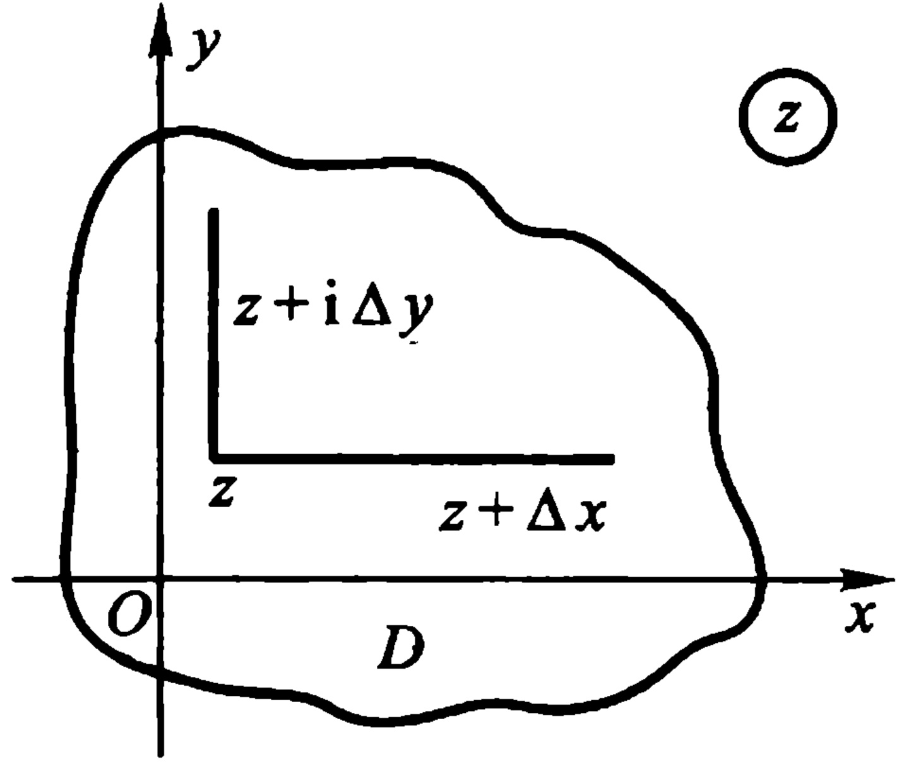

 $$ \begin{align*}\frac{\partial u}{\partial x}+i\frac{\partial v}{\partial x}&=f'(z)\\&=\lim_{\substack{\Delta y=0\\ \Delta x\to0}}\frac{\Delta w}{\Delta z}\\&=\lim_{y=y_0\atop x\to x_0}\frac{f(z)-f(z_0)}{z-z_0}.\end{align*} $$ 

图2.1
 

同样，设  $ \Delta x = 0, \Delta y \to 0 $，即变点  $ z + \Delta z $ 沿平行于虚轴的方向趋于点 z（图 2.1），此时（2.4）成为

 $$ -\mathrm{~i~}\operatorname*{l i m}_{\Delta y\to0}\frac{\Delta u}{\Delta y}+\operatorname*{l i m}_{\Delta y\to0}\frac{\Delta v}{\Delta y}=f^{\prime}\left(z\right), $$ 

故知 $ \frac{\partial u}{\partial y}, \frac{\partial v}{\partial y} $亦必存在，且有

 $$ \begin{aligned}-\mathrm{i}\frac{\partial u}{\partial y}+\frac{\partial v}{\partial y}&=f^{\prime}(z)\\&=\lim_{\substack{\Delta x=0\\ \Delta y\to0}}\frac{\Delta w}{\Delta z}\end{aligned} $$

<!-- page: 69 -->

$$  =\operatorname*{l i m}_{\stackrel{x=x_{0}}{y\to y_{0}}}\frac{f(z)-f(z_{0})}{z-z_{0}}.   \tag*{(2.6)}$$

比较(2.5)及(2.6)得出

$$  \frac{\partial u}{\partial x}=\frac{\partial v}{\partial y},\frac{\partial u}{\partial y}=-\frac{\partial v}{\partial x},   \tag*{(C.-R.)}$$

这是关于 u 及 v 的偏微分方程组，称为柯西－黎曼方程（简记为 C.-R.）.

注 灵活应用(2.5)及(2.6)这两个公式, 计算  $ f(z) $ 的实部  $ u(x, y) $ 及虚部  $ v(x, y) $ 在点  $ (x_{0}, y_{0}) $ 的偏导数, 是比较方便的.

总结以上探讨，即得下述定理：

定理 2.1(可微的必要条件) 设函数

 $$ f(z)=u(x,y)+\mathrm{i}v(x,y) $$ 

在区域 D 内有定义，且在 D 内一点  $ z = x + iy $ 可微，则必有

（1）偏导数  $ u_{x} $、 $ u_{y} $、 $ v_{x} $、 $ v_{y} $ 在点  $ (x,y) $ 存在；

(2)  $ u(x,y) $、 $ v(x,y) $ 在点  $ (x,y) $ 满足 C. -R. 方程.

由下例可见定理中的条件不是充分的：

例 2.6 函数  $ f(z)=\sqrt{|xy|} $ 在 z=0 满足定理 2.1 中的条件，但在 z=0 不可微.

证 因为  $ u(x,y)=\sqrt{|xy|} $,  $ v(x,y)\equiv0 $,

 $$ u_{x}\left(0,0\right)=\lim_{\Delta x\to0}\frac{u\left(\Delta x,0\right)-u\left(0,0\right)}{\Delta x}=0=v_{y}\left(0,0\right), $$ 

 $$ u_{y}\left(0,0\right)=\lim_{\Delta y\rightarrow0}\frac{u\left(0,\Delta y\right)-u\left(0,0\right)}{\Delta y}=0=-\;v_{x}\left(0,0\right), $$ 

但是

 $$ \frac{f(\Delta z)-f(0)}{\Delta z}=\frac{\sqrt{|\Delta x\Delta y|}}{\Delta x+i\Delta y} $$ 

在  $ \Delta z \rightarrow 0 $ 时无极限. 这只要让  $ \Delta z = \Delta x + i\Delta y $ 沿射线  $ \Delta y = k\Delta x $ ( $ \Delta x > 0 $) 随  $ \Delta x \rightarrow 0 $ 而趋于零, 即知上述比值是一个与 k 有关的值

<!-- page: 70 -->

$$ \frac{\sqrt{\vert k\vert}}{1+k i}. $$ 

我们把定理 2.1 的条件适当加强，就得到

定理 2.2 （可微的充要条件） 设函数  $ f(z) = u(x, y) + iv(x, y) $ 在区域 D 内有定义，则  $ f(z) $ 在 D 内一点  $ z = x + iy $ 可微的充要条件是

（1）二元函数  $ u(x,y) $、 $ v(x,y) $ 在点  $ (x,y) $ 可微；

(2)  $ u(x, y) $、 $ v(x, y) $ 在点  $ (x, y) $ 满足 C. -R. 方程.

上述条件满足时， $ f(z) $ 在点 z = x + iy 的导数可以表示为下列形式之一：

$$  \begin{aligned}f^{\prime}(z)&=\frac{\partial u}{\partial x}+\mathrm{i}\frac{\partial v}{\partial x}=\frac{\partial v}{\partial y}-\mathrm{i}\frac{\partial u}{\partial y}\\&=\frac{\partial u}{\partial x}-\mathrm{i}\frac{\partial u}{\partial y}=\frac{\partial v}{\partial y}+\mathrm{i}\frac{\partial v}{\partial x}.\end{aligned}   \tag*{(2.7)}$$

证 必要性 设  $ f(z) $ 在 D 内一点 z 可微，则

$$  \Delta f(z)=f^{\prime}(z)\Delta z+\eta\Delta z,   \tag*{(2.8)}$$

其中  $ \eta $ 是随  $ \Delta z \rightarrow 0 $ 而趋于零的复数. 若命

 $$ f^{\prime}\left(z\right)=\alpha+\mathrm{i}\beta,\Delta z=\Delta x+\mathrm{i}\Delta y,\Delta f(z)=\Delta u+\mathrm{i}\Delta v, $$ 

则(2.8)可写成

 $$ \Delta u+\mathrm{i}\Delta v=\alpha\Delta x-\beta\Delta y+\mathrm{i}\left(\beta\Delta x+\alpha\Delta y\right)+\eta_{1}+\mathrm{i}\eta_{2}, $$ 

这里  $ \eta_{1} = \mathrm{Re}(\eta \cdot \Delta z) $， $ \eta_{2} = \mathrm{Im}(\eta \cdot \Delta z) $ 是  $ \left|\Delta z\right| = \sqrt{(\Delta x)^{2} + (\Delta y)^{2}} $ 的高阶无穷小.

比较上式两端的实、虚部，即得

 $$ \begin{aligned}\Delta u&=\alpha\Delta x-\beta\Delta y+\eta_{1},\\\Delta v&=\beta\Delta x+\alpha\Delta y+\eta_{2},\end{aligned} $$ 

由数学分析中二元函数的微分定义即知， $ u(x,y) $ 与  $ v(x,y) $ 在点  $ (x,y) $ 可微，且

 $$ u_{x}=\alpha=v_{y},u_{y}=-\beta=-\upsilon_{x}.\eqno(\mathrm{C.}-\mathrm{R.}) $$ 

充分性 由  $ u(x,y) $ 及  $ v(x,y) $ 的可微性即知，在点  $ (x,y) $ 有

<!-- page: 71 -->

$$ \Delta u=u_{x}\Delta x+u_{y}\Delta y+\eta_{1}, $$ 

 $$ \Delta v=v_{x}\Delta x+v_{y}\Delta y+\eta_{2}, $$ 

其中  $ \eta_{1} $ 及  $ \eta_{2} $ 是  $ \sqrt{(\Delta x)^{2}+(\Delta y)^{2}} $ 的高阶无穷小.

再由 C.-R. 方程, 可设

 $$ \alpha=u_{x}=v_{y},u_{y}=-v_{x}=-\beta, $$ 

于是就有

 $$ \begin{aligned}\Delta f&=\Delta u+\mathrm{i}\Delta v=\alpha\Delta x-\beta\Delta y+\eta_{1}+\mathrm{i}\left(\beta\Delta x+\alpha\Delta y+\eta_{2}\right)\\&=\left(\alpha+\mathrm{i}\beta\right)\left(\Delta x+\mathrm{i}\Delta y\right)+\eta_{1}+\mathrm{i}\eta_{2},\end{aligned} $$ 

或

 $$ \frac{\Delta f}{\Delta z}=\alpha+\mathrm{i}\beta+\eta. $$ 

其中  $ \eta=\frac{\eta_{1}+i\eta_{2}}{\Delta x+i\Delta y} $ 随  $ \Delta z\rightarrow0 $ 而趋于零. 因为

 $$ |\eta|\leqslant\frac{|\eta_{1}|}{\sqrt{(\Delta x)^{2}+(\Delta y)^{2}}}+\frac{|\eta_{2}|}{\sqrt{(\Delta x)^{2}+(\Delta y)^{2}}}, $$ 

所以

 $$ \lim_{\Delta z\to0}\frac{\Delta f}{\Delta z}=\alpha+\mathrm{i}\beta, $$ 

即是说

 $$ \begin{align*}f^{\prime}\left(z\right)&=\alpha+\mathrm{i}\beta=u_{x}+\mathrm{i}v_{x}=v_{y}-\mathrm{i}u_{y}\\&=u_{x}-\mathrm{i}u_{y}=v_{y}+\mathrm{i}v_{x}.\end{align*} $$ 

由数学分析知道,二元函数的可微性可以通过偏导数的连续性看出来,于是我们有

推论 2.3 （可微的充分条件） 设函数  $ f(z) = u(x, y) + iv(x, y) $ 在区域 D 内有定义，则  $ f(z) $ 在 D 内一点  $ z = x + iy $ 可微的充分条件是

（1） $ u_{x} $、 $ u_{y} $、 $ v_{x} $、 $ v_{y} $ 在点  $ (x,y) $ 处连续；

(2)  $ u(x,y) $、 $ v(x,y) $ 在点  $ (x,y) $ 处满足 C.-R. 方程.

由定义 2.2 及定理 2.2, 我们得到一个刻画函数在区域内解析的定理.

定理 2.4 函数  $ f(z) = u(x, y) + \mathrm{i}v(x, y) $ 在区域 D 内解析的充要条件是：

<!-- page: 72 -->

（1）二元函数  $ u(x,y) $、 $ v(x,y) $ 在区域 D 内可微；

(2)  $ u(x,y) $、 $ v(x,y) $ 在 D 内满足 C. -R. 方程.

由定义 2.2 及推论 2.3, 我们有

定理 2.5 函数  $ f(z) = u(x, y) + \mathrm{i}v(x, y) $ 在区域 D 内解析的充分条件是

（1） $ u_{x} $、 $ u_{y} $、 $ v_{x} $、 $ v_{y} $ 在D内连续；

(2)  $ u(x,y) $、 $ v(x,y) $ 在 D 内满足 C. -R. 方程.

并且  $ f'(z) $ 可由公式 (2.7) 给出.

从以上几个定理，我们可以看出：C. - R. 方程是判断复变函数在一点可微或在一区域内解析的主要条件，在哪一点不满足它，函数在那一点就不可微；在哪个区域内不满足它，函数在那个区域内就不解析。定理2.4或定理2.5既提供了判别函数解析性的方法，又指出了求导数的公式(2.7)。而用它求导数，可避免计算极限(2.1)所带来的困难。

例 2.7 讨论函数  $ f(z) = |z|^{2} $ 的解析性.

解 因  $ u(x,y)=x^{2}+y^{2} $， $ v(x,y)\equiv0 $，故

 $$ u_{x}=2x,u_{y}=2y,v_{x}=v_{y}=0. $$ 

这四个偏导数在 z 平面上处处连续，但只在 z=0 处满足 C. -R.

方程. 故函数  $ f(z) $ 只在 z=0 可微，从而，此函数在 z 平面上处处不解析. 并且  $ f'(0) = (u_{x} + i v_{x}) \mid_{(0,0)} = 0 $.

例 2.8 讨论函数  $ f(z) = x^{2} - iy $ 的可微性和解析性.

解 因  $ u(x,y)=x^{2} $,  $ v(x,y)=-y $, 故

 $$ u_{x}=2x,u_{y}=0,v_{x}=0,v_{y}=-1, $$ 

所以

 $$ u_{y}=0=-\;v_{x}. $$ 

要  $ 2x = u_{x} = v_{y} = -1 $，必须  $ x = -\frac{1}{2} $。故仅在直线  $ x = -\frac{1}{2} $ 上，C.

- R. 方程成立，且偏导数连续。从而仅在直线  $ x = -\frac{1}{2} $ 上  $ f(z) $ 可

微，但在 z 平面上， $ f(z) $ 却处处不解析。并且

<!-- page: 73 -->

$$ \begin{aligned}f^{\prime}(z)\bigg|_{x=-\frac{1}{2}}&=(u_{x}+\mathrm{i}v_{x})\bigg|_{x=-\frac{1}{2}}\\&=(2x+\mathrm{i}\cdot0)\bigg|_{x=-\frac{1}{2}}=-1.\end{aligned} $$ 

注上述两例,由于函数  $ f(z) $ 只有一个孤立点或只在一条直线上可微,各点都未形成由可微点构成的圆邻域,故  $ f(z) $ 在其上都不解析,从而在 z 平面上处处不解析.

例 2.9 试证函数  $ f(z) = \mathrm{e}^{x}\left(\cos y + \mathrm{i}\sin y\right) $ 在 z 平面上解析，且  $ f'(z) = f(z) $.

证 因  $ u(x,y)=\mathrm{e}^{x}\cos y $,  $ v(x,y)=\mathrm{e}^{x}\sin y $, 而

 $$ u_{x}=\mathrm{e}^{x}\cos y,u_{y}=-\mathrm{e}^{x}\sin y, $$ 

 $$ v_{x}=\mathrm{e}^{x}\sin y,v_{y}=\mathrm{e}^{x}\cos y $$ 

在 z 平面上处处连续，且适合 C. -R. 方程. 由定理 2.5 即知  $ f(z) $ 在 z 平面上解析，并且

 $$ f^{\prime}(z)=u_{x}+\mathrm{i}v_{x}=\mathrm{e}^{x}\cos y+\mathrm{i}\mathrm{e}^{x}\sin y=f(z). $$ 

* 例 2.10 若函数  $ f(z) = u(x, y) + iv(x, y) $ 在区域  $ D' $ 内解析，且  $ f'(z) \neq 0 (z \in D) $，则

 $$ u\left(x,y\right)=c_{1.},v\left(x,y\right)=c_{2} $$ 

( $ c_{1},c_{2} $为常数)是D内两组正交曲线族.

证 因  $ f'(z) = u_{x} + \mathrm{i} v_{x} \neq 0 (z \in D) $，故在点  $ (x, y) $， $ u_{x} $ 与  $ v_{x} $ 必不全为零.

（1）设在点 $ (x,y) $， $ u_{x}\neq0 $ 且  $ v_{x}\neq0 $，则曲线  $ u(x,y)=c_{1} $ 的斜率由

 $$ 0=\mathrm{d}u=u_{x}\mathrm{d}x+u_{y}\mathrm{d}y $$ 

求得为

 $$ k_{u}=-\frac{u_{x}}{u_{y}}; $$ 

同理，求得曲线  $ v(x,y)=c_{2} $ 的斜率为

<!-- page: 74 -->

$$ k_{v}=-\frac{v_{x}}{v_{y}}, $$ 

故在点 $ (x,y) $,

 $$ k_{u}\cdot k_{v}=\frac{u_{x}}{u_{y}}\cdot\frac{v_{x}}{v_{y}}\frac{(\mathrm{C.}-\mathrm{R.})}{}\frac{v_{y}}{-v_{x}}\cdot\frac{v_{x}}{v_{y}}=-1. $$ 

所以曲线  $ u(x,y)=c_{1} $ 及  $ v(x,y)=c_{2} $ 在点  $ (x,y) $ 正交.

（2）设在点 $ (x,y) $，

 $$ u_{x}\neq0\  且 \ v_{x}=0, $$ 

或

 $$ u_{x}=0\  且 \ v_{x}\neq0. $$ 

此时，过交点的两条切线，必然一条为水平切线，另一条为铅直线，它们仍然在交点处正交.

最后，我们还要指出：当  $ z_{0}=x_{0}+\mathrm{i}y_{0}\in D,f^{\prime}(z_{0})\neq0 $ 时，则两条曲线：

 $$ u\left(x,y\right)=u\left(x_{0},y_{0}\right),v\left(x,y\right)=v\left(x_{0},y_{0}\right) $$ 

必在 $ (x_{0},y_{0}) $处正交.

思考题 （1）复变函数的可微性与解析性有什么异同？

（2）判断函数的解析性有哪些方法？

#### §2. 初等解析函数

例 2.3 及例 2.4 已经指出了多项式及有理分式函数的解析性. 这一节和下一节将进一步叙述复变数的初等函数, 这些函数是数学分析中通常的初等函数在复数域中的自然推广. 经过推广之后的初等函数, 往往会获得一些新的性质. 例如, 复指数函数  $ e^{z} $ 是有周期的, 复三角函数  $ \sin z $ 及  $ \cos z $ 已不再是有界的, 等等.

另外，这一节主要讨论复初等单值函数的解析性，这可从它们各自在一定区域内的可微性来判定.

1. 指数函数 由例 2.9, 我们知道  $ f(z) = \mathrm{e}^{x} (\cos y + \sin y) $

<!-- page: 75 -->

在 z 平面上解析，且  $ f'(z) = f(z) $. 进一步，还易验证

 $$ f(z_{1}+z_{2})=f(z_{1})f(z_{2}). $$ 

因此，我们有理由给出下面定义.

定义 2.4 对于任何复数  $ z = x + iy $，我们用关系式

$$  \mathrm{e}^{z}=\mathrm{e}^{x+\mathrm{i}y}=\mathrm{e}^{x}\left(\cos y+\mathrm{i}\sin y\right)   \tag*{(2.9)}$$

来规定指数函数  $ e^{z} $

对于复指数函数  $ e^{z} $，我们指出它具有如下的性质：

(1) 对于实数 z = x (y = 0) 来说, 我们的定义与通常实指数函数的定义是一致的.

(2)  $ \left|e^{x}\right|=e^{x}>0,\arg e^{z}=y $; 在 z 平面上  $ e^{z}\neq0 $.

（3） $ e^{z} $ 在 z 平面上解析，且  $ (e^{z})^{\prime}=e^{z} $

（4）加法定理成立，即  $ e^{z_{1}+z_{2}}=e^{z_{1}}e^{z_{2}} $

(5)  $ e^{z} $ 是以  $ 2\pi i $ 为基本周期的周期函数 (注(1)).

因对任一整数 k,  $ \mathrm{e}^{z+2k\pi i} = \mathrm{e}^{x} $,

这里  $ \mathrm{e}^{2k\pi i} = 1 $.

（6）极限  $ \lim_{x \to \infty} e^{x^{2}} $ 不存在，即  $ e^{\infty} $ 无意义.

因当 z 沿实轴趋于  $ +\infty $ 时,  $ e^{z} \to \infty $; 当 z 沿实轴趋于  $ -\infty $ 时,  $ e^{z} \to 0 $.

注 (1) 如一函数  $ f(z) $ 当 z 增加一个定值  $ \omega $ 时其值不变，即  $ f(z + \omega) = f(z) $，则称  $ f(z) $ 为周期函数， $ \omega $ 称为  $ f(z) $ 的周期。如  $ f(z) $ 的所有周期都是某一周期  $ \omega $ 的整倍数，则称  $ \omega $ 为  $ f(z) $ 的基本周期。

(2) (2.9) 式中，当 z 的实部 x=0 时，就得到欧拉公式

 $$ \mathrm{e}^{\mathrm{i}y}=\cos y+\mathrm{i}\sin y, $$ 

所以(2.9)是欧拉公式的推广.

（3）因  $ e^{z}e^{-z}=e^{0}=1 $ ，从而

 $$ \mathrm{e}^{-z}=\frac{1}{\mathrm{e}^{z}};\frac{\mathrm{e}^{z_{1}}}{\mathrm{e}^{z_{2}}}=\mathrm{e}^{z_{1}-z_{2}}. $$ 

（4） $ e^{z} $ 仅仅是一个记号，其意义如定义 2.4，它与 e = 2.718…

<!-- page: 76 -->

的乘方不同,没有幂的意义.有时将复指数函数 $ e^{z} $写成 $ \exp z $,表示区别.

（5）虽然在 z 平面上， $ e^{z}=e^{z+2k\pi i} $（k 为整数），但

 $$ \left(\mathrm{e}^{z}\right)^{\prime}=\mathrm{e}^{z}\neq0, $$ 

即不满足罗尔(Rolle)定理，故数学分析中的微分中值定理不能直接推广到复平面上来. 不过，洛必达(L'Hospital)法则在复平面上却是成立的(见本章习题2).

 $$ (6)\mathrm{e}^{z_{1}}=\mathrm{e}^{z_{2}}\Longleftrightarrow\mathrm{z}_{1}=\mathrm{z}_{2}+2k\pi\mathrm{i}(k=0,\pm1,\cdots). $$ 

*例 2.11 对任意的复数 z，若  $ \mathrm{e}^{z+\omega} = \mathrm{e}^{z} $，则必有

 $$ \omega=2k\pi i(k 为整数 )． $$ 

证 由假设, 对 z=0, $ \omega=a+ib $, 就有

 $$ \mathrm{e}^{\omega}=\mathrm{e}^{0}=1,\mathrm{e}^{a}\left(\cos b+\mathrm{i}\sin b\right)=1, $$ 

于是

 $$ \mathrm{e}^{a}=1,\cos b+\mathrm{i}\sin b=1, $$ 

 $$ a=0,\cos b=1,\sin b=0, $$ 

 $ a=0, b=2k\pi $ (k为整数)，

 $$ \omega=a+i b=2k\pi i(k 为整数 ). $$ 

2. 三角函数与双曲函数 由(2.9)，当 x=0 时推得

 $$ \mathrm{e}^{iy}=\cos y+\mathrm{i}\sin y, $$ 

 $$ \mathrm{e}^{-\mathrm{i}y}=\cos y-\mathrm{i}\sin y. $$ 

这里左端表示右端那个确定的复数，从而得到

 $$ \sin y=\frac{\mathrm{e}^{\mathrm{i}y}-\mathrm{e}^{-\mathrm{i}y}}{2\mathrm{i}},\cos y=\frac{\mathrm{e}^{\mathrm{i}y}+\mathrm{e}^{-\mathrm{i}y}}{2} $$ 

对于任意的实数 y 成立. 这两个公式中的 y 代以任意复数 z 后，由(2.9)，右端有意义，而左端尚无意义，因而我们给出如下定义.

定义 2.5 规定

 $$ \sin z=\frac{\mathrm{e}^{iz}-\mathrm{e}^{-iz}}{2i},\cos z=\frac{\mathrm{e}^{iz}+\mathrm{e}^{-iz}}{2}, $$ 

并分别称为 z 的正弦函数和余弦函数.

这样定义的正弦函数和余弦函数具有如下性质：

<!-- page: 77 -->

（1）对于 z 为实数 y 来说，我们的定义与通常正弦函数及余弦函数的定义是一致的.

（2）在 z 平面上是解析的，且

 $$ \left(\sin z\right)^{\prime}=\cos z,\left(\cos z\right)^{\prime}=-\sin z. $$ 

因为

 $$ (\sin z)^{\prime}=\frac{1}{2\mathrm{i}}(\mathrm{e}^{\mathrm{i}z}-\mathrm{e}^{-\mathrm{i}z})^{\prime}=\frac{1}{2}(\mathrm{e}^{\mathrm{i}z}+\mathrm{e}^{-\mathrm{i}z})=\cos z. $$ 

同理可证另一个.

(3)  $ \sin z $ 是奇函数,  $ \cos z $ 是偶函数, 并遵从通常的三角恒等式:

 $$ \sin^{2}z+\cos^{2}z=1, $$ 

 $$ \sin(z_{1}+z_{2})=\sin z_{1}\cdot\cos z_{2}+\cos z_{1}\cdot\sin z_{2}, $$ 

 $$ \cos(z_{1}+z_{2})=\cos z_{1}\cdot\cos z_{2}-\sin z_{1}\cdot\sin z_{2}, $$ 

等等.例如

 $$ \begin{align*}\sin(z_1+z_2)&=\frac{e^{i(z_1+z_2)}-e^{-i(z_1+z_2)}}{2i}\\&=\frac{e^{iz_1}e^{iz_2}-e^{-iz_1}e^{-iz_2}}{2i}\\&=\frac{e^{iz_1}-e^{-iz_1}}{2i}\cdot\frac{e^{iz_2}+e^{-iz_2}}{2}\\&\quad+\frac{e^{iz_1}+e^{-iz_1}}{2}\cdot\frac{e^{iz_2}-e^{-iz_2}}{2i}\\&=\sin z_1\cdot\cos z_2+\cos z_1\cdot\sin z_2.\end{align*} $$ 

（4） $ \sin z $ 及  $ \cos z $ 是以  $ 2\pi $ 为周期的周期函数.

因由定义 2.5，

 $$ \begin{align*}\cos(z+2\pi)&=\frac{e^{i(z+2\pi)}+e^{-i(z+2\pi)}}{2}\\&=\frac{e^{iz}e^{2\pi i}+e^{-iz}e^{-2\pi i}}{2}\\&=\frac{e^{iz}+e^{-iz}}{2}=\cos z.\end{align*} $$

<!-- page: 78 -->

同理可证另一个.

(5)  $ \sin z $ 的零点（即  $ \sin z = 0 $ 的根）为

 $$ z=n\pi\quad(n=0,\pm1,\cdots). $$ 

 $ \cos z $ 的零点为

 $$ z=\left(n+\frac{1}{2}\right)\pi\quad(n=0,\pm1,\cdots). $$ 

事实上，因为方程  $ \sin z = 0 $ 可以写成  $ e^{2iz} = 1 $。如令  $ z = \alpha + i\beta $，即可写成  $ e^{-2\beta}e^{2ia} = 1 = e^{2n\pi i} $ 故

 $$ \mathrm{e}^{-2\beta}=1,2\alpha=2n\pi\quad(n=0,\pm1,\cdots), $$ 

即

 $$ \beta=0,\alpha=n\pi\quad(n=0,\pm1,\cdots). $$ 

所以  $ z = n\pi $ （ $ n = 0, \pm 1, \cdots $）是  $ \sin z $ 的零点.

同理可推得  $ \cos z $ 的零点.

（6）在复数域内不能再断言

 $$ \left|\sin z\right|\leqslant1,\left|\cos z\right|\leqslant1. $$ 

例如，取  $ z = \mathrm{i} y (y > 0) $，则

 $$ \cos(\mathrm{i}y)=\frac{\mathrm{e}^{\mathrm{i}(\mathrm{i}y)}+\mathrm{e}^{-\mathrm{i}(\mathrm{i}y)}}{2}=\frac{\mathrm{e}^{-y}+\mathrm{e}^{y}}{2}>\frac{\mathrm{e}^{y}}{2} $$ 

只要 y 充分大, $ \cos i y $ 就可大于任一预先给定的正数.

例 2.12 求  $ \sin(1+2i) $ 的值.

解

 $$ \begin{aligned}\sin(1+2i)&=\frac{e^{i(1+2i)}-e^{-i(1+2i)}}{2i}=\frac{e^{-2+i}-e^{2-i}}{2i}\\&=\frac{e^{-2}(\cos1+i\sin1)-e^{2}(\cos1-i\sin1)}{2i}\\&=\frac{e^{2}+e^{-2}}{2}\sin1+i\frac{e^{2}-e^{-2}}{2}\cos1\\&=cosh2\sin1+i\sinh2\cos1.\end{aligned} $$ 

例 2.13 对任意的复数 z，若  $ \sin(z + \omega) = \sin z $，则必有

 $$ \omega=2k\pi\quad(k 为整数 ). $$ 

证 由假设,有  $ \sin(z+\omega)-\sin z=0 $,因而

 $$ \sin\frac{\omega}{2}\cos\left(z+\frac{\omega}{2}\right)=0, $$

<!-- page: 79 -->

效必

 $$ \omega=2k\pi\quad(k 为整数 ). $$ 

定义 2.6 规定

 $$ \tan z=\frac{\sin z}{\cos z},\cot z=\frac{\cos z}{\sin z}, $$ 

 $$ \sec z=\frac{1}{\cos z},\csc z=\frac{1}{\sin z}, $$ 

分别称为 z 的正切函数、余切函数、正割函数及余割函数.

这四个函数都在 z 平面上使分母不为零的点处解析，且

 $$ (\tan z)^{\prime}=\sec^{2}z,(\cot z)^{\prime}=-\csc^{2}z $$ 

 $$ (\sec z)^{\prime}=\sec z\cdot\tan z,(\csc z)^{\prime}=-\csc z\cdot\cot z. $$ 

正切函数和余切函数的周期为  $ \pi $，正割函数及余割函数的周期为  $ 2\pi $，例如，就函数  $ \tan z $ 来说，它在  $ z \neq \left(n + \frac{1}{2}\right)\pi - (n = 0, \pm 1, \cdots) $ 的各点处解析，且有  $ \tan(z + \pi) = \tan z $。因为

 $$ \tan(z+\pi)=\frac{\sin(z+\pi)}{\cos(z+\pi)}=\frac{-\sin z}{-\cos z}=\frac{\sin z}{\cos z}=\tan z. $$ 

*例 2.14 对任意的复数 z，若  $ \tan(z + \omega) = \tan z $，则必有

 $$ \omega=k\pi\quad(k 为整数 ). $$ 

证 由定义 2.6 及定义 2.5 知

 $$ \tan z=\frac{\sin z}{\cos z}=\frac{\mathrm{e}^{2\mathrm{i}x}-1}{\mathrm{i}\left(\mathrm{e}^{2\mathrm{i}x}+1\right)}, $$ 

由此可见， $ \tan(z+\omega)=\tan z $ 等价于  $ \mathrm{e}^{2\mathrm{i}(z+\omega)}=\mathrm{e}^{2\mathrm{i}z} $. 故必有

 $$ \mathrm{e}^{2\mathrm{i}\omega}=1. $$ 

所以

 $$ \omega=k\pi\quad(k 为整数 ). $$ 

定义 2.7 规定

 $$ \sinh z=\frac{\mathrm{e}^{z}-\mathrm{e}^{-z}}{2},\cosh z=\frac{\mathrm{e}^{z}+\mathrm{e}^{-z}}{2}, $$ 

 $$ \tanh z=\frac{\sinh z}{\cosh z},\coth z=\frac{1}{\tanh z}, $$ 

 $$ \operatorname{sech} z=\frac{1}{\cosh z},\operatorname{csch} z=\frac{1}{\sinh z}, $$

<!-- page: 80 -->

并分别称为 z 的双曲正弦函数、双曲余弦函数、双曲正切函数、双

曲余切函数、双曲正割函数及双曲余割函数.

显然，它们都是解析函数，各有其解析区域，且都是相应的实双曲函数在复数域内的推广.

由于  $ e^{z} $ 及  $ e^{-z} $ 皆以  $ 2\pi i $ 为基本周期。故双曲正弦及双曲余弦函数也以  $ 2\pi i $ 为基本周期。

关于三角函数与双曲函数的有些性质以及它们之间的关系，我们已列入本章习题.

注 （1）由定义 2.5 可知，对任何复数 z，有

 $$ \mathrm{e}^{\mathrm{i}z}=\cos z+\mathrm{i}\sin z, $$ 

这是欧拉公式在复数域内的推广.

（2）定义 2.5、定义 2.6 及定义 2.7 本身就反映了复三角函数与复指数函数的关系以及复双曲函数与复指数函数的关系.换言之,无论是复三角函数还是复双曲函数,都是由复指数函数表示的.

本节所提到的初等函数都是周期函数，在下一节，我们可以证明它们的反函数都是多值函数：

#### §3. 初等多值函数

在复数域中对于多值函数的研究具有特殊的重要意义. 因为只有在这样的研究中才能看出函数多值性的本质. 本节的一个内容是介绍幂函数与根式函数、指数函数与对数函数的映射性质; 主要内容是采用限制辐角或割破平面的方法, 来分出根式函数与对数函数的单值解析分支; 最后, 对反三角函数及一般幂函数只作初步介绍.

为了下面讨论的需要,我们先给出如下定义.

定义 2.8 设函数  $ f(z) $ 在区域 D 内有定义，且对 D 内任意不同的两点  $ z_{1} $ 及  $ z_{2} $，都有  $ f(z_{1}) \neq f(z_{2}) $，则称函数  $ f(z) $ 在 D 内是单叶的。并且称区域 D 为  $ f(z) $ 的单叶性区域。

<!-- page: 81 -->

显然，区域 D 到区域 G 的单叶满变换  $ w = f(z) $ 就是 D 到 G 的一一变换.

### 1. 根式函数

定义 2.9 我们规定根式函数  $ w = \sqrt[n]{z} $ 为幂函数  $ z = w^{n} $ 的反函数 (n 是大于 1 的整数).

##### （1）幂函数的变换（映射）性质及其单叶性区域

$$  z=w^{n}   \tag*{(2.10)}$$

在 w 平面上单值解析，它把扩充 w 平面变成扩充 z 平面，且 z = 0， $ \infty $ 分别对应于 w = 0， $ \infty $ 。可是由

 $$ \begin{aligned}\mathcal{w}=&\sqrt[n]{z}=\sqrt[n]{|z|}e^{i\frac{\arg z+2k\pi}{n}}\\&(k=0,1,\cdots,n-1)\end{aligned} $$ 

知道，每一个不为零或 $ \infty $的z，在w平面上有n个原像，且此n个点分布在以原点为中心的正n角形的顶点上.于是，函数(2.10)的反函数 $ w=\sqrt[n]{z} $在z平面上就是n值的.

如果置  $ z = re^{\mathrm{i}\theta} $， $ w = \rho e^{\mathrm{i}\varphi} $，则(2.10)成为

$$  r=\rho^{n},\theta=n\varphi.   \tag*{(2.11)}$$

由(2.11)知道，变换(2.10)把从原点出发的射线  $ \varphi = \varphi_{0} $ 变成从原点出发的射线  $ \theta = n\varphi_{0} $，并把圆周  $ \rho = \rho_{0} $ 变成圆周  $ r = \rho_{0}^{n} $ (图2.2).

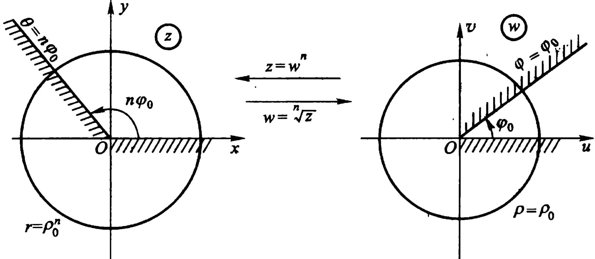

图2.2
 

<!-- page: 82 -->

当 w 平面上的动射线从射线  $ \varphi = 0 $ 扫动到射线  $ \varphi = \varphi_{0} $ 时，在变换  $ z = w^{n} $ 下的像，就在 z 平面上从射线  $ \theta = 0 $ 扫动到射线  $ \theta = n\varphi_{0} $。从而，w 平面上的角形  $ 0 < \varphi < \varphi_{0} $ 就被变成 z 平面上的角形  $ 0 < \theta < n\varphi_{0} $（图 2.2）。

特别，变换(2.10)把  $ w_{i} $ 平面上的角形  $ -\frac{\pi}{n} < \varphi < \frac{\pi}{n} $ 变成 z 平面除去原点及负实轴的区域(图 2.3).

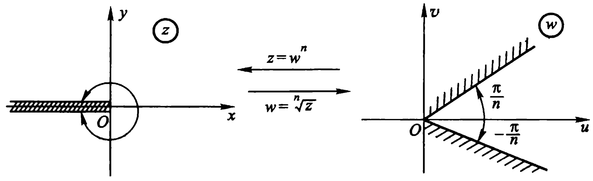

图2.3
 

一般,变换(2.10)把张度为 $ \frac{2\pi}{n} $的 $ n $个角形

$$  \begin{aligned}T_{k}:\left(\frac{2k\pi}{n}-\frac{\pi}{n}\right)&<\varphi<\left(\frac{2k\pi}{n}+\frac{\pi}{n}\right)\ $ k&=0,1,\cdots,n-1)\end{aligned}   \tag*{(2.12)}$$

都变成 z 平面除去原点及负实轴的区域. 图 2.3 是 k=0 的情形. 图 2.4 是 n=3 的情形, 这时  $ T_{k}(k=0,1,2) $ 都变成 z 平面除去原点及负实轴的区域.

显然(2.12)是函数(2.10)的单叶性区域的 $ \uwave{\text{一种分法}} $.因由(2.11),我们知道区域T是(2.10)的单叶性区域的充要条件是:对于T内任一点 $ w_{1} $,满足下面等式的点 $ w_{2} $,

 $$ \begin{aligned}\mid\boldsymbol{w}_{2}\mid&=\mid\boldsymbol{w}_{1}\mid,\arg\boldsymbol{w}_{2}=\arg\boldsymbol{w}_{1}+\frac{2k\pi}{n}\\&\quad(k=1,2,\cdots,n-1)\end{aligned} $$

<!-- page: 83 -->

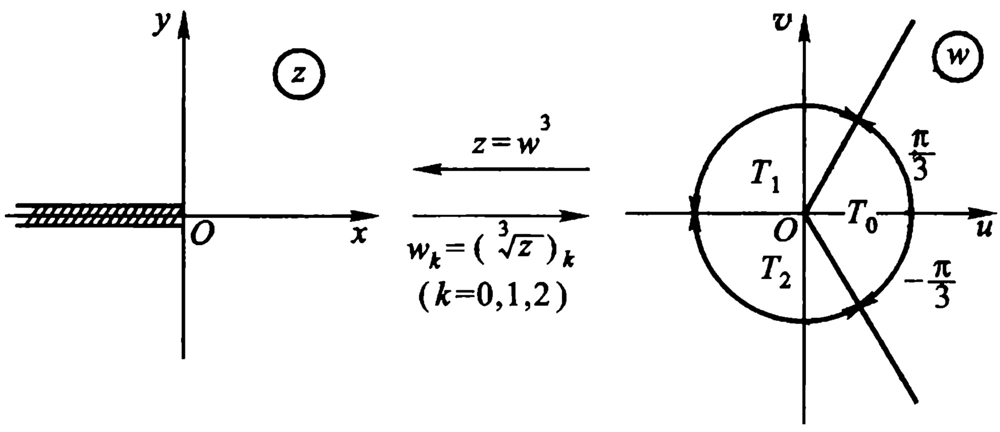

图2.4
 

不属于 T. (2.12) 的这些角形互不相交而填满（都加上同一端边界）w 平面（图 2.4）.

总之，幂函数  $ w = z^{n} $ （ $ n $ 是大于 1 的整数）的单叶性区域，是顶点在原点 z = 0，张度不超过  $ \frac{2\pi}{n} $ 的角形区域.

(2) 分出  $ \omega = \sqrt[n]{z} $ 的单值解析分支 当  $ z = r e^{i\theta} $ 时，函数

 $$ \begin{array}{r}{\varpi=\sqrt[n]{z}=\sqrt[n]{r}\mathrm{e}^{\mathrm{i}\frac{\theta+2k\pi}{n}},(k=0,1,\cdots,n-1)}\end{array} $$ 

出现多值性的原因是由于 z 确定后，其辐角并不唯一确定（可以相差  $ 2\pi $ 的整数倍）。今在 z 平面上从原点 O 到点  $ \infty $ 任意引一条射线（或一条无界简单曲线 $ ^{①} $），将 z 平面割破，割破了的 z 平面构成一个以此割线为边界的区域，记为 G（同时我们就用 G 表示包含在割破了的 z 平面内的某一子区域）。在 G 内随意指定一点  $ z_{0} $，并指定  $ z_{0} $ 的一个辐角值，则在 G 内任意的点 z，皆可根据  $ z_{0} $ 的辐角，依连续变化而惟一确定 z 的辐角。

假定从原点起割破负实轴，C 是 G 内过点  $ z_{0} $ 的一条简单闭曲线，即 C 不穿过负实轴，它的内部不包含原点 z=0，则当变点 z

<!-- page: 84 -->

从  $ z_{0} $ 起绕 C 一周时，z 的像点  $ \boldsymbol{w}_{k} = (\sqrt[n]{z})_{k} $ 各画出一条闭曲线  $ \Gamma_{k} $ （包含在角形  $ T_{k} $ 内）而各回到它原来的位置  $ \boldsymbol{w}_{k}^{(0)} $，因为这时  $ \arg z $ 回到其起始的值  $ \arg z_{0} $ （如图 2.5，它是 n = 3 的情形）.

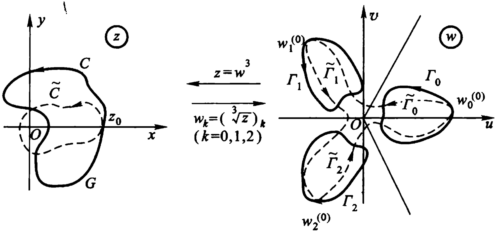

图2.5
 

因此，在区域 G 内可以得到

$$  \begin{align*}\varpi_{k}=(\sqrt[n]{z})_{k}&=\sqrt[n]{r(z)}\mathrm{e}^{\mathrm{i}\frac{\theta(z)+2k\pi}{n}},(z\in G)\ $ k&=0,1,2,\cdots,n-1)\end{align*}   \tag*{(2.13)}$$

它们也可记成

$$  \begin{aligned}\omega=&\sqrt[n]{z}\left(\sqrt[n]{1}=\mathrm{e}^{\mathrm{i}\frac{2k\pi}{n}}\right),(z\in G)\\&(k=0,1,\cdots,n-1)\end{aligned}   \tag*{(2.13)  ^{\prime} }$$

(2.13)或(2.13)′称为 $ \sqrt[n]{z} $的n个单值连续分支函数.当k取0,1, $ \cdots $,n-1中的固定值时,它就是 $ \sqrt[n]{z} $的第k个分支函数

下面,我们根据列入本章习题第9题的那个定理,来验证这个单值连续分支函数都是解析函数,并有

$$  \begin{aligned}\frac{\mathrm{d}}{\mathrm{d}z}(\sqrt[n]{z})_{k}&=\frac{1}{n}\frac{(\sqrt[n]{z})_{k}}{z},(z\in G)\ $ k&=0,1,\cdots,n-1)\end{aligned}   \tag*{(2.14)}$$

例如，对  $ \omega_{k} = (\sqrt[n]{z})_{k} $ 这一单值连续分支函数，其实部及虚部

<!-- page: 85 -->

$$ u\left(r,\theta\right)=\sqrt[n]{r}\cos\frac{\theta+2k\pi}{n},v\left(r,\theta\right)=\sqrt[n]{r}\sin\frac{\theta+2k\pi}{n} $$ 

在 G 内皆为 r, $ \theta $ 的可微函数，并且

 $$ u_{r}=\frac{1}{n}r^{\frac{1}{n}-1}\cos\frac{\theta+2k\pi}{n},u_{\theta}=-\frac{1}{n}r^{\frac{1}{n}}\sin\frac{\theta+2k\pi}{n}, $$ 

 $$ v_{r}=\frac{1}{n}r^{\frac{1}{n}-1}\sin\frac{\theta+2k\pi}{n},v_{\theta}=\frac{1}{n}r^{\frac{1}{n}}\cos\frac{\theta+2k\pi}{n}, $$ 

在 G 内满足极坐标的 C.-R. 方程：

 $$ u_{r}=\frac{1}{r}v_{\theta}\mathrm{,}v_{r}=-\frac{1}{r}u_{\theta}\mathrm{,} $$ 

故  $ \omega_{k} = (\sqrt[n]{z})_{k} $ 在 G 内解析，且

 $$ \begin{align*}\frac{\mathrm{d}}{\mathrm{d}z}(\sqrt[n]{z})_{k}&=\frac{r}{z}(u_{r}+\mathrm{i}v_{r})\\&=\frac{r}{z}\left(\frac{1}{n}r^{\frac{1}{n}-1}\cos\frac{\theta+2k\pi}{n}+\mathrm{i}\frac{1}{n}r^{\frac{1}{n}-1}\sin\frac{\theta+2k\pi}{n}\right)\\&=\frac{1}{n}\frac{1}{z}r^{\frac{1}{n}}\left(\cos\frac{\theta+2k\pi}{n}+\mathrm{i}\sin\frac{\theta+2k\pi}{n}\right)\\&=\frac{1}{n}\frac{(\sqrt[n]{z})_{k}}{z}(k=0,1,\cdots,n-1).\end{align*} $$ 

(3)  $ \omega = \sqrt[n]{z} $ 的支点及支割线 我们再分析一下，如果不像上述办法割破 z 平面，则变点 z 就可以沿一条简单闭曲线  $ \widetilde{C} $ (如图 2.5) 变  $ z_{0} $ 是  $ \widetilde{C} $ 上某一个点， $ \widetilde{C} $ 包含原点 z = 0 在其内部。这时， $ \widetilde{C} $ 穿过负实轴。于是，当变点 z 从  $ z_{0} $ 出发，循正 (负) 方向绕  $ \widetilde{C} $ 一周后， $ z_{0} $ 的辐角已经增 (减) 了  $ 2\pi $，z 的像点  $ \omega_{k} = (\sqrt[n]{z})_{k} $ 就不可能回到它们的原来位置  $ \omega_{k}^{(0)} $ ( $ \omega_{0}^{(0)} = \omega_{0} $)，而是沿如图 2.5 中虚线路径，从一支变到另一支：

 $$ \begin{aligned}{\mathcal{W}_{0}=\mathcal{W}_{0}^{(0)}}&{{}\xrightarrow{}\mathcal{W}_{1}^{(0)}\xrightarrow{}\mathcal{W}_{2}^{(0)}\xrightarrow{}\mathcal{W}_{3}^{(0)}\xrightarrow{}\cdots\xrightarrow{}\mathcal{W}_{n-1}^{(0)}\xrightarrow{}\mathcal{W}_{0}}\\ {\quad}&{{}(\leftarrow)\quad(\leftarrow)\quad(\leftarrow)\quad(\leftarrow)\cdots(\leftarrow)\quad(\leftarrow)}\\ \end{aligned} $$ 

这样一来，在包含或包围着原点 z=0 的区域 D 内，我们不可能把  $ w=\sqrt[n]{z} $ 分成 n 个独立的单值解析分支。而现在，这些分支好像在原

<!-- page: 86 -->

点 z=0 连接起来，抖不散了.

原点 z=0——在此点的充分小邻域内，作一个包围此点的圆周  $ \Gamma $，当变点 z 从  $ \Gamma $ 上一点出发，绕  $ \Gamma $ 连续变动一周而回到其出发点时， $ \sqrt[n]{z} $ 从其一支变到另外一支——我们称它为  $ \sqrt[n]{z} $ 的支点.

 $ z=\infty $ 也具有 z=0 所具有的类似性质，也称为 $ \sqrt[n]{z} $ 的支点。因为 z 沿顺时针方向绕以原点 z=0 为心，半径为充分大的圆周  $ \Gamma $ （此圆周可以看作是在点  $ \infty $ 的邻域内，并包围着  $ \infty $ 的一个圆周）一周时， $ \sqrt[n]{z} $ 也从其一支变到另外一支。

一般地，具有这种性质的点，使得当变点 z 绕这点一整周时，多值函数从其一支变到另一支，也就是说，当变点回转至原来的位置时，函数值与原来的值相异，则称此点为此多值函数的支点.

 $ \sqrt[n]{z} $ 除在 z=0 及 z= $ \infty $ 具有上述性质外，其他任何点皆不具此性质。因此， $ \sqrt[n]{z} $ 仅以 z=0 及 z= $ \infty $ 为支点。

用来割破 z 平面，借以分出  $ \sqrt[n]{z} $ 的单值解析分支的割线，称为  $ \sqrt[n]{z} $ 的支割线。一般地说，支割线可以区分为两岸。当支割线接近于平行 x 轴的方向，就分成上岸与下岸；当支割线接近平行于 y 轴的方向，就分成左岸与右岸。每一单值分支在支割线的两岸取得不同的值。

对应于支割线的不同作法，分支也就不同。因为这时各分支的定义域 G 随支割线改变而改变，其值域  $ T_{k}(k=0,1,\cdots,n-1) $ 当然也要随支割线改变而改变。但无论怎样，各分支的总体仍然是  $ \sqrt[n]{z} $，因为改变后的  $ T_{k}(k=0,1,\cdots,n-1) $ 仍然互不相交而填满（都加上同一端边界）w 平面。

特别情形,是取负实轴为支割线而得出的 n 个不同的分支,其中有一支在正实轴上取正实值的,称为 $ \sqrt[n]{z} $的主值支,它可以表为:

$$  \left(\sqrt[n]{z}\right)_{0}=\sqrt[n]{r}\mathrm{e}^{\frac{\mathrm{i}\theta}{n}},\quad(-\pi<\theta<\pi).   \tag*{(2.15)}$$

<!-- page: 87 -->

顺便指出：每一单值分支在支割线上是不连续的。就拿以负实轴为支割线的主值支(2.15)来说，当 z 从负实轴上方趋于点 z = -x (x > 0)，与从负实轴下方趋于此点时，分别有极限  $ \sqrt[n]{x} e^{\frac{i\pi}{n}} $ 及  $ \sqrt[n]{xe^{-\frac{i\pi}{n}}} $。不过，函数  $ w = \sqrt[n]{z} $ 的每一单值连续分支，可以扩充成为直到负实轴（除去原点 z = 0）的上岸（或下岸）连续的函数。扩充的函数值称为上述单值连续分支在负实轴的上岸（或下岸）所取的值。

也就是说，如  $ z = z_{0} $ 在支割线负实轴的上岸，而每个在 G:  $ -\pi < \theta(z) < \pi $ 内的单值解析分支  $ (\sqrt[n]{z})_{k} $ 是可以扩充成单边连续到负实轴上岸的。这时，就可以在上岸上计算其值。

值得注意的是：√z除了表多值函数的总体外，在一般书中，也常用它同时表某一特定单值分支。这时，一定要从上上下文去看它究竟是表示什么区域上的哪一分支。比如，当我们将√z的第k支(√z)仍用√z表示时，公式(2.14)就可写成

$$  \frac{\mathrm{d}}{\mathrm{d}z}\sqrt[n]{z}=\frac{1}{n}\cdot\frac{\sqrt[n]{z}}{z}=\frac{1}{n}z^{\frac{1}{n}-1},   \tag*{(2.14)  ^{\prime} }$$

这时，(2.14)′中的 $ \sqrt[n]{z} $及 $ z^{\frac{1}{n}} $就不能看成多值函数的总体，而应看成同一个特定单值解析分支.

还要强调一下，对于定义域 G 而言，如 G 不包含（或不包围）原点（或点 $ \infty $）时，则 $ \sqrt[n]{z} $在 G 内已能分出单值解析分支（如图 2.6

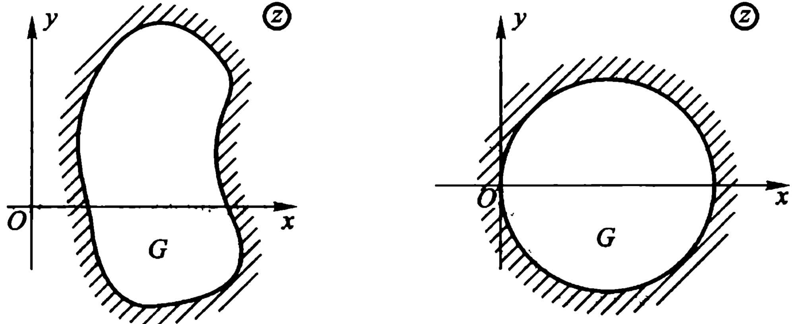

图2.6
 

<!-- page: 88 -->

所示各区域 G)，否则(如图 2.7 所示各区域 G)就要从原点至点  $ \infty $ 引割线将 G 割开，才能分出单值解析分支.

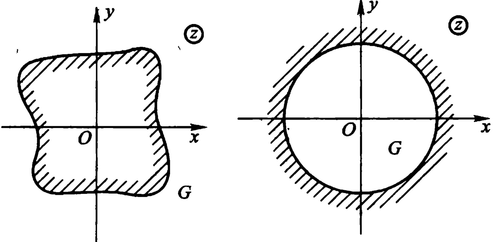

图2.7
 

前面讨论的一切结论,经过适当的变数代换,就可以转移到多少更一般类型的函数:

 $$ w=\sqrt[n]{z-a}, $$ 

它只以 z = a 及  $ z = \infty $ 为支点，以从  $ z = a $ 出发并伸向无穷的广义简单曲线为支割线。且在沿支割线割开的 z 平面上任一区域内，能分出 n 个单值解析分支。

例 2.15 设  $ \omega = \sqrt[3]{z} $ 确定在从原点 z = 0 起沿负实轴割破了的 z 平面上，并且  $ \omega(i) = -i $. 试求  $ \omega(-i) $ 之值.

解 设  $ z = re^{\mathrm{i}\theta} $，则

 $$ \omega_{k}=\sqrt[3]{r(z)}\mathrm{e}^{\mathrm{i}\frac{\theta(z)+2k\pi}{3}},k=0,1,2 $$ 

这里

 $ z \in G: -\pi < \theta < \pi $. 且必  $ r(z) = |z| > 0 $.

(因为在单有限支点的情形,沿 z 平面的负实轴割破,与限制 z 的辐角  $ \arg z = \theta(z) $ 的变化范围  $ -\pi < \theta(z) < \pi $ 是一致的.)

（1）由已给条件定 k:

 $$ z=\mathrm{i}\in G\mathrm{ 时 },r(\mathrm{i})=1,\theta(\mathrm{i})=\frac{\pi}{2}. $$

<!-- page: 89 -->

要  $ -\mathrm{i} = \mathrm{e}^{\mathrm{i}\frac{\pi}{2} + 2k\pi} = \mathrm{e}^{\mathrm{i}\frac{\pi}{6} + 4k\pi} $，必 k = 2。

或直接由 -i 的辐角  $ \arg(-i)=\frac{3}{2}\pi $，合于  $ \pi<arg(-i)<\frac{5\pi}{3} $ 看出  $ -i\in T_{2} $（如图 2.8），因而 k=2。

(2) 求  $ w_2(-i)(-i \in G) $:

因  $ r(-i)=1, \theta(-i)=-\frac{\pi}{2} $，故

 $$ \begin{array}{r}{\mathcal{w}_{2}\left(-\mathrm{~i~}\right)=\mathrm{e}^{\mathrm{i}\frac{1}{3}\left(-\frac{\pi}{2}+4\pi\right)}=\mathrm{e}^{\frac{7}{6}\pi\mathrm{i}}=-\mathrm{e}^{\frac{\pi}{6}\mathrm{i}}.}\end{array} $$ 

（3）各支的图像（如图 2.8）：

 $$ G:-\pi<\theta(z)<\pi\longrightarrow T_1:\frac{\pi}{3}<\arg w_1(z)<\pi;T_2:\pi<\arg w_2(z)<\frac{5\pi}{3}. $$ 

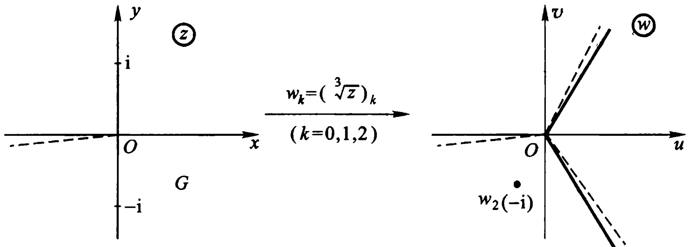

图2.8
 

2. 对数函数

(1) 复对数的定义

定义 2.10 我们规定对数函数是指数函数的反函数.即若

$$  \mathrm{e}^{w}=z\quad(z\neq0,\infty)   \tag*{(2.16)}$$

则复数 w 称为复数 z 的对数, 记为  $ w = \mathrm{Ln} z $.

<!-- page: 90 -->

令  $ z = re^{\mathrm{i}\theta} $, w = u + iv, 则 (2.16) 就是

因而

 $$ \begin{array}{c}{\mathrm{e}^{u+\mathrm{i}v}=r\mathrm{e}^{\mathrm{i}\theta}}\\ {\mathrm{u}=\ln r,v=\theta+2k\pi}\\ {\mathrm{(~k=0,~\pm1,\cdots~)}}\end{array} $$ 

故方程(2.16)的全部根是

或

$$  \begin{aligned}\ln z&=\ln r+\mathrm{i}(\theta+2k\pi),(k=0,\pm1,\cdots)\\\ln z&=\ln|z|+\mathrm{i}\arg z\\&=\ln|z|+\mathrm{i}(\arg z+2k\pi).(k=0,\pm1,\cdots)\end{aligned}   \tag*{(2.18)}$$

（当 k 取确定值时， $ \ln z $ 的对应值记为 $ (\ln z)_{k} $）

且

$$  \ln z=\ln z+2k\pi\mathrm{i}(k=0,\pm,\cdots)   \tag*{(2.19)}$$

这就说明了一个复数  $ z(z \neq 0, \infty) $ 的对数仍是复数，它的实部是 z 的模的通常实自然对数，它的虚部是 z 的辐角的一般值，即虚部可以取无穷多个值，任二相异值之差为  $ 2\pi $ 的一个整数倍。也就是说， $ w = \mathrm{Ln} z $ 是 z 的无穷多值函数。

式(2.19)的  $ \ln z = \ln |z| + \mathrm{iarg} z $ 表示  $ \mathrm{Ln} z $ 的某一个特定值，其中  $ \arg z $ 表示  $ \mathrm{Arg} z $ 的一个特定值。当限定  $ \arg z $ 取主值时，即  $ -\pi < \arg z \leq \pi $ 时， $ \ln z $ 称为  $ \mathrm{Ln} z $ 的主值（或主值支）。于是

主值

$$  \begin{aligned}\ln z&=\ln|z|+\mathrm{i}\arg z,\ $ -\pi&<\arg z\leqslant\pi)\end{aligned}   \tag*{(2.20)}$$

例 2.16 设 a>0，则

 $$ \mathrm{L n}a=\ln a+2k\pi\mathrm{i},(k=0,\pm1,\cdots) $$ 

其主值就是通常的实对数  $ \ln a $.

 $$ \mathrm{L n}(-a)=\ln a+(2k+1)\pi\mathrm{i}(k=0,\pm1,\cdots); $$ 

 $$ \ln(-\alpha)=\ln a+\pi\mathrm{i}; $$ 

特别

 $$ \ln(-1)=\ln1+\pi\mathrm{i}=\pi\mathrm{i}; $$ 

 $$ \mathrm{L n}(-1)=(2k+1)\pi\mathrm{i}(k=0,\pm1,\cdots). $$ 

此例说明:复对数是实对数在复数域内的推广;在实数域内“负数无对数”的说法,在复数域内是不成立的.但可修改成“负数

<!-- page: 91 -->

无实对数，且正实数的复对数也是无穷多值的。”

例 2.17

 $$ \ln i=\ln|\mathrm{i}|+\frac{\pi}{2}\mathrm{i}=\frac{\pi}{2}\mathrm{i}; $$ 

 $$ \begin{aligned}\mathrm{Ln i}=\frac{\pi}{2}\mathrm{i}+2k\pi\mathrm{i}=\left(\frac{1+4k}{2}\right)\pi\mathrm{i}\\ (k=0,\pm1,\cdots)\end{aligned} $$ 

例 2.18

 $$ \begin{array}{c}{\mathrm{L n}(3+4\mathrm{i})=\ln5+\mathrm{i}\mathrm{a r c}\tan\frac{4}{3}+2k\pi\mathrm{i}.}\\ {(k=0,\pm1,\cdots)}\end{array} $$ 

（2）对数函数的基本性质

$$  \begin{array}{r}{\mathrm{L n}(z_{1}z_{2})=\mathrm{L n}z_{1}+\mathrm{L n}z_{2},}\\ {\mathrm{L n}\frac{z_{1}}{z_{2}}=\mathrm{L n}z_{1}-\mathrm{L n}z_{2}.}\end{array}\Biggl\{(z_{1},z_{2}\neq0,\infty)}   \tag*{(2.21)}$$

可以像在实数域中一样证明它们在复数域中成立.例如证明前一个.根据指数函数的加法定理,由恒等式

 $$ \mathrm{e}^{\mathrm{Ln}z_{1}}=z_{1} 和 \mathrm{e}^{\mathrm{Ln}z_{2}}=z_{2}, $$ 

即可推出恒等式

 $$ \mathrm{e}^{\mathrm{L n}z_{1}+\mathrm{L n}z_{2}}=\mathcal{Z}_{1}\mathcal{Z}_{2}; $$ 

另一方面，因

 $$ \begin{array}{c}{\mathrm{e}^{\mathrm{L n}\left(z_{1}z_{2}\right)}=\mathcal{Z}_{1}\mathcal{Z}_{2},}\\ {\mathrm{e}^{\mathrm{L n}\left(z_{1}z_{2}\right)}=\mathrm{e}^{\mathrm{L n}z_{1}+\mathrm{L n}z_{2}}.}\end{array} $$ 

故

于是得证.

思考题 参照我们对公式(1.12)及(1.12)′所作的说明，试对公式(2.21)作出类似的说明.

当求等式

 $$ \mathrm{e}^{z_{1}}=\mathrm{e}^{z_{2}} $$ 

的对数时，结果可以写成

 $$ z_{1}=z_{2}+2k\pi\mathrm{i}. $$ 

加上  $ 2k\pi $ 是必要的，因为指数函数具有虚周期  $ 2\pi i $.

<!-- page: 92 -->

##### （3）指数函数  $ z = e^{w} $ 的变换性质及其单叶性区域

令  $ z = re^{\mathrm{i}\theta} $, w = u + iv, 则 (2.16) 成为

 $$ r=e^{u},\theta=v. $$ 

由此知道，变换(2.16):

 $$ z=\mathrm{e}^{w},(z\neq0,\infty) $$ 

把直线  $ v = v_{0} $ 变成从原点出发的射线  $ \theta = v_{0} $，把线段“u = u_{0} 且  $ -\pi < v \leq \pi $”变成圆周  $ r = e^{u_{0}} $ (图 2.9).

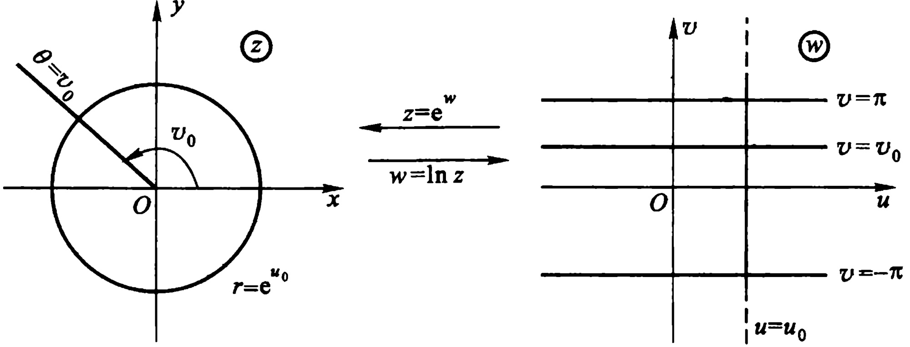

图2.9
 

当 w 平面上的动直线从直线 v = 0 扫动到直线  $ v = v_{0} $ 时，在变换  $ z = e^{w} $ 下的像，就在 z 平面上从射线  $ \theta = 0 $ 扫动到射线  $ \theta = v_{0} $. 从而 w 平面上的带形  $ 0 < v < v_{0} $ 就被变成 z 平面上的角形  $ 0 < \theta < v_{0} $ (图 2.9).

特别,变换  $ z = e^{w} $ 把 w 平面上的带形  $ -\pi < v < \pi $ 变成 z 平面上除去原点及负实轴的区域.

一般，变换(2.16)把宽为  $ 2\pi $ 的带形

$$  B_{k}:(2k-1)\pi<v<(2k+1)\pi,(k=0,\pm1,\cdots)   \tag*{(2.22)}$$

都变成 z 平面上除去原点及负实轴的区域(图 2.10).

显然(2.22)是函数(2.16)的单叶性区域的 $ \uwave{\text{一种分法}} $. 因而(2.17)我们知道, 区域 B 是(2.16)的单叶性区域的充要条件为: 对于

<!-- page: 93 -->

B 内任一点  $ w_{1}=u_{1}+\mathrm{i}v_{1} $，满足条件

 $$ u_{2}=u_{1},v_{2}=v_{1}+2k\pi\quad(k 为非零整数 ) $$ 

的点  $ w_{2}=u_{2}+iv_{2} $ 不属于 B.

(2.22)的这些带形互不相交而填满(都加上同一端边界) $ \omega $ 平面(图 2.10).

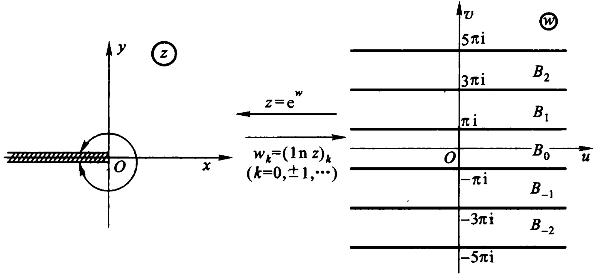

图2.10
 

总之, 指数函数  $ w = e^{z} $ 的单叶性区域, 是 z 平面上平行于实轴, 宽不超过  $ 2\pi $ 的带形区域.

(4) 分出  $ w = \mathrm{Ln} z $ 的单值解析分支 参照图 2.11 作类似于对函数  $ \omega = \sqrt[n]{z} $ 的讨论. 在 z 平面上从原点 z = 0 起割破负实轴的区域 G 内, 可以得到 w =  $ \mathrm{Ln} z $ 的无穷多个不同的单值连续分支函数

$$  \begin{align*}\boldsymbol{w}_{k}=(\ln z)_{k}=\ln r(z)+\mathrm{i}\big[\theta(z)+2k\pi\big].\ $ z\in G,k=0,\pm1,\cdots)\end{align*}   \tag*{(2.23)}$$

它们也可记成

$$  \begin{aligned}\omega=\ln z\left(\ln1=i2k\pi\right),(z\in G)\ $ k=0,\pm1,\cdots)\end{aligned}   \tag*{· (2.23)  ^{\prime} }$$

仍可根据列入本章习题9的那个定理，验证(2.23)皆在G内解

<!-- page: 94 -->

析，且有

 $$ \frac{\mathrm{d}}{\mathrm{d}z}(\ln z)_{k}=\frac{1}{z}\quad(z\in G,k=0,\pm1,\cdots). $$ 

当不割破 z 平面时，参照图 2.11 作类似于对  $ \omega = \sqrt[n]{z} $ 的讨论，即知 w = Ln z 仍只以 z = 0 及 z =  $ \infty $ 为支点，仍以连接 z = 0 及 z =  $ \infty $ 的广义简单曲线（特别是负实轴）为支割线.

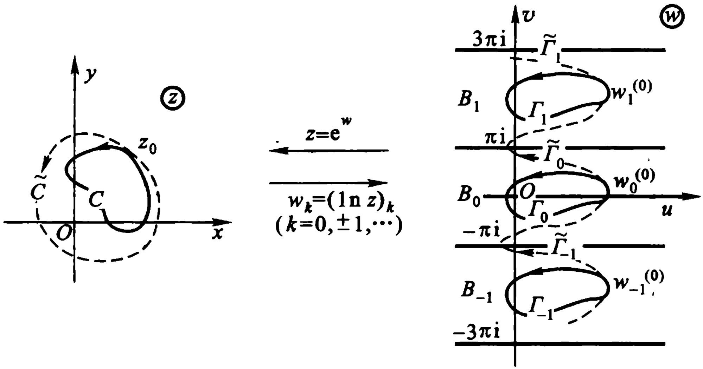

图2.11
 

同理，易知  $ \mathrm{Ln}(z-a) $ 只以 z=a 及 z= $ \infty $ 为支点，以联结 z=a 及 z= $ \infty $ 的任一射线或广义简单曲线为支割线；在沿支割线割开了的 z 平面上任一区域 G 内， $ \mathrm{Ln}(z-a) $ 的每一分支是单值解析的.

### 3. 一般幂函数与一般指数函数

定义 2.11  $ w = z^{a} = e^{a\mathrm{Ln}z} (z \neq 0, \infty; a $ 为复常数) 称为 z 的一般幂函数.

此定义是实数域中等式

 $$ x^{\alpha}=\mathrm{e}^{\alpha\ln x}\quad(x>0,\alpha 为实数 ) $$ 

在复数域中的推广. 不难验证, 当  $ \alpha $ 取整数  $ n \geqslant 1 $ 或取分数  $ \frac{1}{n} $ (n 为大于 1 的整数) 时, 它就是我们已经定义过的幂函数  $ z^{n} $ 及根式

<!-- page: 95 -->

函数 $ \sqrt[n]{z} $.

设 $ (\ln z)_{0} $表示 $ \mathrm{Ln}z $中的任意一个确定的值.则

 $$ \begin{aligned}\boldsymbol{z}^{\alpha}&=\mathrm{e}^{\alpha\operatorname{Ln}z}=\mathrm{e}^{\alpha\left[\left(\ln z\right)_{0}+2k\pi\mathrm{i}\right]}\\&=\mathcal{w}_{0}\mathrm{e}^{2k\pi\mathrm{i}\alpha},\left(k=0,\pm1,\cdots\right)\end{aligned} $$ 

其中  $ w_{0} = e^{a(\ln z)}_{0} $ 表  $ z^{a} $ 所有的值中的一个.

现在我们来讨论  $ \alpha $ 的如下三种特殊情形：

(1)  $ \alpha $ 是一整数 n. 此时

 $$ \mathrm{e}^{2k\pi\mathrm{i}\alpha}=\mathrm{e}^{2(k n)\pi\mathrm{i}}=1, $$ 

故  $ z^{a} $ 这时是 z 的单值函数.

(2)  $ \alpha $ 是一有理数  $ \frac{q}{p} $ (既约分数). 这时

 $$ \mathrm{e}^{2k\pi\mathrm{i}\alpha}=\mathrm{e}^{2k\pi\mathrm{i}\frac{q}{p}}, $$ 

只能取 p 个不同的值，即当 k=0,1,2,\cdots,p-1 时的对应值.于是

 $$ z^{\frac{q}{p}}=\mathcal{w}_{0}\mathrm{e}^{2k\pi\mathrm{i}\frac{q}{p}},k=0,1,2,\cdots,p-1. $$ 

(3)  $ \alpha $ 是一无理数或虚数 这时, 式子  $ \mathrm{e}^{2k\pi i a} $ 的所有的值各不相同,  $ z^{\alpha} $ 就是无限多值的.

总之，由于  $ \mathrm{Ln}z $ 的多值性， $ z^{a} $ 一般也是多值的（仅当 a 为整数时例外）。将  $ z^{a} $ 分成单值解析分支的方法与  $ \mathrm{Ln}z $ 同，且  $ z^{a} $ 仍只以 z=0 及 z= $ \infty $ 为支点。当从原点起沿负实轴割破 z 平面后，对  $ z^{a} $ 的每一分支（仍以  $ z^{a} $ 表示之）有

 $$ \begin{array}{c}\frac{\mathrm{d}}{\mathrm{d}z}z^{\alpha}=\frac{\mathrm{d}}{\mathrm{d}z}\mathrm{e}^{\alpha\ln z}=\mathrm{e}^{\alpha\ln z}\cdot\frac{\alpha}{z}\\ \\ =z^{\alpha}\cdot\frac{\alpha}{z}=\alpha z^{\alpha-1},\end{array} $$ 

当 $ \alpha $取分数 $ \frac{1}{n} $（ $ n $为大于1的整数）时，它就是（2.14）'。

定义 2.12  $ \because w = a^{z} = e^{z\mathrm{Ln}a} (a \neq 0, \infty $ , 为一复常数) 称为一般指数函数.

它是无穷多个独立的，在 z 平面上单值解析的函数. 当  $ \alpha = e $，

<!-- page: 96 -->

Ln e 取主值时,便得到通常的单值的指数函数  $ e^{z} $.

本段说的这两种函数都可看作复合函数，它们的性质可由其他函数的性质推导出来。

例 2.19 求  $ i^{i} $.

解

 $$ \begin{align*}\mathrm{i}^{\mathrm{i}}=\mathrm{e}^{\mathrm{i}\mathrm{Ln}\mathrm{i}}&=\mathrm{e}^{\mathrm{i}\left(\frac{\pi}{2}\mathrm{i}+2k\pi\mathrm{i}\right)}=\mathrm{e}^{-\frac{\pi}{2}-2k\pi},\ $ k&=0,\pm1,\cdots)\end{align*} $$ 

且  $ \mathrm{i}^{i} $ 的主值为  $ \mathrm{e}^{-\frac{\pi}{2}} $

例 2.20 求  $ 2^{1+i} $

解

 $$ \begin{aligned}2^{1+i}&=e^{(1+i)\ln2}\\&=e^{(1+i)(\ln2+2k\pi i)}\\&=e^{(\ln2-2k\pi)+i(\ln2+2k\pi)}\\&=e^{(\ln2-2k\pi)}(\cos\ln2+i\sin\ln2),\\&\quad(k=0,\pm1,\cdots)\end{aligned} $$ 

且  $ 2^{1+i} $ 的主值为  $ \mathrm{e}^{\ln2}\left(\cos\ln2+i\sin\ln2\right) $.

### 4. 具有多个有限支点的情形

前面我们讨论了根式函数  $ \omega = \sqrt[n]{z} $ 与对数函数  $ \omega = \ln z $，它们的支点都是一个有限支点 z = 0 和无穷远点 z = ∞。其支割线可以是从 0 到 ∞ 的一条射线（如包含原点的负实轴），这与限制变点的辐角范围（如  $ -\pi < \arg z < \pi $）是一致的。从而，在 z 平面上以此割线为边界的区域 G 内，它们都能分出单值解析分支。

但对具有多个有限支点的多值函数,我们就不便采取限制辐角范围的办法,而是首先求出该函数的一切支点,然后适当联结支点以割破z平面.于是,在z平面上以此割线为边界的区域G内就能分出该函数的单值解析分支.因为,在G内变点z不能穿过支割线,也就不能单独绕任一个支点转一整周,函数就不可能在G内同一点取不同的值了.

##### （1）讨论函数

<!-- page: 97 -->

$$  w=f(z)=\sqrt[n]{P(z)}   \tag*{(2.24)}$$

的支点，其中  $ P(z) $ 是任意的 N 次多项式，

 $$ P\left(z\right)=A\left(z-a_{1}\right)^{a_{1}}\cdots\left(z-a_{m}\right)^{a_{m}} $$ 

 $ a_{1},a_{2},\cdots,a_{m} $ 是  $ P(z) $ 的一切相异零点  $ \alpha_{1},\alpha_{2},\cdots,\alpha_{m} $ 分别是它们的重数，合于

 $$ \alpha_{1}+\alpha_{2}+\cdots+\alpha_{m}=N. $$ 

##### 我们先来看

##### 例 2.21 考查下列二函数有哪些支点：

 $$ (a)f(z)=\sqrt{z(1-z)};(b)f(z)=\sqrt[3]{z(1-z)} $$ 

##### 解

(a) 当 z 沿内部包含 0(但不包含 1) 的简单闭曲线  $ C_{0} $ 正方向绕行一周时，z 的辐角得到增量  $ 2\pi $ (即  $ \Delta_{C_{0}}\arg z = 2\pi $), 1-z 的辐角并未改变 (即  $ \Delta_{C_{0}}\arg(1 - z) = \Delta_{C_{0}}\arg(z - 1) = 0 $), 结果  $ f(z) = \sqrt{z(1 - z)} $ 的辐角获得增量  $ \pi $, 即

 $$ \begin{aligned}\Delta_{C_{0}}\arg f(z)&=\frac{1}{2}\left[\Delta_{C_{0}}\arg z+\Delta_{C_{0}}\arg(1-z)\right]\\&=\frac{1}{2}\left[2\pi+0\right]=\pi.\end{aligned} $$ 

故  $ f(z) $ 的终值较初值增加了一个因子  $ e^{i\pi} = -1 $，发生了变化，可见  $ 0 $ 是  $ f(z) = \sqrt{z(1 - z)} $ 的支点。同样的讨论，可见 1 也是其支点。

任何异于 0、1 的有限点都不可能是  $ f(z) $ 的支点. 事实上, 对于这样的点  $ \zeta $, 可以取一条包含  $ \zeta $ 但不包含点 0、1 的简单闭曲线  $ \tilde{C} $, 而

 $$ \begin{aligned}\Delta_{\tilde{c}}\arg f(z)&=\frac{1}{2}\left[\Delta_{\tilde{c}}\arg z+\Delta_{\tilde{c}}\arg(1-z)\right]\\&=\frac{1}{2}\left[0+0\right]=0,\end{aligned} $$

<!-- page: 98 -->

即  $ f(z) $ 的终值与初值比较,未发生改变.

如果简单闭曲线 C 同时包含 0、1 两点（如图 2.12），点 z 沿 C 的正向绕行一周后，

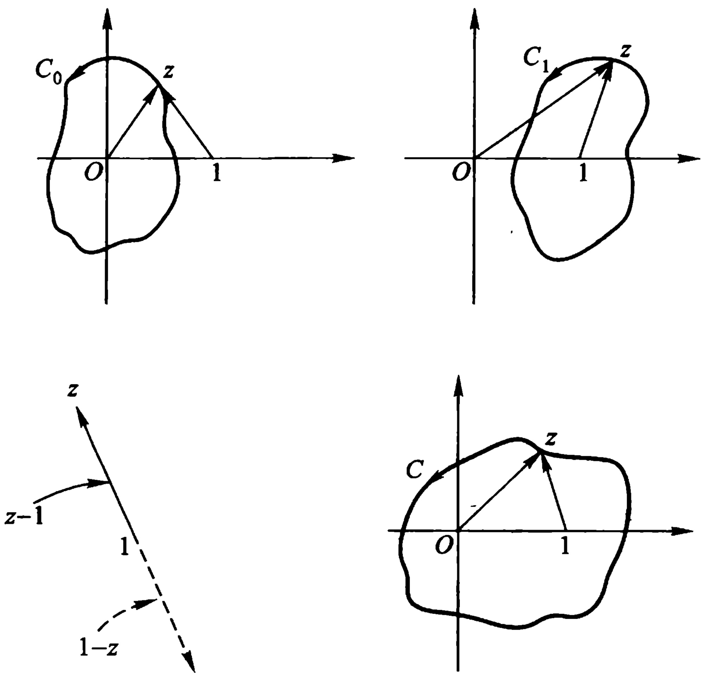

图2.12
 

 $$ \begin{align*}\Delta_{C}\arg f(z)&=\frac{1}{2}\left[\Delta_{C}\arg z+\Delta_{C}\arg(1-z)\right]\\&=\frac{1}{2}\left[\Delta_{C}\arg z+\Delta_{C}\arg(z-1)\right]\\&=\frac{1}{2}\left[2\pi+2\pi\right]=2\pi.\end{align*} $$ 

结果是  $ f(z) $ 原来的值乘以  $ e^{2\pi i}=1 $，并不改变其值。由此可见， $ \infty $ 不是  $ f(z) $ 的支点。

(b)  $ f(z) $ 可能的支点是 0,1, $ \infty $. 如图 2.12, 由于

 $$ \Delta_{c_{0}}\arg f(z)=\frac{1}{3}\left[\Delta_{c_{0}}\arg z+\Delta_{c_{0}}\arg(1-z)\right] $$

<!-- page: 99 -->

$$ =\frac{1}{3}\left[2\pi+0\right]=\frac{2\pi}{3}, $$ 

 $$ \begin{aligned}\Delta_{c_{_{1}}}\arg f(z)&=\frac{1}{3}\left[\Delta_{c_{_{1}}}\arg z+\Delta_{c_{_{1}}}\arg(1-z)\right]\\&=\frac{1}{3}\left[0+2\pi\right]=\frac{2\pi}{3},\end{aligned} $$ 

 $$ \begin{aligned}\Delta_{C}\arg f(z)&=\frac{1}{3}\left[\Delta_{C}\arg z+\Delta_{C}\arg(1-z)\right]\\&=\frac{1}{3}\left[2\pi+2\pi\right]=\frac{4\pi}{3},\end{aligned} $$ 

结果  $ f(z) $ 的值均较原值发生了变化. 故 0、1、 $ \infty $ 都是  $ f(z) $ 的支点，且此外别无支点.

对式(2.24)函数作类似地讨论，我们就能得到下列结论：

(a) (2.24)可能的支点是  $ a_{1}, a_{2}, \cdots, a_{m} $ 和  $ \infty $;

(b) 当且仅当 n 不能整除  $ \alpha_{i} $ 时,  $ \alpha_{i} $ 是  $ \sqrt[n]{P(z)} $ 的支点;

(c) 当且仅当 n 不能整除 N 时,  $ \infty $ 是  $ \sqrt[n]{P(z)} $ 的支点;

(d) 如果 n 能整除  $ \alpha_{1}, \alpha_{2}, \cdots, \alpha_{m} $ 中若干个之和，则  $ a_{1}, a_{2}, \cdots, a_{m} $ 中对应的那几个就可以联结成割线抱成团，即变点 z 沿只包含它们在其内部的简单闭曲线转一整周后，函数值不变。这种抱成的团可能不止一个。其余不入团的点  $ a_{i} $ 则与点  $ \infty $ 联结成一条割线。

例如，对

 $$ \begin{array}{r}{\varpi=\sqrt{z\left(z-1\right)\left(z-2\right)\left(z-3\right)\left(z-4\right)},}\end{array} $$ 

就可将0与1,2与3分别用直线联结成割线，抱成两个团，再把余下的4与点 $ \infty $联结成一条割线.

又如对

 $$ \begin{array}{r}{\varpi=\sqrt[3]{z\left(z-1\right)\left(z-2\right)\left(z-3\right)\left(z-4\right)},}\end{array} $$ 

就可将 0,1,2 用直线联结成一条割线，抱成一个团，再把余下的 3,4 与点 $ \infty $联结成一条割线.

<!-- page: 100 -->

(2) 由已给单值解析分支  $ f(z) $ 的初值  $ f(z_{1}) $，计算终值  $ f(z_{2}) $

借助每一单值解析分支  $ f(z) $ 的连续性，先计算当 z 从  $ z_{1} $ 沿曲线 C（不穿过支割线）到终点  $ z_{2} $ 时， $ f(z) $ 的辐角的连续改变量  $ \Delta_{c} $arg  $ f(z) $，再计算终值

 $$ \begin{aligned}f(z_{2})&=\mid f(z_{2})\mid\mathrm{e}^{\mathrm{iarg}f(z_{2})}\\&=\mid f(z_{2})\mid\mathrm{e}^{\mathrm{i}\left[\arg f(z_{2})-\arg f(z_{1})+\arg f(z_{1})\right]}\\&f(z_{2})=\mid f(z_{2})\mid\mathrm{e}^{\mathrm{i}\Delta_{C}\arg f(z)}\bullet\mathrm{e}^{\mathrm{iarg}f(z_{1})}\end{aligned} $$ 

即

其中  $ \Delta_{C}\arg f(z) $ 与  $ \arg f(z_{1}) $ 的取值无关,  $ \arg f(z_{1}) $ 可以相差  $ 2\pi $ 的整倍数.

当初值  $ f(z_{1}) $ 取定时，(2.25) 就是终点（或动点） $ z_{2} $ 的单值函数，故 (2.25) 就是此单值解析分支的表达式。

例 2.22 试证  $ f(z) = \sqrt[3]{z(1-z)} $ 在将 z 平面适当割开后能分出三个单值解析分支. 并求出在点 z = 2 取负值的那个分支在 z = i 的值.

解 （1）由上例,我们已经知道  $ f(z) $ 的支点是 0,1, $ \infty $.

将 z 平面沿正实轴从 0 到 1 割开，再沿负虚轴割开（如图 2.13）。这样就保证了变点 z 不会单绕 0 或 1 转一周，也不会同绕 0 及 1（即绕点  $ \infty $）转一周了。在这样割开后的 z 平面 G 上， $ f(z)=\sqrt[3]{z(1-z)} $ 就能分出三个单值解析分支。

（2）解法一 设  $ z = r_{1} e^{i\theta_{1}} $

 $$ 1-z=r_{2}\mathrm{e}^{\mathrm{i}\theta_{2}}, $$ 

则

 $$ \begin{aligned}f_{k}\left(z\right)&=\sqrt[3]{r_{1}\left(z\right)r_{2}\left(z\right)}\mathrm{e}^{\mathrm{i}\frac{\theta_{1}\left(z\right)+\theta_{2}\left(z\right)+2k\pi}{3}}\\&\quad\left(z\in G,k=0,1,2\right)\end{aligned} $$ 

当 z=2 时， $ \theta_{1}=0,\theta_{2}=\pi,r_{1}=2,r_{2}=1 $

 $$ f_{k}\left(2\right)=\sqrt[3]{2}\mathrm{e}^{\mathrm{i}\frac{\left(2k+1\right)\pi}{3}},k=0,1,2 $$

<!-- page: 101 -->

当且仅当 k=1 时， $ f_{k}(2) $ 取负值.

故所取分支为

 $$ f_{1}(z)=\sqrt[3]{r_{1}(z)r_{2}(z)}\mathrm{e}^{\mathrm{i}\frac{\theta_{1}(z)+\theta_{2}(z)+2\pi}{3}} $$ 

因此

 $$ \begin{align*}f_{1}\left(\mathrm{i}\right)&=\sqrt[3]{\left|\mathrm{i}\right|\left|1-\mathrm{i}\right|}\mathrm{e}^{\frac{1}{3}\left(\frac{\pi}{2}+\frac{7\pi}{4}+2\pi\right)\mathrm{i}}\\&=\left(\sqrt{2}\right)^{\frac{1}{3}}\mathrm{e}^{\left(\pi+\frac{5\pi}{12}\right)\mathrm{i}}\\&=-\sqrt[6]{2}\mathrm{e}^{\frac{5}{12}\pi\mathrm{i}}.\end{align*} $$ 

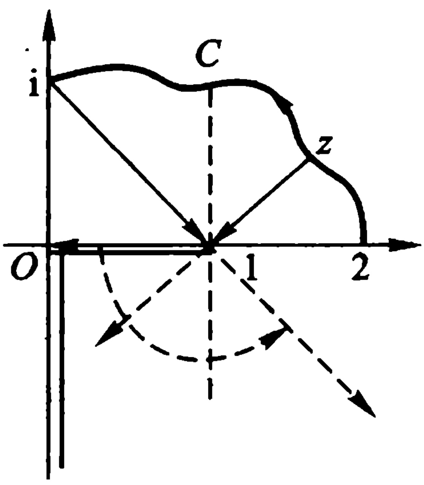

图2.13
 

解法二 如图 2.13.

 $$ \Delta_{C}\arg z=\frac{\pi}{2},\Delta_{C}\arg(1-z)=\frac{3\pi}{4}, $$ 

于是

 $$ \begin{aligned}\Delta_{C}\arg f(z)&=\frac{1}{3}\left[\Delta_{C}\arg z+\Delta_{C}\arg(1-z)\right]\\&=\frac{1}{3}\left(\frac{\pi}{2}+\frac{3\pi}{4}\right)=\frac{5\pi}{12}.\end{aligned} $$ 

而由题设,我们可以认为  $ \arg f(2)=\pi $ (允许相差  $ 2\pi $ 的整数倍).再由公式(2.25)得

 $$ f(\mathrm{i})=\sqrt[3]{|\mathrm{i}||1-\mathrm{i}|}\mathrm{e}^{\mathrm{i}\pi}\mathrm{e}^{\mathrm{i}\frac{5\pi}{12}}=-\sqrt[6]{2}\mathrm{e}^{\frac{5\pi}{12}\mathrm{i}}. $$ 

可见，用解法二（即用公式(2.25)）计算此单值解析分支的终值是较简捷的.

（3）关于对数函数的已给单值解析分支  $ \ln f(z) $，我们可以借助下面的公式来计算它的终值：

 $$ \begin{aligned}\ln f(z_{2})&=\ln|f(z_{2})|+\mathrm{i}\arg f(z_{2})\\&=\ln|f(z_{2})|+\mathrm{i}[\arg f(z_{2})-\arg f(z_{1})\\&\quad+\arg f(z_{1})]\end{aligned} $$ 

即

$$  \ln f(z_{2})=\ln\mid f(z_{2})\mid+\mathrm{i}\Delta_{C}\mathrm{a r g}f(z)+\mathrm{i}\mathrm{a r g}f(z_{1})   \tag*{(2.26)}$$

其中  $ C $ 是一条联结起点  $ z_{1} $ 和终点  $ z_{2} $ 且不穿过支割线的简单曲线； $ \arg f(z_{1}) $ 表示符合条件那一支在起点  $ z_{1} $ 之值

<!-- page: 102 -->

$$ \ln f(z_{1})=\ln|f(z_{1})|+\mathrm{iarg}f(z_{1}) $$ 

的虚部，是一个确定的值.

(2.26)就是此单值解析分支的表达式(当视  $ z_{2} $ 为 G 内的动点时).

例 2.23 试证  $ \mathrm{Ln}(1-z^{2}) $ 在割去“从 -1 到 i 的直线段”，“从 i 到 1 的直线段”与射线“x=0 且  $ y \geqslant 1 $”的 z 平面内能分出单值解析分支。并求 z=0 时等于零的那一支在 z=2 的值。

解 (1)  $ \mathrm{Ln}(1-z^{2}) $ 的支点为  $ z=\pm1 $ 及  $ \infty $.

 $$ \ln(1-z^{2})=\ln(1-z)+\ln(1+z), $$ 

当变点 z 单绕 -1 或 +1 一周时,  $ \ln(1 - z^{2}) $ 的值就改变  $ 2\pi i $ (沿正向) 或  $ -2\pi i $ (沿负向), 即  $ \ln(1 - z^{2}) $ 从一支变成另一支; 当变点 z 同绕 -1 及 +1 一周时,  $ \ln(1 - z^{2}) $ 共改变  $ 4\pi i $ (沿正向) 或  $ -4\pi i $ (沿负向), 即  $ \ln(1 - z^{2}) $ 也从一支变成另一支.

将 z 平面沿题中要求割破后(图 2.14)，变点 z 既不能单纯 -1 或 +1 转一周，也不能同绕 -1 及 +1 转一周。于是，在这样割破了的 z 平面上任一区域 G 内， $ \mathrm{Ln}(1 - z^{2}) $ 就能分出无穷多个单值解析分支。

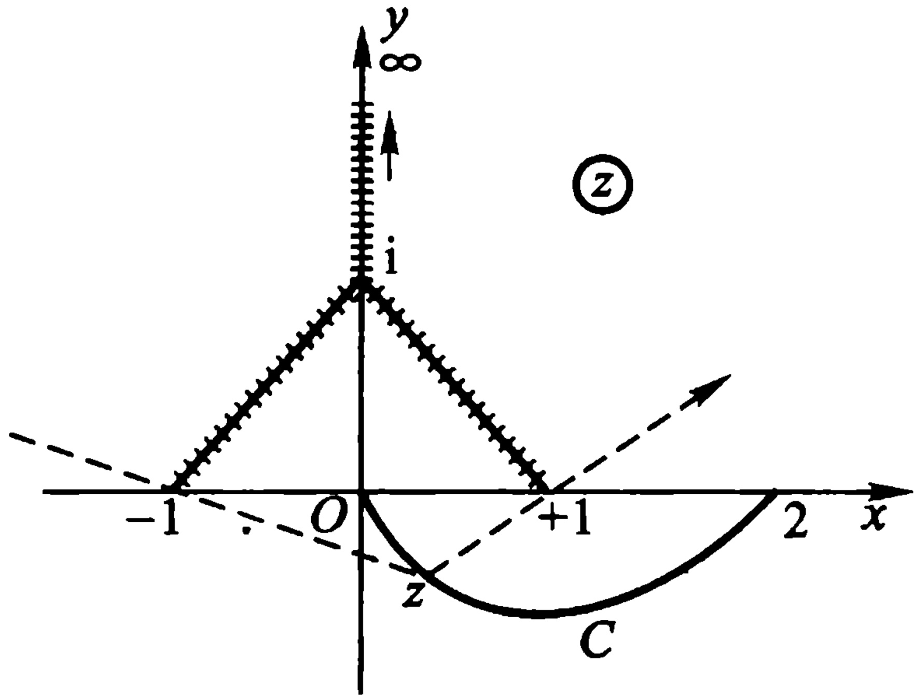

图2.14
 

（2）当 z 从 z=0 沿 G 内一条简单曲线 C 变动到 z=2 时，由

<!-- page: 103 -->

图 2.14，

 $$ \begin{align*}\Delta_{C}\arg(1-z^{2})&=\Delta_{C}\arg(1+z)(1-z)\\&=\Delta_{C}\arg(1+z)+\Delta_{C}\arg(1-z)\\&=\Delta_{C}\arg\left[-(1+z)\right]+\Delta_{C}\arg(1-z)\\&=0+\pi=\pi.\end{align*} $$ 

已知此指定分支在 z=0 的值为 0，从而此初值的虚部为零，故由公式(2.26)可知该分支在 z=2 的值为

 $$ \ln|1-z^{2}|_{z=2}+\pi\mathrm{i}=\ln3+\pi\mathrm{i}. $$ 

注 解这类问题(如以上三个例题)的要点,就是作图观察,当动点z沿路线C(C在G内,且不穿过支割线)从起点 $ z_{1} $到终点 $ z_{2} $时,各因子辐角的连续改变量: $ \Delta_{C} $arg z, $ \Delta_{C} $arg(1-z), $ \cdots $,即观察向量z,1-z, $ \cdots $,的辐角的连续改变量.由此即可计算 $ \Delta_{C} $arg f(z),并可利用公式(2.25)或(2.26).

5. 反三角函数与反双曲函数 正如我们在定义 2.5、定义 2.6 及定义 2.7 中所看到的，三角函数和双曲函数都可以非常简单的用指数函数表示；因为对数函数是指数函数的反函数，所以反三角函数和反双曲函数都可以用对数函数非常简单地表示。

（1）我们先从反正切函数开始. 记号

 $$ \varpi=\operatorname{A r c t a n}z. $$ 

指的是方程

 $$ \tan\ w=z $$ 

的解的总体.我们将此方程改写成

 $$ \frac{1}{\mathrm{i}}\cdot\frac{\mathrm{e}^{\mathrm{i}w}-\mathrm{e}^{-\mathrm{i}w}}{\mathrm{e}^{\mathrm{i}w}+\mathrm{e}^{-\mathrm{i}w}}=z, $$ 

还可改写成

 $$ \mathrm{e}^{2\mathrm{i}w}=\frac{1+\mathrm{i}z}{1-\mathrm{i}z}, $$ 

由此即得

 $$ 2\mathrm{i}w=\mathrm{L n}\frac{1+\mathrm{i}z}{1-\mathrm{i}z}, $$

<!-- page: 104 -->

最后即得

$$  \mathrm{A r c t a n}z=\frac{1}{2\mathrm{i}}\mathrm{L n}\frac{1+\mathrm{i}z}{1-\mathrm{i}z}.   \tag*{(2.27)}$$

同理,由关系  $ \omega = \mathrm{Arcsin} z $ 或由和它等价的关系

 $$ \sin w=z, $$ 

我们即得

 $$ z=\frac{\mathrm{e}^{\mathrm{i}w}-\mathrm{e}^{-\mathrm{i}w}}{2\mathrm{i}}. $$ 

由此得：

 $$ \mathrm{e}^{2i w}-2\mathrm{i}z\mathrm{e}^{\mathrm{i}w}-1=0. $$ 

将此等式看作  $ e^{i\omega} $ 的二次方程，即得

 $$ \begin{aligned}\mathrm{e}^{\mathrm{i}w}&=\mathrm{i}z+\sqrt{1-z^{2}}.\\\mathrm{i}w&=\mathrm{Ln}(\mathrm{i}z+\sqrt{1-z^{2}}).\\\mathrm{w}&=\frac{1}{\mathrm{i}}\mathrm{Ln}(\mathrm{i}z+\sqrt{1-z^{2}}).\end{aligned} $$ 

我们得到了反正弦函数恒等式

$$  \mathrm{A r c s i n}z=\frac{1}{\mathrm{i}}\mathrm{L n}(\mathrm{i}z+\sqrt{1-z^{2}}).   \tag*{(2.28)}$$

同理，对于反余弦函数，我们容易得出：

$$  \mathrm{A r c c o s}z=\frac{1}{\mathrm{i}}\mathrm{L n}(z+\mathrm{i}\sqrt{1-z^{2}}).   \tag*{(2.29)}$$

公式(2.27)、(2.28)和(2.29)都是无穷多值的,因为对数是无穷多值的;此外,不应忽视公式(2.28)和(2.29)中的根式是二值的.

（2）我们现在来讨论双曲函数的反函数.

例如，由等式

 $$ z=\cosh w 或 z=\frac{e^{w}+e^{-w}}{2} $$ 

我们即得(关于  $ w $ 解出方程)和它等价的等式

 $$ \begin{aligned}w&=\mathrm{Ln}(z+\sqrt{z^{2}-1}).\\ \mathrm{Arcosh}z&=\mathrm{Ln}(z+\sqrt{z^{2}-1}).\end{aligned} $$ 

于是

<!-- page: 105 -->

同理，可得

$$  \operatorname{A r s i n h}z=\operatorname{L n}(z+\sqrt{z^{2}+1}),   \tag*{(2.31)}$$

和

$$  \mathrm{A}\operatorname{t a n h}z=\frac{1}{2}\mathrm{L n}\frac{1+z}{1-z}.   \tag*{(2.32)}$$

公式(2.30)、(2.31)和(2.32)都是无穷多值的，且公式(2.30)和(2.31)中的根式是二值的.

所有这些函数分成单值解析分支的方法，与前面所用的讨论方法是类似的，也要先讨论它们的支点，只是较复杂些也较困难些。所有这些分支都在适当割破平面后的区域内单值解析。

当然，也可把它们视为复合函数来化简处理。这里，我们只要求掌握反三角函数的计值方法。

例 2.24 求 Arcsin 2.

解 由公式(2.28)

 $$ \begin{array}{l}\operatorname{Arcsin}2=-\mathrm{i}\operatorname{Ln}(2\mathrm{i}\pm\sqrt{3}\mathrm{i})\\ =-\mathrm{i}\operatorname{Ln}\left[(2\pm\sqrt{3})\mathrm{i}\right]\\ =-\mathrm{i}\left[\ln(2\pm\sqrt{3})+\frac{\pi}{2}\mathrm{i}+2k\pi\right]\\ =\frac{\pi}{2}-\mathrm{i}\ln(2\pm\sqrt{3})+2k\pi\\ =\left(\frac{1}{2}+2k\right)\pi-\mathrm{i}\ln(2\pm\sqrt{3}).\\ (k=0,\pm1,\pm2,\cdots)\end{array} $$ 

例 2.25 求  $ \mathrm{Arctan}(2i) $.

解 由公式(2.27)

 $$ \begin{array}{c}\operatorname{Arctan}(2\mathrm{i})=-\frac{\mathrm{i}}{2}\mathrm{Ln}\left(-\frac{1}{3}\right)\\ =-\frac{\mathrm{i}}{2}\left(\ln\frac{1}{3}+\pi\mathrm{i}+2k\pi\mathrm{i}\right)\\ =\frac{\pi}{2}+\mathrm{i}\frac{\ln3}{2}+k\pi\end{array} $$

<!-- page: 106 -->

$$ \begin{aligned}&=\left(\frac{1}{2}+k\right)\pi+\mathrm{i}\frac{\ln3}{2}.\\&\quad(k=0,\pm1,\pm2,\cdots)\end{aligned} $$ 

## 第二章 习题

## (一)

1 设连续曲线  $ C: z = z(t), t \in [\alpha, \beta] $，有

 $$ z^{\prime}(t_{0})\neq0\quad(t_{0}\in[\alpha,\beta]), $$ 

则(试证)曲线 C 在点  $ z(t_{0}) $ 有切线.

2 洛必达(L'Hospital)法则 若  $ f(z) $ 及  $ g(z) $ 在点  $ z_{0} $ 解析，且

 $$ f(z_{0})=g(z_{0})=0,g^{\prime}(z_{0})\neq0, $$ 

则（试证）

 $$ \lim_{z\to z_{0}}\frac{f(z)}{g(z)}=\frac{f^{\prime}(z_{0})}{g^{\prime}(z_{0})}. $$ 

3 设  $ f(z)=\left\{\begin{aligned}\frac{x^{3}-y^{3}+i(x^{3}+y^{3})}{x^{2}+y^{2}},&z\neq0,\\0,&z=0,\end{aligned}\right. $

试证  $ f(z) $ 在原点满足 C.-R. 方程,但却不可微.

4 试证下列函数在 z 平面上任何点都不解析：

(1)  $ |z| $; (2)  $ x + y $; (3) Re z; (4)  $ \frac{1}{\overline{z}} $

5 试判断下列函数的可微性和解析性：

(1)  $ f(z) = xy^{2} + \mathrm{i}x^{2}y $;

(2)  $ f(z) = x^{2} + \mathrm{i} y^{2} $;

(3)  $ f(z) = 2x^{3} + 3\mathrm{i}y^{3} $;

(4)  $ f(z) = x^{3} - 3xy^{2} + \mathrm{i}(3x^{2}y - y^{3}) $.

答: (1) 只在原点 z = 0 可微;

（2）只在直线 y=x 上可微；

（3）只在 $ \sqrt{2}x\pm\sqrt{3}y=0 $上可微；

<!-- page: 107 -->

（4）处处可微.

6 若函数  $ f(z) $ 在区域 D 内解析，且满足下列条件之一，试证  $ f(z) $ 在 D 内必为常数.

(1) 在 D 内  $ f'(z)=0 $;

(2) $ \overline{f(z)} $在D内解析；

(3) $ |f(z)| $在D内为常数；

(4)  $ \mathrm{Re} f(z) $ 或  $ \mathrm{Im} f(z) $ 在 D 内为常数.

7 如果  $ f(z) $ 在区域 D 内解析，试证  $ \mathrm{i}\overline{f(z)} $ 在区域 D 内也解析.

8 试证下列函数在 z 平面上解析，并分别求出其导函数.

(1)  $ f(z) = x^{3} + 3x^{2}y\mathrm{i} - 3xy^{2} - y^{3}\mathrm{i} $;

(3)  $ f(z) = \sin x \cdot \cosh y + \mathrm{i} \cos x \cdot \sinh y; $

(4)  $ f(z) = \cos x \cdot \cosh y - i \sin x \cdot \sinh y $.

答: (1)  $ f'(z) = 3z^{2} $;

(2)  $ f'(z) = (z + 1)e^z $;

(3)  $ f'(z) = \cos x \cdot \cosh y - i \sin x \cdot \sinh y $;

(4)  $ f'(z) = -(\sin x \cdot \cosh y + \mathrm{i} \cos x \cdot \sinh y) $.

### 9 试证下面的定理：

设  $ f(z)=u(r,\theta)+\mathrm{i}v(r,\theta) $,  $ z=r\mathrm{e}^{\mathrm{i}\theta} $,

若  $ u(r,\theta) $,  $ v(r,\theta) $ 在点  $ (r,\theta) $ 是可微的，且满足极坐标的 C.-R. 方程：

 $$ \frac{\partial u}{\partial r}=\frac{1}{r}\frac{\partial v}{\partial\theta},\quad\frac{\partial v}{\partial r}=-\frac{1}{r}\frac{\partial u}{\partial\theta}(r>0), $$ 

则  $ f(z) $ 在点 z 是可微的，并且

 $$ \begin{align*}f^{\prime}\left(z\right)&=\left(\cos\theta-\mathrm{i}\sin\theta\right)\left(\frac{\partial u}{\partial r}+\mathrm{i}\frac{\partial v}{\partial r}\right)\\&=\frac{r}{z}\left(\frac{\partial u}{\partial r}+\mathrm{i}\frac{\partial v}{\partial r}\right).\end{align*} $$ 

注 这里要适当割破 z 平面(如沿负实轴割破), 否则  $ \theta(z) $ 就不是单值的.

10 设  $ z = x + iy $，试求

(1)  $ \left|e^{i-2z}\right| $; (2)  $ \left|e^{z^2}\right| $; (3)  $ \mathrm{Re}(e^{\frac{1}{z}}) $

答: (1)  $ e^{-2x} $; (2)  $ e^{x^{2}-y^{2}} $;

<!-- page: 108 -->

(3)

 $$ \mathrm{e}^{\frac{x}{2}+y^{2}}\cos\frac{y}{x^{2}+y^{2}}. $$ 

11 试证

(1)  $ \overline{e^{z}} = e^{\overline{z}} $; (2)  $ \overline{\sin z} = \sin \overline{z} $;

(3)  $ \overline{\cos z} = \cos \overline{z} $.

12 试证: 对任意的复数 z 及整数 m,

 $$ \left(\mathrm{e}^{z}\right)^{m}=\mathrm{e}^{mz}. $$ 

13 试求下面各式之值：

(1)  $ \mathrm{e}^{3+\mathrm{i}};\left(2\right)\cos\left(1-\mathrm{i}\right). $

14 试验证：

(1)

 $$ \lim_{z\to0}\frac{\sin z}{z}=1; $$ 

 $$ \lim_{z\to0}\frac{\mathrm{e}^{z}-1}{z}=1 $$ 

(3)

 $$ \lim_{z\to0}\frac{z^{-}z\cos z}{z^{-}\sin z}=3. $$ 

15 设 a、b 为复常数， $ b \neq 0 $，试证

$$  \begin{array}{l}\cos a+\cos(a+b)+\cdots+\cos(a+nb)\\ =\frac{\sin\frac{n+1}{2}b}{\sin\frac{b}{2}}\cos\left(a+\frac{nb}{2}\right);\end{array}   \tag*{(2.33)}$$

及

$$  \begin{aligned}&\sin a+\sin(a+b)+\cdots+\sin(a+nb)\\=&\frac{\sin\frac{n+1}{2}b}{\sin\frac{b}{2}}\sin\left(a+\frac{nb}{2}\right).\end{aligned}   \tag*{(2.34)}$$

注 分别证明（2.33）和（2.34）。由于 a 和 b 是复数，不能从  $ (2.33) + i \cdot (2.34) $ 着手化简后，再比较“实、虚”部。

16 试证：

 $$ (1)\sin(\mathrm{i}z)=\mathrm{i}\sinh z;\qquad(2)\cos(\mathrm{i}z)=\cosh z; $$ 

 $$ (3)\sinh(\mathrm{i}z)=\mathrm{i}\sin z;\qquad(4)\cosh(\mathrm{i}z)=\cos z; $$ 

 $$ (5)\tan(\mathrm{i}z)=\mathrm{i}\mathrm{t a n h}z;\qquad(6)\operatorname{t a n h}(\mathrm{i}z)=\mathrm{i}\mathrm{t a n z}. $$ 

17 试证：

 $$ (1)\ \cosh^{2}z-\sinh^{2}z=1;\quad(2)\ \operatorname{sech}^{2}z+\tanh^{2}z=1; $$ 

 $$ (3)\ \cosh(z_{1}+z_{2})=\cosh z_{1}\cosh z_{2}+\sinh z_{1}\sinh z_{2} $$

<!-- page: 109 -->

18 若  $ z = x + iy $，试证：

(1) $\sin z = \sin x \cdot \cosh y + \mathrm{i} \cos x \cdot \sinh y$;

(2)  $ \cos z = \cos x \cdot \cosh y - i \sin x \cdot \sinh y $;

(3)  $ \left|\sin z\right|^{2}=\sin^{2}x+\sinh^{2}y; $

(4)  $ \left|\cos z\right|^{2}=\cos^{2}x+\sinh^{2}y $

19 试证 $ (\sinh z)' = \cosh z; (\cosh z)' = \sinh z $.

20 试解方程：

(1)  $ \mathrm{e}^{z}=1+\sqrt{3}\mathrm{i}; $ (2)  $ \ln z=\frac{\pi\mathrm{i};}{2}; $

(3)  $ 1 + e^{z} = 0 $; (4)  $ \cos z + \sin z = 0 $;

 $ ^{*} $ (5)  $ \tan z = 1 + 2i $.

答: (1)  $ z = \ln 2 + i \left( \frac{\pi}{3} + 2k\pi \right) $,  $ (k = 0, \pm 1, \cdots) $;

(2) z = i; (3)  $ (2k + 1)\pi i $, (k 为整数);

(4)  $ -\frac{\pi}{4} + k\pi $, (k 为整数).

(5)  $ z = \frac{1}{2} \left[ (2k + 1)\pi - \arctan \frac{1}{2} \right] + \frac{i}{4} \ln 5 $,

 $ (k = 0, \pm 1, \cdots) $

21 设  $ z = re^{i\theta} $，试证

 $$ \mathrm{R e}\bigl[\ln(z-1)\bigr]=\frac{1}{2}\ln(1+r^{2}-2r\cos\theta). $$ 

22 设  $ \omega = \sqrt[3]{z} $ 确定在从原点 z = 0 起沿正实轴割破了的 z 平面上，并且  $ \omega(i) = -i $，试求  $ \omega(-i) $ 之值.

答： $ w(-i)=\frac{1}{2}(\sqrt{3}-i)=e^{-\frac{\pi}{6}i} $

23 设  $ \omega = \sqrt[3]{z} $ 确定在从原点 z = 0 起沿负实轴割破了的 z 平面上，并且  $ w(-2) = -\sqrt[3]{2} $ (这是边界上岸点对应的函数值)，试求  $ w(i) $ 之值.

答： $ w(i) = e^{\frac{5}{6}\pi i} $

24 试求  $ (1 + i)^{i} $ 及  $ 3^{i} $ 之值.

答： $ (1 + \mathrm{i})^{\mathrm{i}} = \mathrm{e}^{\mathrm{i}\ln\sqrt{2}} \mathrm{e}^{-}\left(\frac{\pi}{4} + 2k\pi\right) $， $ (k = 0, \pm 1, \cdots) $；

 $$ 3^{\mathrm{i}}=\mathrm{e}^{1\ln3}\cdot\mathrm{e}^{-2k\pi},(k=0,\pm1,\cdots). $$ 

25 已知  $ f(z) = \sqrt{z^{4} + 1} $ 在 Ox 轴上 A 点  $ (OA = R > 1) $ 的初值为

<!-- page: 110 -->

$ \sqrt{R^{4}+1} $，令 z 由 A 起沿正向在以原点为中心的圆周上走  $ \frac{1}{4} $ 圆周而至 Oy 轴的 B 点，问  $ f(z) $ 在 B 点的终值为何？

 $$ :-\sqrt{R^{4}+1}.\quad( 提示 : 作代换 \omega=z^{4}) $$ 

注 作了提示中的代换后,即可将原具有四个有限支点的繁难情形简化为具有单有限支点的情形.

26 试证: 在将 z 平面适当割开后, 函数

 $$ f(z)=\sqrt[3]{(1-z)z^{2}} $$ 

能分出三个单值解析分支. 并求出在点 z=2 取负值的那个分支在 z=i 的值.

答： $ -\sqrt[6]{2}e^{\frac{7}{12}\pi i} $

## (二)

1 设函数  $ f(z)=\frac{z}{1-z^{2}} $，试证

 $$ \mathrm{R e}\bigg[z\frac{f^{\prime}(z)}{f(z)}\bigg]>0,(|z|<1). $$ 

注 这里  $ f(z)=\frac{z}{1-z^{2}} $ 是单位圆  $ \left|z\right|<1 $ 内的单叶解析星像函数.

2 设  $ f(z)=\frac{z}{1-z} $，试证

 $$ \mathrm{R e}\bigg[1+z\frac{f^{\prime\prime}(\bar{z})}{f^{\prime}(z)}\bigg]>0,(|z|<1). $$ 

注 这里  $ f(z)=\frac{z}{1-z} $ 是单位圆  $ \left|z\right|<1 $ 内的单叶解析凸像函数.

3 若函数  $ f(z) $ 在上半 z 平面内解析，试证函数  $ \overline{f(\bar{z})} $ 在下半 z 平面内解析.

 $ ^{*} $4 （形式导数）(1) 设二元实变函数  $ u(x,y) $ 有偏导数. 此函数可以写成  $ z = x + iy $ 及  $ \bar{z} $ 的函数

 $$ u=u\left(\frac{z+\bar{z}}{2},\frac{z-\bar{z}}{2\mathrm{i}}\right). $$ 

试证(形式地)

 $$ \frac{\partial u}{\partial z}=\frac{1}{2}\left(\frac{\partial u}{\partial x}-\mathrm{i}\frac{\partial u}{\partial y}\right),\frac{\partial u}{\partial\overline{z}}=\frac{1}{2}\left(\frac{\partial u}{\partial x}+\mathrm{i}\frac{\partial u}{\partial y}\right). $$

<!-- page: 111 -->

（2）设复变函数  $ f(z)=u(x,y)+\mathrm{i}v(x,y) $，且  $ u(x,y) $ 和  $ v(x,y) $ 都有偏导数.

试证(形式地):对于  $ f(z) $,柯西-黎曼方程可以写成

 $$ \begin{array}{r}{\frac{\partial f}{\partial\overline{{z}}}=\frac{\partial u}{\partial\overline{{z}}}+\mathrm{i}\frac{\partial v}{\partial\overline{{\dot{z}}}}=0.}\end{array} $$ 

（由此可见，解析函数是以条件 $ \frac{\partial f}{\partial \overline{z}}=0 $为其特征的.因此，我们不妨说，一个解析函数与 $ \overline{z} $无关，而是z的函数.）

5 试证:  $ |\operatorname{Im} z| \leqslant |\sin z| \leqslant e^{|\operatorname{Im} z|} $.

6 若  $ |z| \leq R $，试证

 $$ |\sin z|\leqslant\cosh R,|\cos z|\leqslant\cosh R. $$ 

7 证明函数  $ f(z)=z^{2}+2z+3 $ 在单位圆  $ \left|z\right|<1 $ 内是单叶的.

提示 对圆内的任二相异点  $ z_{1}, z_{2} $，证明

 $$ \left|\frac{f(z_{1})-f(z_{2})}{z_{1}-z_{2}}\right|>0. $$ 

8 试证多值函数  $ f(z)=\sqrt[4]{(1-z)^{3}(1+z)} $ 在割去线段  $ [-1,1] $ 的 z 平

面上可以分出四个单值解析分支.求函数在割线上岸取正值的那个分支在点 $ z=\pm i $的值.

答： $ f(i)=\sqrt{2}e^{-\frac{\pi}{8}i},f(-i)=\sqrt{2}e^{\frac{5\pi}{8}i} $

9 已知  $ f(z)=\sqrt{(1-z)(1+z^{2})} $ 在 z=0 的值为 1. 令 z 描绘路线 OPA（如图 2.15）. 点 A 为 2，试求  $ f(z) $ 在点 A 的值.

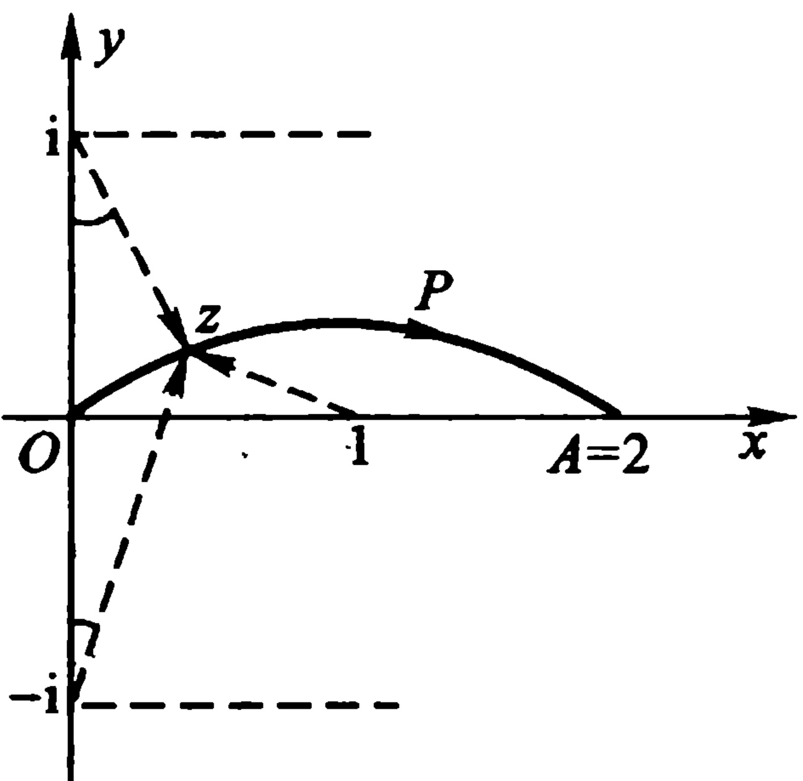

答： $ f(2) = -\sqrt{5}i $.

图2.15
 

10 试证  $ f(z)=\sqrt{z(1-z)} $ 在割去线段  $ 0 \leq \mathrm{Re} z \leq 1 $ 的 z 平面上能分出两个单值

解析分支.并求出在支割线  $ 0 \leq \mathrm{Re} z \leq 1 $ 上岸取正值时的那一支在 z = -1 的值,以及它的第二阶导数在 z = -1 的值.

答： $ f(-1)=\sqrt{2}\mathrm{i},f''(-1)=-\frac{\sqrt{2}}{16}\mathrm{i} $

