# 03-第三章 复变函数的积分

[返回全书目录](../../README.md)

> PDF 页码：112–162

<!-- page: 112 -->

## 第三章 复变函数的积分

‖◆‖‖◆‖‖◆‖‖‖◆‖‖‖◆‖‖

复变函数的积分(简称复积分)是研究解析函数的一个重要工具.解析函数的许多重要性性质要利用复积分来证明.例如,要证明“解析函数的导函数连续”及“解析函数的各阶导数存在”这些表面上看来只与微分学有关的命题,一般均要使用复积分.

本章要建立的柯西积分定理及柯西积分公式尤其重要，它们是复变函数论的基本定理和基本公式，以后各章都直接地或间接地和它们有关联。

‖◆‖‖◆‖‖◆‖‖‖‖

#### §1. 复积分的概念及其简单性质

1. 复变函数积分的定义为为了叙述简便而又不妨碍实际应用，今后我们所提到的曲线（除特别声明外），一律是指光滑的或逐段光滑的，因而也是可求长的。曲线通常还要规定其方向，在开口弧的情形，这只要指出其始点与终点就行了。

逐段光滑的简单闭曲线简称周线。周线自然也是可求长的。对于周线，我们在第一章若尔当定理之后实际上已经规定过它的方向。“反时针”方向为正；“顺时针”方向为负。

定义 3.1 设有向曲线 C:

 $$ z=z\left(t\right),\left(a\leqslant t\leqslant\beta\right) $$ 

以 $ a=z(\alpha) $为起点， $ b=z(\beta) $为终点， $ f(z) $沿C有定义.顺着C

<!-- page: 113 -->

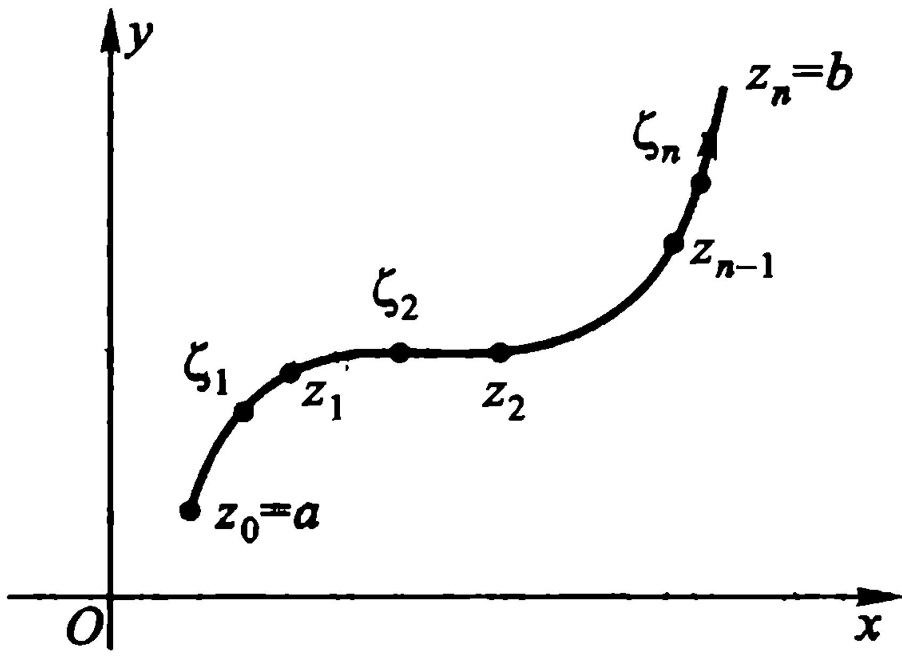

图3.1
 

从a到b的方向在C上取分点：

 $$ a=z_{0},z_{1},\cdots,z_{n-1},z_{n}=b $$ 

把曲线 C 分成若干个弧段（图 3.1）. 在从  $ z_{k-1} $ 到  $ z_{k}(k=1,2,\cdots,n) $ 的每一弧段上任取一点  $ \zeta_{k} $. 作成和数

 $$ S_{n}=\sum_{k=1}^{n}f(\zeta_{k})\Delta z_{k}, $$ 

其中  $ \Delta z_{k}=z_{k}-z_{k-1} $. 当分点无限增多，而这些弧段长度的最大值趋于零时，如果和数  $ S_{n} $ 的极限存在且等于 J，则称  $ f(z) $ 沿  $ C(从 a $ 到 b) 可积，而称 J 为  $ f(z) $ 沿 C (从 a 到 b) 的积分，并以记号  $ \int_{C}f(z)dz $ 表示：

 $$ J=\int_{c}\dot{f}(z)\mathrm{d}z. $$ 

C 称为积分路径.  $ \int_{C} f(z) dz $ 表示沿 C 的正方向的积分,  $ \int_{C^{-}} f(z) dz $ 表示沿 C 的负方向的积分.

如果 J 存在，我们一般不能把 J 写成  $ \int_{a}^{b} f(z) dz $ 的形式，因为 J 的值不仅和 a, b 有关，而且和积分路径 C 有关.

显然， $ f(z) $ 沿曲线 C 可积的必要条件为  $ f(z) $ 沿 C 有界.另

<!-- page: 114 -->

一方面，我们有

定理 3.1 若函数  $ f(z) = u(x, y) + \mathrm{i}v(x, y) $ 沿曲线 C 连续，则  $ f(z) $ 沿 C 可积，且

$$  \int_{C}f(z)\mathrm{d}z=\int_{C}u\mathrm{d}\bar{x}-v\mathrm{d}y+\mathrm{i}\int_{C}v\mathrm{d}x+u\mathrm{d}y.   \tag*{(3.1)}$$

证 设  $ z_{k}=x_{k}+\mathrm{i}y_{k}, x_{k}-x_{k-1}=\Delta x_{k}, y_{k}-y_{k-1}=\Delta y_{k} $

 $$ \zeta_{k}=\xi_{k}+\mathrm{i}\eta_{k},u(\xi_{k},\eta_{k})=u_{k},v(\xi_{k},\eta_{k})=v_{k}, $$ 

我们便得到：

 $$ \begin{align*}S_{n}&=\sum_{k=1}^{n}f(\zeta_{k})(z_{k}-z_{k-1})\\&=\sum_{k=1}^{n}(u_{k}+i v_{k})(\Delta x_{k}+i\Delta y_{k})\end{align*} $$ 

上式右端的两个和数是对应的两个曲线积分的积分和数. 在定理的条件下, 必有  $ u(x, y) $ 及  $ v(x, y) $ 沿 C 连续, 于是这两个曲线积分都是存在的. 因此, 积分  $ \int_{C} f(z) dz $ 存在, 且有公式 (3.1).

公式(3.1)说明,复变函数积分的计算问题,可以化为其实、虚部两个二元实函数曲线积分的计算问题.

注 公式(3.1)可以在形式上看成函数  $ f(z) = u + iv $ 与微分  $ \mathrm{d}z = \mathrm{d}x + \mathrm{d}iy $ 相乘后所得到的. 这样看, 便于记忆.

例 3.1 命 C 表连接点 a 及 b 的任一曲线，试证

(1)  $ \int_{C} dz = b - a $; (2)  $ \int_{C} z dz = \frac{1}{2}(b^{2} - a^{2}) $.

证 (1) 因  $ f(z)=1, S_{n}=\sum_{k=1}^{n}(z_{k}-z_{k-1})=b-a $，故

 $ \lim_{\substack{n\to\infty\\ \max|\Delta z_k|\to0}} $

 $ S_n = b - a $，即  $ \int_{C} dz = b - a $.

<!-- page: 115 -->

(2) 因  $ f(z)=z $，选  $ \zeta_{k}=z_{k-1} $，则得

 $$ \begin{array}{r}{\sum_{1}=\displaystyle\sum_{k=1}^{n}z_{k-1}\left(\mathscr{Z}_{k}-\mathscr{Z}_{k-1}\right),}\end{array} $$ 

但我们又可选  $ \zeta_{k}=z_{k} $，则得

 $$ \begin{array}{r}{\sum_{2}=\displaystyle\sum_{k=1}^{n}z_{k}\left(z_{k}-z_{k-1}\right),}\end{array} $$ 

由定理 3.1, 可知积分  $ \int_{C} z \, dz $ 存在, 因而  $ S_{n} $ 的极限存在, 且应与  $ \sum_{1}  $ 及  $ \sum_{2} $ 的极限相等, 从而应与  $ \frac{1}{2} (\sum_{1} + \sum_{2}) $ 的极限相等. 令

 $$ \frac{1}{2}\left(\sum_{1}+\sum_{2}\right)=\frac{1}{2}\sum_{k=1}^{n}\left(z_{k}^{2}-z_{k-1}^{2}\right)=\frac{1}{2}(b^{2}-a^{2}), $$ 

所以

 $$ \int_{c}z\mathrm{d}z=\frac{1}{2}(b^{2}-a^{2}). $$ 

注 当 C 为闭曲线时， $ \int_{C} dz = 0 $， $ \int_{C} z dz = 0 $.

2. 复变函数积分的计算问题 设有光滑曲线 C:

 $$ z=z\left(t\right)=x\left(t\right)+\mathrm{i}y\left(t\right)\quad\left(a\leqslant t\leqslant\beta\right) $$ 

这就表示  $ z'(t) $ 在  $ [\alpha,\beta] $ 上连续且有不为零的导数  $ z'(t)=x'(t)+iy'(t) $. 又设  $ f(z) $ 沿 C 连续. 令

 $$ \begin{aligned}f[\boldsymbol{z}(t)]&=u[\boldsymbol{x}(t),\boldsymbol{y}(t)]+\mathrm{i}v[\boldsymbol{x}(t),\boldsymbol{y}(t)]\\&=\boldsymbol{u}(t)+\mathrm{i}v(t),\end{aligned} $$ 

由公式(3.1)我们有

 $$ \begin{align*}\int_{C}f(z)\mathrm{d}z&=\int_{C}u\mathrm{d}x-v\mathrm{d}y+i\int_{C}u\mathrm{d}y+v\mathrm{d}x\\&=\int_{a}^{\beta}\left[u(t)x^{\prime}(t)-v(t)y^{\prime}(t)\right]\mathrm{d}t\\&\quad+i\int_{a}^{\beta}\left[u(t)y^{\prime}(t)+v(t)x^{\prime}(t)\right]\mathrm{d}t,\end{align*} $$

<!-- page: 116 -->

即

$$  \int_{C}f(z)\mathrm{d}z=\int_{a}^{\beta}f[z(t)]z^{\prime}(t)\mathrm{d}t,   \tag*{(3.2)}$$

或

$$  \begin{align*}\int_{C}f(z)\mathrm{d}z&=\int_{a}^{\beta}\mathrm{Re}\{f[z(t)]z^{\prime}(t)\}\mathrm{d}t\\&\quad+\mathrm{i}\int_{a}^{\beta}\mathrm{Im}\{f[z(t)]z^{\prime}(t)\}\mathrm{d}t.\end{align*}   \tag*{(3.3)}$$

用公式(3.2)或(3.3)计算复变函数的积分,是从积分路径 C 的参数方程着手的,称为参数方程法.(3.2)或(3.3)称为复积分的变量代换公式.

例 3.2 （一个重要的常用的积分）

 $$ \int_{c}\frac{\mathrm{d}z}{\left(z-a\right)^{n}}=\left\{\begin{aligned}&2\pi i,\left(n=1\right)\\ &0,\left(n\neq1\right) 的整数 \end{aligned}\right. $$ 

这里 C 表示以 a 为心,  $ \rho $ 为半径的圆周. (注意: 积分值与  $ a, \rho $ 均无关, a 可为 0).

证 C 的参数方程为:  $ z - a = \rho e^{i\theta}, 0 \leq \theta \leq 2\pi $. 故

 $$ \int_{C}\frac{\mathrm{d}z}{z-a}\frac{(3.2)}{\overbrace{0}^{2\pi}}\int_{0}^{2\pi}\frac{\mathrm{i}\rho\mathrm{e}^{\mathrm{i}\theta}\mathrm{d}\theta}{\rho\mathrm{e}^{\mathrm{i}\theta}}=\mathrm{i}\int_{0}^{2\pi}\mathrm{d}\theta=2\pi\mathrm{i}; $$ 

当 n 为整数且  $ n \neq 1 $ 时

 $$ \begin{align*}\int_{C}\frac{\mathrm{d}z}{(z-a)^{n}}&\xrightarrow{(3.2)}\int_{0}^{2\pi}\frac{\mathrm{i}\rho\mathrm{e}^{\mathrm{i}\theta}\mathrm{d}\theta}{\rho^{n}\mathrm{e}^{\mathrm{i}n\theta}}=\frac{\mathrm{i}}{\rho^{n-1}}\int_{0}^{2\pi}\mathrm{e}^{-\mathrm{i}(n-1)\theta}\mathrm{d}\theta\\&=\frac{\mathrm{i}}{\rho^{n-1}}\left[\int_{0}^{2\pi}\cos(n-1)\theta\mathrm{d}\theta-\mathrm{i}\int_{0}^{2\pi}\sin(n-1)\theta\mathrm{d}\theta\right]\\&=0.\end{align*} $$ 

3. 复变函数积分的基本性质 设函数  $ f(z) $,  $ g(z) $ 沿曲线 C 连续, 则有下列与数学分析中的曲线积分相类似的性质:

(1)  $ \int_{C}af(z)\mathrm{d}z=a\int_{C}f(z)\mathrm{d}z $, a 是复常数；

(2)

 $$ \int_{C}\left[f(z)+g(z)\right]\mathrm{d}z=\int_{C}f(z)\mathrm{d}z+\int_{C}g(z)\mathrm{d}z; $$ 

(3)  $ \int_{C} f(z) dz = \int_{C_{1}} f(z) dz + \int_{C_{2}} f(z) dz $，其中 C 由曲线

<!-- page: 117 -->

$ C_{1} $ 和  $ C_{2} $ 衔接而成；

(4)

 $$ \int_{c^{-}}f(z)\mathrm{d}z=-\int_{c}f(z)\mathrm{d}z. $$ 

（5）

 $$ \left|\int_{C}f(z)\mathrm{d}z\right|\leqslant\int_{C}\left|f(z)\right|\left|\mathrm{d}z\right|=\int_{C}\left|f(z)\right|\mathrm{d}s. $$ 

这里  $ \left| dz \right| $ 表示弧长的微分，即

 $$ \left|\mathrm{d}z\right|=\sqrt{\left(\mathrm{d}x\right)^{2}+\left(\mathrm{d}y\right)^{2}}=\mathrm{d}s. $$ 

要得到(5)式，只要把下列不等式取极限 $ ^{①} $:

 $$ \big|\sum_{k=1}^{n}f(\zeta_{k})\Delta z_{k}\big|\leqslant\sum_{k=1}^{n}\mid f(\zeta_{k})\mid\mid\Delta z_{k}\mid\leqslant\sum_{k=1}^{n}\mid f(\zeta_{k})\mid\Delta s_{k}. $$ 

定理 3.2 (积分估值) 若沿曲线 C，函数  $ f(z) $ 连续，且有正数 M 使  $ \left|f(z)\right| \leq M $，L 为 C 之长，则

 $$ \left|\int_{c}f(z)\mathrm{d}z\right|\leqslant M L. $$ 

证 由不等式

 $$ \left|\sum_{k=1}^{n}f(\zeta_{k})\Delta z_{k}\right|\leqslant M\sum_{k=1}^{n}\left|\Delta z_{k}\right|\leqslant M L, $$ 

取极限即得证.

例 3.3 试证  $ \left|\int_{C}\frac{\mathrm{d}z}{z^{2}}\right|\leq2 $.

积分路径 C 是连接 i 和  $ 2+i $ 的直线段.

证 C 的参数方程为

 $$ z=\left(1-t\right)\mathrm{i}+t\left(2+\mathrm{i}\right)\quad\left(0\leqslant t\leqslant1\right), $$ 

 $$ z=2t+\mathrm{i}\quad(0\leqslant t\leqslant1), $$ 

即

沿  $ C, \frac{1}{z^{2}} $ 连续，且

 $$ \left|\frac{1}{z^{2}}\right|=\frac{1}{\left|z\right|^{2}}=\frac{1}{4t^{2}+1}\leqslant1. $$

<!-- page: 118 -->

而 C 之长为 2. 故由定理 3.2,  $ \left|\int_{C}\frac{dz}{z^{2}}\right|\leq2 $.

例 3.4 试证

 $$ \left|\int_{|z|=r}\frac{\mathrm{d}z}{(z-a)(z+a)}\right|<\frac{2\pi r}{|r^{2}-|a|^{2}|}\quad(r>0,|a|\neq r). $$ 

证 若 a=0，则  $ \int_{|z|=r}\frac{\mathrm{d}z}{z^{2}}=0 $（例 3.2），不等式成立；若  $ a\neq0 $，则由复积分的基本性质（5），

 $$ \begin{align*}\left|\int_{|z|=r}\frac{\mathrm{d}z}{(z-a)(z+a)}\right|&\leq\int_{|z|=r}\frac{|\mathrm{d}z|}{|z^2-a^2|}\\<\int_{|z|=r}\frac{|\mathrm{d}z|}{|r^2-|a|^2|}&=\frac{2\pi r}{|r^2-|a|^2|}.\end{align*} $$ 

注 数学分析中实变函数的积分中值定理,不能直接推广到复积分上来.因由

 $$ \int_{0}^{2\pi}\mathrm{e}^{\mathrm{i}\theta}\mathrm{d}\theta=\int_{0}^{2\pi}\cos\theta\mathrm{d}\theta+\mathrm{i}\int_{0}^{2\pi}\sin\theta\mathrm{d}\theta=0, $$ 

而  $ \mathrm{e}^{\mathrm{i}\theta}(2\pi-0)\neq0 $，即可看出.

例 3.5 计算积分

 $$ \int_{c}\mathrm{R e}z\mathrm{d}z, $$ 

其中积分路径 C(图 3.2) 为：

（1）连接由点 O 到点  $ 1+i $ 的直线段；

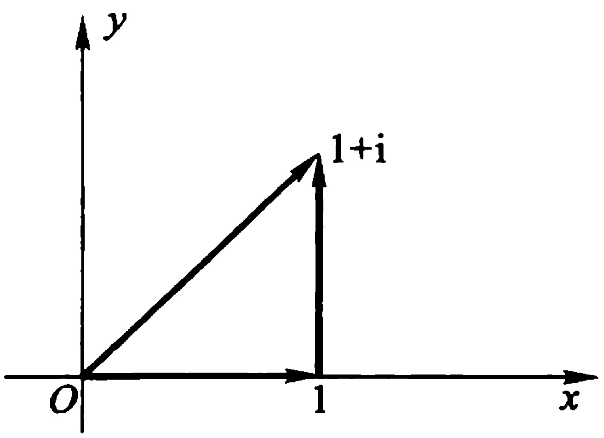

（2）连接由点 O 到点 1 的直线 图 3.2 段，以及连接由点 1 到点  $ 1+i $ 的直线段所组成的折线.

解 （1）连接 O 及  $ 1+i $ 的直线段的参数方程为：

 $$ z=\left(1+\mathrm{i}\right)t\quad\left(0\leqslant t\leqslant1\right), $$ 

故

 $$ \begin{align*}\int_{C}\operatorname{Re}z\mathrm{d}z&=\int_{0}^{1}\left\{\operatorname{Re}[(1+\mathrm{i})t]\right\}(1+\mathrm{i})\mathrm{d}t\\&=(1+\mathrm{i})\int_{0}^{1}t\mathrm{d}t=\frac{1+\mathrm{i}}{2}.\end{align*} $$

<!-- page: 119 -->

（2）连接 O 与 1 的直线段的参数方程为：

 $$ z=t\quad(0\leqslant t\leqslant1), $$ 

连接点1与 $ 1+i $的直线段的参数方程为：

 $$ z=\left(1-t\right)+\left(1+\mathrm{i}\right)t\quad\left(0\leqslant t\leqslant1\right), $$ 

即

 $$ z=1+i t\quad\left(0\leqslant t\leqslant1\right), $$ 

故

 $$ \begin{aligned}\int_{C}\operatorname{Re}z\mathrm{d}z&=\int_{0}^{1}\operatorname{Re}t\mathrm{d}t+\int_{0}^{1}\left[\operatorname{Re}(1+\mathrm{i}t)\right]\mathrm{i}\mathrm{d}t\\&=\int_{0}^{1}t\mathrm{d}t+\mathrm{i}\int_{0}^{1}\mathrm{d}t=\frac{1}{2}+\mathrm{i}.\end{aligned} $$ 

由此例可以看出，积分路径不同，积分结果可以不同。

#### §2. 柯西积分定理

1. 柯西积分定理 从上一节所举的例题来看,例 3.1(2)的被积函数  $ f(z)=z $ 在单连通区域 z 平面上处处解析,它沿连接起点 a 及终点 b 的任何路径 C 的积分值都相同,即积分与路径无关,或者说沿 z 平面上任何闭曲线的积分为零;例 3.2 的被积函数

 $$ f(z)=\frac{1}{z-a} $$ 

只以 z=a 为奇点，即在“z 平面除去一点 a”的非单连通区域内处处解析，但是积分

 $$ \int_{c}\frac{\mathrm{d}z}{z-a}=2\pi\mathrm{i}\neq0, $$ 

其中 C 表圆周  $ |z - a| = \rho > 0 $，即在此区域内积分与路径有关；例 3.5 的被积函数  $ f(z) = \mathrm{Re} \cdot z $。在单连通区域 z 平面上处处不解析（第二章习题4（3）），而积分与连接起点 O 及终点  $ 1 + i $ 的路径 C 有关，即沿 z 平面上任何闭曲线的积分，其值不恒为零。

由此可见，复积分的值与路径无关的条件，或沿区域内任何闭曲线积分值为零的条件，可能与被积函数的解析性及解析区域的单连通性有关。

<!-- page: 120 -->

1825 年柯西给出了如下的定理，肯定地回答了上述问题，它是研究复变函数的钥匙，常称为柯西积分定理.

定理 3.3 设函数  $ f(z) $ 在 z 平面上的单连通区域 D 内解析，C 为 D 内任一条周线，则

 $$ \int_{c}f(z)\mathrm{d}z=0. $$ 

要证明这个定理是比较困难的.

1851年，黎曼在附加假设“ $ f'(z) $在D内连续”的条件下，得到一个如下的简单证明.

黎曼证明 令  $ z = x + iy $,  $ f(z) = u(x, y) + iv(x, y) $; 由公式(3.1),

 $$ \int_{C}f(z)\mathrm{d}z=\int_{C}\dot{u}\mathrm{d}x-v\mathrm{d}y+\mathrm{i}\int_{C}v\mathrm{d}x+u\mathrm{d}y, $$ 

而  $ f'(z) $ 在 D 内连续，导致  $ u_{x}, u_{y}, v_{x}, v_{y} $ 在 D 内连续，并适合 C. -R. 方程：

 $$ u_{x}=v_{y},u_{y}=-v_{x}. $$ 

由格林定理，

 $$ \int_{c}u\mathrm{d}x-v\mathrm{d}y=0,\int_{c}v\mathrm{d}x+u\mathrm{d}y=0, $$ 

故得

 $$ \int_{c}f(z)\mathrm{d}z=0. $$ 

柯西将复变函数  $ f(z) $ 作为复变数 z 的一元函数来研究. 他定义解析函数为  $ f'(z) $ 在区域 D 内存在并连续. 1900 年古莎 (Goursat) 发表上述定理的新的证明方法, 无须将  $ f(z) $ 分为实部与虚部: 更重要的是免去了  $ f'(z) $ 为连续的假设. 因此,  $ f'(z) $ 的连续性假设不仅在柯西积分定理中可以省略, 同时对解析函数的定义也像我们现在这样定义 (定义 2.2), 只须  $ f'(z) $ 在区域 D 存在, 不必假设  $ f'(z) $ 连续.

柯西积分定理的古莎证明比较长，我们将它放在下一段单独证明.现在先由柯西积分定理，可以得到

<!-- page: 121 -->

定理 3.4 设函数  $ f(z) $ 在 z 平面上的单连通区域 D 内解析，C 为 D 内任一闭曲线（不必是简单的），则

 $$ \int_{c}f(z)\mathrm{d}z=0. $$ 

证 因为  $ \mathring{C} $ 总可以看成区域 D 内有限多条周线衔接而成(如图 3.3). 再由复积分的基本性质(3)及柯西积分定理 3.3, 即可得证.

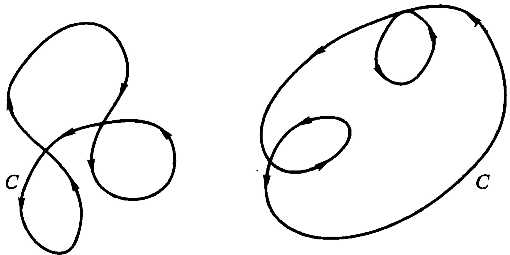

图3.3
 

推论 3.5 设函数  $ f(z) $ 在 z 平面上的单连通区域  $ D_{1} $ 内解析，则  $ f(z) $ 在 D 内积分与路径无关。即对 D 内任意两点  $ z_{0} $ 与  $ z_{1} $，积分

 $$ \int_{z_{0}}^{z_{1}}f(z)\mathrm{d}z $$ 

之值,不依赖于 D 内连接起点  $ z_{0} $ 与终点  $ z_{1} $ 的曲线.

证 设  $ C_{1} $ 与  $ C_{2} $ 是 D 内连接起点  $ z_{0} $ 与终点  $ z_{1} $ 的任意两条曲线（如图 3.4）. 则正方向曲线  $ C_{1} $ 与负方向曲线  $ C_{2}^{-} $就衔接成 D 内的一条闭曲线 C. 于是，由定理 3.4 与复积分的基本性质（3）有

 $$ 0=\int_{c}f(z)\mathrm{d}z=\int_{c_{1}}f(z)\mathrm{d}z+\int_{c_{2}^{-}}f(z)\mathrm{d}z, $$ 

因而

<!-- page: 122 -->

$$ \int_{c_{1}}f(z)\mathrm{d}z=\int_{c_{2}}f(z)\mathrm{d}z. $$ 

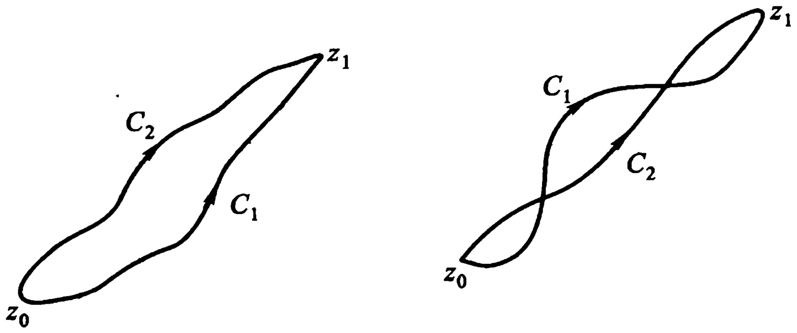

图3.4
 

### 2. 柯西积分定理的古莎证明

第一步: C 为 D 内任一个三角形  $ \triangle $.

假设

 $$ \left|\int_{\triangle}f(z)\mathrm{d}z\right|=M. $$ 

我们来证明

 $$ M=0. $$ 

二等分给定三角形 $ \triangle $的每一边，两两连接这些分点， $ \triangle $就被分成了四个全等的三角形，它们的周界是 $ \triangle_{1} $， $ \triangle_{2} $， $ \triangle_{3} $， $ \triangle_{4} $（如图3.5）。显然有

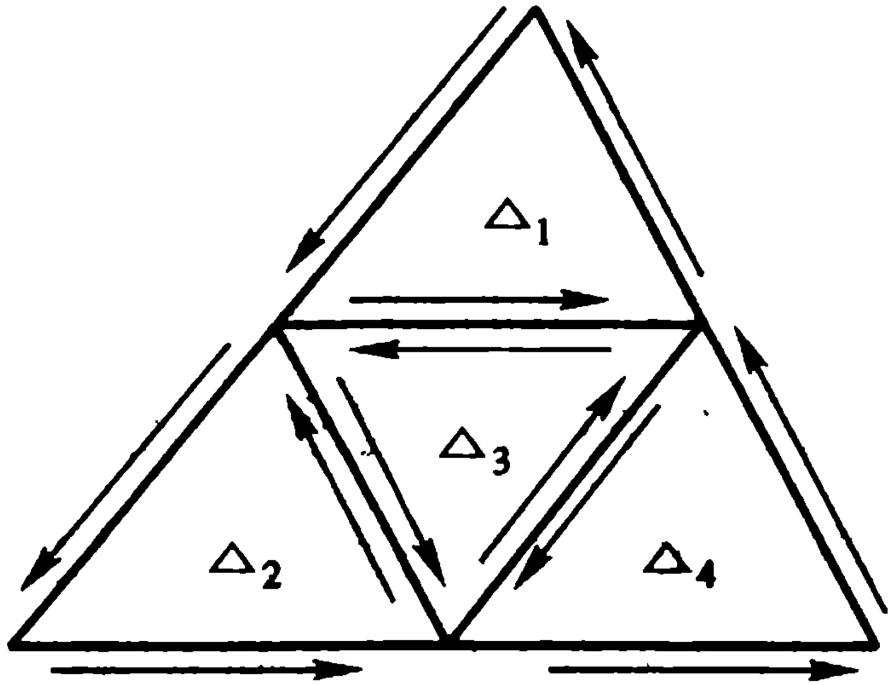

图3.5
 

<!-- page: 123 -->

$$  \begin{align*}\int_{\Delta}f(z)\mathrm{d}z&=\int_{\Delta_{1}}f(z)\mathrm{d}z+\int_{\Delta_{2}}f(z)\mathrm{d}z+\int_{\Delta_{3}}f(z)\mathrm{d}z\\&\quad+\int_{\Delta_{4}}f(z)\mathrm{d}z.\end{align*}   \tag*{(3.4)}$$

因为在这里沿每一条连接分点的线段的积分从彼此正好相反的方向取了两次，刚好互相抵消。由于  $ \left|\int_{\Delta} f(z) \, \mathrm{d}z\right| = M $，根据(3.4)，周界  $ \triangle_{k}(k=1,2,3,4) $ 中至少有一个使沿着它所取积分的模不小于  $ \frac{M}{4} $。比如说，假定这个周界是  $ \triangle^{(1)} = \triangle_{1} $。

 $$ \left|\int_{\triangle^{(1)}}f(z)\mathrm{d}z\right|\geqslant\frac{M}{4}. $$ 

对于这个三角形周界 $ \triangle^{(1)} $，和前面一样，我们把它分成四个全等三角形。于是，在以 $ \triangle^{(1)} $为周界的三角形内的四个三角形中我们又可以找到一个三角形，记它的周界为 $ \triangle^{(2)} $，使

 $$ \left|\int_{\triangle^{(2)}}f(z)\mathrm{d}z\right|\geqslant\frac{M}{4^{2}}. $$ 

很明显，这个作法可以无限制的作下去，于是我们得到具有周界： $ \triangle=\triangle^{(0)},\triangle^{(1)},\triangle^{(2)},\triangle^{(3)},\cdots,\triangle^{(n)},\cdots $的三角形序列，其中一个包含后面的一个而且有下列不等式：

$$  \left|\int_{\triangle}^{(n)}f(z)\mathrm{d}z\right|\geqslant\frac{M}{4^{n}},(n=0,1,2,\cdots).   \tag*{(3.5)}$$

用 U 表示周界△的长度，于是周界△ $ ^{(1)} $，△ $ ^{(2)} $，⋯，△ $ ^{(n)} $，⋯相应的长度就是：

 $$ \frac{U}{2},\frac{U}{2^{2}},\cdots,\frac{U}{2^{n}},\cdots. $$ 

我们来估计  $ \int_{\Delta(n)} f(z) dz $ 的模. 由于序列中每一个三角形都包含在它后面的全部三角形，而且它们周界的长度随 n 的无限增大而趋向于零（根据定义 1.11）. 所以根据极限理论的基本原则（即闭集套定理 1.5——这里是三角形套），惟一存在一个点  $ z_{0} $ 属于这个

<!-- page: 124 -->

序列中所有的三角形. 这个点  $ z_{0} $ 在区域 D 内，而函数  $ f(z) $ 在 D 内又是解析的，因此在点  $ z_{0} $ 函数  $ f(z) $ 有一个有限导数. 从而，对于任一个无论怎样小的  $ \varepsilon > 0 $，都有一个正数  $ \delta = \delta(\varepsilon) $ 存在，使当  $ 0 < |z - z_{0}| < \delta $ 时，有

 $$ \left|\frac{f(z)-f(z_{0})}{z-z_{0}}-f^{\prime}(z_{0})\right|<\varepsilon. $$ 

把上不等式两端乘以  $ |z - z_{0}| $，即得

$$  |f(z)-f(z_{0})-f^{\prime}(z_{0})(z-z_{0})|<\varepsilon|z-z_{0}|.   \tag*{(3.6)}$$

对于以  $ z_{0} $ 为中心、以  $ \delta $ 为半径的圆内的点  $ z(\neq z_{0}) $，(3.6)成立；另一方面，从一个充分大的 n 开始，三角形  $ \triangle^{(n)} $ 都在上述圆内。因此，可以用 (3.6) 式来估计  $ \int_{\triangle^{(n)}} f(z) dz $ 的模。由于  $ \int_{\triangle^{(n)}} dz = 0 $， $ \int_{\triangle^{(n)}} zdz = 0 $ (见例 3.1 注)，所以

$$  \int_{\triangle^{(n)}}f(z)\mathrm{d}z=\int_{\triangle^{(n)}}\left[f(z)-f(z_{0})-f^{\prime}(z_{0})(z-z_{0})\right]\mathrm{d}z.   \tag*{(3.7)}$$

但由(3.6)式,当 z 位于三角形周界  $ \triangle^{(n)} $ 上时,

 $$ |f(z)-f(z_{0})-f^{\prime}(z_{0})(z-z_{0})|<\varepsilon|z-z_{0}|<\frac{\varepsilon U}{2^{n}}, $$ 

其中第二个不等式，是因为三角形周界 $ \triangle^{(n)} $上任一点z，到此三角形上一点 $ z_{0} $的距离小于 $ \frac{U}{2^{n}} $，故由(3.7)式得

$$  \left|\int_{\triangle}^{(n)}f(z)\mathrm{d}z\right|<\varepsilon\cdot\frac{U}{2^{n}}\cdot\frac{U}{2^{n}}=\varepsilon\cdot\frac{U^{2}}{4^{n}}.   \tag*{(3.8)}$$

比较(3.5)和(3.8)可得

 $$ \begin{array}{l}\varepsilon\cdot\frac{U^{2}}{4^{n}}>\frac{M}{4^{n}}.\\M<\varepsilon\cdot U^{2}.\end{array} $$ 

即

但  $ \varepsilon $ 是一个可以任意小的正数，而  $ M \neq 0 $，故

<!-- page: 125 -->

$$ M=0. $$ 

第二步: C 为 D 内任一条简单闭环线 P.

用对角线把以 P 为周界的多角形分成有限多个三角形，如图 3.6(P 为凸多角形)、图 3.7(P 为非凸多角形).

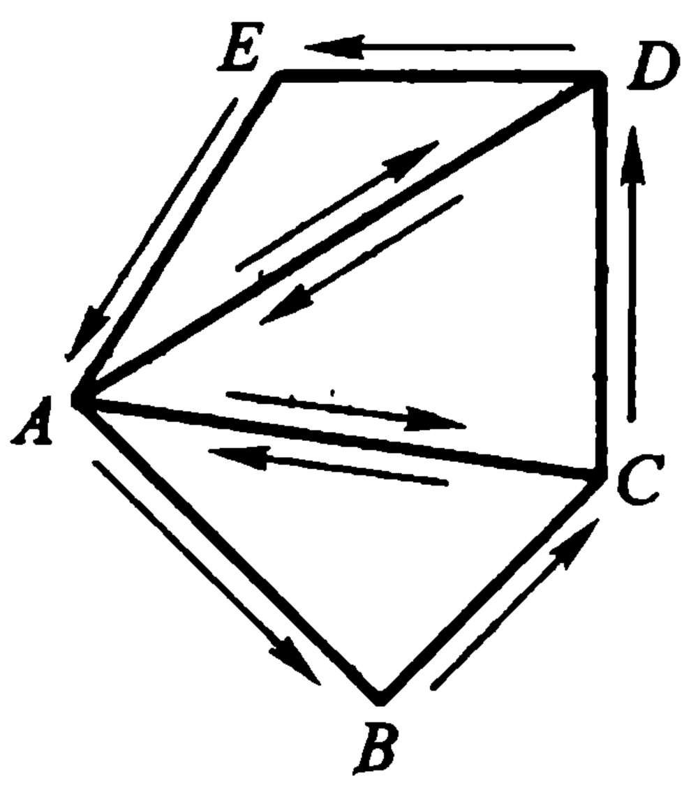

图3.6
 

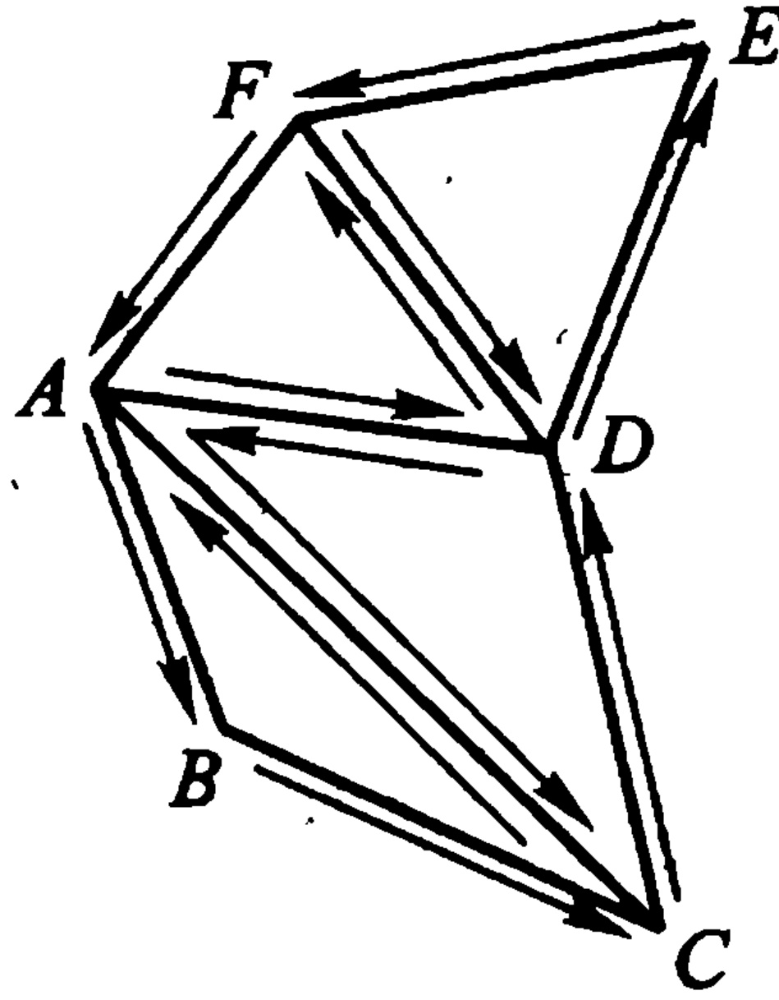

图3.7
 

因为这时沿每一条对角线，积分从彼此正好相反的方向取了两次，刚好互相抵消。于是，由第一步的结果得

 $$ \int_{P}f(z)\mathrm{d}z=0. $$ 

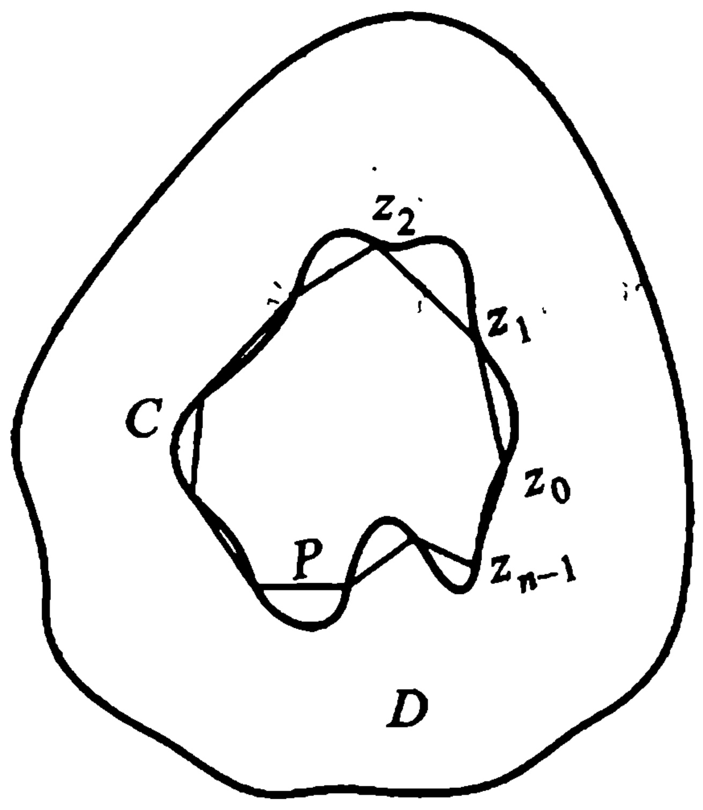

图3.8
 

第三步：C 为 D 内任一条周线.

（1）对于任一无论怎样小的  $ \varepsilon>0 $，都存在一条内接于 C 并完全在 D 内的简单闭环线 P（如图 3.8），使得

<!-- page: 126 -->

$$  \left|\int_{C}f(z)\mathrm{d}z-\int_{P}f(z)\mathrm{d}z\right|<\varepsilon.   \tag*{(3.9)}$$

换句话说，积分  $ \int_{C} f(z) dz $ 的值，可以用沿着在区域 D 内内接于 C 的简单闭环线 P 所取积分的值来逼近任何精确的程度.

为了证明这个事实，我们考虑区域 D 内的一个闭子域  $ \overline{G} $，使曲线 C 整个位于 G 内。设 G 的边界与 C 间的最小距离为  $ \rho $。易知  $ \rho > 0 $（见后面注）。于是以 C 上任意点为心， $ \rho $ 为半径的圆，均全含于  $ \overline{G} $ 内。从而，C 上任意两点只要距离小于  $ \rho $，它们的联结线段必全在  $ \overline{G} $ 内。

根据假设，函数  $ f(z) $ 在  $ \overline{G} $ 上连续，因而在  $ \overline{G} $ 上一致连续，故对于任一无论怎样小的  $ \varepsilon > 0 $，都存在一个正数  $ \delta_{1} = \delta_{1}(\varepsilon) $，使得当  $ z^{\prime}, z^{\prime\prime} $ 在  $ \overline{G} $ 上且适合  $ |z^{\prime} - z^{\prime\prime}| < \delta_{1} $ 时，不等式

 $$ f(z^{\prime})-f(z^{\prime \prime})<\frac{\varepsilon}{2l} $$ 

成立，这里 l 为 C 之长.

显然，可以在 C 上依积分正向取 n 个点  $ z_{0}, z_{1}, z_{2}, \cdots, z_{n-1} $ 分 C 为 n 段弧  $ \sigma_{1}, \sigma_{2}, \cdots, \sigma_{n} $，使

 $$ \max_{1\leqslant j\leqslant n}(\sigma_{j} 之长 )<\delta\leqslant\min(\delta_{1},\rho) $$ 

于是以  $ z_{0}, z_{1}, \cdots, z_{n-1} $ 为顶的简单多边形 P 全含于  $ \overline{G} $ 内（因而全含于 D 内）。P 的边  $ r_{1}, r_{2}, \cdots, r_{n} $ 分别是  $ \sigma_{1}, \sigma_{2}, \cdots, \sigma_{n} $ 所对的弦，故有

 $$ \begin{array}{r l}&{\left|\displaystyle\int_{C}f(z)d z-\displaystyle\int_{P}f(z)d z\right|}\\ {=}&{\left|\displaystyle\sum_{j=1}^{n}\int_{\sigma_{j}}^{f(z)}f(z)d z-\displaystyle\sum_{j=1}^{n}\int_{r_{j}}^{f(z)}f(z)d z\right|}\\ {\leqslant}&{\displaystyle\sum_{j=1}^{n}\left|\displaystyle\int_{\sigma_{j}}^{f(z)}f(z)d z-\displaystyle\int_{r_{j}}^{f(z)}f(z)d z\right|.}\end{array} $$ 

因由例 3.1(1)，有

<!-- page: 127 -->

$$ \frac{1}{10} $$ 

即得

 $$ \begin{array}{r l}&{\int\displaylimits_{\sigma_{j}}f(z_{j})\mathrm{d}z=f(z_{j})(z_{j}-z_{j-1})=\int\displaylimits_{r_{j}}f(z_{j})\mathrm{d}z,}\\ &{\quad}\\ &{\left|\int\displaylimits_{\sigma_{j}}f(z)\mathrm{d}z-\int\displaylimits_{r_{j}}f(z)\mathrm{d}z\right|}\\ &{\leqslant\left|\int\displaylimits_{\sigma_{j}}\left[f(z)-f(z_{j})\right]\mathrm{d}z\right|+\left|\int\displaylimits_{r_{j}}\left[f(z)-f(z_{j})\right]\mathrm{d}z\right|}\\ &{\leqslant\underset{z\in\sigma_{j}}{\operatorname*{s u p}}|f(z)-f(z_{j})|(\sigma\mathrm{~之~长~})}\\ &{\quad+\underset{z\in r_{j}}{\operatorname*{s u p}}|f(z)-f(z_{j})|\cdot(r_{j}\mathrm{~之~长~}),}\end{array} $$ 

但是弧  $ \sigma_{j} $ 与弦  $ r_{j} $ 上任意两点的距离小于  $ \delta $，所以

 $$ \operatorname*{s u p}_{z\in\sigma_{j}}\left|f(z)-f(z_{j})\right|<\frac{\epsilon}{2l},\operatorname*{s u p}_{z\in\tau_{j}}\left|f(z)-f(z_{j})\right|<\frac{\epsilon}{2l}, $$ 

从而

 $$ \begin{aligned}&\left|\int_{o_{j}}f(z)dz-\int_{r_{j}}f(z)dz\right|\\ &<\frac{\varepsilon}{2l}\cdot(\sigma_{j} 之长 +r_{j} 之长 )<\frac{\varepsilon}{l}(\sigma_{j} 之长 ),\\ \end{aligned} $$ 

所以

 $$ \left|\int_{C}f(z)\mathrm{d}z-\int_{P}f(z)\mathrm{d}z\right|<\frac{\varepsilon}{l}\cdot l=\varepsilon. $$ 

（2）由第二步结果，对于(1)段中作出的 P，有

 $$ \begin{aligned}\int_{P}f(z)\mathrm{d}z&=0,\\\left|\int_{c}f(z)\mathrm{d}z\right|&<\varepsilon.\end{aligned} $$ 

故(3.9)成为

由于  $ \varepsilon $ 可以任意小，故必  $ \int_{C} f(z) dz = 0 $。至此柯西积分定理已经得到证明。

注 设 E 和 F 是平面上两个点集，下确界  $ \inf\{|z_{1}-z_{2}|\} $  $ |z_{1}\in E,z_{2}\in F\} $ 称为点集 E 和 F 的距离，记为  $ \rho(E,F) $，可以证明，当 E 和 F 是不相交的闭集，E 有界时， $ \rho(E,F)>0 $。

<!-- page: 128 -->

3. 不定积分 柯西积分定理 3.3 已经回答了积分与路径无关的问题. 这就是说, 如果在单连通区域 D 内函数  $ f(z) $ 解析, 则沿 D 内任一曲线 L 的积分  $ \int_{L} f(\zeta) d\zeta $ 只与其起点和终点有关. 因此当起点  $ z_{0} $ 固定时, 这积分就在 D 内定义了一个变上限 z 的单值函数, 我们把它记成变上限积分

$$  \boldsymbol{F}(z)=\int_{z_{0}}^{z}f(\zeta)\mathrm{d}\zeta.\left(\begin{aligned}& 定点 z_{0}\in D\\ & 动点 z\in D\end{aligned}\right)   \tag*{(3.10)}$$

定理3.6. 设函数  $ f(z) $ 在单连通区域 D 内解析，则由 (3.10) 定义的函数  $ F(z) $ 在 D 内解析，且  $ F'(z) = f(z) $.

证 我们只要对 D 内任一点 z 证明  $ F'(z) = f(z) $ 就行了. 以 z 为心作一个含于 D 内的小圆，在小圆内取动点  $ z + \Delta z $. 考虑  $ (\Delta z \neq 0) $

 $$ \frac{F(z+\Delta z)-F(z)}{\Delta z}=\frac{1}{\Delta z}\left[\int_{z_{0}}^{z+\Delta z}f(\zeta)\mathrm{d}\zeta-\int_{z_{0}}^{z}f(\zeta)\mathrm{d}\zeta\right] $$ 

在  $ \Delta z \rightarrow 0 $ 时的极限.

由于积分与路径无关， $ \int_{z_{0}}^{z+\Delta z} f(\zeta) \, d\zeta $ 的积分路径，可以考虑为由  $ z_{0} $ 到 z，再从 z 沿直线段到  $ z+\Delta z $。而由  $ z_{0} $ 到 z 的积分路径取得和  $ \int_{z_{0}}^{z} f(\zeta) \, d\zeta $ 的积分路径相同（图 3.9）。于是就有

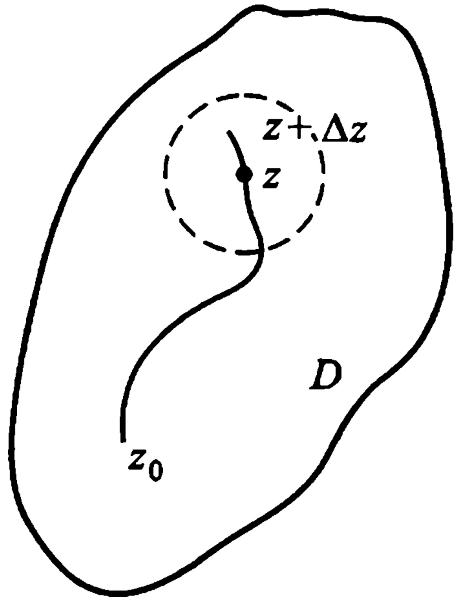

 $$ \frac{F(z+\Delta z)-F(z)}{\Delta z}=\frac{1}{\Delta z}\int_{z}^{z+\Delta z}f(\zeta)\mathrm{d}\zeta, $$ 

图3.9
 

注意到  $ f(z) $ 是与积分变量  $ \zeta $ 无关的定值, 所以由例 3.1(1) 又有

 $$ \frac{1}{\Delta z}\int_{z}^{z+\Delta z}f(z)\mathrm{d}\zeta=f(z), $$ 

由以上两式即得

<!-- page: 129 -->

$$ \frac{F(z+\Delta z)-F(z)}{\Delta z}-f(z)=\frac{1}{\Delta z}\int_{z}^{z+\Delta z}[f(\zeta)-f(z)]\mathrm{d}\zeta. $$ 

根据  $ f(z) $ 在 D 内的连续性，对于任给的  $ \varepsilon > 0 $，只要开始取的那个小圆足够小，则小圆内一切点  $ \zeta $ 均符合条件

 $$ |f(\zeta)-f(z)|<\varepsilon, $$ 

这样一来，由定理 3.2

 $$ \begin{align*}\left|\frac{F(z+\Delta z)-F(z)}{\Delta z}-f(z)\right|&=\left|\frac{1}{\Delta z}\int_{z}^{z+\Delta z}[f(\zeta)-f(z)]\mathrm{d}\zeta\right|\\&\leq\epsilon\frac{|\Delta z|}{|\Delta z|}=\epsilon,\end{align*} $$ 

即是说

 $$ \lim_{\Delta z\to0}\frac{F(z+\Delta z)-F(z)}{\Delta z}=f(z). $$ 

也就是

 $$ F^{\prime}(z)=f(z)\quad(z\in D). $$ 

分析以上的证明，我们实际上已经证明了一个更一般的定理：

定理 3.7 设(1)函数  $ f(z) $ 在单连通区域 D 内连续；

(2)  $ \int f(\zeta) \, \mathrm{d}\zeta $ 沿区域 D 内任一周线的积分值为零（从而，积分与路径无关），则函数

 $$ F(z)=\int_{z_{0}}^{z}f(\zeta)\mathrm{d}\zeta\quad(z_{0} 为 D 内一定点 ) $$ 

在 D 内解析，且  $ F'(z) = f(z) $ ( $ z \in D $).

与数学分析相仿，我们有

定义 3.2 在区域 D 内，如果函数  $ f(z) $ 连续，则称符合条件

 $$ \Phi^{\prime}(z)=f(z)\quad(z\in D) $$ 

的函数  $ \Phi(z) $ 为  $ f(z) $ 的一个不定积分或原函数（显然  $ \Phi(z) $ 必在 D 内解析）.

在定理 3.6 或定理 3.7 的条件下，函数(3.10)就是  $ f(z) $ 的一个原函数。下面我们来证明  $ f(z) $ 的任何一个原函数  $ \Phi(z) $ 都呈形式：

<!-- page: 130 -->

$$  \Phi(z)=F(z)+C=\int_{z_{0}}^{z}f(\zeta)\mathrm{d}\zeta+C,   \tag*{(3.11)}$$

其中 C 为一常数. 事实上, 我们有

 $$ [\Phi(z)-F(z)]^{\prime}=f(z)-f(z)=0\quad(z\in D), $$ 

由第二章习题(一)6(1)即知

 $$ \Phi\left(z\right)-F\left(z\right)=C, 即 \Phi\left(z\right)=F\left(z\right)+C. $$ 

在公式(3.11)中令  $ z = z_{0} $，得到  $ C = \Phi(z_{0}) $。于是有与数学分析中积分基本定理（牛顿－莱布尼茨公式）类似的如下定理。

定理 3.8 在定理 3.6 或定理 3.7 的条件下，如果  $ \Phi(z) $ 为  $ f(z) $ 在单连通区域 D 内的任意一个原函数，则

$$  \int_{z_{0}}^{z}f(\zeta)\mathrm{d}\zeta=\Phi(z)-\Phi(z_{0})\quad(z、z_{0}\in D).   \tag*{(3.12)}$$

例3.6 在单连通区域  $ D: -\pi < \arg z < \pi $ 内，函数  $ \ln z $ 是  $ f(z) = \frac{1}{z} $ 的一个原函数，而  $ f(z) = \frac{1}{z} $ 在 D 内解析，故由定理 3.8 有

 $$ \int_{1}^{z}\frac{\mathrm{d}\zeta}{\zeta}=\ln z-\ln1=\ln z\quad(z\notin D). $$ 

下面两段我们介绍柯西积分定理的再推广.

4. 柯西积分定理的推广 首先,我们来证明柯西积分定理

3.3与下面的定理是等价的.

定理3.3' 设 C 是一条周线，D 为 C 之内部，函数  $ f(z) $ 在闭域  $ \overline{D} = D + C $ 上解析，则  $ \int_{C} f(z) dz = 0 $.

证 （1）由定理 3.3 推证定理 3.3'

由定理3.3的假设，函数 $ f(z) $必在z平面上一含D的单连通区域G内解析，于是由定理3.3就有 $ \int_{D}f(z)dz=0 $.

（2）由定理3.3 $ ^{′} $推证定理3.3

由定理 3.3 的假设：“函数  $ f(z) $ 在单连通区域 D 内解析，C

<!-- page: 131 -->

为D内任一条周线”，今设G为C之内部，则 $ f(z) $必在闭域 $ \overline{G}=G+C $上解析.于是由定理3.3'就有

 $$ \int_{c}f(z)\mathrm{d}z=0. $$ 

下面的定理要比定理3.3'更一般,它是从一个方面推广了的 $ \uwave{\text{柯西积分定理}} $.

定理 3.9 设 C 是一条周线，D 为 C 之内部，函数  $ f(z) $ 在 D 内解析，在  $ \overline{D} = D + C $ 上连续（也可以说“连续到  $ C $”），则

 $$ \int_{c}f(z)\mathrm{d}z=0. $$ 

因  $ f(z) $ 沿 C 连续，故积分  $ \int_{C} f(z) dz $ 存在。在 C 的内部作周线  $ C_{n} $ 逼近于 C，由定理 3.3 知  $ \int_{C_{n}} f(z) dz = 0 $。我们希望取极限而得出所要的结论。这种想法提供了证明本定理的一个线索，但严格的证明①②都比较麻烦，故这里从略不证。

例 3.7 计算下列积分：

(1)

 $$ \int_{|z|=r}\ln(1+z)\mathrm{d}z\quad(0<r<1) $$ 

(2)

 $$ \int_{c}\frac{1}{z^{2}}\mathrm{d}z, $$ 

其中 C 为右半圆周:  $ \left|z\right|=3 $, Re  $ z\geqslant0 $, 起点为 -3i, 终点为 3i;

(3)  $ \int_{|z-1|=1}\sqrt{z}\,dz $，其中 $ \sqrt{z} $取 $ \sqrt{1}=-1 $那一支.

解 （1）因为  $ \ln(1+z) $ 的支点为 -1,  $ \infty $, 所以它在闭圆

<!-- page: 132 -->

$ |z| \leqslant r (0 < r < 1) $上单值解析. 于是由柯西积分定理 3.9.

 $$ \int_{|z|=r}\ln(1+z)\mathrm{d}z=0. $$ 

（2）因为 $ \frac{1}{z^{2}} $在 $ \mathrm{Re} z \geqslant 0, z \neq 0 $上解析，

故

 $$ \int_{C}\frac{1}{z^{2}}\mathrm{d}z=\frac{1}{-2+1}z^{-2+1}\bigg|_{-3\mathrm{i}}^{3\mathrm{i}}=\frac{2\mathrm{i}}{3}. $$ 

（3）因为 $ \sqrt{z} $的支点为0, $ \infty $，其单值分支在圆 $ \left|z-1\right|<1 $内解析，并连续到边界 $ \left|z-1\right|=1 $，所以由柯西积分定理3.9，

 $$ \int_{|z-1|=1}\sqrt{z}\mathrm{d}z=0. $$ 

### 5. 柯西积分定理推广到复周线的情形

下面我们从另一个方面再推广柯西积分定理，即将柯西积分定理从以一条(单)周线为边界的有界单连通区域，推广到以多条周线组成的“复周线”为边界的有界多连通区域.

定义 3.3 考虑  $ n+1 $ 条周线  $ C_{0}, C_{1}, \cdots, C_{n} $，其中  $ C_{1}, C_{2}, \cdots, C_{n} $ 中每一条都在其余各条的外部，而它们又全都在  $ C_{0} $ 的内部。在  $ C_{0} $ 的内部同时又在  $ C_{1}, C_{2}, \cdots, C_{n} $ 外部的点集构成一个有界的  $ n+1 $ 连通区域 D，以  $ C_{0}, C_{1}, C_{2}, \cdots, C_{n} $ 为它的边界。在这种情况下，我们称区域 D 的边界是一条复周线

 $$ \boldsymbol{C}=\boldsymbol{C}_{0}+\boldsymbol{C}_{1}^{-}+\boldsymbol{C}_{2}^{-}+\cdots+\boldsymbol{C}_{n}^{-}\mathrm{,} $$ 

它包括取正方向的  $ C_{0} $，以及取负方向的  $ C_{1} $， $ C_{2} $， $ \cdots $， $ C_{n} $。换句话说，假如观察者沿复周线 C 的正方向绕行时，区域 D 的点总在它的左手边（图 3.10 是 n=2 的情形）。

定理 3.10 设 D 是由复周线

 $$ \boldsymbol{C}=\boldsymbol{C}_{0}+\boldsymbol{C}_{1}^{-}+\boldsymbol{C}_{2}^{-}+\cdots+\boldsymbol{C}_{n}^{-} $$ 

所围成的有界  $ n+1 $ 连通区域，函数  $ f(z) $ 在 D 内解析，在  $ \overline{D}=D+C $ 上连续，则

 $$ \int_{c}f(z)\mathrm{d}z=0, $$

<!-- page: 133 -->

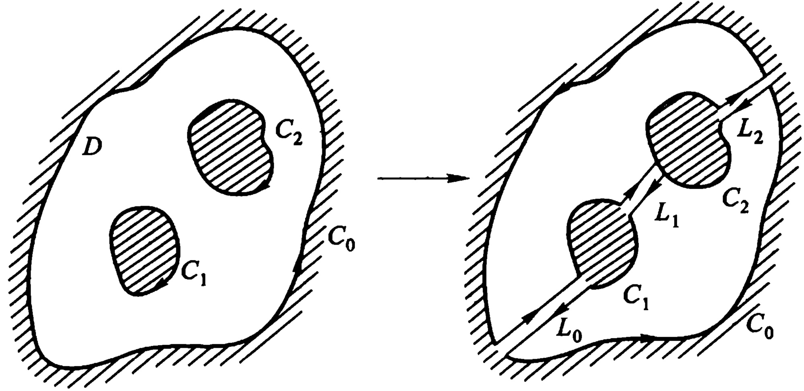

图 3.10
 

或写成

$$  \begin{aligned}\int_{C_{0}}f(z)\mathrm{d}z+\int_{C_{1}^{-}}f(z)\mathrm{d}z+&\cdots+\int_{C_{n}^{-}}f(z)\mathrm{d}z\\ =&0,\end{aligned}   \tag*{(3.13)}$$

或写成  $ \int_{C_{0}} f(z)dz=\int_{C_{1}} f(z)dz+\cdots+\int_{C_{n}} f(z)dz. $

（沿外边界积分等于沿内边界积分之和。）

注 定理 3.10 中的复周线换成单周线（一条）就是定理 3.9. 所以定理 3.10 是定理 3.9 的推广.

证 取  $ n+1 $ 条互不相交且全在 D 内（端点除外）的光滑弧  $ L_{0}, L_{1}, L_{2}, \cdots, L_{n} $ 作为割线. 用它们顺次地与  $ C_{0}, C_{1}, C_{2}, \cdots, C_{n} $ 连接. 设想将 D 沿割线割破, 于是 D 就被分成两个单连通区域 (图 3.10 是 n=2 的情形), 其边界各是一条周线, 分别记为  $ \Gamma_{1} $ 和  $ \Gamma_{2} $. 而由定理 3.9, 我们有

 $$ \int_{\Gamma_{1}}f(z)\mathrm{d}z=0,\int_{\Gamma_{2}}f(z)\mathrm{d}z=0, $$ 

将这两个等式相加，并注意到沿着  $ L_{0}, L_{1}, \cdots, L_{n} $ 的积分，各从相反的两个方向取了一次，在相加的过程中互相抵消。于是，由复积分的基本性质(3)就得到

<!-- page: 134 -->

$$ \int_{c}f(z)\mathrm{d}z=0. $$ 

从而有(3.13)和(3.14).

例 3.8 设 a 为周线 C 内部一点，则

 $$ \int_{c}\frac{\mathrm{d}z}{\left(z-a\right)^{n}}=\left\{\begin{aligned}&2\pi\mathrm{i}&\left(n=1\right),\\ &0&\left(n\neq1,\mathrm{ 且 }\right.\end{aligned}\right. $$ 

证 以 a 为圆心画圆周  $ C^{\prime} $，使  $ C^{\prime} $ 全含于 C 的内部，则由 (3.14)

 $$ \int_{C}\frac{\mathrm{d}z}{\left(z-a\right)^{n}}=\int_{C^{\prime}}\frac{\mathrm{d}z}{\left(z-a\right)^{n}}, $$ 

再由例 3.2 即得要证明的结论.

注 例 3.8 是例 3.2 更普遍的形式.

 $ ^{*} $例 3.9 （多连通区域内的不定积分或变上限积分）试证

 $$ \int_{1}^{z}\frac{\mathrm{d}\zeta}{\zeta}=\mathrm{L n}z\quad(z\in G:z\neq0,\infty). $$ 

其中积分路径是不过原点，且连接点  $ z_{0}=1 $ 和点 z 的任意逐段光滑曲线.

证 G 是二连通区域. 考虑这样两条路径的积分值, 其中一条 L 沿正方向或负方向绕原点若干周; 另一条 l 则不绕原点 (不穿过负实轴). 如图 3.11, 由例 3.6 及例 3.8 可得

 $$ \begin{aligned}\int_{L}\frac{d\zeta}{\zeta}&=\int_{ABCbDA}\frac{d\zeta}{\zeta}+\int_{ADaCEA}\frac{d\zeta}{\zeta}+\int_{AEF}\frac{d\zeta}{\zeta}\\&=2\int_{\gamma}\frac{d\zeta}{\zeta}+\int_{l}\frac{d\zeta}{\zeta}.\end{aligned} $$ 

一般，

 $$ \begin{array}{c}\displaystyle\int_{L}\frac{\mathrm{d}\zeta}{\zeta}=\displaystyle\int_{l}\frac{\mathrm{d}\zeta}{\zeta}+n\displaystyle\int_{r}\frac{\mathrm{d}\zeta}{\zeta}\\ \\ =\ln z+2n\pi i\\ \\ (n=0,\pm1,\cdots)\\ \\ =\mathrm{Ln}\ z.\end{array} $$ 

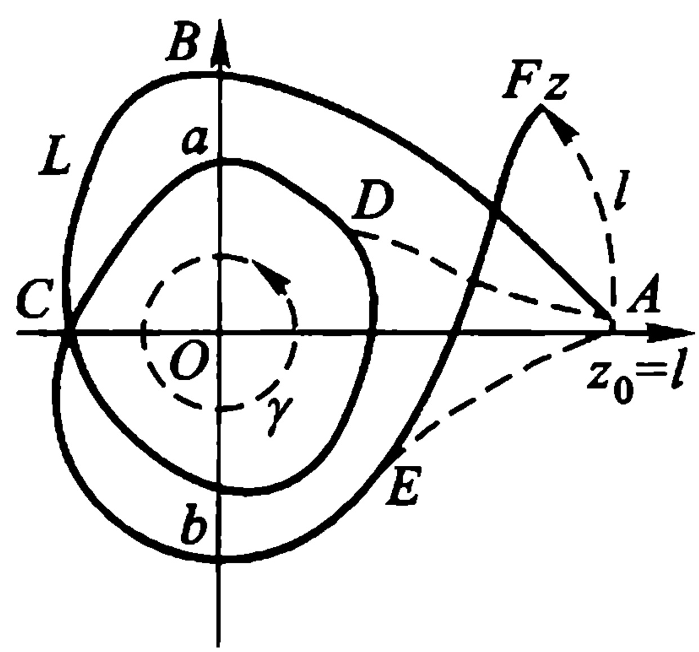

图3.11
 

<!-- page: 135 -->

因此，所给变上限 z 的函数

 $$ \dot{F}(z)=\int_{1}^{z}\frac{\mathrm{d}\zeta}{\zeta} $$ 

是对数函数  $ \mathrm{Ln}z $ 的一个积分表达式，在原点处的支点是被积函数惟一的奇点.

注 多连通区域 G 内的变上限积分一般表示多值解析函数，比如上面例 3:9，但也有表示单值解析函数的。比如，我们来考查变上限积分

$$  \int_{1}^{z}\frac{1}{\zeta^{2}}\mathrm{d}\zeta,   \tag*{  (*) }$$

这里  $ z \in G $:  $ z \neq 0, \infty, G $ 是二连通区域，积分路径 L 是不过原点，且联结点  $ z_{0} = 1 $ 和点 z 的任意逐段光滑曲线.

1) 当 L 不围绕原点 z = 0，被积函数  $ \frac{1}{z^{2}} $ 在包含 L 但不包含 z = 0 的一个单连通子区域 D 内单值解析，从而由定理 3.8

 $$ \int_{1}^{z}\frac{1}{\zeta^{2}}\mathrm{d}\zeta=-\left.\frac{1}{\zeta}\right|_{1}^{z}=-\frac{1}{z}+1\quad(z\in D). $$ 

2) 设  $ \gamma $ 是在 G 内的一条周线，原点在  $ \gamma $ 的内部，则当 z 沿  $ \gamma $ 的正向绕行一周时，积分 ( $ * $) 有增量

 $$ \int_{y}\frac{1}{\zeta^{2}}\mathrm{d}\zeta=0\quad( 例 3.8). $$ 

3）由1)和2)的结果，并参看图3.11，可见

 $$ \int_{1}^{z}\frac{1}{\zeta^{2}}\mathrm{d}\zeta=-\frac{1}{z}+1\quad(z\in G), $$ 

这就是 z 的单值解析函数.

#### §3. 柯西积分公式及其推论

1. 柯西积分公式 我们利用柯西积分定理(复周线形式)导出一个用边界值表示解析函数内部值的积分公式.

<!-- page: 136 -->

定理 3.11 设区域 D 的边界是周线 (或复周线) C，函数  $ f(z) $ 在 D 内解析，在  $ \overline{D} = D + C $ 上连续，则有

$$  f(z)=\frac{1}{2\pi\mathrm{i}}\int_{c}\frac{f(\zeta)}{\zeta-z}\mathrm{d}\zeta\quad(z\in D).   \tag*{(3.15)}$$

这就是柯西积分公式. 它是解析函数的积分表达式, 因而是今后我们研究解析函数各种局部性质的重要工具.

证 任意固定  $ z \in D $,  $ F(\zeta) = \frac{f(\zeta)}{\zeta - z} $ 作为  $ \zeta $ 的函数在 D 内除点  $ z $ 外均解析. 今以点 z 为心, 充分小的  $ \rho > 0 $ 为半径作圆周  $ \gamma_{\rho} $, 使  $ \gamma_{\rho} $ 及其内部均含于 D (图 3.12). 对于复周线  $ \Gamma = C + \gamma_{\rho}^{-} $及函数  $ F(\zeta) $, 应用定理 3.10 的 (3.13) 式, 得

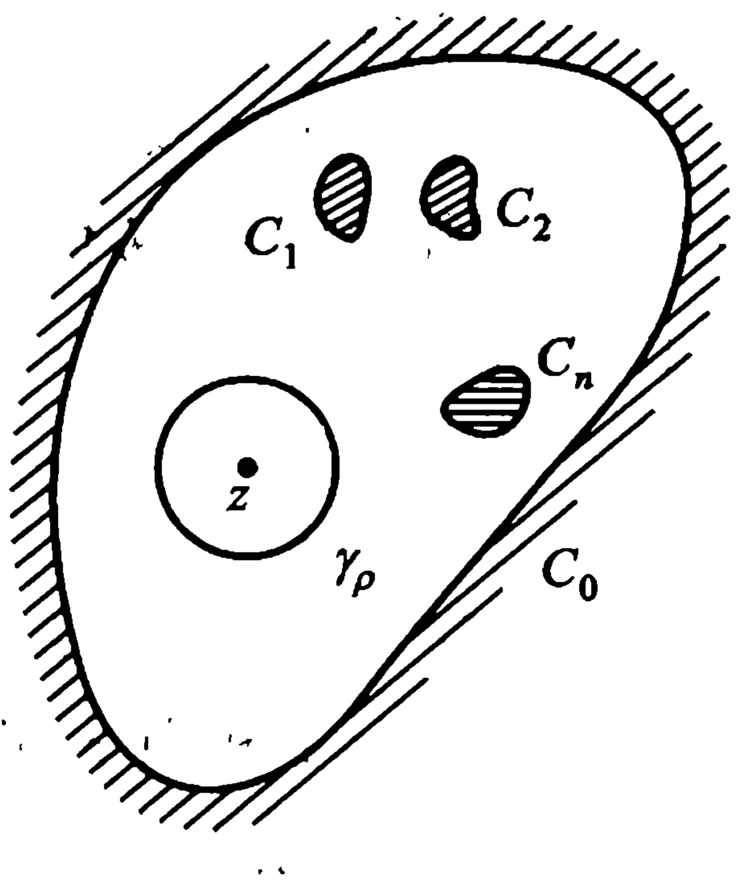

图 3.12
 

 $$ \int_{C}\frac{f(\zeta)}{\zeta-z}\mathrm{d}\zeta=\int_{\gamma_{0}}\frac{f(\zeta)}{\zeta-z}\mathrm{d}\zeta. $$ 

（这一步的重要性，在于将复杂路径 C 代以简单路径  $ \gamma_{\rho} $）上式表示右端与  $ \gamma_{\rho} $ 的半径  $ \rho $ 无关，因此我们只须证明

$$  \lim_{\rho\to0}\int_{\gamma}\frac{f(\zeta)}{\zeta-z}\mathrm{d}\zeta=2\pi\mathrm{i}f(z),   \tag*{(3.16)}$$

则柯西积分公式(3.15)就算证明了.

注意到  $ f(z) $ 与积分变量  $ \zeta $ 无关，而  $ 2\pi i = \int_{\gamma} \frac{d\zeta}{\zeta - z} $（见例 3.2），于是有

$$  \begin{align*}\left|\int_{\gamma_{\rho}}\frac{f(\zeta)}{\zeta-z}\mathrm{d}\zeta-2\pi\mathrm{i}f(z)_{z}\right|&=\left|\int_{\gamma_{\rho}}\frac{f(\zeta)}{\zeta-z}\mathrm{d}\zeta-f(z)\int_{\gamma_{\rho}}\frac{\mathrm{d}\zeta}{\zeta-z}\right|\\&=\left|\int_{\gamma_{\rho}}\frac{f(\zeta)-f(z)}{\zeta-z}\mathrm{d}\zeta\right|.\tag{3.}\end{align*}   \tag*{(3.17)}$$

根据  $ f(\zeta) $ 的连续性，对任给的  $ \varepsilon > 0 $，存在  $ \delta > 0 $，只要  $ \left|\zeta - z\right| $

<!-- page: 137 -->

$ \rho<\delta $，就有

 $$ \mid f(\zeta)-f(z)\mid<\frac{\varepsilon}{2\pi}\quad(\zeta\in\gamma_{\rho}), $$ 

由定理 3.2 知 (3.17) 不超过  $ \frac{\varepsilon}{2\pi\rho} \cdot 2\pi\rho = \varepsilon $，于是证明了 (3.16). 定理得证.

定义 3.4 在定理 3.11 的条件下，

 $$ \frac{1}{2\pi\mathrm{i}}\int_{c}\frac{f(\zeta)}{\zeta-z}\mathrm{d}\zeta,(z\notin\mathbb{C}) $$ 

称为柯西积分.

思考题 在定理 3.11 的条件下，如果  $ z \notin \overline{D} $，则柯西积分  $ \frac{1}{2\pi i} \int_{c} \frac{f(\zeta)}{\zeta - z} \, \mathrm{d}\zeta $ 之值如何？

柯西积分公式(3.15)可以改写成

$$  \int_{c}\frac{f(\zeta)}{\zeta-z}\mathrm{d}\zeta=2\pi\mathrm{i}f(z)\quad(z\in D),   \tag*{(3.15)'}$$

借此公式可以计算某些周线积分（指路径是周线的积分）.

例 3.10 设 C 为圆周  $ \left|\zeta\right|=2 $，则按(3.15).

 $$ \begin{array}{r}{\int_{c}\frac{\zeta}{(9-\zeta^{2})(\zeta+i)}\mathrm{d}\zeta=\displaystyle\int_{c}\frac{\frac{\zeta}{9-\zeta^{2}}}{\zeta-(-i)}\mathrm{d}\zeta}\\ {=2\pi i\cdot\frac{\zeta}{9-\zeta^{2}}\bigg|_{\zeta=-i}=\frac{\pi}{5}.}\end{array} $$ 

注意到  $ f(\zeta)=\frac{\zeta}{9-\zeta^{2}} $ 在闭圆  $ |\zeta|\leq2 $ 上解析，定理 3.11 的条件满足，故公式 (3.15) 它可以应用，因而上面的计算是正确的.

注 在(3.15)及(3.15) $ ^{\prime} $中， $ \zeta = z $ 是被积函数

 $$ F(\zeta)=\frac{f(\zeta)}{\zeta-z} $$ 

在 C 内部的惟一奇点，如果给定的积分被积函数  $ F(\zeta) $ 在 C 内部有两个以上奇点，就不能直接应用柯西积分公式

<!-- page: 138 -->

定理 3.11 的特殊情形,有如下的解析函数平均值定理. 在下一章,我们将应用它来证明解析函数的最大模原理.

定理 3.12 如果函数  $ f(z) $ 在圆  $ \left|\zeta - z_{0}\right| < R $ 内解析，在闭圆  $ \left|\zeta - z_{0}\right| \leq R $ 上连续，则

 $$ f(z_{0})=\frac{1}{2\pi}\int_{0}^{2\pi}f(z_{0}+R\mathrm{e}^{\mathrm{i}\varphi})\mathrm{d}\varphi, $$ 

即  $ f(z) $ 在圆心  $ z_{0} $ 的值等于它在圆周上的值的算术平均数.

证 设 C 表圆周  $ \left|\zeta - z_{0}\right| = R $ (如图 3.13), 则

 $$ \zeta-z_{0}=R\mathrm{e}^{\mathrm{i}\varphi},\quad0\leqslant\varphi\leqslant2\pi, $$ 

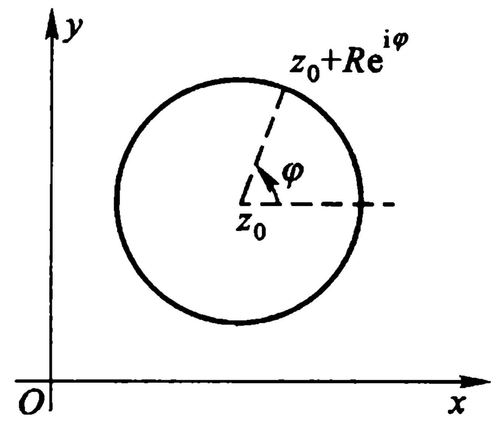

或

 $$ \zeta=z_{0}+R\mathrm{e}^{\mathrm{i}\varphi}, $$ 

由此

图 3.13
 

 $$ \mathrm{d}\boldsymbol{\zeta}=\mathrm{i}R\mathrm{e}^{\mathrm{i}\varphi}\mathrm{d}\varphi, $$ 

根据柯西积分公式(3.15)

 $$ \begin{align*}f(z_{0})&=\frac{1}{2\pi i}\int_{c}\frac{f(\zeta)}{\zeta-z_{0}}\mathrm{d}\zeta\\&=\frac{1}{2\pi i}\int_{0}^{2\pi}\frac{f(z_{0}+Re^{i\varphi})\mathrm{i}Re^{i\varphi}\mathrm{d}\varphi}{Re^{i\varphi}}\\&=\frac{1}{2\pi}\int_{0}^{2\pi}f(z_{0}+Re^{i\varphi})\mathrm{d}\varphi.\end{align*} $$ 

例 3.11 设函数  $ f(z) $ 在闭圆  $ \left|z\right| \leqslant R $ 上解析. 如果存在 a > 0, 使当  $ \left|z\right| = R $ 时

 $$ \begin{aligned}&|f(z)|>a,\\&|f(0)|<a,\end{aligned} $$ 

而且

试证：在圆  $ \left|z\right|<R $ 内  $ f(z) $ 至少有一个零点.

证 反证法，设  $ f(z) $ 在  $ |z|<R $ 内无零点，而由题设  $ f(z) $ 在  $ |z|=R $ 上也无零点。于是

 $$ F(z)=\frac{1}{f(z)} $$

<!-- page: 139 -->

在闭圆  $ \left|z\right| \leqslant R $ 上解析. 由解析函数的平均值定理,

 $$ \begin{array}{r}{F(0)=\frac{1}{2\pi}\int_{0}^{2\pi}F(R\mathrm{e}^{\mathrm{i}\varphi})\mathrm{d}\varphi,}\end{array} $$ 

又由题设

 $$ \left|F(0)\right|=\frac{1}{\left|f(0)\right|}>\frac{1}{a}, $$ 

 $$ |F(R\mathrm{e}^{\mathrm{i}\varphi})|=\frac{1}{|f(R\mathrm{e}^{\mathrm{i}\varphi})|}<\frac{1}{a}, $$ 

从而

 $$ \begin{aligned}\frac{1}{a}<|F(0)|_{.}=&\left|\frac{1}{2\pi}\int_{0}^{2\pi}F(R\mathrm{e}^{\mathrm{i}\varphi})\mathrm{d}\varphi\right|\leqslant\frac{1}{a}\cdot\frac{1}{2\pi}\cdot2\pi\\ =&\frac{1}{a}.\end{aligned} $$ 

矛盾. 故在圆  $ \left|z\right|<R $ 内  $ f(z) $ 至少有一个零点.

2. 解析函数无穷可微性 我们将柯西积分公式(3.15)形式地在积分号下对 z 求导后得

$$  f^{\prime}(z)=\frac{1}{2\pi\mathrm{i}}\int_{c}\frac{f(\zeta)}{(\zeta-z)^{2}}\mathrm{d}\zeta\quad(z\in D),   \tag*{(3.18)}$$

这样继续一次又可得

 $$ f^{\prime\prime}(z)=\frac{2!}{2\pi\mathrm{i}}\int_{c}\frac{f(\zeta)}{(\zeta-z)^{3}}\mathrm{d}\zeta\quad(z\in D), $$ 

我们将对这些公式的正确性加以证明.

定理 3.13 在定理 3.11 的条件下，函数  $ f(z) $ 在区域 D 内有各阶导数，并且有

$$  \begin{align*}f^{(n)}(z)=\frac{n!}{2\pi\mathrm{i}}\int_{c}\frac{f(\zeta)}{(\zeta-z)^{n+1}}\mathrm{d}\zeta\quad(z\in D).\ $ n=1,2,\cdots)\tag{1}\end{align*}   \tag*{(3.19)}$$

这是一个用解析函数  $ f(z) $ 的边界值表示其各阶导函数内部值的积分公式.

证 首先对 n=1 的情形来证明，即要证公式(3.18)成立.按照(3.15)，有 $ (\Delta z \neq 0) $

 $$ \frac{f(z+\Delta z)\div f(z)}{\Delta z}=\frac{1}{\Delta z}\left[\frac{1}{2\pi\mathrm{i}}\int_{c}\frac{f(\zeta)}{\zeta-z-\Delta z}\mathrm{d}\zeta-\right. $$

<!-- page: 140 -->

$$ \begin{array}{l}\frac{1}{2\pi\mathrm{i}}\int_{c}\frac{f(\zeta)}{\zeta-z}\mathrm{d}\zeta\\ =-\frac{1}{2\pi\mathrm{i}}\int_{c}\frac{f(\zeta)}{(\zeta-z-\Delta z)(\zeta-z)}\mathrm{d}\zeta.\end{array} $$ 

我们要证明下面的差数

$$  \begin{align*}\frac{1}{2\pi\mathrm{i}}\int_{c}\frac{f(\zeta)\mathrm{d}\zeta}{(\zeta-z-\Delta z)(\zeta-z)}-\frac{1}{2\pi\mathrm{i}}\int_{c}\frac{f(\zeta)\mathrm{d}\zeta}{(\zeta-z)^{2}}\\=\left|\frac{1}{2\pi\mathrm{i}}\int_{c}\frac{\Delta z f(\zeta)}{(\zeta-z-\Delta z)(\zeta-z)^{2}}\mathrm{d}\zeta\right|\end{align*}   \tag*{(3.20)}$$

在  $ \left|\Delta z\right| $ 充分小时不超过任给的正数  $ \varepsilon $.

设沿周线  $ C, |f(\zeta)| \leq M $。设 d 表示 z 与 C 上点  $ \zeta $ 间的最短距离。于是，当  $ \zeta \in C $ 时， $ |\zeta - z| \geq d > 0 $（参看定理 3.3 注）。

先设  $ \left|\Delta z\right| < \frac{d}{2} $，于是（图 3.14） $ \left|\zeta - z - \Delta z\right| \geqslant \left|\zeta - z\right| - \left|\Delta z\right| > \frac{d}{2} $，这样一来，差数 (3.20) 不超过

 $$ \frac{|\Delta z|}{2\pi}\cdot\frac{M l}{\frac{d}{2}\cdot d^{2}}, $$ 

其中 l 为 C 之长度. 为使上式不超过任给正数  $ \varepsilon $, 只要取

 $$ |\Delta z|<\delta=\min\left(\frac{d}{2},\frac{\pi d^{3}\varepsilon}{M l}\right). $$ 

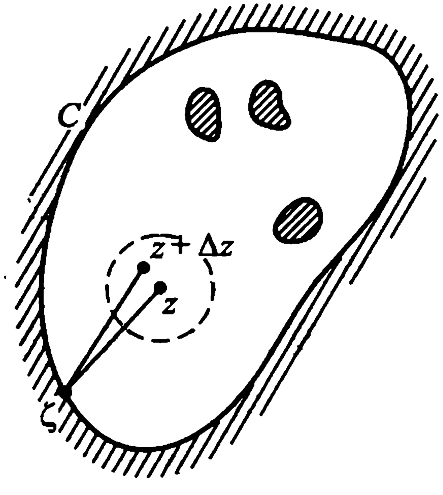

图 3.14
 

于是(3.18)就证明了.

要完成定理的证明，只要应用数学

归纳法.设  $ n=k $ 时公式(3.19)成立;证明  $ n \neq k+1 $ 时,(3.19)也成立.这就是要证明下面这个式子

 $$ \begin{align*}\frac{f^{(k)}\left(z+\Delta z\right)-f^{(k)}\left(z\right)}{\Delta z}&=\frac{1}{\Delta z}\left[\frac{k!}{2\pi i}\int_{c}\frac{f(\zeta)d\zeta}{(\zeta-z-\Delta z)^{k+1}}\right.\\&\quad\left.-\frac{k!}{2\pi i}\int_{c}\frac{f(\zeta)d\zeta}{(\zeta-z)^{k+1}}\right].\end{align*} $$

<!-- page: 141 -->

在  $ \Delta z \rightarrow 0 $ 时，以

 $$ \frac{(k+1)!}{2\pi i}\int_{c}\frac{f(\zeta)}{(\zeta-z)^{k+2}}\mathrm{d}\zeta $$ 

为极限.方法和证明 n=1 的情形类似,不过稍微复杂些,就不重复了.

公式(3.19)可改写成

$$  \int_{c}\frac{f(\zeta)}{(\zeta-z)^{n+1}}\mathrm{d}\zeta=\frac{2\pi\mathrm{i}}{n!}f^{(n)}(z)\quad(z\in D,n=1,2,\cdots).   \tag*{(3.19)'}$$

注 （1）应用(3.19)可以计算一些周线积分；

(2) 在(3.19)及(3.19)′中， $ \zeta = z $ 是被积函数  $ F(\zeta) $ 在 C 内部的惟一奇点，如果  $ F(\zeta) $ 在 C 内部有两个以上的奇点，就不能直接应用它们.

例 3.12 计算积分

 $$ \int_{c}\frac{\cos z}{(z-\mathrm{i})^{3}}\mathrm{d}z, $$ 

其中 C 是绕 i 一周的周线.

解 因为  $ \cos z $ 在 z 平面上解析，应用公式 (3.19) 于  $ f(z) = \cos z $，我们得

 $$ \int_{c}\frac{\cos z}{(z-i)^{3}}\mathrm{d}z=\frac{2\pi i}{2!}(\cos z)^{\prime \prime}\bigg|_{z=i}=-\pi\mathrm{i}\cos i=-\pi\frac{\mathrm{e}^{-1}+\mathrm{e}}{2}\mathrm{i}. $$ 

应用上述定理，我们得出解析函数的无穷可微性：

定理 3.14 设函数  $ f(z) $ 在 z 平面上的区域 D 内解析，则  $ f(z) $ 在 D 内具有各阶导数，并且它们也在 D 内解析.

证 设  $ z_{0} $ 为 D 内任一点，将定理 3.13 应用于以  $ z_{0} $ 为心的充分小的圆（只要这个闭圆全含于 D 内），即知  $ f(z) $ 在此圆内有各阶导数。特别说来， $ f(z) $ 在点  $ z_{0} $ 有各阶导数。由于  $ z_{0} $ 的任意性，所以  $ f(z) $ 在 D 内有各阶导数。

这样，由函数在区域 D 内解析（注意：仅只假设其导数在 D

<!-- page: 142 -->

内存在!), 就推出了其各阶导数在 D 内存在且连续. 而数学分析中区间上的可微函数, 在此区间上不一定有二阶导数, 更谈不上有高阶导数了.

借助解析函数的无穷可微性,我们现在来把判断函数  $ f(z) $ 在区域 D 内解析的一个充分条件——定理 2.5,补充证明成刻画解析函数的第二个等价定理:

定理 3.15 函数  $ f(z) = u(x, y) + \mathrm{i}v(x, y) $ 在区域 D 内解析的充要条件是

（1） $ u_{x}, u_{y}, v_{x}^{'} $,  $ v_{y} $ 在 D 内连续；

(2)  $ u(x,y) $,  $ v(x,y) $ 在 D 内满足 C. -R. 方程.

##### 证 充分性 即定理 2.5.

必要性 条件(2)的必要性已由定理2.1得出. 现在, 由于解析函数  $ f(z) $ 的无穷可微性,  $ f'(z) $ 必在 D 内连续, 因而  $ u_{x}, u_{y}, v_{x}, v_{y} $ 必在 D 内连续.

3. 柯西不等式与刘维尔(Liouville)定理 利用定理 3.13 可以得出一个很有用的导数的估计式：

柯西不等式 设函数  $ f(z) $ 在区域 D 内解析, a 为 D 内一点, 以 a 为心作圆周  $ \gamma: |\zeta - a| = R $, 只要  $ \gamma $ 及其内部 K 均含于 D, 则有

 $$ \mid f^{(n)}(a)\mid\leqslant\frac{n!}{R^{n}}M(R), $$ 

其中  $ M(R) = \max_{|z - a| = R} |f(z)| $, n = 1, 2,  $ \cdots $.

证 应用定理 3.13 于  $ \overline{K} $ 上，则有

 $$ \begin{aligned}\left|f^{(n)}(a)\right|&=\left|\frac{n!}{2\pi\mathrm{i}}\int_{\gamma}\frac{f(\zeta)}{\left(\zeta-a\right)^{n+1}}\mathrm{d}\zeta\right|\leqslant\frac{n!}{2\pi}\cdot\frac{M(R)}{R^{n+1}}\cdot2\pi R\\&=\frac{n!}{R^{n}}\frac{M(R)}{}\end{aligned} $$ 

注 柯西不等式是对解析函数各阶导数模的估计式，说明解析函数在解析点 a 的各阶导数的估计与它的解析区域的大小密

<!-- page: 143 -->

切相关.

在整个复平面上解析的函数称为整函数.例如多项式, $ e^{z} $,  $ \cos z $及 $ \sin z $都是整函数.常数当然也是整函数.应用柯西不等式,可得一个关于整函数的定理:

刘维尔定理 有界整函数  $ f(z) $ 必为常数.

证 设  $ \left|f(z)\right| $ 的上界为 M，则在柯西不等式中，对无论什么样的 R，均有  $ M(R) \leq M $。于是命 n = 1 有

 $$ |f^{\prime}(a)|\leqslant\frac{M}{R}, $$ 

上式对一切 R 均成立，让  $ R \to +\infty $，即知  $ f'(a) = 0 $。而 a 是 z 平面上任一点，故  $ f(z) $ 在 z 平面上的导数为零。由第二章习题（一）6(1)知  $ f(z) $ 必为常数。

注 这是一个非局部性命题，也是模有界定理，其逆也真，即：常数是有界整函数；此定理的逆否定理为：非常数的整函数必无界；关于刘维尔定理，我们以后还要论及。

应用刘维尔定理可以很简洁地证明：

代数学基本定理 在 z 平面上，n 次多项式

 $$ p(z)=a_{0}z^{n}+a_{1}z^{n-1}+\cdots+a_{n}\quad(a_{0}\neq0) $$ 

至少有一个零点.

证 反证法，设  $ p(z) $ 在 z 平面上无零点。由于  $ p(z) $ 在 z 平面上是解析的， $ \frac{1}{p(z)} $ 在 z 平面上也必解析。

下面我们证明 $ \frac{1}{p(z)} $在z平面上有界.由于

 $$ \begin{aligned}&\lim_{z\to\infty}p\left(z\right)=\lim_{z\to\infty}z^{n}\left(a_{0}+\frac{a_{1}}{z}+\cdots+\frac{a_{n}}{z^{n}}\right)=\infty,\\&\lim_{z\to\infty}\frac{1}{p\left(z\right)}=0,\end{aligned} $$ 

故存在充分大的正数 R，使当  $ \left|z\right|>R $ 时， $ \left|\frac{1}{p(z)}\right|<1 $.

<!-- page: 144 -->

又因 $ \frac{1}{p(z)} $在闭圆 $ \left|z\right|\leq R $上连续，故可设

 $$ \left|\frac{1}{p(z)}\right|\leqslant M( 正常数 ), $$ 

从而，在 z 平面上

 $$ \left|\frac{1}{p(z)}\right|<M+1, $$ 

于是， $ \frac{1}{p(z)} $ 在 z 平面上是解析且有界的. 由刘维尔定理， $ \frac{1}{p(z)} $ 必为常数，即  $ p(z) $ 必为常数. 这与定理的假设矛盾. 故定理得证.

注 代数学基本定理,用纯粹代数的方法是不容易证明的,这是因为数学知识还不够的缘故,由此可见,数学知识积累在解决问题中的重要性.

4. 摩勒拉(Morera)定理 我们现在来证明柯西积分定理(定理3.3)的逆定理,称为摩勒拉定理.

定理 3.16 若函数  $ f(z) $ 在单连通区域 D 内连续，且对 D 内的任一周线 C，有

 $$ \int_{c}f(z)\mathrm{d}z=0, $$ 

则  $ f(z) $ 在 D 内解析.

证 在假设条件下，根据定理 3.7 即知

 $$ F(z)=\int_{z_{0}}^{z}f(\zeta)\mathrm{d}\zeta\quad(z_{0}\in D) $$ 

在 D 内解析，且  $ F'(z) = f(z) $ ( $ z \in D $). 但解析函数  $ F(z) $ 的导函数  $ F'(z) $ 还是解析的。即是说  $ f(z) $ 在 D 内解析。

下面我们着重指出刻画解析函数的第三个等价定理.

定理 3.17 函数  $ f(z) $ 在区域 G 内解析的充要条件是：

（1） $ f(z) $在G内连续；

（2）对任一周线 C，只要 C 及其内部全含于 G 内，就有

 $$ \int_{c}f(z)\mathrm{d}z=0. $$

<!-- page: 145 -->

证 必要性可由柯西积分定理 3.3 导出.至于充分性,我们在 G 内任一点  $ z_{0} $ 的一个邻域 K:  $ |\zeta - z_{0}| < \rho $ 内来应用定理 3.16,只要  $ \rho $ 充分小,就知道  $ f(z) $ 在圆 K 内解析.特别说来,在  $ z_{0} $ 解析,因为  $ z_{0} $ 可在 G 内任意取,故  $ f(z) $ 在 G 内解析.

例 3.13 如果函数  $ f(z) $ 为一整函数，且有使

 $$ \mathrm{Re}f(z)<M $$ 

的实数 M 存在，试证  $ f(z) $ 为常数.

证 令  $ F(z) = \mathrm{e}^{f(z)} $，则  $ F(z) $ 为整函数。又在 z 平面上

 $$ \mid F(z)\mid=\mathrm{e}^{\mathrm{R e}f(z)}<\mathrm{e}^{M}, $$ 

故有界，由刘维尔定理可见  $ F(z) $ 是常数。因此  $ f(z) $ 也是常数。

例 3.14 设  $ f(z) $ 是整函数, n 为正整数, 试证当

 $$ \lim_{z\to\infty}\frac{f(z)}{z^{n}}=0 $$ 

时， $ f(z) $至多是 n-1 次多项式.

证 由第二章习题(一)6(1)及定理3.8,只须证得对任何的  $ z, f^{(n)}(z)=0 $.

由

 $$ \lim_{z\to\infty}\frac{f(z)}{z^{n}}=0 $$ 

可知，对任给的  $ \varepsilon > 0 $，存在 R > 0，只要  $ \left| z \right| > R $ 时就有

 $$ |f(z)|<\varepsilon|z|^{n}. $$ 

在 z 平面上任取一点 z. 再取以 z 为心, 以 r 为半径的圆周 C, 使圆周  $ C_{1} = \{z \mid |z| = R\} $ 全含于其内部. 于是有  $ r > |z| $. 这时对于  $ \zeta \in C $, 必  $ |\zeta| > R $, 因而

 $$ |f(\zeta)|<\varepsilon|\zeta|^{n}\leqslant\varepsilon(|z|+r)^{n}. $$ 

由柯西不等式可得

 $$ \begin{align*}|f^{(n)}(z)|&\leqslant\frac{n!}{r^n}\varepsilon(|z|+r)^n\\&=n!\varepsilon\left(1+\frac{|z|}{r}\right)^n\leqslant n!2^n\varepsilon.\end{align*} $$

<!-- page: 146 -->

因为  $ \varepsilon>0 $ 是任意的，所以

 $$ f^{\left(n\right)}\left(z\right)=0. $$ 

故  $ f(z) $ 至多是 n-1 次多项式.

#####  $ ^{*} $5. 柯西型积分

定义 3.4 设 C 为任一条简单逐段光滑曲线（不必闭合）， $ f(\zeta) $ 是在 C 上有定义的可积函数，则具有如下形式的积分：

 $$ \frac{1}{2\pi\mathrm{i}}\int_{c}\frac{f(\zeta)}{\zeta-z}\mathrm{d}\zeta\quad(z\notin C) $$ 

称为柯西型积分.

显然柯西积分为柯西型积分的特例，但柯西型积分就不一定为柯西积分.

例如（1）

 $$ \frac{1}{2\pi i}\int_{|\zeta|=1}\frac{\overline{\zeta}}{\zeta-z}\mathrm{d}\zeta,(\mid z\mid\neq1); $$ 

(2)

 $$ \frac{1}{2\pi i}\int_{|\zeta|=1}\frac{\frac{1}{\zeta}}{\zeta-z}\mathrm{d}\zeta,(\mid z\mid\neq1); $$ 

(3)

 $$ \frac{1}{2\pi\mathrm{i}}\int_{-1}^{+1}\frac{\mathrm{d}x}{x-z},(z\in[-1,1]). $$ 

（显然(1)可变形为(2);(2)、(3)的计算留给读者).这三个积分都是柯西型积分而非柯西积分.

类似定理 3.13 的证明,我们可以得到类似定理 3.13 的结果.

定理 3.13' 若函数  $ f(\zeta) $ 沿简单逐段光滑曲线 C（不必闭合）连续，则由柯西型积分

 $$ F(z)=\frac{1}{2\pi i}\int_{c}\frac{f(\zeta)}{\zeta-z}\mathrm{d}\zeta,(z\notin C) $$ 

所定义的函数  $ F(z) $，在 z 平面上 C 外任一区域 D 内解析，且

 $$ \begin{align*}F^{(n)}(z)&=\frac{n!}{2\pi\mathrm{i}}\int_{c}\frac{f(\zeta)}{(\zeta-\overrightarrow{z})^{n+1}}\mathrm{d}\zeta,\ $ z&\in D,n=1,2,\cdots).\end{align*} $$ 

证明留给读者.

<!-- page: 147 -->

#### §4. 解析函数与调和函数的关系

在前一节,我们已经证明了,在区域内解析的函数具有任何阶的导数.因此,在区域内它的实部u与虚部v都有二阶连续导数.现在我们来研究应该如何选择u与v才能使函数 $ u+iv $在区域内解析.

设  $ f(z)=u+i v $ 在区域 D 内解析，则由 C.-R. 方程

 $$ \frac{\partial u}{\partial x}=\frac{\partial v}{\partial y},\quad\frac{\partial u}{\partial y}=-\frac{\partial v}{\partial x}, $$ 

得

 $$ \frac{\partial^{2}u}{\partial x^{2}}=\frac{\partial^{2}v}{\partial x\partial y},\quad\frac{\partial^{2}u}{\partial y^{2}}=-\frac{\partial^{2}v}{\partial y\partial x}, $$ 

因 $ \frac{\partial^{2}v}{\partial x\partial y} $与 $ \frac{\partial^{2}v}{\partial y\partial x} $在D内连续，它们必定相等，故在D内有

 $$ \frac{\partial^{2}u}{\partial x^{2}}+\frac{\partial^{2}u}{\partial y^{2}}=0, $$ 

同理，在 D 内有

 $$ \frac{\partial^{2}v}{\partial x^{2}}+\frac{\partial^{2}v}{\partial y^{2}}=0, $$ 

即 u 及 v 在 D 内满足拉普拉斯 (Laplace) 方程：

 $$ \Delta u=0,\quad\Delta v=0. $$ 

这里  $ \Delta\equiv\frac{\partial^{2}}{\partial x^{2}}+\frac{\partial^{2}}{\partial y^{2}} $ 是一种运算记号，称为拉普拉斯算子.

定义 3.5 如果二元实函数  $ H(x, y) $ 在区域 D 内有二阶连续偏导数，且满足拉普拉斯方程  $ \Delta H = 0 $，则称  $ H(x, y) $ 为区域 D 内的调和函数.

调和函数常出现在诸如流体力学、电学、磁学等实际问题中.

定义 3.6 在区域 D 内满足 C. -R. 方程

 $$ \frac{\partial u}{\partial x}=\frac{\partial v}{\partial y},\quad\frac{\partial u}{\partial y}=-\frac{\partial v}{\partial x} $$ 

的两个调和函数 u, v 中, v 称为 u 在区域 D 内的共轭调和函数.

<!-- page: 148 -->

由上面的讨论，我们已经证明了：

定理 3.18 若  $ f(z) = u(x, y) + \mathrm{i}v(x, y) $ 在区域 D 内解析，则在区域 D 内  $ v(x, y) $ 必为  $ u(x, y) $ 的共轭调和函数.

现在接着上面的讨论.反过来,如果 u,v 是任意选取的在区域 D 内的两个调和函数,则  $ u+iv $ 在 D 内就不一定解析.

要想  $ u + iv $ 在区域 D 内解析, u 及 v 还必须满足 C. -R. 方程. 即 v 必须是 u 的共轭调和函数. 由此, 如已知一个解析函数的实部  $ u(x, y) $ (或虚部  $ v(x, y) $) 就可以求出它的虚部  $ v(x, y) $ (或实部  $ u(x, y) $).

假设 D 是一个单连通区域,  $ u(x, y) $ 是区域 D 内的调和函数, 则  $ u(x, y) $ 在 D 内有二阶连续偏导数, 且

 $$ \frac{\partial^{2}u}{\partial x^{2}}+\frac{\partial^{2}u}{\partial y^{2}}=0. $$ 

即  $ -\frac{\partial u}{\partial y}, \frac{\partial u}{\partial x} $ 在 D 内具有一阶连续偏导数，且

 $$ \frac{\partial}{\partial y}\left(-\frac{\partial u}{\partial y}\right)=\frac{\partial}{\partial x}\left(\frac{\partial u}{\partial x}\right). $$ 

由数学分析的定理, 知道  $ -\frac{\partial u}{\partial y}dx + \frac{\partial u}{\partial x}dy $ 是全微分,

命

$$  -\frac{\partial u}{\partial y}\mathrm{d}x+\frac{\partial u}{\partial x}\mathrm{d}y=\mathrm{d}v\left(x,y\right),   \tag*{(3.21)}$$

则

$$  v(x,y)=\int_{(x_{0},y_{0})}^{(x,y)}-\frac{\partial u}{\partial y}\mathrm{d}x+\frac{\partial u}{\partial x}\mathrm{d}y+C,   \tag*{(3.22)}$$

其中 $ (x_{0},y_{0}) $是D内的定点， $ (x,y) $是D内的动点，C是一个任意常数，积分与路径无关.

将(3.22)式分别对 x, y 求偏导数，得

 $$ \frac{\partial v}{\partial x}=-\frac{\partial u}{\partial y},\quad\frac{\partial v}{\partial y}=\frac{\partial u}{\partial x}, $$ 

这就是 C. -R. 方程. 由定理 3.15 知  $ u + i v $ 在 D 内解析. 故得

定理 3.19 设  $ u(x, y) $ 是在单连通区域 D 内的调和函数，则

<!-- page: 149 -->

存在由(3.22)式所确定的函数  $ v(x,y) $，使  $ u + iv = f(z) $ 是 D 内的解析函数.

注（1）如单连通区域 D 包含原点，则（3.22）式中的  $ (x_{0}, y_{0}) $ 显然可取成原点  $ (0,0) $；如 D 非单连通区域，则积分 (3.22) 可能规定一个多值函数.

（2）公式(3.22)不必强记，可以先如下去推(3.21):由

 $$ \mathrm{d}v(x,y)=v_{x}\mathrm{d}x+v_{y}\mathrm{d}y\xlongequal{C.-R.-}u_{y}\mathrm{d}x+u_{x}\mathrm{d}y, $$ 

然后两端积分之.

（3）类似地，

 $$ \mathrm{d}u\left(x,y\right)=u_{x}\mathrm{d}x+u_{y}\mathrm{d}y\xlongequal{C.-R.}v_{y}\mathrm{d}x-v_{x}\mathrm{d}y, $$ 

然后两端积分，有

$$  u\left(x,y\right)=\int_{\left(x_{0},y_{0}\right)}^{(x,y)}v_{y}\mathrm{d}x-v_{x}\mathrm{d}y+C.   \tag*{(3.22)  ^{\prime} }$$

思考题（1）“v 是 u 的共轭调和函数”，其中 u, v 是否可以交换顺序？

(2) 如果 v 是 u 的共轭调和函数, 那么 v 的共轭调和函数是什么?

注 （1）刻画解析函数的又一等价定理.

 $$ f(z)=u(x,y)+iv(x,y) 在区域 D 内解析 $$ 

定理3.18

 $ \Longleftrightarrow $ 在区域 D 内  $ v(x,y) $ 是  $ u(x,y) $ 的共轭调和函数.

定理3.19

(2) 由于任一个二元调和函数都可作为一个解析函数  $ f(z) $ 的实部  $ u(x, y) $ (或虚部  $ v(x, y) $), 而虚部  $ v(x, y) $ (或实部  $ u(x, y) $) 可由 C. - R. 方程确定. 于是由于解析函数  $ f(z) = u + iv $ 的任意阶导数仍然是解析的, 可知, 任一个二元调和函数的任意阶偏导数也是调和函数.

例 3.15 验证  $ u(x, y) = x^{3} - 3xy^{2} $ 是 z 平面上的调和函数，并求以  $ u(x, y) $ 为实部的解析函数  $ f(z) $，使合  $ f(0) = i $.

<!-- page: 150 -->

解 因在 z 平面上任一点

 $$ u_{x}=3x^{2}-3y^{2},u_{y}=-6x y, $$ 

 $$ u_{xx}=6x,u_{yy}=-6x. $$ 

故  $ u(x,y) $ 在 z 平面上为调和函数.

解法一

 $$ \begin{aligned}&\text{(d)}v=v_{x}\mathrm{d}x+v_{y}\mathrm{d}y\xlongequal{C.-R.-}u_{y}\mathrm{d}x+u_{x}\mathrm{d}y)\\&\xrightarrow{}\boldsymbol{v}(x,y)\frac{(3.22)}{ 记 }=\int_{(0,0)}^{(x,0)}6xy\mathrm{d}x+(3x^{2}-3y^{2})\mathrm{d}y\\&\quad+\int_{(x,0)}^{(x,y)}6xy\mathrm{d}x+(3x^{2}-3y^{2})\mathrm{d}y+C\\&\quad=\int_{0}^{y}(3x^{2}-3y^{2})\mathrm{d}y+C\\&\quad=3x^{2}y-y^{3}+C,\end{aligned} $$ 

故

 $$ \begin{aligned}f(z)&=u+\mathrm{i}v=x^{3}-3xy^{2}+\mathrm{i}(3x^{2}y-y^{3}+C)\\&=(x+\mathrm{i}y)^{3}+\mathrm{i}C=z^{3}+\mathrm{i}C.\end{aligned} $$ 

要合  $ f(0)=\mathrm{i} $，必 C=1，故  $ f(z)=z^{3}+\mathrm{i} $.

解法二 先由 C.-R. 方程中的一个得

 $$ v_{y}=u_{x}=3x^{2}-3y^{2}, $$ 

 $$ \left(\mathrm{d}v=v_{x}\mathrm{d}x+v_{y}\mathrm{d}y\xlongequal{C.-R.-}u_{y}\mathrm{d}x+u_{x}\mathrm{d}y\right) $$ 

 $$ \Rightarrow v=\int u_{x}\mathrm{d}y+\varphi(x) $$ 

故

 $$ v=3x^{2}y-y^{3}+\varphi(x), $$ 

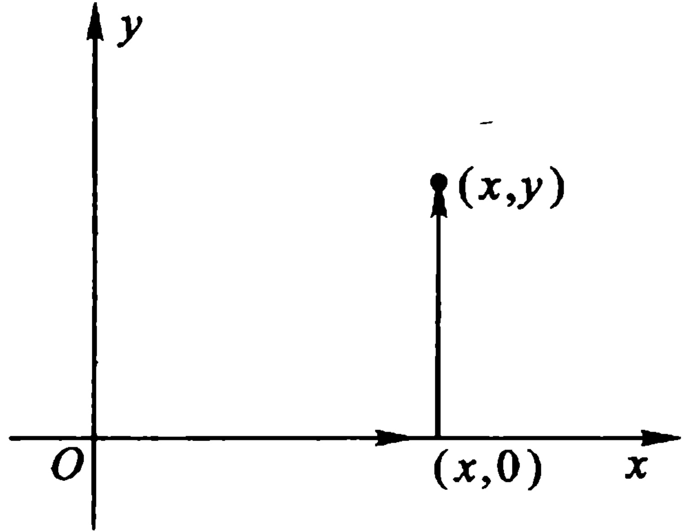

图 3.15
 

<!-- page: 151 -->

再由 C.-R. 方程中的另一个得

 $$ v_{x}=6x y+\varphi^{\prime}(x)=-u_{y}=6\dot{x}y, $$ 

故

 $$ \varphi^{\prime}(x)=0,\quad 即 \quad\varphi(x)=C, $$ 

因此

 $$ v\left(x,y\right)=3x^{2}y-y^{3}+C. $$ 

（下同解法一）

注 这两个方法都可以根据公式前括号内的形式推导进行，

不必强记公式. 两个方法的共同点是都要引用 C. - R. 方程.

例 3.16 验证  $ v(x, y) = \arctan \frac{y}{x}(x > 0) $ 在右半 z 平面内是调和函数，并求以此为虚部的解析函数  $ f(z) $.

解

 $$ v_{x}=\frac{-\frac{y}{x^{2}}}{1+\frac{y}{x^{2}}}=-\frac{y}{x^{2}+y^{2}}\quad(x>0), $$ 

 $$ v_{y}=\frac{\frac{1}{x}}{1+\frac{y^{2}}{x^{2}}}=\frac{x}{x^{2}+y^{2}}\quad(x>0), $$ 

 $$ v_{xx}=\frac{2xy}{\left(x^{2}+y^{2}\right)^{2}},v_{yy}=\frac{-2xy}{\left(x^{2}+y^{2}\right)^{2}}\quad\left(x>0\right), $$ 

于是

 $$ v_{x x}+v_{y y}=0\quad\left(x>0\right), $$ 

故在右半 z 平面内， $ v(x,y) $ 是调和函数.

 $$ \begin{align*}u\left(x,y\right)&=\int u_{x}\mathrm{d}x+\psi\left(y\right)\frac{\mathrm{C.}-\mathrm{R.}}{\mathrm{C.}} \int v_{y}\mathrm{d}x+\psi\left(y\right)\\&=\int\frac{x}{x^{2}+y^{2}}\mathrm{d}x+\psi\left(y\right)=\frac{1}{2}\ln\left(x^{2}+y^{2}\right)+\psi\left(y\right),\end{align*} $$ 

两端对 y 求导

 $$ \frac{1}{2}\cdot\frac{2y}{x^{2}+y^{2}}+\psi^{\prime}(y)=u_{y}\frac{C.-R.}{x^{2}+y^{2}}, $$ 

所以  $ \psi'(y)=0 $，从而  $ \psi(y)=C $（任意常数），

 $$ u\left(x,y\right)=\frac{1}{2}\ln\left(x^{2}+y^{2}\right)+C, $$

<!-- page: 152 -->

故

 $$ \begin{aligned}f(z)&=\frac{1}{2}\ln(x^{2}+y^{2})+C+\mathrm{i}\arctan\frac{y}{x}(x>0)\\&=\ln|z|+\mathrm{i}\arg z+C\\&=\ln z+C,\end{aligned} $$ 

它在右半 z 平面内单值解析.

注 由于解析函数与调和函数的密切联系，人们自然会想到利用这种联系，可以由解析函数的已知性质去推出调和函数的某些性质.不过调和函数尚有它本身的重要性，且对它们的研究又常常不能用复变函数的方法加以简化.因此，有必要对它作专门的研究.我们将在第九章作适当介绍.

#### §5. 平面向量场——解析函数的应用（一）

本节我们要讨论平行于一个平面的定常向量场。这就是说：第一，这个向量场中的向量是与时间无关的；第二，这个向量场中的向量都平行于某一个平面  $ S_{0} $，并且在垂直于  $ S_{0} $ 的任何一条直线上所有的点处，这个场中的向量（就大小与方向来说）都是相等的。显然，在所有的平行于  $ S_{0} $ 的平面内，这个向量场的情形都完全同样。因此，这个向量场可以由位于平面  $ S_{0} $ 内的向量所构成的一个平面向量场完全表示出来。这时，说到平面向量场  $ S_{0} $ 的一个点  $ z_{0} $，我们在心中便要记起在那个平行于平面的向量场中的一条无限直线，它通过所说的那个点  $ z_{0} $ 而垂直于平面  $ S_{0} $；说到  $ S_{0} $ 内的一条曲线 C，则是意味着一个以 C 为基线的柱面；说到  $ S_{0} $ 的一个区域 D，则是意味着以 D 为底面的一个柱体。

我们把平面  $ S_{0} $ 取作 z 平面. 于是向量场中每个向量便可以用复数来表示.

由于解析函数的发展是与流体力学密切联系的,因此,在下面

讲平面向量场与解析函数的关系时,我们常采用流体力学中的术

<!-- page: 153 -->

语. 尽管所讲的那些内容, 都是可以关系着各种不同物理特性的向量场的(如在第五章 §5 所提到的平面电场).

现在我们把江面上水的流动(例 1.1.1)作些补充，并把问题深入一步，从中就可看出解析函数是怎样应用于流体力学的.

我们不限于水的流动，广泛一点说是流体的流动。假设流体是质量均匀的，并且具有不可压缩性，即是说密度不因流体所处的位置以及受到的压力而改变。我们就假设密度为1。流体的形式是 $ \uwave{\text{定常的}} $(即与时间无关) $ \uwave{\text{平面流动}} $。所谓平面流动是指流体在垂直于某一固定平面的直线上各点均有相同的流动情况(图3.16)。流体层的厚度可以不考虑，或者认为是一个单位长。

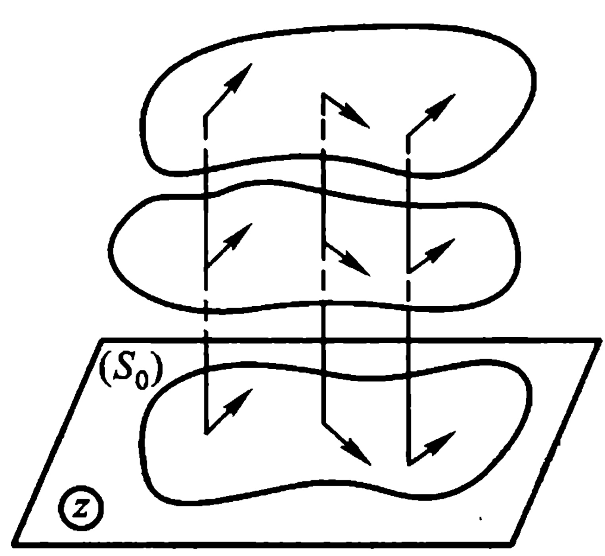

图 3.16
 

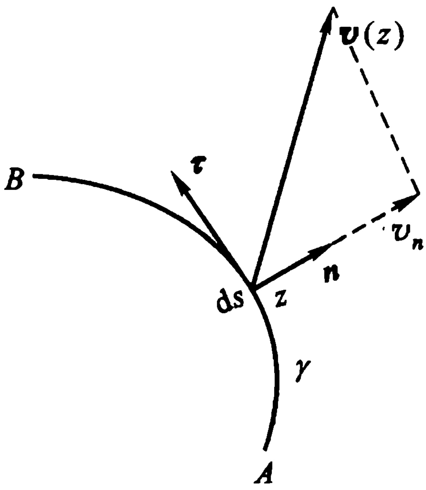

图 3.17
 

1. 流量与环量 设流体在 z 平面上某一区域 D 内流动， $ v(z)=p+qi $ 是在点  $ z\in D $ 处的流速，其中  $ p=p(x,y) $，q=q(x,y) 分别为  $ v(z) $ 的水平及垂直分速，并且假设它们都是连续的.

今考查流体在单位时间内流过以 A 为起点，B 为终点的有向曲线  $ \gamma $ (图 3.17) 一侧的流量 (实际上是流体层的质量). 为此取弧元 ds, n 为其单位法向量，它指向曲线  $ \gamma $ 的右边 (顺着 A 到 B 的方向看). 显然，在单位时间内流过 ds 的流最为  $ v_{n} $ ds ( $ v_{n} $ 是 v 在 n

<!-- page: 154 -->

上的投影)，再乘上流体层的厚度以及流体的密度(取厚度为一个单位长，密度为1).因此，这个流量的值就是

 $$ v_{n}\mathrm{d}s $$ 

这里 ds 为切向量  $ \mathrm{d}z = \mathrm{d}x + \mathrm{id}y $ 之长. 当 v 与 n 夹角为锐角时, 流量  $ v_{n} $ ds 为正; 夹角为钝角时为负.

令

 $$ \tau=\frac{\mathrm{d}x}{\mathrm{d}s}+\mathrm{i}\frac{\mathrm{d}y}{\mathrm{d}s} $$ 

是顺  $ \gamma $ 正向的单位切向量. 故 n 恰好可由  $ \tau $ 旋转  $ -\frac{\pi}{2} $ 得到, 即

 $$ \boldsymbol{n}=\mathrm{e}^{-\frac{\pi}{2}\mathrm{i}}\boldsymbol{\tau}=-\mathrm{i}\boldsymbol{\tau}=\frac{\mathrm{d}y}{\mathrm{d}s}-\mathrm{i}\frac{\mathrm{d}x}{\mathrm{d}s}. $$ 

于是即得v在n上的投影为

 $$ \begin{array}{r}{\boldsymbol{v}_{n}=\boldsymbol{v}\cdot\boldsymbol{n}=p\frac{\mathrm{d}y}{\mathrm{d}s}-q\frac{\mathrm{d}x}{\mathrm{d}s}.}\end{array} $$ 

以  $ N_{\gamma} $ 表示单位时间内流过  $ \gamma $ 的流量，则

 $$ N_{r}=\int_{r}\left(\not{p}\frac{\mathrm{d}y}{\mathrm{d}s}-q\frac{\mathrm{d}x}{\mathrm{d}s}\right)\mathrm{d}s=\int_{r}-q\mathrm{d}x+\not{p}\mathrm{d}y. $$ 

在流体力学中，还有一个重要的概念，即流速的环量。它定义为：流速在曲线  $ \gamma $ 上的切线分速，沿着该曲线的积分，以  $ \Gamma_{y} $ 表示。于是

 $$ \Gamma_{\gamma}=\int_{\gamma}\bigg(p\ \frac{\mathrm{d}x}{\mathrm{d}s}+q\ \frac{\mathrm{d}y}{\mathrm{d}s}\bigg)\mathrm{d}s=\int_{\gamma}p\mathrm{d}x+q\mathrm{d}y. $$ 

现在我们可以借助于复积分来表示环量和流量.为此,我们以i乘 $ N_{\gamma} $,再与 $ \Gamma_{\gamma} $相加即得环流量

 $$ \begin{align*}\Gamma_{r}+\mathrm{i}N_{r}&=\int_{r}p\mathrm{d}x+q\mathrm{d}y+\mathrm{i}\int_{r}-q\mathrm{d}x+p\mathrm{d}y\\&=\int_{r}\left(p-q\mathrm{i}\right)\left(\mathrm{d}x+\mathrm{i}\mathrm{d}y\right),\end{align*} $$ 

即

 $$ \Gamma_{\gamma}+\mathrm{i}N_{\gamma}=\int_{\gamma}\overline{{\boldsymbol{v}(z)}}\mathrm{d}z. $$

<!-- page: 155 -->

我们称  $ \overline{v(z)} $ 为复速度.

2. 无源、漏的无旋流动 我们可以假设在流动过程中没有流体自 D 内任何一处涌出或者漏掉。用术语来说，即 D 内无源、漏。即使有源、漏，为了研究方便，我们也可以把 D 适当缩小使源、漏从研究的区域中排除。这样一来，在 D 内任作一周线 C，只要其内部均含于 D，由于不可压缩性，则经过 C 而流进 C 内的流量，恰好等于经过 C 而流出的流量，即  $ N_{C} = 0 $。并且，在源点邻域内  $ N_{C} > 0 $；在漏点邻域内  $ N_{C} < 0 $（图 3.18）。

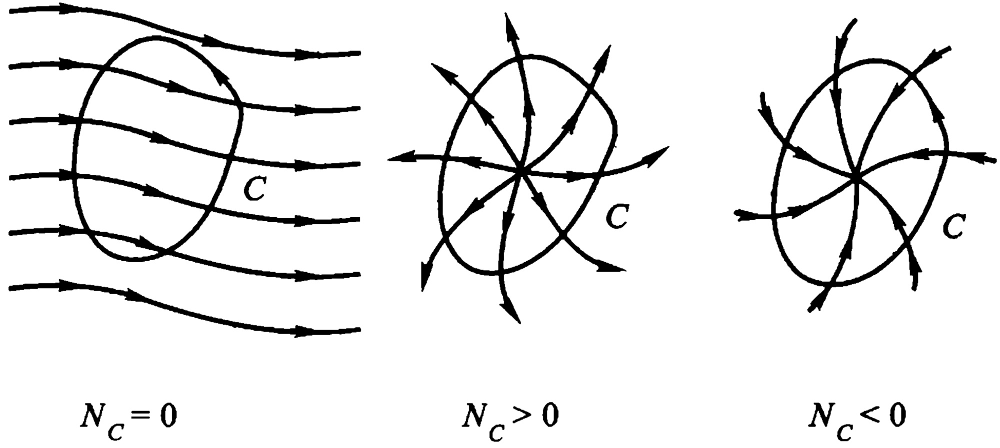

图3.18
 

在流体力学中,对于无旋流动的研究是很重要的.这里它可以定义为  $ \Gamma_{C}=0 $, 只要 C 及其内部均含于 D.

这样,如果流体在 D 内作无源、漏的无旋流动,其充要条件为

 $$ \int_{c}\overline{v(z)}\mathrm{d}z=0, $$ 

只要 C 及其内部均含于 D.

按照定理 3.17, 即知无源、漏的无旋流动特征是  $ \overline{v}(z) $ 在该流动区域 D 内解析.

3. 复势设在区域 D 内有一无源、漏的无旋流动，从以上的讨论，即知其对应的复速度为解析函数  $ \overline{v(z)} $。我们称函数  $ f(z) $ 为对应于此流动的复势，如果  $ f(z) $ 在 D 内处处合乎条件

<!-- page: 156 -->

$$ f^{\prime}(z)=\overline{v(z)}. $$ 

对于无源、漏的无旋流动，复势总是存在的；如果略去常数不计，它还是惟一的. 这是因为  $ \overline{v(z)} $ 解析，由下式确定的

 $$ \ddot{f}(z)=\int_{z_{0}}^{z}\overline{v(z)}\mathrm{d}z $$ 

就是复势，其中  $ z, z_{0} $ 属于 D. 当 D 为单连通时， $ f(z) $ 为单值解析函数. 当 D 为多连通时， $ f(z) $ 可能为多值解析函数. 但它在 D 内任何一个单连通子区域内均能分出单值解析分支.

今设

 $$ f(z)=\varphi(x,y)+\mathrm{i}\psi(x,y) $$ 

为某一流动的复势. 我们称  $ \varphi(x, y) $ 为所述流动的势函数, 称  $ \varphi(x, y) = k(k $ 为实常数 $ ) $ 为势线; 称  $ \psi(x, y) $ 为所述流动的流函数, 称  $ \psi(x, y) = k(k $ 为实常数 $ ) $ 为流线.

因

 $$ \varphi_{x}+\mathrm{i}\psi_{x}=f^{\prime}\left(z\right)=\overline{v\left(z\right)}=p-\mathrm{i}q, $$ 

所以

 $$ \begin{array}{r l}{p=\varphi_{x}=\psi_{y}\mathrm{,}}&{{}q=-\psi_{x}=\varphi_{y}\mathrm{.}\quad\mathrm{~(C.~-R.)}}\end{array} $$ 

又因流线上点  $ z(x, y) $ 的速度方向与该点的切线方向一致, 即流线的微分方程为

 $$ \begin{aligned}\frac{\mathrm{d}x}{p}&=\frac{\mathrm{d}y}{q},\\\psi_{x}\mathrm{d}x&+\psi_{y}\mathrm{d}y=0.\end{aligned} $$ 

即

而  $ \psi(x,y) $ 为调和函数，我们有  $ \psi_{yx} = \psi_{xy} $，于是

 $$ \mathrm{d}\psi(x,y)=0, $$ 

所以  $ \psi(x,y)=k $ 就是流线方程的积分曲线.

流线与势线在流速不为零的点处互相正交(根据例 2.10).

我们用复势来刻画流动比用复速度方便.因为由复势求复速度只用到求导数,反之则要用积分.另一方面,由复势容易求流线和势线,这样就可以了解流动的概况.

例 3.17 考查复势为  $ f(z)=az $ 的流动情况.

<!-- page: 157 -->

解 设 a > 0，则势函数和流函数分别为：

 $$ \varphi\left(x,y\right)=ax,\quad\psi\left(x,y\right)=ay, $$ 

故势线是  $ x = C_{1} $; 流线是  $ y = C_{2} $ ( $ C_{1}, C_{2} $ 均为实常数). 这种流动称为均匀常流 (图 3.19).

当 a 为复数时，情况相仿，势线和流线也是直线，只是方向有了改变。这时的速度为  $ \bar{a} $。

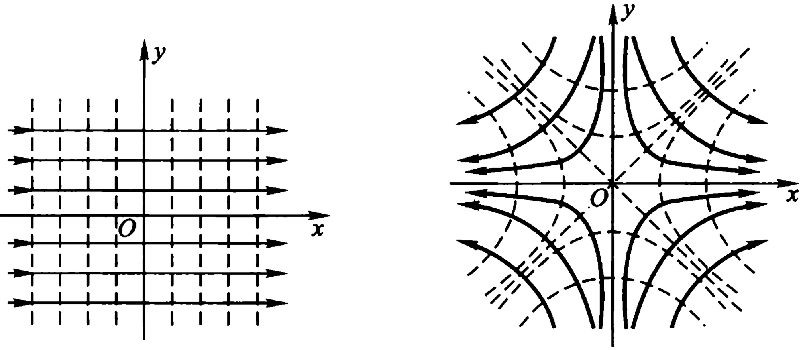

图3.19
 

图 3.20
 

例 3.18 设复势为  $ f(z) = z^{2} $，试确定其流线、势线和速度.

解 势函数和流函数分别为

 $$ \varphi(x,y)=x^{2}-y^{2}, $$ 

 $$ \psi(x,y)=2xy, $$ 

故势线及流线是互相正交的两族等轴双曲线（图 3.20）.

在点 z 处的速度  $ v(z)=\overline{f'(z)}=2\overline{z} $.

## 第三章 习题

(一)

1 计算积分  $ \int_{C}(x-y+ix^{2})dz $，积分路径 C 是连接由 0 到  $ 1+i $ 的直线段.

<!-- page: 158 -->

答： $ -\frac{1}{3}(1-i) $

2 计算积分  $ \int_{-1}^{1}|z| $ dz，积分路径是(1)直线段；(2)上半单位圆周；(3)下半单位圆周.

答:(1) $ ^{1} $; (2)2; (3)2.

### 3 利用积分估值，证明

(1)  $ \left|\int_{C}(x^{2}+iy^{2})dz\right|\leq2 $, 其中 C 是连接 -i 到 i 的直线段;

(2)  $ \left|\int_{C}(x^{2}+iy^{2})dz\right|\leq\pi $, 其中 C 是连接 -i 到 i 的右半圆周.

4 不用计算，验证下列积分之值为零，其中 C 均为单位圆周  $ \left|z\right|=1 $

(1)  $ \int_{c}\frac{dz}{\cos z} $; (2)  $ \int_{c}\frac{dz}{z^{2}+2z+2} $;

(3)  $ \int_{c}\frac{e^{z}dz}{z^{2}+5z+6} $; (4)  $ \int_{c}z\cos z^{2}dz $.

5 计算: (1)  $ \int_{-2}^{-2+i}(z+2)^2 dz $; (2)  $ \int_0^{\pi+2i}\cos\frac{z}{2} dz $.

答: (1)  $ -\frac{\mathrm{i}}{3} $ (2) 2  $ \cosh 1 $.

6 求积分

 $$ \int_{0}^{2\pi a}\left(2z^{2}+8z+1\right)\mathrm{d}z $$ 

之值,其中积分路径是连接0到 $ 2\pi a $的摆线:

 $$ x=a\left(\theta-\sin\theta\right),y=a\left(1-\cos\theta\right). $$ 

7 （分部积分法）设函数  $ f(z) $,  $ g(z) $ 在单连通区域 D 内解析,  $ \alpha $、 $ \beta $ 是 D 内两点, 试证

 $$ \int_{a}^{\beta}f(z)g^{\prime}(z)\mathrm{d}z=\left[f(z)g(z)\right]_{a}^{\beta}-\int_{a}^{\beta}g(z)f^{\prime}(z)\mathrm{d}z. $$ 

8 由积分 $ \int_{c}\frac{\mathrm{d}z}{z+2} $之值证明

 $$ \int_{0}^{\pi}\frac{1+2\cos\theta}{5+4\cos\theta}\mathrm{d}\theta=0, $$ 

其中 C 取单位圆周  $ |z|=1 $.

9 计算(C: |z| = 2)

<!-- page: 159 -->

(1)  $ \int_{C}\frac{2z^{2}-z+1}{z-1}dz $; (2)  $ \int_{C}\frac{2z^{2}-z+1}{(z-1)^{2}}dz $.

答: (1)  $ 4\pi i $; (2)  $ 6\pi i $.

10 计算积分：

 $$ \int_{c_{j}}\frac{\sin\frac{\pi}{4}z}{z^{2}-1}\mathrm{d}z,\quad(j=1,2,3) $$ 

(1)  $ C_{1}:|z+1|=\frac{1}{2} $; (2)  $ C_{2}:|z-1|=\frac{1}{2} $; (3)  $ C_{3}:|z|=2 $.

答: (1)  $ \frac{\sqrt{2}}{2}\pi\mathrm{i} $; (2)  $ \frac{\sqrt{2}}{2}\pi\mathrm{i} $; (3)  $ \sqrt{2}\pi\mathrm{i} $.

11 求积分

 $$ \int_{C}\frac{\mathrm{e}^{z}}{z}\mathrm{d}z\left(C\colon|z|=1\right), $$ 

从而证明

 $$ \int_{0}^{\pi}\mathrm{e}^{\cos\theta}\cos(\sin\theta)\mathrm{d}\theta=\pi. $$ 

12 设 C 表圆周  $ x^{2} + y^{2} = 3 $,  $ f(z) = \int_{C} \frac{3\zeta^{2} + 7\zeta + 1}{\zeta - z} \, \mathrm{d}\zeta $, 求  $ f'(1 + i) $.

提示 令  $ \varphi(\zeta)=3\zeta^{2}+7\zeta+1 $.

答:  $ 2\pi(-6+13i) $.

13 设  $ C: z = z(t) (a \leq t \leq \beta) $ 为区域 D 内的光滑曲线， $ f(z) $ 于区域 D 内单叶解析且  $ f'(z) \neq 0 $ ①， $ w = f(z) $ 将 C 映成曲线  $ \Gamma $，求证  $ \Gamma $ 亦为光滑曲线.

提示 光滑曲线 C 的特点是: C 是若尔当曲线且  $ z'(t) \neq 0 $ 连续于  $ \alpha \leq t \leq \beta $. 现要证  $ \Gamma: w = f[z(t)] $ 亦具有类似的性质.

14 同前题的假设,证明积分换元公式

 $$ \int_{\varGamma}\Phi(\mathbf{\nabla}w)\mathrm{d}\mathbf{\nabla}w=\int_{C}\Phi\big[\mathbf{\nabla}f(z)\big]\mathbf{\nabla}f^{\prime}(z)\mathrm{d}z. $$ 

其中  $ \Phi(w) $ 沿  $ \Gamma $ 连续.

15 设函数  $ f(z) $ 在 z 平面上解析，且  $ \left|f(z)\right| $ 恒大于一个正的常数，试证  $ f(z) $ 必为常数.

16 分别由下列条件求解析函数  $ f(z)=u+iv $.

<!-- page: 160 -->

(1)

 $$ u=x^{2}+x y-y^{2} $$ 

 $$ f(\mathrm{i})=-1+\mathrm{i}; $$ 

(2)  $ u = e^{x} $ ( $ x \cos y - y \sin y $),  $ f(0) = 0 $;

(3)  $ v = \frac{y}{x^{2} + y^{2}} $, \quad f(2) = 0.

答: (1)  $ f(z) = \left(1 - \frac{\mathrm{i}}{2}\right)z^{2} + \frac{\mathrm{i}}{2} $; (2)  $ f(z) = z\mathrm{e}^{z} $;

(3)  $ f(z)=\frac{1}{2}-\frac{1}{z} $.

17 设函数  $ f(z) $ 在区域 D 内解析,试证

 $$ \left(\frac{\partial^{2}}{\partial x^{2}}+\frac{\partial^{2}}{\partial y^{2}}\right)\mid f(z)\mid^{2}=4\mid f^{\prime}(z)\mid^{2}. $$ 

18 设函数  $ f(z) $ 在区域 D 内解析，且  $ f'(z) \neq 0 $，试证  $ \ln |f'(z)| $ 为区域 D 内的调和函数.

19 设流体流动的水平及垂直分速为  $ ky, kx $ ( $ k > 0 $ 为常数)，试求复势并画出势线及流线.

答: 复势  $ f(z) = -\frac{k i}{2} z^{2} $.

20 某流动的复势为  $ f(z)=\frac{1}{z^{2}-1} $，试分别求出沿圆周

(1)  $ C_{1}:|z-1|=\frac{1}{2} $; (2)  $ C_{2}:|z+1|=\frac{1}{2} $;

(3)  $ C_{3}: |z| = 3 $,

的流量及环量.

答:(1) 0,0; (2) 0,0; (3) 0;0.

## (二)

1 设函数  $ f(z) $ 在  $ 0<|z|<1 $ 内解析，且沿任何圆周  $ C: |z|=r, 0<r<1 $ 的积分值为零。问  $ f(z) $ 是否必须在 z=0 处解析？试举例说明之。

2 沿从 1 到 -1 的如下路径求  $ \int_{C}\frac{1}{\sqrt{z}}\mathrm{d}z $.

（1）上半单位圆周；（2）下半单位圆周，其中 $ \sqrt{z} $取主值支.

3 试证

 $$ \left|\int_{c}\frac{z+1}{z-1}\mathrm{d}z\right|\leqslant8\pi, $$

<!-- page: 161 -->

其中 C 为圆周  $ \left|z-1\right|=2 $.

4 设 a, b 为实数,  $ s = \sigma + it (\sigma > 0) $ 时, 试证

 $$ \left|\mathrm{e}^{b s}-\mathrm{e}^{a s}\right|\leqslant\left|s\right|\mid b-a\mid\mathrm{e}^{\max\{a,b\}\cdot\sigma}. $$ 

5 设在区域  $ D = \left\{ z \mid |\arg z| < \frac{\pi}{2} \right\} $ 内的单位圆周  $ |z| = 1 $ 上任取一点 z，用 D 内曲线 C 连接 0 与 z，试证

 $$ \mathrm{R e}\int_{c}\frac{\mathrm{d}z}{1+z^{2}}=\frac{\pi}{4}. $$ 

6 试计算积分

 $$ \int_{c}\left(\mid z\mid-\mathrm{e}^{z}\sin z\right)\mathrm{d}z $$ 

之值，其中 C 为圆周  $ |z|=a>0 $.

7 设(1)  $ f(z) $ 在  $ \mid z\mid \leqslant 1 $ 上连续；(2) 对任意的  $ r (0 < r < 1) $,

 $$ \int_{|z|=r}f(z)\mathrm{d}z=0, $$ 

试证

 $$ \int_{|z|=1}f(z)\mathrm{d}z=0. $$ 

8 设(1)函数  $ f(z) $ 当  $ \left|z - z_{0}\right| > r_{0} > 0 $ 时是连续的；(2)  $ M(r) $ 表  $ \left|f(z)\right| $ 在  $ K_{r}:\left|z - z_{0}\right| = r > r_{0} $ 上的最大值；(3)  $ \lim_{r \to +\infty} rM(r) = 0 $. 试证

 $$ \lim_{r\to+\infty}\int_{K_{r}}f(z)\mathrm{d}z=0. $$ 

##### 提示 应用积分估值定理.

9 证明：

（1）若函数  $ f(z) $ 在点 z=a 的邻域内连续，则

 $$ \lim_{r\to0}\int_{|z-a|=r}\frac{f(z)}{z-a}\mathrm{d}z=2\pi\mathrm{i}f(a); $$ 

(2) 若函数  $ f(z) $ 在原点 z=0 的邻域内连续，则

 $$ \operatorname*{l i m}_{r\to0}\int_{0}^{2\pi}f(r\mathrm{e}^{\mathrm{i}\theta})\mathrm{d}\theta=2\pi f(0). $$ 

10 设函数  $ f(z) $ 在  $ \left|z\right| < 1 $ 内解析，在闭圆  $ \left|z\right| \leq 1 $ 上连续，且  $ f(0) = 1 $，求积分

 $$ \frac{1}{2\pi\mathrm{i}}\int_{|z|=1}\left[2\pm\left(z+\frac{1}{z}\right)\right]f(z)\frac{\mathrm{d}z}{z} $$ 

之值.

<!-- page: 162 -->

答:  $ 2 \pm f'(0) $.

11 若函数  $ f(z) $ 在区域 D 内解析，C 为 D 内以 a, b 为端点的直线段。试证：存在数  $ \lambda, |\lambda| \leq 1 $，与  $ \xi \in C $ 使得

 $$ f(b)-f(a)=\lambda(b-a)f^{\prime}(\xi). $$ 

12 如果在  $ \left|z\right|<1 $ 内函数  $ f(z) $ 解析，且

 $$ \mid f(z)\mid\leqslant\frac{1}{1-\mid z\mid}. $$ 

试证：

 $$ \begin{aligned}\mid f^{(n)}(0)\mid\leqslant(n+1)!\quad\left(1+\frac{1}{n}\right)^{n}&<\mathrm{e}(n+1)!\ ,\ $ n=1,2,\cdots).\end{aligned} $$ 

提示 可取积分路径为圆周  $ C: |z| = \frac{n}{n+1} $，然后应用柯西高阶导数公式.

13 设在  $ \left|z\right|\leqslant1 $ 上函数  $ f(z) $ 解析，且  $ \left|f(z)\right|\leqslant1 $

试证：

 $ \left|f'(0)\right|\leqslant1 $

注 很清楚,由  $ f(z)=z $ 知,这是可能的最好界.

14 设  $ f(z) $ 为非常数的整函数，又设 R, M 为任意正数。试证：满足  $ \left|z\right| > R $ 且  $ \left|f(z)\right| > M $ 的 z 必存在。

提示 用反证法，并应用刘维尔定理.

15 已知  $ u + v = (x - y)(x^{2} + 4xy + y^{2}) - 2(x + y) $，试确定解析函数  $ f(z) = u + iv $.

答： $ f(z)=z^{3}-2z+k $ （k为任意常数）.

16 设(1)区域 D 是有界区域，其边界是周线或复周线 C；(2)函数  $ f_{1}(z) $ 及  $ f_{2}(z) $ 在 D 内解析，在闭域  $ \overline{D} = D + C $ 上连续；(3) 沿 C,  $ f_{1}(z) = f_{2}(z) $，试证：在整个闭域  $ \overline{D} $ 上， $ f_{1}(z) \equiv f_{2}(z) $.

