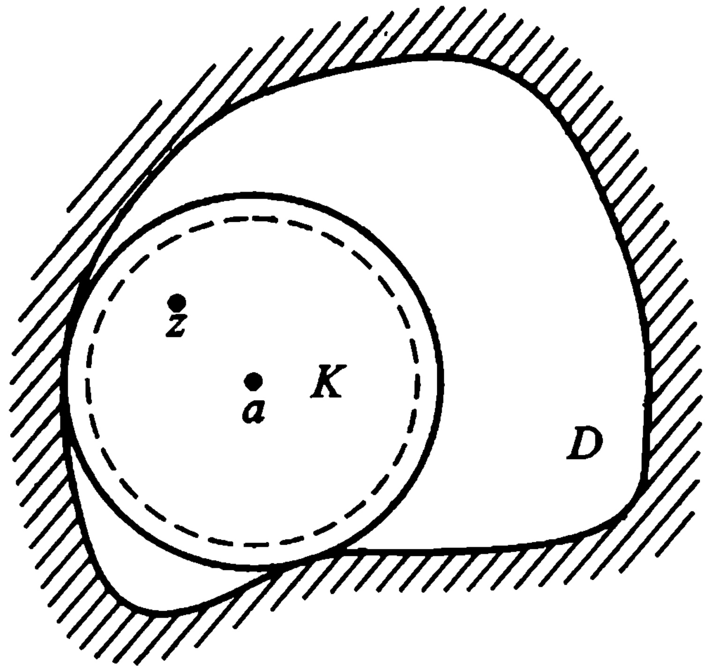
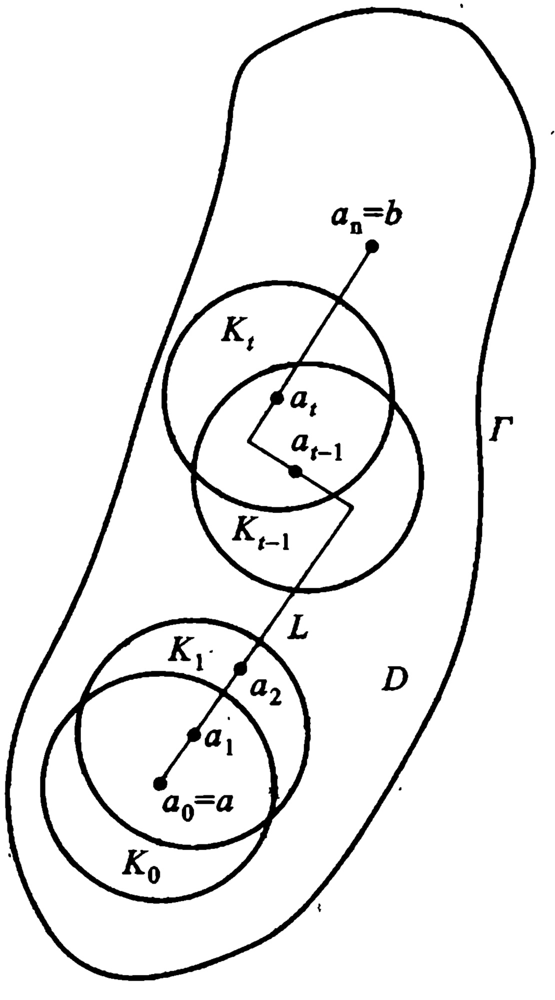
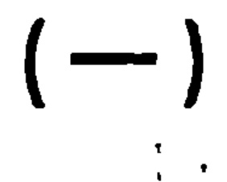

# 04-第四章 解析函数的幂级数表示法

[返回全书目录](../../README.md)

> PDF 页码：163–199

<!-- page: 163 -->

## 第四章 解析函数的幂级数表示法

级数也是研究解析函数的一个重要工具.把解析函数表为级数不仅有理论上的意义,而且也有实用的意义.例如,利用级数可以计算函数的近似值;在许多带有应用性质的问题中(如解微分方程等)也常常用到级数.

本章将讨论把解析函数表示为幂级数的问题，对于某些和数学分析中平行的结论，往往只叙述而不加证明。

‖◇‖‖◇

#### § 1. 复级数的基本性质

### 1. 复数项级数

定义 4.1 对于复数项的无穷级数

$$  \sum_{n=1}^{\infty}\alpha_{n}=\alpha_{1}+\alpha_{2}+\cdots+\alpha_{n}+\cdots,   \tag*{(4.1)}$$

命  $ s_{n}=\alpha_{1}+\alpha_{2}+\cdots+\alpha_{n} $ （ $ \uwave{\text{部分和}} $）. 若复数列  $ s_{n} $ （n=1,2,\cdots）以有限复数 s 为极限，即若

 $$ \lim_{n\to\infty}s_{n}=s, $$ 

则称复数项无穷级数(4.1)收敛于 s，且称 s 为级数(4.1)的和，写成

<!-- page: 164 -->

$$ s=\sum_{n=1}^{\infty}\alpha_{n}； $$ 

若复数列  $ s_{n} $ (n=1,2, $ \cdots $) 无有限极限，则称级数 (4.1) 为发散.

定理 4.1 设  $ \alpha_{n}=a_{n}+ib_{n}(n=1,2,\cdots) $， $ a_{n} $ 及  $ b_{n} $ 为实数，则复级数 (4.1) 收敛于  $ s=a+ib(a,b $ 为实数) 的充要条件为: 实级数  $ \sum_{n=1}^{\infty}a_{n} $ 及  $ \sum_{n=1}^{\infty}b_{n} $ 分别收敛于 a 及 b.

证 设  $ \dot{s}_{n} = \sum_{k=1}^{n} a_{k}, A_{n} = \sum_{k=1}^{n} a_{k}, B_{n} = \sum_{k=1}^{n} b_{k} $，

则  $ s_{n}=A_{n}+\mathrm{i}B_{n} $  $ (n=1,2,\cdots) $,

由第一章习题(一)17

 $$ \lim_{n\to\infty}s_{n}=a+i b $$ 

的充要条件为：

 $$ \lim_{n\to\infty}A_{n}=a\  及 \lim_{n\to\infty}B_{n}=b. $$ 

例 4.1 考察级数  $ \sum_{n=1}^{\infty}\left(\frac{1}{n}+\frac{i}{2^{n}}\right) $ 的敛散性.

解 因  $ \sum_{n=1}^{\infty}\frac{1}{n} $ 发散，故虽  $ \sum_{n=1}^{\infty}\frac{1}{2^{n}} $ 收敛，我们仍断定原级数发散.

由柯西收敛准则(第一章习题(一)18)立得

定理 4.2 复级数(4.1)收敛的充要条件为: 对任给  $ \varepsilon > 0 $, 存在正整数  $ N(\varepsilon) $, 当 n > N 且 p 为任何正整数时

 $$ \mid\alpha_{n+1}+\alpha_{n+2}+\cdots+\alpha_{n+p}\mid<\varepsilon. $$ 

特别，取 p=1，则必  $ \left|\alpha_{n+1}\right|<\varepsilon $，即收敛级数的通项必趋于零： $ \lim_{n\to\infty}\alpha_{n}=0 $。

显然，收敛级数的各项必是有界的.

若级数(4.1)中略去有限个项,则所得级数与原级数同为收敛或同为发散.

<!-- page: 165 -->

定理 4.3 复级数(4.1)收敛的一个充分条件为级数  $ \sum_{n=1}^{\infty} |\alpha_n| $ 收敛.

证 由于

 $ \left|\alpha_{n+1}+\alpha_{n+2}+\cdots+\alpha_{n+p}\right|\leq\left|\alpha_{n+1}\right|+\left|\alpha_{n+2}\right|+\cdots\left|\alpha_{n+p}\right| $

 $ \infty $

若  $ \sum_{n=1}^{\infty}\left|\alpha_{n}\right| $ 收敛，则由定理 4.2，必  $ \sum_{n=1}^{\infty}\alpha_{n} $ 收敛.

定义 4.2 若级数  $ \sum_{n=1}^{\infty} |\alpha_n| $ 收敛，则原级数  $ \sum_{n=1}^{\infty} \alpha_n $ 称为绝对收敛；非绝对收敛的收敛级数，称为条件收敛.

级数  $ \sum_{n=1}^{\infty} |\alpha_n| $ 的各项既为非负实数，故它是否收敛，可依正项级数的理论判定之.

和实级数一样，我们有

定理 4.4 （1）一个绝对收敛的复级数的各项可以任意重排次序，而不致改变其绝对收敛性，亦不致改变其和.（2）两个绝对收敛的复级数

 $$ s=\alpha_{1}+\alpha_{2}+\cdots+\alpha_{n}+\cdots, $$ 

 $$ s^{\prime}=\alpha^{\prime}{}_{1}+\alpha^{\prime}{}_{2}+\cdots+\alpha^{\prime}{}_{n}+\cdots, $$ 

可按下述对角线方法

 $$ \begin{array}{cccc}\alpha^{\prime}_{1}&\alpha^{\prime}_{2}&\alpha^{\prime}_{3}&...\\\hline\alpha_{1}&\alpha_{1}\alpha^{\prime}_{1}&\alpha_{1}\alpha^{\prime}_{2}&\alpha_{1}\alpha^{\prime}_{3}\\*&\*&\*&\*\\*&\alpha_{2}\alpha^{\prime}_{1}&\alpha_{2}\alpha^{\prime}_{2}&\alpha_{2}\alpha^{\prime}_{3}\\*&\*&\*&\*\\*&\alpha_{3}\alpha^{\prime}_{1}&\alpha_{3}\alpha^{\prime}_{2}&\alpha_{3}\alpha^{\prime}_{3}\\*&\vdots&\vdots&\vdots\end{array} $$ 

得出乘积(柯西积)级数

 $$ \alpha_{1}\alpha^{^{\prime}}{}_{1}+\left(\alpha_{1}\alpha^{^{\prime}}{}_{2}+\alpha_{2}\alpha^{^{\prime}}{}_{1}\right)+\cdots+ $$

<!-- page: 166 -->

$$ \begin{align*}&+\left(\alpha_{1}\alpha^{^{\prime}}_{n}+\alpha_{2}\alpha^{^{\prime}}_{n-1}+\cdots+\alpha_{n}\alpha^{^{\prime}}_{1}\right)+\cdots\\=&\sum_{n=1}^{\infty}\sum_{k=1}^{n}\alpha_{k}\alpha^{^{\prime}}(_{n+1)-k}\end{align*} $$ 

也绝对收敛于  $ s\ddot{s}^{\prime} $.

### 2. 一致收敛的复函数项级数

定义 4.3 设复变函数项级数

$$  f_{1}\left(z\right)+f_{2}\left(z\right)+\cdots+f_{n}\left(z\right)+\cdots   \tag*{(4.2)}$$

的各项均在点集 E 上有定义，且在 E 上存在一个函数  $ f(z) $， $ \uwave{\text{对于 E 上的每一点 z，级数(4.2)均收敛于 f(z)}} $，则称  $ f(z) $ 为级数 (4.2) 的和函数，记为

 $$ f(z)=\sum_{n=1}^{\infty}f_{n}(z). $$ 

用  $ \varepsilon-N $ 的说法来描述这件事就是：

任给  $ \varepsilon>0 $，以及给定的  $ z\in E $，存在正整数 N=N( $ \varepsilon $,z)，使当 n>N 时，有

 $$ |f(z)-s_{n}(z)|<\varepsilon, $$ 

式中  $ s_{n}(z)=\sum_{k=1}^{n}f_{k}(z) $.

上述的正整数  $ N = N(\varepsilon, z) $，一般地说，不仅依赖于  $ \varepsilon $，而且依赖于  $ z \in E $。重要的一种情形是  $ N = N(\varepsilon) $ 不依赖于  $ z \in E $，这就是：

定义 4.4 对于级数 (4.2)，如果在点集 E 上有一个函数  $ f(z) $，使对任意给定的  $ \varepsilon > 0 $，存在正整数 N = N( $ \varepsilon $)，当 n > N 时，对一切的  $ z \in E $ 均有

 $$ |f(z)-s_{n}(z)|<\varepsilon, $$ 

则称级数(4.2)在 E 上一致收敛于  $ f(z) $.

注（1）根据定义 4.4，证明级数(4.2)在点集 E 上一致收敛于  $ f(z) $ 的关键，是找不依赖于 z 的正整数 N，使当 n > N 时， $ |f(z) - s_{n}(z)| < \varepsilon $ 成立。因此，一般是先如下加强不等式  $ |f(z)| $

<!-- page: 167 -->

$ -s_{n}(z)| \leqslant P_{n}(z) \leqslant Q_{n} $，并对 $ \forall \varepsilon > 0 $，由 $ Q_{n} < \varepsilon $找N.

（2）证明不一致收敛的方法，是利用定义 4.4 的否定形式. 即把定义 4.4 逐句以否定语句代替，而成

定义 4.4  $ \sum_{n=1}^{\infty} f_{n}(z) $ 在点集 E 上不一致收敛于  $ f(z) \Leftrightarrow \exists $ 某个  $ \varepsilon_{0} > 0 $，对任何整数 N > 0， $ \exists $ 整数  $ n_{0} > N $ 时，总有某个  $ z_{0} \in E $，使  $ |f(z_{0}) - s_{n_{0}}(z_{0})| \geq \varepsilon_{0} $。

定理4.5（柯西一致收敛准则）级数(4.2)在点集E上一致收敛于某函数的充要条件是：任给 $ \varepsilon>0 $，存在正整数 $ N=N(\varepsilon) $，使当 $ n>N $时，对一切 $ z\in E $，均有

 $$ |f_{n+1}(z)+\cdots+f_{n+p}(z)|<\varepsilon\quad(p=1,2,\cdots). $$ 

定理4.5  $ \sum_{n=1}^{\infty} f_{n}(z) $在点集E上不一致收敛 $ \Leftrightarrow $∃某个 $ \varepsilon_{0} $

>0,对任何正整数N，∃整数 $ n_{0} $，使当 $ n_{0}>N $，总有某个 $ z_{0}\in E $

及某个正整数 $ p_{0} $，有

 $$ \mid f_{n_{0}+1}(z_{0})+f_{n_{0}+2}(z_{0})+\cdots+f_{n_{0}+p_{0}}(z_{0})\mid\geqslant\varepsilon_{0}. $$ 

由这个准则，可得出一致收敛的一个充分条件，即优级数准则：

如果有正数列  $ M_{n} $ (n=1,2, $ \cdots $),使对一切  $ z\in E $,有

 $$ |f_{n}(z)|\leqslant M_{n}(n=1,2,\cdots), $$ 

而且正项级数  $ \sum_{n=1}^{\infty} M_{n} $ 收敛，则复函数项级数  $ \sum_{n=1}^{\infty} f_{n}(z) $ 在集 E 上绝对收敛且一致收敛：

这样的正项级数  $ \sum_{n=1}^{\infty} M_{n} $ 称为复函数项级数  $ \sum_{n=1}^{\infty} f_{n}(z) $ 的优先级数.

注 优先级数准则是一个被广泛应用的方法.因为它把判别复函数项级数的一致收敛性转化为判别正项级数的收敛性,而实现后者较容易;另外,优先级数准则同时还可以判定绝对收敛性.

<!-- page: 168 -->

例 4.2 级数

 $$ 1+z+z^{2}+\cdots+z^{n}+\cdots $$ 

在闭圆  $ \left|z\right| \leqslant r (r < 1) $ 上一致收敛.

事实上,所述级数有收敛的优级数  $ \sum_{n=0}^{\infty} r^{n} $.

下述两个定理也和数学分析中相应的定理平行.

定理 4.6 设级数  $ \sum_{n=1}^{\infty} f_{n}(z) $ 的各项在点集 E 上连续，并且一致收敛于  $ f(z) $，则和函数

 $$ f(z)=\sum_{n=1}^{\infty}f_{n}(z) $$ 

也在 E 上连续.

定理 4.7 设级数  $ \sum_{n=1}^{\infty} f_{n}(z) $ 的各项在曲线 C 上连续，并且在 C 上一致收敛于  $ f(z) $，则沿 C 可以逐项积分：

 $$ \int_{C}f(z)\mathrm{d}z=\sum_{n=1}^{\infty}\int_{C}f_{n}(z)\mathrm{d}z $$ 

定义 4.5 设函数  $ f_{n}(z) $ (n=1,2, $ \cdots $) 定义于区域 D 内，若级数 (4.2) 在 D 内任一有界闭集上一致收敛，则称此级数在 D 内内闭一致收敛.

定理 4.8 级数(4.2)在圆  $ K: |z - a| < R $ 内闭一致收敛的充要条件为: 对任意正数  $ \rho $, 只要  $ \rho < R $, 级数(4.2)在闭圆  $ \overline{K}_{\rho}: |z - a| \leq \rho $ 上一致收敛.

证 必要性 因为  $ \overline{K}_{\rho} $ 就是 K 内的有界闭集.

充分性 因为圆 K 内的任意闭集 F，总可以包含在 K 内的某个闭圆  $ K_{\rho} $ 上.

显然，在区域 D 内一致收敛的级数必在 D 内内闭一致收敛，但其逆不真.例如，我们考察几何级数

 $$ 1+z+z^{2}+\cdots+z^{n}+\cdots, $$

<!-- page: 169 -->

当 $ \left|z\right|<1 $时，此级数收敛但不一致收敛.可是，由例4.2知它在单位圆 $ \left|z\right|<1 $内是内闭一致收敛的.

3. 解析函数项级数 在数学分析中, 函数项级数能逐项求导的条件是苛刻的, 然而解析函数项级数求导的条件却比较宽些, 这就是下面的魏尔斯特拉斯定理.

定理 4.9 设(1) 函数  $ f_{n}(z) $ (n=1,2,\cdots) 在区域 D 内解析，(2)  $ \sum_{n=1}^{\infty} f_{n}(z) $ 在 D 内内闭一致收敛于函数  $ f(z) $:

 $$ f(z)=\sum_{n=1}^{\infty}f_{n}(z), $$ 

则 （1）函数  $ f(z) $ 在区域 D 内解析.

(2)

 $$ f^{\left(p\right)}\left(z\right)=\sum_{n=1}^{\infty}f_{n}^{\left(p\right)}\left(z\right)\quad\left(z\in D,p=1,2,\cdots\right). $$ 

证（1）设  $ z_{0} $ 为 D 内任一点，则必有  $ \rho>0 $，使闭圆  $ \overrightarrow{K}:|z-z_{0}|\leq\rho $ 全含于 D 内。若 C 为圆  $ K:|z-z_{0}|<\rho $ 内任一周线，则由柯西积分定理得

 $$ \int_{C}f_{n}(z)\mathrm{d}z=0,n=1,2,\cdots, $$ 

再由假设知级数  $ \sum_{n=1}^{\infty} f_{n}(z) $ 在  $ \overline{K} $ 上一致收敛，且  $ f_{n}(z) $ 是连续的，所以由定理4.6知  $ f(z) $ 在  $ \overline{K} $ 上连续，由定理4.7得

 $$ \int_{C}f(z)\mathrm{d}z=\sum_{n=1}^{\infty}\int_{C}f_{n}(z)\mathrm{d}z=0, $$ 

于是，由摩勒拉定理知  $ f(z) $ 在 K 内解析，即  $ f(z) $ 在点  $ z_{0} $ 解析，由于  $ z_{0} $ 的任意性，故  $ f(z) $ 在区域 D 内解析.

(2) 设  $ z_{0} $ 为 D 内任一点，则必有  $ \rho > 0 $，使闭圆  $ \overline{K}: |z - z_{0}| \leq \rho $ 全含于 D 内， $ \overline{K} $ 的边界是圆周  $ \Gamma: |z - z_{0}| = \rho $。故由定理 3.12 有

<!-- page: 170 -->

$$ \begin{array}{r l}&{f^{(p)}\left(z_{0}\right)=\frac{p!}{2\pi\mathrm{i}}\displaystyle\int_{\Gamma}\frac{f(\zeta)}{\left(\zeta-z_{0}\right)^{p+1}}\mathrm{d}\zeta}\\ &{f_{n}^{(p)}\left(z_{0}\right)=\frac{p!}{2\pi\mathrm{i}}\displaystyle\int_{\Gamma}\frac{f_{n}(\zeta)}{\left(\zeta-z_{0}\right)^{p+1}}\mathrm{d}\zeta.}\end{array}\quad(p=1,2,\cdots), $$ 

在  $ \Gamma $ 上由条件(2)知级数

 $$ \frac{f(\zeta)}{(\zeta-z_{0})^{p+1}}=\sum_{n=1}^{\infty}\frac{f_{n}(\zeta)}{(\zeta-z_{0})^{p+1}} $$ 

是一致收敛的.于是由定理4.7得到

 $$ \int_{\Gamma}\frac{f(\zeta)}{\left(\zeta-z_{0}\right)^{p+1}}\mathrm{d}\zeta=\sum_{n=1}^{\infty}\int_{\Gamma}\frac{f_{n}(\zeta)}{\left(\zeta-z_{0}\right)^{p+1}}\mathrm{d}\zeta, $$ 

两端同乘以 $ \frac{p!}{2\pi i} $就得到所要证明的

 $$ f^{\left(p\right)}\left(z_{0}\right)=\sum_{n=1}^{\infty}f_{n}^{\left(p\right)}\left(z_{0}\right)\qquad\left(p=1,2,\cdots\right). $$ 

注（1）这个定理的证明，关键是用了柯西高阶导数公式，它使我们可以根据原来函数项级数的内闭一致收敛性，对级数进行逐项求积分，从而推出逐项求任意阶导数的性质。这是上一章柯西高阶导数公式的应用的一个范例。

（2）这个定理还有第三条结论：

 $$ \sum_{n=1}^{\infty}f_{n}^{\left(p\right)}\left(z\right) 在 D 内内闭一致收敛于 f^{\left(p\right)}\left(z\right) $$ 

 $$ \left(p=1,2,\cdots. 证明从略 \right). $$ 

#### §2. 幂级数

### 1. 幂级数的敛散性 具有

$$  \sum_{n=0}^{\infty}c_{n}\left(z-a\right)^{n}=c_{0}+c_{1}\left(z-a\right)+c_{2}\left(z-a\right)^{2}+\cdots   \tag*{(4.3)}$$

形式的复函数项级数称为幂级数, 其中  $ c_{0}, c_{1}, c_{2}, \cdots $ 和 a 都是复常数. 如果作变换  $ \zeta = z - a $, 则以上幂级数还可以写成如下形式

<!-- page: 171 -->

（把  $ \zeta $ 仍改写为 z）

 $$ \sum_{n=0}^{\infty}c_{n}z^{n}=c_{0}+c_{1}z+c_{2}z^{2}+\cdots. $$ 

幂级数是最简单的解析函数项级数.其收敛范围很规范,是个圆,因而在理论和应用上都很重要.为了搞清它的敛散性,先建立下述定理,通常称为阿贝尔(Abel)定理.

定理 4.10 如果幂级数(4.3)在某点  $ z_{1} (\neq a) $ 收敛，则它必在圆  $ K: |z - a| < |z_{1} - a| $ (即以 a 为心，圆周通过  $ z_{1} $ 的圆) 内绝对收敛且内闭一致收敛.

证 设 z 是所述圆 K 内的任意定点. 因为  $ \sum_{n=0}^{\infty} c_{n}(z_{1}-a)^{n} $ 收敛, 它的各项必然有界, 即有正数 M, 使

 $$ \mid c_{n}(z_{1}-a)^{n}\mid\leqslant M\quad(n=0,1,2,\cdots), $$ 

这样一来，即有

 $$ \mid c_{n}\left(z-a\right)^{n}\mid=\mid c_{n}\left(z_{1}-a\right)^{n}\left(\frac{z-a}{z_{1}-a}\right)^{n}\mid\leqslant M\left|\frac{z-a}{z_{1}-a}\right|^{n}, $$ 

注意到  $ \left|z-a\right|<\left|z_{1}-a\right| $，故级数

 $$ \sum_{n=0}^{\infty}M\left|\frac{z-a}{z_{1}-a}\right|^{n} $$ 

为收敛的等比级数. 因而  $ \sum_{n=0}^{\infty}c_{n}(z-a)^{n} $ 在圆 K 内绝对收敛.

其次，对 K 内任一闭圆  $ \overline{K}_{\rho}: |z-a| \leqslant \rho (0 < \rho < |z_{1}-a|) $ 上的一切点来说，有

 $$ \mid c_{n}\left(z-a\right)^{n}\mid\leqslant M\left|\frac{z-a}{z_{1}-a}\right|^{n}\leqslant M\left(\frac{\rho}{\lceil z_{1}-a\rceil}\right)^{n}, $$ 

故  $ \sum_{n=0}^{\infty}c_{n}(.z-a)^{n} $ 在  $ \overline{K}_{\rho} $ 上有收敛的优级数

 $$ \sum_{n=0}^{\infty}M\left(\frac{\rho}{\lceil z_{1}-a\rceil}\right)^{n}, $$ 

因而它在  $ \overline{K}_{\rho} $ 上绝对且一致收敛. 再由定理 4.8, 此级数必在圆 K

<!-- page: 172 -->

内绝对且内闭一致收敛.

推论 4.11 若幂级数(4.3)在某点  $ z_{2} (\neq a) $ 发散，则它在以 a 为心并通过  $ z_{2} $ 的圆周外部发散.

证 用反证法，证明留给读者.

对于一个形如(4.3)的幂级数,  $ z = a $ 这一点总是收敛的.  $ z \neq a $ 时, 可能有下述三种情况

第一种 任意的  $ z \neq a $，级数  $ \sum_{n=0}^{\infty} c_{n}(z-a)^{n} $ 均发散.

例 4.3 级数

 $$ 1+z+2^{2}z^{2}+\cdots+n^{n}z^{n}+\cdots, $$ 

当  $ z \neq 0 $ 时，通项不趋于零，故发散.

第二种 任意的 z，级数  $ \sum_{n=0}^{\infty} c_{n}(z-a)^{n} $ 均收敛.

例 4.4 级数

 $$ 1+z+\frac{z^{2}}{2^{2}}+\cdots+\frac{z^{n}}{n^{n}}+\cdots, $$ 

对任意固定的 z，从某个 n 开始，以后总有  $ \frac{|z|}{n} < \frac{1}{2} $，于是从此以后，有  $ \left|\frac{z^{n}}{n^{n}}\right| < \left(\frac{1}{2}\right)^{n} $，故所述级数对任意的 z 均收敛.

第三种 存在一点  $ z_{1} \neq a $，使  $ \sum_{n=0}^{\infty} c_{n}(z_{1}-a)^{n} $ 收敛（此时，根据定理4.10的第一部分知，它必在圆周  $ |z-a|=|z_{1}-a| $ 内部绝对收敛），另外又存在一点  $ z_{2} $，使  $ \sum_{n=0}^{\infty} c_{n}(z_{2}-a)^{n} $ 发散。（肯定  $ |z_{2}-a|\geq|z_{1}-a| $；根据推论4.11知，它必在圆周  $ |z-a|=|z_{2}-a| $ 外部发散。）

在这种情况下，可以证明，存在一个有限正数 R，使得

 $ \sum_{n=0}^{\infty}c_{n}(z-a)^{n} $ 在圆周  $ \left|z-a\right|=R $ 内部绝对收敛，在圆周  $ \left|z-a\right| $

<!-- page: 173 -->

= R 的外部发散. R 称为此幂级数的收敛半径; 圆  $ \left|z - a\right| < R $ 和圆周  $ \left|z - a\right| = R $ 分别称为它的收敛圆和收敛圆周. 在第一种情形, 约定 R = 0; 在第二种情形, 约定  $ R = +\infty $, 并也称它们为收敛半径.

一个幂级数在其收敛圆周上的敛散性有如下三种可能: (1) 处处发散; (2) 既有收敛点, 又有发散点; (3) 处处收敛.

2. 收敛半径 R 的求法、柯西 - 阿达马 (Hadamard) 公式.

定理 4.12 如果幂级数  $ \sum_{n=0}^{\infty} c_{n}(z-a)^{n} $ 的系数  $ c_{n} $ 介于

 $ \lim_{n\to\infty}\left|\frac{c_{n+1}}{c_n}\right|=l $，(达朗贝尔(D'Alembert))

或  $ \lim_{n\to\infty}\sqrt[n]{|c_n|}=l $，(柯西)

或  $ \lim_{n\to\infty}\sqrt[n]{|c_n|}=l $，(柯西-阿达马)

则幂级数  $ \sum_{n=0}^{\infty}c_{n}(z-a)^{n} $ 的收敛半径 $ ^{①} $

$$  R=\left\{\begin{aligned}{}&{{}\frac{1}{l},}&{\quad l\neq0,l\neq+\infty;}\\ {}&{{}0,}&{\quad l=+\infty;}\\ {}&{{}+\infty,}&{\quad l=0.}\\ \end{aligned}\right.   \tag*{(4.4)}$$

例 4.5 试求下列各幂级数的收敛半径 R.

(1)

 $$ \sum_{n=1}^{\infty}\frac{z^{n}}{n^{2}} $$ 

解  $ R = \lim_{n \to \infty} \left| \frac{c_n}{c_{n+1}} \right| = \lim_{n \to \infty} \left( \frac{n+1}{n} \right)^2 = 1 $.

(2)  $ \sum_{n=0}^{\infty}\frac{z^{n}}{n!} $.

解 因  $ l=\lim_{n\to\infty}\left|\frac{c_{n+1}}{c_n}\right|=\lim_{n\to\infty}\frac{1}{(n+1)!}= $0,

<!-- page: 174 -->

故  $ R = +\infty $.

(3)  $ \sum_{n=0}^{\infty} n! z^{n} $.

解 因  $ l=\lim_{n\to\infty}\left|\frac{c_{n+1}}{c_n}\right|=\lim_{n\to\infty}\frac{(n+1)!}{n!}=+\infty $,

故

 $$ \boldsymbol{R}=\boldsymbol{0}. $$ 

(4)  $ 1 + z^{2} + z^{4} + z^{9} + \cdots $

解 因当 n 是平方数时  $ c_{n}=1 $，其他情形  $ c_{n}=0 $。因此，相应有  $ \sqrt[n]{|c_{n}|}=1 $ 或 0，于是数列  $ \left\{\sqrt[n]{|c_{n}|}\right\} $ 的聚点是 0 和 1，从而 l=1, R=1。

(5)  $ \sum_{n=0}^{\infty} n! z^{n} $

解 因  $ C_{n}=n!,\lim_{n\to\infty}\sqrt[n]{|c_{n}|}=\infty, $

 $ \therefore\quad R=0. $

### 3. 幂级数和的解析性

定理 4.13 （1）幂级数

$$  f(z)=\sum_{n=0}^{\infty}c_{n}\left(z-a\right)^{n}   \tag*{(4.5)}$$

的和函数  $ f(z) $ 在其收敛圆 K:  $ \left|z - a\right| < R $ ( $ 0 < R \leq +\infty $) 内解析.

（2）在 K 内，幂级数（4.5）可以逐项求导至任意阶，即

$$  \begin{align*}f^{(p)}\left(z\right)&=p!c_{p}+\left(p+1\right)p\cdots2c_{p+1}\left(z-a\right)+\cdots\\&\quad+n\left(n-1\right)\cdots\left(n-p+1\right)c_{n}\left(z-a\right)^{n-p}+\cdots.\\\left(p&=1,2,\cdots\right)\tag{4.}\end{align*}   \tag*{(4.6)}$$

还有，(4.6)与(4.5)的收敛半径 R 相同(本章习题(一)3).

（3）

$$  c_{p}=\frac{f^{(p)}(a)}{p!}\quad(p=0,1,2,\cdots).   \tag*{(4.7)}$$

证 由阿贝尔定理(定理4.10)，幂级数

<!-- page: 175 -->

$$ \sum_{n=0}^{\infty}c_{n}\left(z-a\right)^{n} $$ 

在其收敛圆  $ K: |z - a| < R $ ( $ 0 < R \leq +\infty $) 内内闭一致收敛于  $ f(z) $，而其各项  $ c_{n}(z - a)^{n} $ ( $ n = 0, 1, 2, \cdots $) 又都在 z 平面上解析。故由魏尔斯特拉斯定理（定理 4.9），本定理的 (1)、(2) 部分得证。逐项求 p 阶导数 (p = 1, 2,  $ \cdots $) 后，即得 (4.6)。

在(4.6)中令 z=a，得

 $$ c_{p}=\frac{f^{(p)}(a)}{p!}\qquad(p=1,2,\cdots), $$ 

注意到  $ c_{0}=f(a)=f^{(0)}(a) $，即得(4.7).

注 （1）本定理还有一条结论：级数(4.5)可沿 K 内曲线 C 逐项积分，且其收敛半径与原级数(4.5)的收敛半径 R 相同（本章习题(一)3）.

(2) 所有的幂级数(4.5)至少在中心 a 是收敛的,但收敛半径等于零的幂级数没有什么有益的性质,是平凡情形.

#### §3. 解析函数的泰勒(Taylor)展式

这一节主要研究在圆内解析的函数展开成幂级数的问题.

1. 泰勒定理 由定理4.13(1)我们看到,任意一个具有非零收敛半径的幂级数在其收敛圆内收敛于一个解析函数,这个性质是很重要的.但在解析函数的研究上,幂级数之所以重要,还在于这个性质的逆命题也是成立的,即有

定理 4.14 （泰勒定理）设  $ f(z) $ 在区域 D 内解析,  $ a \in D $, 只要圆 K: |z - a| < R 含于 D, 则  $ f(z) $ 在 K 内能展成幂级数

$$  f(z)=\sum_{n=0}^{\infty}c_{n}(z-a)^{n},   \tag*{(4.8)}$$

其中系数

$$  c_{n}=\frac{1}{2\pi i}\int_{r_{o}}\frac{f(\zeta)}{\left(\zeta-a\right)^{n+1}}\mathrm{d}\zeta=\frac{f^{(n)}(a)}{n!}.   \tag*{(4.9)}$$

（积分形式）

 $$ ( 微分形式 ) $$

<!-- page: 176 -->

$$ (\Gamma_{\rho}:|\zeta-a|=\rho,0<\rho<R;n=0,1,2,\cdots) $$ 

且展式是惟一的.

证 证明的关键是利用柯西积分公式及如下熟知的公式

$$  \frac{1}{1-u}=\sum_{n=0}^{\infty}u^{n}\qquad(\mid u\mid<1).   \tag*{(4.10)}$$

设 z 为 K 内任意取定的点，总有一个圆周  $ \Gamma_{\rho}: |\zeta - a| = \rho (0 < \rho < R) $，使点 z 含在  $ \Gamma_{\rho} $ 的内部（图 4.1 中虚线表  $ \Gamma_{\rho} $）。由柯西积分公式得

图4.1
 

 $$ f(z)=\frac{1}{2\pi\mathrm{i}}\int_{r_{p}}\frac{f(\zeta)}{\zeta-z}\mathrm{d}\zeta. $$ 

我们设法将被积式 $ \frac{f(\zeta)}{\zeta-z} $表为含有z-a的正幂次的级数.为此写

$$  \frac{f(\zeta)}{\zeta-z}=\frac{f(\zeta)}{\zeta-a-(z-a)}=\frac{f(\zeta)}{\zeta-a}\cdot\frac{1}{1-\frac{z-a}{\zeta-a}},   \tag*{(4.11)}$$

当  $ \zeta \in \Gamma_{\rho} $ 时，由于

 $$ \left|\frac{z-a}{\zeta-a}\right|=\frac{\left|z-a\right|}{\rho}<1, $$

<!-- page: 177 -->

应用公式(4.10)，我们有

 $$ \frac{1}{1-\frac{z-a}{\zeta-a}}=\sum_{n=0}^{\infty}\left(\frac{z-a}{\zeta-a}\right)^{n}, $$ 

等号右端的级数在  $ \Gamma_{\rho} $ 上(关于  $ \zeta $) 是一致收敛的. 以  $ \Gamma_{\rho} $ 上的有界函数  $ \frac{f(\zeta)}{\zeta-a} $ 相乘, 仍然得到  $ \Gamma_{\rho} $ 上的一致收敛级数. 于是(4.11)表示为  $ \Gamma_{\rho} $ 上一致收敛级数

 $$ \frac{f(\zeta)}{\zeta-z}=\sum_{n=0}^{\infty}(z-a)^{n}\cdot\frac{f(\zeta)}{(\zeta-a)^{n+1}}, $$ 

将上式沿  $ \Gamma_{\rho} $ 积分，并以  $ \frac{1}{2\pi i} $ 乘所得结果. 根据逐项积分定理，即得

 $$ \begin{align*}f(z)&=\frac{1}{2\pi\mathrm{i}}\int_{r_{\rho}}\frac{f(\zeta)}{\zeta-z}\mathrm{d}\zeta\\&=\sum_{n=0}^{\infty}(z-a)^{n}\cdot\frac{1}{2\pi\mathrm{i}}\int_{r_{\rho}}\frac{f(\zeta)}{(\zeta-a)^{n+1}}\mathrm{d}\zeta,\end{align*} $$ 

由定理 3.13 知

 $$ \frac{1}{2\pi i}\int_{\Gamma_{\rho}}\frac{f(\zeta)}{\left(\zeta-a\right)^{n+1}}\mathrm{d}\zeta=\frac{f^{(n)}(a)}{n!}, $$ 

最后得出

 $$ f(\overset{,}{z})=\sum_{n=0}^{\infty}c_{n}(z-a)^{n}. $$ 

其中的系数  $ c_{n} $ 由公式(4.9)给出.上面的证明对任意  $ z \in K $ 均成立,故定理的前半部分得证..

下面证明展式是惟一的.

设另有展式

 $$ f(z)=\sum_{n=0}^{\infty}c^{\prime}_{n}(z-a)^{n}(z\in K:|z-a|<R). $$ 

由定理 4.13(3)，即知

 $$ c_{n}^{\prime}=\frac{f^{(n)}(a)}{n!}=c_{n}\quad(n=0,1,2,\cdots), $$

<!-- page: 178 -->

故展式是惟一的.

显然幂级数(4.8)的收敛半径大于或等于 R.

定义 4.6 (4.8) 称为  $ f(z) $ 在点 a 的泰勒展式，(4.9) 称为其泰勒系数，而 (4.8) 等号右边的级数，则称为泰勒级数.

综合定理 4.13(1) 和定理 4.14 可得出刻画解析函数的第四个等价定理：

定理 4.15 函数  $ f(z) $ 在区域 D 内解析的充要条件为:  $ f(z) $ 在 D 内任一点 a 的邻域内可展成 z - a 的幂级数, 即泰勒级数.

由第三章的柯西不等式知，若  $ f(z) $ 在  $ \left|z - a\right| < R $ 内解析，则其泰勒系数  $ c_{n} $ 满足柯西不等式

 $$ \left|c_{n}\right|\leqslant\frac{\max\limits_{\left|z-a\right|=\rho}\left|f(z)\right|}{\rho^{n}}(0<\rho<R,n=0,1,2,\cdots). $$ 

### 2. 幂级数的和函数在其收敛圆周上的状况

泰勒展式(4.8)仅限于 z 在  $ \Gamma_{\rho} $ (图 4.1) 的内部时方能成立，而  $ \Gamma_{\rho} $ 又只需在  $ f(z) $ 的解析区域 D 内就行，其大小并无限制。故展式 (4.8) 在以 a 为心，通过与 a 最接近的  $ f(z) $ 之奇点的圆周内部皆成立。事实上，我们有

定理 4.16 如果幂级数  $ \sum_{n=0}^{\infty} c_{n} (z - a)^{n} $ 的收敛半径 R > 0，且

 $$ f(z)=\sum_{n=0}^{\infty}c_{n}(z-a)^{n}\quad(z\in K;|z-a|<R), $$ 

则  $ f(z) $ 在收敛圆周 C:  $ \left|z - a\right| = R $ 上至少有一奇点，即不可能有这样的函数  $ F(z) $ 存在，它在  $ \left|z - a\right| < R $ 内与  $ f(z) $ 恒等，而在 C 上处处解析.

证 假若这样的  $ F(z) $ 存在，这时 C 上的每一点就都是某圆 O 的中心，而在圆 O 内  $ F(z) $ 是解析的。根据有限覆盖定理，我们就可以在这些圆 O 中选取有限个圆将 C 覆盖了。这有限个圆构成

<!-- page: 179 -->

一个区域 G，用  $ \rho>0 $ 表 C 到 G 的边界的距离（参看第三章定理3.3注）。于是， $ F(z) $ 在较圆 K 大的同心圆  $ K^{\prime}: |z-a|<R+\rho $ 内是解析的。于是  $ F(z) $ 在  $ K^{\prime} $ 中可展开为泰勒级数。但因在  $ |z-a|<R $ 中  $ F(z)\equiv f(z) $，故在 z=a 处它们以及各阶导数有相同的值，因此级数  $ \sum_{n=0}^{\infty}c_{n}(z-a)^{n} $ 也是  $ F(z) $ 的泰勒级数，而它的收敛半径不会小于  $ R+\rho $，这与假设矛盾。

现在,我们立即可得—确定收敛半径 R 的方法:

设  $ f(z) $ 在点 a 解析, b 是  $ f(z) $ 的奇点中距 a 最近的一个奇点, 则  $ \left| b - a \right| = R $ 即为  $ f(z) $ 在点 a 的邻域内的幂级数展式  $ \sum_{n=0}^{\infty} c_{n}(z - a)^{n} $ 的收敛半径.

注（1）纵使幂级数在其收敛圆周上处处收敛，其和函数在收敛圆周上仍然至少有一个奇点.

例如，

 $$ f(z)=\frac{z}{1^2}+\frac{z^2}{2^2}+\frac{z^3}{3^2}+\cdots+\frac{z^n}{n^2}+\cdots, $$ 

由例 4.5(1) 知其收敛半径 R = 1 > 0，而在圆周  $ \left|z\right| = 1 $ 上级数

 $$ \sum_{n=1}^{\infty}\left|\frac{z^{n}}{n^{2}}\right|:=\sum_{n=1}^{\infty}\frac{1}{n^{2}} $$ 

是收敛的，所以原级数  $ \sum_{n=1}^{\infty}\frac{z^{n}}{n^{2}} $ 在收敛圆周  $ \left|z\right|=1 $ 上是处处绝对收敛的；从而  $ \sum_{n=1}^{\infty}\frac{z^{n}}{n^{2}} $ 在闭圆  $ \left|z\right|\leq1 $ 上绝对且一致收敛。但

 $$ f^{\prime}\left(z\right)=1+\frac{z}{2}+\frac{z^{2}}{3}+\cdots+\frac{z^{n-1}}{n}+\cdots\quad\left(\mid z\mid<1\right) $$ 

当 z 沿实轴从单位圆内趋于 1 时， $ f'(z) $ 趋于  $ +\infty $，所以 z=1 是  $ f(z) $ 的一个奇点.

（2）这个定理，一方面建立了幂级数的收敛半径与此幂级数

<!-- page: 180 -->

所代表的函数的性质之间的密切关系；同时，还表明幂级数的理论只有在复数域内才弄得完全明白。

例如，在实数域内便不了解：为什么仅当  $ |x|<1 $ 时有展式

 $$ \frac{1}{1+x^{2}}=1-x^{2}+x^{4}-x^{6}+\cdots, $$ 

而函数 $ \frac{1}{1+x^{2}} $对于独立变数x的所有的值都是确定的，且在全实轴上有任意阶导数.这个现象从复变数的观点来看，就完全可以解释清楚.实际上，函数 $ \frac{1}{1+z^{2}} $在z平面上有两个奇点，即 $ z=\pm i $.故我们所考虑的级数的收敛半径等于1.

思考题（1）读者可以将实变函数中无穷多阶可微函数展开为泰勒级数和复变函数中解析函数展开为泰勒级数，两者的条件作一比较.

（2）试列举在区域 D 内解析的函数的种种等价刻画（包括定义 2.2）.

幂级数在它的收敛圆内绝对收敛.因此两个幂级数在收敛半径较小的那个圆域(两圆心相同)内,不但可作加法、减法,还可作乘法.至于除法,我们将通过乘法及待定系数法来解决.

3. 一些初等函数的泰勒展式 一些初等函数的泰勒展开方法，一般不采取计算泰勒系数(4.9)的直接法；而是，常采取借用一些已知展开式来计算要求展式的间接法。下面给出几个初等函数的泰勒展式，它们的形式与数学分析中大家熟知的形式是一致的。

例 4.6 函数  $ f(z) = e^{z} $ 在 z 平面上解析，它在 z = 0 处的泰勒系数为

 $$ c_{n}=\frac{f^{(n)}(0)}{n!}=\frac{1}{n!}\quad(n=0,1,2,\cdots), $$ 

于是有

 $$ \mathrm{e}^{z}=1+z+\frac{z^{2}}{2!}+\cdots+\frac{z^{n}}{n!}+\cdots\quad(|z|<+\infty). $$

<!-- page: 181 -->

例 4.7 我们利用  $ e^{z} $ 的上述展式求得

 $$ \cos z=\frac{\mathrm{e}^{\mathrm{i}z}+e^{-\mathrm{i}z}}{2}=\frac{1}{2}\sum_{n=0}^{\infty}\frac{(\mathrm{i}z)^{n}}{n!}+\frac{1}{2}\sum_{n=0}^{\infty}\frac{(-\mathrm{i}z)^{n}}{n!}. $$ 

注意到两个级数的奇次方项互相抵消，故得

 $$ \cos z=\sum_{n=0}^{\infty}\frac{(-1)^{n}z^{2n}}{(2n)!}\quad(|z|<+\infty); $$ 

同理又可得

 $$ \sin z=\sum_{n=0}^{\infty}\frac{\left(-1\right)^{n}z^{2n+1}}{\left(2n+1\right)!}\quad\left(\mid z\mid<+\infty\right). $$ 

根据泰勒展式的惟一性,上两个展式分别是  $ \cos z $ 及  $ \sin z $ 在 z 平面上的泰勒展式.

例 4.8 多值函数  $ \mathrm{Ln}(1+z) $ 以  $ z = -1, \infty $ 为支点，将 z 平面沿负实轴从 -1 到  $ \infty $ 割破，在这样得到的区域 G（特别在单位圆  $ |z|<1 $）内， $ \mathrm{Ln}(1+z) $ 可以分出无穷多个单值解析分支。先取主值支  $ f_{0}(z)=(\ln(1+z))_{0} $ 在单位圆内展成 z 的幂级数。为此先计算其泰勒系数。由于

 $$ f_{0}^{\prime}\left(z\right)=\frac{1}{1+z},\cdots,f_{0}^{\left(n\right)}\left(z\right)=\left(-1\right)^{n-1}\frac{\left(n-1\right)!}{\left(1+z\right)^{n}}, $$ 

所以其泰勒系数为

 $$ c_{n}=\frac{f_{0}^{(n)}(0)}{n!}=\frac{(-1)^{n-1}}{n}\quad(n=1,2,\cdots), $$ 

因为  $ f_{0}(z)=(\ln(1+z))_{0} $ 是主值，即在  $ 1+z $ 取正实数时， $ (\ln(1+z))_{0} $ 取实数，于是有  $ f_{0}(0)=0 $。最后得出

$$  \begin{aligned}\left(\ln(1+z)\right)_{0}=z-\frac{z^{2}}{2}+\frac{z^{3}}{3}-\cdots+(-1)^{n-1}\frac{z^{n}}{n}+\cdots,\ $ |z|<1)\end{aligned}   \tag*{(4.12)}$$

所以  $ \mathrm{Ln}(1+z) $ 的各支的展式应该是

 $$ \begin{align*}(\ln(1+z))_{k}&=2k\pi\mathrm{i}+z-\frac{\stackrel{,}{z}{}^{2}}{2}+\frac{z^{3}}{3}+\cdots+(-1)^{n-1}\frac{z^{n}}{n}+\cdots.\\&(\mid z\mid<1;k=0,\pm1,\pm2,\cdots)\end{align*} $$

<!-- page: 182 -->

例 4.9 按一般幂函数的定义

 $$ \left(1+z\right)^{\alpha}=\mathrm{e}^{\alpha\mathrm{Ln}\left(1+z\right)}\quad.(\alpha 为复数 ), $$ 

它的支点也是  $ -1, \infty $，故  $ (1 + z)^{a} $ 在  $ \left|z\right| < 1 $ 内也能分出单值解析分支。取其主值支

 $$ g(z)=(1+z)^{\alpha}=\mathrm{e}^{\alpha[\ln(1+z)]_{0}} $$ 

在 z=0 处展开. 我们先算泰勒系数, 为此令

 $$ g\left(z\right)=\mathrm{e}^{a f_{0}\left(z\right)}\quad\left(f_{0}\left(z\right) 就是上例中的 \left[\ln(1+z)\right]_{0}\right), $$ 

按复合函数求导法则得

 $$ g^{\prime}\left(\mathcal{Z}\right)=\mathrm{e}^{a f_{0}\left(z\right)}\cdot a f_{0}^{\prime}\left(z\right), $$ 

为了方便继续求导，注意到

 $$ \begin{array}{c}{\displaystyle f_{0}^{\prime}\left(z\right)=\frac{1}{1+z}=\frac{1}{\mathrm{e}^{\left[\ln\left(1+z\right)\right]_{0}}}=\frac{1}{\mathrm{e}^{f_{0}\left(z\right)}},}\\ {\displaystyle g^{\prime}\left(z\right)=\alpha\mathrm{e}^{\left(a-1\right)f_{0}\left(z\right)},}\end{array} $$ 

所以

继续求导,每次应用  $ f_{0}^{\prime}(z)=\frac{1}{\mathrm{e}^{f_{0}(z)}} $, 即得

 $$ g^{(n)}(z)=\alpha(\alpha-1)\cdots(\alpha-n+1)\mathrm{e}^{(a-n)f_{0}(z)}, $$ 

我们得出泰勒系数为

 $$ g\left(0\right)=1,\frac{g^{\left(n\right)}\left(0\right)}{n!}=\frac{\alpha\left(\alpha-1\right)\cdots\left(\alpha-n+1\right)}{n!},\\\left(n=1,2,\cdots\right) $$ 

于是得出 $ (1+z)^{a} $ 的主值支的展式为

$$  \begin{align*}(1+z)^{a}&=1+\alpha z+\frac{\alpha(a-1)}{2!}z^{2}+\cdots\\&\quad+\frac{\alpha(a-1)\cdots(a-n+1)}{n!}z^{n}+\cdots.\end{align*}   \tag*{(4.13)}$$

利用一些基本的展式,又可导出其它一些函数的展式.

例 4.10 将  $ \frac{e^{z}}{1-z} $ 在 z=0 展开成幂级数.

解 因  $ \frac{e^{z}}{1-z} $ 在  $ \left|z\right|<1 $ 内解析，故展开后的幂级数在  $ \left|z\right|<1 $

<!-- page: 183 -->

内收敛.已经知道：

 $$ \mathrm{e}^{z}=1+z+\frac{z^{2}}{2!}+\frac{z^{3}}{3!}+\cdots,\quad\left(\mid z\mid<+\infty\right), $$ 

 $$ \frac{1}{1-z}=1+z+z^{2}+z^{3}+\cdots\quad\left(\mid z\mid<1\right), $$ 

在 $ \left|z\right|<1 $时将两式相乘得

 $$ \begin{aligned}\frac{\mathrm{e}^{z}}{1-\overline{z}}&=1+\binom{1+\frac{1}{1!}}{1+\frac{1}{1!}}z+\binom{1+\frac{1}{1!}+\frac{1}{2!}}{1+\frac{1}{1!}}z^{2}\\&\quad+\binom{1+\frac{1}{1!}+\frac{1}{2!}+\frac{1}{3!}}{1+\frac{1}{1!}+\frac{1}{2!}+\frac{1}{3!}}z^{3}+\cdots.\end{aligned} $$ 

相乘的方法，可按定理4.4所指出的对角线方法.

例 4.11 求  $ \sqrt{z+i}\left(\sqrt{i}=\frac{1+i}{\sqrt{2}}\right) $ 的展开式.

解 因  $ \sqrt{z+i} $ 的支点为 -i 及  $ \infty $，故其指定分支在  $ \left|z\right|<1 $ 内单值解析.

 $$ \begin{align*}\sqrt{z+i}&=\sqrt{i}\sqrt{1+\frac{z}{i}}=\sqrt{i}\left(1+\frac{z}{i}\right)^{\frac{1}{2}}\\&=\frac{1+i}{\sqrt{2}}\left[1+\frac{1}{2}\cdot\frac{z}{i}+\frac{\frac{1}{2}\left(\frac{1}{2}-1\right)}{\frac{1}{2}-1\cdot\frac{1}{2}}\left(\frac{z}{i}\right)^{2}+\cdots\right]\\&=\frac{1+i}{\sqrt{2}}\left(1-\frac{i}{2}z+\frac{1}{8}z^{2}+\cdots\right)\quad\because\left(\left|z\right|<1\right),\end{align*} $$ 

其一般表达式为:当 $ |z|<1 $时

 $$ \sqrt{z+\mathrm{i}}=\frac{1+\mathrm{i}}{\sqrt{2}}\left(\underbrace{\mathbf{1}_{.}}_{-\cdot}-\frac{\mathrm{i}}{2}z\right.-\sum_{\substack{\pi=2\\ }}^{\infty}\frac{\mathbf{1}\cdot\mathbf{3}\cdots(2n-3)}{2\cdot4\cdots(2n)}\mathrm{i}^{n}z^{n}\left.\right) $$ 

例 4.12 将  $ e^{z}\cos z $ 及  $ e^{z}\sin z $ 展为 z 的幂级数.

 $$ \begin{array}{l}\mathrm{e}^{z}\left(\cos z+\mathrm{i}\sin z\right)=\mathrm{e}^{z}\mathrm{e}^{\mathrm{i}z},\\=\mathrm{e}^{(1+\mathrm{i})z}=\mathrm{e}^{\sqrt{2}\mathrm{e}^{\frac{\pi}{4}1}z}\\=1+\sqrt{2}\mathrm{e}^{\frac{\pi}{4}\mathrm{i}}z+\sum_{n=2}^{\infty}\frac{\left(\sqrt{2}\right)^{n}\mathrm{e}^{\frac{n\pi}{4}\mathrm{i}}z^{n}}{n!},\end{array} $$

<!-- page: 184 -->

同理

 $$ \begin{array}{l}{\mathrm{e}^{z}\left(\cos z-\mathrm{i}\sin z\right)=\mathrm{e}^{\sqrt{2}\mathrm{e}^{-\frac{\pi}{4}\mathrm{i}}z}}\\ {=1+\sqrt{2}\mathrm{e}^{-\frac{\pi}{4}\mathrm{i}}z+\displaystyle\sum_{n=2}^{\infty}\frac{\left(\sqrt{2}\right)^{n}\mathrm{e}^{-\frac{n\pi}{4}\mathrm{i}}z^{n}}{n!}.}\end{array} $$ 

两式相加除以2得

 $$ \begin{align*}\mathrm{e}^{z}\cos z&=1+\sqrt{2}\cos\frac{\pi}{4}z+\sum_{n=2}^{\infty}\frac{(\sqrt{2})^{n}\cos\frac{n\pi}{4}}{n!}z^{n}\\&=2+\sum_{n=2}^{\infty}\frac{(\sqrt{2})^{n}\cos\frac{n\pi}{4}}{n!}z^{n},|z|<+\infty;\end{align*} $$ 

两式相减除以 2i 得

 $$ \begin{align*}\textrm{e}^{z}\sin^{'}{z}&=\sqrt[3]{2}\sin^{i}\frac{\pi}{4}z+\sum_{n=2}^{\infty}\frac{(\sqrt{2})^{n}\sin\frac{n\pi}{4}}{n!}z^{n}\\&=1+\sum_{n=2}^{\infty}\frac{(\sqrt{2})^{n}\sin\frac{n\pi}{4}}{n!}z^{n},|z|<\bar{+}\infty.\end{align*} $$ 

例 4.13 试将函数

 $$ f(z)=\frac{z}{z+2} $$ 

按 z-1 的幂展开，并指明其收敛范围.

解

 $$ \begin{align*}f(z)&=\frac{z}{z+2}=1-\frac{2}{z+2}=1-\frac{2}{(z-1)+3}\\&=1-\frac{2}{3}\cdot\frac{\cdot\cdot\cdot}{1+\frac{z-1}{3}}=1-\frac{2}{3}\sum_{n=0}^{\infty}\left(\cdot-1\right)^{n}\left(\frac{z-1}{3}\right)^{n}\\&=\frac{1}{3}-\frac{2}{3}\sum_{n=1}^{\infty}\left(-\frac{1}{3}\right)^{n}(z-1)^{n}\left(\mid z-1\mid<3\right).\end{align*} $$ 

*例 4.14 设  $ \frac{1}{1-z-z^{2}}=\sum_{n=0}^{\infty}c_{n}z^{n} $.

（1）证明  $ c_{n}=c_{n-1}+c_{n-2}(n\geqslant2) $;

<!-- page: 185 -->

（2）求出展式的前五项；

（3）指出收敛范围.

解 （1）解法一 利用系数公式(4.9)的积分形式，有

 $$ \begin{align*}c_{n-1}+c_{n-2}&=\frac{1}{2\pi\mathrm{i}}\int_{r_\rho:|\zeta|=\rho}\frac{1}{1-\zeta-\zeta^{2}}\left(\frac{1}{\zeta^{n}}+\frac{1}{\zeta^{n-1}}\right)\mathrm{d}\zeta\\&=\frac{1}{2\pi\mathrm{i}}\int_{r_\rho}\frac{1+\zeta}{\zeta^{n}\left(1-\zeta-\zeta^{2}\right)}\mathrm{d}\zeta\\&=\frac{1}{2\pi\mathrm{i}}\int_{r_\rho}\frac{\zeta+\zeta^{2}}{\frac{1-\zeta-\zeta^{2}}{\zeta^{n+1}}}\mathrm{d}\zeta\\&=\frac{1}{2\pi\mathrm{i}}\int_{r_\rho}\frac{1-\zeta-\zeta^{2}}{\frac{1-\zeta-\zeta^{2}}{\zeta^{n+1}}}\mathrm{d}\zeta\\&-\frac{1}{2\pi\mathrm{i}}\int_{r_\rho}\frac{1}{\zeta^{n+1}}\mathrm{d}\zeta=c_n\quad(n\geqslant2).\end{align*} $$ 

解法二 利用待定系数法，有

 $$ \begin{aligned}1&=\left(1-z-z^{2}\right)\left(c_{0}+c_{1}z+c_{2}z^{2}+\cdots+c_{n-2}z^{n-2}+c_{n-1}z^{n-1}\right.\\&\quad\left.+c_{n}z^{n}+\cdots\right)\\&=c_{0}+c_{1}\left|z+c_{2}\right|\left.z^{2}+\cdots+c_{n}\right|\\&\quad-c_{0}\left|-c_{1}\right|\\&\quad-c_{0}\left|-c_{1}\right|\\&\quad-c_{0}\\&z^{n}+\cdots.\\&\quad\left|z^{n}+c_{n-1}\right|\\&-c_{n-2}\\&-c_{n-2}\end{aligned} $$ 

比较两端同次幂的系数得

 $$ c_{0}=1;c_{1}-c_{0}=0,c_{2}-c_{1}-c_{0}=0,\cdots,c_{n}-c_{n-1}-c_{n-2}=0, $$ 

所以  $ c_{0}=1, c_{1}=c_{0}=1, c_{2}=c_{1}+c_{0}=2, \cdots $

 $$ c_{n}=c_{n-1}+c_{n-2}\qquad(n\geqslant2). $$ 

(2)

 $$ c_{0}=\frac{1}{1-z-z^{2}}\bigg|_{z=0}=1, $$ 

 $$ c_{1}=\left(\frac{1}{1-z-z^{2}}\right)_{z=0}^{\prime}=\frac{1+2z}{(1-z-z^{2})^{2}}\bigg|_{z=0}=1, $$ 

从而由(1)依次得  $ c_{2}=c_{1}+c_{0}=1+1=2 $

<!-- page: 186 -->

$$ c_{3}=c_{2}+c_{1}=2+1=3, $$ 

 $$ c_{4}=c_{3}+c_{2}=3+2=5, $$ 

即  $ \frac{1}{1-z-z^{2}}=1+z+2z^{2}+3z^{3}+5z^{4}+\cdots $.

（3）因由  $ 1-z-z^{2}=0 $ 解得  $ z=\frac{-1\pm\sqrt{5}}{2} $，它们是和函数的两个奇点。故知收敛圆为

 $$ |z|<\frac{\sqrt{5}-1}{2}. $$ 

注 在有关单叶解析函数的文献中，常见把单位圆  $ |z|<1 $ 内解析的函数  $ f(z) $ 规范成展式

 $$ f(z)=z+a_{1}z^{2}+\cdots,|z|<1, $$ 

它合乎标准化条件  $ f(0)=0, f'(0)=1 $，其中  $ a_{1} $ 为复常数.

#### §4. 解析函数零点的孤立性及惟一性定理

在很多实际问题中，往往需要研究使一个函数等于零的点，也就是求根。最简单的情况是：在解常系数线性微分方程时，将这个问题转化为求其特征多项式的根的问题。一个 n 次多项式有 n 个根，而多项式是解析函数，那么一个解析函数有几个根呢？在一般情况下，它可能有无穷多个根。那么这无穷多个可能的根的分布情况如何呢？这个问题是属于值的分布论中的问题。这一节，我们从函数  $ f(z) $ 根的分布情况来研究  $ f(z) \equiv 0 $ 的问题。

### 1. 解析函数零点的孤立性

定义 4.7 设函数  $ f(z) $ 在解析区域 D 内一点 a 的值为零，则称 a 为解析函数  $ f(z) $ 的零点.

如果在  $ \left|z - a\right| < R $ 内，解析函数  $ f(z) $ 不恒为零，我们将  $ f(z) $ 在点 a 展成幂级数，此时，幂级数的系数必不全为零。故必有一正整数  $ m (m \geqslant 1) $，使得

<!-- page: 187 -->

$$ f(a)=f^{\prime}(a)=\cdots=f^{(m-1)}(a)=0, 但 f^{(m)}(a)\neq0 $$ 

合乎上述条件的 m 称为  $ \uwave{\text{零点 a 的阶}} $，a 称为  $ f(z) $ 的 m 阶零点. 特别是当 m=1 时，a 也称为  $ f(z) $ 的单零点.

定理 4.17 不恒为零的解析函数  $ f(z) $ 以 a 为 m 阶零点的充要条件为：

$$  f(z)=(z-a)^{m}\varphi(z),   \tag*{(4.14)}$$

其中  $ \varphi(z) $ 在点 a 的邻域  $ \left|z-a\right|<R $ 内解析，且  $ \varphi(a)\neq0 $.

证 必要性 由假设，

 $$ f(z)=\frac{f^{(m)}(a)}{m!}(z-a)^{m}+\frac{f^{(m+1)}(a)}{(m+1)!}(z-a)^{m+1}+\cdots, $$ 

只要设  $ \varphi(z)=\frac{f^{m}(a)}{m!}+\frac{f^{(m+1)}(a)}{(m+1)!}(z-a)+\cdots, $

就得到(4.14).

充分性 证明留给读者.

(4.14)是具有 m 阶零点 a 的解析函数  $ f(z) $ 的解析表达式.

例 4.15 考察函数

 $$ f(z)=z-\sin z $$ 

在原点 z=0 的性质.

解 显然  $ f(z) $ 在 z=0 解析，且  $ f(0)=0 $.

由

 $$ \begin{aligned}f(z)&=z-\left(z-\frac{z^{3}}{3!}+\frac{z^{5}}{5!}-\cdots\right)\\&=z^{3}\left(\frac{1}{3!}-\frac{z^{2}}{5!}+\cdots\right),\end{aligned} $$ 

或由

 $$ f^{\prime}(z)=1-\cos z,f^{\prime}(0)=1-1=0, $$ 

 $$ f^{\prime\prime}(z)=\sin z,\quad f^{\prime\prime}(0)=0, $$ 

 $$ f^{\prime \prime}(z)\rightrightarrows\cos z,\quad f^{\prime \prime}(0)=1\neq0. $$ 

知 z=0 为  $ f(z)=z-\sin z $ 的三阶零点.

例 4.16 求  $ \sin z - 1 $ 的全部零点，并指出它们的阶.

解  $ \sin z - 1 $ 在 z 平面上解析. 由  $ \sin z - 1 = 0 $ 得

 $$ \mathrm{e}^{\mathrm{i}z}-\mathrm{e}^{-\mathrm{i}z}=2\mathrm{i}, $$

<!-- page: 188 -->

即

 $$ \left(\mathrm{e}^{\mathrm{i}z}-\mathrm{i}\right)^{2}=0,\mathrm{e}^{\mathrm{i}z}=\mathrm{i}, $$ 

故

 $$ z=\frac{\pi}{2}+2k\pi\qquad(k=0,\pm1,\cdots), $$ 

这就是  $ \sin z-1 $ 在 z 平面上的全部零点.

显然

 $$ \left(\sin z-1\right)^{\prime}\left|_{z=\frac{\pi}{2}+2k\pi}\right.=\cos z\left|_{z=\frac{\pi}{2}+2k\pi}\right.=0, $$ 

 $$ \left(\sin z-1\right)^{\prime\prime}\bigg|_{z=\frac{\pi}{2}+2k\pi}=-\left.\sin z\right|_{z=\frac{\pi}{2}+2k\pi}=-1\neq0, $$ 

故

 $$ z=\frac{\pi}{2}+2k\pi\qquad(k=0,\pm1,\pm2,\cdots) $$ 

都是函数  $ \sin z - 1 $ 的二阶零点.

一个实变可微函数的零点不一定是孤立的；例如实变函数

 $$ f(x)=\left\{\begin{aligned}&x^{2}\sin\frac{1}{x},&x\neq0,\\ &0,&x=0\end{aligned}\right. $$ 

在点 x=0 可微，在实轴上其它地方也处处可微，且以 x=0 为一个零点。但  $ x=\pm\frac{1}{n\pi}(n=1,2,3,\cdots) $ 也是它的零点，并以 x=0 为聚点。所以尽管这里函数  $ f(x) $ 不恒为零，而 x=0 却不是一个孤立零点。但在复变函数中，我们有

定理 4.18 如在  $ \left|z - a\right| < R $ 内的解析函数  $ f(z) $ 不恒为零，a 为其零点，则必有 a 的一个邻域，使得  $ f(z) $ 在其中无异于 a 的零点。（简单说来就是：不恒为零的解析函数的零点必是孤立的。）

证 设 a 为  $ f(z) $ 的 m 阶零点，于是，由定理 4.17

 $$ f(z)\neq:(z-a)^{m}\varphi(z), $$ 

其中  $ \varphi(z) $ 在  $ |z-a|<R $ 内解析，且  $ \varphi(a)\neq0 $，从而  $ \varphi(z) $ 在点 a 连续。于是由例 1.28 知存在一邻域  $ |z-a|<r $ 使得  $ \varphi(z) $ 于其中恒不为零。故  $ f(z) $ 在其中无异于 a 的其它零点。

上述定理实际上告诉我们这样的结论：

<!-- page: 189 -->

推论4.19 设(1)函数  $ f(z) $ 在邻域 K: |z - a| < R 内解析;

(2) 在 K 内有  $ f(z) $ 的一列零点  $ \{z_{n}\}(z_{n} \neq a) $ 收敛于 a，则  $ f(z) $ 在 K 内必恒为零.

证 因为  $ f(z) $ 在点 a 连续，且  $ f(z_{n})=0 $，让 n 趋于无穷取极限，即得  $ f(a)=0 $。故 a 是一个非孤立的零点。由定理 4.18 必  $ f(z) $ 在 K 内恒为零。

注 为了便于应用,推论4.19中的条件(2)可代换成更强的条件“ $ f(z) $在K内某一子区域(或某一小段弧)上等于0”.

思考题 试举一例，说明  $ f(z) $ 在某区域 D 内解析且有无穷多个零点，但在 D 内  $ f(z) \neq 0 $；这与推论 4.19 矛盾吗？

2. 惟一性定理 对于一个不加条件限制的复变函数，我们不能从其定义域中某一部分的取值情况来确定其它部分的值。对于连续函数也只能说，相邻两点的函数值相差很小。对于解析函数来说就完全不同了。从下面的（内部）惟一性定理可以看出，解析函数在其定义域中某点邻域内的取值情况完全决定着它在其它部分的值。以前由柯西积分公式，曾经使我们知道，从解析函数在边界 C 上的值可以推得它在 C 的内部的一切值。因之（内部）惟一性定理可以看成柯西积分公式的补充定理，它们都反映解析函数的特性，同是解析函数论中最基本的定理。

定理 4.20 设(1) 函数  $ f_{1}(z) $ 和  $ f_{2}(z) $ 在区域 D 内解析；

(2) D 内有一个  $ \uwave{\text{收敛于  $ a \in D $ 的点列}} $  $ \{z_{n}\}(z_{n} \neq a) $，在其上  $ f_{1}(z) $ 和  $ f_{2}(z) $ 等值，则  $ f_{1}(z) $ 和  $ f_{2}(z) $ 在 D 内恒等.

证. 令  $ f(z)=f_{1}(z)-f_{2}(z) $ 我们只须证明  $ f(z) $ 在  $ D^{'} $ 内恒为零就行了.

由假设知  $ f(z) $ 在 D 内解析，且在 D 内有一列零点  $ \{z_{n}\}(z_{n} \neq a) $ 收敛于  $ a \in D $。如果 D 本身就是以 a 为心的圆，或 D 就是整个 z 平面，则由推论 4.19，即知  $ f(z) \equiv 0 $。定理就证明了。在一般情形下，可用下述所谓圆锥法来证明。

<!-- page: 190 -->

设 b 是 D 内任意固定的点（图 4.2）. 在 D 内可作一折线 L 连

设 $b$ 是 $D$ 内任意固定的点（图 4 接 $a$ 及 $b$，以 $d$ 表示 $L$ 与 $D$ 的边界 $\Gamma$ 间的最短距离（见第三章定理 3.3 注，$d>0$）。在 $L$ 上依次取一串点 $a = a_0, a_1, \cdots, a_{n-1}, a_n = b$，使相邻两点间的距离小于定数 $R$（$0 < R < d$）。显然，由推论 4.19，在圆 $K_0: |z - a_0| < R$ 内 $f(z) \equiv 0$。在圆 $K_1: |z - a_1| < R$ 又重复应用推论 4.19，即知在 $K_1$ 内 $f(z) \equiv 0$。这样继续下去，直到最后一个含有点 $b$ 的圆为止，在该圆内 $f(z) \equiv 0$，特别说来，$f(b) = 0$。因为 $b$ 是 $D$ 内任意的点，故证明了在 $D$ 内 $f(z) \equiv 0$。

推论 4.21 设在区域 D 内解析的函数  $ f_{1}(z) $ 及  $ f_{2}(z) $ 在 D 内的某一子区域（或一小段弧）上相等，则它们必在区域 D 内恒等.

图4.2
 

例 4.17 设(1) 函数  $ f(z) $ 及  $ g(z) $ 在区域 D 内解析；

(2) 在 D 内  $ f(z)\cdot g(z)\equiv0 $,

试证:在 D 内  $ f(z) \equiv 0 $ 或  $ g(z) \equiv 0 $.

证 若有  $ z_{0} \in D $ 使  $ g(z_{0}) \neq 0 $. 因  $ g(z) $ 在点  $ z_{0} $ 连续，故由例 1.28 知，存在  $ z_{0} $ 的邻域  $ K \subsetneq D $，使  $ g(z) $ 在 K 内恒不为零。而由题设

 $$ f(z)\cdot g(z)\equiv0\quad(z\in K\subset D), $$ 

故必

 $$ f(z){\equiv}0\quad(z\in K\subset D). $$ 

由惟一性定理(推论 4.21)  $ f(z) \equiv 0 $,  $ \zeta_{z} \in D $.

推论 4.22 一切在实轴上成立的恒等式（例如， $ \sin^{2}z + \cos^{2}z $

<!-- page: 191 -->

=1, $ \sin 2z=2\sin z\cdot\cos z $ 等等)，在 z 平面上也成立，只要这个恒等式的等号两边在 z 平面上都是解析的.

注（1）推论 4.19 显然包含在定理 4.20 中，因此它们和推论 4.21、4.22 在引用时都称为解析函数的惟一性定理.

（2）惟一性定理揭示了解析函数一个非常深刻的性质，函数在区域 $ D $内的局部值确定了函数在区域 $ D $内整体的值，即局部与整体之间有着十分紧密的内在联系。

例 4.18. 应用惟一性定理，在  $ \left|z\right|<1 $ 内展开  $ \mathrm{Ln}(1+z) $ 的主值支成 z 的幂级数.

解 我们已知  $ \mathrm{Ln}(1+z) $ 的主值支  $ \ln(1+z) $ 在  $ \left|z\right|<1 $ 内解析. 又在数学分析中已知

 $$ \ln(1+x)=\sum_{n=0}^{\infty}\frac{(-1)^{n}x^{n+1}}{n+1},x\in(-1,1), $$ 

而幂级数

 $$ \sum_{n=0}^{\infty}\frac{\left(-1\right)^{n}z^{n+1}}{n+1} $$ 

的收敛半径为 1，即它在  $ \left|z\right|<1 $ 内收敛于一个解析函数  $ g(z) $。但在实轴的线段  $ (-1,1) $ 上

 $$ g\left(z\right)=\ln\left(1+z\right), $$ 

因此根据惟一性定理(推论 4.21)，在圆  $ \left|z\right|<1 $ 内

 $$ g\left(z\right)=\ln\left(1+z\right), $$ 

故得  $ \ln(1+z) $ 在  $ \left|z\right|<1 $ 内的幂级数展式为

 $$ \ln(1+z)=\sum_{n=0}^{\infty}\frac{(-1)^{n}z^{n+1}}{n+1}, $$ 

这与(4.12)一致.

由此例我们看出：应用惟一性定理（特别是推论 4.21 或 4.22），在数学分析中常见的一些初等函数的幂级数展式都可以推广到复数域上来.

3. 最大模原理 下面的定理是解析函数论中最有用的定理之一.

<!-- page: 192 -->

定理4.23(最大模原理) 设函数  $ f(z) $ 在区域 D 内解析，则  $ |f(z)| $ 在 D 内任何点都不能达到最大值，除非在 D 内  $ f(z) $ 恒等于常数.

证 如果用 M 表  $ \left|f(z)\right| $ 在 D 内的最小上界，则必  $ 0 < M < +\infty $。假定在 D 内有一点  $ z_{0} $，函数  $ f(z) $ 的模在  $ z_{0} $ 达到它的最大值，即  $ \left|f(z_{0})\right| = M $。

（1）应用平均值定理(定理3.12)于以 $ z_{0} $为中心，并且连同它的周界一起都全含于区域D内的一个圆 $ \left|z-z_{0}\right|<R $，就得到

 $$ f(z_{0})=\frac{1}{2\pi}\int_{0}^{2\pi}f(z_{0}+R\mathrm{e}^{\mathrm{i}\varphi})\mathrm{d}\varphi. $$ 

由此推出

$$  \mid f(z_{0})\mid\leqslant\frac{1}{2\pi}\int_{0}^{2\pi}\mid f(z_{0}+R e^{\mathrm{i}\varphi})\mid\mathrm{d}\varphi.   \tag*{(4.15)}$$

由于

 $$ \mid f(z_{0}+R\mathrm{e}^{\mathrm{i}\varphi})\mid\leqslant M, 而 \mid f(z_{0})\mid=M, $$ 

从不等式(4.15)就可以看出,对于任何  $ \varphi(0\leq\varphi\leq2\pi) $,

 $$ \mid f(z_{0}+R\mathrm{e}^{\mathrm{i}\varphi})\mid=M. $$ 

事实上，如果对于某一个值  $ \varphi = \varphi_{0} $ 有

 $$ |f(z_{0}+R\mathrm{e}^{\mathrm{i}\varphi_{0}})|<M, $$ 

那么根据  $ \left|f(z)\right| $ 的连续性，不等式  $ \left|f\left(z_{0}+Re^{i\varphi}\right)\right|<M $ 在某个充分小的区间

 $$ \varphi_{0}-\varepsilon<\varphi<\varphi_{0}+\varepsilon $$ 

内成立. 同时, 在这个区间之外, 总是

 $$ \mid f(z_{0}+R\mathrm{e}^{\mathrm{i}\varphi})\mid\leqslant M. $$ 

在这样的情况下，由(4.15)得

 $$ \pmb{M}=\mid f(z_{0})\mid\leqslant\frac{1}{2\pi}\int_{0}^{2\pi}\mid f(z_{0}+R\mathrm{e}^{\mathrm{i}\varphi})\mid\mathrm{d}\varphi<M, $$ 

矛盾.因此,我们已经证明了:在以点 $ z_{0} $为中心的 $ \uwave{\text{每一个}} $充分小的圆周上 $ \left|f(z)\right|=M $.换句话说,在 $ z_{0} $点的足够小的邻域K内(K

<!-- page: 193 -->

及其周界全含于D内)有 $ \left|f(z)\right|=M $.

(2) 由第二章习题(一)6(3)，必  $ f(z) $ 在 K 内为一常数.

（3）由惟一性定理，必  $ f(z) $ 在 D 内为一常数.

推论 4.24 设(1) 函数  $ f(z) $ 在有界区域 D 内解析，在闭域  $ \overline{D} = D + \partial D $ 上连续；

 $$ |f(z)|\leqslant M\quad(z\in\bar{D}), $$ 

(2)

则除  $ f(z) $ 为常数的情形外， $ \left|f(z)\right|<M $ （ $ z\in D $）.

注 (1) 在柯西不等式中的  $ M(R) = \max_{|z - a| = R_{1\ldots}}\left|f(z)\right| $，现在也可以理解为  $ M(R) = \max_{|z - a| \leq p} |f(z)| $.

（2）读者可以应用本书第七章定理 7.1 的保域定理，来作出最大模原理的几何解释.

（3）最大模原理说明了解析函数在区域边界上的最大模可以限制区域内的最大模.这也是解析函数特有的性质.

例 4.19 试用最大模原理证明例 3.11. 即证：“设  $ f(z) $ 在闭圆  $ \left|z\right| \leqslant R $ 上解析，如果存在 a > 0，使当  $ \left|z\right| = R $ 时，

 $$ |f(z)|>a, $$ 

而且

 $$ |f(0)|<a, $$ 

则在圆  $ \left|z\right|<R $ 内， $ f(z) $ 至少有一个零点。”

证 如果在  $ \left|z\right|<R $ 内， $ f(z) $ 无零点。而由题设在  $ \left|z\right|=R $ 上  $ \left|f(z)\right|>a>0 $，且  $ f(z) $ 在  $ \left|z\right|\leq R $ 上解析。故

 $$ \varphi(z)=\frac{1}{f(z)} $$ 

在 $ \left|z\right|\leqslant R $上解析.此时

 $$ |\varphi(0)|=\left|\frac{1}{f(0)}\right|>\frac{1}{a}, $$ 

且在 $ \left|z\right|=R $上，

 $$ |\varphi(z)|=\left|\frac{1}{f(z)}\right|<\frac{1}{a}, $$

<!-- page: 194 -->

于是  $ \varphi(z) $ 必非常数，在  $ \left|z\right|=R $ 上

 $$ |\varphi(z)|<|\varphi(0)|. $$ 

由最大模原理，这就得到矛盾。

## 第四章 习题

1 判断下列级数的敛、散性.

(1)  $ \sum_{n=1}^{\infty} \frac{\mathrm{i}^{n}}{n}; $

(2)  $ \sum_{n=1}^{\infty} \frac{(3+5\mathrm{i})^{n}}{n!}; $

(3)  $ \sum_{n=1}^{\infty} \left( \frac{1+5\mathrm{i}}{2} \right)^{n} $.

答: (1) 条件收敛; (2) 绝对收敛; (3) 发散.

2 试确定下列幂级数的收敛半径：

(1)  $ \sum_{n=0}^{\infty}\frac{z^{n}}{n} $; (2)  $ \sum_{n=0}^{\infty}\frac{nz^{n}}{2^{n}} $; (3)  $ \sum_{n=1}^{\infty}n^{n}z^{n} $.

答: (1) 1; (2) 2; (3) 0.

3 如果  $ \lim_{n\to\infty}\frac{C_{n+1}}{C_n} $ 存在 ( $ \neq\infty $)，试证下列三个幂级数有相同的收敛半径：

(1)  $ \sum c_{n}z^{n} $ (原级数);

(2)  $ \sum\frac{c_{n}}{n+1}z^{n+1} $ (原级数逐项积分后所成级数);

(3)  $ \sum nc_{n}z^{n-1} $ (原级数逐项求导后所成级数).

4 设  $ \sum_{n=0} c_{n} z^{n} $ 的收敛半径为  $ R (0 < R < +\infty) $，并且在收敛圆周上一点绝对收敛。试证明这个级数对于所有的点  $ z: |z| \leq R $ 为绝对收敛且一致收敛。

5 将下列函数展成 z 的幂级数，并指出展式成立的范围：

(1) $ \frac{1}{az+b}(a,b $为复数,且 $ b\neq0 $);

(2)  $ \int_{0}^{z} e^{z^{2}} \, \mathrm{d}z; $ (3)  $ \int_{0}^{z} \frac{\sin z}{z} \, \mathrm{d}z; $

(4)  $ \sin^{2}z; $ (5)  $ \frac{1}{(1-z)^{2}}. $

<!-- page: 195 -->

答: (1)  $ \sum_{n=0}^{\infty}(-1)^{n}\frac{a^{n}}{b^{n+1}}z^{n},\quad|z|<\left|\frac{b}{a}\right| $;

(2)  $ \sum_{n=0}^{\infty}\frac{z^{2n+1}}{(2n+1)n!},\quad|z|<+\infty; $

 $$ \sum_{n=0}^{\infty}\left(-1\right)^{n}\frac{z^{2n+1}}{\left(2n+1\right)\left(2n+1\right)!},\quad\left|z\right|<+\infty; $$ 

(4)  $ -\frac{1}{2}\sum_{n=1}^{\infty}(-1)^{n}\frac{(2z)^{2n}}{(2n)!},\quad|z|<+\infty; $

（5）提示  $ \frac{1}{(1-z)^{2}}=\left(\frac{1}{1-z}\right)^{\prime} $

6 写出  $ e^{z}\ln(1+z) $ 的幂级数展式至含  $ z^{5} $ 项为止，其中  $ \ln(1+z)\bigg|_{z=0}=0 $，

答： $ z+\frac{z^{2}}{2}+\frac{z^{3}}{3}+\frac{3z^{5}}{40}+\cdots,|z|<1 $

7 将下列函数按 z-1 的幂展开，并指明其收敛范围：

(1)  $ \sin z $; (2)  $ \frac{z-1}{z+1} $;

(3)  $ \frac{z}{z^2 - 2z + 5} $; (4)  $ \sqrt[3]{z}\left(\sqrt[3]{1} = \frac{-1 + \sqrt{3}i}{2}\right) $.

答: (1)  $ \sum_{k=0}^{\infty}\frac{\sin\left(\frac{k\pi}{2}+1\right)}{k!}(z-1)^{k},|z-1|<+\infty; $

(2)  $ -\sum_{n=1}^{\infty}\left(-\frac{1}{2}\right)^{n}(z-1)^{n},|z-1|<2; $

 $$ \begin{align*}\frac{1}{4}\left[\sum_{n=0}^{\infty}\left(-\frac{1}{4}\right)^{n}(z-1)^{2n}+\sum_{n=0}^{\infty}\left(-\frac{1}{4}\right)^{n}(z-1)^{2n+1}\right],\\|z-1|<2;\end{align*} $$ 

(4)  $ \frac{-1+\sqrt{3}i}{2}\sum_{n=0}^{\infty}\left(\frac{n}{3}\right)(z-1)^n,|z-1|<1, $

其中  $ \left(\frac{n}{3}\right)=\frac{\frac{1}{3}\left(\frac{1}{3}-1\right)\cdots\left(\frac{1}{3}-n+1\right)}{n!},\quad(n\geqslant1),\quad\left(\frac{0}{1}{}\right)=1. $

8 指出下列函数在零点 z=0 的阶.

<!-- page: 196 -->

(1)  $ z^{2}(e^{z^{2}}-1) $; (2)  $ 6\sin z^{3}+z^{3}(z^{6}-6) $,

答:(1)4 阶；(2)15 阶.

9 设  $ z_{0} $ 是函数  $ f(z) $ 的 m 阶零点，又是  $ g(z) $ 的 n 阶零点，试问下列函数在  $ z_{n} $ 处具有何种性质？

(1)  $ f(z) + g(z) $; (2)  $ f(z) \cdot g(z) $; (3)  $ \frac{f(z)}{g(z)} $.

10 设  $ z_{0} $ 为解析函数  $ f(z) $ 的至少 n 阶零点，又为解析函数  $ \varphi(z) $ 的 n 阶零点，则（试证）

 $$ \lim_{z\to z_{0}}\frac{f(z)}{\varphi(z)}=\frac{f^{(n)}(z_{0})}{\varphi^{(n)}(z_{0})}(\varphi^{(n)}(z_{0})\neq0). $$ 

注 由解析函数的无穷可微性,本题就构成一般形式的洛必达法则.

11 在原点解析, 而在  $ z = \frac{1}{n} (n = 1, 2, \cdots) $ 处取下列各组值的函数是否存在:

(1) 0,1,0,1,0,1, $ \cdots $

(2)  $ 0, \frac{1}{2}, 0, \frac{1}{4}, 0, \frac{1}{6}, \cdots $

(3) $ \frac{1}{2},\frac{1}{2},\frac{1}{4},\frac{1}{4},\frac{1}{6},\frac{1}{6},\cdots $

(4) $ \frac{1}{2},\frac{2}{3},\frac{3}{4},\frac{4}{5},\frac{5}{6},\cdots $

答:(1) 不存在；(2) 不存在；

（3）不存在；（4）存在, $ \frac{1}{1+z} $.

12 设(1)  $ f(z) $ 在区域 D 内解析；

（2）在某一点  $ z_{0} \in D $ 有

 $$ f^{(n)}\left(z_{0}\right)=0,\quad n=1,2,\cdots $$ 

试证  $ f(z) $ 在 D 内必为常数.

13 （最小模原理）若区域 D 内不恒为常数的解析函数  $ f(z) $，在 D 内的点  $ z_{0} $ 有  $ f(z_{0}) \neq 0 $，则  $ \left|f(z_{0})\right| $ 不可能是  $ \left|f(z)\right| $ 在 D 内的最小值，试证之.

提示 反证法,应用最大模原理.

注 最小模原理的推论：

设(1) 函数  $ f(z) $ 在有界区域 D 内解析，在有界闭域  $ \overline{D} = D + \partial D $ 上连

<!-- page: 197 -->

续；

(2)  $ f(z) \neq 0 (z \in D) $;

（3）存在 m>0，使  $ \left|f(z)\right|\geqslant m(z\in\bar{D}) $，则除  $ f(z) $ 为常数外， $ \left|f(z)\right|>m(z\in D) $.

14 设 D 是周线 C 的内部，函数  $ f(z) $ 在区域 D 内解析，在闭域  $ \overline{D} = D + C $ 上连续，其模  $ |f(z)| $ 在 C 上为常数。试证：若  $ f(z) $ 不恒等于一个常数，则  $ f(z) $ 在 D 内至少有一个零点。

## (二)

1 设级数  $ \sum_{n=1}^{\infty} f_{n}(z) $ 在点集 E 上一致收敛于  $ f(z) $，且在 E 上  $ |g(z)| \leq M(M < +\infty) $，则级数

 $$ \sum_{n=1}^{\infty}g(z)f_{n}(z) $$ 

在 E 上一致收敛于  $ g(z) \cdot f(z) $. 试证之.

2 试证: 在单位圆  $ \left|z\right|<1 $ 内, 级数

 $$ z+\left(z^{2}-z\right)+\cdots+\left(z^{n}-z^{n-1}\right)+\cdots $$ 

收敛于函数  $ f(z) \equiv 0 $，但它并非一致收敛的.

试证

（1）如果  $ \sum_{n=1}^{\infty} v_{n} = \delta $ 绝对收敛，则

 $$ \mid\delta\mid\leqslant\mid v_{1}\mid+\mid v_{2}\mid+\cdots+\mid v_{n}\mid+\cdots. $$ 

(2) 对任一复数 z

 $$ \left|\mathrm{e}^{z}-1\right|\leqslant\mathrm{e}^{\left|z\right|}-1\leqslant\left|z\right|\mathrm{e}^{\left|z\right|}. $$ 

（3）当 0<|z|<1 时

 $$ \frac{1}{4}\mid z\mid<|\mathrm{e}^{z}-1|<\frac{7}{4}\mid z\mid. $$ 

3 设  $ f(z)=\sum_{n=0}^{\infty}a_{n}z^{n}(a_{0}\neq0) $ 的收敛半径 R>0，且

 $$ M=\operatorname*{m a x}_{|z|\leqslant\rho}|f(z)|\quad(\rho<R). $$ 

试证：在圆

 $$ \left|z\right|<\frac{\left|a_{0}\right|}{\left|a_{0}\right|+M^{0}} $$

<!-- page: 198 -->

内  $ f(z) $ 无零点.

提示 由柯西不等式  $ \left|a_{n}\right|\leqslant\frac{M}{\rho^{n}} $，在圆  $ \left|z\right|<\rho $ 内可证  $ \left|f(z)-a_{0}\right|\leqslant M\frac{|z|}{\rho-|z|} $，从而在题设圆内可证  $ \left|f(z)\right|>0 $.

4 设在  $ \left|z\right|<R $ 内解析的函数  $ f(z) $ 有泰勒展式

 $$ f(z)=a_{0}+a_{1}z+a_{2}z^{2}+\cdots+a_{n}z^{n}+\cdots, $$ 

试证：当  $ 0 \leq r < R $ 时

 $$ \frac{1}{2\pi}\int_{0}^{2\pi}\mid f(r\mathrm{e}^{\mathrm{i}\theta})\mid^{2}\mathrm{d}\theta=\sum_{n=0}^{\infty}\mid a_{n}\mid^{2}r^{2n}. $$ 

提示  $ \left|f(z)\right|^{2}=f(z)\cdot\overline{f(z)}. $

5 设  $ f(z) $ 是一个整函数，且假定存在着一个非负整数 n，以及两个正数 R 与 M，使当  $ |z| \geq R $ 时， $ |f(z)| \leq M|z|^n $.

试证明： $ f(z) $ 是一个至多 n 次的多项式或一常数.

提示 估计  $ f(z) $ 积分形式的泰勒系数.

注 当 n=0 时,这就是通常的刘维尔定理,故本题是刘维尔定理的推广.

6 设(1)  $ f(z) $ 在邻域 K:  $ |z - z_0| < R $ 内解析,  $ z_0 $ 是  $ f(z) $ 的 m 阶零点;

(2)  $ z_{1} \neq z_{0}, z_{1} \in K $.

问函数

 $$ F(z)=\int_{z_{0}}^{z}f(\zeta)\mathrm{d}\zeta\qquad(z\in K) $$ 

及函数

 $$ \Phi(z)=\int_{z_{1}}^{z}f(\zeta)\mathrm{d}\zeta\qquad(z\in K) $$ 

在点  $ z_{0} $ 的性质如何？（这里积分路径都假定在 K 内。）

7 设(1) 区域 D 含有实轴的一段 L；

(2) 函数  $  u(x, y) + iv(x, y)  $ 及

 $$ u\left(z,0\right)+\mathrm{i}v\left(z,0\right)\quad\left(z=x+\mathrm{i}y\right) $$ 

都在区域 D 内解析. 则(试证)在 D 内

 $$ u\left(x,y\right)+\mathrm{i}v\left(x,y\right)\equiv u\left(z,0\right)+\mathrm{i}v\left(z,0\right). $$

<!-- page: 199 -->

注 应用此题,可将一些符合条件的解析函数

 $$ u(x,y)+\mathrm{i}v(x,y) $$ 

（见第二、三章内的一些例题和习题），化成 z 的一元函数

 $$ {}_{,}\quad{}_{,}\quad{}_{,}\quad{}_{,}\quad u\left({z},0\right)+i v\left({z},0\right) $$ 

（即令 y=0, x=z). 读者不妨自己去验证一下.

8 设(1)函数  $ f(z) $ 在区域 D 内解析  $ f(z) $ 非常数；

(2) C 为 D 内任一条周线，只要  $ \overline{I(C)} $ 全含于 D；

(3) A 为任一复数.

试证： $ f(z)=A $ 在 C 的内部  $ I(C) $ 只有有限个根.

9 问  $ \left|e^{z}\right| $ 在闭圆  $ \left|z-z_{0}\right|\leqslant1 $ 上的何处达到最大？并求出最大值.

10 设函数  $ f(z) $ 在  $ \left|z\right| < R $ 内解析，令

 $$ M(r)=\operatorname*{m a x}_{|z|=r}|f(z)|\qquad(0\leqslant r<R). $$ 

试证： $ M(r) $ 在区间  $ [0, R) $ 上是一个上升函数，且若存在  $ r_{1} $ 及  $ r_{2} $ ( $ 0 \leq r_{1}, r_{2} < R $)，使得  $ M(r_{1}) = M(r_{2}) $，则  $ f(z) \equiv $ 常数.

