# 05-第五章 解析函数的洛朗 (Laurent)展式与孤立奇点

[返回全书目录](../../README.md)

> PDF 页码：200–240

<!-- page: 200 -->

## 第五章 解析函数的洛朗 (Laurent)展式与孤立奇点

在前一章我们已经看出，用泰勒级数来表示圆形区域内的解析函数是很方便的.但是对于有些特殊函数，如贝塞尔（Bessel）函数，以圆心为奇点，就不能在奇点邻域内表成泰勒级数.为此，本章将建立（挖去奇点a的）圆环 $ r<|z-a|<R(r\geqslant0,R\leqslant+\infty $，当r=0时为去心圆 $ 0<|z-a|<R $)内解析函数的级数表示，并以它为工具去研究解析函数在孤立奇点邻域内的性质.

#### §1. 解析函数的洛朗展式

### 1. 双边幂级数 考虑两个级数

$$  c_{0}+c_{1}(z-a)+c_{2}(z-a)^{2}+\cdots,   \tag*{(5.1)}$$

$$  \frac{c_{-1}}{z^{\prime}-a}+\frac{c_{-2}}{\left(z-a\right)^{2}}+\cdots.   \tag*{(5.2)}$$

前者是幂级数，故它在收敛圆  $ \left|z - a\right| < R $ ( $ 0 < R \leq +\infty $) 内表一解析函数  $ f_{1}(z) $. 对第二个级数作代换

 $$ \zeta=\frac{1}{z-a}, $$ 

则它成为一个幂级数

 $$ c_{-1}\zeta+c_{-2}\zeta^{2}+\cdots. $$

<!-- page: 201 -->

设它的收敛区域为  $ \left|\zeta\right| < \frac{1}{r}\left(0 < \frac{1}{r} \leq +\infty\right) $，换回到原来的变数 z，即知 (5.2) 在  $ \left|z - a\right| > r $ ( $ 0 \leq r < +\infty $) 内表一解析函数  $ f_{2}(z) $.

当且仅当 r < R 时，(5.1)及(5.2)有公共的收敛区域即圆环  $ H: r < |z - a| < R $。这时，我们称级数 (5.1) 与 (5.2) 之和为双边幂级数。可以表为

$$  \sum_{n=-\infty}^{\infty}c_{n}\left(z-a\right)^{n}.   \tag*{(5.3)}$$

由以上讨论及定理 4.10 和定理 4.13 得

定理5.1 设双边幂级数(5.3)的收敛圆环为

 $$ H:r<|z-a|<R(r\geqslant0,R\leqslant+\infty) $$ 

则(1)（5.3）在 H 内绝对收敛且内闭一致收敛于

 $$ f(z)=f_{1}(z)+f_{2}(z). $$ 

(2) 函数  $ f(z) $ 在 H 内解析.

(3) 函数  $ f(z)=\sum_{n=-\infty}^{\infty}c_{n}(z-a)^{n} $

在 H 内可逐项求导 p 次  $ (p=1,2,\cdots) $.

（4）函数  $ f(z) $ 可沿 H 内曲线 C 逐项积分.

注 定理 5.1 对应于定理 4.13.

2. 解析函数的洛朗展式 前面指出了双边幂级数在其收敛圆环内表一解析函数，反过来有

定理 5.2 (洛朗定理) 在圆环  $ H: r < |z - a| < R $ ( $ r \geqslant 0, R \leqslant +\infty $) 内解析的函数  $ f(z) $ 必可展成双边幂级数

$$  f(z)=\sum_{n=-\infty}^{\infty}c_{n}(z-a)^{n},   \tag*{(5.4)}$$

其中

$$  c_{n}=\frac{1}{2\pi\mathrm{i}}\int_{\Gamma}\frac{f(\zeta)}{(\zeta-a)^{n+1}}\mathrm{d}\zeta\quad(n=0,\pm1,\cdots),   \tag*{(5.5)}$$

Γ为圆周 $ \left|\zeta-a\right|=\rho(r<\rho<R) $，并且展式是惟一的（即 $ f(z) $及圆环H惟一地决定了系数 $ c_{n} $）。

<!-- page: 202 -->

注，定理 5.2 对应于定理 4.14（泰勒定理）.

证 设 z 为 H 内任意取定的点, 总可以找到含于 H 内的两个圆周

 $$ \begin{aligned}\Gamma_{1}&:|\zeta-a|=\rho_{1},\\\Gamma_{2}&:|\zeta-a|=\rho_{2},\end{aligned} $$ 

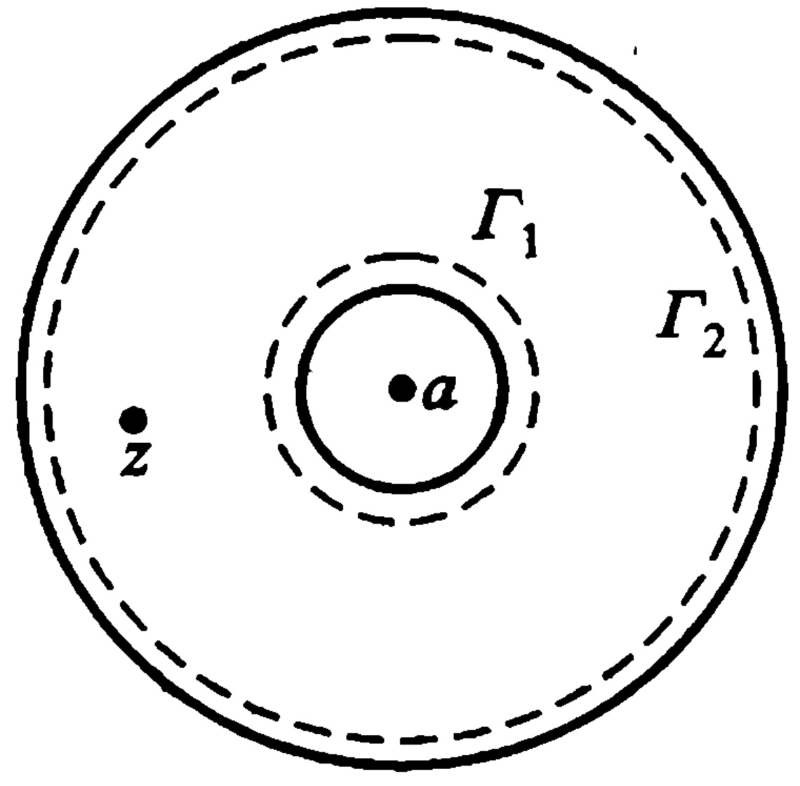

使得 z 含在圆环  $ \rho_{1} < |z - a| < \rho_{2} $ 内（图 5.1）.

图 5.1
 

因为函数  $ f(z) $ 在闭圆环  $ \rho_{1} \leqslant |z - a| \leqslant \rho_{2} $ 上解析，由柯西积分公式有

 $$ f(z)=\frac{1}{2\pi\mathrm{i}}\int_{\Gamma_{2}}\frac{f(\zeta)}{\zeta-z}\mathrm{d}\zeta-\frac{1}{2\pi\mathrm{i}}\int_{\Gamma_{1}}\frac{f(\zeta)}{\zeta-z}\mathrm{d}\zeta, $$ 

或写成

$$  f(z)=\frac{1}{2\pi\mathrm{i}}\int_{\Gamma_{2}}\frac{f(\zeta)}{\zeta-z}\mathrm{d}\zeta+\frac{1}{2\pi\mathrm{i}}\int_{\Gamma_{1}}\frac{f(\zeta)}{z-\zeta}\mathrm{d}\zeta.   \tag*{(5.6)}$$

我们将上式中的两个积分表为含有 z - a 的(正或负)幂次的级数.

对于第一个积分，只要照抄泰勒定理 4.14 证明中的相应部分，就得

$$  \frac{1}{2\pi\mathrm{i}}\int_{\Gamma_{2}}\frac{f(\zeta)}{\zeta-z}\mathrm{d}\xi=\sum_{n=0}^{\infty}c_{n}\left(z-a\right)^{n},   \tag*{(5.7)}$$

$$  c_{n}=\frac{1}{2\pi\mathrm{i}}\int_{\Gamma_{2}}\frac{f(\zeta)}{(\zeta-a)^{n+1}}\mathrm{d}\zeta(n=0,1,2,\cdots).   \tag*{(5.8)}$$

类似地，考虑(5.6)式中的第二个积分

 $$ \frac{1}{2\pi\mathrm{i}}\int_{r_{1}}\frac{f(\zeta)}{z-\zeta}\mathrm{d}\zeta, $$ 

我们有

 $$ \frac{f(\zeta)}{z-\zeta}=\frac{f(\zeta)}{(z-a)-(\zeta-a)}=\frac{f(\zeta)}{z-a}\cdot\frac{1}{1-\frac{\zeta-a}{z-a}}. $$

<!-- page: 203 -->

当  $ \zeta \in \Gamma_{1} $ 时，

 $$ \left|\frac{\zeta-a}{z-a}\right|=\frac{\rho_{1}}{|z-a|}<1, $$ 

于是上式可以展成一致收敛的级数

 $$ \frac{f(\zeta)}{z-\zeta}=\frac{f(\zeta)}{z-a}\sum_{n=1}^{\infty}\left(\frac{\zeta-a}{z-a}\right)^{n-1} $$ 

沿  $ \Gamma_{1} $ 逐项积分，再以  $ \frac{1}{2\pi i} $ 乘两端即得

$$  \frac{1}{2\pi\mathrm{i}}\int_{\Gamma_{1}}\frac{f(\zeta)}{z-\zeta}\mathrm{d}\zeta=\sum_{n=1}^{\infty}\frac{c_{-n}}{(z-a)^{n}},   \tag*{(5.9)}$$

$$  c_{-n}=\frac{1}{2\pi i}\int_{r_{1}}\frac{f(\zeta)}{(\zeta-a)^{-n+1}}\mathrm{d}\zeta(n=1,2,\cdots).   \tag*{(5.10)}$$

由（5.6），（5.7），（5.9）即得

 $$ \begin{align*}f(z)&=\sum_{n=0}^{\infty}c_{n}(z-a)^{n}+\sum_{n=1}^{\infty}\frac{c_{-n}}{(z-a)^{n}}\\&=\sum_{n=-\infty}^{\infty}c_{n}(z-a)^{n}.\end{align*} $$ 

· 回过头来考查系数(5.8)及(5.10)，由复周线的柯西积分定理，对任意圆周  $ \Gamma: |z - a| = \rho (r < \rho < R) $; 有

 $$ \begin{align*}c_{n}=&\frac{1}{2\pi i}\int_{\Gamma_{2}}\frac{f(\zeta)}{(\zeta-a)^{n+1}}\mathrm{d}\zeta\\=&\frac{1}{2\pi i}\int_{\Gamma}\frac{f(\zeta)}{(\zeta-a)^{n+1}}\mathrm{d}\zeta(n=0,1,2,\cdots),\end{align*} $$ 

 $$ \begin{align*}c_{-n}&=\frac{1}{2\pi i}\int_{\Gamma_{1}}\frac{f(\zeta)}{(\zeta-a)^{-n+1}}\mathrm{d}\zeta\\&=\frac{1}{2\pi i}\int_{\Gamma}\frac{f(\zeta)}{(\zeta-a)^{-n+1}}\mathrm{d}\zeta\quad(n=1,2,\cdots),\end{align*} $$ 

于是系数可统一表成(5.5).

因为系数  $ c_{n} $ 与我们所取的 z 根本无关，故在圆环 H 内(5.4)成立.

<!-- page: 204 -->

最后证明展式的惟一性. 设  $ f(z) $ 在圆环 H 内又可展成下式：

 $$ f(z)=\sum_{n=-\infty}^{\infty}c_{n}^{\prime}(z-\dot{a})^{n}, $$ 

由定理 5.1 知，它在圆周  $ \Gamma: |z-a|=\rho(r<\rho<R) $ 上一致收敛.

乘以沿  $ \Gamma $ 上的有界函数  $ \frac{1}{(z-a)^{m+1}} $，仍然一致收敛，故可逐项积分得  $ \int_{\Gamma}\frac{f(\zeta)}{(\zeta-a)^{m+1}}\mathrm{d}\zeta=\sum_{n=-\infty}^{\infty}\int_{\Gamma}\left(\zeta-a\right)^{n-m-1}\mathrm{d}\zeta $

由例 3.2 即知等号右端级数中 n=m 那一项积分为  $ 2\pi i $，其余各项为零，于是

 $$ c_{m}^{\prime}=\frac{1}{2\pi\mathrm{i}}\int_{\Gamma}\frac{f(\zeta)}{(\zeta-a)^{m+1}}\mathrm{d}\zeta,(m=0,\pm1,\cdots) $$ 

与(5.5)比较，即知  $ c_{n}^{'}=c_{n}(n=0,\pm1,\cdots) $.

定义 5.1 (5.4) 称为函数  $ f(z) $ 在点 a 的洛朗展式，(5.5) 称为其洛朗系数，而 (5.4) 等号右边的级数则称为洛朗级数.

证明了洛朗展式的惟一性后,我们就可以采用一些常用的更简便的方法去求一些初等函数在指定圆环内的洛朗展开式(如例5.1至例5.5),只有在个别的情况下,才直接采用公式(5.5)求洛朗系数的方法(如例5.6).

3. 洛朗级数与泰勒级数的关系 当已给函数  $ f(z) $ 在点 a 处解析时，中心在 a，半径等于由 a 到函数  $ f(z) $ 的最近奇点的距离的那个圆可以看成圆环的特殊情形，在其中就可作出洛朗级数展开式。根据柯西积分定理，由公式(5.5)可以看出，这个展式的所有系数  $ c_{-n}(n=1,2,\cdots) $ 都等于零。在此情形下，计算洛朗级数的系数公式与泰勒级数的系数公式（积分形式）无异，所以洛朗级数就转化为泰勒级数。因此，泰勒级数是洛朗级数的特殊情形。

例 5.1 函数

 $$ f(z)=\frac{1}{(z-1)(z-2)}. $$ 

在 z 平面上只有两个奇点: z = 1 及 z = 2. 因此 z 平面被分成如下

<!-- page: 205 -->

三个不相交的  $ f(z) $ 的解析区域: (1) 圆  $ \left|z\right|<1 $; (2) 圆环  $ 1<|z|<2 $; (3) 圆环:  $ 2<|z|<+\infty $, 试分别在此三个区域内求  $ f(z) $ 的展式.

解 首先将函数  $ f(z) $ 分解成部分分式

 $$ f(z)=\frac{1}{z-2}-\frac{1}{z-1}. $$ 

（1）在圆  $ \left|z\right|<1 $ 内. 因  $ \left|z\right|<1<2 $，即  $ \left|\frac{z}{2}\right|<1 $，利用公式

（4.10）得

 $$ f(z)=\frac{1}{1-z}-\frac{1}{2\left(1-\frac{z}{2}\right)}=\sum_{n=0}^{\infty}\left(1-\frac{1}{2^{n+1}}\right)z^{n}, $$ 

此即  $ f(z) $ 在圆  $ \left|z\right|<1 $ 内的泰勒展式.

（2）在圆环  $ 1<|z|<2 $ 内，即有  $ \left|\frac{1}{z}\right|<1,\left|\frac{z}{2}\right|<1 $

 $$ \begin{align*}f(z)&=-\frac{1}{2}\cdot\frac{1}{1-\frac{z}{2}}-\frac{1}{z}\cdot\frac{1}{1-\frac{1}{z}}\\&=-\frac{1}{2}\sum_{n=0}^{\infty}\frac{z^n}{2^n}-\frac{1}{z}\sum_{n=1}^{\infty}\frac{1}{z^{n-1}}\\&=-\sum_{n=0}^{\infty}\frac{z^n}{2^{n+1}}-\sum_{n=1}^{\infty}\frac{1}{z^n}.\end{align*} $$ 

（3）在圆环  $ 2<|z|<+\infty $ 内.这时  $ \left|\frac{1}{z}\right|<1,\left|\frac{2}{z}\right|<1 $ 故

 $$ \begin{aligned}f(z)&=\frac{1}{z}\cdot\frac{1}{1-\frac{2}{z}}-\frac{1}{z}\cdot\frac{1}{1-\frac{1}{z}}\\&=\frac{1}{z}\sum_{n=0}^{\infty}\frac{2^{n}}{z^{n}}-\frac{1}{z}\sum_{n=0}^{\infty}\frac{1}{z^{n}}=\sum_{n=2}^{\infty}\frac{2^{n-1}-1}{z^{n}}.\end{aligned} $$ 

4. 解析函数在孤立奇点邻域内的洛朗展式

定义 5.2 如果函数  $ f(z) $ 在点 a 的某一去心邻域  $ K - \{a\} $:  $ 0 < |z - a| < R $ (即除去圆心 a 的某圆) 内解析，点 a 是  $ f(z) $ 的奇

<!-- page: 206 -->

点(见定义 2.3)，则称 a 为  $ f(z) $ 的一个孤立奇点.

注 因函数  $ f(z) $ 在  $ K-\{a\} $ 内是单值的，故也称 a 为  $ f(z) $ 的单值性孤立奇点；如以后遇到  $ f(z) $ 在  $ K-\{a\} $ 内是多值的，则称 a 为  $ f(z) $ 的多值性孤立奇点，即支点（由于在支点的邻域内函数能由一支变到另一支，故函数在支点邻域内缺少单值性。因而它以最简单的方式破坏了函数的解析性。因此支点也是函数的奇点）。以后如无特别声明，提到孤立奇点总指单值性孤立奇点。当然，以后也会遇到非孤立奇点。

如果 a 为函数  $ f(z) $ 的一个孤立奇点，则必存在正数 R，使得  $ f(z) $ 在点 a 的去心邻域  $ K - \{a\} : 0 < |z - a| < R $ 内可展成洛朗级数.

例 5.2 函数  $ f(z)=\frac{1}{(z-1)(z-2)} $ 在 z 平面内只有两个奇点 z=1 及 z=2。试分别求  $ f(z) $ 在此二点去心邻域内（图 5.2）的洛朗展式。

解 （1）在（最大的）去心邻域  $ 0<|z-1|<1 $ 内

 $$ \begin{aligned}f(z)&=\frac{-1}{z-1}+\frac{1}{z-2}\\&=-\frac{1}{z-1}+\frac{1}{(z-1)-1}\\&=-\frac{1}{z-1}-\sum_{n=0}^{\infty}(z-1)^{n};\end{aligned} $$ 

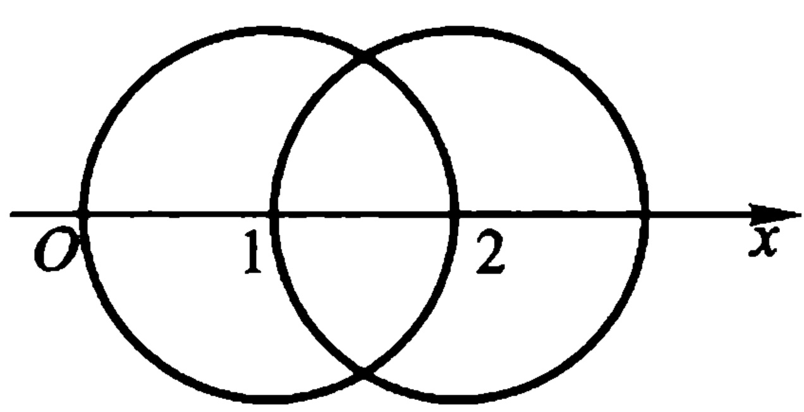

图5.2
 

（2）在（最大的）去心邻域  $ 0<|z-2|<1 $ 内

 $$ \begin{aligned}f(z)&=\frac{1}{z-2}-\frac{1}{z-2+1}\\&=\frac{1}{z-2}-\sum_{n=0}^{\infty}(-1)^{n}(z-2)^{n}.\end{aligned} $$ 

（3）在(最大的)点 $ \infty $的去心邻域 $ 1<|z-1|<+\infty $（以 $ z=1 $为中心）内，有 $ \left|\frac{1}{z-1}\right|<1 $，从而有

<!-- page: 207 -->

$$ \begin{aligned}f(z)&=-\frac{1}{z-1}+\frac{1}{z-1}\cdot\frac{1}{1-\frac{1}{z-1}}\\&=-\frac{1}{z-1}+\frac{1}{z-1}\sum_{n=0}^{\infty}\left(\frac{1}{z-1}\right)^{n}=\sum_{n=1}^{\infty}\left(\frac{1}{z-1}\right)^{n+1}.\end{aligned} $$ 

（4）在（最大的）点 $ \infty $的去心邻域 $ 1<|z-2|<+\infty $（以 $ z=2 $为中心——见本章第3节末）内有 $ \left|\frac{1}{z-2}\right|<1 $，从而有

 $$ \begin{aligned}f(z)&=\frac{1}{z-2}-\frac{1}{z-2+1}=\frac{1}{z-2}-\frac{1}{z-2}\cdot\frac{1}{1+\frac{1}{z-2}}\\&=\frac{1}{z-2}-\frac{1}{z-2}\sum_{n=0}^{\infty}(-1)^{n}\left(\frac{1}{z-2}\right)^{n}\\&=\sum_{n=1}^{\infty}\left(-\frac{1}{z-2}\right)^{n+1}.\end{aligned} $$ 

例 5.3  $ \frac{\sin z}{z} $ 在 z 平面上只有奇点 z=0，在其去心邻域 0<|z|<+\infty 内有洛朗展式

 $$ \frac{\sin z}{z}=\sum_{n=0}^{\infty}\frac{\left(-1\right)^{n}z^{2n}}{\left(2n+1\right)!}=1-\frac{z^{2}}{3!}+\cdots. $$ 

例 5.4  $ e^{z} + e^{\frac{1}{z}} $ 在 z 平面上只有奇点 z=0，在其去心邻域 0<|z|<+\infty 内有洛朗展式

 $$ \mathrm{e}^{z}+\mathrm{e}^{\frac{1}{z}}=2+\sum_{n=1}^{\infty}\frac{z^{n}}{n!}+\sum_{n=1}^{\infty}\frac{1}{n!}\cdot\frac{1}{z^{n}}. $$ 

由以上各例已可看出，在求一些初等函数的洛朗展式时，一般并不是按照公式(5.5)去计算洛朗系数，主要是利用已知的幂级数展式去求所需要的洛朗展式。下面我们再举两例：

例 5.5  $ \sin \frac{z}{z-1} $ 在 z 平面上只有奇点 z=1，且在去心邻域  $ 0<|z-1|<+\infty $ 内可展成洛朗级数：

解  $ \sin\frac{z}{z-1}=\sin\left(1+\frac{1}{z-1}\right) $

<!-- page: 208 -->

$$ \begin{align*}&=\sin1\cdot\cos\frac{1}{z-1}+\cos1\cdot\sin\frac{1}{z-1}\\&=\sin1\left[1-\frac{1}{2!(z-1)^2}+\cdots\right.\\&\quad\left.+(-1)^n\frac{1}{(2n)!(z-1)^{2n}}+\cdots\right]\\&\quad+\cos1\left[\frac{1}{z-1}-\frac{1}{3!(z-1)^3}+\cdots\right.\\&\quad\left.+(-1)^n\frac{1}{(2n+1)!(z-1)^{2n+1}}+\cdots\right]\\&=\sin1+\frac{\cos1}{z-1}-\frac{\sin1}{2!(z-1)^2}\\&\quad-\frac{\cos1}{3!(z-1)^3}+\cdots+(-1)^n\frac{\sin1}{(2n)!(z-1)^{2n}}\\&\quad+(-1)^n\frac{\cos1}{(2n+1)!(z-1)^{2n+1}}+\cdots.\end{align*} $$ 

例 5.6 试证

 $$ \cosh\left(z+\frac{1}{z}\right)=c_{0}+\sum_{n=1}^{\infty}c_{n}\left(z^{n}+z^{-n}\right), $$ 

其中

 $$ c_{n}=\frac{1}{2\pi}\int_{0}^{2\pi}\cos n\varphi\cdot\cosh(2\cos\varphi)\mathrm{d}\varphi. $$ 

证 因  $ w = z + \frac{1}{z} $ 在 z 平面上只有 z = 0 一个奇点. 而

 $$ \cosh w=\frac{1}{2}(\mathrm{e}^{w}+\mathrm{e}^{-w}) $$ 

在 w 平面上解析，故  $ \cosh\left(z+\frac{1}{z}\right) $ 在 z 平面上也只有一个奇点 z = 0。即它在去心邻域  $ 0 < |z| < +\infty $。内解析。由洛朗定理得

 $$ \begin{array}{c}{\displaystyle\operatorname{c o s h}\left(z+\frac{1}{z}\right)=\sum_{n=-\infty}^{\infty}c_{n}z^{n},}\\ {\displaystyle c_{n}=\frac{1}{2\pi\mathrm{i}}\int_{\Gamma_{\rho}}\frac{\operatorname{c o s h}\left(z+z^{-1}\right)}{z^{n+1}}\mathrm{d}z,}\end{array} $$

<!-- page: 209 -->

$ \Gamma_{\rho} $ 表任意圆周  $ |z|=p>0 $.

取  $ \rho=1 $，则沿圆周  $ \Gamma_{\rho}: z=e^{\mathrm{i}\varphi},0\leqslant\varphi\leqslant2\pi $，有

 $$ \begin{align*}c_{n}&=\frac{1}{2\pi}\int_{0}^{2\pi}\cosh(e^{i\varphi}+e^{-i\varphi})e^{-ni\varphi}d\varphi\\&=\frac{1}{2\pi}\int_{0}^{2\pi}\cosh(2\cos\varphi)\cos n\varphi d\varphi\\&\quad-\frac{i}{2\pi}\int_{0}^{2\pi}\cosh\left(2\cos\varphi\right)\sin n\varphi d\varphi.\end{align*} $$ 

命  $ \varphi=2\pi-\theta $，则可知等号右边第二个积分为零。故

 $$ c_{n}=\frac{1}{2\pi}\int_{0}^{2\pi}\cosh(2\cos\varphi)\cos n\varphi\mathrm{d}\varphi. $$ 

所以

 $$ c_{n}=c_{-n}(n=1,2,\cdots). $$ 

所以

 $$ \operatorname{c o s h}\left(z+\frac{1}{z}\right)=c_{0}+\sum_{n=1}^{\infty}c_{n}\left(z^{n}+z^{-n}\right). $$ 

#### §2. 解析函数的孤立奇点

孤立奇点是解析函数的奇点中最简单、最重要的一种类型。以解析函数的洛朗展式为工具，我们能够在孤立奇点的去心邻域内充分研究一个解析函数的性质。

1. 孤立奇点的三种类型 已经说过, 如 a 为函数  $ f(z) $ 的孤立奇点, 则  $ f(z) $ 在 a 点的某去心邻域  $ K - \{a\} $ 内可以展成洛朗级数

 $$ f(z)=\sum_{n=-\infty}^{\infty}c_{n}(z-a)^{n}. $$ 

我们称非负幂部分  $ \sum_{n=0}^{\infty} c_{n}(z-a)^{n} $ 为  $ f(z) $ 在点 a 的正则部分，而称负幂部分  $ \sum_{n=1}^{\infty} c_{-n}(z-a)^{-n} $ 为  $ f(,z) $ 在点 a 的主要部分. 这是因为实际上非负幂部分表示在点 a 的邻域  $ K: |z-a| < R $ 内

<!-- page: 210 -->

的解析函数,故函数  $ f(z) $ 在点 a 的奇异性质完全体现在洛朗级数的负幂部分上.

定义 5.3 设 a 为函数  $ f(z) $ 的孤立奇点.

(1) 如果  $ f(z) $ 在点 a 的主要部分为零，则称 a 为  $ f(z) $ 的可去奇点（见例 5.3）.

(2) 如果  $ f(z) $ 在点 a 的主要部分为有限多项, 设为

 $$ \frac{c_{-m}}{\left(z-a\right)^{m}}+\frac{c_{-(m-1)}}{\left(z-a\right)^{m-1}}+\cdots+\frac{c_{-1}}{z-a}\left(c_{-m}\neq0\right), $$ 

则称 a 为  $ f(z) $ 的 m 阶极点（见例 5.2）. 一阶极点也称为单极点.

(3) 如果  $ f(z) $ 在点 a 的主要部分有无限多项，则称 a 为  $ f(z) $ 的本质奇点（见例 5.4 及例 5.5）.

以下我们分别讨论三类孤立奇点的特征.

2. 可去奇点 如果 a 为函数  $ f(z) $ 的可去奇点，则有

 $$ f(z)=c_{0}+c_{1}(z-a)+c_{2}(z-a)^{2}+\cdots(0<|z-a|<R). $$ 

上式等号右边表圆  $ K: |z - a| < R $ 内的解析函数. 如果命  $ f(a) = c_{0} $，则  $ f(z) $ 在圆 K 内与一个解析函数重合. 也就是说，我们将  $ f(z) $ 在点 a 的值加以适当定义，则点 a 就是  $ f(z) $ 的解析点. 这就是我们称 a 为  $ f(z) $ 的可去奇点的由来.

例如，当我们约定 $ \frac{\sin z}{z}\bigg|_{z=0}=1 $时, $ \frac{\sin z}{z} $在z=0就解析了.

定理 5.3 如果 a 为函数  $ f(z) $ 的孤立奇点，则下列三条是等价的。因此，它们中的任何一条都是可去奇点的特征。

(1)  $ f(z) $ 在点 a 的主要部分为零；

(2)  $ \lim_{z \to a} f(z) = b (\neq \infty) $;

(3)  $ f(z) $ 在点 a 的某去心邻域内有界.

证 只要证明(1)推出(2);(2)推出(3);(3)推出(1)就行了.

（1）推出（2）：由（1）知

 $$ \begin{align*}f(z)=c_{0}+c_{1}(z-a)+\cdots(0<|z-a|<R),\\\liminf_{z\to a}(z)=c_{0}(\neq,\infty).\end{align*} $$ 

于是

<!-- page: 211 -->

（2）推出（3）：即例 1.27.

(3) 推出(1): 设  $ f(z) $ 在点 a 的某去心邻域  $ K - \{a\} $ 内以 M 为界. 考虑  $ f(z) $ 在点 a 的主要部分

 $$ \frac{c_{-1}}{z-a}+\frac{c_{-2}}{\left(z-a\right)^{2}}+\cdots+\frac{c_{-n}}{\left(z-a\right)^{n}}+\cdots, $$ 

 $$ c_{-n}=\frac{1}{2\pi\mathrm{i}}\int_{\Gamma}\frac{f(\zeta)}{(\zeta-a)^{-n+1}}\mathrm{d}\zeta(n=1,2,3,\cdots), $$ 

而  $ \Gamma $ 为全含于 K 内的圆周  $ \left|\zeta - a\right| = \rho, \rho $ 可以充分小. 于是由

 $$ \begin{align*}\mid c_{-n}\mid&=\left|\frac{1}{2\pi i}\int_{\Gamma}\frac{f(\zeta)}{(\zeta-a)^{-n+1}}\mathrm{d}\zeta\right|\\&\leqslant\frac{1}{2\pi}\cdot\frac{M}{\rho^{-n+1}}2\pi\rho=M\rho^{n}\end{align*} $$ 

即知当 n=1,2, $ \cdots $时， $ c_{-n}=0 $。即是说， $ f(z) $在点 a 的主要部分为零。

3. 施瓦茨(Schwarz)引理 如果函数  $ f(z) $ 在单位圆  $ |z|<1 $ 内解析，并且满足条件

 $$ f(0)=0,\mid f(z)\mid<1(\mid z\mid<1), $$ 

则在单位圆  $ \left|z\right|<1 $ 内恒有

 $$ \begin{aligned}\mid f(z)\mid&\leqslant\mid z\mid,\\ \mid f^{\prime}(0)\mid&\leqslant1.\end{aligned} $$ 

且有

如果上式等号成立，或在圆  $ \left|z\right|<1 $ 内一点  $ z_{0}\neq0 $ 处前一式符号成立，则(当且仅当)

 $$ f(z)=\mathrm{e}^{\mathrm{i}\alpha}z\quad(\mid z\mid<1), $$ 

其中  $ \alpha $ 为一实常数.

证 设

 $$ f(z)=c_{1}z+c_{2}z^{2}+\cdots(\mid z\mid<1). $$ 

令

 $$ \varphi\left(z\right)=\frac{f\left(z\right)}{z}=c_{1}+c_{2}z+\cdots\left(z\neq0\right), $$

<!-- page: 212 -->

定义  $ \varphi(0)=c_{1}=f'(0) $，则  $ \varphi(z) $ 在  $ \left|z\right|<1 $ 内解析.

考虑  $ \varphi(z) $ 在单位圆  $ |z|<1 $ 内任一点  $ z_{0} $ 处的值，如果 r 满足条件  $ |z_{0}|<r<1 $，根据最大模原理，有

 $$ |\varphi(z_{0})|\leqslant\max_{|z|=r}|\varphi(z)|=\max_{|z|=r}\left|\frac{f(z)}{z}\right|\leqslant\frac{1}{r}. $$ 

让  $ r \rightarrow 1 $ 即得

 $$ \mid\varphi(z_{0})\mid\leqslant1. $$ 

于是 $ \left|f^{\prime}(0)\right|=\left|\varphi(0)\right|\leqslant1 $，且当 $ z_{0}\neq0 $时，有

 $$ \begin{aligned}\mid\varphi(z_{0})\mid&=\left|\frac{f(z_{0})}{z_{0}}\right|\leqslant1,\\&\mid f(z_{0})\mid\leqslant\mid z_{0}\mid.\end{aligned} $$ 

即

如果这些关系式中，有一个取等号，这就意味着在单位圆  $ |z| < 1 $ 内的某一点  $ z_{0} $，模数  $ |\varphi(z)| $ 达到最大值，这只有  $ \varphi(z) =  $ 常数  $ e^{i\alpha} $ （ $ \alpha $ 为实数）时才可能，此即  $ f(z) = e^{i\alpha}z $.

从几何上看，施瓦茨引理表明：任一解析变换  $ \omega = f(z) $， $ f(0) = 0 $，当它把单位圆变到一个单位圆内的区域  $ \Delta $ 上去时，圆内任一点  $ z \neq 0 $ 的像都比 z 本身距坐标原点为近。而如果有一个点的像与这个点本身距坐标原点有相同距离的话，则  $ \Delta $ 就与单位圆相同，变换就仅仅是一个旋转（图 5.3）。

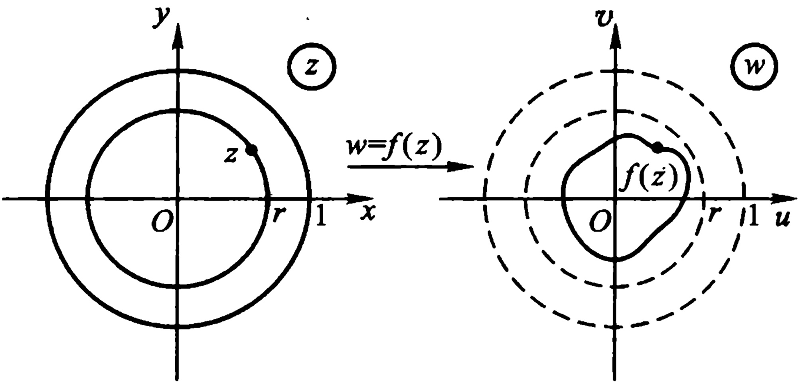

图5.3
 

<!-- page: 213 -->

$ ^{*} $ 注 施瓦茨引理有如下一个简单改进：

我们保留假设条件不变. 如果原点是函数  $ f(z) $ 的  $ \lambda $ 阶零点，就可以考虑函数  $ \frac{f(z)}{z^{\lambda}} $，与刚才的情形一样，我们由此可以得到

 $$ |f(z)|\leqslant|z|^{\lambda}, $$ 

并且只有当

 $$ f(z)=\mathrm{e}^{\mathrm{i}\alpha}z^{\lambda}\left(\alpha 为实数 \right) $$ 

时，等号才成立.这样，在这个特殊情形之下，函数的模就有了一个比前面公式中更小的界限.

### 4. 极点

定理 5.4 如果函数  $ f(z) $ 以点 a 为孤立奇点，则下列三条是等价的. 因此，它们中的任何一条都是 m 阶极点的特征.

(1)  $ f(z) $ 在点 a 的主要部分为

 $$ \frac{c_{-m}}{\left(z-a\right)^{m}}+\cdots+\frac{c_{-1}}{z-a}\left(c_{-m}\neq0\right); $$ 

(2)  $ f(z) $ 在点 a 的某去心邻域内能表成

$$  f(z)=\frac{\lambda(z)}{(z-a)^{m}},   \tag*{(5.11)}$$

其中  $ \lambda(z) $ 在点 a 邻域内解析，且  $ \lambda(a) \neq 0 $;

(3)  $ g(z)=\frac{1}{f(z)} $ 以点 a 为 m 阶零点 (可去奇点要当作解析点看, 只要令  $ g(a)=0 $).

注 第(3)条表明：

f(z)以点a为m阶极点 $ \Leftrightarrow\frac{1}{f(z)} $以点a为m阶零点.

证 （1）推出(2): 若(1)为真, 则在点 a 的某去心邻域内有

 $$ \begin{aligned}f(z)=\frac{c_{-m}}{\left(z-a\right)^{m}}+\frac{c_{-(m-1)}}{\left(z-a\right)^{m-1}}+\cdots+\frac{c_{-1}}{z-a}\\+c_{0}+c_{1}(z-a)+\cdots\end{aligned} $$

<!-- page: 214 -->

$$ =\frac{c_{-m}+c_{-(m-1)}(z-a)+\cdots}{(z-a)^{m}}=\frac{\lambda(z)}{(z-a)^{m}}, $$ 

其中  $ \lambda(z) $ 显然在点 a 的邻域内解析，且  $ \lambda(a)=c\quad m\neq0 $

(2) 推出(3): 若(2)为真, 则在点 a 的某去心邻域内有

 $$ g(z)=\frac{1}{f(z)}=\frac{(z-a)^{m}}{\lambda(z)}, $$ 

其中 $ \frac{1}{\lambda(z)} $在点a的某邻域内解析，且 $ \frac{1}{\lambda(a)}\neq0 $（由例1.28）。因此，a为 $ g(z) $的可去奇点，作为解析点来看，只要令 $ g(a)=0 $，a就为 $ g(z) $的m阶零点。

（3）推出(1): 如果  $ g(z)=\frac{1}{f(z)} $ 以点 a 为 m 阶零点，则在点 a 的某邻域内

 $$ g\left(z\right)=\left(z-a\right)^{m}\varphi\left(z\right) $$ 

（见(4.14)），其中  $ \varphi(z) $ 在此邻域内解析，且  $ \varphi(a)\neq0 $。这样一来

 $$ f(z)=\frac{1}{(z-a)^{m}}\cdot\frac{1}{\varphi(z)}. $$ 

因 $ \frac{1}{\varphi(z)} $在点a某邻域内解析(由例1.28)，如在此邻域内命

 $$ \frac{1}{\varphi(z)}=c_{-_{m}}+c_{-(m-1)}(z-a)+\cdots $$ 

为其泰勒展式,则  $ f(z) $ 在点 a 的主要部分就是

 $$ \frac{c_{-m}}{\left(z-a\right)^{m}}+\frac{c_{-(m-1)}}{\left(z-a\right)^{m-1}}+\cdots+\frac{c_{-1}}{z-a}\left(c_{-m}=\frac{1}{\varphi(a)}\neq0\right). $$ 

下述定理也能说明极点的特征,其缺点是不能指明极点的阶.

定理 5.5 函数  $ f(z) $ 的孤立奇点 a 为极点的充要条件是

 $$ \operatorname*{l i m}_{z\to a}f(z)=\infty. $$ 

证 函数  $ f(z) $ 以 a 为极点的充要条件是  $ \frac{1}{f(z)} $ 以 a 为零点（上定理之(3)，由此知定理为真.

例 5.7 函数

<!-- page: 215 -->

$$ f(z)=\frac{5z+1}{(z-1)(2z+1)^{2}} $$ 

以 z=1 为一阶极点， $ z=-\frac{1}{2} $ 为二阶极点（由定理 5.4(3)）.

### 5. 本质奇点

定理 5.6 函数  $ f(z) $ 的孤立奇点 a 为本质奇点的充要条件是

 $$ \liminf_{z\to a}(z)\neq\left\{\begin{aligned}&b( 有限数 ),\\ &\infty\end{aligned}\right. 即 \liminf_{z\to a}(z) 不存在 . $$ 

这可由定理 5.3.3 之(2)及定理 5.5 得到证明.

定理 5.7 若 z = a 为函数  $ f(z) $ 之一本质奇点，且在点 a 的充分小去心邻域内不为零，则 z = a 亦必为  $ \frac{1}{f(z)} $ 的本质奇点.

证 命  $ \varphi(z)=\frac{1}{f(z)} $. 由假设, z=a 必为  $ \varphi(z) $ 的孤立奇点.

若 z=a 为  $ \varphi(z) $ 的可去奇点 (解析点), 则 z=a 必为  $ f(z) $ 的可去奇点或极点, 此与假设矛盾; 若 z=a 为  $ \varphi(z) $ 的极点, 则 z=a 必为  $ f(z) $ 的可去奇点 (零点), 亦与假设矛盾. 故 z=a 必为  $ \varphi(z) $ 的本质奇点.

例 5.8 z=0 为  $ e^{\frac{1}{z}} $ 的本质奇点. 因为

 $$ \begin{aligned}\mathrm{e}^{\frac{1}{z}}&=1+\frac{1}{z}+\frac{1}{2!z^{2}}+\cdots+\frac{1}{n!z^{n}}+\cdots.\\&\quad(0<|z|<+\infty)\end{aligned} $$ 

由定理 5.7, 我们可以断定 z=0 亦为  $ e^{-\frac{1}{z}} $ 的本质奇点. 在上式中将 z 改为 -z, 也可看出这一点.

就本书所遇到的奇点情况来看，可以列表如下：

<!-- page: 216 -->

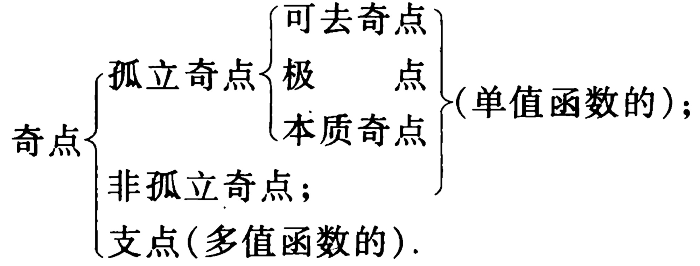

### 6. 皮卡(Picard)定理

魏尔斯特拉斯 1876 年给出下面的定理, 描述出解析函数在本质奇点邻域内的特性.

定理 5.8 如果 a 为函数  $ f(z) $ 的本质奇点，则对于任何常数 A，不管它是有限数还是无穷，都有一个收敛于 a 的点列  $ \{z_{n}\} $，使得

 $$ \lim_{z_{n}\to a}f(z_{n})=A. $$ 

换句话说，在本质奇点的无论怎样小的去心邻域内，函数  $ f(z) $ 可以取任意接近于预先给定的任何数值（有限的或无穷的）。

证 (1) 在  $ A = \infty $ 的情形, 定理是正确的. 因为函数  $ f(z) $ 的模在 a 的任何去心邻域内都是无界的. 否则, a 必为  $ f(z) $ 的可去奇点.

##### (2) 现在设  $ A \neq \infty $.

可能有这种情形发生,在点 a 的任意小的去心邻域内有这样一点 z 存在,使  $ f(z)=A $. 在这种情形下,定理已经得证.

因此，我们可以假定，在点 a 的充分小的去心邻域  $ K - \{a\} $ 内  $ f(z) \neq A $。这样，由定理 5.7，函数

 $$ \varphi\left(z\right)=\frac{1}{f\left(z\right)-A} $$ 

在  $ K - \{a\} $ 内解析，且以 a 为本质奇点（因 a 为  $ f(z) $ 的本质奇点）。根据前面（1）段的结果，必定有一个趋向 a 的点列  $ \{z_{n}\} $ 存在，使得

 $$ \lim_{z_{n}\to a}\varphi(z)=\infty. $$

<!-- page: 217 -->

由此推出

 $$ \lim_{z_{n}\to a}f(z_{n})=A. $$ 

思考题 试描述这个魏尔斯特拉斯定理的几何意义.

我们用两个例子来说明这个定理.

例 5.9  $ f(z)=\sin\frac{1}{z} $

这里原点是  $ f(z) $ 的本质奇点。事实上，当  $ z \to 0 $ 时， $ \sin \frac{1}{z} $ 不趋于任何（有限的或无穷的）极限。只要考察 z 取实数值就可以发现这一点。

如果  $ A = \infty $，则可设  $ z_{n} = \frac{i}{n} $，即  $ \frac{1}{z_{n}} = -in $，我们得： $ n \to \infty $ 时  $ \sin \frac{1}{z_{n}} = -i  $ sh  $ n \to \infty $。

现在设  $ A \neq \infty $. 为了得到如魏尔斯特拉斯定理中所说的点列  $ \{z_{n}\} $，我们解方程

 $$ \sin\frac{1}{z}=A, $$ 

得

 $$ \frac{1}{z}=\mathrm{A r c}\sin A=\frac{1}{\mathrm{i}}\mathrm{L n}(\mathrm{i}A+\sqrt{1-A^{2}}). $$ 

于是  $ z_{k}=\frac{i}{\ln(iA+\sqrt{1-A^{2}})+2k\pi i},(k=0,\pm1,\cdots). $

若取

 $$ \mathcal{Z}_{n}=\frac{\mathrm{i}}{\ln(\mathrm{i}A+\sqrt{1-A^{2}})+2n\pi\mathrm{i}}, $$ 

并使 n=1,2, $ \cdots $,我们得到点列  $ \{z_{n}\}\to0 $,并满足条件

 $$ f(z_{n})=A(n=1,2,\cdots). $$ 

因此

 $$ \lim_{n\to\infty}f(z_{n})=A. $$ 

思考题 z=0 是否为  $ \frac{1}{\sin\frac{1}{z}} $ 的本质奇点？

<!-- page: 218 -->

例 5.10  $ f(z)=\mathrm{e}^{\frac{1}{z}} $

这里，原点是  $ f(z) $ 的本质奇点.（见例 5.8）

设  $ A = \infty $，取  $ z_{n} = \frac{1}{n} $，我们有

 $ f(z_{n})=\mathrm{e}^{n}\rightarrow\infty $（当  $ n\rightarrow\infty $ 时）.

就是说，当  $ A = \infty $ 时，点列  $ \left\{\frac{1}{n}\right\} $ 适合魏尔斯特拉斯定理中的论断.

现在设 A = 0，若令  $ z_{n} = -\frac{1}{n} $，我们有

 $ f(z_{n})=\mathrm{e}^{-n}\rightarrow0 $（当  $ n\rightarrow\infty $ 时）.

就是说，定理的论断在此情形也得到证实.

最后，设  $ A \neq 0, A \neq \infty $。这里极易由解方程

 $$ \mathrm{e}^{\frac{1}{x}}=A $$ 

来取相应的点  $ z_{n} $. 我们得

 $$ \frac{1}{z}=\mathrm{Ln}A, $$ 

于是

 $$ z_{k}=\frac{1}{\ln A+2k\pi i},(k=0,\pm1,\cdots). $$ 

若取

 $$ z_{n}=\frac{1}{\ln A+2n\pi\mathrm{i}}(n=1,2,\cdots), $$ 

我们就有收敛于零且满足条件  $ f(z_{n}) = A $ 的点列  $ \{z_{n}\} $. 于是

 $$ \lim_{n\to\infty}f(z_{n})=A. $$ 

在例5.9与例5.10中，我们看到了，除了个别的例外（前例中的 $ A=\infty $，后例中的 $ A=\infty,A=0 $），不但有点列 $ \{z_{n}\} $使满足极限等式

 $$ \lim_{z_{n}\to a}f(z_{n})=\bar{A}, $$ 

而且还有点列 $ \{z_{n}\} $使满足准确等式

<!-- page: 219 -->

$$ f(z_{n})=A(n=1,2,\cdots). $$ 

在一般情况下，也有类似的结果。下列定理是皮卡于 1879 年给出的：

定理 5.9 （皮卡(大)定理） 如果 a 为函数  $ f(z) $ 的本质奇点，则对于每一个  $ A \neq \infty $，除掉可能一个值  $ A = A_{0} $ 外，必有趋于 a 的无限点列  $ \{z_{n}\} $ 使  $ f(z_{n}) = A $ （ $ n = 1, 2, \cdots $）.

必须指出，皮卡定理较之魏尔斯特拉斯定理是更普遍并且更深刻了。但它只是函数值分布理论的早期结果之一。

皮卡证明的方法虽然很短 $ ^{①} $，但却利用了一种称为椭圆模函数的性质这种较高深的数学工具。后人虽有多种浅近的证明 $ ^{②③} $方法，但都非常繁复。本书限于篇幅，不加证明。

从皮卡定理出发，近代在这个方面还有许多深刻的研究，这些都是属于解析函数的值的分布理论范围，这里就不深入讨论了。

#### §3. 解析函数在无穷远点的性质

上一节讨论的是函数的孤立奇点为有限的情形. 由于函数  $ f(z) $ 在点  $ \infty $ 总是无意义的, 所以点  $ \infty $ 总是  $ f(z) $ 的奇点.

定义 5.4 设函数  $ f(z) $ 在无穷远点（去心）邻域

 $$ N-\{\infty\}:+\infty>|z|>r\geqslant0 $$ 

内解析,则称点 $ \infty $为 $ f(z) $的一个孤立奇点.

设点 $ \infty $为 $ f(z) $的孤立奇点，利用变换 $ z'=\frac{1}{z} $，于是

<!-- page: 220 -->

$$  \varphi\left(z^{\prime}\right)=f\left(\frac{1}{z^{\prime}}\right)=f(z)   \tag*{(5.12)}$$

在去心邻域  $ K - \{0\}: 0 < |z'| < \frac{1}{r} $ (如 r = 0 规定  $ \frac{1}{r} = +\infty $) 内解析.  $ z' = 0 $ 就为  $ \varphi(z') $ 之一孤立奇点. 我们还看出：

（1）对应于扩充 z 平面上无穷远点的去心邻域  $ N - \{\infty\} $，有扩充  $ z' $ 平面上原点的去心邻域；

(2) 在对应的点 z 与  $ z' $ 上，函数  $ f(z) $ 与  $ \varphi(z') $ 的值相等；

(3)  $ \lim_{z \to \infty} f(z) = \lim_{z' \to 0} \varphi(z') $，或两个极限都不存在.

从这里,我们很自然地根据  $ \varphi(z^{\prime}) $ 在原点的状态来规定函数  $ f(z) $ 在无穷远点的状态. 即有

定义 5.5 若  $ z' = 0 $ 为  $ \varphi(z') $ 的可去奇点（解析点）、m 阶极点或本质奇点，则我们相应地称  $ z = \infty $ 为  $ f(z) $ 的可去奇点（解析点）、m 阶极点或本质奇点.

注 虽然我们可以定义  $ f(\infty) $，但在无穷远处没有定义差商，因此我们没有定义  $ f(z) $ 在无穷远点处的可微性。但由定义 5.5 可见，所谓  $ f(z) $ 在点  $ \infty $ 解析，就是指点  $ \infty $ 为  $ f(z) $ 的可去奇点，且定义  $ f(\infty) = \lim_{z \to \infty} f(z) $.

设在去心邻域  $ K - \{0\}: 0 < |z'| < \frac{1}{r} $ 内将  $ \varphi(z') $ 展成洛朗级数：

 $$ \varphi(z^{\prime})=\sum_{n=-\infty}^{\infty}c_{n}z^{\prime n}. $$ 

令  $ z' = \frac{1}{z} $，并根据(5.12)，则有

$$  f(z)=\sum_{n=-\infty}^{\infty}b_{n}z^{n},   \tag*{(5.13)}$$

其中  $ b_{n}=c_{-n}(n=0,\pm1,\cdots) $

(5.13)为  $ f(z) $ 在无穷远点去心邻域  $ N - \{\infty\}: 0 \leq r < |z| < $

<!-- page: 221 -->

+\infty 内的洛朗展式. 对应  $ \varphi(z^{\prime}) $ 在  $ z^{\prime}=0 $ 的主要部分, 我们称

 $ \sum_{n=1}^{\infty}b_{n}z^{n} $ 为  $ f(z) $ 在  $ z=\infty $ 的主要部分.

注 我们来观察这样一个特例: 设函数  $ f(z) $ 在  $ \mathbb{C}_{\infty} $ 上只有奇点 z=0 和  $ z=\infty $，则可设

 $$ \begin{aligned}f(z)&=a_{0}+\frac{a_{1}}{z}+\cdots+\frac{a_{n}}{z^{n}}+\cdots+b_{1}z+b_{2}z^{2}+\cdots\\&\quad+b_{n}z^{n}+\cdots(0<|z|<+\infty),\end{aligned} $$ 

这样就把函数  $ f(z) - a_{0} $ 一分为二： $ \sum_{n=1}^{\infty} \frac{a_{n}}{z^{n}} $ 及  $ \sum_{n=1}^{\infty} b_{n} z^{n} $. 在 z=0 的去心邻域  $ 0 < |z| < +\infty $ 内，前者是主部，起主导作用， $ f(z) $ 的性质主要由前者所规定，而后者则是次要的. 但是当  $ |z| $ 逐渐变大，趋向  $ +\infty $ 时，主要和非主要就互相转化. 在  $ z = \infty $ 的去心邻域  $ 0 < |z| < +\infty $ 内，后者是主部，起主导作用，决定  $ f(z) $ 的性质，而前者却变为次要的.

由上述定义及性质(1),(2),(3)等,我们易得

定理 5.3′ （对应于定理 5.3）函数  $ f(z) $ 的孤立奇点  $ z = \infty $ 为可去奇点的充要条件是下列三条中的任何一条成立：

(1)  $ f(z) $ 在  $ z = \infty $ 的主要部分为零；

(2)  $ \lim_{z \to \infty} f(z) = b (\neq \infty) $;

(3)  $ f(z) $ 在  $ z = \infty $ 的某去心邻域  $ N - \{\infty\} $ 内有界.

定理 5.4′ （对应于定理 5.4） 函数  $ f(z) $ 的孤立奇点  $ z = \infty $ 为 m 阶极点的充要条件是下列三条中的任何一条成立：

(1)  $ f(z) $ 在  $ z = \infty $ 的主要部分为

 $$ b_{1}z+b_{2}z^{2}+\cdots+b_{m}z^{m}\left(b_{m}\neq0\right); $$ 

(2)  $ f(z) $ 在  $ z = \infty $ 的某去心邻域  $ N - \{\infty\} $ 内能表成

$$  f(z)=z^{m}\cdot\mu(z),   \tag*{(5.11)^{\prime}}$$

其中  $ \mu(z) $ 在  $ z=\infty $ 的邻域 N 内解析，且  $ \mu(\infty)\neq0 $;

<!-- page: 222 -->

(3)  $ g(z)=\frac{1}{f(z)} $ 以  $ z=\infty $ 为 m 阶零点 (只要令  $ g(\infty)=0 $).

例 5.11 由  $ f(z)=\frac{1}{(z-1)(z-2)} $ 在  $ 2<|z|<+\infty $ 内的洛朗展式（见例 5.1（3）），知它以  $ z=\infty $ 为可去奇点，并且作为解析点来看是二阶零点（只要让  $ f(\infty)=0 $）。

又

 $$ \begin{aligned}g\left(z\right)&=\frac{1}{f\left(z\right)}=\left(z-1\right)\left(z-2\right)\\&=z^{2}\left(1-\frac{1}{z}\right)\left(1-\frac{2}{z}\right),\end{aligned} $$ 

以  $ z = \infty $ 为二阶极点. 这里

 $$ \mu(z)=\left(1-\frac{1}{z}\right)\left(1-\frac{2}{z}\right),\mu(\infty)=1\neq0. $$ 

定理 5.5′ （对应于定理 5.5） 函数  $ f(z) $ 的孤立奇点  $ \infty $ 为极点的充要条件是  $ \lim_{z \to \infty} f(z) = \infty $.

定理 5.6′ （对应于定理 5.6） 函数  $ f(z) $ 的孤立奇点  $ \infty $ 为本质奇点的充要条件是下列两条中的任何一条成立：

(1)  $ f(z) $ 在  $ z = \infty $ 的主要部分有无穷多项正幂不等于零；

(2)  $ \lim_{z \to \infty} f(z) $ 不存在 (即当 z 趋向于  $ \infty $ 时,  $ f(z) $ 不趋向于任何 (有限或无穷) 极限).

注 定理 5.7、5.8 及 5.9 对  $ z = \infty $ 是  $ f(z) $ 的本质奇点也真.

下面我们再举几个其他类型的例子.

例 5.12 将多值解析函数  $ \mathrm{Ln}\frac{z-a}{z-b} $ 的各分支在无穷远点的某去心邻域内展成洛朗级数.

解 无穷远点不是

 $$ \mathrm{Ln}\frac{z-a}{z-b} $$ 

的支点，故能在点 $ \infty $的邻域 $ \left|z\right| > \max\left\{\left|a\right|, \left|b\right|\right\} $内分出单值解析分支.且在此去心邻域内，各支均能展成洛朗级数.现在第k支

<!-- page: 223 -->

$$ \begin{aligned}\ln\frac{z-a}{z-b}&=\ln\frac{1-\frac{a}{z}}{1-\frac{b}{z}}\\&=\ln\left(1-\frac{a}{z}\right)-\ln\left(1-\frac{b}{z}\right)+2k\pi i,\end{aligned} $$ 

其中  $ \ln\left(1-\frac{a}{z}\right) $ 及  $ \ln\left(1-\frac{b}{z}\right) $ 均表主值支. 由(4.12)即得

 $$ \begin{aligned}\ln\frac{z-a}{z-b}&=2k\pi\mathrm{i}-\\&=2k\pi\mathrm{i}+\\&\quad\sum_{n=1}^{\infty}\frac{1}{n}\left(\frac{a}{z}\right)^{n}+\\&\quad\sum_{n=1}^{\infty}\frac{b^{n}-a^{n}}{n}\cdot\frac{1}{z^{n}}(k=0,\pm1,\pm2,\cdots).\end{aligned} $$ 

由此可见， $ z=\infty $实为各单值解析分支的单值性孤立奇点——可去奇点.

例 5.13 在点  $ z = \infty $ 的去心邻域内将函数

 $$ f(z)=\mathrm{e}^{\frac{z}{z+2}} $$ 

展成洛朗级数.

解 令  $ z=\frac{1}{\zeta} $，则得

 $$ f\left(\frac{1}{\zeta}\right)=\mathrm{e}^{\frac{1}{\frac{1}{\zeta}+2}}=\mathrm{e}^{\frac{1}{1+2\zeta}}, $$ 

而点  $ \zeta=0 $ 是此函数的解析点. 将此函数简记为  $ \varphi(\zeta) $, 就得

 $$ \varphi^{\prime}(\zeta)=-\frac{2}{(1+2\zeta)^{2}}\mathrm{e}^{\frac{1}{1+2\zeta}}, $$ 

 $$ \varphi^{\prime\prime}(\zeta)=\mathrm{e}^{\frac{1}{1+2\zeta}}\left[\frac{8}{(1+2\zeta)^{3}}+\frac{4}{(1+2\zeta)^{4}}\right]. $$ 

等等. 于是  $ \varphi(0)=\mathrm{e},\varphi^{\prime}(0)=-2\mathrm{e},\varphi^{\prime\prime}(0)=12\mathrm{e} $ 等等.

由此得

 $$ \varphi\left(\zeta\right)=\mathrm{e}\left(1-2\zeta+6\dot{\zeta}^{2}+\cdots\right). $$ 

所以

 $$ \mathrm{e}^{\frac{z}{z+2}}=\mathrm{e}\left(1-\frac{2}{z}+\frac{6}{z^{2}}+\cdots\right)\quad(2<|z|<+\infty), $$

<!-- page: 224 -->

这里  $ z=\infty $ 是  $ f(z) $ 的可去奇点，如令  $ f(\infty)=e $，则化为解析点.

例 5.14 求出函数  $ \frac{\tan(z-1)}{z-1} $ 的奇点（包括无穷远点），并确定其类别.

解  $ \frac{\tan(z-1)}{z-1}=\frac{\sin(z-1)}{(z-1)\cos(z-1)} $

以 z=1 为可去奇点； $ z_{k}=1+\frac{2k+1}{2}\pi,k=0,\pm1,\cdots $ 为一阶极点；z= $ \infty $ 为这些极点的聚点，是个非孤立奇点.

例 5.15 问函数  $ \sec \frac{1}{z-1} $ 在 z=1 的去心邻域内能否展开为

洛朗级数.

解 因 z=1 为函数

 $$ \sec\frac{1}{z-1}=\frac{1}{\cos\frac{1}{z-1}} $$ 

的非孤立奇点. (注意:  $ \sec \frac{1}{z-1} $ 的奇点除 z=1 外, 还有奇点)

 $$ z_{k}=\frac{1}{\left(k+\frac{1}{2}\right)\pi}+1,k=0,\pm1,\pm2,\cdots $$ 

以 z=1 为聚点. 故此函数在 z=1 的去心邻域内不能展开为洛朗级数.

例 5.16 若函数  $ f(z) $ 在 0<|z-a|<R 内解析，且不恒为零；又若  $ f(z) $ 有一列异于 a 但却以 a 为聚点的零点。试证 a 必为  $ f(z) $ 的本质奇点。

证 z = a 必是  $ f(z) $ 的孤立奇点且不能是可去奇点. 否则  $ f(z) $ 于  $ \left|z - a\right| < R $ 内解析 (令  $ f(a) = 0 $) 且以 a 为非孤立的零点. 由推论 4.2 必有  $ f(z) $ 恒为零, 这与假设矛盾.

其次, z=a 也不能是  $ f(z) $ 的极点. 否则, 对任给 M>0, 有  $ \delta>0 $, 使当  $ 0<|z-a|<\delta $ 时,  $ |f(z)|>M $. 也与假设矛盾.

<!-- page: 225 -->

故 z=a 必为  $ f(z) $ 的本质奇点.

注 在本节最后,我们把第一章§4定义过的无穷远点邻域的概念推广如下,以方便应用:

无穷远点邻域正好对应着以北极点 N 为心的一个球盖，在复平面  $ C_{\infty} $ 上就是任何一个圆周的外部（包含点  $ \infty $）。确切地说， $ N(\infty):r<|z-a| $ 就称为以  $ z=a $ 为中心的  $ z=\infty $ 的邻域（包含点  $ \infty $);  $ N(\infty)-\{\infty\} $:  $ r<|z-a|<+\infty $ 就称为以  $ z=a $ 为中心的  $ z=\infty $ 的去心邻域。

当 a=0 时，这就是第一章 §4 定义过的情形.

设函数  $ f(z) $ 在  $ \mathbb{C}_{\infty} $ 上只有奇点 z = a 和 z =  $ \infty $，则其洛朗展式可设为

 $$ \begin{align*}f(z)&=a_{0}+\frac{a_{1}}{z-a}+\cdots+\frac{a_{n}}{\left(z-a\right)^{n}}+\cdots+b_{1}\left(z-a\right)+b_{2}\left(z-a\right)^{2}+\\&\cdots+b_{n}\left(z-a\right)^{n}+\cdots\left(r<\mid z-a\mid<\right.+\infty).\end{align*} $$ 

#### §4. 整函数与亚纯函数的概念

根据解析函数的孤立奇点特征,便可以区分出两种最简单的解析函数族.

1. 整函数 在第三章我们已经定义过，在整个 z 平面上解析的函数  $ f(z) $ 称为整函数.

设  $ f(z) $ 为一整函数，则  $ f(z) $ 只以 z =  $ \infty $ 为孤立奇点，且可设

$$  f(z)=\sum_{n=0}^{\infty}c_{n}z^{n}\quad(0\leqslant|z|<+\infty).   \tag*{(5.14)}$$

于是显然有

定理 5.10 若  $ f(z) $ 为一整函数，则

(1)  $ z = \infty $ 为  $ f(z) $ 的可去奇点的充要条件为:  $ f(z) = 常数 c_{0} $.

(2)  $ z = \infty $ 为  $ f(z) $ 的 m 阶极点的充要条件为:  $ f(z) $ 是一个 m 次多项式  $ c_{0} + c_{1}z + \cdots + c_{m}z^{m} (c_{m} \neq 0) $.

<!-- page: 226 -->

(3)  $ z = \infty $ 为  $ f(z) $ 的本质奇点的充要条件为: 展式 (5.14) 有无穷多个  $ c_{n} $ 不等于零. (我们称这样的  $ f(z) $ 为超越整函数.)

由此可见，整函数族按惟一奇点  $ z = \infty $ 的不同类型而被分成了三类 $ ^{①} $.

例如, $ e^{z} $, $ \sin z $及 $ \cos z^{-} $都是超越整函数.

### 2. 亚纯函数

定义 5.6 在 z 平面上除极点外无其他类型奇点的单值解析函数称为亚纯函数.

亚纯函数族是较整函数族更一般的函数族.

定理 5.11 一函数  $ f(z) $ 为有理函数的充要条件为:  $ f(z) $ 在扩充 z 平面上除极点外没有其他类型的奇点.

证 必要性 设有理函数

 $$ f(z)=\frac{P(z)}{Q(z)}, $$ 

其中  $ P(z) $ 与  $ Q(z) $ 分别为 z 的 m 次与 n 次多项式，且彼此互质，则

(1) 当 m > n 时, z =  $ \infty $ 必为 f(z) 的 m - n 阶极点;

(2) 当  $ m \leq n $ 时, z =  $ \infty $ 必为  $ f(z) $ 的可去奇点, 只要置

 $$ \dot{f}(\infty)=\lim_{z\to\infty}\frac{P(z)}{Q(z)},z=\infty 就是 f(z) 的解析点； $$ 

(3)  $ Q(z) $ 的零点必为  $ f(z) $ 的极点.

充分性 若  $ f(z) $ 在扩充 z 平面上除极点外无其他类型的奇点，则这些极点的个数只能是有限个。因若不然，这些极点在扩充 z 平面上的聚点就是  $ f(z) $ 的非孤立奇点。与假设矛盾。

今命  $ f(z) $ 在 z 平面上的极点为  $ z_{1} $、 $ z_{2} $、 $ \cdots $、 $ z_{n} $，其阶分别为  $ \lambda_{1} $、 $ \lambda_{2} $、 $ \cdots $、 $ \lambda_{n} $，则函数

 $$ g(z)=(z-z_{1})^{\lambda_{1}}(z-z_{2})^{\lambda_{2}}\cdots(z-z_{n})^{\lambda_{n}}f(z) $$

<!-- page: 227 -->

至多以  $ z = \infty $ 为极点，而在 z 平面上解析。故  $ g(z) $ 必为一多项式（或常数）。即必  $ f(z) $ 为有理函数。

由此可见，每一有理函数都是亚纯函数。

定义 5.7 非有理函数的亚纯函数称为超越亚纯函数.

例 5.17  $ \frac{1}{e^{z}-1} $ 是一个超越亚纯函数，因为它有无穷多个极点：

 $$ z=2k\pi\mathrm{i}(k=0,\pm1,\pm2,\cdots), $$ 

其聚点  $ z = \infty $ 是一个非孤立奇点. 故此函数不可能是一有理函数.

整函数也看成是亚纯函数的一种特例.

注 可去奇点既然可以除去后成为解析点,所以在定义及定理的条件中,一般都不提到它.

 $ ^{*} $例 5.18 试证： $ f(z) $是单叶整函数的充要条件为

 $$ f(z)=az+b\quad(a\neq0). $$ 

证 充分性 由于函数

 $$ \begin{array}{r}{\varpi=f(z)=a z+b(a\neq0)}\end{array} $$ 

及其反函数

 $$ z=\frac{1}{a}(w-b) $$ 

都是单值整函数（一次多项式）.所以

 $$ f(z)=az+b\quad(a\neq0) $$ 

是单叶整函数.

必要性 设  $ f(z) $ 是单叶整函数. 由定理 5.10, 整函数分三类：

(1)  $ f(z) $ 为常数，这与单叶性假设矛盾；

(2)  $ f(z) $ 为超越整函数，

 $$ \begin{align*}f(z)&=c_{0}+c_{1}z+\cdots+c_{n}z^{n}+\cdots,\ $ 0&\leqslant|z|<+\infty)\end{align*} $$ 

它的惟一奇点是本质奇点  $ z = \infty $。再由皮卡大定理，对每个 A

<!-- page: 228 -->

$ \neq\infty $，除掉可能一个值  $ A=A_{0} $ 外，必有趋于  $ \infty $ 的无限点列  $ \{z_{n}\} $ 使  $ f(z_{n})=A(n=1,2,\cdots) $. 这也与  $ f(z) $ 的单叶性假设矛盾；

(3)  $ f(z) $ 为一多项式，

 $$ f(z)=c_{0}+c_{1}z+\cdots+\dot{c}_{n}z^{n}\left(c_{n}\neq0\right). $$ 

对每个  $ A \neq \infty $，由代数学基本定理， $ f(z) = A $ 必有且只有 n 个根（是几重根就算作几个根）。但由  $ f(z) $ 的单叶性假设，必有 n = 1。即必有

 $$ f(z)=c_{0}+c_{1}z\quad(c_{1}\neq0). $$ 

也可写成

 $$ f(z)=az^{^{\prime}}+b\quad(a\neq0). $$ 

#### §5. 平面向量场——解析函数的应用（二）

1. 奇点的流体力学意义 在第三章 §5 中已经知道，流体在区域 D 内作无源、漏的无旋流动时，对应复势  $ f(z) $ 是 D 内的解析函数（可能是多值的）。现在我们举两个例子来说明某些奇点具有的流体力学意义。

例 5.19 考查复势为  $ f(z)=\frac{N}{2\pi}\ln z $ 的流动 (N 为非零实数).

解 我们知道  $ f(z)=\frac{N}{2\pi}\ln z $ 对应的流动在  $ 0<|z|<+\infty $ 内是无源、漏的并且是无旋的. 现在我们来看看原点及  $ \infty $ (作为  $ \ln z $ 的支点) 有什么性质.

令  $ z = re^{\mathrm{i}\theta} $，易知其势函数及流函数分别为

 $$ \varphi\left(r,\theta\right)=\frac{N}{2\pi}\ln r,\psi\left(r,\theta\right)=\frac{N}{2\pi}\theta. $$ 

为了确定原点、 $ \infty $及 N 的物理意义，考查沿圆周 C: r = 常数的环量及流量.

 $$ \Gamma_{c}+\mathrm{i}N_{c}=\int_{c}f^{\prime}(z)\mathrm{d}z=\frac{N}{2\pi}\int_{c}\frac{\mathrm{d}z}{z}=\mathrm{i}N. $$

<!-- page: 229 -->

故  $ \Gamma_{C}=0, N_{C}=N $. 即对于任意的同心圆周 r= 常数, 均有相同的流量流过. 这恰好说明, 每单位时间内有  $ \left|N\right| $ 这样多的流量自原点涌出  $ (N>0) $ 到点  $ \infty $ 漏掉或自点  $ \infty $ 涌出  $ (N<0) $ 到原点漏掉. 即原点就是一个源  $ (N>0) $ 或漏  $ (N<0) $. 对应的,  $ \infty $ 就算作一个漏  $ (N>0) $ 或源  $ (N<0) $. 而称  $ \left|N\right| $ 为源 (漏) 强 (图 5.4).

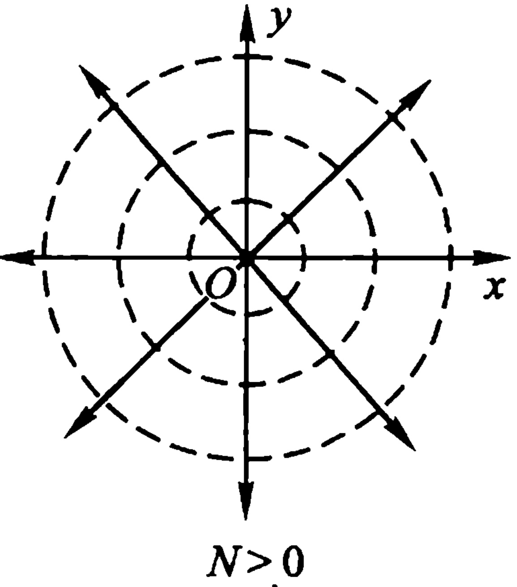

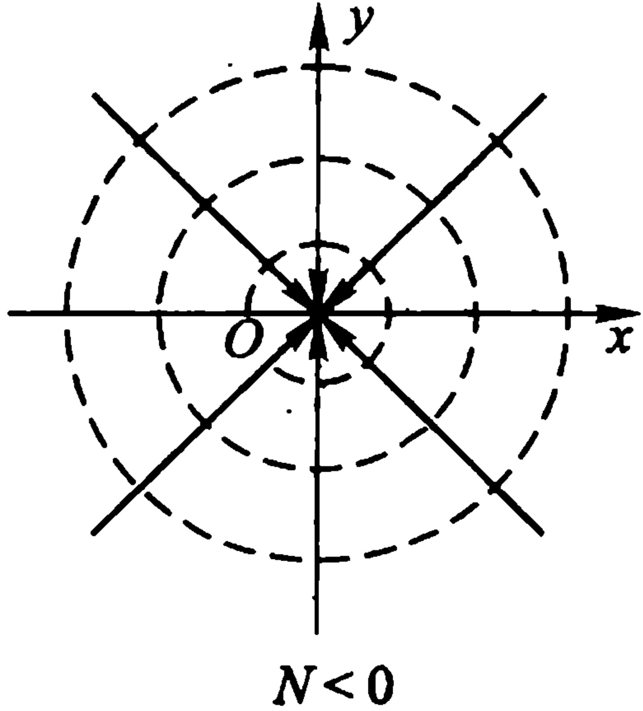

图5.4
 

故势线是同心圆周 r = 常数，流线是过原点的射线  $ \theta = $ 常数，

且此流动的复速度  $ \overline{v(z)} = f'(z) = \frac{N}{2\pi z} $，

以 z = 0 为一阶极点，以  $ z = \infty $ 为一阶零点（只要令  $ v(\infty) = 0 $）。

例 5.20 考查复势  $ f(z)=\frac{1}{z} $ 的流动情况：

解 我们首先指出,  $ \frac{1}{z} $ 以 z=0 为一阶极点, 以  $ z=\infty $ 为可去奇点 (一阶零点, 只要令  $ f(\infty)=0 $), 它在  $ 0<|z|<+\infty $ 内是无源 (漏) 并且是无旋的.

其次，容易算得势函数及流函数分别为

 $$ \varphi\left(x,y\right)=\frac{x}{x^{2}+y^{2}},\psi\left(x,y\right)=\frac{-y}{x^{2}+y^{2}}, $$ 

故势线及流线是经过原点，且互为正交的圆周（图 5.5）.

设 C 是不过原点但包围原点的周线，则

<!-- page: 230 -->

$$ \begin{aligned}\Gamma_{c}+\mathrm{i}N_{c}&=\int_{c}f^{\prime}(z)\mathrm{d}z\\&=-\int_{c}\frac{\mathrm{d}z}{z^{2}}=0.\end{aligned} $$ 

这种流动，可以想像为 $ \uwave{\text{在原点处}} $有充分多的流体以无限大的速度涌出，同时又以无限大的速度被漏掉.原点称为重源或称为偶极子，它是强度相同的一个源及一个漏无限接近而它们的强度无限增大时的极限情形.

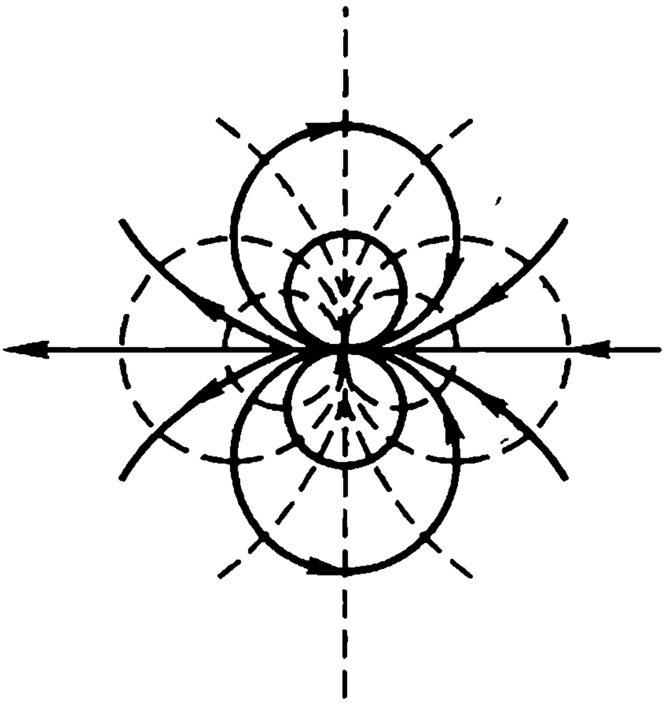

图5.5
 

2. 在电场中的应用举例 在平面电场中，电通  $ \varphi $ 和电位  $ \psi $ 都是调和函数，即它们都满足拉普拉斯方程，而且电力线（相当于势线） $ \varphi = k_{1} $ 和等位线（相当于流线） $ \psi = k_{2} $ 互相正交。这种性质正好和一个解析函数的实部和虚部所具有的性质相符合。因此，在研究平面电场时，常将电场的电通  $ \varphi $（相当于势函数）和电位  $ \psi $（相当于流函数）分别看作一个解析函数的实部和虚部，而将它们合为一个解析函数进行研究。这种由电通作实部，电位作虚部组成的解析函数

 $$ f(z)=\varphi(x,y)+\mathrm{i}\psi(x,y) $$ 

称为电场的复电位(相当于复势).

如果不是利用解析函数作为研究电场的工具，则研究电场的电通和电位是孤立进行的，看不出它们之间的联系，在研究过程中也无一定的方法可循。如果使用解析函数，则这些缺点都可以克服，而且计算起来亦较简单。反过来，如果知道了一个平面电场的复电位，则通过对复电位的实部和虚部的研究，便可得出电场的分布情况。

注 静电场的势函数一定是单值函数.

例 5.21 已知一电场的电力线方程为

 $$ \arctan\frac{y}{x+b}-\arctan\frac{y}{x-b}=k_{1}, $$

<!-- page: 231 -->

试求其等位线方程和复电位.

解 设复电位  $ f(z)=\varphi+i\psi $，则

 $$ \varphi(x,y)=\arctan\frac{y}{x+b}-\arctan\frac{y}{x-b}. $$ 

根据 C.-R. 方程，

 $$ \psi_{y}=\varphi_{x}=\frac{-y}{(x+b)^{2}+y^{2}}+\frac{y}{(x-b)^{2}+y^{2}}. $$ 

两边对 y 积分，得

 $$ \begin{align*}\psi\left(x,y\right)&=\int\left[\frac{y}{\left(x-b\right)^{2}+y^{2}}-\frac{y}{\left(x+b\right)^{2}+y^{2}}\right]\mathrm{d}y.\\&=\frac{1}{2}\ln\left[\left(x-b\right)^{2}+y^{2}\right]-\frac{1}{2}\ln\left[\left(x+b\right)^{2}+y^{2}\right]+\lambda\left(x\right).\end{align*} $$ 

又  $ \psi_{x} = -\varphi_{y} $,

而

 $$ \psi_{x}=\frac{x-b}{\left(x-b\right)^{2}+y^{2}}-\frac{x+b}{\left(x+b\right)^{2}+y^{2}}+\lambda^{\prime}\left(x\right), $$ 

 $$ \varphi_{y}=\frac{x+b}{\left(x+b\right)^{2}+y^{2}}-\frac{x-b}{\left(x-b\right)^{2}+y^{2}}, $$ 

故  $ \lambda'(x)=0 $，即  $ \lambda(x)=\lambda $ 为一常数。于是得等位线方程为

 $$ \frac{1}{2}\ln\left[(x-b)^{2}+y^{2}\right]-\frac{1}{2}\ln\left[(x+\bar{b})^{2}+y^{2}\right]+\lambda=\lambda_{1}, $$ 

或

 $$ \ln\sqrt{\frac{(x-b)^2+y^2}{(x+b)^2+y^2}}=k_2\quad(k_2=\lambda_1-\lambda). $$ 

复电位为

 $$ \begin{array}{l}f(z)=\left(\operatorname{a r c}\tan\frac{y}{x+b}-\arctan\frac{y}{x-b}\right)\\ \quad+\mathrm{i}\ln\sqrt{\frac{(x-b)^2+y^2}{(x+b)^2+y^2}},\end{array} $$ 

或

 $$ f(z)=\mathrm{i}\ln\left(\frac{z-b}{z+b}\right). $$ 

这是双曲线传输线所产生的电场(图 5.6).  $ f(z) $ 的支点 - b 及 + b 就是这个电场的正、负电荷位置.

<!-- page: 232 -->

通过上面的讨论，我们知道，利用解析函数对电场进行研究是十分理想的，它可将对电场的电位和电通的研究联系起来，克服了分别研究的复杂手续，而且使问题得到了简化。但找出这样的解析函数是极不容易的。因此，一般是将问题反转过来，不是根据电场去找解析函数，而是先研究一些不同的解析函数，找出它们所表示的电场图形，再由这些电场的图形，推出带电导体的形状。如此积累了一些电场图形与解析函数之间的关系，再由这些已知的关系，推出新电场的复电位函数。即使现有导体的形状为已知的关系所不具备，也可选用近似的形状，把所得的解析函数用于现有的情况，较无根据的猜测，总要好些。下面就介绍一个由解析函数所表示的电场。

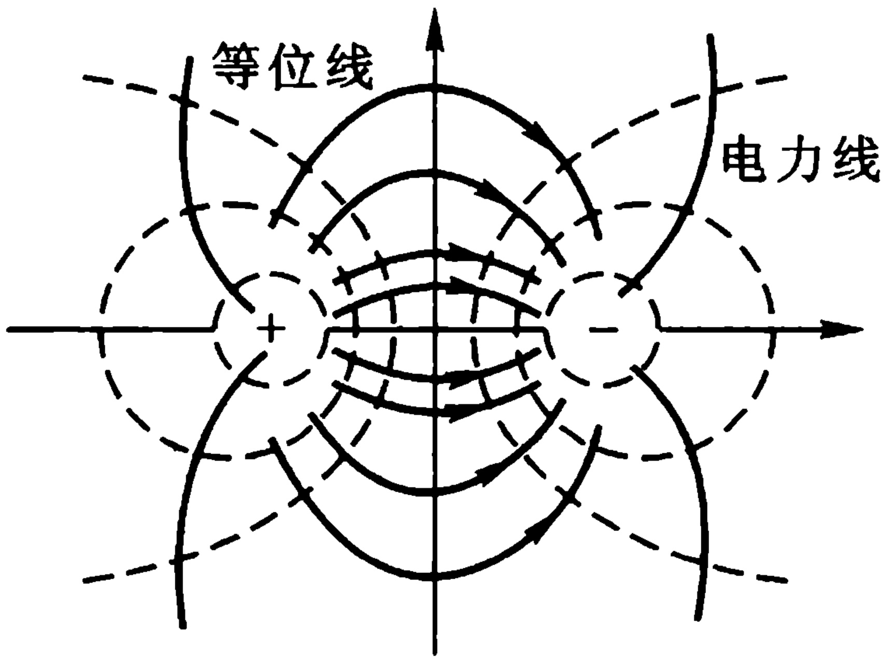

图5.6
 

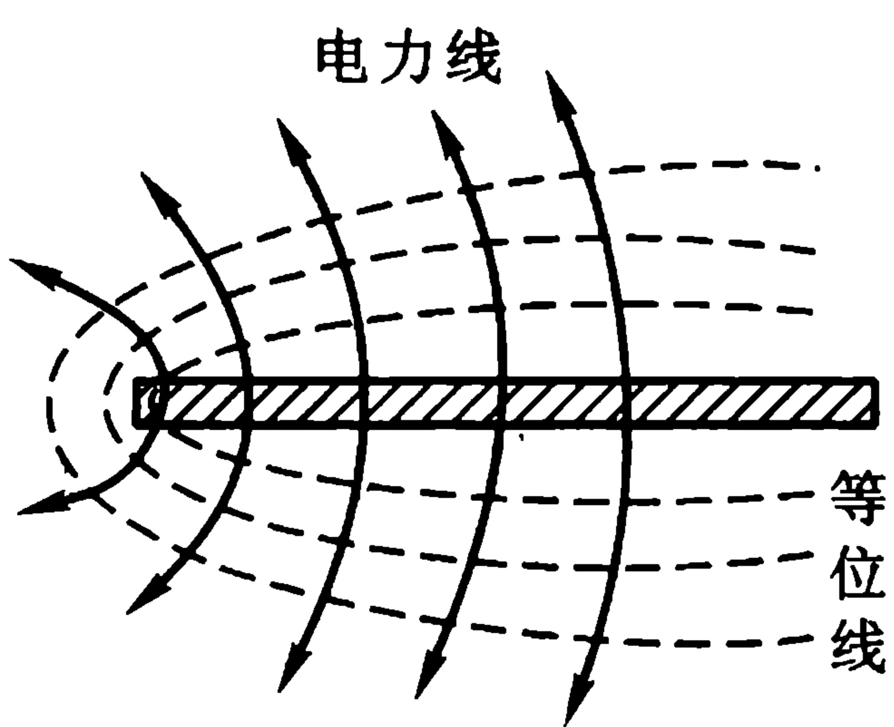

图5.7
 

例 5.22 求由  $ f(z)=z^{\frac{1}{2}} $ 所表现的电场.

解 设  $ f(z) = u + iv $,

则

 $$ (u+\mathrm{i}v)^{2}=x+\mathrm{i}y. $$ 

故

 $$ u^{2}-v^{2}=x,2uv=y. $$ 

解两式得

 $$ y^{2}=4u^{2}\left(u^{2}-x\right), $$ 

或

 $$ y^{2}=4v^{2}\left(v^{2}+x\right). $$ 

令  $ u = k_{1} $，得电力线方程为

<!-- page: 233 -->

$$ y^{2}=4k_{1}^{2}(k_{1}^{2}-x), $$ 

即  $ y^{2} = -2p(x - a) $ (这里  $ p = 2k_{1}^{2} $,  $ a = k_{1}^{2} $), 这是抛物线.

令  $ v = k_{2} $，得等位线方程为

 $$ y^{2}=4k_{2}^{2}(k_{2}^{2}+x), $$ 

即  $ y^{2}=2p(x+a) $ (这里  $ p=2k_{2}^{2}, a=k_{2}^{2} $),

这也是抛物线.

## 第五章 习题

(一)

1 将下列各函数在指定圆环内展为洛朗级数.

(1)  $ \frac{z+1}{z^{2}(z-1)},0<|z|<1;1<|z|<+\infty $

答:1)  $ \frac{z+1}{z^{2}(z-1)} = -\frac{1}{z^{2}} - 2 \sum_{n=0}^{\infty} z^{n-1}, (0 < |z| < 1) $;

2)

 $$ \frac{z+1}{z^{2}(z-1)}=\frac{1}{z^{2}}+2\sum_{n=0}^{\infty}\frac{1}{z^{n+3}},(1<|z|<+\infty). $$ 

(2) $ \frac{z^{2}-2z+5}{(z-2)(z^{2}+1)},1<|z|<2. $

答: 原式 = 2  $ \sum_{n=1}^{\infty}(-1)^{n}\frac{1}{z^{2n}}-\sum_{n=0}^{\infty}\frac{z^{n}}{2^{n+1}} $.

(3) $ \frac{e^{z}}{z(z^{2}+1)},0<|z|<1 $, 只要含 $ \frac{1}{z} $到 $ z^{2} $各项.

答: 原式  $ =\frac{1}{z}+1-\frac{z}{2}-\frac{5}{6}z^{2}+\cdots $

2 将下列各函数在指定点的去心邻域内展成洛朗级数，并指出其收敛范围.

(1) $ \frac{1}{(z^{2}+1)^{2}},z=i. $

<!-- page: 234 -->

答: 原式 =  $ \sum_{n=0}^{\infty}(-1)^{n}(n+1)\frac{(z-i)^{n-2}}{(2i)^{n+2}}\quad(0<|z-i|<2) $.

(2） $ z^{2}e^{\frac{1}{z}}, z=0 $ 及  $ z=\infty $

答： $ z^{2}e^{\frac{1}{z}}=\sum_{n=-2}^{\infty}\frac{1}{(n+2)!}\cdot\frac{1}{z^{n}}\quad(0<|z|<+\infty) $.

 $ (0<|z|<+\infty $既是z=0的去心邻域，又是以z=0为中心 $ z=\infty $的去心邻域.)

(3)  $ e^{\frac{1}{1-x}}, z = 1 $ 及  $ z = \infty $.

 $$ \mathrm{e}^{\frac{1}{1-z}}=\sum_{n=0}^{\infty}\frac{(-1)^{n}}{n!}\frac{1}{(z-1)^{n}}\quad(0<|z-1|<+\infty); $$ 

 $ (0<|z-1|<+\infty $既是z=1的去心邻域,又是以z=1为中心点 $ \infty $的去心邻域.)

 $$ \mathrm{e}^{\frac{1}{1-z}}=1-\frac{1}{z}-\frac{1}{2}\frac{1}{z^{2}}-\frac{1}{6}\frac{1}{z^{3}}-\cdots\quad\left(1<|z|<+\infty\right). $$ 

 $ (1<|z|<+\infty $ 是以 z=0 为中心  $ z=\infty $ 的去心邻域.)

3 试证

 $$ \sin\left[t\left(z+\frac{1}{z}\right)\right]=c_{0}+\sum_{n=1}^{\infty}c_{n}\left(z^{n}+z^{-n}\right),0<|z|<+\infty $$ 

其中 t 为与 z 无关的实参数，

 $$ \begin{array}{c}c_{n}=\frac{1}{2\pi}\int_{0}^{2\pi}\sin\left(2t\cos\theta\right)\cos n\theta\mathrm{d}\theta,\ $ n=0,1,2,\cdots).\end{array} $$ 

4 求出下列函数的奇点，并确定它们的类别（对于极点，要指出它们的

阶），对于无穷远点也要加以讨论.

(1) $ \frac{z-1}{z(z^{2}+4)^{2}} $

答: z=0 为一阶极点,  $ z=\pm2i $ 为二阶极点,  $ z=\infty $ 为可去奇点.

(2) $ \frac{1}{\sin z+\cos z} $

答:  $ z = k\pi - \frac{\pi}{4} $ ( $ k = 0, \pm 1, \cdots $) 各为一阶极点,  $ z = \infty $ 为非孤立奇点.

(3) $ \frac{1-\mathrm{e}^{z}}{1+\mathrm{e}^{z}} $

答:  $ z = (2k + 1)\pi i (k = 0, \pm 1, \cdots) $ 各为一阶极点,  $ z = \infty $ 为非孤立奇点.

<!-- page: 235 -->

(4) $ \frac{1}{(z^{2}+i)^{3}}. $

答:  $ z = \pm \frac{\sqrt{2}}{2} (1 - i) $ 各为三阶极点,  $ z = \infty $ 为可去奇点.

(5)  $ \tan^{2} z $.

答:  $ z = \left( k + \frac{1}{2} \right) \pi $ （ $ k = 0, \pm 1, \cdots $）各为二阶极点,  $ z = \infty $ 为非孤立奇点.

(6)  $ \cos\frac{1}{z+i} $

答: z = -i 为本质奇点, z =  $ \infty $ 为可去奇点.

(7)  $ \frac{1 - \cos z}{z^2} $.

答: z=0 为可去奇点,  $ z=\infty $ 为本质奇点.

(8) $ \frac{1}{e^{z}-1} $

答:  $ z = 2k\pi i (k = 0, \pm 1, \cdots) $ 各为一阶极点,  $ z = \infty $ 为非孤立奇点.

5 下列函数在指定点的去心邻域内能否展为洛朗级数.

(1)  $ \cos \frac{1}{z}, z = 0 $; (2)  $ \cos \frac{1}{z}, z = \infty $;

(3) $ \frac{1}{\sin\frac{1}{z}},z=0; $ (4) $ \cot z,z=\infty $

答:(1) 能；(2) 能；(3) 否；(4) 否.

6 函数  $ f(z) $,  $ g(z) $ 分别以 z = a 为 m 阶极点及 n 阶极点. 试问 z = a 为  $ f(z) + g(z) $,  $ f(z)g(z) $ 及  $ f(z)/g(z) $ 的什么点?

7 设函数  $ f(z) $ 不恒为零且以 z = a 为解析点或极点，而函数  $ \varphi(z) $ 以 z = a 为本质奇点，试证 z = a 是  $ \varphi(z) \pm f(z) $， $ \varphi(z) \cdot f(z) $ 及  $ \varphi(z)/f(z) $ 的本质奇点.

8 判定下列函数的奇点及其类别（包括无穷远点）.

(1) $ \frac{1}{e^{2}-1}-\frac{1}{z} $

答: z=0 为可去奇点;  $ z=2k\pi i(k=\pm1,\pm2,\cdots) $ 各为一阶极点;

 $ z = \infty $ 为非孤立奇点.

<!-- page: 236 -->

(2)  $ e^{x-\frac{1}{x}} $

答: z=0 及  $ z=\infty $ 为本质奇点.

(3)  $ \sin \frac{1}{z} + \frac{1}{z^2} $.

答: z=0 为本质奇点;  $ z=\infty $ 为一阶零点（可去奇点）.

(4)  $ \mathrm{e}^{z}\cos\frac{1}{z} $

答：z=0 及 z= $ \infty $ 为本质奇点.

(5) $ \frac{e^{\frac{1}{x-1}}}{e^{x}-1} $

答: z=1 为本质奇点;  $ z=2k\pi i(k=0,\pm1,\pm2\cdots) $ 各为一阶极点; z= $ \infty $ 为非孤立奇点.

9 试证: 在扩充 z 平面上解析的函数  $ f(z) $ 必为常数(刘维尔定理).

10 刘维尔定理的几何意义是“非常数整函数的值不能全含于一圆之内”，试证明：非常数整函数的值不能全含于一圆之外。

11 设幂级数  $ f(z)=\sum_{n=0}^{\infty}a_{n}z^{n} $ 所表示的和函数  $ f(z) $ 在其收敛圆周上只有惟一的一阶极点  $ z_{0} $. 试证： $ \frac{a_{n}}{a_{n+1}}\rightarrow z_{0} $，因而  $ \left|\frac{a_{n}}{a_{n+1}}\right|\rightarrow|z_{0}|\left(|z_{0}|=r\right. $ 是收敛半径).

## (二)

1 下列多值函数在指定点的去心邻域内能否有分支可展成洛朗级数.

(1) $ \sqrt{z}, z=0; $

(2)  $ \sqrt{z(z-2)} $, z=1;

(3)  $ \sqrt{\frac{z}{(z-1)(z-2)}}, z = \infty $;

(4) Ln  $ \frac{1}{z-1} $, z= $ \infty $;

(5)  $ \ln\frac{(z-1)(z-3)}{(z-2)(z-4)},z=\infty $.

答:(1) 否;(2) 能;(3) 否;

（4）否；（5）能.

<!-- page: 237 -->

### 2 函数

 $$ f(z)=\frac{1}{z(z-1)^{2}} $$ 

在 z=1 处有一个二阶极点；这个函数又有下列洛朗展式：

 $$ \frac{1}{z\left(z-1\right)^{2}}=\frac{1}{\left(z-1\right)^{3}}-\frac{1}{\left(z-1\right)^{4}}+\frac{1}{\left(z-1\right)^{5}}+\cdots, $$ 

 $$ (1<|z-1|<+\infty) $$ 

于是就说“z=1 又是  $ f(z) $ 的本质奇点”. 这个说法对吗？

3 设函数  $ f(z) $ 在点 a 解析,试证函数

 $$ g(z)=\left\{\begin{matrix}{\frac{f(z)-f(a)}{z-a},}&{z\neq a,}\\ {f^{\prime}(a),}&{z=a,}\\ \end{matrix}\right. $$ 

在点 a 也解析.

4 设  $ f(z) $ 为整函数, 试证

 $$ \mathbf{g}\left(z\right)=\left\{\begin{matrix}{\frac{f\left(z\right)-f\left(0\right)}{z},}&{z\neq0,}\\ {f^{\prime}\left(0\right),}&{z=0,}\\ \end{matrix}\right. $$ 

也是一个整函数.

5 试证: 若 a 为  $ f(z) $ 的单值性孤立奇点, 则 a 为  $ f(z) $ 的 m 阶极点的充要条件是

 $$ \lim_{z\to a}(z-a)^{m} f(z)=\alpha(\neq0,\infty), $$ 

其中 m 是正整数.

6 若 a 为  $ f(z) $ 的单值性孤立奇点， $ (z-a)^{k}f(z) $ ( $ k $ 为正整数) 在点 a 的去心邻域内有界。试证：a 是  $ f(z) $ 的不高于 k 阶的极点或可去奇点。

7 考查函数

 $$ f(z)=\sin\left(\frac{1}{\sin\frac{1}{z}}\right) $$ 

的奇点类型.

8 试证: 在扩充 z 平面上只有一个一阶极点的解析函数  $ f(z) $ 必有如下形式:

 $$ f(z)=\frac{az+b}{cz+d},ad-bc\neq0. $$ 

9（含点00的区域的车辆面积分定理）设 C 是一条周线，区域 D 是 C 的

<!-- page: 238 -->

外部(含点 $ \infty $),  $ f(z) $在D内解析且连续到C;又设

 $$ \lim_{z\to\infty}f(z)=c_{0}\neq\infty, $$ 

则

 $$ \frac{1}{2\pi\mathrm{i}}\int_{c^{-}}f(z)\mathrm{d}z=-c_{-1}, $$ 

这里  $ c_{0} $ 及 c_{-1} $ 是  $ f(z) $ 在无穷远点去心邻域内的洛朗展式的系数. 试证之.

提示 设 R 充分大, 使 C 及其内部全含于圆周  $ \Gamma: |z| = R $ 的内部(图 5.8). 其次, 证明

 $$ \frac{1}{2\pi\mathrm{i}}\int_{\Gamma^{-}}f(z)\mathrm{d}z=-c_{-1}. $$ 

再应用复周线的柯西积分定理,就会得证.

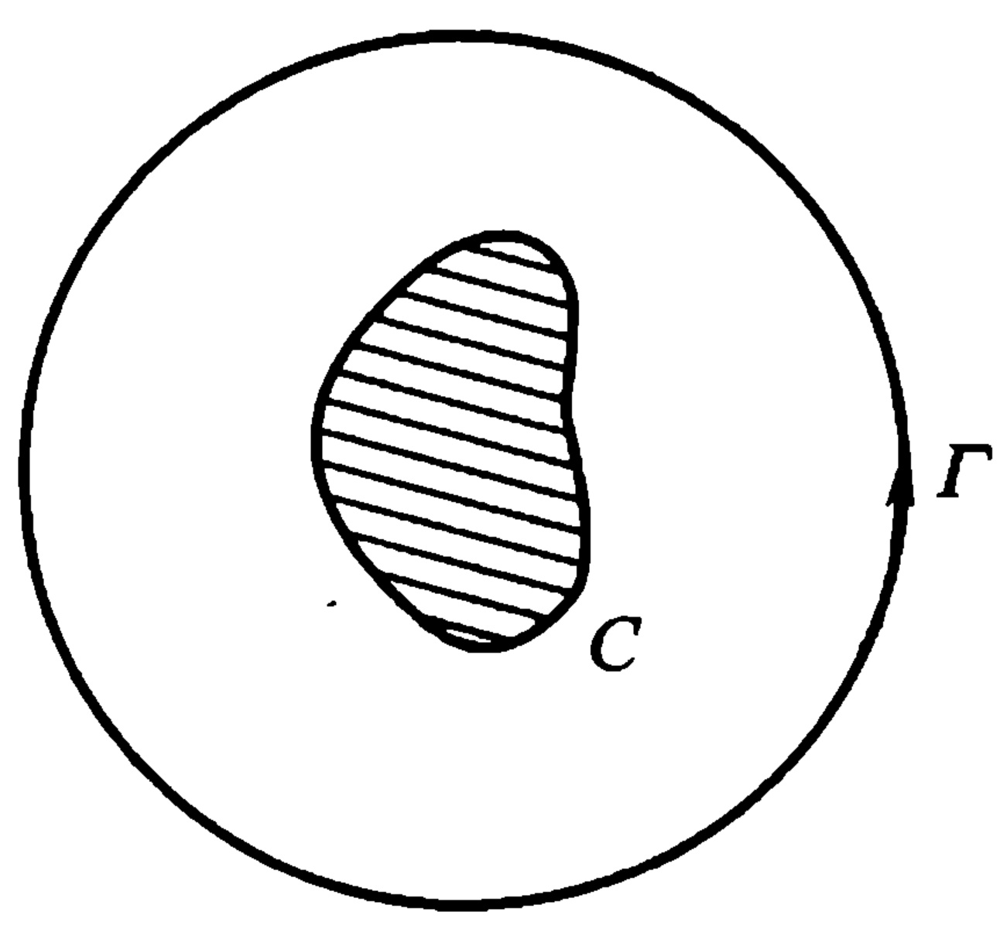

图5.8
 

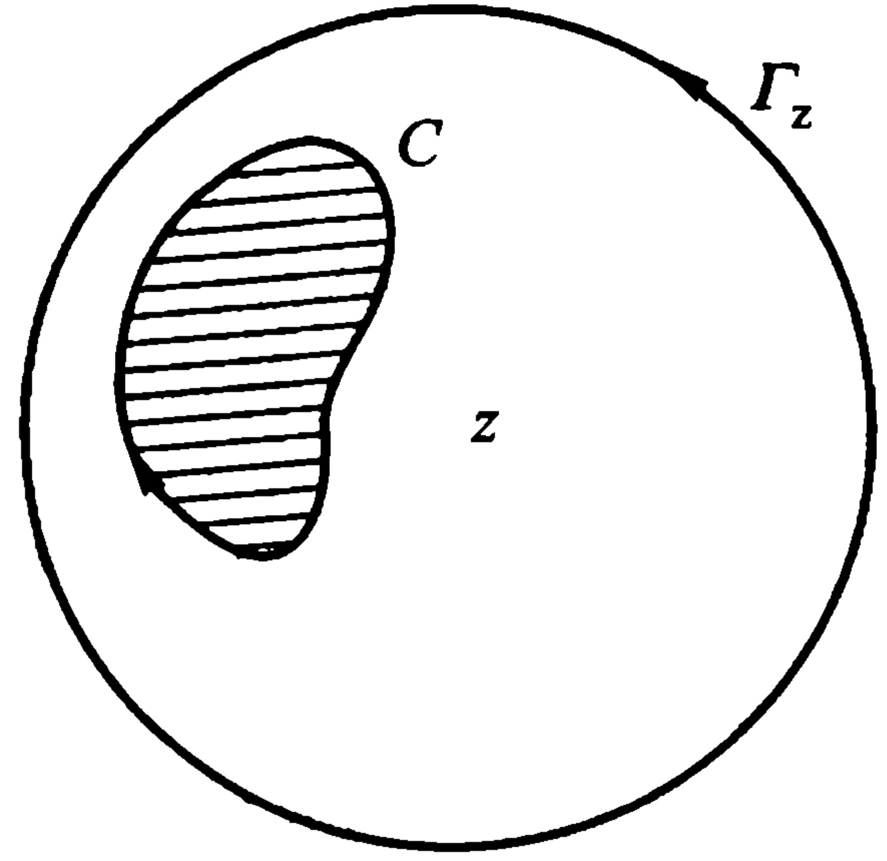

图5.9
 

10 （含点 $ \infty $的区域的柯西积分公式）假设条件同前题，则

 $$ \frac{1}{2\pi\mathrm{i}}\int_{c^{-}}\frac{f(\zeta)}{\zeta-z}\mathrm{d}\zeta=\left\{\begin{aligned}&f(z)-f(\infty),&&z\in D,\\ &0-f(\infty),&&z\notin\overline{D}.\end{aligned}\right. $$ 

这里  $ C^{-} $表示的方向,含点  $ \infty $ 的区域 D 恰在一人沿它前进的左方.

提示 例如就定点  $ z \in D $ 来说，以 z 为心作充分大圆周  $ \Gamma_{z} $，使 C 及其内部全含于  $ \Gamma_{z} $ 内部（如图 5.9）.  $ L = \Gamma_{z} + C^{-} $ 构成一复周线。则应用有界区域的柯西积分公式

 $$ \frac{1}{2\pi\mathrm{i}}\int_{L}\frac{f(\boldsymbol{\zeta})}{\zeta-z}\mathrm{d}\zeta=f(z). $$ 

再进一步由  $ f(\zeta) $ 在  $ R<|\zeta-z|<+\infty $ 内的洛朗展式可以证明

<!-- page: 239 -->

$$ \frac{1}{2\pi\mathrm{i}}\int_{r_{z}}\frac{f(\zeta)}{\zeta-z}\mathrm{d}\zeta=f(\infty). $$ 

( $ R<|\zeta-z|<+\infty $ 就是以 z 为中心的点  $ \infty $ 的去心邻域.)

11 应用上题公式计算积分

 $$ I=\frac{1}{2\pi\mathrm{i}}\int_{|z|=99}\frac{\mathrm{d}z}{(z-2)(z-4)(z-6)\cdots(z-98)(z-100)}. $$ 

答:  $ I = -\frac{1}{\prod_{k=1}^{49}(100 - 2k)} = -\frac{1}{98!!} $.

注 第9、10两题中的区域 D 和边界 C 可代以更一般的形式: 设 D 是扩充 z 平面上包含点  $ \infty $ 的区域, 其边界 C 由有限条互不包含且互不相交的周线  $ C_{1}, C_{2}, \cdots, C_{m} $ 组成, 即

 $$ C=C_{1}+C_{2}+\cdots+C_{m}. $$ 

12 设解析函数  $ f(z) $ 在扩充 z 平面上只有孤立奇点，则奇点的个数必为有限个.试证之.

13 求在扩充 z 平面上只有 n 个一阶极点的解析函数的一般形式.

14 设(1)C 是一条周线， $ f(z) $ 在 C 的内部是亚纯的，且连续到 C；

(2)  $ f(z) $ 沿 C 不为零，

则(试证)函数  $ f(z) $ 在 C 的内部至多只有有限个零点和极点.

15 在施瓦茨引理的假设条件下,如果原点是  $ f(z) $ 的  $ \lambda $ 阶零点,求证

 $$ \left|\frac{f^{\lambda}(0)}{\lambda!}\right|\leqslant1. $$ 

要想这里的等号成立，必需  $ f(z)=\mathrm{e}^{\mathrm{i}\alpha}z^{\lambda} $ ( $ \alpha $ 为实数， $ |z|<1 $).

16 若  $ f(z) $ 在圆  $ \left|z\right| < R $ 内解析， $ f(0) = 0 $， $ \left|f(z)\right| \leq M < +\infty $，则 (1)  $ \left|f(z)\right| \leq \frac{M}{R}\left|z\right| $， $ \left|z\right| < R $，且有  $ \left|f'(0)\right| \leq \frac{M}{R} $；(2) 若在圆内有一点  $ z (0 < \left|z\right| < R) $ 使

 $$ \mid f(z)\mid=\frac{M}{R}\mid z\mid, $$ 

就有

 $ f(z)=\frac{M}{R}\mathrm{e}^{\mathrm{i}\alpha}z $ （ $ \alpha $ 为实数， $ |z|<R $）.

注 （1）当 R=1, M=1 时, 本题就是我们前面证明过的施瓦茨引理, 故本题为其更一般的形式.

（2）本题的结果也有如下一个简单改进：我们保留本题的假设条件不

<!-- page: 240 -->

变，如果 z=0 是  $ f(z) $ 的  $ \lambda $ 阶零点，则

 $$ \left|f(z)\right|\leqslant\frac{M}{R}\mid z\mid^{\lambda}(\mid z\mid<R), 且有 \left|\frac{f^{(\lambda)}(0)}{\lambda!}\right|\leqslant\frac{M}{R}. $$ 

如果这些关系中，有一个取等号，这只有

 $$ f\left(z\right)=\frac{M}{R}\mathrm{e}^{\mathrm{i}\alpha}z^{\lambda}\left(\alpha 为实数 ,\mid z\mid<R\right). $$ 

（当  $ \lambda = 1 $ 时，这些就是本题的结果。）

