# 06-第六章 留数理论及其应用

[返回全书目录](../../README.md)

> PDF 页码：241–292

<!-- page: 241 -->

## 第六章 留数理论及其应用

这一章是第三章柯西积分理论的继续. 中间插入的泰勒级数和洛朗级数是研究解析函数的有力工具. 留数在复变函数论本身及实际应用中都是很重要的, 它和计算周线积分(或归结为考察周线积分)的问题有密切关系. 此外应用留数理论, 我们已有条件去解决“大范围”的积分计算问题, 还可以考察区域内函数的零点分布状况.

‖◆‖‖◆‖‖‖◆‖‖‖‖◆‖‖‖‖‖◆‖‖‖‖‖◆‖‖‖‖‖◆‖‖‖‖‖◆‖‖‖‖‖◆‖‖‖‖‖◆

#### §1. 留数

1. 留数的定义及留数定理 如果函数  $ f(z) $ 在点 a 是解析的，周线 C 全在点 a 的某邻域内，并包围点 a，则根据柯西积分定理

 $$ \int_{c}\dot{f}(z)\mathrm{d}z=0. $$ 

但是，如果 a 是  $ f(z) $ 的一个孤立奇点，且周线 C 全在 a 的某个去心邻域内，并包围点 a，则积分…

 $$ \int_{c}f(z)\mathrm{d}z $$ 

的值，一般说来，不再为零。并且利用洛朗系数公式很容易计算出它的值来。概括起来，我们有

定义 6.1 设函数  $ f(z) $ 以有限点  $ a $ 为孤立奇点，即  $ f(z) $ 在

<!-- page: 242 -->

点 a 的某去心邻域  $ 0<|z-a|<R $ 内解析,则称积分

 $$ \frac{1}{2\pi\mathrm{i}}\int_{\mathbf{r}}f(z)\mathrm{d}z(\stackrel{\cdot}{\boldsymbol{\Gamma}}\colon|\boldsymbol{z}-\boldsymbol{a}|=\rho,0<\rho<R) $$ 

为  $ f(z) $ 在点 a 的留数 (residue)，记为  $ \mathrm{Res}f(z) $.

 $$ z=a $$ 

由柯西积分定理 3.10 知道，当  $ 0 < \rho < R $，留数的值与  $ \rho $ 无关，利用洛朗系数公式 (5.5) 有

 $$ \begin{array}{c}{\frac{1}{2\pi\mathrm{i}}\displaystyle\int_{r}f(z)\mathrm{d}z=c_{-1},}\\ {\mathrm{R e s}f(z)=c_{-1}.}\\ {z=a}\end{array} $$ 

即

这里  $ c_{-1} $ 是  $ f(z) $ 在 z = a 处的洛朗展式中  $ \frac{1}{z - a} $ 这一项的系数.

“由此可知，函数在有限可去奇点处的留数为零.

定理6.1 (柯西留数定理)  $ f(z) $ 在周线或复周线 C 所范围的区域内，除  $ a_{1}, a_{2}, \cdots, a_{n} $ 外解析，在闭域  $ \overline{D} = D + C $ 上除  $ a_{1}, a_{2}, \cdots, a_{n} $ 外连续，则（“大范围”积分）

$$  \int_{C}f(z)\mathrm{d}z=2\pi\mathrm{i}\sum_{k=1}^{n}\operatorname{R e s}_{z=a_{k}}f(z).   \tag*{(6.2)}$$

证 以  $ a_{k} $ 为心，充分小的正数  $ \rho_{k} $ 为半径画圆周  $ \Gamma_{k}: |z - a_{k}| = \rho_{k}(k = 1, 2, \cdots, n) $，使这些圆周及其内部均含于 D，并且彼此互。相隔离（图 6.1）。应用复周线的柯西积分定理 3.10 得

 $$ \int_{C}f(z)\mathrm{d}z=\sum_{k=1}^{n}\int_{R_{k}}f(z)\mathrm{d}z. $$ 

由留数的定义，有

 $$ \int_{\Gamma_{k}}f(z)\mathrm{d}z=2\pi\mathrm{i}\operatorname*{R e s}_{z=a_{k}}f(z). $$ 

代入上式，即知(6.2)为真.

（思考题 试说明柯西积分定理 3.10 与柯西积分公式都是柯西留数定理的特殊情形.

留数定理把计算周线积分的整体问题，化为计算各孤立奇点

<!-- page: 243 -->

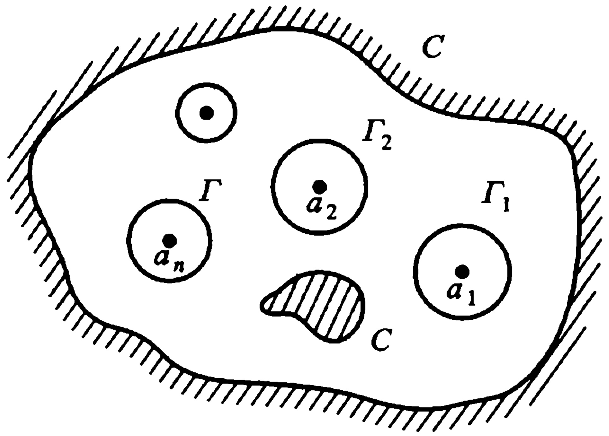

图 6.1
 

处留数的局部问题.

2. 留数的求法 为了应用留数定理求周线积分，首先应该掌握求留数的方法.而计算在孤立奇点 a 的留数时，我们只关心其

洛朗展式中的  $ \frac{1}{z - a} $ 这一项的系数，所以应用洛朗展式求留数是一般方法.下面的定理是求 n 阶极点处留数的公式，免得每求一个极点处的留数，都要去求一次洛朗展式.不过这个公式对于阶数过高（例如超过三阶）的极点，计算起来也未必简单.

定理 6.2 设 a 为  $ f(z) $ 的 n 阶极点，

 $$ f(z)=\frac{\varphi(z)}{(z-a)^{n}}, $$ 

其中  $ \varphi(z) $ (由定理 5.4) 在点 a 解析,  $ \varphi(a) \neq 0 $, 则

$$  \operatorname{Res}f(z)=\frac{\varphi^{(n-1)}(a)}{(n-1)!}.   \tag*{(6.3)}$$

这里符号  $ \varphi^{(0)}(a) $ 代表  $ \varphi(a) $，且有  $ \varphi^{(n-1)}(a)=\lim_{z\to a}\varphi^{(n-1)}(z) $.

证

 $$ \mathrm{R e s}_{z=a}f(z)=\frac{1}{2\pi\mathrm{i}}\int_{\Gamma}\frac{\varphi(z)}{\left(z-a\right)^{n}}\mathrm{d}z=\frac{\varphi^{(n-1)}(a)}{\left(n-1\right)!}. $$ 

推论 6.3 设 a 为  $ f(z) $ 的一阶极点，

 $$ \varphi(z)=(z-a)f(z), $$

<!-- page: 244 -->

则

$$  \mathop{\operatorname{R e s f}}_{z=a}(z)=\varphi(a).   \tag*{(6.4)}$$

推论 6.4 设 a 为  $ f(z) $ 的二阶极点，

 $$ \begin{aligned}\varphi(z)&=(z-a)^{2}f(z),\\\mathbf{Res}f(z)&=\varphi^{\prime}(a).\\z&=a\end{aligned} $$ 

则

定理 6.5 设 a 为  $ f(z) = \frac{\varphi(z)}{\psi(z)} $ 的一阶极点 (只要  $ \varphi(z) $ 及  $ \psi(z) $ 在点 a 解析, 且  $ \varphi(a) \neq 0, \psi(a) = 0, \psi'(a) \neq 0. $)，则

 $$ \operatorname{Res}f(z)=\frac{\varphi(a)}{\psi^{\prime}(a)}. $$ 

证 因为 a 为  $ f(z)=\frac{\varphi(z)}{\psi(z)} $ 的一阶极点，故

 $$ \begin{aligned}\operatorname{Res}f(z)&=\lim_{z\to a}\frac{\varphi(z)}{\psi(z)}(z-a)=\lim_{z\to a}\frac{\varphi(z)}{\frac{\psi(z)-\psi(a)}{z-a}}\\&=\frac{\varphi(a)}{\psi^{\prime}(a)}.\end{aligned} $$ 

要熟练掌握应用推论 6.3、推论 6.4 及定理 6.5 来计算函数在一、二阶极点处的留数.

例 6.1 计算积分  $ \int_{|z|=2}\frac{5z-2}{z(z-1)^{2}}\mathrm{d}z $.

解 显然，被积函数  $ f(z)=\frac{5z-2}{z(z-1)^{2}} $ 在圆周  $ \left|z\right|=2 $ 的内部只有一阶极点 z=0 及二阶极点 z=1.

由推论 6.3，

 $$ \operatorname{Res}_{z=0}f(z)=\frac{5z-2}{(z-1)^2}\bigg|_{z=0}=-2; $$ 

由推论 6.4

 $$ \mathrm{R e s}_{z=1}f(z)=\left(\frac{5z-2}{z}\right)^{\prime}\bigg|_{z=1}=\frac{2}{z^{2}}\bigg|_{z=1}=2; $$ 

故由留数定理得.

<!-- page: 245 -->

$$ \int_{|z|=2}\frac{5z-2}{z(z-1)^{2}}\mathrm{d}z=2\pi\mathrm{i}(-2+2)=0. $$ 

例 6.2 计算积分  $ \int_{|z|=n}\tan\pi z dz $ （n 为正整数）.

解  $ \tan \pi z = \frac{\sin \pi z}{\cos \pi z} $ 只以  $ z = k + \frac{1}{2} $， $ (k = 0, \pm 1, \cdots) $ 为一阶极点。由定理 6.5 得

 $$ \begin{aligned}\operatorname{Res}_{\ z=k+\frac{1}{2}}(\tan\pi z)&=\frac{\sin\pi z}{(\cos\pi z)^{\prime}}\Bigg|_{z=k+\frac{1}{2}}=-\frac{1}{\pi}.\ $ k&=0,\pm1,\cdots)\end{aligned} $$ 

于是，由留数定理得

 $$ \begin{aligned}\int_{|z|=n}\tan\pi z\mathrm{d}z&=2\pi\mathrm{i}\sum_{k+\frac{1}{2}<n}\operatorname{Res}(\tan\pi z)\\&=2\pi\mathrm{i}\left(-\frac{2n}{\pi}\right)=-4n\mathrm{i}.\end{aligned} $$ 

例 6.3 计算积分  $ \int_{|z|=1}\frac{\cos z}{z^{3}}dz $.

解  $ f(z)=\frac{\cos z}{z^{3}} $ 只以 z=0 为三阶极点. 由定理 6.2 得

 $$ \mathbf{Res}_{z=0}f(z)=\frac{1}{2!}[\cos z]_{z=0}^{\prime \prime}=-\frac{1}{2}, $$ 

故由留数定理得  $ \int_{|z|=1}\frac{\cos z}{z^{3}}\mathrm{d}z=2\pi\mathrm{i}\left(-\frac{1}{2}\right)=-\pi\mathrm{i} $.

*例 6.4 计算积分  $ \int_{|z|=1}\frac{z\sin z}{(1-\mathrm{e}^{z})^{3}}\mathrm{d}z $.

解法一 被积函数在单位圆周  $ \left|z\right|=1 $ 内部只有 z=0 一个奇点，但其进一步的性质粗略一看还不明显，故我们先采用洛朗展式求留数的一般方法.

 $$ \frac{z\sin z}{\left(1-\mathrm{e}^{z}\right)^{3}}=\frac{z\left(z-\frac{z^{3}}{3!}+\cdots\right)}{-\left(z+\frac{z^{2}}{2!}+\cdots\right)^{3}}=-\frac{z^{2}}{z^{3}}\cdot\frac{\left(1-\frac{z^{2}}{3!}+\cdots\right)}{\left(1+\frac{z}{2!}+\cdots\right)^{3}}, $$

<!-- page: 246 -->

后面那个分式在 z=0 为解析,故可展为 z 的幂级数:

 $$ 1+a_{1}z+\cdots $$ 

(数字  $ a_{1} $ 及以下各项我们不需关心!). 于是在 z=0 的去心邻域内有

 $$ \frac{z\sin z}{(1-\mathrm{e}^{z})^{3}}=-\frac{1}{z}-a_{1}-\cdots, $$ 

由此即得

 $$ \mathrm{Res}_{z=0}\frac{z\sin z}{(1-\mathrm{e}^{z})^{3}}=-1, $$ 

故由留数定理, 原积分等于  $ -2\pi i $.

解法二 仔细分析,我们看出  $ 1 - e^{z} $ 的全部零点为

 $$ z=2k\pi\mathrm{i},k=0,\pm1,\cdots $$ 

只有 z=0 在单位圆周  $ \left|z\right|=1 $ 的内部，它是被积函数分母  $ (1-e^{z})^{3} $ 的三阶零点。又 z=0 显然是被积函数分子  $ z\sin z $ 的二阶零点。所以被积函数

 $$ f(z)=\frac{z\sin z}{\left(1-\mathrm{e}^{z}\right)^{3}} $$ 

在圆周  $ \left|z\right|=1 $ 的内部只有 z=0 一个一阶极点. 这时

 $$ \varphi(z)=z f(z)=\frac{z^{2}\sin z}{(1-\mathrm{e}^{z})^{3}}, $$ 

(注意 因子 z 与  $ f(z) $ 的分母形式上消不掉, 若这时将 z=0 代入, 则成  $ \frac{0}{0} $ 的不定型) 所以

 $$ \begin{array}{l}\operatorname{Res}f(z)=\varphi(0)=\limlimits_{z\to0}\varphi(z)=\lim\limits_{z\to0}\frac{z^2\sin z}{(1-\mathrm{e}^z)^3}\\=\lim\limits_{z\to0}\frac{\sin z}{z}\cdot\frac{z^3}{(1-\mathrm{e}^z)^3}\\=\left(\lim\limits_{z\to0}\frac{z}{1-\mathrm{e}^z}\right)^3=\left(\lim\limits_{z\to0}\frac{1}{-\mathrm{e}^z}\right)^3\\=(-1)^3=-1.\end{array} $$

<!-- page: 247 -->

故由留数定理, 原积分等于  $ -2\pi i $.

例 6.5 计算积分  $ \int_{|z|=1} e^{\frac{1}{z^{2}}} dz $.

解 在单位圆周  $ \left|z\right|=1 $ 的内部，函数  $ e^{\frac{1}{z^{2}}} $ 只有一个本质奇点 z=0. 在该点的去心邻域内有洛朗展式

 $$ \mathrm{e}^{z^{\frac{1}{2}}}=1+\frac{1}{z^{2}}+\frac{1}{2!}\frac{1}{z^{4}}+\cdots, $$ 

于是

 $$ \mathop{\mathrm{R e s}}_{z=0}\mathrm{e}^{\frac{1}{z^{2}}}=0. $$ 

故由留数定理得

 $$ \int_{\{z\mid=1}}\mathrm{e}^{\frac{1}{z^{2}}}\mathrm{d}z=2\pi\mathrm{i}\cdot\underset{z=0}{\mathrm{R e s}}\mathrm{e}^{\frac{1}{z^{2}}}=0. $$ 

3. 函数在无穷远点的留数 留数的概念可以推广到无穷远点的情形.

定义 6.2 设  $ \infty $ 为函数  $ f(z) $ 的一个孤立奇点，即  $ f(z) $ 在去心邻域  $ N - \{\infty\} $:  $ 0 \leq r < |z| < +\infty $ 内解析，则称

 $$ \frac{1}{2\pi\mathrm{i}}\int_{\Gamma^{-}}f(z)\mathrm{d}z,(\Gamma::|z|=\rho>r) $$ 

为 $ f(z) $在点 $ \infty $的留数，记为 $ \mathrm{Res}_{z=\infty}f(z) $，这里 $ \Gamma^{-} $是指顺时针方向（这个方向很自然地可以看作是绕无穷远点的正向）.

设  $ f(z) $ 在  $ 0 \leq r < |z| < +\infty $ 内的洛朗展式为

 $$ f(z)=\cdots+\frac{c_{-i n}}{z^{n}}+\cdots+\frac{c_{-1}}{z}+^{i}c_{0}+c_{1}\stackrel{.}{z}+\cdots+c_{n}z^{n}+\cdots, $$ 

由逐项积分定理及第三章例3.2，即知

$$  \mathrm{R e s}_{z=\infty}f_{i}(z)=\frac{1}{2\pi\mathrm{i}}\int_{\Gamma^{-}}f(z)\mathrm{d}z=-c_{-1},   \tag*{(6.6)}$$

也就是说， $ \mathrm{Res}f(z) $ 等于  $ f(z) $ 在点  $ \infty $ 的洛朗展式中  $ \frac{1}{z} $ 这一项的系数反号.

定理 6.6 如果函数  $ f(z) $ 在扩充 z 平面上只有有限个孤立

<!-- page: 248 -->

奇点（包括无穷远点在内），设为  $ a_{1}, a_{2}, \cdots, a_{n} $;  $ \infty $, 则  $ f(z) $ 在各点的留数总和为零.

证 以原点为心作圆周  $ \Gamma $，使  $ a_{1}, a_{2}, \cdots, a_{n} $ 皆含于  $ \Gamma $ 的内部，则由留数定理得

 $$ \int_{\Gamma}f(z)\mathrm{d}\dot{z}=2\pi\mathrm{i}\sum_{k=1}^{n}\operatorname{R e s}f(\dot{z}), $$ 

两边除以  $ 2\pi i $，并移项即得

 $$ \sum_{k=1}^{n}\mathop{\mathrm{R e s}}_{z=a_{k}}\mathsf{f}(z)+\frac{1}{2\pi\mathrm{i}}\int_{\dot{R}^{-}}f(z)\mathrm{d}z=0, $$ 

亦即

 $$ \sum_{k=1}^{n}\mathop{\mathrm{R e s}}_{z=a_{k}}\mathsf{f}(z)+\mathop{\mathrm{R e s}}_{z=\infty}\mathsf{f}(z)=0. $$ 

要特别注意: 虽然在  $ f(z) $ 的有限可去奇点 a 处, 必有  $ \mathrm{Res}f(z)=0 $, 但是, 如果点  $ \infty $ 为  $ f(z) $ 的可去奇点 (或解析点), 则 z=a

 $ \mathrm{Res}f(z) $ 可以不是零。例如  $ f(z)=2+\frac{1}{z} $ 以  $ z=\infty $ 为可去奇点，但  $ z=\infty $

 $ \mathrm{Res}f(z) = -1 $.

 $ z = \infty $

下面我们引入计算留数 $ Resf(z) $的另一公式.

令

 $$ t=\frac{1}{z}. $$ 

于是

 $$ \varphi\left(t\right)=f\left(\frac{1}{t}\right)=f\left(z\right), $$ 

且 z 平面上无穷远点的去心邻域  $ N - \{\infty\}: 0 \leq r < |z| < +\infty $ 被变成 t 平面上原点的去心邻域  $ K - \{0\}: 0 < |t| < \frac{1}{r} $ (如  $ r = 0 $, 规定  $ \frac{1}{r} = +\infty $); 圆周  $ \Gamma: |z| = \rho > r $ 被变成圆周  $ y: |t| = \lambda = \frac{1}{\rho} < \frac{1}{r} $. 从而易证

 $$ \frac{1}{2\pi i}\int_{F^{-}}f(z)\mathrm{d}z=-\frac{1}{2\pi i}\int_{F}\left(\frac{1}{t}\right)\cdot\frac{1}{t^{2}}\mathrm{d}t. $$

<!-- page: 249 -->

所以，

$$  \mathbf{R e s}_{z=\infty}f(z)=-\mathbf{R e s}_{t=0}\left[f\left(\frac{1}{t}\right)\frac{1}{t^{2}}\right].   \tag*{(6.7)}$$

例 6.6 计算积分

 $$ I=\int_{|z|=4}\frac{z^{15}}{(z^{2}+1)^{2}(z^{4}+2)^{3}}\mathrm{d}z. $$ 

解 被积函数一共有七个奇点:  $ z = \pm i $,  $ z = \sqrt[4]{2} e^{i\frac{\pi + 2k\pi}{4}} $ (k = 0, 1, 2, 3) 以及 z =  $ \infty $. 前六个奇点均含在  $ \left|z\right| = 4 $ 内部.

要计算  $ \left|z\right|=4 $ 内部六个奇点的留数和是十分麻烦的，所以应用上述定理及留数定理得

 $$ I=2\pi\mathrm{i}\left[-\operatorname{Res}_{z=\infty}f(z)\right]. $$ 

由下式可知  $ f(z) $ 在  $ \infty $ 处的洛朗展式中  $ \frac{1}{z} $ 这一项的系数  $ c_{-1} $.

 $$ \begin{aligned}f(z)&=\frac{z^{15}}{\left(z^{2}+1\right)^{2}\left(z^{4}+2\right)^{3}}=\frac{z_{1}^{15}}{z^{16}\left(1+\frac{1}{z^{2}}\right)^{2}\left(1+\frac{2}{z^{4}}\right)^{3}}\\&=\frac{1}{z}\left(1-2\cdot\frac{1}{z^{2}}+\cdots\right)\left(1-3\cdot\frac{2}{z^{4}}+\cdots\right),\end{aligned} $$ 

因此， $ \mathrm{Res}_{z=\infty}f(z)\stackrel{(6.6)}{=} -1 $，故  $ I=2\pi i $。

另外，也可应用公式(6.7).先看

 $$ \begin{aligned}f\left(\frac{1}{t}\right)\frac{1}{t^{2}}&=\frac{\frac{1}{t^{15}}}{\left(\frac{1}{t^{2}}+1\right)^{2}\left(\frac{1}{t^{4}}+2\right)^{3}}\cdot\frac{1}{t^{2}}\\&=\frac{1}{t\left(1+t^{2}\right)^{2}\left(1+2t^{4}\right)^{3}},\end{aligned} $$ 

它以 t=0 为一阶极点. 所以

 $$ \begin{aligned}I&=2\pi\mathrm{i}\left[\begin{array}{c}-\operatorname{Res}\limits_{z=\infty}f(z)\end{array}\right]\xlongequal{(6.7)}2\pi\mathrm{i}\operatorname{Res}\limits_{t=0}\left[\begin{array}{c}f\left(\frac{1}{t}\right)\cdot\frac{1}{t^{2}}\end{array}\right]\\&=2\pi\mathrm{i}.\end{aligned} $$

<!-- page: 250 -->

思考题 试总结计算  $ f(z) $ 的周线积分  $ \int_{c} f(z) dz $ 的种种方法.

#### §2. 用留数定理计算实积分

某些实施的定积分可应用留数定理进行计算，尤其是对原函数不易直接求得的定积分和反常积分，常是一个有效的方法，其要点是将它化归为复变函数的周线积分.

1. 计算  $ \int_{0}^{2\pi} R(\cos\theta,\sin\theta)\mathrm{d}\theta $ 型积分  $ \dot{\cdot} $ 这里  $ R(\cos\theta,\sin\theta) $ 表  $ \cos\theta,\sin\theta $ 的有理函数，并且在  $ [0,2\pi] $ 上连续. 若命  $ z=e^{i\theta} $，则

 $$ \cos\theta=\frac{z+z^{-1}}{2},\sin\theta=\frac{z-z^{-1}}{2i},\mathrm{d}\theta=\frac{\mathrm{d}z}{\mathrm{i}z}, $$ 

当  $ \theta $ 经历变程  $ [0,2\pi] $ 时, z 沿圆周  $ \left|z\right|=1 $ 的正方向绕行一周. 因此有

 $$ \int_{0}^{2\pi}R\left(\cos\theta,\sin\theta\right)\mathrm{d}\theta=\int_{\mid z\mid=1}R\left(\frac{z+z^{-1}}{2},\frac{z-z^{-1}}{2\mathrm{i}}\right)\frac{\mathrm{d}z}{\mathrm{i}z}, $$ 

右端是 z 的有理函数的周线积分，并且积分路径上无奇点，应用留数定理就可求得其值.

注 这里关键一步是引进变数代换  $ z = e^{i\theta} $，至于被积函数  $ R(\cos\theta, \sin\theta) $ 在  $ [0, 2\pi] $ 上的连续性可不必先检验，只要看变换后的被积函数在  $ \left|z\right| = 1 $ 上是否有奇点.

例 6.7 计算积分

 $$ I=\int_{0}^{2\pi}\frac{\mathrm{d}\theta}{1-2\dot{p}\cos\theta+\dot{p}^{2}}(0\leqslant|p|<1). $$ 

解 命  $ z = e^{i\theta} $，则  $ \mathrm{d}\theta = \frac{\mathrm{d}z}{iz} $。当  $ p \neq 0 $ 时，

 $$ 1-2p\cos\theta+p^{2}=1-p(z+z^{-1})+p^{2}=\frac{(z-p)(1-p z)}{z}, $$

<!-- page: 251 -->

这样就有

 $$ I=\frac{1}{\mathrm{i}}\int_{|z|=1}\frac{\mathrm{d}z}{(z-p)(1-p z)}, $$ 

且在圆 $ \left|z\right|<1 $内

 $$ f(z)=\frac{1}{(z-p)(1-p z)}, $$ 

只以 z=p 为一阶极点，在  $ \left|z\right|=1 $ 上无奇点，依公式(6.4)

 $$ \operatorname{Res}f(z)=\frac{1}{1-p z}\bigg|_{z=p}=\frac{1}{1-p^{2}}(0<|p|<1), $$ 

所以，由留数定理得  $ I=\frac{1}{\mathrm{i}}\cdot2\pi\mathrm{i}\cdot\frac{1}{1-p^{2}}=\frac{2\pi}{1-p^{2}}(0\leqslant|p|<1) $.

注 此题在数学分析中可用万能代换的方法求解，比较起来，用复变函数的方法求解要简单得多.

思考题 当  $ |p| > 1 $ 时, 积分

 $$ \int_{0}^{2\pi}\frac{\mathrm{d}\theta}{1-2p\cos\theta+p^{2}} $$ 

之值为何？

例 6.8 计算积分

 $$ I=\int_{0}^{2\pi}\frac{\sin^{2}\theta}{a+b\cos\theta}\mathrm{d}\theta(a>b>0). $$ 

解 命  $ z = e^{i\theta} $，则

 $$ \begin{align*}I&=\int_{|z|=1}\left[\frac{-(z^2-1)^2}{4z^2}\right]\cdot\frac{1}{a+b\left(\frac{z^2+1}{2z}\right)}\cdot\frac{\mathrm{d}z}{\mathrm{i}z}\\&=\frac{\mathrm{i}}{2b}\int_{|z|=1}\frac{(z^2-1)^2}{z^2\left(z^2+\frac{2a}{b}z+1\right)}\mathrm{d}z\\&=\frac{\mathrm{i}}{2b}\int_{|z|=1}\frac{(z^2-1)^2}{z^2(z-a)(z-\beta)}\mathrm{d}z,\end{align*} $$ 

其中

 $$ \alpha=\frac{-a+\sqrt{a^{2}-b^{2}}}{b},\beta=\frac{-a-\sqrt{a^{2}-b^{2}}}{b} $$ 

为实系数二次方程

<!-- page: 252 -->

$$ z^{2}+\frac{2a}{b}z+1=0 $$ 

的两个相异实根. 由根与系数的关系  $ \alpha\beta=1 $，且显然  $ |\beta|>|\alpha| $，故必  $ | \alpha |<1, |\beta|>1 $.

于是，被积函数  $ f(z) $ 在  $ \left|z\right|=1 $ 上无奇点。在单位圆  $ \left|z\right|<1 $ 内只有一个二阶极点 z=0 和一个一阶极点 z= $ \alpha $。由公式 (6.5) 及 (6.4) 得

 $$ \operatorname{Res}f(z)=\left[\frac{(z^2-1)^2}{z^2+\frac{2a}{b}z+1}\right]^{\prime}_z=-\frac{2a}{b}, $$ 

 $$ \begin{aligned}\operatorname{Res}f(z)&=\frac{(z^{2}-1)^{2}}{z^{2}(z-\beta)}\Bigg|_{z=\alpha}=\frac{(a^{2}-1)^{2}}{a^{2}(a-\beta)}=\frac{\left(a-\frac{1}{a}\right)^{2}}{a-\beta}\\&=\frac{(a-\beta)^{2}}{a-\beta}=a-\beta=\frac{2\sqrt{a^{2}-b^{2}}}{b},\end{aligned} $$ 

由留数定理得

 $$ \begin{aligned}I&=\frac{\mathrm{i}}{2b}\cdot2\pi\mathrm{i}\left[-\frac{2a}{b}+\frac{2\sqrt{a^{2}-b^{2}}}{b}\right]\\&=\frac{2\pi}{b^{2}}\left[a-\sqrt{a^{2}-b^{2}}\right].\end{aligned} $$ 

例 6.9 计算积分

 $$ I=\int_{0}^{2\pi}\frac{\mathrm{d}\theta}{1+\cos^{2}\theta}. $$ 

解 命  $ z = e^{i\theta} $，则

 $$ I=\int_{\Gamma:\mid z\mid=1}\frac{4z\mathrm{d}z}{\mathrm{i}\left(z^{4}+6z^{2}+1\right)}, $$ 

又命  $ z^{2}=u $ ，则  $ \frac{4z\mathrm{d}z}{\mathrm{i}(z^{4}+6z^{2}+1)}=\frac{2\mathrm{d}u}{\mathrm{i}(u^{2}+6u+1)} $

当 z 绕  $ \Gamma $ 圆周一周时，u 亦在其上绕二周，故

 $$ I=2\int_{r}\frac{2\mathrm{d}u}{\mathrm{i}(u^{2}+6u+1)}=\frac{4}{\mathrm{i}}\int_{r}\frac{\mathrm{d}u}{u^{2}+6u+1}. $$

<!-- page: 253 -->

被积函数  $ f(u) $ 在  $ \Gamma $ 内部仅有一个一阶极点  $ u = -3 + \sqrt{8} $.

 $$ \mathrm{R e s}_{u=-3+\sqrt{8}}f(u)=\left.\frac{1}{u+3+\sqrt{8}}\right|_{u=-3+\sqrt{8}}=\frac{1}{2\sqrt{8}}=\frac{1}{4\sqrt{2}}. $$ 

所以由留数定理，

 $$ I=\frac{4}{\mathrm{i}}\cdot2\pi\mathrm{i}\cdot\frac{1}{4\sqrt{2}}=\sqrt{2}\pi. $$ 

若  $ R(\cos \theta, \sin \theta) $ 为  $ \theta $ 的偶函数，则  $ \int_{0}^{\pi} R(\cos \theta, \sin \theta) d\theta $ 之值亦可由上述方法求之. 因此时

 $$ \int_{0}^{\pi}R(\cos\theta,\sin\theta)\mathrm{d}\theta=\frac{1}{2}\int_{-\pi}^{\pi}R(\cos\theta,\sin\theta)\mathrm{d}\theta, $$ 

仍命  $ z = e^{i\theta} $，与前同法，我们可将  $ \int_{-\pi}^{\pi} R(\cos\theta, \sin\theta) \, d\theta $ 化为单位圆周  $ \Gamma $ 上的积分.

例 6.10 计算积分

 $$ I=\int_{0}^{\pi}\frac{\cos m x}{5-4\cos x}\mathrm{d}x, $$ 

m 为正整数.

解 因为积分号下的函数为 x 的偶函数，故

 $$ I=\frac{1}{2}\int_{-\pi}^{\pi}\frac{\cos m x}{5-4\cos x}\mathrm{d}x, $$ 

命

 $$ I_{1}=\int_{-\pi}^{\pi}\frac{\cos m x}{5-4\cos x}\mathrm{d}x,\quad I_{2}=\int_{-\pi}^{\pi}\frac{\sin m x}{5-4\cos x}\mathrm{d}x, $$ 

则

 $$ I_{1}+\mathrm{i}I_{2}=\int_{-\pi}^{\pi}\frac{\mathrm{e}^{\mathrm{i}mx}}{5-4\cos x}\mathrm{d}x. $$ 

设  $ z = e^{ix} $，则

 $$ \begin{aligned}I_{1}+\mathrm{i}I_{2}&=\frac{1}{\mathrm{i}}\int_{r}\frac{z^{m}}{5z-2(1+z^{2})}\mathrm{d}z\\&=\frac{\mathrm{i}}{2}\int_{r}\frac{z^{m}}{\left(z-\frac{1}{2}\right)(z-2)}\mathrm{d}z.\end{aligned} $$

<!-- page: 254 -->

在圆周  $ \Gamma $ 内部，积分号下函数  $ f(z) $ 仅有一个一阶极点  $ z=\frac{1}{2} $，于是

 $$ \operatorname{Res}f(z)=\frac{z^m}{z-2}\bigg|_{z=\frac{1}{2}}=-\frac{1}{3(2^{m-1})}, $$ 

故由留数定理，

 $$ I_{1}+\mathrm{i}I_{2}=\left(-\frac{1}{2\mathrm{i}}\right)\cdot2\pi\mathrm{i}\left(-\frac{1}{3(2^{m-1})}\right)=\frac{\pi}{3(2^{m-1})}, $$ 

于是知

 $$ I_{1}=\frac{\pi}{3(2^{m-1})},\quad I_{2}=0, $$ 

所以

 $$ I=\frac{1}{2}I_{1}=\frac{\pi}{3(2^{m})}. $$ 

在实际问题中，往往需要计算反常积分，如：

 $$ \begin{aligned}&\int_{0}^{+\infty}\frac{\sin x}{x}\mathrm{d}x\quad( 有  阻  尼  的  振  动 )；\\ &\int_{0}^{+\infty}\sin x^{2}\mathrm{d}x\quad( 光  的  折  射 )；\\ &\int_{0}^{+\infty}\mathrm{e}^{-ax^{2}}\cos bx\mathrm{d}x.(a>0).\quad( 热  传  导 ) 等  等 .\\ \end{aligned} $$ 

回忆数学分析中计算反常积分的方法，要计算上述几个反常积分是麻烦的，而且没有统一的处理方法。但是根据留数定理来计算，往往就比较简捷。这种方法线索如下：

对于一个实函数  $ f(x) $ 沿 x 轴上一条有限线段  $ [a, b] $ 的积分，我们来补充  $ [a, b] $ 以一条或几条辅助曲线  $ \Gamma $，使  $ [a, b] $ 和  $ \Gamma $ 一起构成一条周线，围成一个区域 D（图 6.2）。如果有在 D 内解析，在  $ \overline{D} $ 上连续（除了 D 中有限个点外）的辅助函数  $ g(z) $，在  $ [a, b] $ 内  $ g(z) $ 或  $ g(z) $ 的实部及虚部中的一个等于  $ f(x) $，则由留数定理就有

$$  \int_{a}^{b}g(x)\mathrm{d}x+\int_{\Gamma}g(z)\mathrm{d}z=2\pi\mathrm{i}\sum,   \tag*{(6.8)}$$

<!-- page: 255 -->

其中 $ \sum $是 $ g(z) $在D内的奇点的留数总和.假如上式中的第二个积分能够算出，则 $ \int_{a}^{b}f(x)dx $的计算问题就解决了.如果a或b不是有限数，则可于(6.8)式两端取极限，这时，如能求得 $ \int_{r}^{g}(z)dz $的极限，就能至少得到所求反常积分的柯西主值.但在一般给出的问题中，或者只需要要求主值，或者不难预先看出这一反常积分收敛，因此，所求出的那个主值恰好就是所需要的值.

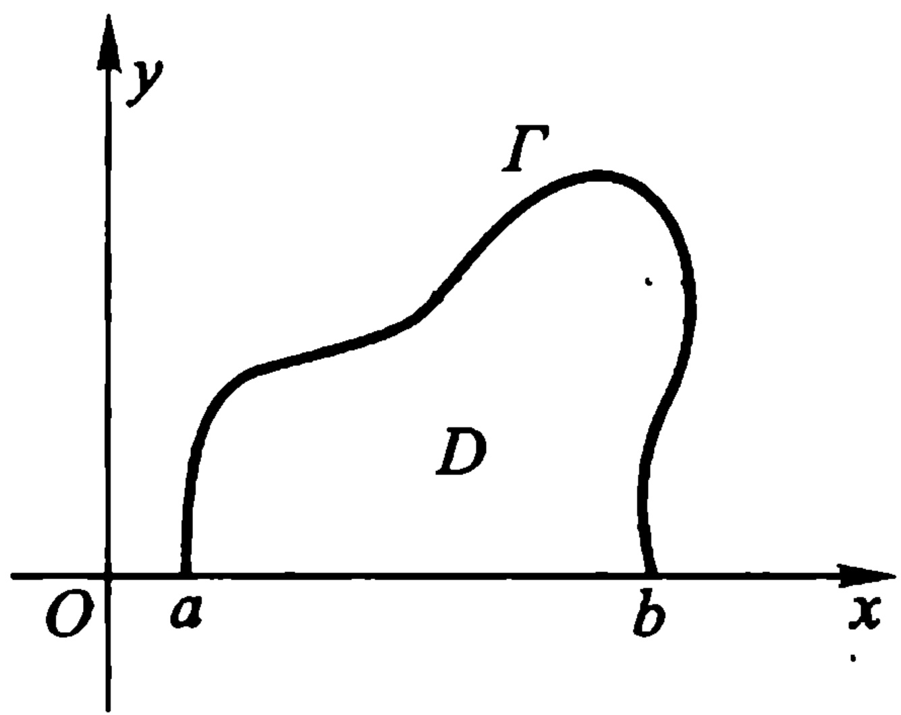

图 6.2
 

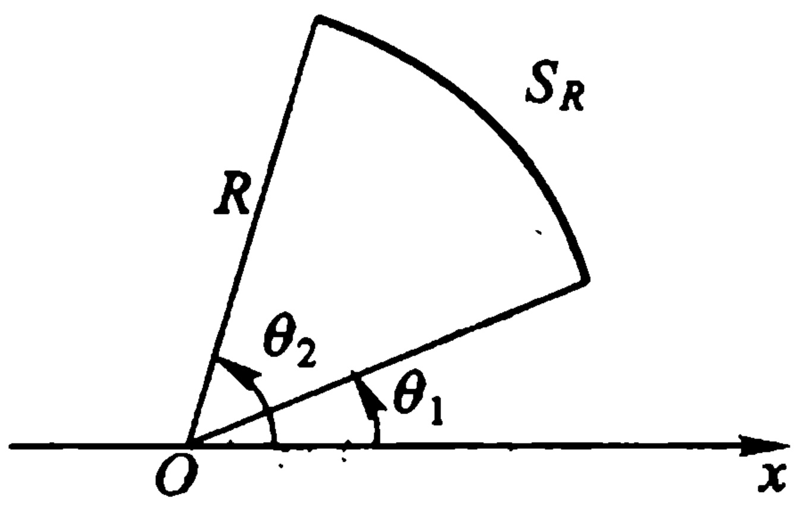

图 6.3
 

下面几段我们就分几种类型来具体讨论这个问题.

2. 计算  $ \int_{-\infty}^{+\infty} \frac{P(x)}{Q(x)} \mathrm{d}x $ 型积分 为了计算这种反常积分,我们先证明一个引理. 它主要用来估计辅助曲线  $ \Gamma $ 上的积分.

引理 6.1 设  $ f(z) $ 沿圆弧  $ S_{R}: z = Re^{\mathrm{i}\theta} (\theta_{1} \leqslant \theta \leqslant \theta_{2}, R $ 充分大) 上连续(图 6.3)，且

 $$ \lim_{R\to+\infty}z f(z)=\lambda $$ 

于  $ S_{R} $ 上一致成立（即与  $ \theta_{1} \leqslant \theta \leqslant \theta_{2} $ 中的  $ \theta $ 无关），则

$$  \lim_{R\to+\infty}\int_{S_{R}}f.(z)\mathrm{d}z\mathop{=}\limits_{\mathrm{i}}\mathrm{i}(\theta_{2}-\theta_{1})\lambda.   \tag*{(6.9)}$$

证 因为

 $$ \mathrm{i}(\theta_{2}-\theta_{1})\lambda=\lambda\int_{S_{R}}\frac{\mathrm{d}z}{z}, $$

<!-- page: 256 -->

于是有

$$  \left|\int_{S_{R}}f(z)\mathrm{d}z-\mathrm{i}(\theta_{2}-\theta_{1})\lambda\right|=\left|\int_{S_{R}}\frac{z f(z)-\lambda}{z}\mathrm{d}z\right|.   \tag*{(6.10)}$$

对于任给  $ \varepsilon>0 $，由已知条件，存在  $ R_{0}(\varepsilon)>0 $，使当  $ R>R_{0} $ 时，有不等式

 $$ |z f(z)-\lambda|<\frac{\epsilon}{\theta_{2}-\theta_{1}},\quad z\in S_{\mathrm{R}}. $$ 

于是(6.10)式不超过 $ \frac{\varepsilon}{\theta_{2}-\theta_{1}}\cdot\frac{l}{R}=\varepsilon $（其中l为 $ S_{R} $的长度，即 $ l=R(\theta_{2}-\theta_{1}) $）。

定理 6.7 设  $ f(z)=\frac{P(z)}{Q(z)} $ 为有理分式，其中

 $$ \begin{array}{r l}&{P(z)=c_{0}z^{m}+c_{1}z^{m-1}+\cdots+c_{m}(c_{0}\ne0)}\\ &{Q(\bar{z})=b_{0}\bar{z}^{n}+b_{1}z^{n-1}+\cdots+b_{n}(b_{0}\ne0).}\end{array} $$ 

与

为互质多项式，且符合条件: (1)  $ n - m \geqslant 2 $; (2) 在实轴上  $ Q(z) \neq 0 $, 于是有

$$  \int_{-\infty}^{+\infty}f(x)\mathrm{d}x=2\pi\mathrm{i}\sum_{\mathrm{I m}a_{k}>0}\mathrm{R e s}_{z=a_{k}}f(z).   \tag*{(6.11)}$$

证 由条件(1)、(2)及数学分析的结论, 知  $ \int_{-\infty}^{+\infty} f(x) \, dx $ 存在, 且等于它的主值

 $$ \begin{aligned}&\lim_{R\rightarrow+\infty}\int_{-R}^{+R}f(x)\mathrm{d}x.\\&P.V.\int_{-\infty}^{+\infty}f(x)\mathrm{d}x.\end{aligned} $$ 

记为

取上半圆周  $ \Gamma_{R}: z = Re^{i\theta} (0 \leq \theta \leq \pi) $ 作为辅助曲线（图 6.4）。于是，由线段  $ [-R, R] $ 及  $ \Gamma_{R} $ 合成一周线  $ C_{R} $，先取 R 充分大，使  $ C_{R} $ 内部包含  $ f(z) $ 在上半平面内的一切孤立奇点（实际上只有有限个极点）。而由条件 (2)， $ f(z) $ 在  $ C_{R} $ 上没有奇点。

<!-- page: 257 -->

按留数定理得

 $$ \int_{C_{R}}f(z)\mathrm{d}z=2\pi\mathrm{i}\sum_{\mathrm{I m}a_{k}>0}\mathrm{R e s}_{z=a_{k}}f(z^{\prime}), $$ 

或写成

$$  \int_{-R}^{R}f(x)\mathrm{d}x+\int_{\Gamma_{R}}f(z)\mathrm{d}z=2\pi\mathrm{i}\sum_{\mathrm{I m}a_{k}>0}\mathrm{R e s}_{f(z)_{k}}.   \tag*{(6.12)}$$

因为

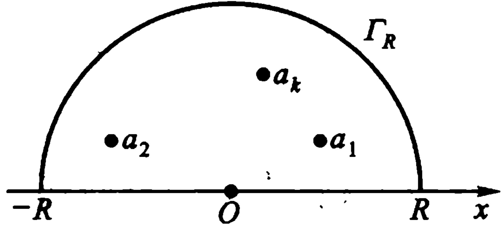

图 6.4
 

 $$ \begin{align*}zf(z)|=&\left|z\frac{P(z)}{Q(z)}\right|=\left|z\frac{c_0z^m+\cdots+c_m}{b_0z^n+\cdots+b_n}\right|\\\overset{!}{=}\left|\frac{z^{m+1}}{z^n}\right|\left|\frac{c_0+\cdots+\frac{c_m}{z^m}}{b_0+\cdots+\frac{b_n}{z^n}}\right|,\end{align*} $$ 

由假设条件(1)知  $ n - m - 1 \geqslant 1 $，故沿  $ \Gamma_{R} $ 上就有

 $$ |z f(z)|\to0\quad(R\to+\infty). $$ 

在等式(6.12)中命  $ R \rightarrow +\infty $，并根据引理6.1，知(6.12)中第二项的积分之极限为零，这就证明了(6.11).

例 6.11 设 a>0, 计算积分

 $$ \int_{0}^{+\infty}\frac{\mathrm{d}x}{x^{4}+a^{4}}. $$ 

解 因  $ \int_{0}^{+\infty}\frac{\mathrm{d}x}{x^{4}+a^{4}}=\frac{1}{2}\int_{-\infty}^{+\infty}\frac{\mathrm{d}x}{x^{4}+a^{4}}, f(z)=\frac{1}{z^{4}+a^{4}} $

它一共有四个一阶极点

<!-- page: 258 -->

$$ a_{k}=a\mathrm{e}^{\frac{\pi+2k\pi}{4}\mathrm{i}}\quad(k=0,1,2,3), $$ 

且符合定理 6.7 的条件.而

 $$ \begin{aligned}\operatorname{Res}_{f(z)}&=\frac{1}{4z^{3}}\bigg|_{z=a_{k}}=\frac{1}{4a_{k}^{3}}=\frac{a_{k}}{4a_{k}^{4}}=-\frac{a_{k}}{4a^{4}}\\&(k=0,1,2,3)\end{aligned} $$ 

（这里用到了  $ a_{k}^{4} + a^{4} = 0 $）.  $ f(z) $ 在上半平面内只有两个极点  $ a_{0} $ 及  $ a_{1} $，于是

 $$ \begin{aligned}\int_{0}^{+\infty}\frac{\mathrm{d}x}{x^{4}+a^{4}}&=-\pi\mathrm{i}\frac{1}{4a^{4}}(a\mathrm{e}^{\frac{\pi}{4}\mathrm{i}}+a\mathrm{e}^{\frac{3\pi}{4}\mathrm{i}})\\&=-\pi\mathrm{i}\frac{1}{4a^{3}}(\mathrm{e}^{\frac{\pi}{4}\mathrm{i}}-\mathrm{e}^{-\frac{\pi}{4}})=\frac{\pi}{2a^{3}}\sin\frac{\pi}{4}\\&=\frac{\pi}{2\sqrt{2}a^{3}}.\end{aligned} $$ 

例 6.12 计算积分

 $$ \int_{-\infty}^{+\infty}\frac{x^{4}\mathrm{d}x}{(2+3x^{2})^{4}}. $$ 

解 函数  $ f(z)=\frac{z^{4}}{(2+3z^{2})^{4}} $ 在上半平面内只有  $ z=\sqrt{\frac{2}{3}}i $ 一个四阶极点，且符合定理 6.7 的条件.

记  $ \sqrt{\frac{2}{3}}i = a $，令  $ z - a = t $，即令 z = a + t，则

 $$ \begin{align*}f(z)&=\frac{z^4}{(2+3^2z^2)^4}=\frac{z^4}{3^4(z-a)^4(z+a)^4};\\&=\frac{(t+a)^4}{3^4t^4(t+2a)^4},\\&=\frac{1}{3^4t^4}\cdot\frac{a^4+4a^3t+6a^2t^2+4at^3+t^4}{16a^4+32a^3t+24a^2t^2+8at^3+t^4}\\&=\frac{1}{3^4t^4}\left(\frac{1}{16}+\frac{t}{8a}+\frac{t^2}{32a^2}-\frac{t^3}{32a^3}+\cdots\right).\end{align*} $$ 

故

<!-- page: 259 -->

$$ \mathrm{Res}_{z=a}f(z)=-\frac{1}{3^{4}\cdot32a^{3}}. $$ 

即

 $$ \begin{aligned}\operatorname{Res}_{z=\sqrt{\frac{2}{3}i}}f(z)&=-\frac{1}{3^4\cdot32\left(\sqrt{\frac{2}{3}i}\right)^3}\\&=\frac{-i}{32\sqrt{2^3\cdot3^5}}=\frac{-i}{576\sqrt{6}}.\end{aligned} $$ 

故  $ \int_{-\infty}^{+\infty}\frac{x^{4}}{(2+3x^{2})^{4}}\mathrm{d}x=2\pi\mathrm{i}\cdot\frac{-i}{576\sqrt{6}}=\frac{\pi}{288\sqrt{6}} $.

3. 计算  $ \int_{-\infty}^{+\infty}\frac{P(x)}{Q(x)}\mathrm{e}^{\mathrm{i}mx}\mathrm{d}x $ 型积分

引理 6.2(若尔当引理) 设函数  $ g(z) $ 沿半圆周  $ \Gamma_{R}: z = R e^{i\theta} $  $ (0 \leq \theta \leq \pi, R $ 充分大) 上连续，且

 $$ \lim_{R\to+\infty}g\left(z\right)=0 $$ 

在  $ \Gamma_{R} $ 上一致成立. 则

 $$ \lim_{R\to+\infty}\int_{\Gamma_{R}}g\left(z\right)\mathrm{e}^{\mathrm{i}m z}\mathrm{d}z=0\quad\left(m>0\right). $$ 

证 对于任给的  $ \varepsilon>0 $，存在  $ R_{0}(\varepsilon)>0 $，使当  $ R>R_{0} $ 时，有

 $$ |g(z)|<\varepsilon,z\in\Gamma_{R}. $$ 

于是，就有

$$  \begin{align*}\left|\int_{\Gamma_{R}}g(z)\mathrm{e}^{\mathrm{i}mz}\mathrm{d}z\right|&=\left|\int_{0}^{\pi}g(R\mathrm{e}^{\mathrm{i}\theta})\mathrm{e}^{\mathrm{i}mR\mathrm{e}^{\mathrm{i}\theta}}R\mathrm{e}^{\mathrm{i}\theta}\mathrm{id}\theta\right|\\&\leqslant R\varepsilon\int_{0}^{\pi}\mathrm{e}^{-mR\sin\theta}\mathrm{d}\theta,\end{align*}   \tag*{(6.13)}$$

这里利用了  $ \left|g(R\mathrm{e}^{\mathrm{i}\theta})\right|<\varepsilon,\left|R\mathrm{e}^{\mathrm{i}\theta}\mathrm{i}\right|=R $ 以及

 $$ \mid\mathrm{e}^{\mathrm{i}m R\mathrm{e}^{\mathrm{i}\theta}}\mid=\mid\mathrm{e}^{-m R\sin\theta+\mathrm{i}m R\cos\theta}\mid=\mathrm{e}^{-m R\sin\theta}. $$ 

于是，由（若尔当不等式）

 $$ \frac{2\theta}{\pi}\leqslant\sin\theta\leqslant\theta\quad\left(0\leqslant\theta\leqslant\frac{\pi}{2}\right), $$ 

将(6.13)化为

<!-- page: 260 -->

$$ \begin{align*}\left|\int\limits_{r_R} g(z)e^{\mathrm{im}z}\mathrm{d}z\right|&\leqslant2R\varepsilon\int_{0}^{\frac{\pi}{2}}e^{-mR\sin\theta}\mathrm{d}\theta\\&\leqslant2R\varepsilon\int_{0}^{\frac{\pi}{2}}e^{-\frac{2mR\theta}{\pi}}\mathrm{d}\theta=2\varepsilon R\left[-\frac{e^{-\frac{2mR}{\pi}\theta}}{2mR}\right]^{\theta=\frac{\pi}{2}}\\&=\frac{\pi\varepsilon}{m}(1-e^{-mR})<\frac{\pi\varepsilon}{m}.\end{align*} $$ 

应用引理 6.2, 完全和证明定理 6.7 一样可得

定理 6.8 设  $ g(z) = \frac{F(z)}{Q(z)} $，其中  $ P(z) $ 及  $ Q(z) $ 是互质多项式，且符合条件：

（1） $ Q(z) $的次数比 $ P(z) $的次数高，

(2) 在实轴上  $ Q(z) \neq 0 $,

(3) m > 0,

则有

$$  \int_{-\infty}^{+\infty}g(x)\mathrm{e}^{\mathrm{i}m x}\mathrm{d}x=2\pi\mathrm{i}\sum_{\mathrm{I m}a_{k}>0}\mathrm{R e s}\big[g(z)\mathrm{e}^{\mathrm{i}m z}\big].   \tag*{(6.14)}$$

特别说来，将(6.14)分开实虚部，就可以得到形如

 $$ \int_{-\infty}^{+\infty}\frac{P(x)}{Q(x)}\cos m x\mathrm{d}x 及 \int_{-\infty}^{+\infty}\frac{P(x)}{Q(x)}\sin m x\mathrm{d}x 的积分 . $$ 

由数学分析的结论,可知上面两个反常积分都存在,其值就等于其柯西主值.

例 6.13 计算积分  $ \int_{0}^{+\infty}\frac{\cos mx}{1+x^{2}}dx $ （ $ m>0 $）.

解 被积函数为偶函数，故

 $$ \int_{0}^{+\infty}\frac{\cos m x}{1+x^{2}}\mathrm{d}x=\frac{1}{2}\int_{-\infty}^{+\infty}\frac{\cos m x}{1+x^{2}}\mathrm{d}x. $$ 

根据定理 6.8 得

 $$ \int_{-\infty}^{+\infty}\frac{\mathrm{e}^{\mathrm{i}mx}}{1+x^{2}}\mathrm{d}x=2\pi\mathrm{i}\operatorname{Res}_{z=\mathrm{i}}\left[\frac{\mathrm{e}^{\mathrm{i}mz}}{1+z^{2}}\right] $$

<!-- page: 261 -->

$$ =2\pi\mathrm{i}\frac{\mathrm{e}^{-m}}{2\mathrm{i}}=\pi\mathrm{e}^{-m}. $$ 

于是有

 $$ \int_{-\infty}^{+\infty}\frac{\cos m x}{1+x^{2}}\mathrm{d}x=\pi\mathrm{e}^{-m}, $$ 

 $$ \int_{0}^{+\infty}\frac{\cos m x}{1+x^{2}}\mathrm{d}x=\frac{\pi}{2}\mathrm{e}^{-m}. $$ 

例 6.14 计算积分  $ \int_{-\infty}^{+\infty}\frac{x\cos x}{x^{2}-2x+10} $.

解 不难验证,函数

 $$ f(z)=\frac{z\mathrm{e}^{\mathrm{i}z}}{z^{2}-2z+10} $$ 

满足若尔当引理的条件,这里 m=1,  $ g(z)=\frac{z}{z^{2}-2z+10} $.

函数  $ f(z) $ 有两个一阶极点  $ z=1+3i $ 及 z=1-3i.

 $$ \begin{aligned}\operatorname{Res}_{z=1+3\mathrm{i}}f(z)&=\frac{z\mathrm{e}^{\mathrm{i}z}}{(z^{2}-2z+10)^{\prime}}\Bigg|_{z=1+3\mathrm{i}}\\&=\frac{(1+3\mathrm{i})\mathrm{e}^{-3+\mathrm{i}}}{6\mathrm{i}}.\end{aligned} $$ 

于是

 $$ \begin{align*}\int_{-\infty}^{+\infty}\frac{x\mathrm{e}^{\mathrm{i}x}\mathrm{d}x}{x^{2}-2x+10}&=2\pi\mathrm{i}\frac{(1+3\mathrm{i})\mathrm{e}^{-3+\mathrm{i}}}{6\mathrm{i}}\\&=\frac{\pi}{3}\mathrm{e}^{-3}(1+3\mathrm{i})(\cos1+\mathrm{i}\sin1)\\&=\frac{\pi}{3}\mathrm{e}^{-3}(\cos1-3\sin1)+\mathrm{i}\frac{\pi}{3}\mathrm{e}^{-3}(3\cos1+\sin1).\end{align*} $$ 

比较等式两端的实部与虚部，就得

 $$ \begin{aligned}\int_{-\infty}^{+\infty}\frac{x\cos x d x}{x^{2}-2x+10}&=\frac{\pi}{3}\mathrm{e}^{-3}\left(\cos1-3\sin1\right),\\\int_{-\infty}^{+\infty}\frac{x\sin x d x}{x^{2}-2x+10}&=\frac{\pi}{3}\mathrm{e}^{-3}\left(3\cos1+\sin1\right).\end{aligned} $$ 

4. 计算积分路径上有奇点的积分 在数学分析中,对于瑕积

<!-- page: 262 -->

分,也可以类似地定义它的柯西主值.又在定理6.8中假定Q(z)无实零点,现在我们可以把条件放宽一点,容许Q(z)有有限多个一阶零点,即允许函数 $ f(z)=\frac{P(z)}{Q(z)}\mathrm{e}^{\mathrm{i}mz} $在实轴上有有限个一阶极点.为了估计挖去这种极点后沿辅助路径的积分,除了上面两个引理外,再引进一个与引理6.1相似的引理.

引理 6.3 设  $ f(z) $ 沿圆弧  $ S_{r}: z - a = r e^{i\theta} (\theta_{1} \leqslant \theta \leqslant \theta_{2}, r $ 充分小) 上连续，且

 $$ \lim_{r\to0}(z-a)f(z)=\lambda $$ 

于  $ S_{r} $ 上一致成立，则有

 $$ \lim_{r\to0}\int_{S_{r}}f(z)\mathrm{d}z=\mathrm{i}(\theta_{2}-\theta_{1})\lambda. $$ 

证 因为  $ i(\theta_{2}-\theta_{1})\lambda=\lambda\int_{s_{r}}\frac{\mathrm{d}z}{z-a} $，于是有

 $ \left|\int_{s_{r}}f(z)\mathrm{d}z-i(\theta_{2}-\theta_{1})\lambda\right|=\left|\int_{s_{r}}\frac{(z-a)f(z)-\lambda}{z-a}\mathrm{d}z\right| $.

与引理6.1的证明相仿,得知上式在r充分小时,其值不超过任意给定的正数 $ \varepsilon $.

例 6.15 计算积分  $ \int_{0}^{+\infty}\frac{\sin x}{x}dx $.

解  $ \int_{0}^{+\infty}\frac{\sin x}{x}\mathrm{d}x $ 存在，且

 $$ \int_{0}^{+\infty}\frac{\sin x}{x}\mathrm{d}x=\frac{1}{2}\mathrm{P.V.}\int_{-\infty}^{+\infty}\frac{\sin x}{x}\mathrm{d}x. $$ 

考虑函数  $ f(z)=\frac{e^{iz}}{z} $ 沿图 6.5 所示之闭曲线路径 C 的积分.

根据柯西积分定理得

 $$ \int_{c}f(z)\mathrm{d}z=0. $$ 

或写成

<!-- page: 263 -->

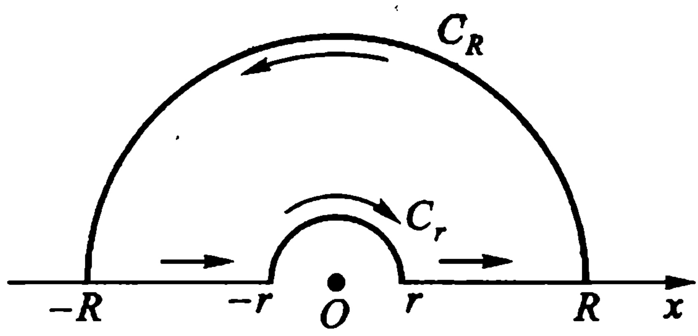

图 6.5
 

$$  \int_{r}^{R}\frac{\mathrm{e}^{\mathrm{i}x}}{x}\mathrm{d}x+\int_{C_{R}}\frac{\mathrm{e}^{\mathrm{i}z}}{z}\mathrm{d}z+\int_{-R}^{-r}\frac{\mathrm{e}^{\mathrm{i}x}}{x}\mathrm{d}x-\int_{C_{r}}\frac{\mathrm{e}^{\mathrm{i}z}}{z}\mathrm{d}z=0.   \tag*{(6.15)}$$

这里  $ C_{R} $ 及  $ C_{r} $ 分别表示半圆周  $ z = Re^{\mathrm{i}\theta} $ 及  $ z = r\mathrm{e}^{\mathrm{i}\theta} $ ( $ 0 \leqslant \theta \leqslant \pi $,  $ r < R $).

由引理 6.2 知

 $$ \lim_{R\to+\infty}\int_{C_{R}}\frac{\mathrm{e}^{\mathrm{i}z}}{\dot{z}}\mathrm{d}z=0. $$ 

由引理 6.3 知

 $$ \lim_{r\to0}\int_{C_{r}}\frac{\mathrm{e}^{\mathrm{i}z}}{z}\mathrm{d}z=\mathrm{i}\pi. $$ 

在(6.15)中，令  $ r \to 0, R \to +\infty $ 取极限即得  $ \int_{-\infty}^{+\infty} \frac{e^{ix}}{x} dx $ 的主值

 $$ \mathrm{P.V.}\int_{-\infty}^{+\infty}\frac{\mathrm{e}^{\mathrm{i}x}}{x}\mathrm{d}x=\mathrm{i}\pi. $$ 

所以

 $$ \int_{0}^{+\infty}\frac{\sin x}{x}\mathrm{d}x=\frac{1}{2}\mathbf{P}\cdot\mathbf{V}\cdot\int_{-\infty}^{+\infty}\frac{\sin x}{x}\mathrm{d}x=\frac{\pi}{2}. $$ 

5. 杂例 下面我们举出两个例子来说明，计算反常积分有时要用种种不同的方式来选择积分路径.

例 6.16 假定已知泊松(Poisson)积分

$$  \int_{0}^{+\infty}\mathrm{e}^{-t^{2}}\mathrm{d}t=\frac{\sqrt{\pi}}{2},   \tag*{(6.16)}$$

<!-- page: 264 -->

试计算弗莱聂尔(Frensnel)积分 $ ^{①} $

 $$ \int_{0}^{+\infty}\cos x^{2}\mathrm{d}x\text{ 及 }\int_{0}^{+\infty}\sin x^{2}\mathrm{d}x. $$ 

解 考察辅助函数

 $$ f(z)=\mathrm{e}^{-z^{2}}, $$ 

它是一个整函数. 并取如图 6.6 的辅助积分路径  $ C_{R} $. 则

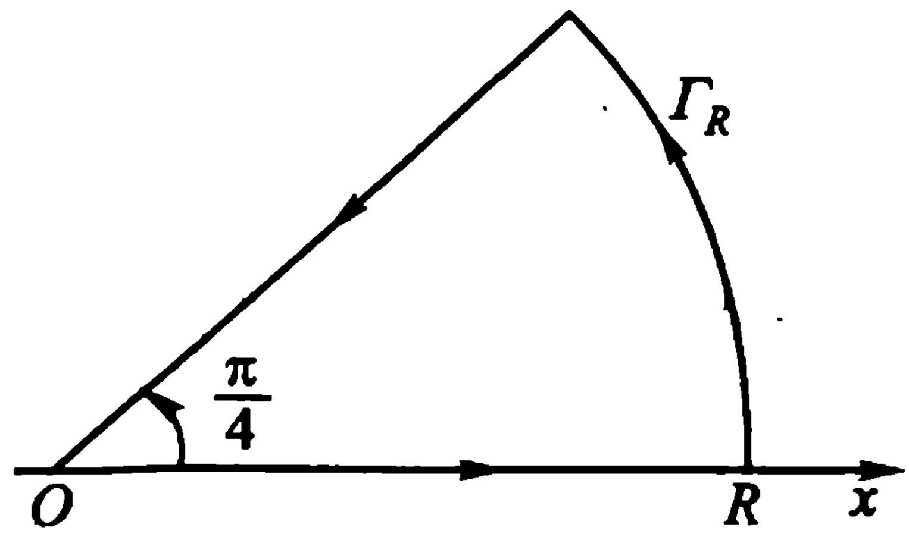

图6.6
 

$$  \begin{aligned}0&=\int_{C_{R}}\mathrm{e}^{-z^{2}}\mathrm{d}z\\&=\int_{0}^{R}\mathrm{e}^{-x^{2}}\mathrm{d}x+\int_{r_{R}}\mathrm{e}^{-z^{2}}\mathrm{d}z+\int_{R}^{0}\mathrm{e}^{-x^{2}\mathrm{e}^{\frac{\pi}{2}\mathrm{i}}}\mathrm{e}^{\frac{\pi}{4}\mathrm{i}}\mathrm{d}x.\end{aligned}   \tag*{(6.17)}$$

而

 $$ \begin{align*}\left|\int\limits_{R_{R}}\mathrm{e}^{-z^{2}}\mathrm{d}z\right|&=\left|\int_{0}^{\frac{\pi}{4}}\mathrm{e}^{-R^{2}(\cos2\varphi+\sin2\varphi)}\mathrm{i}R\mathrm{e}^{\mathrm{i}\varphi}\mathrm{d}\varphi\right|\\&\leqslant\int_{0}^{\frac{\pi}{4}}\mathrm{e}^{-R^{2}\cos2\varphi}R\mathrm{d}\varphi\\&\xlongequal{(令2\varphi=\frac{\pi}{2}-\theta)}\frac{R}{2}\int_{0}^{\frac{\pi}{2}}\mathrm{e}^{-R^{2}\sin\theta}\mathrm{d}\theta\\&\leqslant\frac{(若尔当不等式)\frac{R}{2}\int_{0}^{\frac{\pi}{2}}\mathrm{e}^{-R^{2}\cdot\frac{2\theta}{\pi}}\mathrm{d}\theta}{}\end{align*} $$

<!-- page: 265 -->

$$ \begin{aligned}&=-\frac{R}{2}\bullet\frac{\pi}{2R^{2}}\mathrm{e}^{-\frac{2R^{2}}{\pi}\theta}\bigg|_{\theta=0}^{\theta=\frac{\pi}{2}}\\&=\frac{\pi}{4R}[1-\mathrm{e}^{-R^{2}}].\end{aligned} $$ 

故当  $ R \to +\infty $ 时，

 $$ \left|\int_{\Gamma_{R}}\mathrm{e}^{-z^{2}}\mathrm{d}z\right|\to0. $$ 

于是当  $ R \rightarrow +\infty $ 时，(6.17)变成

 $$ \begin{array}{l}\frac{1+\mathrm{i}}{\sqrt{2}}\int_{0}^{+\infty}\left(\cos x^{2}-\mathrm{i}\sin x^{2}\right)\mathrm{d}x\\=\int_{0}^{+\infty}\mathrm{e}^{-x^{2}}\mathrm{d}x\xlongequal{(6.16)\rightarrow\sqrt{\pi}}\frac{2}{2}.\end{array} $$ 

即

 $$ \int_{0}^{+\infty}\left(\cos x^{2}-\mathrm{i}\sin x^{2}\right)\mathrm{d}x=\frac{1}{2}\sqrt{\frac{\pi}{2}}(1-\mathrm{i}). $$ 

比较两端实部与虚部，即得

 $$ \int_{0}^{+\infty}\cos x^{2}dx=\int_{\theta_{t}}^{+\infty}\sin x^{2}dx=\frac{1}{2}\sqrt{\frac{\pi}{2}}. $$ 

 $ ^{*} $例 6.17 计算积分

 $$ I=\int_{0}^{+\infty}\mathrm{e}^{-a x^{2}}\cos b x\mathrm{d}x,a>0. $$ 

解 若 b=0 , 则

$$  \begin{aligned}I=&\int_{0}^{+\infty}\mathrm{e}^{-ax^{2}}\mathrm{d}x\xlongequal{t=\sqrt{ax}}\frac{1.}{\sqrt{a}}\int_{0}^{+\infty}\mathrm{e}^{-t^{2}}\mathrm{d}t\\&\xlongequal{(6.16)}\frac{1}{\sqrt{a}}\cdot\frac{\sqrt{\pi}}{2}=\frac{1}{2}\sqrt{\frac{\pi}{a}}.\end{aligned}   \tag*{(6.18)}$$

若  $ b \neq 0 $，因为  $ \cos bx $ 是偶函数，所以只需考虑 b > 0 的情况.

根据前面的经验,似乎应该取辅助函数  $ f(z) = \mathrm{e}^{-az^2} \mathrm{e}^{ibz} $. 下面分析应该取什么样的辅助路径及辅助函数才合适:

<!-- page: 266 -->

因为

$$  \begin{align*}I&=\frac{1}{2}\mathrm{Re}\int_{-\infty}^{+\infty}\mathrm{e}^{-\left(ax^{2}+\mathrm{i}bx\right)}\mathrm{d}x=\frac{1}{2}\mathrm{\dot{R}e}\mathrm{e}^{-\frac{b^{2}}{4a}\int_{-\infty}^{+\infty}}\mathrm{e}^{-a\left(x+\frac{b}{2a}\mathrm{i}\right)^{2}}\mathrm{d}x\\&=\frac{1}{2}\mathrm{e}^{-\frac{b^{2}}{4a}}\mathrm{Re}\int_{-\infty+\frac{b}{2a}\mathrm{i}}^{+\infty+\frac{b}{2a}\mathrm{i}}\mathrm{e}^{-az^{2}}\mathrm{d}z,\tag{6}\end{align*}   \tag*{(6.19)}$$

而由(6.18)知道

$$  \int_{-\infty}^{+\infty}e^{-ax^{2}}dx=\sqrt{\frac{\pi}{a}}.   \tag*{(6.20)}$$

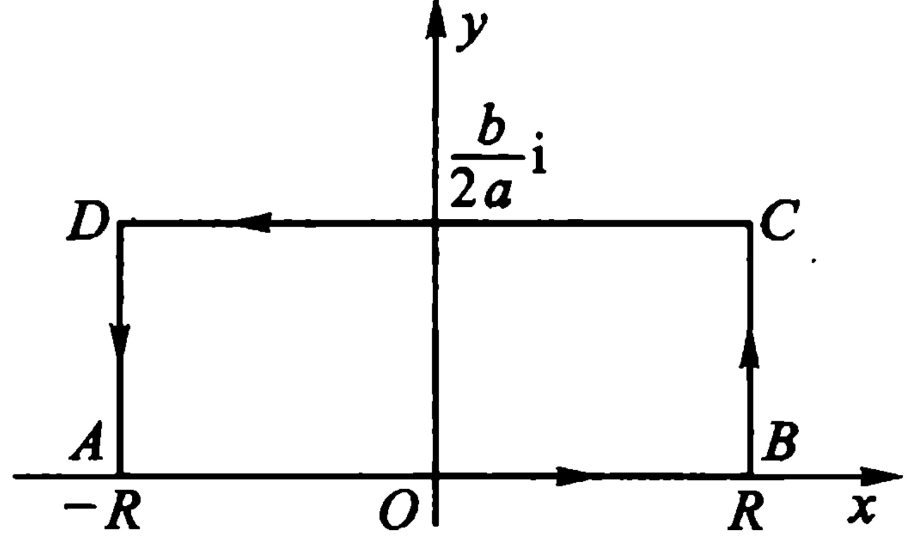

图 6.7
 

由此可见，应该取辅助函数  $ f(z) = \mathrm{e}^{-az^{2}} $，并可取如图 6.7 的辅助路径  $ C_{R} $。由柯西积分定理得到

$$  \begin{aligned}0=\int_{C_{R}}\mathrm{e}^{-az^{2}}\mathrm{d}z&=\int_{AB}\mathrm{e}^{-az^{2}}\mathrm{d}z+\int_{BC}\mathrm{e}^{-az^{2}}\mathrm{d}z+\int_{CD}\mathrm{e}^{-az^{2}}\mathrm{d}z\\&\quad+\int_{DA}\mathrm{e}^{-az^{2}}\mathrm{d}z.\end{aligned}\tag{6.2}   \tag*{(6.21)}$$

比较(6.19)与(6.21)，就得到

 $$ \begin{align*}I&\xlongequal{^{\prime}(6.19)}\frac{1}{2}\mathrm{e}^{-\frac{b^{2}}{4a}}\mathrm{Re}\left[\lim_{R\to+\infty}\left(\int_{DC}\mathrm{e}^{-az^{2}}\mathrm{d}z\right)\right]\\&\xlongequal{(6.21)}\frac{1}{2}\mathrm{e}^{-\frac{b^{2}}{4a}}\mathrm{Re}\left[\lim_{R\to+\infty}\left(\int_{AB}\mathrm{e}^{-az^{2}}\mathrm{d}z+\int_{BC}\mathrm{e}^{-az^{2}}\mathrm{d}z\right.\right.\\&\left.\left.+\int_{DA}\mathrm{e}^{-az^{2}}\mathrm{d}z\right)\right].\end{align*} $$ 

另外，在线段 BC 及 DA 上，

<!-- page: 267 -->

$$ z=\pm R+\mathrm{i}y\left(0\leqslant y\leqslant\frac{b}{2a}\right), $$ 

 $$ \mid\mathrm{e}^{-a z^{2}}\mid=\mathrm{e}^{-a\cdot(R^{2}-y^{2})}\leqslant\mathrm{e}^{\frac{b^{2}}{4a}}\mathrm{e}^{-a R^{2}}. $$ 

故

 $$ \operatorname*{l i m}_{R\to+\infty}\int_{B C}\mathrm{e}^{-a z^{2}}\mathrm{d}z=0,\operatorname*{l i m}_{R\to+\infty}\int_{D A}\mathrm{e}^{-a z^{2}}\mathrm{d}z=0. $$ 

最后得到

 $$ \begin{aligned}I=\frac{1}{2}\mathrm{e}^{-\frac{b^{2}}{4a}}\mathrm{Re}\left[\lim_{R\rightarrow+\infty}\int_{AB}\mathrm{e}^{-az^{2}}\mathrm{d}z\right]\\\underline{\underline{(6.20)}}\frac{1}{2}\mathrm{e}^{-\frac{b^{2}}{4a}}\sqrt{\frac{\pi}{a}}.\end{aligned} $$ 

从前面几个模式可见，利用留数计算定积分，关键在于选择一个合适的辅助函数及一条相应的辅助闭路（周线），从而把定积分的计算化成沿闭路的复积分的计算，除了一些标准模式外，辅助函数尤其是辅助闭路的选择很不规则。一般说来，辅助函数  $ F(z) $ 总要选得使当 z=x 时： $ F(x)=f(x)(f(x) $ 是原定积分中的被积函数)或  $ \mathrm{Re}(F(z))=f(x) $ 或  $ \mathrm{Im}(F(z))=f(x) $。辅助闭路的选择原则是：使添加的路线上的积分能够通过一定的办法（包括用我们给出的几个引理）估计出来；或者是能够转化为原来的定积分。但具体选取时，形状则是多种多样，有半圆周周线、长方形周线、扇形周线、三角形周线等等；此外，周线上有奇点还要绕开过去。

6. 应用多值函数的积分 被积函数或辅助函数是多值解析函数的情形，一定要适当割开平面，使其能分出单值解析分支，才能应用柯西积分定理或柯西留数定理来求出给定的积分的值.

 $ ^{*} $例 6.18 试计算积分

 $$ \int_{0}^{+\infty}\frac{\ln x}{(1+x^{2})^{2}}\mathrm{d}x. $$ 

解 以原点 O 为中心，r 及 R 为半径，在 Ox 轴上方画两个半圆周，r 可充分小，R 可充分大。此两个半圆周与 Ox 轴上的 AB 及  $ B^{\prime}A^{\prime} $ 二线段构成一周线 C（如图 6.8）。

<!-- page: 268 -->

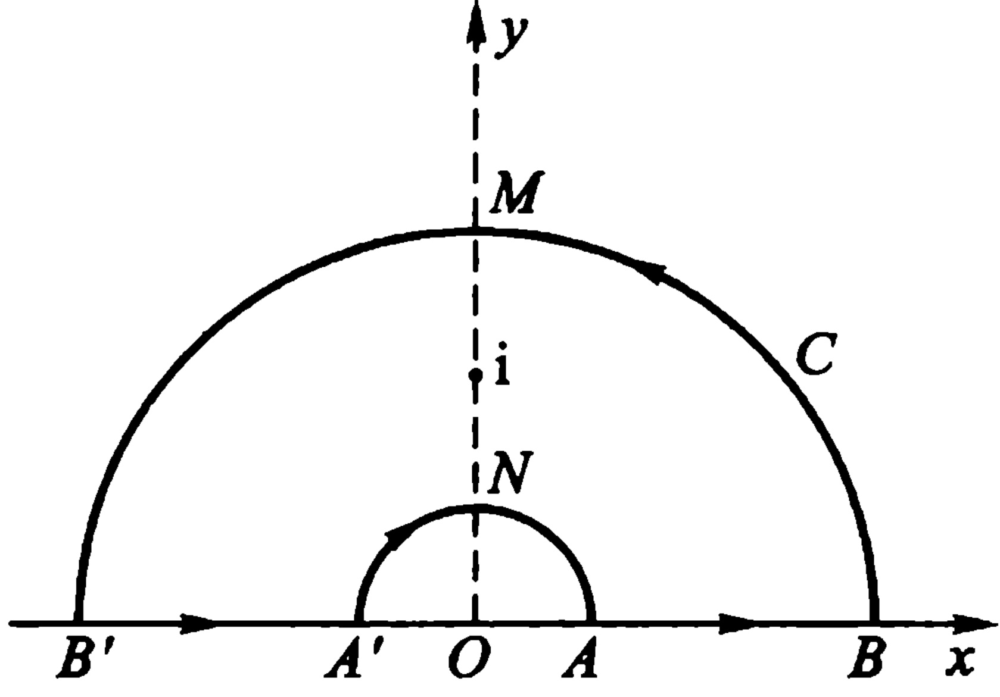

图6.8
 

辅助函数

 $$ f(z)=\frac{\ln z}{(1+z^{2})^{2}} $$ 

在 C 内部仅有一个二阶极点 z = i，而其支点 z = 0 及 z =  $ \infty $ 已不属于 C 的内部。故  $ f(z) $ 在 C 所界的有界闭域上，除 z = i 外，是单值解析的。令

 $$ \varphi\left(z\right)=\left(z-\mathrm{i}\right)^{2}\frac{\ln z}{\left(z+\mathrm{i}\right)^{2}\left(z-\mathrm{i}\right)^{2}}=\frac{\ln z}{\left(z+\mathrm{i}\right)^{2}}, $$ 

则

 $$ \varphi^{\prime}(z)=\frac{1}{z}\cdot\frac{1}{(z+\mathrm{i})^{2}}-\frac{2}{(z+\mathrm{i})^{3}}\ln z, $$ 

 $$ \mathrm{Res}_{z=\mathrm{i}}f(z)\xlongequal{(6.5)}\varphi^{\prime}(\mathrm{i})=-\frac{1}{4\mathrm{i}}-\frac{2}{-8\mathrm{i}}\cdot\frac{\pi\mathrm{i}}{2}=\frac{\pi+2\mathrm{i}}{8}. $$ 

由留数定理，

$$  \begin{aligned}\int_{\widehat{B M B^{\prime}}}&+\int_{B^{\prime}A^{\prime}}+\int_{\widehat{A^{\prime}N A}}+\int_{A B}\!=\int_{C}\frac{\ln z}{(1+z^{2})^{2}}\mathrm{d}z\\ &=2\pi\mathrm{i}\cdot\frac{\pi+2\mathrm{i}}{8}=-\frac{\pi}{2}+\frac{\pi^{2}}{4}\mathrm{i}.\end{aligned}   \tag*{(6.22)}$$

今分别计算(6.22)左边各个积分：

（1）因  $ \lim_{|z|\to+\infty}z\frac{\ln z}{(1+z^{2})^{2}}=0 $，由引理6.1即知

 $$ \int_{\widehat{B M B^{\prime}}}\frac{\ln z}{(1+z^{2})^{2}}\mathrm{d}z=0. $$

<!-- page: 269 -->

(2) 因  $ \lim_{|z|\to0} z \frac{\ln z}{(1 + z^2)^2} = 0 $，故由引理 6.3 即知

 $$ \int_{\widehat{A^{\prime}NA}}\frac{\ln z}{(1+z^{2})^{2}}\mathrm{d}z=0. $$ 

（3）命 AB 上的  $ z = x \cdot e^{i \cdot 0} (x > 0) $，则

 $$ \lim_{r\to0\atop r\to+\infty}\int_{AB}\frac{\ln z}{(1+z^{2})^{2}}\mathrm{d}z=\int_{0}^{+\infty}\frac{\ln x}{(1+x^{2})^{2}}\mathrm{d}x. $$ 

（4） $ A^{\prime}B^{\prime} $ 上的  $ z = xe^{\mathrm{i}\pi}(x > 0) $，于是

 $$ \ln z=\ln x+\mathrm{i}\pi,\mathrm{d}z=\mathrm{e}^{\mathrm{i}\pi}\mathrm{d}x=-\mathrm{d}x. $$ 

故

 $$ \begin{aligned}\lim_{r\to0\atop R\to+\infty}\int_{B^{\prime}A^{\prime}}&\frac{\ln z}{(1+z^{2})^{2}}\mathrm{d}z=\int_{+\infty}^{0}\frac{\ln x+\mathrm{i}\pi}{(1+x^{2})^{2}}(-\mathrm{d}x)\\&=\int_{0}^{+\infty}\frac{\ln x+\mathrm{i}\pi}{(1+x^{2})^{2}}\mathrm{d}x.\end{aligned} $$ 

于是，当  $ R \rightarrow +\infty, r \rightarrow 0 $ 时，(6.22)变成

 $$ \int_{0}^{+\infty}\frac{\ln x}{(1+x^{2})^{2}}\mathrm{d}x+\int_{0}^{+\infty}\frac{\ln x+\mathrm{i}\pi}{(1+x^{2})^{2}}\mathrm{d}x=-\frac{\pi}{2}+\frac{\pi^{2}}{4}\mathrm{i}. $$ 

比较两端的实部，得

 $$ 2\int_{0}^{+\infty}\frac{\ln x}{(1+x^{2})^{2}}\mathrm{d}x=-\frac{\pi}{2}, $$ 

故

 $$ \int_{0}^{+\infty}\frac{\ln x}{(1+x^{2})^{2}}\mathrm{d}x=-\frac{\pi}{4}. $$ 

例 6.19 计算积分

 $$ I=\int_{-1}^{1}\frac{\mathrm{d}x}{\sqrt[3]{(1-x)(1+x)^{2}}}, $$ 

解 考虑辅助函数

 $$ f(z)=\sqrt[3]{(1-z)(1+z)^{2}}, $$ 

它在 z 平面上是(2.24)型的多值函数，+1 及 -1 显然是它的支点.

当 z 沿图 6.9 中点线所表示的闭曲线  $ (-1 $ 及  $ +1 $ 于其内部）按反时针方向绕行一周， $ \varphi_{1}=\arg(1+z) $ 和  $ \varphi_{2}=\arg(1-z) $ 同时增

<!-- page: 270 -->

加  $ 2\pi $，而

 $$ \arg f(z)=\frac{2\varphi_{1}+\varphi_{2}}{3} $$ 

也增加  $ 2\pi $. 这表示  $ f(z) $ 回到原来的数值, 因而  $ \infty $ 不是  $ f(z) $ 的支点.

作支割线 $ [-1,1] $， $ f(z) $在其外部可以分出三个单值解析分支.

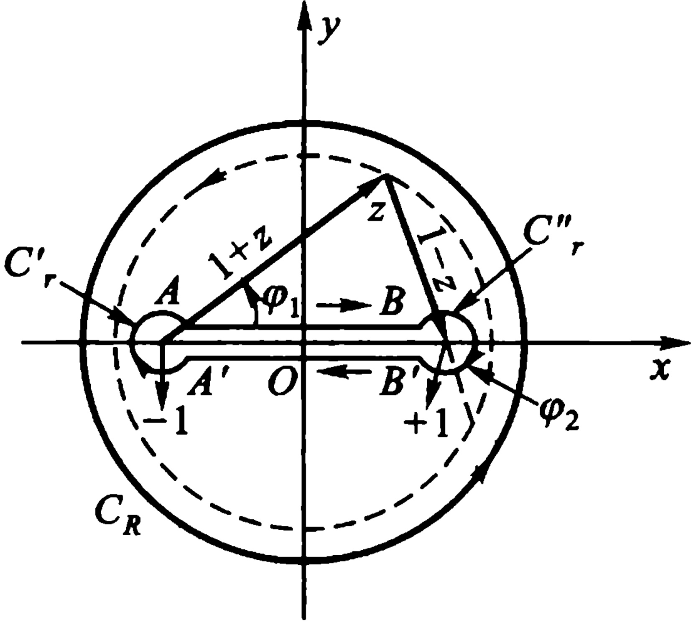

图6.9
 

我们选定在[-1,1]上岸 AB 上取正值的那个分支，并取在图6.9中所表示的那条复周线  $ \Gamma = C_{R} + C'_{r}^{-} + AB + C'_{r}^{-} + B'A' $，当z 在[-1,1]上岸 AB 上， $ \arg f(z) = 0 $，即

 $$ f(z)=\sqrt[3]{(1-x)(1+x)^{2}}>0. $$ 

当 z 从 B 沿  $ C_{r}^{\prime\prime} $ 转到  $ B^{\prime}, f(z) $ 的辐角增加  $ -\frac{2}{3}\pi $，于是在  $ [-1,1] $ 下岸  $ B^{\prime}A^{\prime} $ 上， $ \arg f(z) = -\frac{2}{3}\pi $，即

 $$ f(z)=\mathrm{e}^{-\frac{2\pi}{3}\mathrm{i}}\sqrt[3]{(1-x)(1+x)^{2}}. $$ 

这样我们有

 $$ \left|\int\limits_{C_{r}^{\prime}}\frac{1}{f(z)}d z\right|\leqslant\int\limits_{|1-z|=r}\frac{\left|d z\right|}{\left(\left|1+z\right|^{2}\left|1-z\right|\right)^{\frac{1}{3}}} $$

<!-- page: 271 -->

$$ \begin{aligned}&\leqslant\int_{|1-z|=r}\frac{1}{r^{\frac{1}{3}}}|\mathrm{d}z|\\&=2\pi r\cdot\frac{1}{r^{\frac{1}{3}}}=2\pi r^{\frac{2}{3}}.\end{aligned} $$ 

 $$ \left|\int\limits_{C_{r}^{\prime}}\frac{1}{f(z)}\mathrm{d}z\right|\leqslant\int\limits_{|1+z|=r}\frac{\left|\mathrm{d}z\right|}{\left(|1+z|^{2}|1-z|\right)^{\frac{1}{3}}}\leqslant2\pi r^{\frac{1}{3}}. $$ 

所以当  $ r \rightarrow 0 $ 时，上述两个积分趋于零。

因为，按复周线的柯西积分定理，

 $$ \int_{\Gamma}\frac{1}{f(z)}\mathrm{d}z=0, $$ 

所以当  $ r \to 0 $ 时，有

$$  \begin{align*}(1-\mathrm{e}^{\frac{2\pi\mathrm{i}}{3}})\int_{-1}^{1}\frac{\mathrm{d}x}{\sqrt[3]{(1-x)(1+x)^{2}}}=\int_{c_{R}^{-}}\frac{\mathrm{d}z}{f(z)}\\=2\pi\mathrm{i}\operatorname{Res}\limits_{z=\infty}\frac{1}{f(z)}.\end{align*}   \tag*{(6.23)}$$

我们来观察  $ f(z) $ 已选取的分支. 当 z 从上岸 AB 变化到  $ (1, +\infty) $ 上时; 即 z 从上岸的点 B 沿  $ C_{r}^{\prime\prime} $ (如图 6.9) 绕 1 转到  $ (1, +\infty) $ 上的点 e 时,  $ 1 + z $ 的辐角最终无改变, 只有 1-z 的辐角减少了  $ \pi $, 从而  $ f(z) $ 的辐角就减少  $ \frac{\pi}{3} $.

故在线段 $ (1, +\infty) $上

 $$ \begin{array}{l}f(z)=\sqrt[3]{|1-z||1+z|^{2}}\mathrm{e}^{-\frac{\pi}{3}\mathrm{i}},\\ f(z)=\sqrt[3]{(z-1)(1+z)^{2}}\mathrm{e}^{-\frac{\pi}{3}\mathrm{i}}.\end{array} $$ 

即

由公式(6.7)，

 $$ \begin{aligned}\operatorname{Res}\frac{1}{z=\infty f(z)}&=\operatorname{Res}\left[\frac{1}{\sqrt[3]{(1-z)(1+z)^{2}}}\right]\\&=-\operatorname{Res}\left[\begin{array}{c}1\\ \frac{1}{\sqrt[3]{(1-\frac{1}{t})(\sqrt{1+\frac{1}{t}})^{2}}}}\end{array}\right]\end{aligned} $$

<!-- page: 272 -->

$$ \begin{aligned}&=-Re\sum_{t=0}^{}\left[\frac{1}{t\cdot\sqrt[3]{(t-1)(t+1)^{2}}}\right]\\&=-\frac{1}{\sqrt[3]{(t-1)(t+1)^{2}}}\left|\begin{array}{l}1\\t=0\end{array}\right.\\&\frac{(6.24)}{}-\frac{1}{e^{-\frac{\pi}{3}i}}=-e^{\frac{\pi}{3}i}.\end{aligned}(t=0 为一阶极点 ) $$ 

因此，

 $$ \left(1-\mathrm{e}^{\frac{2\pi}{3}\mathrm{i}}\right)I\xlongequal{\left(6.23\right)}-\mathrm{e}^{\frac{\pi}{3}\mathrm{i}}\cdot2\pi\mathrm{i}. $$ 

由此，最后得到

 $$ I=\int_{-1}^{1}\frac{\mathrm{d}x}{\sqrt[3]{(1-x)(1+x)^{2}}}=\frac{\pi}{\sin\frac{\pi}{3}}=\frac{2\pi}{\sqrt{3}}. $$ 

 $ ^{*} $例 6.20 计算积分

 $$ \int_{0}^{1}\frac{\mathrm{d}x}{\left(x-2\right)\sqrt[5]{x^{2}\left(1-x\right)^{3}}}. $$ 

解 考虑辅助函数

 $$ f(z)=\frac{1}{(z-2)\sqrt[5]{z^{2}(1-z)^{3}}}, $$ 

其中  $ \sqrt[5]{z^{2}(1-z)^{3}}=F(z) $ 是 (2.24) 型的多值函数，它只以 z=0 及 z=1 为支点，z= $ \infty $ 不是支点。作支割线 [0,1]，F[z] 在其外部能分出五个单值解析分支，选取在  $ z=2(>1) $ 取负值的那一支，从而对应的单值解析函数  $ f(z) $ 在 [0,1] 外部只以 z=2 为一阶极点，z= $ \infty $ 为可去奇点。

以原点 O 为圆心画两个圆周，大圆周  $ C_{1} $ 的半径大于 2，小圆周  $ C_{2} $ 的半径在 1 与 2 之间（如图 6.10）；再各以 0 及 1 为圆心画两个小圆周  $ \gamma_{0} $ 及  $ \gamma_{1} $，半径 r 均可无限小.

(1) 因  $ \int_{C_{1}} f(z) \, \mathrm{d}z = -2\pi i \mathop{\mathrm{Res}}\limits_{z = \infty} f(z) $,

<!-- page: 273 -->

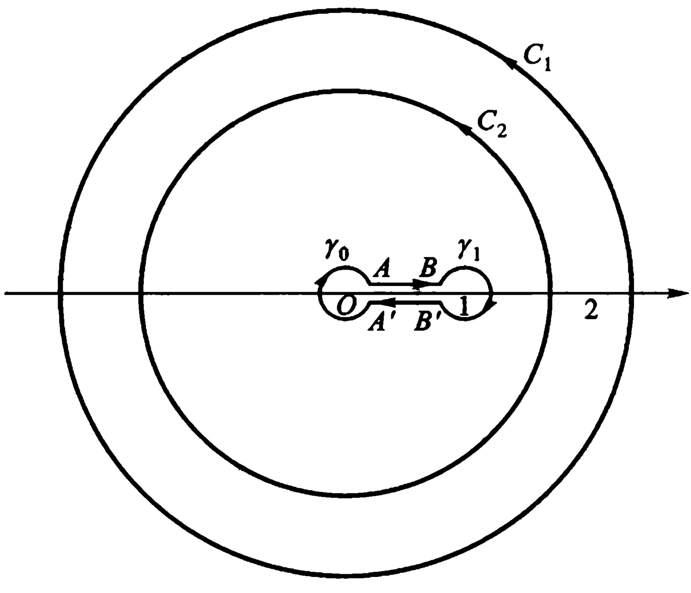

图6.10
 

又因  $ f(z) $ 在点  $ \infty $ 的去心邻域内的洛朗展式从  $ \frac{1}{z^{2}} $ 项开始，无  $ \frac{1}{z} $ 项，故

 $$ \mathop{\mathrm{R e s}}_{z=\infty}f(z)=0. $$ 

所以

 $$ \int_{c_{1}}f(z)\mathrm{d}z=0. $$ 

(2) 含点 $ \infty $的区域的留数定理(列入本章习题(二)5).

设 D 是扩充 z 平面上含点  $ \infty $ 的区域，其边界 C 是由有限条互不包含且互不相交的周线  $ C_{1}, C_{2}, \cdots, C_{m} $ 组成；又设函数  $ f(z) $ 在 D 内除去有限个孤立奇点  $ z_{1}, z_{2}, \cdots, z_{n} $ 及  $ \infty $ 外解析，且连续到边界 C，则

 $$ \int_{C^{-}}f(z)\mathrm{d}z=2\pi\mathrm{i}\left[\sum_{k=1}^{n}\operatorname{R e s}_{z=z_{k}}f(z)+\operatorname{R e s}_{z=\infty}f(z)\right]. $$ 

由此定理，我们得到

<!-- page: 274 -->

$$ \begin{aligned}\int_{C_{2}^{-}}f(z)\mathrm{d}z&=2\pi\mathrm{i}\left[\underset{z=2}{\operatorname{Res}}f(z)+\underset{z=\infty}{\operatorname{Res}}f(z)\right]\\&=2\pi\mathrm{i}\operatorname{Res}_{z=2}f(z).\end{aligned} $$ 

但

 $$ \mathrm{Res}_{z=2}f(z)=\frac{1}{\sqrt[5]{-4}}\frac{ 按选的分支 }{}\frac{1}{-\sqrt[5]{4}}=-\frac{\sqrt[5]{8}}{2}, $$ 

故

 $$ \int_{C_{2}}f(z)\mathrm{d}z=-2\pi\mathrm{i}\left(-\frac{\sqrt[5]{8}}{2}\right)=\sqrt[5]{8}\pi\mathrm{i}. $$ 

（3）应用复周线的柯西积分定理

 $$ \operatorname*{l i m}_{r\to0}\left(\int_{C_{2}}f(z)\mathrm{d}z+\int_{A B}f(z)\mathrm{d}z+\int_{B^{\prime}A^{\prime}}f(z)\mathrm{d}z\right)=0, $$ 

因由引理 6.3,  $ f(z) $ 沿两个小圆周的积分均为零.

于是我们有

$$  \begin{aligned}\lim_{r\to0}\left(\int_{AB}f(z)\mathrm{d}z+\int_{B^{\prime}A^{\prime}}f(z)\mathrm{d}z\right)&=-\int_{C_{2}}f(z)\mathrm{d}z\\&=-\sqrt[5]{8}\pi\mathrm{i}.\end{aligned}   \tag*{(6.25)}$$

(4) 考察  $ \sqrt[3]{z^{2}(1-z)^{3}} $ 的辐角的连续改变量. 已知所选分支在小圆周  $ \gamma_{1} $ 上起点  $ x (>1) $ 的函数值为  $ \sqrt[5]{x^{2}(x-1)^{3}} e^{i\pi} $，从而沿反时针方向转回上岸的点  $ x (0 < x < 1) $ 的值为

 $$ \sqrt[5]{x^{2}(1-x)^{3}}\mathrm{e}^{\mathrm{i}\left(\pi+\frac{3\pi}{5}\right)} $$ 

(因这时 z 的辐角改变量为零, 只有 1-z 的辐角改变量为  $ \pi $); 沿顺时针方向转至下岸的点 x (0 < x < 1) 的值为

 $$ \sqrt[5]{x^{2}(1-x)^{3}}\mathrm{e}^{\mathrm{i}\left(\pi-\frac{3\pi}{5}\right)} $$ 

(因这时只有 1-z 的辐角改变量为  $ -\pi $).

当两个小圆周的半径  $ r \to 0 $ 时（图 6.11），我们有

 $$ -\sqrt[5]{8}\pi\mathrm{i}\xlongequal{(6.25)}\int_{0}^{1}\frac{\mathrm{d}x}{\left(x-2\right)\sqrt[5]{x^{2}\left(1-x\right)^{3}}\mathrm{e}^{\mathrm{i}\left(\pi+\frac{3\pi}{5}\right)}}. $$

<!-- page: 275 -->

$$ \begin{align*}&+\int_{1}^{0}\frac{\mathrm{d}x}{(x-2)\sqrt[5]{x^{2}(1-x)^{3}}\mathrm{e}^{\mathrm{i}\left(\pi-\frac{3\pi}{5}\right)}}\\&=\int_{0}^{1}\frac{\mathrm{e}^{-\frac{8\pi.}{5}\mathrm{i}}-\mathrm{e}^{-\frac{2\pi.}{5}\mathrm{i}}}{(x-2)\sqrt[5]{x^{2}(1-x)^{3}}}\mathrm{d}x\\&=\int_{0}^{1}\frac{\mathrm{e}^{\frac{2\pi.}{5}\mathrm{i}}-\mathrm{e}^{-\frac{2\pi.}{5}\mathrm{i}}}{(x-2)\sqrt[5]{x^{2}(1-x)^{3}}}\mathrm{d}x\,.\end{align*} $$ 

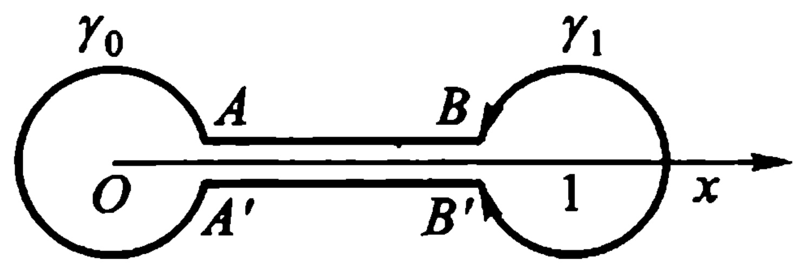

图6.11
 

最后得到

 $$ \begin{aligned}\int_{0}^{1}\frac{\mathrm{d}x}{(x-2)\sqrt[5]{x^{2}(1-x)^{3}}}&=\frac{-\sqrt[5]{8}\pi\mathrm{i}}{\mathrm{e}^{\frac{2\pi}{5}\mathrm{i}}-\mathrm{e}^{-\frac{2\pi}{5}\mathrm{i}}}\\&=\frac{-\sqrt[5]{8}\pi}{2\sin\frac{2\pi}{5}}.\end{aligned} $$ 

#### §3. 辐角原理及其应用

1. 对数留数 留数理论的重要应用之一是计算积分

 $$ \frac{1}{2\pi\mathrm{i}}\int_{c}\frac{f^{\prime}(z)}{f(z)}\mathrm{d}z, $$ 

它称为  $ f(z) $ 的对数留数（这个名称来源于  $ \frac{f'(z)}{f(z)} = \frac{\mathrm{d}}{\mathrm{d}z} [\ln f(z)] $，由它推出的辐角原理提供了计算解析函数零点个数的一个有效方法. 特别是，可以借此研究在一个指定区域内多项式零点的个数问题.

显然，函数  $ f(z) $ 的零点和奇点都可能是  $ \frac{f'(z)}{f(z)} $ 的奇点.

<!-- page: 276 -->

引理 6.4 （1）设 a 为  $ f(z) $ 的 n 阶零点，则 a 必为函数  $ \frac{f'(z)}{f(z)} $ 的一阶极点，并且

 $$ \mathrm{Res}_{z=a}\left[\frac{f^{\prime}(z)}{f(z)}\right]=n; $$ 

(2) 设 b 为  $ f(z) $ 的 m 阶极点，则 b 必为函数  $ \frac{f'(z)}{f(z)} $ 的一阶极点，并且

 $$ \mathrm{Res}_{z=b}\left[\frac{f^{\prime}(z)}{f(z.)}\right]=-m. $$ 

证 （1）如 a 为  $ f(z) $ 的 n 阶零点，则在点 a 的邻域内有

 $$ f(z)=(z-a)^{n}g(z), $$ 

其中  $ g(z) $ 在点 a 的邻域内解析，且  $ g(a) \neq 0 $。于是

 $$ \begin{align*}f^{\prime}\left(z\right)&=n\left(z-a\right)^{n-1}g\left(z\right)+\left(z-a\right)^{n}g^{\prime}\left(z\right),\\\frac{f^{\prime}\left(z\right)}{f\left(z\right)}&=\frac{n}{z-a}+\frac{g^{\prime}\left(z\right)}{g\left(z\right)}.\end{align*} $$ 

由于 $ \frac{g'(z)}{g(z)} $在点a的邻域内解析，故a必为 $ \frac{f'(z)}{f(z)} $的一阶极点，且

 $$ \mathrm{Res}_{z=a}\left[\frac{f^{\prime}(z)}{f(z)}\right]=n. $$ 

(2) 如 b 为  $ f(z) $ 的 m 阶极点, 则在点 b 的去心邻域内有

 $$ f(z)=\frac{h(z)}{(z-b)^{m}}, $$ 

其中  $ h(z) $ 在点 b 的邻域内解析，且  $ h(b) \neq 0 $。由此易得

 $$ \frac{f^{\prime}(z)}{f(z)}=\frac{-m}{z-b}+\frac{h^{\prime}(z)}{h(z)}, $$ 

而 $ \frac{h'(z)}{h(z)} $在点b的邻域内解析.故b必为 $ \frac{f'(z)}{f(z)} $的一阶极点,且

 $$ \mathrm{Res}_{z=b}\left[\frac{f^{\prime}(z)}{f(z)}\right]=-m. $$ 

定理 6.9 设 C 是一条周线,  $ f(z) $ 符合条件:

(1)  $ f(z) $ 在 C 的内部是亚纯的；

<!-- page: 277 -->

(2) $ f(z) $在 C 上解析且不为零.

则有  $ \frac{1}{2\pi i}\int_{c}\frac{f^{\prime}(z)}{f(z)}\mathrm{d}z=N(f,C)-P(f,C) $，(6.26)

式中  $ N(f, C) $ 与  $ P(f, C) $ 分别表示  $ f(z) $ 在 C 内部的零点与极点的个数（一个 n 阶零点算作 n 个零点，而一个 m 阶极点算作 m 个极点）.

证 由第五章习题(二)14, 可知  $ f(z) $ 在 C 内部至多只有有限个零点和极点. 设  $ a_{k}(k=1,2,\cdots,p) $ 为  $ f(z) $ 在 C 内部的不同零点, 其阶相应地为  $ n_{k}; b_{j}(j=1,2,\cdots,q) $ 为  $ f(z) $ 在 C 内部的不同极点, 其阶相应地为  $ m_{j} $, 则根据引理 6.4 知,  $ \frac{f'(z)}{f(z)} $ 在 C 的内部及 C 上除去在 C 内部有一阶极点  $ a_{k}(k=1,2,\cdots,p) $ 及  $ b_{j}(j=1,2,\cdots,q) $ 外均是解析的. 故由留数定理及引理 6.4 得

 $$ \begin{align*}\frac{1}{2\pi\mathrm{i}}\int_{C}&\frac{f^{\prime}(z)}{f(z)}\mathrm{d}z=\sum_{k=1}^{p}\operatorname{Res}_{z=a_{k}}\left[\frac{f^{\prime}(z)}{f(z)}\right]+\sum_{j=1}^{q}\operatorname{Res}_{z=b_{j}}\left[\frac{f^{\prime}(z)}{f(z)}\right]\\&=\sum_{k=1}^{p}n_{k}+\sum_{j=1}^{q}\left(-m_{j}\right)=N(f,C)-P(f,C).\end{align*} $$ 

2. 辐角原理 公式(6.26)的左端是  $ f(z) $ 的对数函数, 它有简单的意义.

为了说明这个意义,我们将它写成

 $$ \begin{align*}\frac{1}{2\pi i}\int_{c}\frac{f'(z)}{f(z)}\mathrm{d}z&=\frac{1}{2\pi i}\int_{c}\frac{\mathrm{d}}{\mathrm{d}z}\left[\ln f(z)\right]\mathrm{d}z\\&=\frac{1}{2\pi i}\int_{c}\mathrm{d}\ln f(z)\\&=\frac{1}{2\pi i}\left[\int_{c}\mathrm{d}\ln|f(z)|+\mathrm{i}\int_{c}\mathrm{d}\arg f(z)\right],\end{align*} $$ 

函数  $ \ln|f(z)| $ 是 z 的单值函数，当 z 从  $ z_{0} $ 起绕行周线 C 一周回到  $ z_{0} $ 时，有

 $$ \int_{C}\mathrm{d}\ln|f(z)|=\ln|f(z_{0})|-\ln|f(z_{0})|=0. $$

<!-- page: 278 -->

另一方面，当 z 从  $ z_{0} $ 起沿周线 C 的正方向绕行一周而回到  $ z_{0} $ 时， $ \arg f(z) $ 的值可能改变。如图 6.12，对应的  $ w = f(z) $ 从  $ w_{0} = f(z_{0}) $ 起围绕原点 w = 0 二周后又回到起点  $ w_{0} = f(z_{0}) $。显然， $ \arg f(z) $ 的终值  $ \varphi_{1} $ 与始值  $ \varphi_{0} $ 相差  $ 4\pi $。于是我们得

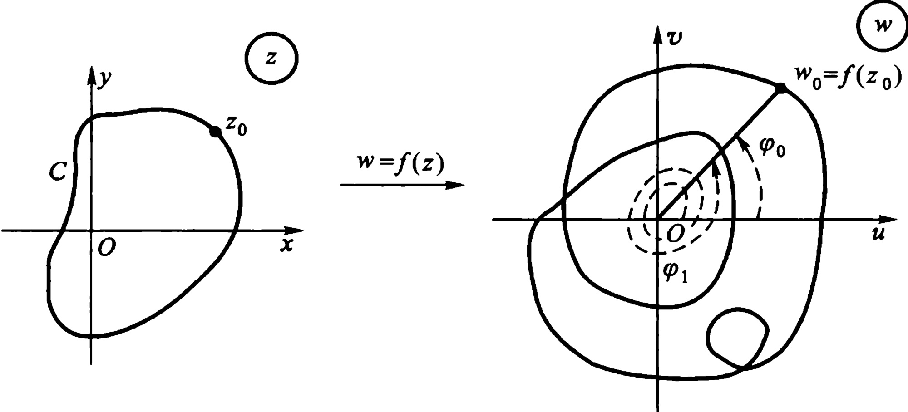

图 6.12
 

 $$ \begin{aligned}\frac{1}{2\pi\mathrm{i}}\int_{c}\frac{f^{\prime}(z)}{f(z)}\mathrm{d}z&=\frac{\mathrm{i}(\varphi_{1}-\varphi_{0})}{2\pi\mathrm{i}}\\&=\frac{\Delta_{c}\arg f(z)}{2\pi},\end{aligned} $$ 

式中  $ \Delta_{C}\operatorname{arg}f(z) $ 表示 z 沿 C 之正方向绕行一周后  $ \arg f(z) $ 的改变量. 它一定是  $ 2\pi $ 的整倍数.

这样，我们可以将定理 6.9 改写成：

辐角原理 在定理 6.9 的条件下,  $ f(z) $ 在周线 C 内部的零点个数与极点个数之差, 等于当 z 沿 C 之正向绕行一周后  $ \arg f(z) $ 的改变量  $ \Delta_{c}\arg f(z) $ 除以  $ 2\pi $, 即

$$  N(f,C)-P(f,C)=\frac{\Delta_{C}\arg f(z)}{2\pi}.   \tag*{(6.27)}$$

特别说来,如  $ f(z) $ 在周线 C 上及 C 之内部均解析,且  $ f(z) $ 在 C 上不为零,则.

<!-- page: 279 -->

$$  N(f,C)=\frac{\Delta_{C}\arg f(z)}{2\pi}.   \tag*{(6.28)}$$

例 6.21 设  $ f(z)=(z-1)(z-2)^{2}(z-4) $，C:  $ \left|z\right|=3 $，试验证辐角原理.

解  $ f(z) $ 在 z 平面上解析，在 C 上无零点，且在 C 的内部只有一阶零点 z=1 及二阶零点 z=2。所以，一方面有

 $$ N(f,C)=1+2=3； $$ 

另一方面，当 z 沿正方向绕 C 一周时，有

 $$ \begin{align*}\Delta_{C}\arg f(z)&=\Delta_{C}\arg(z-1)+\Delta_{C}\arg(z-2)^{2}\\&\quad+\Delta_{C}\arg(z-4)\\&=\Delta_{C}\arg(z-1)+2\Delta_{C}\arg(z-2)\\&=2\pi+4\pi=6\pi,\end{align*} $$ 

于是，(6.28)成立.

注 若将定理 6.9 的条件 (2) 减弱为：“ $ f(z) $ 连续到边界 C，且沿  $ Cf(z) \neq 0 $”，则辐角原理 (6.27) 式 [特别是当  $ f(z) $ 在 C 内部解析时，(6.28) 式] 仍成立.

事实上，首先取一条全含于 C 内部的周线  $ C' $，使  $ C' $ 的内部包含 C 内部的全部零点和极点，则对此周线  $ C' $，根据定理 6.9 就有

 $$ \begin{align*}N(f,C)-P(f,C)&=N(f,C^{\prime})\\&-P(f,C^{\prime})=\frac{\Delta_{c^{\prime}}\arg f(z)}{2\pi},\end{align*} $$ 

然后过渡到极限  $ C^{\prime} \rightarrow C $，利用函数  $ f(z) $ 的连续性即得.

例 6.22 设 n 次多项式

 $$ P(z)=a_{0}z^{n}+a_{1}z^{n-1}+\cdots+a_{n}\qquad(a_{0}\neq0) $$ 

在虚轴上没有零点，试证明它的零点全在左半平面  $ \mathrm{Re}\ z<0 $ 内的充要条件是

 $$ \underset{y(-\infty\nearrow+\infty)}{\Delta\mathrm{a r g}}P(\mathrm{i}y)=n\pi. $$ 

即当点 z 自下而上沿虚轴从点  $ \infty $ 走向点  $ \infty $ 的过程中,  $ P(z) $ 绕原点

<!-- page: 280 -->

转了 $ \frac{n}{2} $圈.

证 令周线  $ C_{R} $ 是右半圆周

 $$ \Gamma_{_{\cal R}}:z=R e^{\mathrm{i}\theta}\left(-\frac{\pi}{2}{\leqslant}\theta{\leqslant}\frac{\pi}{2}\right) $$ 

以及虚轴上从  $ R_{i} $ 到  $ -R_{i} $ 的有向线段所构成（图 6.13）.

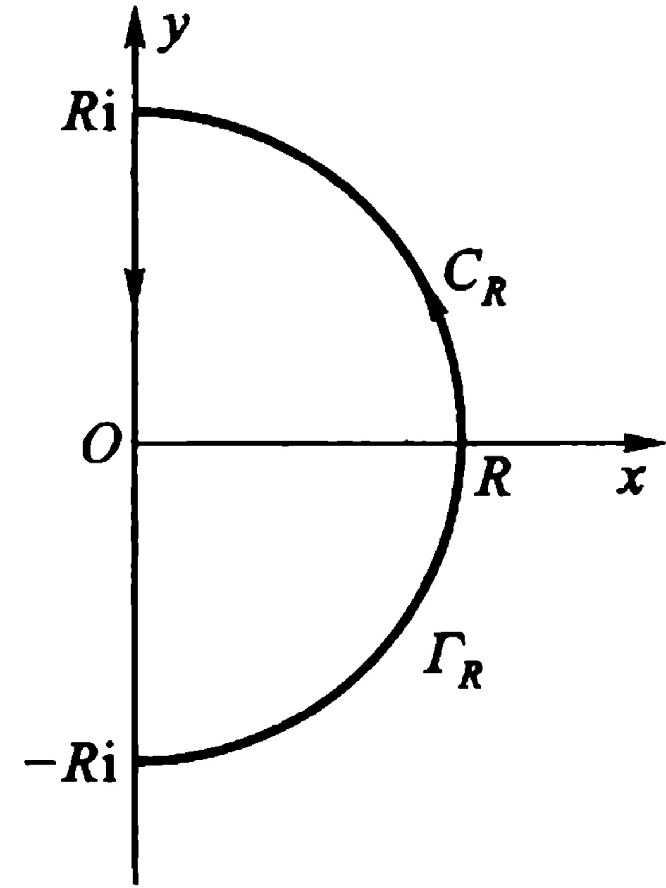

图 6.13
 

于是  $ P(z) $ 的零点全在左半平面的充要条件为  $ N(P, C_{R}) = 0 $

对任意 R 均成立，由 (6.28) 即知此条件可写成

$$  \begin{aligned}&0=\lim_{R\rightarrow+\infty}\Delta_{C_{R}}\arg P(z)\\&=\lim_{R\rightarrow+\infty}\Delta_{\Gamma_{R}}\arg P(z)-\lim_{R\rightarrow+\infty}\Delta_{y(-\mathscr{R}\mathscr{P}+R)}\arg P(iy).\\ \end{aligned}   \tag*{(6.29)}$$

但我们有

 $$ \begin{aligned}&\Delta_{\Gamma_{R}}\arg P(z)=\Delta_{\Gamma_{R}}\arg a_{0}z^{n}\left[1+g(z)\right]\\=&\Delta_{\Gamma_{R}}\arg a_{0}z^{n}+\Delta_{\Gamma_{R}}\arg\left[1+g(z)\right],\\ \end{aligned} $$ 

其中  $ g(z)=\frac{a_{1}z^{n-1}+\cdots+a_{n}}{a_{0}z^{n}} $，在  $ R\rightarrow+\infty $ 时  $ g(z) $ 沿  $ \Gamma_{R} $ 一致趋于零.

由此知

<!-- page: 281 -->

$$ \operatorname*{l i m}_{R\to+\infty}\Delta_{\varGamma_{R}}\arg[1+g(z)]=0. $$ 

另一方面又有

 $$ \Delta_{r_{_{R}}}\arg a_{_{0}}z^{^{n}}=\Delta_{\theta}\big[-\tfrac{\pi}{2}\nearrow+\tfrac{\pi}{2}\big]\arg a_{_{0}}R^{^{n}}\mathrm{e}^{\mathrm{i}n\theta}=n\pi. $$ 

这样一来，(6.29)就是我们所要证明的

 $$ \Delta_{y(-\infty\nearrow+\infty)}\arg P(\mathrm{i}y)=n\pi. $$ 

注 在自动控制中,若干物理和技术装置的稳定性归结为,要求常系数线性微分方程

 $$ a_{0}\ \frac{\mathrm{d}^{n}y}{\mathrm{d}t^{n}}+a_{1}\ \frac{\mathrm{d}^{n-1}y}{\mathrm{d}t^{n-1}}+\cdots+a_{n}y=f(t) $$ 

解的稳定性.此问题要求其特征多项式

 $$ P(z)=a_{0}z^{n}+a_{1}z^{n-1}+\cdots+a_{n} $$ 

的根全在左半平面.例 6.22 给出了此问题的一个判据.

3. 儒歇(Rouché)定理 下面的定理是辐角原理的一个推论，在考察函数的零点分布时，用起来更为方便.

定理 6.10(儒歇定理) 设 C 是一条周线, 函数  $ f(z) $ 及  $ \varphi(z) $ 满足条件:

（1）它们在 C 的内部均解析，且连续到 C；

(2) 在 C 上,  $ \left|f(z)\right| > \left|\varphi(z)\right| $,

则函数  $ f(z) $ 与  $ f(z) + \varphi(z) $ 在 C 的内部有同样多（几阶算作几个）的零点，即

 $$ N(f+\varphi,C)=N(f,C). $$ 

证 由假设知  $ f(z) $ 及  $ f(z) + \varphi(z) $ 在 C 的内部解析，且连续到 C，在 C 上有  $ \left|f(z)\right| > 0 $，

 $$ |f(z)+\varphi(z)|\geqslant|f(z)|-|\varphi(z)|>0. $$ 

这样一来，这两个函数  $ f(z) $ 及  $ f(z) + \varphi(z) $ 都满足定理 6.9 及其注的条件. 由于这两个函数在 C 的内部解析，于是由(6.28)，下面只须证明

$$  \Delta_{c}\arg[f(z)+\varphi(z)]=\Delta_{c}\arg f(z).   \tag*{(6.30)}$$

<!-- page: 282 -->

由关系式

 $$ f(z)+\varphi(z)=f(z)\left[1+\frac{\varphi(z)}{f(z)}\right], $$ 

$$  \Delta_{c}\arg\left[f(z)+\varphi(z)\right]=\Delta_{c}\arg f(z)+\Delta_{c}\arg\left[1+\frac{\varphi(z)}{f(z)}\right],   \tag*{(6.31)}$$

根据条件(2)，当 z 沿 C 变动时  $ \left|\varphi(z)/f(z)\right|<1 $。借助函数  $ \eta=1+\frac{\varphi(z)}{f(z)} $ 将 z 平面上的周线 C 变成  $ \eta $ 平面上的闭曲线  $ \Gamma $。于是  $ \Gamma $ 全在圆周  $ \left|\eta-1\right|=1 $ 的内部（图 6.14），而原点  $ \eta=0 $ 又不在此圆周的内部。即是说，点  $ \eta $ 不会围着原点  $ \eta=0 $ 绕行。故

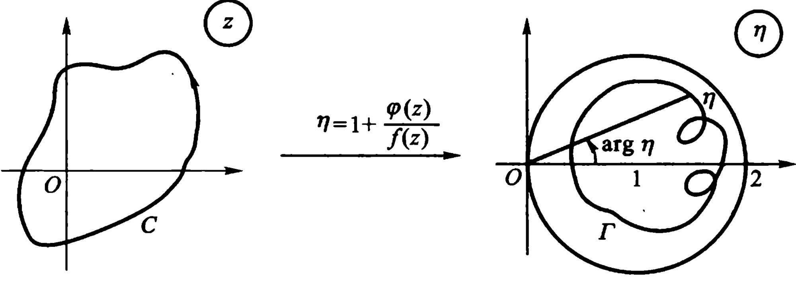

图 6.14
 

 $$ \Delta_{c}\arg\left[1+\frac{\varphi\left(z\right)}{f\left(z\right)}\right]=0, $$ 

由(6.31)即知(6.30)为真.

例 6.23 设 n 次多项式

 $$ p\left(z\right)=a_{0}z^{n}+\cdots+a_{t}z^{n-t}+\cdots+a_{n}\quad\left(a_{0}\neq0\right) $$ 

符合条件

 $$ |a_{t}|>|a_{0}|+\cdots+|a_{t-1}|+|a_{t+1}|+\cdots+|a_{n}|, $$ 

则  $ p(z) $ 在单位圆  $ \left|z\right|<1 $ 内有 n-t 个零点.

证 取  $ f(z)=a_{t}z^{n-t} $,

<!-- page: 283 -->

$$ \varphi(z)=a_{0}z^{n}+\cdots+a_{t-1}z^{n-t+1}+a_{t+1}z^{n-t-1}+\cdots+a_{n}, $$ 

易于验证在单位圆周  $ |z|=1 $ 上，有

 $$ |f(z)|>|\varphi(z)|. $$ 

依儒歇定理知， $ p(z)=f(z)+\varphi(z) $ 在单位圆  $ \left|z\right|<1 $ 内的零点，与  $ f(z)=a_{t}z^{n-t} $ 在单位圆  $ \left|z\right|<1 $ 内的零点一样多，即 n-t 个.

据此，一望而知：

方程  $ z^{8}-5z^{5}-2z+1=0 $ 在单位圆内有 5 个根；

方程  $ z^{7}-5z^{4}+z^{2}-2=0 $ 在单位圆内有 4 个根；

方程  $ z^{4}-5z+1=0 $ 在单位圆内有 1 个根；

方程  $ z^{6}+6z+10=0 $ 在单位圆内无根.

例 6.24 试证: 当  $ |a| > e $ 时, 方程  $ e^{z} - az^{n} = 0 $ 在单位圆  $ |z| < 1 $ 内有 n 个根.

证 在单位圆周  $ |z|=1 $ 上，有

 $$ |-a z^{n}|=|a|>e, $$ 

 $$ \left|\mathrm{e}^{z}\right|=\mathrm{e}^{\mathrm{Re}^{z}}\leqslant\mathrm{e}^{\left|z\right|}=\mathrm{e}, $$ 

即有

 $$ |-a z^{n}|>|\mathrm{e}^{z}|, $$ 

而函数  $ e^{z} $ 及  $ -az^{n} $ 均在单位闭圆  $ \left|z\right|\leq1 $ 上解析. 故由儒歇定理

 $$ N\left(\mathrm{e}^{z}-a z^{n},\mid z\mid=1\right)=N\left(-a z^{n},\mid z\mid=1\right)=n. $$ 

即方程  $ e^{z} - az^{n} = 0 $ 在单位圆  $ \left|z\right| < 1 $ 内有 n 个根.

例 6.25 应用儒歇定理证明代数学基本定理: 任一 n 次方程

 $$ a_{0}z^{n}+a_{1}z^{n-1}+\cdots+a_{n-1}z+a_{n}=0\quad(a_{0}\neq0) $$ 

有且只有 n 个根（几重根就算作几个根）.

证 命  $ f(z)=a_{0}z^{n} $,  $ \varphi(z)=a_{1}z^{n-1}+\cdots+a_{n} $, 当 z 在充分大的圆周  $ C:|z|=R $ 上时, 例如取

 $$ R>\max\left\{\frac{\left|a_{1}\right|+\cdots+\left|a_{n}\right|}{a_{0}}\right\},1, $$ 

有

 $$ \begin{aligned}\mid\varphi(z)\mid\leqslant\mid a_{1}\mid R^{n-1}+\cdots+\mid a_{n-1}\mid R+\mid a_{n}\mid\\ <\mid(a_{1}\mid+\cdots+\mid a_{n}\mid)R^{n-1}\end{aligned} $$

<!-- page: 284 -->

$$ <\mid a_{0}\mid R^{n}=\mid f(z)\mid, $$ 

由儒歇定理即知在圆  $ \left|z\right|<R $ 内，方程

 $$ a_{0}z^{n}+a_{1}z^{n-1}+\cdots+a_{n-1}z+a_{n}=0\mathrm{~ 与 ~}a_{0}z^{n}=0 $$ 

有相同个数的根.而  $ a_{0}z^{n}=0 $ 在  $ \left|z\right|<R $ 内有一个 n 重根 z=0.因此原 n 次方程在  $ \left|z\right|<R $ 内有 n 个根.

另外，在圆周  $ \left|z\right|=R $ 上，或者在它的外部，任取一点  $ z_{0} $，则  $ \left|z_{0}\right|=R_{0}\geqslant R $，于是

 $$ \begin{array}{r l}&{\quad|a_{0}z_{0}^{n}+a_{1}z_{0}^{n-1}+\cdots+a_{n-1}z_{0}+a_{n}|}\\ &{\geqslant|a_{0}z_{0}^{n}|-|a_{1}z_{0}^{n-1}+a_{2}z_{0}^{n-2}+\cdots+a_{n}|}\\ &{\geqslant|a_{0}|R_{0}^{n}-(|a_{1}|R_{0}^{n-1}+|a_{2}|R_{0}^{n-2}+\cdots+|a_{n}|)}\\ &{>|a_{0}|R_{0}^{n}-(|a_{1}|+|a_{2}|+\cdots+|a_{n}|)R_{0}^{n-1}}\\ &{>|a_{0}|R_{0}^{n}-|a_{0}|R_{0}^{n}=0,}\end{array} $$ 

这说明原 n 次方程在圆周  $ \left|z\right|=R $ 上及其外部都没有根. 所以原 n 次方程在 z 平面上有且只有 n 个根.

例 6.26 试证：方程

$$  z^{7}-z^{3}+12=0   \tag*{(6.32)}$$

的根全在圆环  $ 1<|z|<2 $ 内.

证 由例 6.23 知方程(6.32)在圆周  $ \left|z\right|=1 $ 的内部无根.

又在圆周 $ \left|z\right|=2 $上

 $$ \left|12-z^{3}\right|\leqslant12+\left|z\right|^{3}=12+8=20<128=2^{7}=\left|z^{7}\right|, $$ 

故由儒歇定理,方程(6.32)的7个根全在

 $$ 1\leq\mid z\mid<2 $$ 

上. 但当  $ \left|z\right|=1 $ 时

 $$ \begin{aligned}\mid z^{7}-z^{3}\mid&=\mid z\mid^{3}\mid z^{4}-1\mid\leqslant\mid z\mid^{3}(\mid z\mid^{4}+1)=2,\\\mid z^{7}-z^{3}+12\mid&\geqslant12-\mid z^{7}-z^{3}\mid\geqslant12-2=10>0.\end{aligned} $$ 

故方程(6.32)的根全在圆环  $ 1<|z|<2 $ 内.

下面应用儒歇定理证明的定理是单叶解析函数的一个重要性质.在下一章共形映射中要用.

<!-- page: 285 -->

定理 6.11 若函数  $ f(z) $ 在区域 D 内单叶解析，则在 D 内  $ f'(z) \neq 0 $.

证 若有 D 的点  $ z_{0} $ 使  $ f^{\prime}(z_{0})=0 $，则  $ z_{0} $ 必为  $ f(z)-f(z_{0}) $ 的一个 n 阶零点  $ (n \geqslant 2) $。由零点的孤立性，故存在  $ \delta>0 $，使在圆周  $ C: |z-z_{0}|=\delta $ 上

 $$ f(z)-f(z_{0})\neq0, $$ 

在 C 的内部,  $ f(z) - f(z_{0}) $ 及  $ f'(z) $ 无异于  $ z_{0} $ 的零点.

命 m 表  $ \left|f(z)-f(z_{0})\right| $ 在 C 上的下确界，则由儒歇定理即知，当  $ 0<|-a|<m $ 时， $ f(z)-f(z_{0})-a $ 在圆周 C 的内部亦恰有 n 个零点。但这些零点无一为多重点，理由是  $ f'(z) $ 在 C 内部除  $ z_{0} $ 外无其他零点，而  $ z_{0} $ 显然非  $ f(z)-f(z_{0})-a $ 的零点。

故命  $ z_{1}, z_{2}, \cdots, z_{n} $ 表  $ f(z) - f(z_{0}) - a $ 在 C 内部的 n 个相异零点. 于是

 $$ f(z_{k})=f(z_{0})+a\quad(k=1,2,\cdots,n). $$ 

这与  $ f(z) $ 的单叶性假设矛盾.

故在区域 D 内  $ f'(z) \neq 0 $.

思考题 试举一个初等解析函数,说明定理6.11的逆不真.

## 第六章习题

(一)

1 求下列函数  $ f(z) $ 在指定点的留数.

(1) $ \frac{z}{(z-1)(z+1)^{2}} $在 $ z=\pm1,\infty $

答:  $ \mathrm{Res}_{z=1}f(z)=\frac{1}{4};\mathrm{Res}_{z=-1}f(z)=-\frac{1}{4}. $

(2) $ \frac{1}{\sin z} $在 $ z=n\pi(n=0,\pm1,\cdots) $.

<!-- page: 286 -->

答:  $ \mathrm{Res}_{z=n\pi}f(z)=\frac{1}{\cos n\pi}=(-1)^{n} $.

(3) $ \frac{1-\mathrm{e}^{2z}}{z^{4}} $在z=0, $ \infty $.

答: $ Res_{z=0}f(z)=-\frac{4}{3} $

（4） $ e^{\frac{1}{x-1}} $ 在 z = 1,  $ \infty $.

答: Res  $ f(z) = 1 $.

(5) $ \frac{z^{2n}}{(z-1)^{n}} $在z=1, $ \infty $.

答:  $ \mathrm{Res}_{z=1}f(z)=\frac{(2n)!}{(n-1)!(n+1)!} $.

(6) $ \frac{e^{z}}{z^{2}-1} $在 $ z=\pm1,\infty $

答:  $ \mathrm{Res}_{z=\infty} f(z)=\frac{e^{-1}-e}{2} $.

2 求下列函数  $ f(z) $ 在其孤立奇点（包括无穷远点）处的留数 (m 是正整数).

(1)  $ z^{m}\sin\frac{1}{z} $

答：m 为奇数时， $ \mathrm{Res}_{z=0}f(z)=0 $;

m 为偶数 2k 时， $ \mathrm{Res}_{z=0}f(z)=\frac{(-1)^{k}}{(2k+1)!} $.

(2) $ \frac{z^{2m}}{1+z^{m}}. $

答： $ \mathrm{Res}_{z=e_{k}}f(z)=-\frac{e_{k}}{m} $，其中  $ e_{k}=e^{\frac{(2k+1)\pi i}{m}}(k=0,1,\cdots,m-1) $;

 $$ \begin{align*}\mathrm{Res}_{z=\infty}f(z)=&-\sum_{k=0}^{m-1}\left(-\frac{\mathrm{e}_{k}}{m}\right)(\mathrm{e}_{k}^{m}=-1)\\=&\frac{1}{m}\sum_{k=0}^{m-1}\mathrm{e}_{k}=\left\{\begin{array}{c}0,m>1,\\-1,m=1.\end{array}\right.\end{align*} $$ 

(3)  $ \frac{1}{(z - \alpha)^m (z - \beta)} $ ( $ \alpha \neq \beta $).

 $$ \mathop{\mathrm{R e s}}\limits_{z=\alpha}f(z)=-\frac{1}{\left(\beta-\alpha\right)^{m}};\mathop{\mathrm{R e s}}\limits_{z=\beta}f(z)=\frac{1}{\left(\beta-\alpha\right)^{m}}. $$

<!-- page: 287 -->

(4)  $ \frac{e^{z}}{z^{2}(z-\pi i)^{4}} $.

答： $ \mathrm{Res}_{z=0}f(z)=\frac{\pi-4i}{\pi^{5}}; $

 $$ \mathrm{R e s}_{z=\pi\mathrm{i}}f(z)=\frac{1}{6\pi^{5}}(\pi^{3}+6\pi^{2}\mathrm{i}-18\pi-24\mathrm{i}). $$ 

3 计算下列各积分：

(1)

 $$ \int_{|z|=1}\frac{\mathrm{d}z}{z\sin z};(2)\quad\frac{1}{2\pi\mathrm{i}}\int_{|z|=2}\frac{\mathrm{e}^{z\mathrm{i}}}{1+z^{2}}\mathrm{d}z; $$ 

(3)

 $$ \int_{c}\frac{\mathrm{d}z}{(z-1)^{2}(z^{2}+1)},C:x^{2}+y^{2}=2(x+y); $$ 

(4)

 $$ \int_{|z|=1}\frac{\mathrm{d}z}{\left(z-a\right)^{n}\left(z-b\right)^{n}}\quad\left(\begin{aligned}&|a|<1\\ &|b|<1\end{aligned}\right.,a\neq b,n 为正整数 \left)\right. $$ 

答: (1)  $ 0 $; (2)  $ \sin t $; (3)  $ -\frac{1}{2}\pi i $; (4) 0.

4 求下列各积分之值：

(1)

 $$ \int_{0}^{2\pi}\frac{\mathrm{d}\theta}{a+\cos\theta}(a>1)\;;(2)\int_{0}^{2\pi}\frac{\mathrm{d}x}{(2+\sqrt{3}\cos x)^{2}}\;; $$ 

(3) $ \int_{0}^{\pi}\tan\left(\theta+\mathrm{i}a\right)\mathrm{d}\theta $（a为实数且 $ a\neq0 $）.

答: (1)  $ \frac{2\pi}{\sqrt{a^{2}-1}} $; (2)  $ 4\pi $; (3)  $ \pi i(a>0) $;  $ -\pi i(a<0) $.

5 求下列各积分：

 $$ (1)\int_{0}^{+\infty}\frac{x^{2}}{(x^{2}+1)(x^{2}+4)}\mathrm{d}x\;;\;(2)\int_{-\infty}^{+\infty}\frac{x^{2}}{(x^{2}+a^{2})^{2}}\mathrm{d}x(a>0)\;; $$ 

(3)

 $$ \int_{-\infty}^{+\infty}\frac{\cos x}{(x^{2}+1)(x^{2}+9)}\mathrm{d}x\;;\quad(4)\int_{0}^{+\infty}\frac{x\sin m x}{x^{4}+a^{4}}\mathrm{d}x\left(\begin{matrix}m>0\\ a>0\end{matrix}\right). $$ 

答: (1)  $ \frac{\pi}{6} $; (2)  $ \frac{\pi}{2a} $; (3)  $ \frac{\pi}{24e^{3}}(3e^{2}-1) $;

(4)

 $$ \frac{\pi}{2a^{2}}\mathrm{e}^{-\frac{ma}{\sqrt{2}}}\sin\frac{ma}{\sqrt{2}}. $$ 

6 仿照例 6.15 的方法计算下列积分：

(1)  $ \int_{0}^{+\infty}\frac{\sin x}{x(x^{2}+a^{2})}dx(a>0) $; (2)  $ \int_{0}^{+\infty}\frac{\sin x}{x(x^{2}+1)^{2}}dx $.

<!-- page: 288 -->

答: (1)  $ \frac{\pi}{2a^{2}}(1 - e^{-a}); $ (2)  $ \frac{\pi}{2}\left(1 - \frac{3}{2e}\right) $.

7 从  $ \int_{C}\frac{e^{iz}}{\sqrt{z}}dz $ 出发，其中 C 是如图 6.15 所示之周线  $ (\sqrt{z} $ 沿正实轴取正值)，证明

 $$ \int_{0}^{+\infty}\frac{\cos x}{\sqrt{x}}\mathrm{d}x=\int_{0}^{+\infty}\frac{\sin x}{\sqrt{x}}\mathrm{d}x=\sqrt{\frac{\pi}{2}}. $$ 

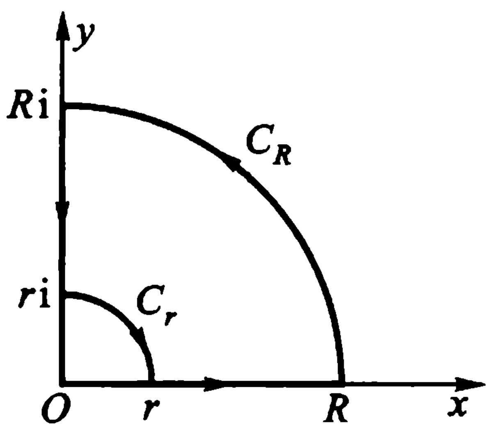

图 6.15
 

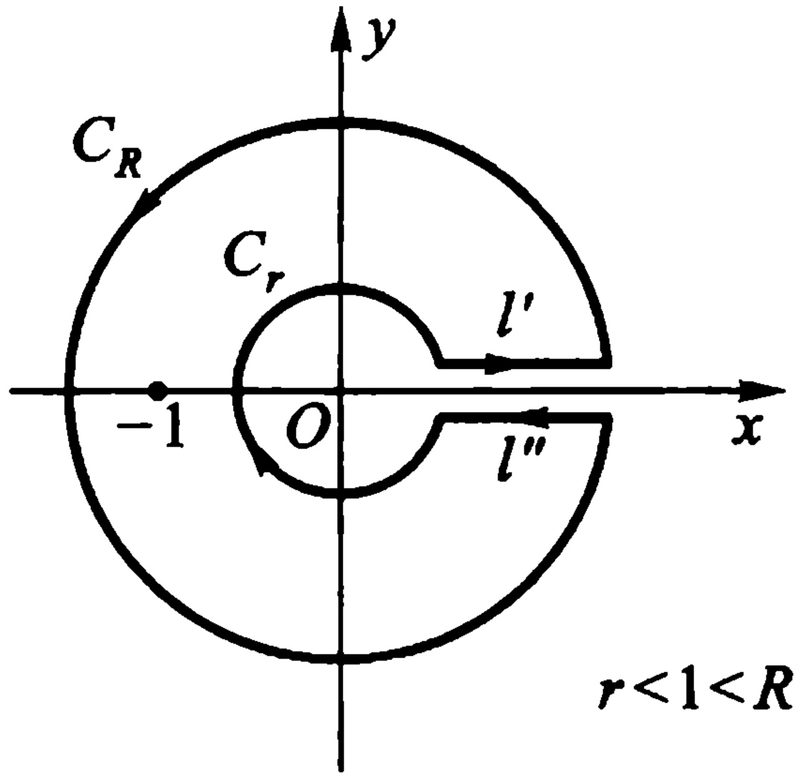

图 6.16
 

8 从  $ \int_{C}\frac{\sqrt{z}\ln z}{(1+z)^{2}}\mathrm{d}z $ 出发, 其中 C 是如图 6.16 所示的周线, 证明:

 $$ \int_{0}^{+\infty}\frac{\sqrt{x}\ln\dot{x}}{\left(1+x\right)^{2}}\mathrm{d}x=\pi, $$ 

 $$ \int_{0}^{+\infty}\frac{\sqrt{x}}{\left(1+x\right)^{2}}\mathrm{d}x=\frac{\pi}{2}. $$ 

9 证明

 $$ I=\int_{0}^{1}\frac{\mathrm{d}x}{\left(1+x^{2}\right)\sqrt{1-x^{2}}}=\frac{\pi}{2\sqrt{2}}. $$ 

提示 取辅助函数

 $$ f(z)=\frac{1}{(1+z^{2})\sqrt{1-z^{2}}}. $$ 

沿图 6.17 所示之路径 C 积分，其中根式是沿  $ l' $ 取正值的那一支。 $ C'_{r}: |z + 1| = r $,  $ C'_{r}: |z - 1| = r $,  $ C_{R}: |z| = R $, r 充分小，R 充分大。

### 10 证明方程

<!-- page: 289 -->

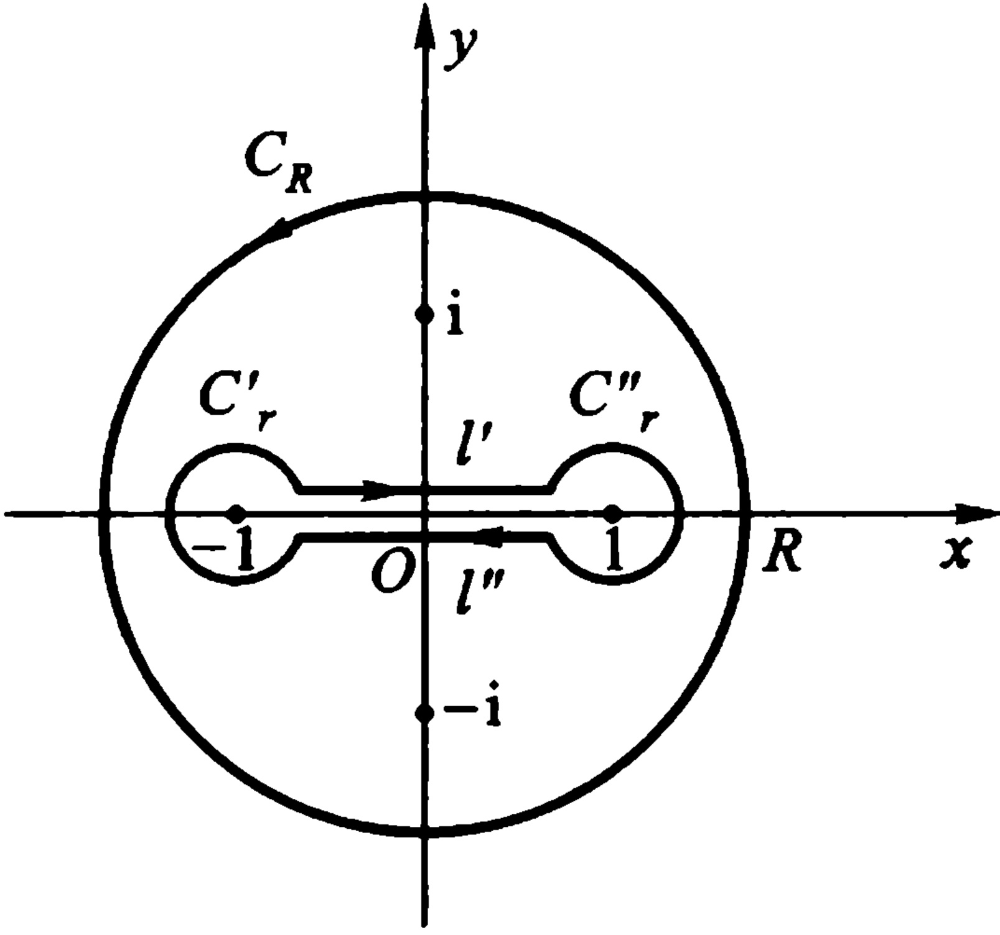

图 6.17
 

 $$ c^{z-\lambda}=z\quad(\lambda>1) $$ 

在单位圆  $ \left|z\right|<1 $ 内恰有一个根，且为实根.

### 11 证明方程

 $$ \mathrm{e}^{z}-\mathrm{e}^{\lambda}z^{n}=0\quad(\lambda>1) $$ 

在单位圆  $ \left|z\right|<1 $ 内有 n 个根.

12 若  $ f(z) $ 在周线 C 内部除有一个一阶极点外解析，且连续到 C，在 C 上  $ \left|f(z)\right|=1 $ 。证明

 $$ f(z)=a\quad(\mid a\mid>1) $$ 

在 C 内部恰好有一个根.

##### 提示 用辐角原理证明

 $$ N(f(z)-a,C)-P(f(z)-a,C)=0. $$ 

13 若  $ f(z) $ 在周线 C 内部亚纯且连续到 C，试证：

(1) 若  $ z \in C $ 时,  $ \left|f(z)\right| < 1 $, 则方程  $ f(z) = 1 $ 在 C 的内部根的个数, 等于  $ f(z) $ 在 C 的内部的极点个数.

(2) 若  $ z \in C $ 时,  $ \left|f(z)\right| > 1 $, 则方程  $ f(z) = 1 $ 在 C 的内部根的个数, 等于  $ f(z) $ 在 C 的内部的零点个数.

14 设  $ \varphi(z) $ 在 C:  $ \left|z\right|=1 $ 内部解析，且连续到 C，在 C 上  $ \left|\varphi(z)\right|<1 $.

试证：在 C 内部只有一个点  $ z_{0} $，使  $ \varphi(z_{0})=z_{0} $.

## (二)

### 1 计算积分

<!-- page: 290 -->

(1)

 $$ \int_{C:\mid z\mid=2}\frac{z}{\frac{1}{2}-\sin^{2}z}\mathrm{d}z; $$ 

(2)

 $$ \int_{C:|z|=2}\frac{z}{z^{4}-1}\mathrm{d}z; $$ 

(3)

 $$ \int_{C:\mid z\mid=2}\frac{\mathrm{d}z}{\left(z+\mathrm{i}\right)^{10}\left(z-1\right)\left(z-3\right)}; $$ 

(4)

 $$ \int_{0}^{\frac{\pi}{2}}\frac{\mathrm{d}x}{a+\sin^{2}x}\quad(a>0); $$ 

(5)

 $$ \int_{0}^{+\infty}\frac{x\sin ax}{x^{2}+b^{2}}\mathrm{d}x\quad\left(a>0,b>0\right). $$ 

答: (1)

 $$ -\pi^{2}\mathrm{i};(2)0;(3)-\frac{\pi\mathrm{i}}{(3+\mathrm{i})^{10}}; $$ 

(4)

 $$ \frac{\pi}{2\sqrt{a(a+1)}};\left(5\right)\frac{\pi}{2}\mathrm{e}^{-a b}. $$ 

2 计算积分

 $$ \frac{1}{2\pi\mathrm{i}}\int_{c}\frac{\mathrm{d}\zeta}{\zeta(\zeta-z)}, $$ 

其中 C 为单位圆周  $ \left|\zeta\right|=1, z\notin C $.

3 设  $ f(z) $ 在  $ \mid z\mid < 1 $ 内解析，在  $ \mid z\mid \leqslant 1 $ 上连续，试证：

 $$ \left(1-\mid z\mid^{2}\right)f(z)=\frac{1}{2\pi\mathrm{i}}\int_{C:\mid\zeta\mid=1}f(\zeta)\left(\frac{1-\bar{z}\zeta}{\zeta-z}\right)\mathrm{d}\zeta, $$ 

其中 z 属于 C 的内部.

4 试证：

 $$ \left(\frac{z^{n}}{n!}\right)^{2}=\frac{1}{2\pi\mathrm{i}}\int_{C}\frac{z^{n}\mathrm{e}^{z\zeta}}{n!\quad\zeta^{n}}\cdot\frac{\mathrm{d}\zeta}{\zeta}, $$ 

这里 C 是围绕原点的一条周线.

5 试证: 含点  $ \infty $ 的区域的留数定理(在例 6.20 中列出并引用过).

6 试证：

 $$ I_{1}=\int_{0}^{2\pi}\mathrm{e}^{\cos\theta}\cos(n\theta-\sin\theta)\mathrm{d}\theta=\frac{2\pi}{n!}. $$ 

提示 考虑  $ I_{1} + iI_{2} $，其中

 $$ I_{2}=\int_{0}^{2\pi}\mathrm{e}^{\cos\theta}\sin(n\theta-\sin\theta)\mathrm{d}\theta. $$ 

7 设函数  $ f(z) $ 在  $ \left|z\right| \leqslant r $ 上解析，在  $ \left|z\right| = r $ 上  $ f(z) \neq 0 $. 试证：在  $ \left|z\right| $

<!-- page: 291 -->

= r 上，

 $$ \mathrm{R e}\left(z\frac{f^{\prime}(z)}{f(z)}\right) $$ 

的最大值至少等于  $ f(z) $ 在  $ \left|z\right| < r $ 内的零点个数.

提示 应用定理 6.9.

8 设 C 是一条周线，且设

(1)  $ f(z) $ 符合定理 6.9 的条件  $ [a_{k}(k=1,2,\cdots,p) $ 为  $ f(z) $ 在 C 内部的不同的零点，其阶相应为  $ n_{k} $;  $ b_{j}(j=1,2,\cdots,q) $ 为  $ f(z) $ 在 C 内部的不同的极点，其阶相应为  $ m_{j} $;

(2)  $ \varphi(z) $ 在闭域  $ \overline{I(C)} $ 上解析.

则有(试证)

 $$ \frac{1}{2\pi\mathrm{i}}\int_{C}\varphi(z)\frac{f^{\prime}(z)}{f(z)}\mathrm{d}z=\sum_{k=1}^{p}n_{k}\varphi(a_{k})-\sum_{j=1}^{q}m_{j}\varphi(b_{j}) $$ 

（这是定理 6.9 的推广， $ \varphi(z)=1 $ 时就是定理 6.9）.

9 设 C 是一条周线，且设

(1)  $ f(z) $、 $ \varphi(z) $ 在 C 内部亚纯，且连续到 C，

(2) 沿  $ C, |f(z)| > |\varphi(z)| $,

则（试证）

 $$ \begin{align*}&N(f(z)+\varphi(z),C)-P(f(z)+\varphi(z),C)\\=&N(f(z),C)-P(f(z),C).\end{align*} $$ 

注 这是儒歇定理的推广形式.为了给出它的一个应用,可参阅:“钟玉泉.一个解析函数定理的推广.四川大学学报(自然科学版),1990(1),86~87.”

10 如果  $ \left|a\right| > \frac{e^{R}}{R^{n}} $，试证方程

 $$  e^{z}=az^{n}\quad(n 为正整数 ) $$ 

在圆 $ \left|z\right|<R $内恰有n个根.

11 试证方程

 $$ \sin z=2z^{4}-7z+1 $$ 

在单位圆  $ \left|z\right|<1 $ 内恰有一个根.

提示 应用第二章习题(二)5.

12 试证方程

 $$ z+\mathrm{e}^{-z}=a\quad(a>1) $$

<!-- page: 292 -->

在 Re z > 0 内只有一个根，且为实根.

### 13 方程

 $$ z^{4}-8z+10=0 $$ 

在圆  $ \left|z\right|<1 $ 与在圆环  $ 1<\left|z\right|<3 $ 内各有几个根？

答: 前者无根; 后者有 4 个根.

14 应用儒歇定理证明例 3.11.

15 设 D 是周线 C 的内部,  $ f(z) $ 在闭域  $ \overline{D} = D + C $ 上解析. 试证: 在 D 内不可能存在一点  $ z_{0} $ 使

 $$ |f(z)|<|f(z_{0})|\quad(z\in C). $$ 

16 设(1)  $ f(z) $ 在点  $ z_{0} $ 解析,  $ f(z_{0}) = w_{0} $;

(2)  $ f(z) - w_{0} $ 以  $ z_{0} $ 为 n 阶零点.

试证:对于充分小的  $ \varepsilon>0 $, 能确定  $ \delta>0 $, 使对满足  $ \left|a-w_{0}\right|<\delta $ 的 a, 函数  $ f(z)-a $ 在圆  $ \left|z-z_{0}\right|<\varepsilon $ 内恰有 n 个一阶零点.

