# 07-第七章 共形映射

[返回全书目录](../../README.md)

> PDF 页码：293–339

<!-- page: 293 -->

## 第七章 共形映射

前几章主要是用分析的方法，也就是用微分、积分和级数等来讨论解析函数的性质和应用。内容主要涉及柯西理论。在这一章中，我们将从几何的角度来对解析函数的性质和应用进行讨论。

第一章我们曾经说过，一个复变函数  $ w = f(z)(z \in E) $，从几何观点看来，可以解释为从 z 平面到 w 平面之间的一个变换，本章将讨论解析函数所构成的变换（简称解析变换）的某些重要性。我们将看到，这种变换在导数不为零的点处具有一种保角的特性，它在数学本身以及在解决流体力学、弹性力学、电学等学科的某些实际问题中，都是一种使问题化繁为简的重要方法。

#### §1. 解析变换的特性

### 1. 解析变换的保域性

定理 7.1(保域定理) 设  $ w = f(z) $ 在区域 D 内解析且不恒为常数，则 D 的像  $ G = f(D) $ 也是一个区域.

证 首先证明 G 的每一点都是内点. 设  $ \omega_{0} \in G $, 则有一点  $ z_{0} \in D $, 使  $ \omega_{0} = f(z_{0}) $. 要证  $ \omega_{0} $ 为 G 的内点, 只须证明  $ \omega_{*} $ 与  $ \omega_{0} $ 充分接近时,  $ \omega_{*} $ 亦属于 G, 即是说, 只须证明, 当  $ \omega_{*} $ 与  $ \omega_{0} $ 充分接近时, 方程  $ \omega_{*} = f(z) $ 在 D 内有解. 为此, 考查

 $$ f(z)-w_{*}=f(z)-w_{0}+w_{0}-w_{*}, $$

<!-- page: 294 -->

由解析函数零点的孤立性，必有以  $ z_{0} $ 为心的某个圆周 C，C 及 C 的内部全含于 D，使得  $ f(z) - w_{0} $ 在 C 上及 C 的内部（除  $ z_{0} $ 外）均不为零。因而在 C 上  $ |f(z) - w_{0}| \geq \delta > 0 $。对在邻域  $ |w_{*} - w_{0}| < \delta $ 内的点  $ w_{*} $ 及在 C 上的点 z 有

 $$ |f(z)-w_{0}|\geqslant\delta>|w_{*}-w_{0}|. $$ 

因此根据第六章的儒歇定理，在 C 的内部

 $$ \begin{aligned}{f(z)-w_{*}=}&{{}\left[f(z)-w_{0}\right]+w_{0}-w_{*}}\\ {}&{{}f(z)-w_{0}}\\ \end{aligned} $$ 

与

有相同的零点个数.于是 $ w_{*} = f(z) $在D内有解.

其次，要证明 G 中任意两点  $ w_{1}=f(z_{1}) $， $ w_{2}=f(z_{2}) $ 均可以用一条完全含于 G 的折线联结起来。为此，由于 D 是区域，可在 D 内取一条联结  $ z_{1}, z_{2} $ 的折线 C:  $ z=z(t) $  $ [t_{1} \leqslant t \leqslant t_{2}, z(t_{1})=z_{1}, z(t_{2})=z_{2}] $。于是， $ \Gamma: w=f[z(t)] $ ( $ t_{1} \leqslant t \leqslant t_{2} $) 就是联结  $ w_{1} $、 $ w_{2} $ 的并且完全含于 G 的一条曲线。从而，参照柯西积分定理的古莎证明第三步，可以找到一条联结  $ w_{1}, w_{2} $，内接于  $ \Gamma $ 且完全含于 G 的折线  $ \Gamma_{1} $。

总结以上两点，即知  $ G = f(D) $ 是区域.

推论 7.2 设  $ w = f(z) $ 在区域 D 内单叶解析，则 D 的像 G = f(D) 也是一个区域.

证 因  $ f(z) $ 在区域 D 内单叶, 必  $ f(z) $ 在 D 内不恒为常数.

注 定理 7.1 可以推广成这样的形式：“ $ w = f(z) $ 在扩充  $ z $ 平面的区域  $ D $ 内亚纯，且不恒为常数，则  $ D $ 的像  $ G = f(D) $ 为扩充  $ w $ 平面上的区域。”

上一章末,我们证明了单叶解析函数的一个重要性质,定理6.11,其逆不真,但有下面我们引出的另一个定理,局部单叶性,列入本章习题(二)1,让读者自己证明.

定理 7.3 设函数  $ w = f(z) $ 在点  $ z_{0} $ 解析，且  $ f'(z_{0}) \neq 0 $，则  $ f(z) $ 在  $ z_{0} $ 的一个邻域内单叶解析.

<!-- page: 295 -->

由此可见，符合本定理条件的解析变换  $ w = f(z) $ 将  $ z_{0} $ 的一个充分小邻域变成  $ w_{0} = f(z_{0}) $ 的一个曲边邻域。

### 2. 解析变换的保角性——导数的几何意义

设  $ w = f(z) $ 于区域 D 内解析， $ z_{0} \in D $，在点  $ z_{0} $ 有导数  $ f'(z_{0}) \neq 0 $。通过  $ z_{0} $ 任意引一条有向光滑曲线

 $$ C:z=z\left(t\right)\quad\left(t_{0}{\leqslant}t{\leqslant}t_{1}\right), $$ 

 $ z_{0}=z(t_{0}) $. 则必  $ z^{\prime}(t_{0}) $ 存在且  $ z^{\prime}(t_{0})\neq0 $, 从而由第二章习题

(一)1, C 在  $ z_{0} $ 有切线,  $ z^{\prime}(t_{0}) $ 就是切向量, 它的倾角为  $ \psi = \arg z^{\prime}(t_{0}) $. 经过变换  $ \boldsymbol{w} = f(z) $, C 之像曲线  $ \Gamma = f(C) $ 的参数方程应为

 $$ \Gamma:\mathcal{w}=f[z(t)]\quad(t_{0}{\leqslant}t{\leqslant}t_{1}). $$ 

由定理 7.3 及第三章习题(一)13,  $ \Gamma $ 在点  $ w_{0}=w(t_{0}) $ 的邻域内是光滑的。又由于  $ w'(t_{0})=f'(z_{0})z'(t_{0})\neq0 $，故  $ \Gamma $ 在  $ w_{0}=f(z_{0}) $ 也有切线， $ w'(t_{0}) $ 就是切向量，其倾角为

 $$ \Psi=\arg w^{\prime}(t_{0})=\arg f^{\prime}(z_{0})+\arg z^{\prime}(t_{0}), $$ 

即

 $$ \Psi=\psi+\arg f^{\prime}\left(z_{0}\right). $$ 

假设

 $$ f^{\prime}(z_{0})=R\mathrm{e}^{i\alpha}, $$ 

则必

 $$ \mid f^{\prime}(z_{0})\mid=R,\arg f^{\prime}(z_{0})=\alpha, $$ 

于是

$$  \Psi-\psi=\alpha\,,   \tag*{(7.1)}$$

 $$ \lim_{\Delta z\to0}\left|\frac{\Delta w}{\Delta z}\right|=R\neq0. $$ 

且

如果我们假定 x 轴与 u 轴、y 轴与 v 轴的正方向相同（如图7.1），而且将原曲线的切线正方向与变换后像曲线的切线正方向间的夹角，理解为原曲线经过变换后的旋转角，则

(7.1)说明:像曲线  $ \Gamma $ 在点  $ w_{0}=f(z_{0}) $ 的切线正向,可由原像曲线 C 在点  $ z_{0} $ 的切线正向旋转一个角  $ \arg f'(z_{0}) $ 得出.  $ \arg f'(z_{0}) $ 仅与  $ z_{0} $ 有关,而与过  $ z_{0} $ 的曲线 C 的选择无关,称为变换  $ w=f(z) $ 在点  $ z_{0} $ 的旋转角.这也就是导数辐角的几何意义.

<!-- page: 296 -->

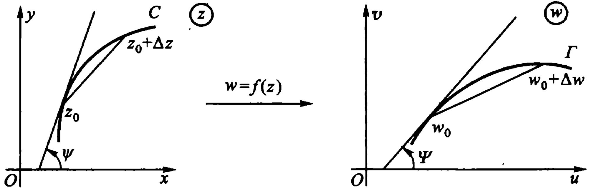

图7.1
 

(7.2)说明:像点间的无穷小距离与原像点间的无穷小距离之比的极限是  $ R = \big|\underbrace{f'(z_0)}_{}\big| $，它仅与  $ z_0 $ 有关，而与过  $ z_0 $ 的曲线 C 之方向无关。称为变换  $ w = f(z) $ 在点  $ z_0 $ 的伸缩率。这也就是导数模的几何意义。

上面提到的旋转角与 C 的选择无关这个性质,称为旋转角不变性;伸缩率与 C 的方向无关这个性质,称为伸缩率不变性.

从几何意义上看: 如果忽略高阶无穷小, 伸缩率不变性就表示  $ w = f(z) $ 将  $ z = z_{0} $ 处的无穷小的圆变成  $ w = w_{0} $ 处的无穷小的圆, 其半径之比为  $ \left| f'(z_{0}) \right| $.

上面的讨论说明: 解析函数在导数不为零的地方具有旋转角不变性和伸缩率不变性.

例 7.1 试求变换  $ w = f(z) = z^{2} + 2z $ 在点  $ z = -1 + 2i $ 处的旋转角，并且说明它将 z 平面的哪一部分放大？哪一部分缩小？

解 因

 $$ f^{\prime}\left(z\right)=2z+2=2\left(z+1\right), $$ 

 $$ f^{\prime}\left(-1+2\mathrm{i}\right)=2\left(-1+2\mathrm{i}+1\right)=4\mathrm{i}, $$ 

故在点  $ -1+2i $ 处的旋转角  $ \arg f'(-1+2i)=\frac{\pi}{2} $.

又因  $ \left|f^{\prime}(z)\right|=2\sqrt{(x+1)^{2}+y^{2}} $，这里  $ z=x+iy $，而  $ \left|f^{\prime}(z)\right|<1 $ 的充要条件是  $ (x+1)^{2}+y^{2}<\frac{1}{4} $，故  $ w=f(z)=z^{2}+2z $ 把以

<!-- page: 297 -->

-1 为心,  $ \frac{1}{2} $ 为半径的圆周内部缩小, 外部放大.

现在，我们再继续上面的讨论.

经点  $ z_{0} $ 的两条有向曲线  $ C_{1} $、 $ C_{2} $ 的切线方向所构成的角，称为两曲线在该点的夹角。今设  $ C_{i}(i=1,2) $ 在点  $ z_{0} $ 的切线倾角为  $ \psi_{i}(i=1,2) $;  $ C_{i} $ 在变换  $ \boldsymbol{w}=\boldsymbol{f}(z) $ 下的像曲线  $ \Gamma_{i} $ 在点  $ \boldsymbol{w}_{0_{i}}=f(z_{0}) $ 的切线倾角为  $ \Psi_{i}(i=1,2) $，则由 (7.1) 有

 $$ \Psi_{1}-\psi_{1}=\alpha\mathrm{~ 及 ~}\Psi_{2}-\psi_{2}=\alpha, $$ 

即有

 $$ \Psi_{1}-\psi_{1}=\Psi_{2}-\psi_{2}, $$ 

所以

 $$ \Psi_{1}-\Psi_{2}=\psi_{1}-\psi_{2}=\delta. $$ 

这里  $ \psi_{1}-\psi_{2} $ 是  $ C_{1} $ 和  $ C_{2} $ 在点  $ z_{0} $ 的夹角（反时针方向为正）， $ \Psi_{1}-\Psi_{2} $ 是  $ \Gamma_{1} $ 和  $ \Gamma_{2} $ 在像点  $ \omega_{0}=f(z_{0}) $ 的夹角（反时针方向为正）。由此可见，这种保角性既保持夹角的大小，又保持夹角的方向（图 7.2）。

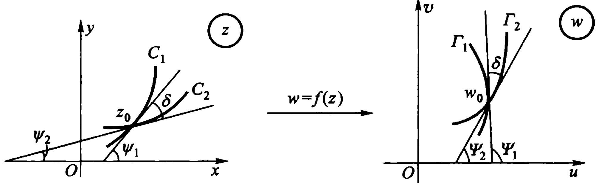

图 7.2
 

定义 7.1 若函数  $ w = f(z) $ 在点  $ z_{0} $ 的邻域内有定义，且在点  $ z_{0} $ 具有：

（1）伸缩率不变性，

(2) 过  $ z_{0} $ 的任意两曲线的夹角在变换  $ \omega = f(z) $ 下，既保持大小，又保持方向，

<!-- page: 298 -->

则称函数  $ w = f(z) $ 在点  $ z_{0} $ 是保角的，或称  $ w = f(z) $ 在点  $ z_{0} $ 处是保角变换。如果  $ w = f(z) $ 在区域 D 内处处都是保角的，则称  $ w = f(z) $ 在区域 D 内是保角的，或称  $ w = f(z) $ 在区域 D 内是保角变换。

总结以上的讨论，我们得到

定理 7.4 如  $ w = f(z) $ 在区域 D 内解析，则它在导数不为零的点处是保角的.

从而在这些点的各自充分小邻域内也是保角的(何故?).

推论 7.5 如  $ w = f(z) $ 在区域 D 内单叶解析，则 w = f(z) 在 D 内是保角的.

证 因由定理 6.11，在 D 内  $ f'(z) \neq 0 $.

例 7.2 试证： $ w = e^{iz} $ 将互相正交的直线族  $ \mathrm{Re} z = C_{1} $ 与  $ \mathrm{Im} z = C_{2} $ 依次变为互相正交的直线族  $ v = u \tan C_{1} $ 与圆周族

 $$ u^{2}+v^{2}=\mathrm{e}^{-2C_{2}} $$ 

证 正交直线族 Re z = C_{1} 与 Im z = C_{2}

在变换

 $$ w=e^{iz} $$ 

下，有

 $$ u+\mathrm{i}v=\mathrm{~}\omega=\mathrm{e}^{\mathrm{i}z}=\mathrm{e}^{\mathrm{i}\left(C_{1}+\mathrm{i}C_{2}\right)}=\mathrm{e}^{-C_{2}}\mathrm{e}^{\mathrm{i}C_{1}}, $$ 

即有像曲线族

 $$ u^{2}+v^{2}=\mathrm{e}^{-2C_{2}} 与 \ \operatorname{a r c}\tan\frac{v}{u}=C_{1}. $$ 

由于在 z 平面上  $ e^{iz} $ 处处解析，且

 $$ \frac{\mathrm{d}w}{\mathrm{d}z}=\mathrm{i}\mathrm{e}^{\mathrm{i}z}\neq0, $$ 

所以在 w 平面上圆周族

 $$ u^{2}+v^{2}=\mathrm{e}^{-2C_{2}} $$ 

与直线族

 $$ v=u\tan\ C_{1} $$ 

也是互相正交的.

<!-- page: 299 -->

### 3. 单叶解析变换的共形性

定义 7.2 如果  $ w = f(z) $ 在区域 D 内是单叶且保角的，则称此变换  $ w = f(z) $ 在 D 内是共形的，也称它为 D 内的共形映射.

注 解析变换  $ w = f(z) $ 在解析点  $ z_{0} $ 如有  $ f'(z_{0}) \neq 0 $ (由  $ f'(z) $ 在  $ z_{0} $ 的连续性, 必在  $ z_{0} $ 的邻域内  $ \neq 0 $), 于是  $ w = f(z) $ 在点  $ z_{0} $ 保角, 因而在  $ z_{0} $ 的邻域内单叶保角, 从而在  $ z_{0} $ 的邻域内共形 (局部); 在区域 D 内  $ w = f(z) $ (整体) 共形, 必然在 D 内处处 (局部) 共形, 但反过来不必真.

例 7.3 讨论解析函数  $ w = z^{n} $ (n 为正整数) 的保角性和共形性.

解 （1）因为

 $$ \frac{\mathrm{d}w}{\mathrm{d}z}=nz^{n-1}\neq0\quad(z\neq0), $$ 

故  $ w = z^{n} $ 在 z 平面上除原点 z = 0 外，处处都是保角的.

(2) 由于  $ w = z^{n} $ 的单叶性区域是顶点在原点张度不超过  $ \frac{2\pi}{n} $ 的角形区域. 故在此角形区域内  $ w = z^{n} $ 是共形的. 在张度超过  $ \frac{2\pi}{n} $ 的角形区域内, 则不是共形的, 但在其中各点的邻域内是共形的 (由定理 7.3).

定理 7.6 设  $ w = f(z) $ 在区域 D 内单叶解析，则

(1)  $ w = f(z) $ 将 D 共形映射成区域  $ G = f(D) $.

(2) 反函数  $ z = f^{-1}(w) $ 在区域 G 内单叶解析，且

 $$ f^{-1^{\prime}}(w_{0})=\frac{1}{f^{\prime}(z_{0})}\quad(z_{0}\in D,w_{0}=f(z_{0})\in G). $$ 

证 （1）由推论 7.2, G 是区域，由推论 7.5 及定义 7.2,  $ w = f(z) $ 将 D 共形映射成 G.

(2) 由定理 6.11,  $ f'(z_0) \neq 0 (z_0 \in D) $, 又因  $ w = f(z) $ 是 D 到 G 的单叶满变换, 因而是 D 到 G 的一一变换. 于是, 当  $ w \neq w_0 $

<!-- page: 300 -->

时， $ z \neq z_{0} $，即反函数  $ z = f^{-1}(w) $ 在区域 G 内单叶。故

 $$ \frac{f^{-1}(w)-f^{-1}(w_{0})}{w-w_{0}}=\frac{z-z_{0}}{w-w_{0}}=\frac{1}{\frac{w-w_{0}}{z-z_{0}}}. $$ 

由假设  $ f(z)=u(x,y)+iv(x,y) $ 在区域 D 内解析，即在 D 内满足 C.-R. 方程

 $$ u_{x}=v_{y},u_{y}=-v_{x}. $$ 

故

 $$ \begin{array}{r l}{\left|\begin{array}{l l}{u_{x}}&{u_{y}}\\ {v_{x}}&{v_{y}}\end{array}\right|}&{=\left|\begin{array}{l l}{u_{x}}&{-v_{x}}\\ {v_{x}}&{u_{x}}\end{array}\right|=u_{x}^{2}+v_{x}^{2}}\\ &{=\mid u_{x}+\mathrm{i}v_{x}\mid^{2}=\mid f^{\prime}(z)\mid^{2}\neq0,\quad(z\in D)}\end{array} $$ 

由数学分析中隐函数存在定理，存在两个函数

 $$ x=x\left(u,v\right),y=y\left(u,v\right) $$ 

在点  $ w_{0}=u_{0}+i v_{0} $ 及其一个邻域  $ N_{\varepsilon}(w_{0}) $ 内为连续. 即在邻域  $ N_{\varepsilon}(w_{0}) $ 中，当  $ w\to w_{0} $ 时，必有  $ z=f^{-1}(w)\to z_{0}=f^{-1}(w_{0}) $.

故

 $$ \begin{aligned}&\lim_{w\to w_{0}}\frac{f^{-1}(w)-f^{-1}(w_{0})}{w-w_{0}}=\frac{1}{}\\\overset{=}{}&=\frac{1}{\lim\limits_{z\to z_{0}}\frac{f(z)-f(z_{0})}{z-z_{0}}}=\frac{1}{f^{\prime}(z_{0})}.\end{aligned} $$ 

即

 $$ f^{-1^{\prime}}(\mathcal{w}_{0})=\frac{1}{f^{\prime}(z_{0})}\quad(z_{0}\in D,\mathcal{w}_{0}=f(z_{0})\in G). $$ 

由于  $ w_{0} $ 或  $ z_{0} $ 的任意性，即知  $ z = f^{-1}(w) $ 在区域 G 内解析.

注 D. Menchoff 曾经证明本定理 (1) 款之逆亦真. 即“如  $ w = f(z) $ 将区域 D 共形映射成区域 G, 则  $ w = f(z) $ 在 D 内单叶解析.”其证明可见 D. Menchoff, Les conditions de monogénéité (单演性条件), 巴黎, 1936, 39 页及以后.

由此可见，如  $ w = f(z) $ 将区域 D 共形映射成区域  $ G = f(D) $，则其反函数  $ z = f^{-1}(w) $ 将区域 G 共形映射成区域 D。这时，区域

<!-- page: 301 -->

D 内的一个无穷小曲边三角形  $ \delta $ 变换成区域 G 内的一个无穷小曲边三角形  $ \triangle $（如图 7.3）；由于保持了曲线间的夹角大小及方向，故  $ \delta $ 与  $ \triangle $ “相似”。这就是共形映射这一名称的由来。

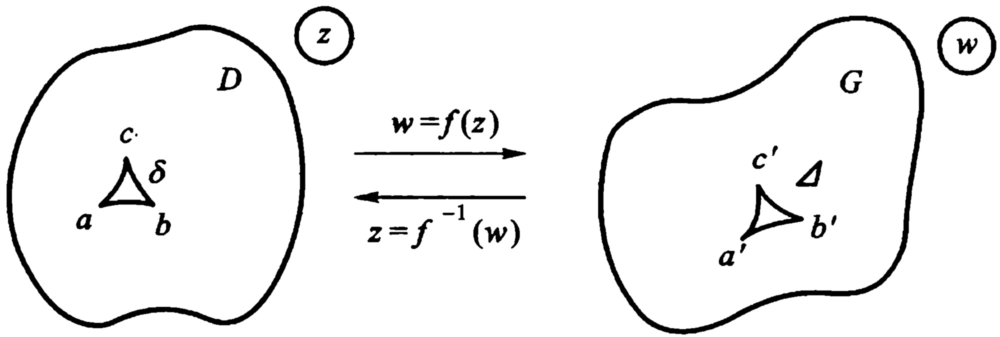

图7.3
 

共形映射理论的基本任务是，给定一个区域 D 及另一个区域 G，要求找出将 D 共形映射成 G 的函数  $ f(z) $ 以及惟一性条件。共形映射的这种一般理论，我们将放到本章 §4 叙述。

显然，两个共形映射的复合仍然是一个共形映射。具体地说，如  $ \xi = f(z) $ 将区域 D 共形映射成区域 E，而  $ w = h(\xi) $ 将 E 共形映射成区域 G，则  $ w = h[f(z)] $ 将区域 D 共形映射成区域 G。利用这一事实，可以复合若干基本的共形映射而构成较为复杂的共形映射。

下面§2及§3研究分式线性变换和由某些初等函数构成的函数的共形性.它们在共形映射中都是很基本的.

#### §2. 分式线性变换

### 1. 分式线性变换及其分解

$$  w=\frac{az+b}{cz+d},\left|\begin{array}{cc}a&b\\c&d\end{array}\right|=ad-bc\neq0   \tag*{(7.3)}$$

称为分式线性变换.简记为  $ w = L(z) $.

<!-- page: 302 -->

条件  $ ad - bc \neq 0 $ 是必要的，否则将导致  $ L(z) $ 恒为常数.

此外，我们将(7.3)式在扩充 z 平面上加以如下补充定义：

如  $ c \neq 0 $，在  $ z = -\frac{d}{c} $ 处定义  $ \omega = \infty $，在  $ z = \infty $ 处定义  $ \omega = \frac{a}{c} $；

如 c = 0，在  $ z = \infty $ 处定义  $ \omega = \infty $。

这样，我们总认为分式线性变换  $ w = L(z) $ 是定义在整个扩充 z 平面上的. 变换 (7.3) 将扩充 z 平面一一地因而单叶地变成扩充 w 平面. 事实上，(7.3) 具有逆变换

$$  z=\frac{-d w+b}{c w-a}.   \tag*{(7.4)}$$

根据定理 7.1 的注，分式线性变换 (7.3) 在扩充 z 平面上是保域的.

注 分式线性变换(7.3)由德国数学家莫比乌斯(Möbius)作过大量的研究.在许多文献中,它就称为莫比乌斯变换.

分式线性变换(7.3)总可以分解成下述简单类型变换的复合：

（Ⅰ） $ w = kz + h $  $ (k \neq 0) $，

（Ⅱ） $ w=\frac{1}{z} $

事实上，当 c=0 时，(7.3) 已经是 (I) 型变换

 $$ w=\frac{a}{d}z+\frac{b}{d}; $$ 

当  $ c \neq 0 $ 时，(7.3)式可改写为

$$  w=\frac{a}{c}+\frac{bc-ad}{c(cz+d)}=\frac{bc-ad}{c}\cdot\frac{1}{cz+d}+\frac{a}{c},   \tag*{(7.3)  ^{\prime} }$$

它就是下面三个形如(Ⅰ.)和(Ⅱ)的变换

 $$ \begin{array}{l}\xi=cz+d,\eta=\frac{1}{\xi},\\w=\frac{bc-ad}{c}\eta+\frac{a}{c}\end{array} $$ 

的复合.

因此，弄清楚(Ⅰ)，(Ⅱ)型变换的几何性质，就可弄清楚一般

<!-- page: 303 -->

分式线性变换(7.3)的性质.

下面，我们来考察（Ⅰ）和（Ⅱ）型变换的几何意义.

（Ⅰ）型变换  $ w = kz + h $ ( $ k \neq 0 $) 可称为整线性变换。如果  $ k = \rho e^{ia} (\rho > 0, \alpha $ 为实数)，则

 $$ w=\rho\mathrm{e}^{i\alpha}z+h, $$ 

由此可见，此变换可以分解成三个更简单的变换：旋转、伸缩和平

移.也就是先将z旋转角度 $ \alpha $，然后作一个以原点为中心的伸缩变换（按比例系数 $ \rho $），最后平移一个向量 $ h $（如图7.4，此图是将原像与像画在同一平面上）。即是说，在整线性变换之下，原像与像相似。不过，这种变换不是任意的相似变换，而是不改变图形方向的相似变换（如图7.4，原像那个三角形的顶点顺

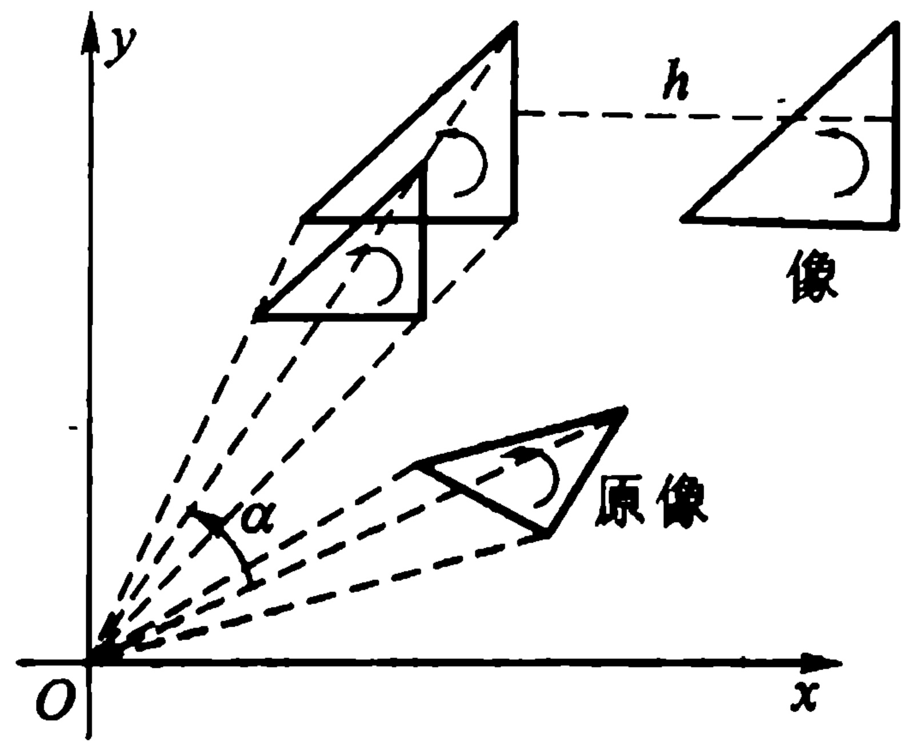

图7.4
 

序如果是反时针方向的，则其像三角形的像顶点顺序也应是反时针方向的).

（Ⅱ）型变换  $ w = \frac{1}{z} $ 可称为反演变换. 它可分解为下面两个更简单变换的复合：

$$  \begin{array}{c}\omega=\frac{1}{\overline{z}},\\\omega=\overline{\omega}.\end{array}   \tag*{(7.5)}$$

前者称为关于单位圆周的对称变换，并称 z 与  $ \omega $ 是关于单位圆周的对称点。后者称为关于实轴的对称变换，并称  $ \omega $ 与  $ \omega $ 是关于实轴的对称点。

已知点 z，可用如图 7.5 的几何方法作出  $ \omega = \frac{1}{\overline{z}} $，然后就可作出  $ \omega = \overline{\omega} = \frac{1}{z} $（如图 7.5，此图也是将像与原像画在同一平面上）.

<!-- page: 304 -->

由图 7.5 可知，直角三角形  $ OzA $ 与直角三角形  $ OA\omega $ 相似. 于是

 $$ \frac{1}{\left\lceil\omega\right\rceil}=\frac{\left|z\right|}{1}, $$ 

从而

 $ \left|\omega\right|\left|z\right|=1^{2} $（即等于半径平方），

并且  $ \omega $、z 都在过单位圆圆心 O 的同一条射线上，这就是  $ \omega $、z 关于单位圆周对称的性质.

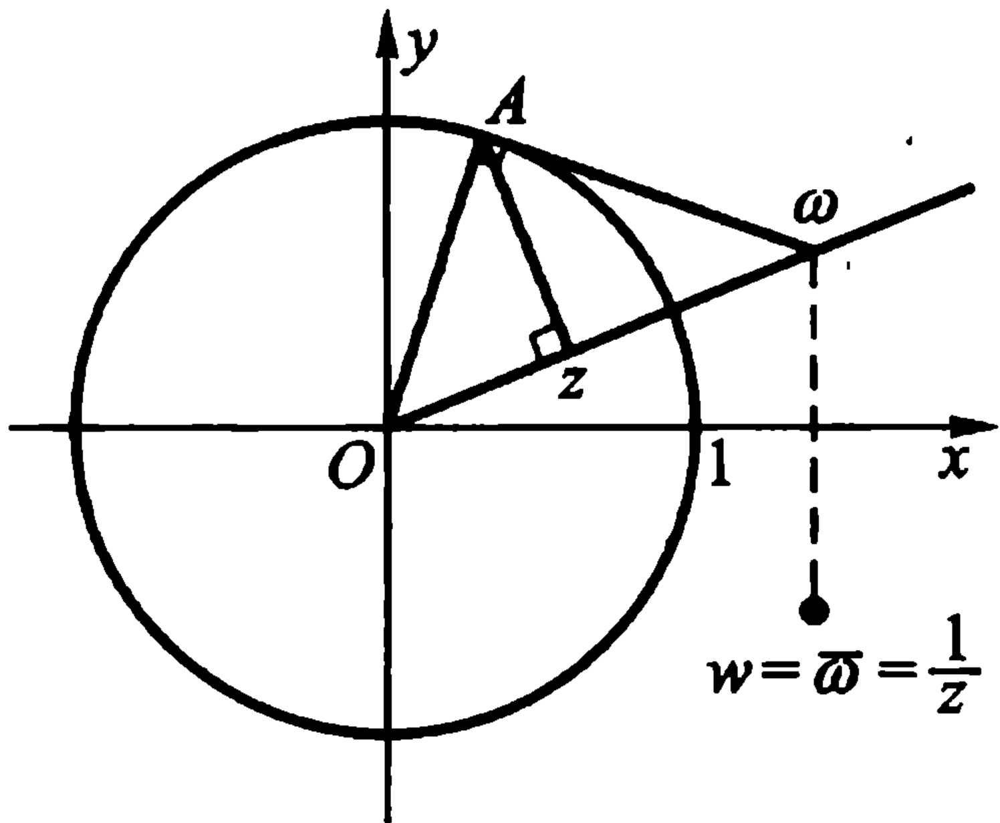

图7.5
 

另外，我们还规定圆心 O 与点  $ \infty $ 为关于单位圆周的对称点.

例 7.4 试证: 除恒等变换  $ w = z $ 之外, 一切分式线性变换 (7.3) 恒有两个相异的或一个二重的不动点 (即自己变成自己的点).

证 分式线性变换

$$  w=\frac{az+b}{cz+d}\quad(ad-bc\neq0)   \tag*{(7.3)}$$

的不动点一定适合方程

 $$ \begin{aligned}z&=\frac{az+b}{cz+d},\\cz^{2}+(d-a)z-b&=0.\end{aligned} $$ 

即

如果(7.7)的系数全为零，则(7.3)就成为恒等变换 w = z. 故(7.7)的系数不能全为零.

（1）若  $ c \neq 0 $，则(7.7)有两个根

 $$ z_{1,2}=\frac{a-d\pm\sqrt{\Delta}}{2c},\Delta=(a-d)^{2}+4b c, $$ 

当  $ \Delta\neq0 $ 时，(7.3) 有两个相异的不动点  $ z_{1} $ 和  $ z_{2} $.

当  $ \Delta=0 $ 时，(7.3) 有一个二重不动点  $ z=\frac{a-d}{2c} $.

（2）若 c=0. 这时 (7.7) 成为  $ (d-a)z-b=0 $.

<!-- page: 305 -->

当  $ a \neq d \neq 0 $ 时，(7.7)有根  $ z = \frac{b}{d - a} $.

这时(7.3)成为

 $$ w=\frac{a}{d}z+\frac{b}{d}, $$ 

所以这时(7.3)有不动点  $ z=\frac{b}{d-a} $ 和  $ z=\infty $.

当  $ a = d \neq 0 $ 时，必  $ b \neq 0 $ 。不动点

 $$ z=\frac{b}{d-a}=\infty. $$ 

故这时(7.3)以  $ z = \infty $ 为二重不动点.

本段最后,我们要说:分式线性变换的复合仍然是分式线性变换.

2. 分式线性变换的共形性 为了证明分式线性变换(7.3)在扩充 z 平面上是共形的,我们只要证明(Ⅰ)和(Ⅱ)型变换在扩充 z 平面上是保角的,因为(7.3)在扩充 z 平面上是单叶的.

对于(Ⅱ)型变换  $ \omega = \frac{1}{z} $ 来说，只要  $ z \neq 0, z \neq \infty $，则有

 $$ \frac{\mathrm{d}w}{\mathrm{d}z}=-\frac{1}{z^{2}}\neq0, $$ 

根据定理 7.4, 即知在  $ z \neq 0 $,  $ z \neq \infty $ 的各处是保角的. 至于在 z = 0 及  $ z = \infty $ 处, 就涉及到我们如何理解两条曲线在无穷远点处交角的意义.

由于第五章 §3 对无穷远点情形的讨论，启发我们有

定义 7.3 二曲线在无穷远点处的交角为  $ \alpha $，就是指它们在反演变换下的像曲线在原点处的交角为  $ \alpha $。

按照这样的定义，(Ⅱ)型变换  $ w = \frac{1}{z} $ 在 z = 0 及 z =  $ \infty $ 处是保角的.

因而(Ⅱ)型变换在扩充z平面上是保角的.

下面我们来看(Ⅰ)型变换

<!-- page: 306 -->

$$ w=kz+h(k\neq0) $$ 

在扩充 z 平面上的保角性.

因为

 $$ \frac{\mathrm{d}w}{\mathrm{d}z}=k\neq0, $$ 

根据定理 7.4, 即知在  $ z \neq \infty $ 的各处是保角的.

要证(Ⅰ)型变换在  $ z = \infty $ (像点为  $ \omega = \infty $) 保角，由定义 7.3，我们引入两个反演变换：

 $$ \lambda=\frac{1}{z},\qquad\mu=\frac{1}{w}. $$ 

它们分别将 z 平面的无穷远点保角变换为  $ \lambda $ 平面的原点；将 w 平面的无穷远点保角变换为  $ \mu $ 平面的原点。现将它们代入(Ⅰ)型变换得

 $$ \frac{1}{\mu}=k\frac{1}{\lambda}+h, $$ 

即

$$  \mu=\frac{\lambda}{h\lambda+k},   \tag*{(7.8)}$$

它将  $ \lambda $ 平面的原点  $ \lambda = 0 $ 变为  $ \mu $ 平面的原点  $ \mu = 0 $.

而

 $$ \frac{\mathrm{d}\mu}{\mathrm{d}\lambda}=\frac{h\lambda+k-h\lambda}{\left(h\lambda+k\right)^{2}}\bigg|_{\lambda=0}=\frac{k}{k^{2}}=\frac{1}{k}\neq0. $$ 

故变换(7.8)在  $ \lambda=0 $ 是保角的.

于是(Ⅰ)型变换在  $ z = \infty $ 是保角的，因而在扩充 z 平面上是保角的.

这样，我们就证明了

定理 7.7 分式线性变换(7.3)在扩充 z 平面上是共形的.

注 在无穷远点处不考虑伸缩率的不变性.

定义 7.4 扩充平面上有顺序的四个相异点  $ z_{1}, z_{2}, z_{3}, z_{4} $ 构

3. 分式线性变换的保交比性

<!-- page: 307 -->

成下面的量,称为它们 $ ^{的} $交比,记为 $ (z_{1},z_{2},z_{3},z_{4}) $:

 $$ \left(\mathcal{z}_{1},\mathcal{z}_{2},\mathcal{z}_{3},\mathcal{z}_{4}\right)=\frac{\mathcal{z}_{4}-\mathcal{z}_{1}}{\mathcal{z}_{4}-\mathcal{z}_{2}}:\frac{\mathcal{z}_{3}-\mathcal{z}_{1}}{\mathcal{z}_{3}-\mathcal{z}_{2}}. $$ 

当四点中有一点为 $ \infty $时，应将包含此点的项用1代替.例如 $ z_{1}=\infty $时，即有

 $$ (\infty,z_{2},z_{3},z_{4})=\frac{1}{z_{4}-z_{2}}:\frac{1}{z_{3}-z_{2}}, $$ 

亦即先视  $ z_{1} $ 为有限，再令  $ z_{1} \rightarrow \infty $ 取极限而得.

定理 7.8 在分式线性变换下, 四点的交比不变.

证 设

 $$ w_{i}=\frac{az_{i}+b}{cz_{i}+d},i=1,2,3,4, $$ 

则

$$  w_{i}-w_{j}=\frac{(a d-b c)(z_{i}-z_{j})}{(c z_{i}+d)(c z_{j}+d)},   \tag*{(7.9)}$$

因此

 $$ \begin{align*}&\left(w_{1},w_{2},w_{3},w_{4}\right)=\frac{w_{4}-w_{1}}{w_{4}-w_{2}}:\frac{w_{3}-w_{1}}{w_{3}-w_{2}}\\&\underbrace{(7.9)}_{\substack{\mathcal{Z}_{4}-\\ \mathcal{Z}_{4}-\\ \mathcal{Z}_{2}}},\underbrace{z_{4}-z_{1}}_{\substack{\mathcal{Z}_{4}-\\ \mathcal{Z}_{2}}}:\frac{z_{3}-z_{1}}{z_{3}-z_{2}}=\left(z_{1},z_{2},z_{3},z_{4}\right).\end{align*} $$ 

其他可能情形的证明留给读者.

从形式上看，分式线性变换(7.3)具有四个复参数 a, b, c, d。但由条件  $ ad - bc \neq 0 $，可知至少有一不为零，因此就可用它去除(7.3)的分子及分母，于是(7.3)实际上就只依赖于三个复参数（即六个实参数）。

为了确定这三个复参数，由定理 7.8 可知，只须任意指定三对对应点：

 $$ z_{i}\xleftarrow{w=L\left(z\right)}w_{i}\quad\left(i=1,2,3\right) $$ 

即可. 因从

<!-- page: 308 -->

$$ (\omega_{1},\omega_{2},\omega_{3},\omega)=(\boldsymbol{z}_{1},\boldsymbol{z}_{2},\boldsymbol{z}_{3},\boldsymbol{z}) $$ 

就可得到变换(7.3)，即  $ w = L(z) $. 其中 a, b, c, d 就可由  $ z_{i} $ 及  $ w_{i}(i=1,2,3) $ 来确定，且除了相差一个常数因子外是惟一的.

这就证明了：

定理 7.9 设分式线性变换将扩充 z 平面上三个相异点  $ z_{1} $， $ z_{2} $， $ z_{3} $ 指定变为  $ w_{1} $， $ w_{2} $， $ w_{3} $，则此分式线性变换就被唯一确定，并且可以写成

$$  \frac{\mathcal{W}-\mathcal{W}_{1}}{\mathcal{W}-\mathcal{W}_{2}}:\frac{\mathcal{W}_{3}-\mathcal{W}_{1}}{\mathcal{W}_{3}-\mathcal{W}_{2}}=\frac{\mathcal{Z}-\mathcal{Z}_{1}}{\mathcal{Z}-\mathcal{Z}_{2}}:\frac{\mathcal{Z}_{3}-\mathcal{Z}_{1}}{\mathcal{Z}_{3}-\mathcal{Z}_{2}}   \tag*{(7.10)}$$

（即三对对应点惟一确定一个分式线性变换）.

例 7.5 求将 2, i, -2 对应地变成 -1, i, 1 的分式线性变换.

解 所求分式线性变换为

 $$ \left(-1,i,1,\mathcal{w}\right)=\left(2,i,-2,z\right), $$ 

即

 $$ \frac{w+1}{w-i}:\frac{1+1}{1-i}=\frac{z-2}{z-i}:\frac{-2-2}{-2-i}, $$ 

化简为

 $$ \frac{w+1}{w-i}=\frac{1+3i}{4}\cdot\frac{z-2}{z-i}, $$ 

于是

 $$ \frac{w+1}{w+1-w+i}=\frac{(1+3i)(z-2)}{(1+3i)(z-2)-4(z-i)}, $$ 

化简后得

 $$ w=\frac{z-6\mathrm{i}}{3\mathrm{i}z-2}. $$ 

4. 分式线性变换的保圆周(圆)性 形如(Ⅰ)的整线性变换，显然将圆周(直线)变为圆周(直线)，这可由变换(Ⅰ)的几何意义得知.

形如（Ⅱ）的反演变换将圆周（直线）变为圆周或直线.事实上，圆周或直线可表为（见第一章习题（一）8）

$$  \begin{aligned}&\boldsymbol{A}z\overline{z}+\bar{\beta}z+\beta\overline{z}+\boldsymbol{C}=\boldsymbol{0},\\&(\boldsymbol{A},\boldsymbol{C} 为实数 ,|\beta|^{2}>\boldsymbol{A}\boldsymbol{C})\end{aligned}   \tag*{(7.11)}$$

当 A=0 时就表直线. 经过反演变换  $ \omega=\frac{1}{z} $，(7.11)成为

<!-- page: 309 -->

$$ C\bar{\tau}\bar{\tau}\bar{\omega}+\bar{\beta}\bar{\tau}\bar{\omega}+\beta\bar{\tau}\bar{\omega}+A=0, $$ 

它表示直线或圆周（视 C 是否为零而定）.

因为分式线性变换(7.3)是几个(Ⅰ)和(Ⅱ)型变换的复合,这样,我们就证明了

定理 7.10 分式线性变换将平面上的圆周（直线）变为圆周或直线.

注 在扩充平面上, 直线可视为经过无穷远点的圆周. 事实上, (7.11) 可改写为

 $$ A+\frac{\overline{\beta}}{\overline{z}}+\frac{\beta}{z}+\frac{C}{z\overline{z}}=0, $$ 

欲其经过 $ \infty $，必须且只须 A = 0。因此可以说： $ \uwave{\text{在分式线性变换(7.3)下，扩充z平面上的圆周周变为扩充w平面上的圆周}} $，同时，圆被保形变换成圆。

这就是分式线性变换的保圆周(圆)性.

设  $ w = L(z) $ 是一分式线性变换， $ \gamma $ 为扩充 z 平面上的一个圆周，则  $ \Gamma = L(\gamma) $ 是扩充 w 平面上的一个圆周。由于扩充平面被圆周划分为两个区域，如  $ \gamma $ 分扩充 z 平面为区域  $ d_{1}, d_{2} $； $ \Gamma $ 分扩充 w 平面为  $ D_{1}, D_{2} $，则我们可以断定  $ d_{1} $ 的像必然是  $ D_{1} $ 和  $ D_{2} $ 中的一个，而  $ d_{2} $ 的像是  $ D_{1} $ 和  $ D_{2} $ 中的另一个。为了确定对应的区域，有两个办法：其一是，在一区域，例如  $ d_{1} $ 中，取一点  $ z_{0} $，如  $ w_{0} = L(z_{0}) \in D_{1} $，则可以断定  $ D_{1} = L(d_{1}) $；否则， $ D_{2} = L(d_{1}) $。另一办法是，在  $ \gamma $ 上任取三点  $ z_{1}, z_{2}, z_{3} $，使沿  $ z_{1}, z_{2}, z_{3} $ 绕行  $ \gamma $ 时， $ d_{1} $ 在观察者的左方，沿对应的  $ w_{1}, w_{2}, w_{3} $ 绕行  $ \Gamma $ 时，在观察者左方的那个区域就是  $ d_{1} $ 的像，其理由如下：过  $ z_{1} $ 作  $ \gamma $ 的一段法线 n，使 n 含于  $ d_{1} $（图 7.6），于是顺着  $ z_{1}, z_{2}, z_{3} $ 看，n 在观察者左方。n 的像 N = L(n) 是过  $ w_{1} $ 并与  $ \Gamma $ 正交的一段圆弧（或直线段），由于在  $ z_{1} $ 的保角性，顺着  $ w_{1}, w_{2}, w_{3} $ 看，N 也应当在观察者的左方。因此，在  $ w_{1}, w_{2}, w_{3} $ 左方的那个区域就是  $ d_{1} $ 的像。

<!-- page: 310 -->

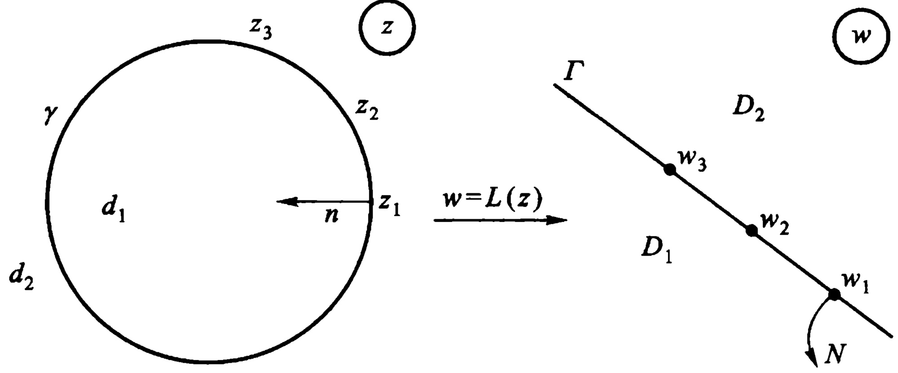

图7.6
 

反之，在扩充平面上给定区域 d 及 D，其边界都是圆周，则 d 必然可以共形映射成 D。分式线性变换就能实现，且在一定条件下，这种分式线性变换还是惟一的。

注 （1）当  $ \gamma $ 或  $ \Gamma = L(\gamma) $ 为直线时，其所界的圆是以它为边界的两个半平面；

（2）要使分式线性变换  $ w = L(z) $ 把有限圆周 C 变成直线，其条件是：C 上的某点  $ z_{0} $ 变成  $ \infty $.

5. 分式线性变换的保对称点性 在第一段中, 我们曾经讲过关于单位圆周的对称点这一概念, 现推广如下:

定义 7.5  $ z_{1}, z_{2} $ 关于圆周  $ \dot{\gamma}: |z - a| = R $ 对称是指  $ z_{1}, z_{2} $ 都在过圆心 a 的同一条射线上，且合

$$  \left|z_{1}-a\right|\mid z_{2}-a\mid=R^{2}.   \tag*{(7.6)'}$$

此外，还规定圆心 a 与点  $ \infty $ 也是关于  $ \gamma $ 为对称的（如图 7.7）.

由定义即知, $ z_{1},z_{2} $关于圆周 $ \gamma:|z-a|=R $对称,必须且只须

$$  z_{2\cdot}-a=\frac{R^{2}}{z_{1}-a}.   \tag*{(7.5)'}$$

下述定理从几何方面说明了对称点的特性.

<!-- page: 311 -->

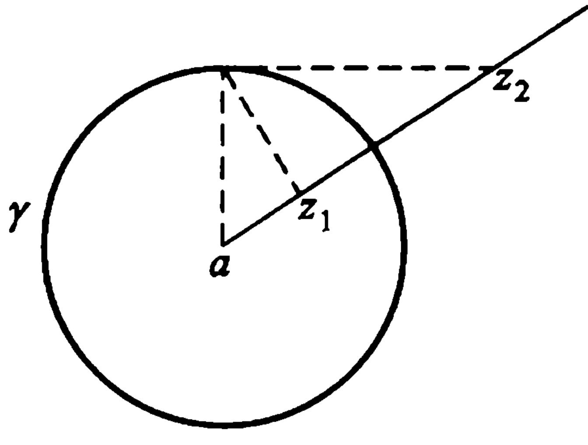

图7.7
 

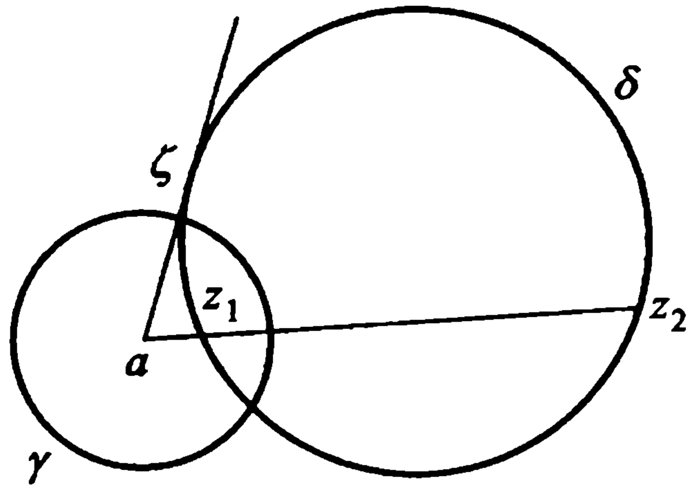

图7.8
 

定理 7.11 扩充 z 平面上两点  $ z_{1}, z_{2} $ 关于圆周  $ \gamma $ 对称的充要条件是，通过  $ z_{1}, z_{2} $ 的任意圆周都与  $ \gamma $ 正交.

证 当  $ \gamma $ 为直线的情形, 定理的正确性是很明显的. 我们只就  $ \gamma $ 为有限圆周  $ \left|z - a\right| = R $ 的情形予以证明(图 7.8).

必要性 设  $ z_{1}, z_{2} $ 关于圆周  $ \gamma: |z - a| = R $ 对称. 则过  $ z_{1}, z_{2} $ 的直线必然与  $ \gamma $ 正交 (按对称点的定义,  $ z_{1}, z_{2} $ 在从 a 出发的同一条射线上).

设  $ \delta $ 是过  $ z_{1}, z_{2} $ 的任一圆周（非直线），由 a 引  $ \delta $ 的切线  $ a\zeta, \zeta $ 为切点。由平面几何的定理得

 $$ \mid\zeta-a\mid^{2}=\mid z_{1}-a\mid\mid z_{2}-a\mid. $$ 

但由  $ z_{1}, z_{2} $ 关于圆周  $ \gamma $ 对称的定义，有

 $$ \left|z_{1}-a\right|\mid z_{2}-a\mid=R^{2}. $$ 

所以

 $$ \mid\zeta-a\mid=R. $$ 

即是说  $ \alpha\zeta $ 是圆周  $ \gamma $ 的半径. 因此  $ \delta $ 与  $ \gamma $ 正交.

充分性 设过  $ z_{1}, z_{2} $ 的每一圆周都与  $ \gamma $ 正交. 过  $ z_{1}, z_{2} $ 作一圆周 (非直线)  $ \delta $, 则  $ \delta $ 与  $ \gamma $ 正交. 设交点之一为  $ \zeta $, 则  $ \gamma $ 的半径  $ \alpha\zeta $ 必为  $ \delta $ 的切线.

联结  $ z_{1}, z_{2} $，延长后必经过 a（因为过  $ z_{1}, z_{2} $ 的直线与  $ \gamma $ 正交）。于是  $ z_{1}, z_{2} $ 在从 a 出发的同一条射线上，并且由平面几何的定理得

<!-- page: 312 -->

$$ \boldsymbol{R}^{2}=\left|\mathrm{\boldmath~\zeta-a~}\right|^{2}=\left|\mathrm{\boldmath~z_{1}-a~}\right|\left|\mathrm{\boldmath~z_{2}-a~}\right|. $$ 

因此， $ z_{1}, z_{2} $ 关于圆周  $ \gamma $ 对称.

下述定理就是分式线性变换的保对称点性.

定理 7.12 设扩充 z 平面上两点  $ z_{1}, z_{2} $ 关于圆周  $ \gamma $ 对称， $ w = L(z) $ 为一分式线性变换，则  $ w_{1} = L(z_{1}), w_{2} = L(z_{2}) $ 两点关于圆周  $ \Gamma = L(\gamma) $ 为对称.

证 设  $ \Delta $ 是扩充 w 平面上经过  $ w_{1}, w_{2} $ 的任意圆周. 此时, 必然存在一个圆周  $ \delta $, 它经过  $ z_{1}, z_{2} $, 并使  $ \Delta = L(\delta) $. 因为  $ z_{1}, z_{2} $ 关于  $ \gamma $ 对称, 故由定理 7.11,  $ \delta $ 与  $ \gamma $ 正交. 由于分式线性变换  $ w = L(z) $ 的保角性,  $ \Delta = L(\delta) $ 与  $ \Gamma = L(\gamma) $ 亦正交. 这样, 再由定理 7.11 即知  $ w_{1}, w_{2} $ 关于  $ \Gamma = L(\gamma) $ 对称.

6. 分式线性变换的应用 分式线性变换在处理边界为圆弧或直线的区域的变换中, 具有很大的作用.

下面三例就是反映这个事实的重要特例：

例 7.6 把上半 z 平面共形映射成上半 w 平面的分式线性变换可以写成

 $$ w=\frac{az+b}{cz+d}, $$ 

其中 a, b, c, d 是实数，且满足条件

$$  ad-bc>0.   \tag*{(7.12)}$$

事实上，所述变换将实轴变为实轴，且当 z 为实数时

 $$ \frac{\mathrm{d}w}{\mathrm{d}z}=\frac{ad-bc}{\left(cz+d\right)^{2}}>0, $$ 

即实轴变成实轴是同向的（如图 7.9），因此上半 z 平面共形映射成上半 w 平面.

当然，这也可以直接由下面的推导看出：

 $$ \begin{aligned}\operatorname{Im}\ w&=\frac{1}{2\mathrm{i}}(\overline{w-\overline{w}})=\frac{1}{2\mathrm{i}}\left(\frac{az+b}{cz+d}-\frac{a\overline{z}+b}{c\overline{z}+d}\right)\\&=\frac{1}{2\mathrm{i}}\frac{ad-bc}{\mid cz+d\mid^{2}}(z-\frac{\cdot}{z})=\frac{ad\cdot bc}{\mid cz+d\mid^{2}}\operatorname{Im}z.\end{aligned} $$

<!-- page: 313 -->

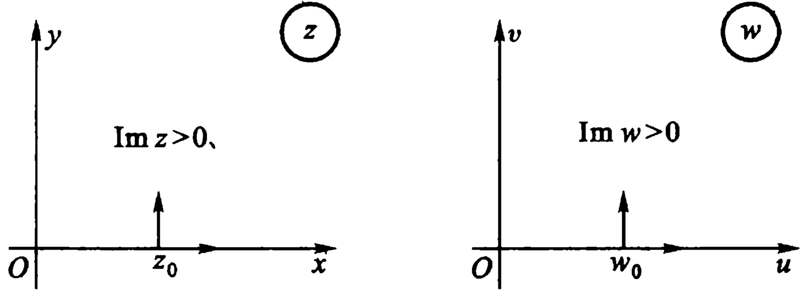

图7.9
 

注 满足条件(7.12)的分式线性变换也将下半平面共形映射成下半平面.

例 7.7 求出将上半平面  $ \mathrm{Im} z > 0 $ 共形映射成单位圆  $ |w| < 1 $ 的分式线性变换，并使上半平面一点  $ z = a (\mathrm{Im} a > 0) $ 变为 w = 0.

解 根据分式线性变换保对称点的性质，点  $ a $ 关于实轴的对称点  $ \bar{a} $ 应该变到 w = 0 关于单位圆周的对称点  $ w = \infty $。因此，这个变换应当具有形式：

$$  \begin{array}{r}{\omega=k\frac{z-a}{z-\bar{a}},}\end{array}   \tag*{(7.13)  ^{\prime} }$$

其中 k 是常数. k 的确定, 可使实轴上的一点, 例如 z = 0, 变到单位圆周上的一点

 $$ w=k\frac{a}{\overline{a}}. $$ 

因此

 $$ 1=\left|k\right|\left|\frac{a}{\overline{a}}\right|=\left|k\right|. $$ 

所以,可以令  $ k = e^{i\beta} $ ( $ \beta $ 是实数),最后得到所要求的变换为

$$  \begin{array}{r}{\mathcal{w}=\acute{\mathrm{e}}^{\mathrm{i}\beta}\frac{z-a}{z-\overline{a}}(\mathrm{I m}\ a>0).}\end{array}   \tag*{(7.13)}$$

在变换(7.13)中，即使 a 给定了，还有一个实参数  $ \beta $ 需要确定。为了确定此  $ \beta $，或者指出实轴上一点与单位圆周上某点的对应关系，或者指出变换在 z = a 处的旋转角  $ \arg w'(a) $。（读者可以验

<!-- page: 314 -->

证，变换(7.13)在 z = a 处的旋转角  $ \arg w'(a) = \beta - \frac{\pi}{2} $.

由(7.13)可见，同心圆周族 $ |w|=k(k<1) $的原像是圆周族

 $$ \left|\frac{z-a}{z-\bar{a}}\right|=k, $$ 

这是上半 z 平面内以  $ a $、 $ \bar{a} $ 为对称点的圆周族，又根据保对称性可知，单位圆  $ |w| < 1 $ 内的直径的原像是过  $ a $、 $ \bar{a} $ 的圆周在上半 z 平面内的半圆弧。

例 7.8 求出将单位圆  $ \left|z\right|<1 $ 共形映射成单位圆  $ \left|w\right|<1 $ 的分式线性变换，并使一点  $ z=a\left(\left|a\right|<1\right) $ 变到 w=0.

解 根据分式线性变换保对称点的性质，点  $ a $（不妨假设  $ a \neq 0 $）关于单位圆周  $ |z| = 1 $ 的对称点  $ a^* = \frac{1}{\bar{a}} $，应该变成  $ w = 0 $ 关于单位圆周  $ |w| = 1 $ 的对称点  $ w = \infty $，因此所求变换具有形式

$$  \omega=k\frac{z-a}{z-\frac{1}{\overline{a}}},   \tag*{(7.14)  ^{\prime} }$$

整理后得

 $$ \omega=k_{1}\frac{z-a}{1-\bar{a}z}, $$ 

其中  $ k_{1} $ 是常数. 选择  $ k_{1} $，使得 z=1 变成单位圆周  $ \left|w\right|=1 $ 上的点，于是

 $$ \left|k_{1}\frac{1-a}{1-\bar{a}}\right|=1, $$ 

即  $ \left|k_{1}\right|=1 $，因此可令  $ k_{1}=\mathrm{e}^{\mathrm{i}\beta} $ ( $ \beta $ 是实数)，最后得到所求的变换为

$$  \begin{array}{c}w=\mathrm{e}^{\mathrm{i}\beta}\frac{z-a}{1-\overline{a}z}(|a|<1).\end{array}   \tag*{(7.14)}$$

 $ \beta $ 的确定还要求附加条件，如像例 7.7 中所说过的类似。（读者可以验证，对于变换(7.14)，有  $ \arg w'(a) = \beta $.）

由(7.14)可见，同心圆周族 $ \left|w\right|=k(k<1) $的原像是

<!-- page: 315 -->

$$ \left|\frac{z-a}{1-\bar{a}z}\right|=k, $$ 

这是 z 平面上单位圆内以  $ a, \frac{1}{a} $ 为对称点的圆周族：

 $$ \left|\frac{z-a}{z-\frac{1}{\overline{a}}}\right|=|a|\cdot k. $$ 

而单位圆  $ \left|w\right|<1 $ 内的直径的原像是过  $ a $ 与  $ \frac{1}{a} $ 两点的圆周在单位圆  $ \left|z\right|<1 $ 内的圆弧.

注 上两例我们见到的分式线性变换  $ w = L(z) $ 的惟一性条件是下列两种形式：

（1） $ L(a)=b $（一对内点对应），再加一对边界点对应.

(2)  $ L(a) = b $ (一对内点对应),  $ \arg L'(a) = \alpha $ (即在点 a 处的旋转角固定).

思考题 （1）求将上半平面  $ \mathrm{Im}\ z>0 $ 共形映射成下半平面  $ \mathrm{Im}\ w<0 $ 的分式线性变换，条件(7.12)应怎样修改？

(2) 求将上半平面  $ \mathrm{Im}\ z>0 $ 共形映射成单位圆周外部  $ |w|>1 $ 的分式线性变换，(7.13) 括弧中的条件应作怎样修改？

（3）求将单位圆  $ \left|z\right| < 1 $ 共形映射成单位圆周外部  $ \left|w\right| > 1 $ 的分式线性变换，(7.14)括弧中的条件应作怎样修改？

例 7.9 求将上半 z 平面共形映射成上半 w 平面的分式线性变换  $ w = L(z) $，使符合条件：

 $$ 1+\mathrm{i}=L\left(\mathrm{i}\right),\quad0=L\left(0\right). $$ 

解 设所求分式线性变换  $ w = L(z) $ 为

 $$ w=\frac{az+b}{cz+d}, $$ 

其中 a, b, c, d 都是实数, ad - bc > 0.

由于  $ 0 = L(0) $，必 b = 0，因而  $ a \neq 0 $。用 a 除分子分母，则  $ w = L(z) $ 变形为

<!-- page: 316 -->

$$ w=\frac{z}{e z+f}, $$ 

其中  $ e=\frac{c}{a} $， $ f=\frac{d}{a} $ 都是实数，

再由第一个条件得

 $$ 1+\mathrm{i}=\frac{\mathrm{i}}{e\mathrm{i}+f}, $$ 

即

 $$ (f-e)+\mathrm{i}(f+e)=\mathrm{i}, $$ 

所以

 $$ f-e=0,f+e=1, $$ 

解之得

 $$ f=e=\frac{1}{2}, $$ 

故所求的分式线性变换为

 $$ w=\frac{z}{\frac{1}{2}z+\frac{1}{2}}, 即 w=\frac{2z}{z+1}. $$ 

例 7.10 求将上半 z 平面共形映射成圆  $ \left|w - w_{0}\right| < R $ 的分式线性变换  $ w = L(z) $，使符合条件

 $$ L\left(\mathrm{i}\right)=w_{0},L^{\prime}\left(\mathrm{i}\right)>0. $$ 

解 作分式线性变换

 $$ \xi=\frac{w-w_{0}}{R} $$ 

将圆  $ \left|w-w_{0}\right|<R $ 共形映射成单位圆  $ \left|\xi\right|<1 $.

其次，作出上半平面  $ \mathrm{Im} z > 0 $ 到单位圆  $ \left|\xi\right| < 1 $ 的共形映射，使 z = i 变成  $ \xi = 0 $，此分式线性变换为（如图 7.10）

 $$ \xi=\mathrm{e}^{\mathrm{i}\theta}\frac{z-i}{z+i}. $$ 

（为了能应用上述三个特例的结果.我们在 z 平面与 w 平面间插入一个“中间”平面—— $ \xi $ 平面.）

复合上述两个分式线性变换得

 $$ \frac{w-w_{0}}{R}=\mathrm{e}^{i\theta}\frac{z-i}{z+i}, $$

<!-- page: 317 -->

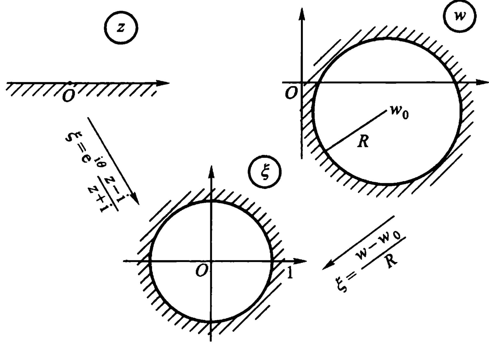

图 7.10
 

它将上半z平面共形映射成圆 $ \left|w-w_{0}\right|<R $，i变成 $ w_{0} $。再由条件 $ L^{\prime}(i)>0 $，先求得

 $$ \frac{1}{R}\frac{\mathrm{d}w}{\mathrm{d}z}\bigg|_{z=\mathrm{i}}=\mathrm{e}^{\mathrm{i}\theta}\frac{z+\mathrm{i}-z+\mathrm{i}}{(z+\mathrm{i})^{2}}\bigg|_{z=\mathrm{i}}=\mathrm{e}^{\mathrm{i}\theta}\frac{1}{2\mathrm{i}}, $$ 

即

 $$ L^{\prime}(\mathrm{i})=R\mathrm{e}^{\mathrm{i}\theta}\cdot\frac{1}{2\mathrm{i}}=\frac{R}{2}\mathrm{e}^{\mathrm{i}\left(\theta-\frac{\pi}{2}\right)}, $$ 

于是

 $$ \theta-\frac{\pi}{2}=0,\theta=\frac{\pi}{2},\mathrm{e}^{\mathrm{i}\theta}=\mathrm{i}, $$ 

所求分式线性变换为

 $$ \begin{array}{r}{\omega=R\mathrm{i}\frac{z-\mathrm{i}}{z+\mathrm{i}}+\omega_{0}.}\end{array} $$ 

#### §3. 某些初等函数所构成的共形映射

初等函数构成的共形映射对今后研究较复杂的共形映射大有作用.

### 1. 幂函数与根式函数 先讨论幂函数

<!-- page: 318 -->

$$  w=z^{n},   \tag*{(7.15)}$$

其中 n 是大于 1 的自然数. 除了 z=0 及 z= $ \infty $ 外, 它处处具有不为零的导数, 因而在这些点是保角的.

由第二章§3，(7.15)的单叶性区域是顶点在原点张度不超过 $ \frac{2\pi}{n} $的角形区域。例如说，(7.15)在角形区域 $ d:0<\arg z<a $和 $ \left(0<\alpha\leq\frac{2\pi}{n}\right) $内是单叶的，因而也是共形的（因为不保角的点 $ z=0 $及 $ z=\infty $在 $ d $的边界上，不在 $ d $内）。于是幂函数(7.15)将图7.11的角形区域 $ d:0<\arg z<\alpha $和 $ z=\frac{2\pi}{n} $共形映射成角形区域 $ D:0<\arg w<n\alpha $。

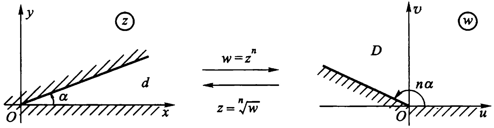

图 7.11
 

特别， $ w = z^{n} $ 将角形区域  $ 0 < \arg z < \frac{2\pi}{n} $ 共形映射成 w 平面上除去原点及正实轴的区域（图 7.12）.

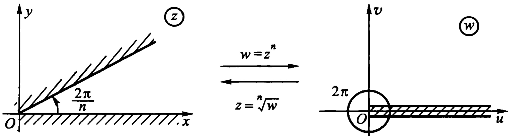

图 7.12
 

<!-- page: 319 -->

作为  $ w = z^{n} $ 的逆变换

$$  z=\sqrt[n]{w}\,,   \tag*{(7.16)}$$

将 w 平面上的角形区域  $ D: 0 < \arg w < n\alpha $  $ \left(0 < \alpha \leq \frac{2\pi}{n}\right) $ 共形映射成 z 平面上的角形区域  $ d: 0 < \arg z < \alpha $ (图 7.11). (这里  $ \sqrt[n]{w} $ 是 D 内的一个单值解析分支, 它的值完全由区域 d 确定).

总之，以后我们要将角形区域的张度拉大或缩小时，就可以利用幂函数(7.15)或根式函数(7.16)所构成的共形映射.

例 7.11 求一变换，把具有割痕“ $ \mathrm{Re} z = a, 0 \leqslant \mathrm{Im} z \leqslant h $”的上半 z 平面共形映射成上半 w 平面.

解 复合图 7.13 所示五个变换，即得所要求的变换为

 $$ \omega=\sqrt{(z-a)^{2}+h^{2}}+a, $$ 

例 7.12 将区域  $ -\frac{\pi}{4} < \arg z < \frac{\pi}{2} $ 共形映射成上半平面. 使 z = 1 - i, i, 0 分别变成 w = 2, -1, 0 (图 7.14).

解 易知  $ \xi = \left[ (\mathrm{e}^{\hat{\bar{\tau}}^{i}} \cdot z)^{\hat{\bar{\tau}}} \right]^{4} = (\mathrm{e}^{\hat{\bar{\tau}}^{i}} \cdot z)^{\hat{\bar{\tau}}} $ 将指定区域变成上半平面，不过 z = 1 - i, i, 0 变成  $ \xi = \sqrt[3]{4}, -1, 0 $.

现再作上半平面到上半平面的分式线性变换，使  $ \xi=\sqrt[3]{4}, -1, 0 $ 变成 w=2,-1,0. 此变换为

 $$ \omega=\frac{2(\sqrt[3]{4}+1)\xi}{(\sqrt[3]{4}-2)\xi+3\sqrt[3]{4}}. $$ 

复合两个变换，即得所求的变换为

 $$ \omega=\frac{2(\sqrt[3]{4}+1)\left(\mathrm{e}^{\frac{\pi}{4}\mathrm{i}}z\right)^{\frac{4}{3}}}{(\sqrt[3]{4}-2)\left(\mathrm{e}^{\frac{\pi}{4}\mathrm{i}}z\right)^{\frac{4}{3}}+3\sqrt[3]{4}} $$ 

2. 指数函数与对数函数 指数函数

$$  w=\mathrm{e}^{z}   \tag*{(7.17)}$$

在任意有限点均有 $ (e^{z})^{\prime} \neq 0 $，因而它在 z 平面上是保角的.

由第二章 §3，(7.17) 的单叶性区域是平行于实轴宽不超过

<!-- page: 320 -->

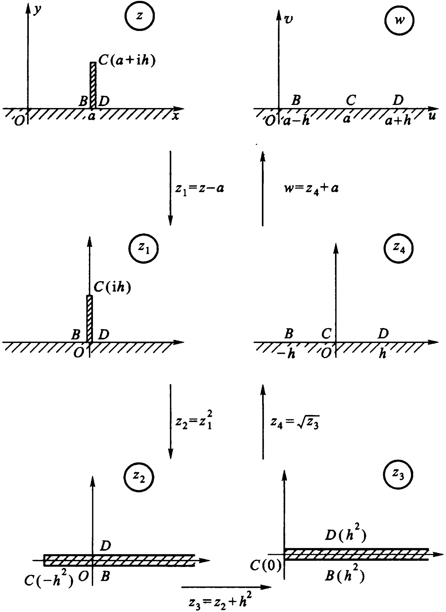

图 7.13
 

2 $ \pi $ 的带形区域.例如,指数函数(7.17)在带形区域  $ g:0<Im z<h $ (0<h≤2 $ \pi $)是单叶的,因而也是共形的( $ z=\infty $ 不在 g 内,而在 g 的边界上).于是指数函数(7.17)将带形区域  $ g:0<Im z<h $ (0<h≤2 $ \pi $)共形映射成角形区域  $ G:0<arg w<h $ (图 7.15).

<!-- page: 321 -->

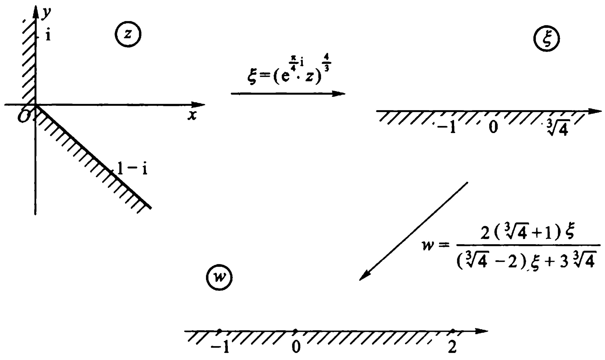

图 7.14
 

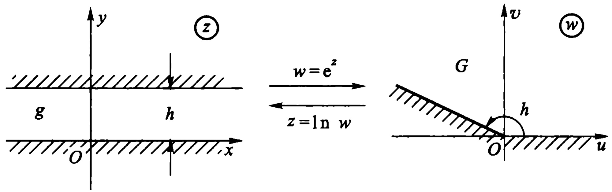

图 7.15
 

特别， $ w=e^{z} $ 将带形区域  $ 0<Im z<2\pi $ 共形映射成 w 平面除去原点及正实轴的区域.

作为  $ w = e^{z} $ 的逆变换

 $$ z=\ln w, $$ 

将图 7.15 所示 w 平面上的角形区域 G:0 < arg w < h (0 < h ≤ 2\pi) 共形映射成 z 平面上的带形区域 g:0 < Im z < h (这里 ln w 是 G 内的一个单值解析分支, 它的值完全由区域 g 确定.)

<!-- page: 322 -->

例 7.13 求一变换将带形  $ 0 < \mathrm{Im} z < \pi $ 共形映射成单位圆  $ |w| < 1 $.

解 复合如图 7.16 所示的两个变换，即得所求的变换为

 $$ \omega=\frac{\mathrm{e}^{z}-\mathrm{i}}{\mathrm{e}^{z}+\mathrm{i}}. $$ 

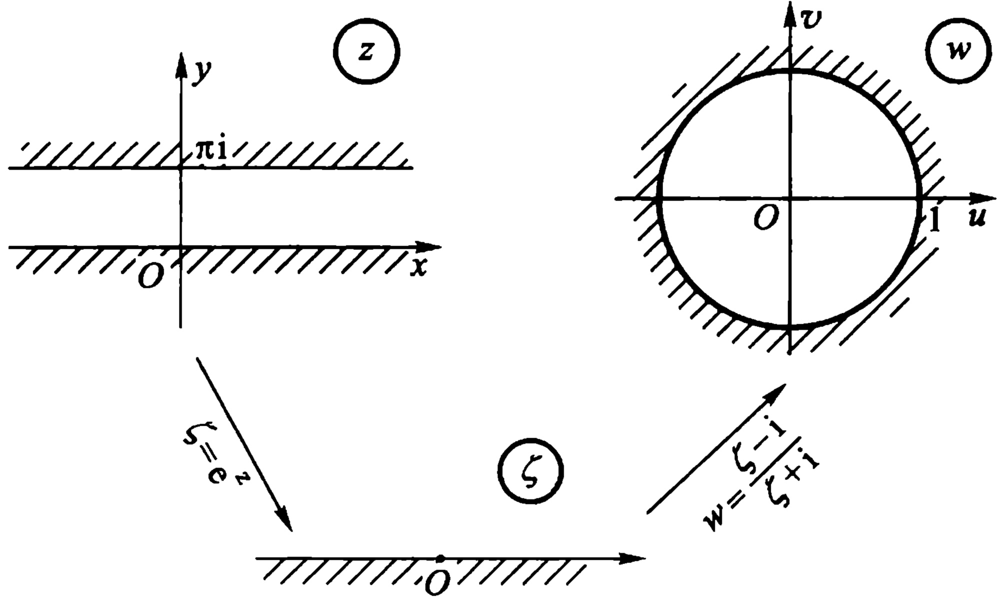

图 7.16
 

3. 由圆弧构成的两角形区域的共形映射 借助于分式线性函数,以及幂函数或指数函数的复合,可以将二圆弧或直线段所构成的两角形区域,共形映射成一个标准区域,比如上半平面.

由于分式线性变换的保圆性，它把已给两角形区域共形映射成同样形状的区域、或弓形区域、或角形区域。只要已给圆周（或直线）上有一个点变为  $ w = \infty $，则此圆周（或直线）就变成直线。如果它上面没有点变为  $ w = \infty $，则它就变为有限半径的圆周。所以，若二圆弧的一个公共点变为  $ w = \infty $，则此二圆弧所围成的两角形区域就共形映射成角形区域。

例 7.14 考虑交角为  $ \frac{n}{n} $ 的两个圆弧所构成的区域，将其共形映射成上半平面.

解 用 a, b 表示两个圆弧的交点. 我们先设法将两圆弧变成从原点出发的两条射线. 为此, 作分式线性变换

<!-- page: 323 -->

$$ \xi=k\frac{z-a}{z-b}. $$ 

其中 k 是一常数. 选择适当的 k, 就可以使给定的区域共形映射成角形区域

 $$ 0<\arg\xi<\frac{\pi}{n}. $$ 

再通过幂函数

 $$ w=\xi^{n} $$ 

就共形映射成上半平面.故所求变换具有形式

 $$ \begin{array}{r}{\omega=\left(k\frac{z-a}{z-b}\right)^{n}.}\end{array} $$ 

例 7.15 求出一个上半单位圆到上半平面的共形映射.

解 作分式线性变换

 $$ \xi=k\frac{z+1}{z-1} $$ 

将上半单位圆（视为两角形）变成第一象限，为此只要选择 k = -1 就行了. 事实上，此变换将线段  $ [-1,1] $ 变成了正实轴，将上半圆周变成了正虚轴. 于是

 $$ \mathcal{w}=.\left(-\frac{z+1}{z-1}\right)^{2} $$ 

就是所求的一个变换.

例 7.16 为了作出使相切于点 a 的两个圆周所构成的月牙形区域到上半平面的共形映射,我们先用分式线性变换

 $$ \xi=\frac{cz+d}{z-a} $$ 

将二圆周变成二平行直线.只要适当地选取 c,d,所述区域就能共形映射成带形区域

 $$ 0<\mathrm{I m}\xi<\pi. $$ 

再通过指数函数  $ w = e^{\xi} $，得到

 $$ \begin{array}{r}{\omega=\mathrm{e}^{\frac{c z+d}{z-a}},}\end{array} $$

<!-- page: 324 -->

它能将指定的区域共形映射成上半平面.

 $ ^{*} $4. 机翼剖面函数及其反函数所构成的共形映射 首先考虑机翼剖面外部区域到单位圆周外部区域的共形映射.

为什么要研究把如图 7.17(a) 的机翼剖面外部区域 D, 共形映射成单位圆周外部  $ G: |w| > 1 $ 呢？因为要研究机翼剖面轮廓线形状以及它在空中飞行时所受的阻力、上升力等，计算时如按原图，则困难且复杂，往往就把它共形映射成单位圆（如图 7.17(b)），研究它在单位圆周外部的相应条件。而在复变函数中，我们知道对于单位圆周的外部是比较好处理的。

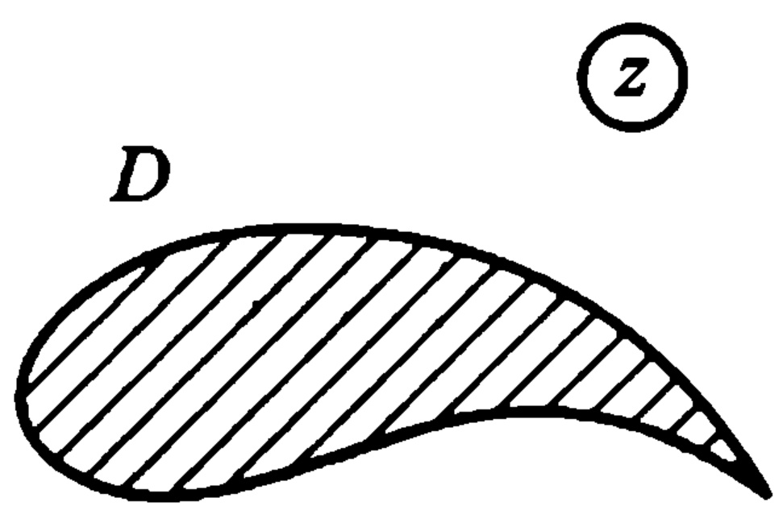

图 7.17(a)
 

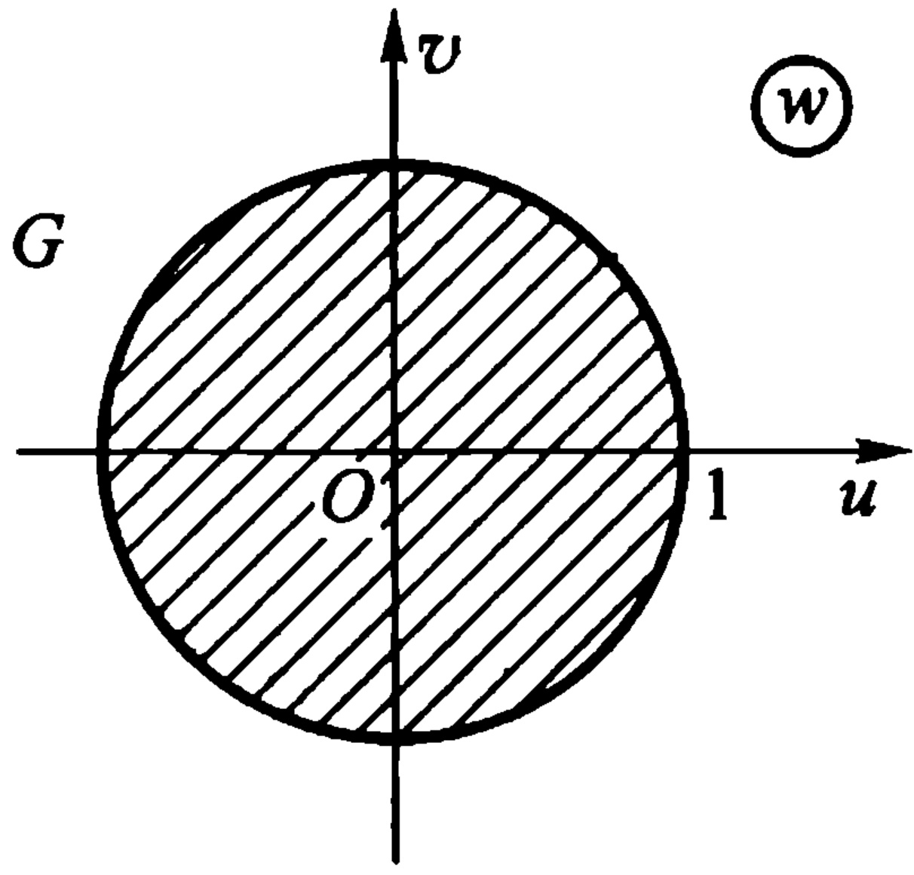

图 7.17(b)
 

为了讲得更确切起见，我们考虑比较特殊一些的形状，其坐标关系选成如图 7.17(a')与(b')所示。现在，我们分下列几步来作出机翼剖面函数及其反函数所构成的共形映射。

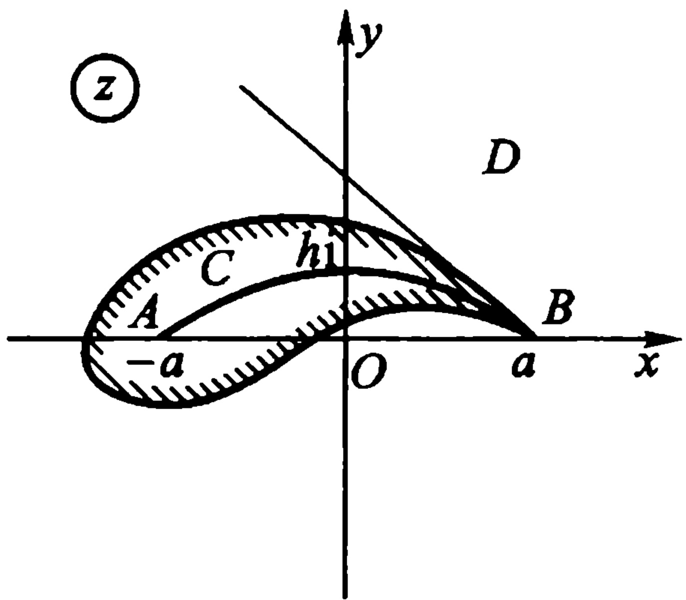

图 7.17(a')
 

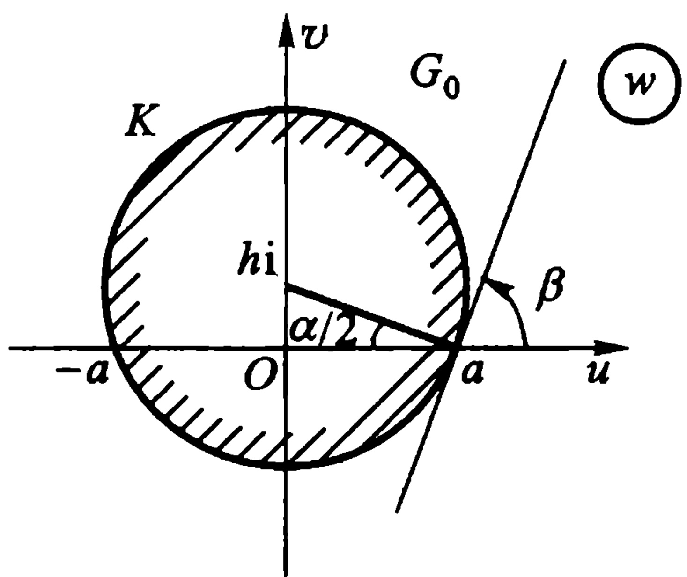

图 7.17(b')
 

<!-- page: 325 -->

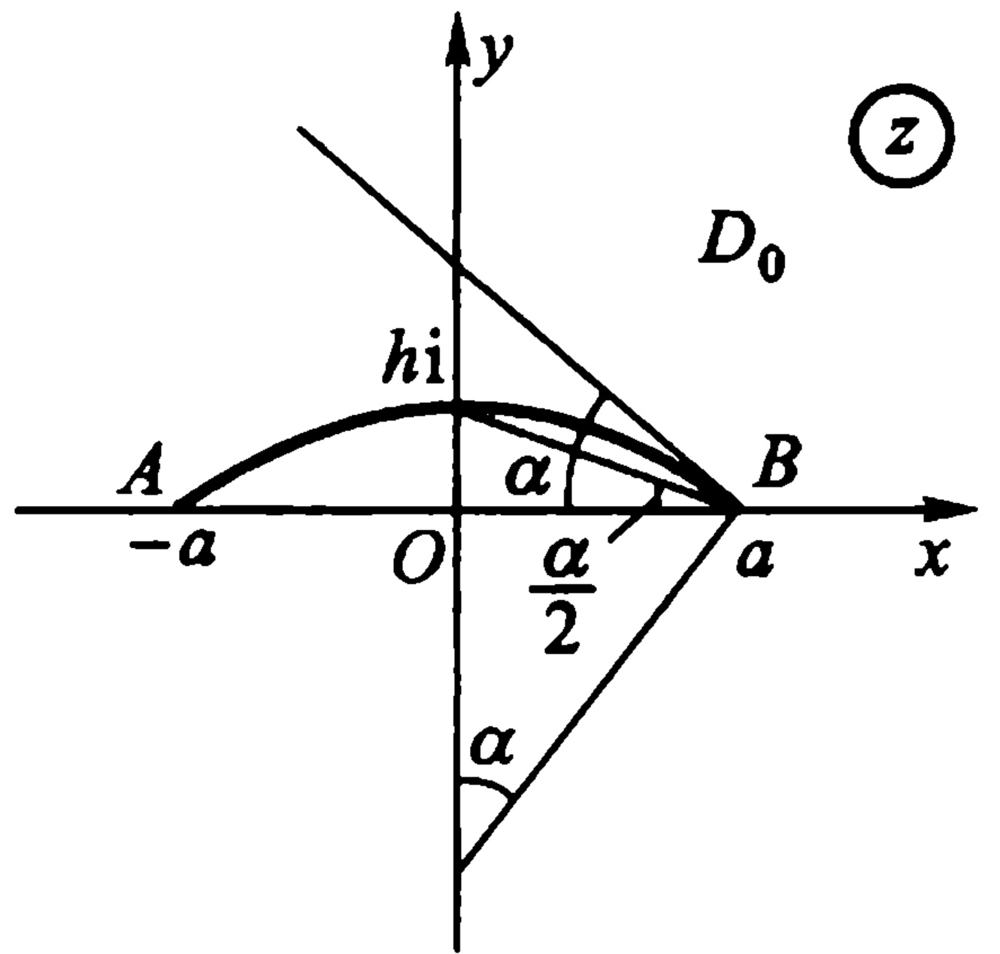

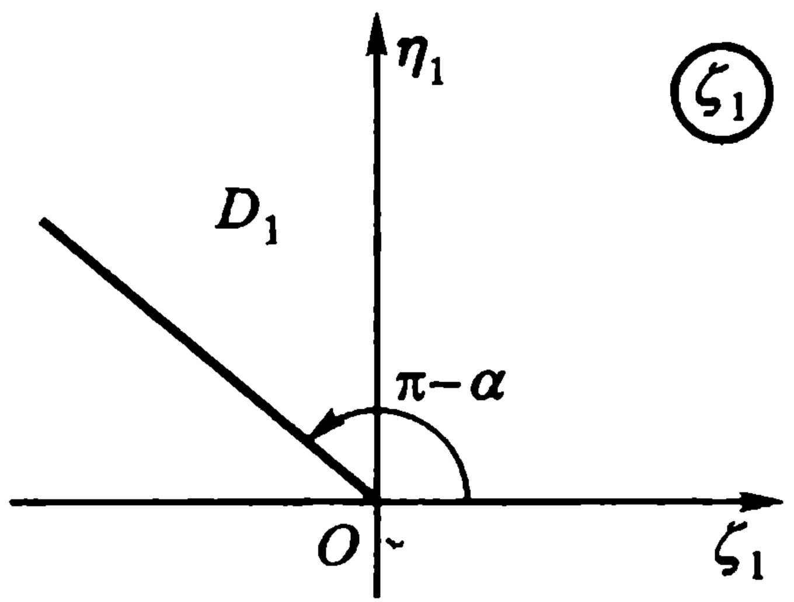

图 7.17(a")
 

图 7.17(c)
 

（1）分式线性变换

 $$ \zeta_{1}=\frac{z-a}{z+a} $$ 

将 z 平面上圆弧AB外部区域  $ D_{0} $ 共形映射成  $ \zeta_{1} $ 平面上去掉射线

 $$ \arg\ \zeta_{1}=\pi-\alpha $$ 

所成的区域  $ D_{1} $，其中

 $$ \alpha=2\arctan\frac{h}{a} $$ 

（图 7.17(a")及图 7.17(c)）.

（2）分式线性变换

 $$ \mathrm{w}_{1}=\frac{\mathrm{w}-\mathrm{a}}{\mathrm{w}+\mathrm{a}} $$ 

将 w 平面上圆周 K 外部的区域  $ G_{0} $ (图 7.17(b′)) 共形映射成  $ w_{1} $ 平面上的半平面区域

 $$ G_{1}:\beta-\pi<\arg w_{1}<\beta. $$ 

其中  $ \beta=\frac{\pi}{2}-\frac{a}{2} $（图 7.17(d)）. 而圆周 K 为以 hi 为心，过 -a, a 两点，且在 a 点有切线倾角  $ \beta $.

（3）变换

 $$ \zeta_{1}=w_{1}^{2} $$ 

将  $ G_{1} $ 共形映射成  $ D_{1} $，这是因为  $ 2\beta = \pi - \alpha $.

<!-- page: 326 -->

于是

 $$ \left(\frac{w-a}{w+a}\right)^{2}=\frac{z-a}{z+a}. $$ 

解出 z 来，即

$$  z=\frac{1}{2}\left(w+\frac{a^{2}}{w}\right).   \tag*{(7.18)}$$

其反函数

 $$ \omega=z+\sqrt{z^{2}-a^{2}} $$ 

将  $ D_{0} $ 共形映射成  $ G_{0} $

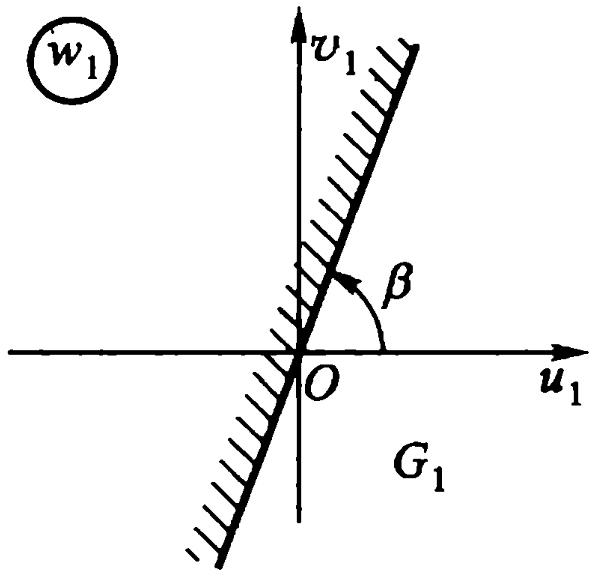

(7.18)称为机翼剖面函数或机翼变换，也称为儒可夫斯基（Жуковский）变换.

图 7.17(d)
 

在机翼变换(7.18)下，当 w 为自变量时，它将 w 平面上的区域  $ G_{0} $ 共形映射成 z 平面上的区域  $ D_{0} $。再看任何一个在 w = a 与圆周 K 相切的圆周  $ K' $ 经变换(7.18)变成 z 平面上的什么曲线？注意到  $ K' $ 与 K 相切（两个单侧切线在 a 的夹角为  $ \pi $，变到 z 平面时，设  $ K' $ 变为  $ C' $ 曲线，则  $ C' $ 与 AB 在 z = a 也相切（两个单侧切线在点 a 的夹角为  $ 2\pi $。如图 7.18(a)及(b)所示。

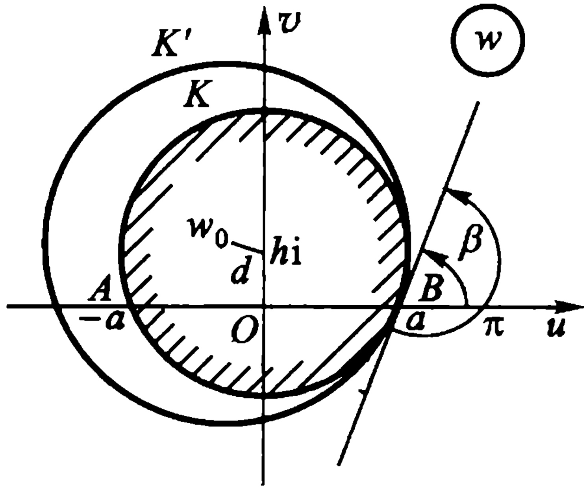

(a)
 

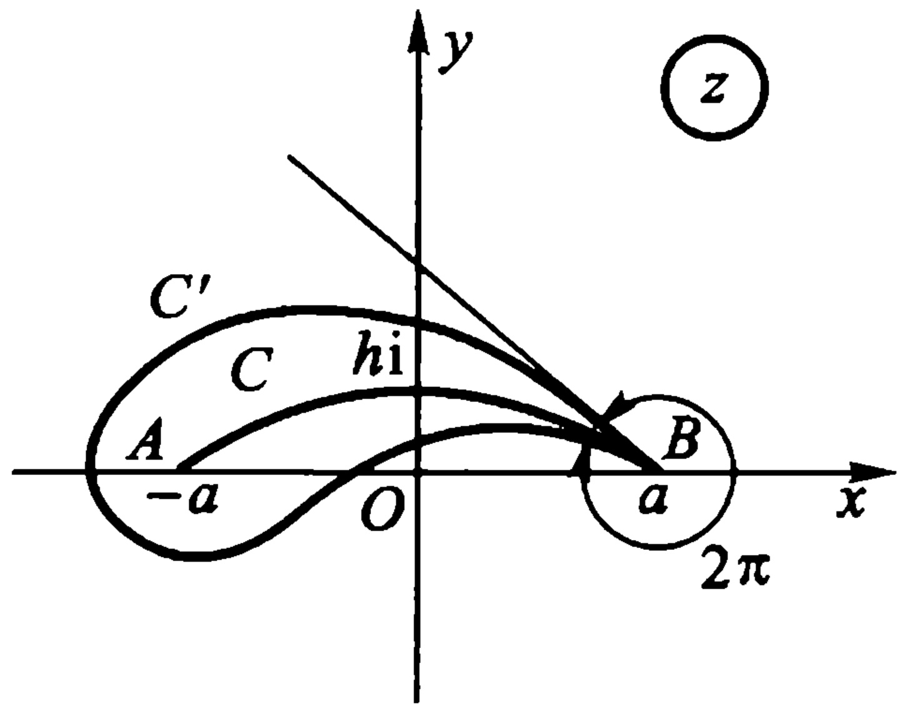

(b)
 

图 7.18
 

在 B 点有一个尖点。闭曲线  $ K' $ 包含了闭曲线  $ K $（在  $ K' $ 的内部）。相应地，闭曲线  $ C' $ 包含了  $ AB $（在  $ C' $ 的内部），而  $ C' $ 的形状就好像飞机机翼的截线（翼型），这就是儒可夫斯基最先采用的机翼

<!-- page: 327 -->

断面的周线.这里 $ K' $的圆心 $ w_{0} $到 $ h_{i} $的距离d,以及当初的a,h这三者是机翼的翼型参数.a,h,d分别反映了机翼剖面的宽度、弯度和厚度.一个翼型的选择,主要是由这三个参数来描述的.

注 （1）函数(7.18)在 w=a 的导数为零，在 w=a 的邻近，变换不是保角的.这只要看

 $$ \left(\frac{w-a}{w+a}\right)^{2}=\frac{z-a}{z+a} $$ 

的近似式

 $$ \frac{(w-a)^{2}}{2a}=z-a, $$ 

可知函数把过点  $ w = a $ 的曲线(两个单侧切线的夹角为  $ \pi $)变成过点 z = a 的曲线(两个单侧切线的夹角为  $ 2\pi $).

（2）在工程应用上，儒可夫斯基断面作机翼时有一个缺点，就是此种断面的后缘角是零，过于尖锐，不满足工程上坚固性的要求。故需先加修正，使其圆化。

### 5. 儒可夫斯基函数的单叶性区域

下面我们进一步观察儒可夫斯基函数(7.18)的单叶性区域.为此,我们首先将它改写成通常形式:

$$  \varpi=\frac{1}{2}\left(z+\frac{1}{z}\right),   \tag*{(7.18)  ^{\prime} }$$

这个函数在扩充 z 平面上除 z = 0, ∞ 外解析, z = 0, ∞ 都是它的一阶极点.

由上面的讨论易知，儒可夫斯基函数(7.18)’是一个单叶解析函数，它把扩充z平面上单位圆周外部 $ |z|>1 $共形映射成扩充w平面上去掉割线 $ -1\leq\mathrm{Re}w\leq1 $,  $ \mathrm{Im}w=0 $而得的区域 $ D_{0} $.

##### 又，分式线性函数

 $$ \eta=\frac{1}{z} $$ 

把扩充 z 平面上区域  $ \left|z\right| > 1 $ 共形映射成单位圆  $ \left|\eta\right| < 1 $. 将其代入 (7.18) 后得到

<!-- page: 328 -->

$$ w=\frac{1}{2}\left(\eta+\frac{1}{\eta}\right). $$ 

由此可见，(7.18)′把单位圆| $ \eta $|<1也共形映射成 $ D_{0} $

总之，儒可夫斯基函数(7.18)′在 $ |z|=1 $的内部及外部都是单叶的，且将它们都共形映射成扩充w平面上去掉割线 $ -1\leq\mathrm{Re}w\leq1 $， $ \mathrm{Im}w=0 $而得的区域 $ D_{0} $。这样一来，儒可夫斯基函数(7.18)′在区域 $ D_{0} $内就有两个单值反函数（称为单值解析分支）

 $$ z=w+\sqrt{w^{2}-1}, $$ 

它们分别将区域  $ D_{0} $ 共形映射成单位圆周  $ \left|z\right|=1 $ 的内部  $ \left|z\right|<1 $ 及外部  $ \left|z\right|>1 $.

### § 4. 关于共形映射的黎曼存在 定理和边界对应定理

1. 黎曼存在定理 不少实际问题要求我们将一个指定的区域共形映射成另一个区域来予以处理，前两节中的多数例子就是.

定理 7.6 告诉我们，一个单叶解析函数能够将它的单叶性区域共形映射成另一个区域.于是，我们很自然地反过来考虑共形映射理论中的一个基本问题：

“在扩充平面上任意给定两个单连通区域 D 与 G，是否存在一个（单叶）解析函数，使 D 共形映射成 G？简单地说，单连通区域 D 能共形映射成单连通区域 G 的条件为何？惟一性条件为何？”

上述问题可以简化成这样：

“在扩充平面上任给单连通区域 D，能否共形映射成单位圆？在什么条件下，这种变换还是惟一的？

事实上，在简化后的问题中，如果存在性有肯定的答案，又知道了惟一性条件，则先将 D 共形映射成单位圆，然后再将此单位圆共形映射成 G，两者复合起来即可将 D 共形映射成 G，也能弄

<!-- page: 329 -->

清楚这时的惟一性条件.

对于上述简化后的基本问题，有两种极端情形的回答是否定的：第一，区域 D 是扩充平面（这时 D 无边界点）；第二，区域 D 是扩充平面除去一点（这时 D 只有一个边界点。我们不妨假设除去的是点  $ \infty $。如果除去的是有限点 a，只须先作一个分式线性变换  $ \xi = \frac{1}{z - a} $，就将 D 先化成扩充  $ \xi $ 平面除去点  $ \infty $ 的区域了）。无论哪一种情形，如果  $ w = f(z) $ 将它们共形映射成单位圆，则由刘维尔定理知  $ f(z) $ 必恒为常数，它就不可能成为我们要求的变换。

除开这两种情形，答案总是肯定的，即有

定理 7.13 （黎曼存在与惟一性定理）扩充 z 平面上的单连通区域 D，其边界点不止一点，则有一个在 D 内的单叶解析函数  $ w = f(z) $，它将 D 共形映射成单位圆  $ |w| < 1 $；且当符合条件

$$  f(a)=0,\quad f^{\prime}(a)>0\quad(a\in D)   \tag*{(7.19)}$$

时，这种函数  $ f(z) $ 就只有一个.

注（1）这个定理的存在性证明比较难，超出大纲要求，故不给证明 $ ^{①} $.可参看普里瓦洛夫著：《复变函数引论》第十二章§6.

(2) 惟一性条件(7.19)的几何意义是: 指定  $ a \in D $ 变成单位圆的圆心, 而在点 a 的旋转角  $ \arg f'(a) = 0 $. 它依赖于三个实参数.

（3）在将单连通区域 D 共形映射成单连通区域 G 的一般情形，惟一性条件可表成

 $$ f(a)=b,\arg f^{\prime}(a)=\alpha. $$ 

其中  $ a \in D $,  $ b \in G $, 而  $ \alpha $ 为实参数.

在 D,G 的边界均是周线的情形,惟一性条件也可表成

 $$ f(a)=b,f(\xi)=\eta, $$

<!-- page: 330 -->

其中  $ a \in D $, b  $ \in G $.  $ \xi $ 为 D 之边界点,  $ \eta $ 为 G 之边界点.

在上述情形，惟一性条件还可表成

 $$ f(\xi_{i})=\eta_{i}\left(i=1,2,3\right), $$ 

其中  $ \xi_{i} $ 及  $ \eta_{i} $ 分别是 D 及 G 的边界上指定的三点（但绕行方向应一致）。区域的边界点的位置可用一个实参数来确定，例如，用某一个固定边界为起点的弧坐标即可确定。

利用施瓦茨引理，我们来证明黎曼定理的惟一性部分.

今设单叶解析函数  $ w_{1}=f_{1}(z) $ 也适合条件 (7.19)，并把单连通区域 D 共形映射成单位圆  $ \left|w_{1}\right|<1 $。这时，函数

 $$ \begin{array}{r}{\varpi_{1}=f_{1}\left[f^{-1}(\varpi)\right]=\varPhi(\varpi)}\end{array} $$ 

在单位圆  $ |w|<1 $ 内单叶解析，且满足条件：

 $$ \begin{aligned}&\Phi(0)=f_{1}\left[f^{-1}(0)\right]=f_{1}(a)=0,\\ &\mid\Phi(w)\mid=\mid w_{1}\mid<1,(|w|<1)\\ \end{aligned} $$ 

 $$ \Phi^{\prime}(0)\underline{\underline{ 定理 7.6}}\frac{f^{\prime}_{1}(a)}{f^{\prime}(a)}>0. $$ 

所以由施瓦茨引理知

$$  |\Phi(w)|=|\dot{w}_{1}|\leq|w|.   \tag*{(7.20)}$$

同样的结论可用于函数  $ \Phi(w) $ 的反函数

 $$ \begin{aligned}\boldsymbol{w}&=\boldsymbol{f}\left[\boldsymbol{f}_{1}^{-1}\left(\boldsymbol{w}_{1}\right)\right]=\boldsymbol{\varPhi}^{-1}\left(\boldsymbol{w}_{1}\right),\\&\left|\boldsymbol{w}\right|\leqslant\left|\boldsymbol{w}_{1}\right|=\left|\boldsymbol{\varPhi}(\boldsymbol{w})\right|.\end{aligned} $$ 

得到

由（7.20）及（7.21）得到

因此

 $$ \begin{array}{l}\left|\Phi(w)\right|=\left|w\right|,\\ \Phi(w)=\mathrm{e}^{\mathrm{i}\alpha}w\left(\alpha 为实数 \right).\\ 0<\Phi^{\prime}(0)=\mathrm{e}^{\mathrm{i}\alpha},\\ \mathrm{e}^{\mathrm{i}\alpha}=1\left( 因 \left|\mathrm{e}^{\mathrm{i}\alpha}\right|=1\right),\\ f_{1}\left\lceil f^{-1}(w)\right\rceil=\Phi(w)=w\end{array} $$ 

由于

故必

因而有

 $$ f_{1}\left[f^{-1}\left(\boldsymbol{\varpi}\right)\right]=\varPhi\left(\boldsymbol{\varpi}\right)=\varpi. $$ 

故必

 $$ f_{1}(z)=f(z). $$ 

例 7.17 如果函数  $ w = f(z) $ 在 z 平面上是解析的，并且不

<!-- page: 331 -->

取位于某一条简单弧  $ \gamma $ 上的那些值，则它必是一个常数.

证 设单叶解析函数  $ \omega = \varphi(w) $ 作出把曲线  $ \gamma $ 外部的单连通区域共形映射成单位圆  $ |\omega| < 1 $，根据黎曼存在定理，这函数是存在的，并且当然不是一个常数.

我们来看复合函数  $ \omega = \varphi[f(z)] = g(z) $，它在 z 平面上是解析的，并且所有它的值都位于单位圆  $ |\omega| < 1 $ 内。根据刘维尔定理，函数  $ \omega = g(z) $ 是个常数。但由非常数的解析函数  $ \omega = \varphi(w) $ 的单叶性，函数  $ w = f(z) $ 是一个常数。

思考题 说明刘维尔定理是例 7.17 所述定理的特殊情形.

2. 边界对应定理 上面所讨论的限于区域内部间的共形映射,未涉及边界;下面我们举出两个有关边界对应的定理,第一个不给证明①②.

定理 7.14(边界对应定理) 设

（1）有界单连通区域 D 与 G 的边界分别为周线 C 与  $ \Gamma $;

(2)  $ w = f(z) $ 将 D 共形映射成 G，

则  $ f(z) $ 可以扩张成  $ F(z) $，使在 D 内  $ F(z) = f(z) $，在  $ \overline{D} = D + C $ 上  $ F(z) $ 连续，并将 C 双方单值且双方连续地变成  $ \Gamma $.

从例 7.8 可验证此定理.

定理 7.15 （边界对应定理的逆定理，判断解析函数单叶性的充分条件）.

设单连通区域 D 及 G，分别是两条周线 C 及  $ \Gamma $ 的内部. 且设函数  $ w = f(z) $ 满足下列条件：

(1)  $ w = f(z) $ 在区域 D 内解析，在  $ D + C $ 上连续，

(2)  $ w = f(z) $ 将 C 双方单值地变成  $ \Gamma $,

则 (1) w = f(z) 在 D 内单叶；

<!-- page: 332 -->

(2)  $ G = f(D) $ (从而 w = f(z)) 将 D 共形映射成 G).

证 证明的关键，在应用辐角原理来证明集合等式

 $$ G=f(D). $$ 

（1）设  $ w_{0} $ 为 G 内任一点. 我们证明  $ w_{0} \in f(D) $，而且方程  $ f(z) - w_{0} = 0 $ 在 C 内部只有一个根. 根据辐角原理

 $$ N(f(z)-w_{0},C)=\frac{1}{2\pi}\Delta_{r}\arg(w-w_{0}) $$ 

(在 z 沿 C 的正向绕行一周的假定下). 由假设条件(2), 这时  $ w = f(z) $ 应该沿  $ \Gamma $ 的正向或负向绕行一周. 因此, 起点在  $ w_{0} $ 终点在  $ \Gamma $ 上的向量  $ w - w_{0} $ 应该转角  $ \pm 2\pi $. 于是

 $$ N(f(z)-\omega_{0},C)=\frac{1}{2\pi}\Delta_{r}\mathrm{a r g}(w-w_{0})=\pm1, $$ 

负号显然应该除去(因为  $ N \geqslant 0 $). 因此我们肯定  $ w = f(z) $ 必须沿  $ \Gamma $ 的正向 ( $ \Gamma $ 的内部在此方向的左边) 绕行, 并且方程  $ f(z) - w_{0} = 0 $ 在区域 D 内只有一个根.

（2）设  $ w_{0} $ 位于  $ \Gamma $ 的外部，则必  $ w_{0} \notin f(D) $. 因为

 $$ N(f(z)-\omega_{0},C)=\frac{1}{2\pi}\Delta_{r}\mathrm{a r g}(w-w_{0})=0, $$ 

即方程  $ f(z)-w_{0}=0 $ 在 D 内无根.

(3) 设  $ w_{1} $ 为  $ \Gamma $ 上的任一点，我们来证明方程  $ f(z) = w_{1} $ 在 D 内无根。假定 D 内有一点  $ z_{1} $ 使  $ f(z_{1}) = w_{1} $，则可得一个以  $ w_{1} $ 为中心的圆周  $ \gamma $，使对  $ \gamma $ 内部任意一点  $ w' $，方程  $ f(z) = w' $ 在 D 内有根（因  $ f(D) $ 为区域， $ w_{1} $ 为其内点）。特别在  $ \gamma $ 内部取一点  $ w' $ 位于  $ \Gamma $ 的外部，由 (2) 段证明，方程  $ f(z) = w' $ 在 D 内无根，发生矛盾。

由以上各结果, 可见函数  $ w = f(z) $ 在 D 内单叶, 并将 D 共形映射为  $ \Gamma $ 的内部 G.

例 7.18 如果将函数  $ w = z^{2} $ 表成极坐标的形式. 令

 $$ \begin{array}{r}{\varpi=\rho\mathrm{e}^{\mathrm{i}\varphi},z=r\mathrm{e}^{\mathrm{i}\theta},}\end{array} $$

<!-- page: 333 -->

则它把 z 平面上的圆周（图 7.19）

 $$ r=\cos\ \theta $$ 

变成心脏线

 $$ \rho=\cos^{2}\frac{\varphi}{2}=\frac{1}{2}(1+\cos\varphi), $$ 

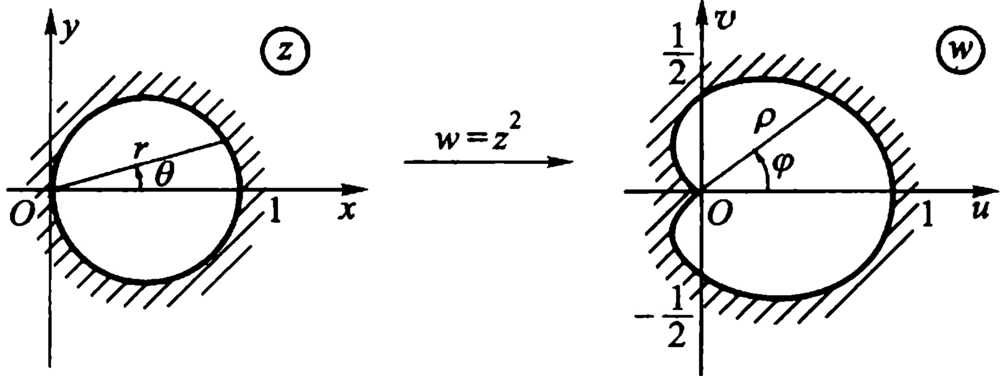

图7.19
 

并且是双方单值的.

由定理 7.15(单叶性原理),  $ w = z^{2} $ 将这个圆周的内部共形映射成心脏线的内部.

思考题 一个多连通区域(比如 $ \underset{\cdot}{如} $有一个“洞”的区域)可否共形映射成一个单连通区域？

## 第七章 习题

(一)

1 求  $ w = z^{2} $ 在 z = i 处的伸缩率和旋转角. 问此变换将经过点 z = i 且平行于实轴正方向的曲线的切线方向变换成 w 平面上哪一个方向？并作图.

答: 伸缩率 = 2, 旋转角 =  $ \frac{\pi}{2} $.

2 试利用保域定理 7.1 简捷地证明第二章习题(一)6(3)、(4).

3 在整线性变换 w = iz 下，下列图形分别变成什么图形？

<!-- page: 334 -->

（1）以  $ z_{1}=i, z_{2}=-1, z_{3}=1 $ 为顶点的三角形；

(2) 闭圆  $ \left| z - 1 \right| \leqslant 1 $.

答: (1) 以  $ w_{1} = -1, w_{2} = -i, w_{3} = i $ 为顶点的三角形; (2) 闭圆  $ \left|w - i\right| \leqslant 1 $.

4 下列各题中，给出了三对对应点  $ z_{1} \xleftarrow{} w_{1}, z_{2} \xleftarrow{} w_{2}, z_{3} \xleftarrow{} w_{3} $ 的具体数值，写出相应的分式线性变换，并指出此变换把通过  $ z_{1}, z_{2}, z_{3} $ 的圆周的内部，或直线左边（顺着  $ z_{1}, z_{2}, z_{3} $ 观察）变成什么区域.

(1)  $ 1 \longleftrightarrow 1, i \longleftrightarrow 0, -i \longleftrightarrow -1; $

(2)  $ 1 \longleftrightarrow \infty, i \longleftrightarrow -1, -1 \longleftrightarrow 0 $;

(3)  $ \infty \longleftrightarrow 0, i \longleftrightarrow i, 0 \longleftrightarrow \infty $;

(4)  $ \infty \longleftrightarrow 0,0 \longleftrightarrow 1,1 \longleftrightarrow \infty $.

答: (1)  $ w = \frac{(1 + \mathrm{i})(z - \mathrm{i})}{1 + z + 3\mathrm{i}(1 - z)}; $ (2)  $ w = \frac{\mathrm{i}(z + 1)}{1 - z}; $ (3)  $ w = -\frac{1}{z}; $ (4)  $ w = \frac{1}{1 - z}. $

5 z平面上有三个互相外切的圆周，切点之一在原点，函数  $ w = \frac{1}{z} $ 将此三个圆周所围成的区域变成 w 平面上什么区域？

6 如  $ w=\frac{az+b}{cz+d} $ 将单位圆周变成直线，其系数应满足什么条件？

答： $ \left|c\right|=\left|d\right| $ 且 ad - bc \neq 0.

7 分别求将上半 z 平面  $ \mathrm{Im} z > 0 $ 共形映射成单位圆  $ |w| < 1 $ 的分式线性变换  $ w = L(z) $，使符合条件：

(1)  $ L(i) = 0, L'(i) > 0; $

(2)  $ L(i) = 0, \arg L'(i) = \frac{\pi}{2} $.

答: (1)  $ w = i \frac{z - i}{z + i}; $ (2)  $ w = \frac{i - z}{i + z}. $

8 分别求将单位圆  $ \left|z\right|<1 $ 共形映射成单位圆  $ \left|w\right|<1 $ 的分式线性变换  $ w=L(z) $，使符合条件：

(1)  $ L\left(\frac{1}{2}\right)=0, L(1)=-1; $

(2)  $ L\left(\frac{1}{2}\right)=0 $,  $ \arg L'\left(\frac{1}{2}\right)=-\frac{\pi}{2} $.

<!-- page: 335 -->

答: (1)  $ w = \frac{2z - 1}{z - 2} $; (2)  $ w = \frac{\mathrm{i}(2z - 1)}{-2 + z} $.

9 求出将圆  $ \left|z-4i\right|<2 $ 变成半平面 v>u 的共形映射，使得圆心变到 -4，而圆周上的点 2i 变到 w=0.

答： $ w = -4i \cdot \frac{z - 2i}{z - 2(1 + 2i)} $

10 求出将上半 z 平面  $ \mathrm{Im} z > 0 $ 共形映射成圆  $ \left| w \right| < R $ 的分式线性变换  $ w = L(z) $，使符合条件  $ L(i) = 0 $；如果再要求  $ L'(i) = 1 $，此变换是否存在？

答： $ w = R e^{i\theta} \cdot \frac{z - i}{z + i}; w = 2 i \cdot \frac{z - i}{z + i} $

11 求将圆  $ \left|z\right| < \rho $ 共形映射成圆  $ \left|w\right| < R $ 的分式线性变换，使 z =  $ a(|a| < \rho) $ 变成 w = 0.

答： $ w = R\rho e^{i\theta} \cdot \frac{z - a}{\rho^{2} - \overline{a}z} (\theta \text{ 为实参数}) $.

12 求出圆  $ \left|z\right|<2 $ 到半平面  $ \mathrm{Re} w>0 $ 的共形映射  $ w=f(z) $，使符合条件

 $$ f(0)=1\quad\arg f^{\prime}(0)=\frac{\pi}{2}. $$ 

答： $ w = -\frac{z - 2i}{z + 2i} $

13 试求以下各区域(除去阴影的部分)到上半平面的一个共形映射.

(1)  $ \left|z + i\right| < 2 $, Im z > 0 (图 7.20).

答： $ w = -\left(\frac{z + \sqrt{3}}{z - \sqrt{3}}\right)^{3} $

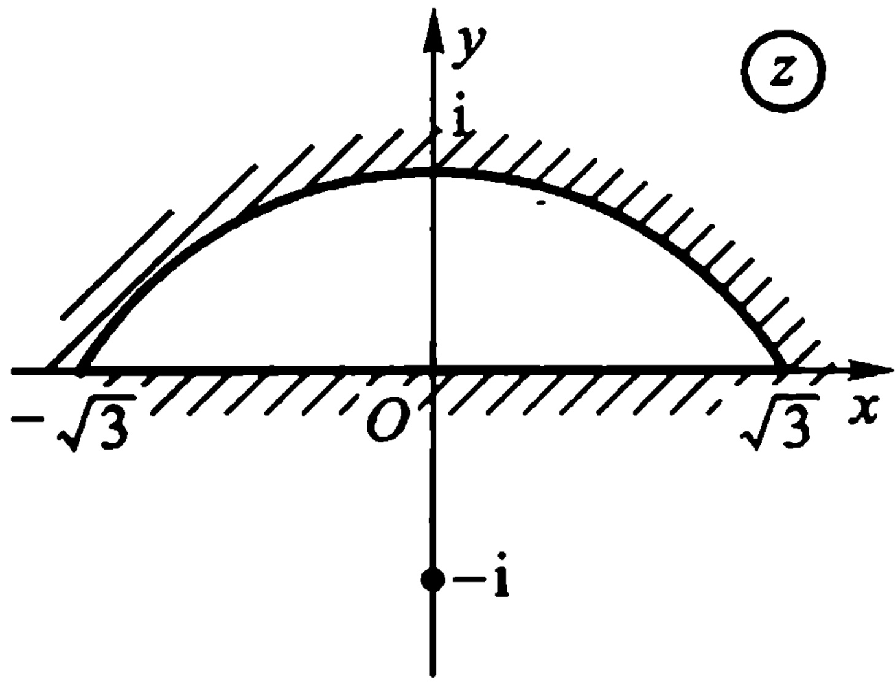

图 7.20
 

<!-- page: 336 -->

(2)  $ \left|z + \mathrm{i}\right| > \sqrt{2}, \left|z - \mathrm{i}\right| < \sqrt{2} $ (图 7.21).

答： $ w = -i\left(\frac{z+1}{z-1}\right)^{2} $

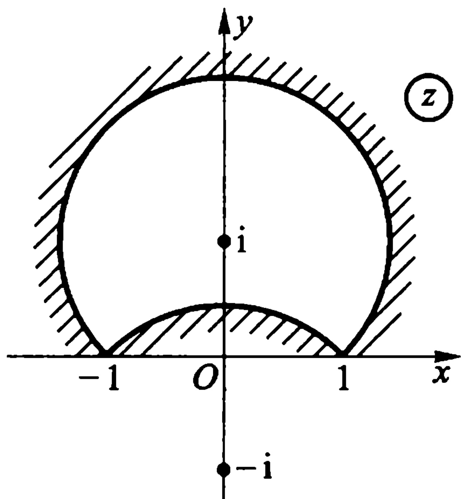

图 7.21
 

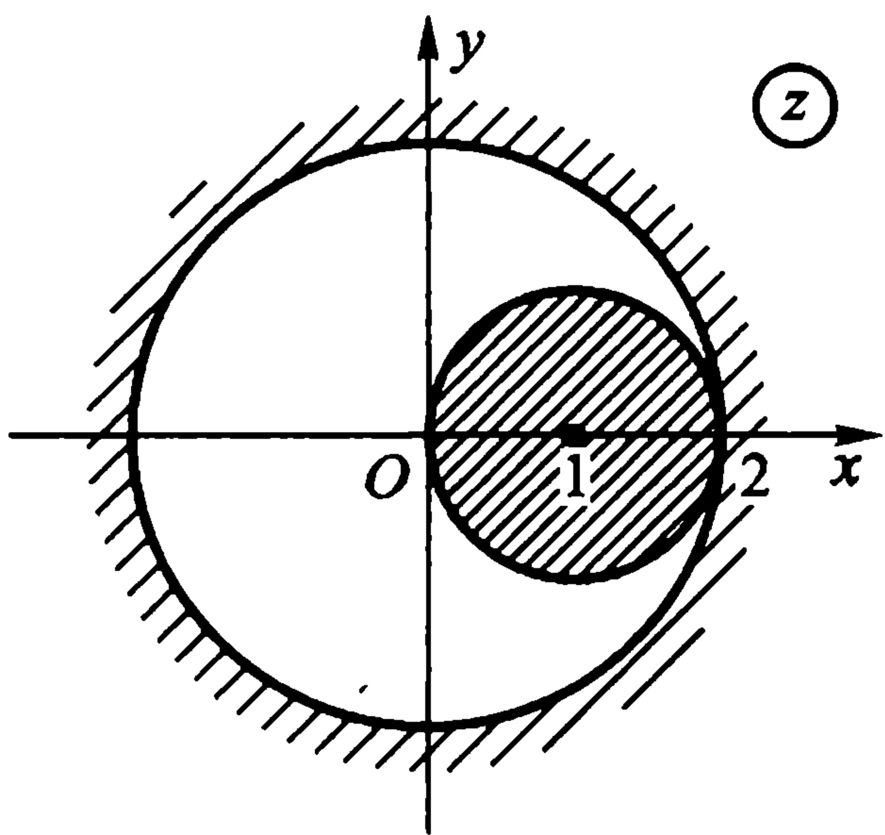

图 7.22
 

(3) $ |z|<2,|z-1|>1 $ (图7.22).

答： $ w = e^{2\pi i\frac{z}{z-2}} $

14 求出角形区域  $ 0 < \arg z < \frac{\pi}{4} $ 到单位圆  $ \left|w\right| < 1 $ 的一个共形映射.

答： $ w = \frac{z^{4} - i}{z^{4} + i} $（非惟一的）.

15 求出将上半单位圆变成上半平面的共形映射，使 z=1,-1,0 分别变成  $ w = -1,1,\infty $.

答： $ w = -\frac{1}{2}\left(z + \frac{1}{z}\right) $.

16 求出第一象限到上半平面的共形映射，使  $ z=\sqrt{2}i, \theta, 1 $ 对应地变成  $ w=0, \infty, -1 $.

答： $ w = -\frac{z^{2} + 2}{3z^{2}}. $

17 将扩充 z 平面割去  $ 1+i $ 到  $ 2+2i $ 的线段后剩下的区域共形映射成上半平面.

答： $ w=\sqrt{\frac{(1+\mathrm{i})-z}{z-(2+2\mathrm{i})}} $

18 将单位圆割去 0 到 1 的半径后剩下的区域共形映射成上半平面.

<!-- page: 337 -->

答： $ w=\left(\frac{\sqrt{z}+1}{\sqrt{z}-1}\right)^{2} $

19 将一个从中心起沿实轴上的半径割开了的单位圆共形映射成单位圆，使符合条件：割缝上岸的1变成1，割缝下岸的1变成-1，0变成-i.

答： $ w = \frac{z + 1 + 2i\sqrt{z}}{i(z + 1) + 2\sqrt{z}}. $

## (二)

1 证明定理 7.3. (只须就  $ z_{0}=0 $ 的情形证明)

提示 不妨假设  $ f(0)=0 $，否则，代替  $ f(z) $ 总可以考虑  $ F(z)=f(z)-f(0) $，而  $ F(0)=0, F'(0)=f'(0)\neq0 $；接着可以应用儒歇定理.

2 如果单叶解析函数  $ w = f(z) $，面上可求面积的区域 D 共形映射成 w 平面上的区域 G，试证 G 的

 $$ \int_{D}\left|f^{\prime}(z)\right|^{2}\mathrm{d}x\mathrm{d}y,\left(z=x+\mathrm{i}y\right). $$ 

3 试证： $ w = z + \frac{1}{z} $ 把圆周  $ \left|z\right| = c $ 变成椭圆周

 $$ \begin{align*}u=\left(c+\frac{1}{c}\right)\cos\theta,v=\left(c-\frac{1}{c}\right)\sin\theta\\ (0\leqslant\theta\leqslant2\pi).\end{align*} $$ 

4  $ w = \frac{i}{z} $ 把半带形

 $$ \mathrm{R e}z>0,0<\mathrm{I m}z<1 $$ 

变成什么？

答：Re w > 0,  $ \left|w - \frac{1}{2}\right| > \frac{1}{2} $, Im w > 0.

5 求分式线性变换 w = L(z)，使点 1 变到  $ \infty $，点 i 是二重不动点.

答： $ w=\frac{(2i-1)z+1}{z-1} $

6 证明:有二相异有限不动点 p,q 的分式线性变换可写成

 $ \frac{w-p}{w-q}=k\frac{z-p}{z-q} $，k 是非零复常数.

7 证明: 只有一个不动点 (二重有限) p 的分式线性变换可写成

<!-- page: 338 -->

$ \frac{1}{w-p}=\frac{1}{z-p}+k $, k 是非零复常数.

8 证明：以 p, q 为对称点的圆周的方程为

 $$ \left|\frac{z-p}{z-q}\right|=k>0, $$ 

当 k=1 时，退化为以 p,q 为对称点的直线.

9 求分式线性变换

 $$ w=\frac{az+b}{cz+d},ad-bc\ne0 $$ 

使扩充 z 平面上由三圆弧所围成的三角形与扩充 w 平面上的直线三角形相对应的充要条件.

答: 三圆弧过点  $ -\frac{d}{c} $.

10 设函数  $ w = f(z) $ 在  $ |z| < 1 $ 内解析，且是将  $ |z| < 1 $ 共形映射成  $ |w| < 1 $ 的分式线性变换。试证

(1)  $ \mid f'(z) \mid = \frac{1 - \mid f(z) \mid^2}{1 - \mid z \mid^2} (\mid z \mid < 1) $;

(2)  $ \left|f'(a)\right|=\frac{1}{1-\left|a\right|^2} $,

其中 a 在单位圆  $ \left|z\right|<1 $ 内， $ f(a)=0 $.

##### 提示 应用例 7.8.

11 若  $ w = f(z) $ 是将  $ \left|z\right| < 1 $ 共形映射成  $ \left|w\right| < 1 $ 的单叶解析函数，且

 $$ f(0)=0,\arg f^{\prime}(0)=0. $$ 

试证:这个变换只能是恒等变换,即  $ f(z) \equiv z $.

提示 应用施瓦茨引理先证明  $ f(z)=\mathrm{e}^{\mathrm{i}\alpha}z $.

12 设函数  $ w = f(z) $ 在  $ \mid z \mid < 1 $ 内单叶解析，且将  $ \mid z \mid < 1 $ 共形映射成  $ \mid w \mid < 1 $，试证  $ w = f(z) $ 必是分式线性函数.

提示 设  $ f(0) = w_{0}, \cdot |w_{0}| < 1 $. 由例 7.8 则可作出符合上题条件的变换.

13 设在  $ \left|z\right|<1 $ 内  $ f(z) $ 解析，且  $ \left|f(z)\right|<1 $; 但  $ f(a)=0(\left|a\right|<1) $. 试证：在  $ \left|z\right|<1 $ 内，

 $$ |f(z)|\leqslant\left|\frac{z-a}{1-\bar{a}z}\right|. $$ 

提示 应用例 7.8 及施瓦茨引理.

<!-- page: 339 -->

14 应用施瓦茨引理证明：把  $ |z|<1 $ 变成  $ |w|<1 $，且把  $ a(|a|<1) $ 变成 0 的共形映射一定有下列形状

 $$ \omega=\mathrm{e}^{\mathrm{i}\theta}\frac{z-a}{1-\bar{a}z}, $$ 

这里  $ \theta $ 是实常数.

