# 08-第八章 解析延拓

[返回全书目录](../../README.md)

> PDF 页码：340–382

<!-- page: 340 -->

## 第八章 解析延拓

我们将在本章讨论已知区域内解析函数定义域的扩大问题。也就是研究在什么条件下能够延拓成为更大区域上的解析函数，并给出两个具体的解析延拓方法——幂级数延拓与对称原理。最后，我们引进完全解析函数与黎曼面的概念，并将多值函数 $ \sqrt{z} $及 $ \ln z $看作其黎曼面上的单值解析函数。

#### §1. 解析延拓的概念与幂级数延拓

### 1. 解析延拓的概念

定义 8.1 设函数  $ f(z) $ 在区域 D 内解析，考虑一个包含 D 的更大区域 G，如果存在函数  $ F(z) $ 在 G 内解析，并且在 D 内  $ F(z) = f(z) $，则称函数  $ f(z) $ 可以解析延拓到  $ G $ 内，并称  $ F(z) $ 为  $ f(z) $ 在区域 G 内的解析延拓。

我们这样定义的解析延拓如果存在，必是惟一的。因为，如果有两个函数  $ F_{1}(z) $ 及  $ F_{2}(z) $ 在包含着区域 D 的更大的区域 G 内解析，且在 D 内  $ F_{1}(z) = f(z) $ 及  $ F_{2}(z) = f(z) $。由解析函数的内部惟一性定理，在 G 内必有  $ F_{1}(z) \equiv F_{2}(z) $。这就证明了解析延拓的惟一性。

例 8.1 设  $ \sum_{n=0}^{\infty} z^{n} = f(z) $ （ $ D: |z| < 1 $）. 而  $ \frac{1}{1 - z} $ 在 z 平面

<!-- page: 341 -->

上只有一个奇点 z=1. 故  $ F(z)=\frac{1}{1-z} $ 就是  $ f(z)=\sum_{n=0}^{\infty}z^{n} $ 在区域 G(z 平面去掉 1) 内的解析延拓，因在 D 内  $ F(z)=f(z) $.

复变函数论的目的,是研究在某一区域内解析的函数.解析性这一要求,就使得在区域 $ D_{1} $内解析的函数的数值,与另一和 $ D_{1} $紧接的区域 $ D_{2} $内解析的函数的数值之间,有着紧密的有机联系.

所谓“紧接”的区域，一个含义是指两个具有公共部分的区域，这个公共部分也是一个区域。

定义 8.2 设 D 是一区域， $ f(z) $ 是 D 内的单值解析函数，这种区域和函数的组合称为一个解析函数元素，记成  $ \{D, f(z)\} $；两个解析函数元素当且仅当其区域重合，而且在其上对应的函数值相等时，则称为是恒等的。

定理 8.1 （相交区域的解析延拓原理）

设 $ \{D_{1}, f_{1}(z)\} $， $ \{D_{2}, f_{2}(z)\} $为两个解析函数元素，符合于

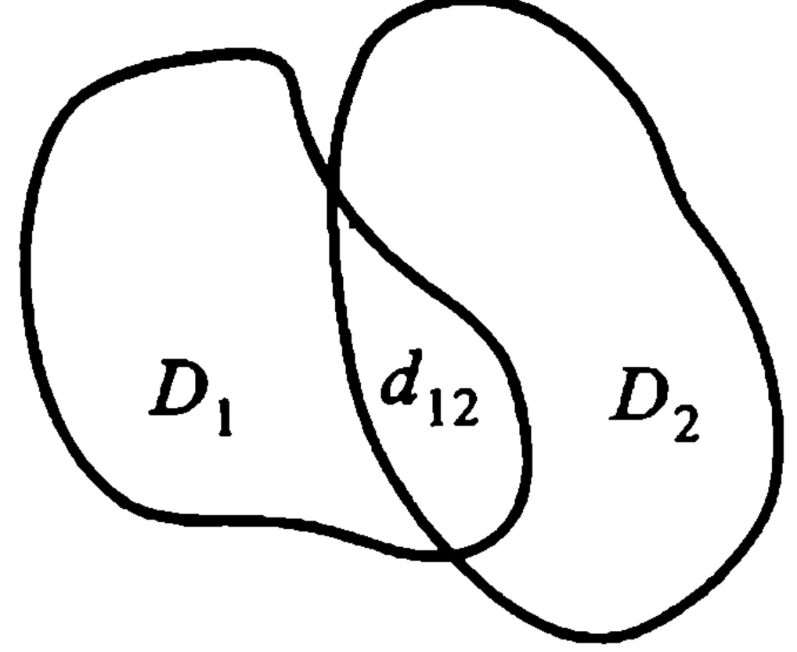

（1）区域  $ D_{1} $ 及  $ D_{2} $ 有一公共区域  $ d_{12} $ （如图 8.1）；

图 8.1
 

 $$ (2)\ f_{1}(z)=f_{2}(z)(z\in d_{12}), $$ 

则  $ \left\{D_{1}+D_{2},F(z)\right\} $ 也是一个解析函数元素，其中

 $$ \begin{aligned}F(z)=\left\{\begin{aligned}&f_{1}\left(z\right),& 当 z\in D_{1}-d_{12};\\ &f_{2}\left(z\right),& 当 z\in D_{2}-d_{12};\\ &f_{1}\left(z\right)=f_{2}\left(z\right),& 当 z\in d_{12}.\end{aligned}\right.\end{aligned} $$ 

证 显然在  $ D_{1} $ 内  $ F(z) = f_{1}(z) $，并且在  $ D_{2} $ 内  $ F(z) = f_{2}(z) $。故在  $ D_{1} $ 及  $ D_{2} $ 内  $ F(z) $ 均解析，因而在  $ D_{1} + D_{2} $ 内  $ F(z) $ 解析。

这里  $ D_{1} + D_{2} $ 相当于定义 8.1 中提到的更大区域 G，它既包含区域  $ D_{1} $ 又包含区域  $ D_{2} $。所以  $ F(z) $ 既是  $ f_{1}(z) $ 在 G 内的解析延拓，又是  $ f_{2}(z) $ 在 G 内的解析延拓。于是，我们有

<!-- page: 342 -->

定义 8.3 如果(1) $ D_{1}\cdot D_{2}=d_{12} $ 为一区域（如图 8.1）；

(2)  $ f_{1}(z)=f_{2}(z)(z\in d_{12}) $,

则两个解析函数元素  $ \{D_{1}, f_{1}(z)\} $ 及  $ \{D_{2}, f_{2}(z)\} $ 称为互为直接解析延拓.

例 8.2 设  $ f_{1}(z)=\sum_{n=0}^{\infty}(-1)^{n}(z-1)^{n},(z\in D_{1}:|z-1|<1) $

 $$ f_{2}\left(z\right)=\frac{1}{\mathrm{i}}\sum_{n=0}^{\infty}\left(-1\right)^{n}\left(\frac{z-\mathrm{i}}{\mathrm{i}}\right)^{n}\quad\left(z\in D_{2}:\mid z-\mathrm{i}\mid<1\right), $$ 

则易知：

(1)  $ \{D_{1}, f_{1}(z)\} $ 及  $ \{D_{2}, f_{2}(z)\} $ 均是解析函数元素；

（2）圆  $ D_{1} $ 及  $ D_{2} $ 的公共部分  $ d_{12} $ (图 8.2) 是一个区域；

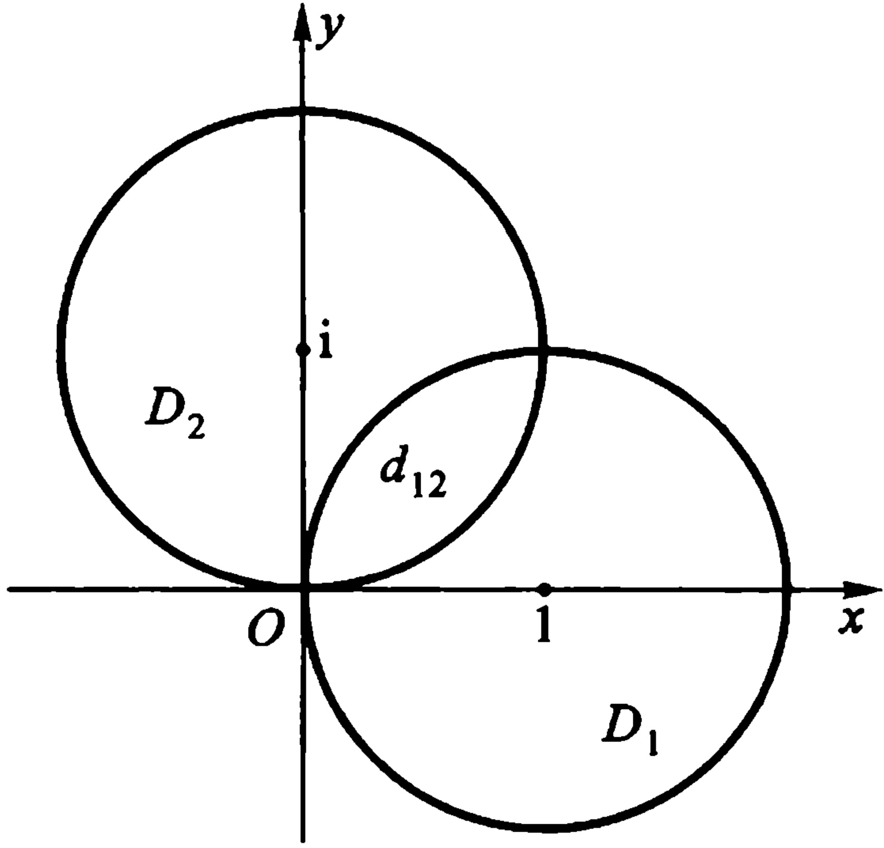

图 8.2
 

（3）根据等比级数求和公式，当  $ z \in D_{1} \cdot D_{2} $ 时，

 $$ f_{1}(z)=f_{2}(z)\left(=\frac{1}{z}\right), $$ 

因此， $ \{D_{1},f_{1}(z)\} $ 及  $ \{D_{2},f_{2}(z)\} $ 互为直接解析延拓.

根据在定义 8.1 意义下的解析延拓的惟一性，易知一个解析函数元素  $ \{D_{1}, f_{1}(z)\} $ 在同一区域  $ D_{2} $ 内的直接解析延拓  $ f_{2}(z) $ 也必是惟一的（因为  $ \{D_{1} + D_{2}, F(z)\} $ 是惟一的）。这样的一个直接延

<!-- page: 343 -->

拓确实将原来的解析函数推广了,解析区域也比原区域扩大了.

如果  $ \{D_{1}, f_{1}(z)\} $ 及  $ \{D_{2}, f_{2}(z)\} $ 互为直接解析延拓，根据定理8.1，从一开始我们已经有可能来研究解析函数元素  $ \{D_{1} + D_{2}, F(z)\} $，所以上面说的好像没有什么进展。但是，如果我们现在来考查第三个解析函数元素  $ \{D_{3}, f_{3}(z)\} $，假定它是  $ \{D_{2}, f_{2}(z)\} $ 的一个直接解析延拓，则很可能是  $ D_{3} $ 与  $ D_{1} $ 交叠，而  $ \{D_{3}, f_{3}(z)\} $ 却不是  $ \{D_{1}, f_{1}(z)\} $ 的直接解析延拓。在这种情况下，解析函数元素集  $ \{D_{1}, f_{1}(z)\} $， $ \{D_{2}, f_{2}(z)\} $， $ \{D_{3}, f_{3}(z)\} $ 就不能用一个单值解析函数元素来代替，但从此却可得出一个多值解析函数。

##### 例 8.3 紧接例 8.2, 我们再设

 $$ f_{3}\left(z\right)=-\sum_{n=0}^{\infty}\left(z+1\right)^{n},\left(z\in D_{3}:\mid z+1\mid<1\right) $$ 

 $$ f_{4}(z)=-\frac{1}{\mathrm{i}}\sum_{n=0}^{\infty}\left(\frac{z+\mathrm{i}}{\mathrm{i}}\right)^{n},(z\in D_{4}:|z+\mathrm{i}|<1) $$ 

则易知  $ \left\{D_{2},f_{2}(z)\right\} $ 及  $ \left\{D_{3},f_{3}(z)\right\} $ 互为直接解析延拓；

 $ \left\{D_{3},f_{3}(z)\right\} $ 及  $ \left\{D_{4},f_{4}(z)\right\} $ 互为直接解析延拓；

 $ \left\{D_{4},f_{4}(z)\right\} $ 及  $ \left\{D_{1},f_{1}(z)\right\} $ 互为直接解析延拓.

于是，解析函数元素集  $ \left\{D_{1}, f_{1}(z)\right\}, \left\{D_{2}, f_{2}(z)\right\}, \left\{D_{3}, f_{3}(z)\right\} $， $ \left\{D_{4}, f_{4}(z)\right\} $ 就能用一个单值解析函数元素  $ \left\{D, F(z)\right\} $ 来代替. 其中 D 是区域  $ D_{1} + D_{2} + D_{3} + D_{4} $，即以闭曲线 ABCEFGHIA 及原点 z=0 为边界的区域（如图 8.3）； $ F(z) $ 为

 $$ F(z)=\left\{\begin{array}{ll}f_1(z),&z\in D_1;\\f_2(z),&z\in D_2;\\f_3(z),&z\in D_3;\\f_4(z),&z\in D_4;\\f_1(z)=f_2(z),&z\in d_{12};\\f_2(z)=f_3(z),&z\in d_{23};\\f_3(z)=f_4(z),&z\in d_{34};\\f_4(z)=f_1(z),&z\in d_{41}.\end{array}\right. $$

<!-- page: 344 -->

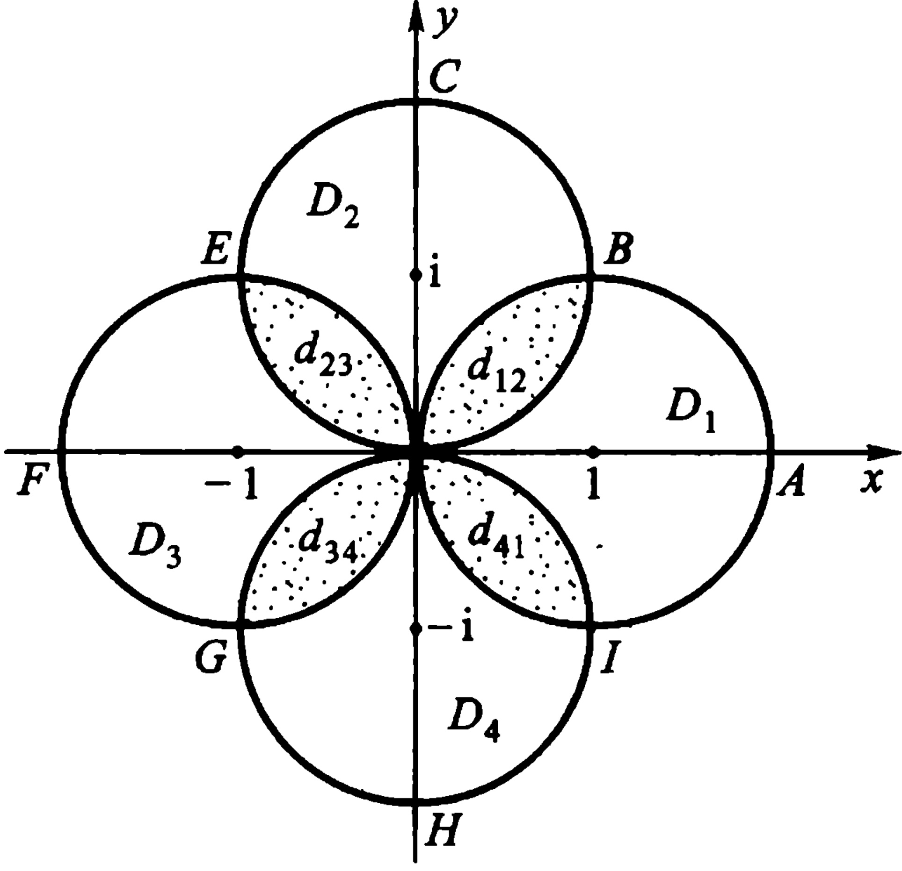

图 8.3
 

定义 8.4 给定解析函数元素集  $ \left\{\left\{D_{1}, f_{1}(z)\right\}, \left\{D_{2}, f_{2}(z)\right\}, \cdots, \left\{D_{n}, f_{n}(z)\right\}\right\} $，如果每一个解析函数元素是前一个解析函数元素的直接解析延拓，则称这些解析函数元素组成解析延拓链。链把开始元素  $ \left\{D_{1}, f_{1}(z)\right\} $ 和最后元素  $ \left\{D_{n}, f_{n}(z)\right\} $ 连接起来。显然，方向相反的同一个链把解析函数元素  $ \left\{D_{n}, f_{n}(z)\right\} $ 和  $ \left\{D_{1}, f_{1}(z)\right\} $ 连接起来。这两个解析函数元素称为互为（间接）解析延拓。

例如，在例 8.3 中， $ \{D_{1}, f_{1}(z)\} $ 及  $ \{D_{3}, f_{3}(z)\} $， $ \{D_{2}, f_{2}(z)\} $ 及  $ \{D_{4}, f_{4}(z)\} $，都是互为（间接）解析延拓的。

注上述函数“延拓”这一概念是以解析原理：“在延拓函数的时候，不得破坏函数的解析性”作为它的基础的。

思考题 试问连续原理：“在延拓函数的时候，不得破坏函数的连续性”能否作为延拓函数的基础，而保证延拓函数的惟一性？

2. 解析延拓的幂级数方法 给定一个解析函数元素，求它的解析延拓的最基本的方法是采用幂级数法.

<!-- page: 345 -->

给定解析函数元素  $ \{D, f(z)\} $，并设  $ z_{1} $ 是 D 内的任一点，则  $ f(z) $ 可在点  $ z_{1} $ 的邻域内展成幂级数：

$$  \begin{aligned}&\sum_{n=0}^{\infty}c_{n}^{(1)}\left(z-z_{1}\right)^{n},\\&c_{n}^{(1)}=\frac{1}{n!}f^{(n)}\left(z_{1}\right).\\ \end{aligned}   \tag*{(8.1)}$$

其中

如果这个级数的收敛半径为  $ +\infty $，换句话说，在 z 平面上每一点处，级数 (8.1) 都收敛。这时 (8.1) 的和  $ f_{1}(z) $ 表示一个在 z 平面上处处解析的函数，而在 D 内与  $ f(z) $ 相同。因之，根据解析延拓的惟一性，这个函数  $ f_{1}(z) $ 就是  $ f(z) $ 在 D 以外的解析延拓。

如果级数(8.1)的收敛半径为有限正数  $ R_{1} $，且其收敛圆  $ \Gamma_{1} $：

 $ |z - z_{1}| < R_{1} $ 部分超出 D 外（否则，就在 D 内另选一点  $ z_{1} $，再重复上面的过程），则我们在  $ \Gamma_{1} $ 内取一个不是圆心  $ z_{1} $ 的点  $ z_{2} $，并在点  $ z_{2} $ 的邻域内把  $ f_{1}(z) $ 展开为幂级数

$$  \begin{array}{l}{\displaystyle\sum_{n=0}^{\infty}c_{n}^{(2)}\left(z-z_{2}\right)^{n},}\\ {\displaystyle c_{n}^{(2)}=\frac{1}{n!}f_{1}^{(n)}\left(z_{2}\right),}\end{array}   \tag*{(8.2)}$$

其中

而  $ f_{1}^{(n)}(z_{2})(n=0,1,2,\cdots) $ 则由级数 (8.1) 计算之.

如级数(8.2)的收敛半径为  $ R_{2} $，则  $ R_{2} $ 一定满足不等式

$$  R_{2}\geqslant R_{1}-\mid z_{2}-z_{1}\mid.   \tag*{(8.3)}$$

但  $ R_{2} $ 无论如何不能大于  $ R_{1} + |z_{2} - z_{1}| $，即无论如何（8.2）的收敛圆不能全包含（8.1）的收敛圆（加上边界）于其内，因为这与（8.1）的收敛半径为  $ R_{1}(0 < R_{1} < +\infty) $ 的假设矛盾.

下面分别就(8.3)的两种情形讨论.

若  $ R_{2}=R_{1}-|z_{2}-z_{1}| $，则级数(8.2)给出的函数  $ f_{2}(z) $，在收敛圆  $ \Gamma_{2}:|z-z_{2}|<R_{2} $ 内那些点的值已被级数(8.1)给出的函数  $ f_{1}(z) $ 确定了。即，沿着半径从  $ z_{1} $ 到  $ z_{2} $ 的方向， $ f_{1}(z) $ 不能进行

<!-- page: 346 -->

延拓. 此时, 级数 (8.1) 和级数 (8.2) 的收敛圆周的切点  $ \xi $ 就是  $ f_{1}(z) $ 的一个奇点 (图 8.4(a)).

事实上，由定理4.16， $ f_{2}(z) $在圆 $ \Gamma_{2} $的边界 $ \gamma_{2} $上至少有一个奇点。但 $ \gamma_{2} $上的点除 $ \xi $外都在 $ \Gamma_{1} $内，因而是 $ f_{1}(z) $的解析点，当然也是 $ f_{2}(z) $的解析点。所以只剩下一点 $ \xi $不在 $ \Gamma_{1} $内，而在圆的边界 $ \gamma_{1} $上，它必定是 $ f_{2}(z) $的一个奇点，也就是 $ f_{1}(z) $的一个奇点。

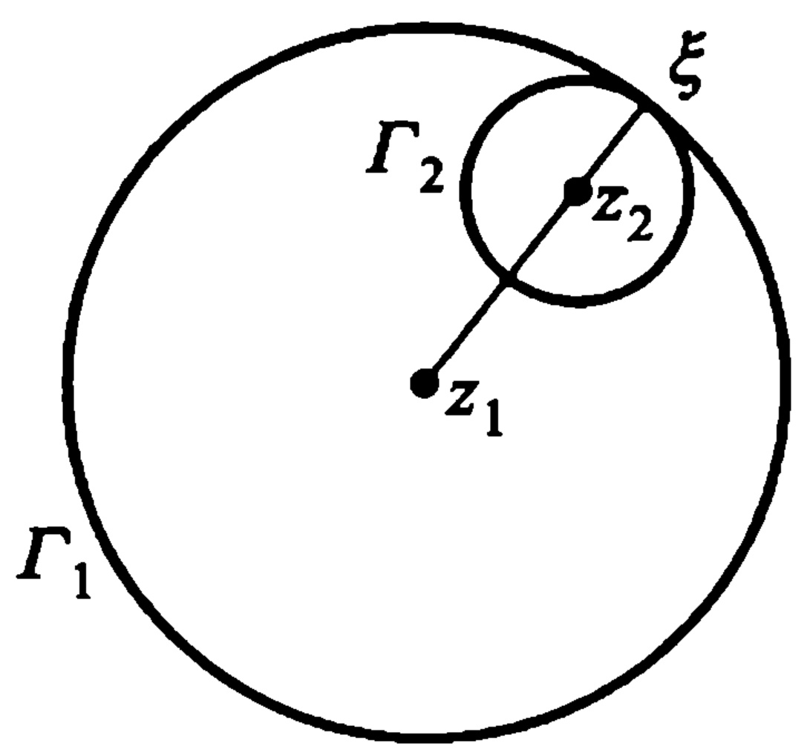

(a)
 

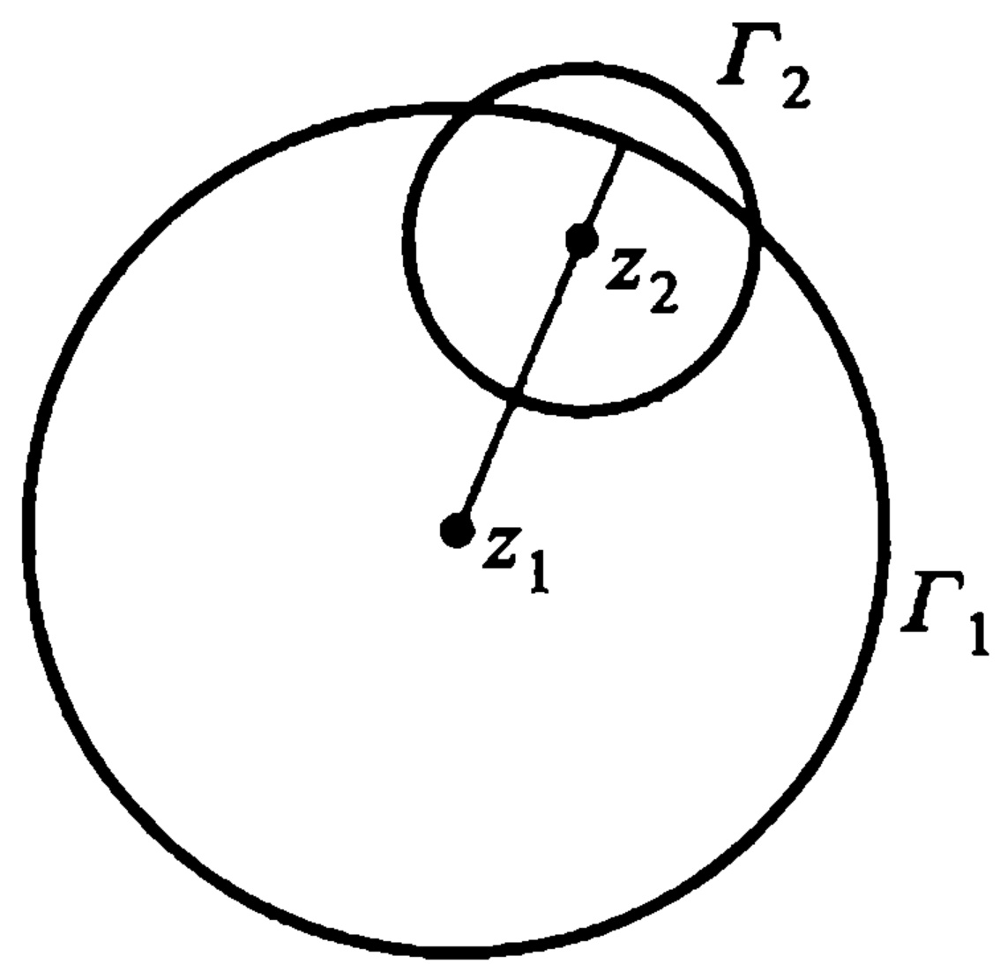

(b)
 

图 8.4
 

若  $ R_{2} > R_{1} - |z_{2} - z_{1}| $，则新的收敛圆  $ \Gamma_{2}: |z - z_{2}| < R_{2} $ 就越出了原来的圆  $ \Gamma_{1} $ 外（图 8.4(b)）。于是，级数（8.2）在圆  $ \Gamma_{2} $ 内表一解析函数，设为  $ f_{2}(z) $。则在  $ \Gamma_{1} \cdot \Gamma_{2} $ 内  $ f_{1}(z) = f_{2}(z) $（由惟一性定理推得）。因而， $ \{\Gamma_{2}, f_{2}(z)\} $ 是  $ \{\Gamma_{1}, f_{1}(z)\} $ 的直接解析延拓。

再在  $ \Gamma_{2} $ 内任取一点  $ z_{3} \neq z_{2} $，并在点  $ z_{3} $ 的邻域内把  $ f_{2}(z) $ 展开为幂级数

$$  \sum_{n=0}^{\infty}c_{n}^{(3)}\left(z-z_{3}\right)^{n},   \tag*{(8.4)}$$

其中

 $$ c_{n}^{(3)}=\frac{1}{n!}f_{2}^{(n)}\left(z_{3}\right), $$ 

而  $ f_{2}^{(n)}(z_{3})(n=0,1,2,\cdots) $ 则由级数(8.2)计算之.

<!-- page: 347 -->

设级数(8.4)的收敛圆为  $ \Gamma_{3}: |z-z_{3}| < R_{3} $. 当圆  $ \Gamma_{3} $ 有一部分在  $ \Gamma_{2} $ 的外部时，则又得  $ \{\Gamma_{2}, f(z)\} $ 在  $ \Gamma_{3} $ 内的直接解析延拓（沿着半径从  $ z_{2} $ 到  $ z_{3} $ 的方向）.

用这样的方法，就能得到 $ \{\Gamma_{1}, f_{1}(z)\} $的所有解析延拓（也就得到了 $ \{D, f(z)\} $的所有解析延拓）。换句话说，我们从一个解析函数元素出发，沿所有可能的方向延拓，新的组成部分也向一切可能的方向进行延拓，一直延拓到不能延拓为止。

从上面的讨论,我们还可以看出:如果在一个确定的方向上,有可能进行延拓时,一般来说,这个延拓可以借助于幂级数来实现.

最后，我们还必须指出两点：

（1）由于幂级数的收敛圆周上，至少存在一个和函数的奇点，所以在收敛圆内所定义的解析函数，向任意方向都可以延拓的情形是不可能发生的.

（2）从下面的例 8.4 可见，幂级数的和函数在收敛圆内沿任一方向都不能进行解析延拓的情形也是存在的。

例 8.4 试证: 在单位圆  $ \left|z\right|<1 $ 内的解析函数

 $$ f(z)=\sum_{n=1}^{\infty}z^{2^{n}} $$ 

不能延拓到单位圆周  $ \left|z\right|=1 $ 的外部.

证 级数的收敛半径 R=1，故在单位圆  $ \left|z\right|<1 $ 内  $ f(z) $ 表一解析函数. 以下证明， $ f(z) $ 的奇点稠密于单位圆周  $ \left|z\right|=1 $ 上.

首先证明，当 z 沿半径而趋于 1 时， $ f(z) \to \infty $：命

 $$ z=x,0<x<1, $$ 

则

 $$ f(x)=x^{2}+x^{4}+\cdots+x^{2^{n}}+\cdots>x^{2}+x^{4}+\cdots+x^{2^{n}}, $$ 

故

 $$ \lim_{x\to1}f(x)\geqslant\lim_{x\to1}(x^{2}+x^{2^{2}}+\cdots+x^{2^{n}})=n, $$

<!-- page: 348 -->

由 n 的任意性，故

 $$ \lim_{x\to1}f(x)=+\infty, $$ 

显然, z=1 是  $ f(z) $ 的一个奇点.

其次，由于

 $$ \begin{aligned}f\big(\mathcal{z}\big)}&=\mathcal{z}^{2}+\mathcal{z}^{4}+\cdots+\mathcal{z}^{2^{n}}+\big(\mathcal{z}^{2^{n+1}}+\mathcal{z}^{2^{n+2}}+\cdots\big)\\&=\mathcal{z}^{2}+\mathcal{z}^{4}+\cdots+\mathcal{z}^{2^{n}}+f\big(\mathcal{z}^{2^{n}}\big),\end{aligned} $$ 

故能使

 $$ z^{2^{n}}=1 $$ 

的点 z 均为  $ f(z) $ 的奇点. 即单位圆周上的点

 $$ \mathcal{Z}_{k}=\mathrm{e}^{\frac{2k\pi\mathrm{i}}{2^{n}}} $$ 

 $$ (k=0,1,\cdots,2^{n}-1;n=1,2,\cdots) $$ 

均为  $ f(z) $ 的奇点，这种点稠密于圆周  $ \left|z\right|=1 $ 上。故  $ f(z) $ 不能再向单位圆周  $ \left|z\right|=1 $ 外延拓。

例 8.5 函数  $ \frac{1}{1-z} $ 在原点邻域内可展成幂级数：

 $$ \frac{1}{1-z}=1+z+z^{2}+\cdots+z^{n}+\cdots=\sum_{n=0}^{\infty}z^{n}. $$ 

这个级数的收敛圆为  $ \left|z\right|<1 $。因此，它表示一个在单位圆内的解析函数。

如在单位圆内取一点  $ b \neq 0 $; 则函数  $ \frac{1}{1 - z} $ 在点 b 的某一邻域内可展成幂级数

 $$ \sum_{n=0}^{\infty}\frac{1}{\left(1-b\right)^{n+1}}(z-b)^{n}. $$ 

当  $ b = -\frac{1}{2} $ 时，展开式成为

 $$ \sum_{n=0}^{\infty}\left(\frac{2}{3}\right)^{n+1}\left(z+\frac{1}{2}\right)^{n}, $$

<!-- page: 349 -->

此级数的收敛半径为 $ \frac{3}{2} $，显然这个级数是级数 $ \sum_{n=0}^{\infty}z^{n} $的一个解析

延拓，因为在圆 $ \left|z+\frac{1}{2}\right|<\frac{3}{2} $内确实含有单位圆以外的点（图8.5

的阴影部分）.

当  $ b = + \frac{1}{2} $ 时，展开式成为

 $$ \sum_{n=0}^{\infty}2^{n+1}\left(z-\frac{1}{2}\right)^{n}, $$ 

而它的收敛半径为  $ \frac{1}{2} $，此时 z = +1 为新旧两个收敛圆周的切点，所以是函数  $ \frac{1}{1-z} $ 的奇点.

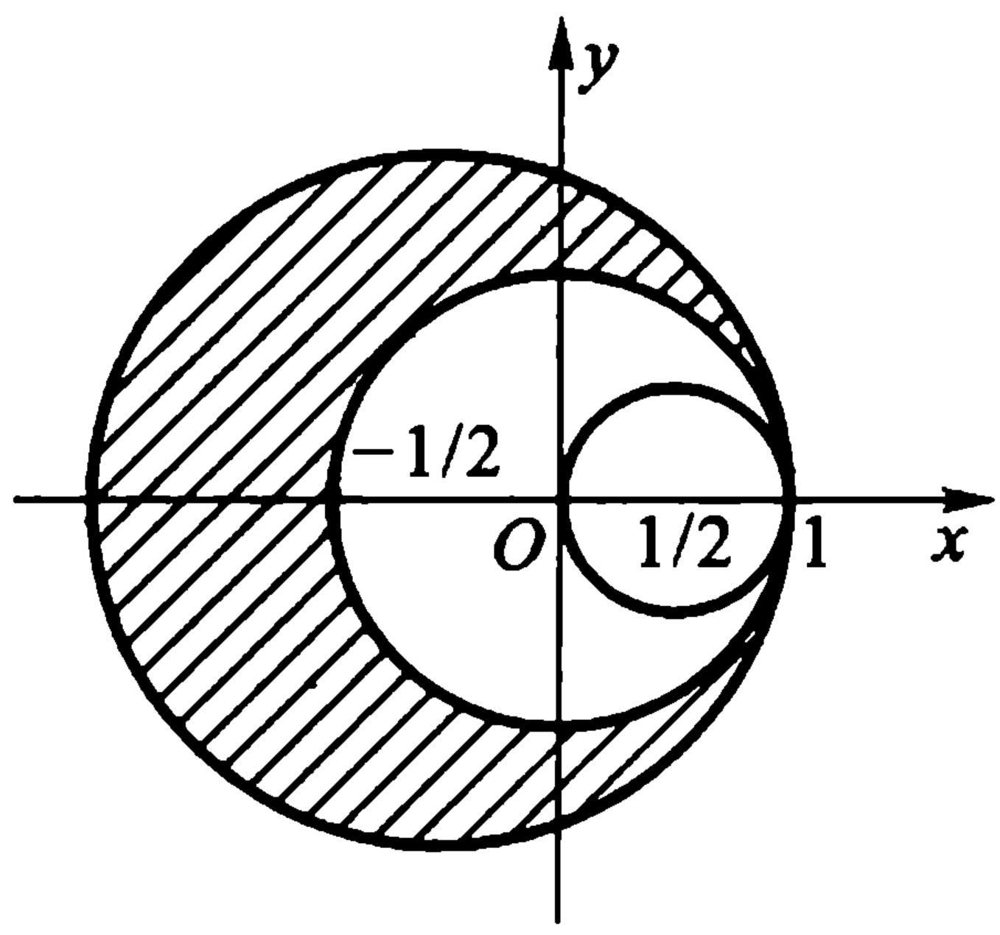

事实上，除实轴正方向外，单位圆

图 8.5
 

内的解析函数  $ \sum_{n=0}^{\infty} z^{n} $ 可沿其半径的任一方向进行延拓，因为 z=1 是它的惟一奇点.

例 8.6

 $$ f(z)=\frac{1}{1-z^{p}}\qquad(p\neq1, 是一个正整数 ), $$ 

这是一个有理函数，它的奇点就是它的极点：

 $$ \mathcal{z}_{k}=\mathrm{e}^{\frac{2k\pi}{p}\mathrm{i}}(k=0,1,2,\cdots,p-1). $$ 

这些极点(个数总是有限的)以等距离分布在单位圆周  $ \left|z\right|=1 $ 上，所说的距离随 p 的增大而减小.

我们取在原点的展开式

 $$ f(z)=1+z^{p}+z^{2p}+\cdots+z^{np}+\cdots=\sum_{n=0}^{\infty}z^{np} $$ 

及其收敛圆  $ |z| < 1 $ 作为第一个解析函数元素，沿着任何不穿过收敛圆周  $ |z| = 1 $ 上  $ f(z) $ 的极点的曲线（即用幂级数延拓时，收敛圆心都取在此曲线上）都可作解析延拓。

<!-- page: 350 -->

#### §2. 透弧解析延拓、对称原理

在前节中提到的直接解析延拓概念是关于相交区域的.如果两个区域不相交，但有一段公共边界(这是两个区域“紧接”的又一个含义)，我们可以在下列连续延拓原理的基础上，建立透弧直接解析延拓的概念.并指出解析延拓的一个几何方法——对称原理.

### 1. 透弧直接解析延拓

定理 8.2 潘勒韦(Painleve')连续延拓原理 设  $ \{D_{1}, f_{1}(z)\} $ 及  $ \{D_{2}, f_{2}(z)\} $ 为两个解析函数元素，符合于

（1）区域  $ D_{1} $ 与  $ D_{2} $ 不相交，但有一段公共边界，除掉其端点后的开弧记为  $ \Gamma $；

（2） $ f_{1}(z) $ 在  $ D_{1}+\Gamma $ 上连续， $ f_{2}(z) $ 在  $ D_{2}+\Gamma $ 上连续；

（3）沿  $ \Gamma, f_{1}(z) = f_{2}(z) $

则  $ \left\{D_{1}+T+D_{2}, F(z)\right\} $ 也是一个解析函数元素. 其中

 $$ \begin{aligned}F(z)=\left\{\begin{aligned}&f_{1}(z),& 当 z\in D_{1},\\&f_{1}(z)=f_{2}(z),& 当 z\in\Gamma,\\&f_{2}(z),& 当 z\in D_{2}.\end{aligned}\right.\end{aligned} $$ 

证  $ F(z) $ 在区域  $ G = D_{1} + \Gamma + D_{2} $ 内是连续的. 我们来证明：

 $ F(z) $沿着任何一条位于 G 内的周线 C (只要其内部全含于 G)的积分都等于零.

如果 C 全部位于  $ D_{1} $ 或  $ D_{2} $ 内，结果从柯西积分定理立即可推出。如果 C 分属于  $ D_{1} $ 与  $ D_{2} $ (图 8.6)，C 落在  $ D_{1} $ 与  $ D_{2} $ 内的部分分别记为  $ C_{1} $ 与  $ C_{2} $， $ \Gamma $ 落在 C 内部的一段记成  $ \gamma $。根据柯西积分定理

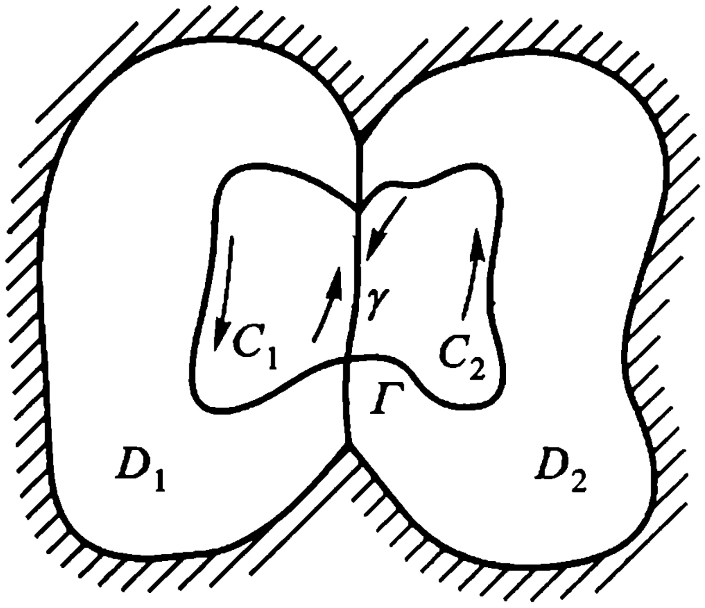

图 8.6
 

<!-- page: 351 -->

$$ \int_{C_{1}+\gamma}F(z)\mathrm{d}z=0, $$ 

 $$ \int_{c_{2}+\gamma^{-}}F(z)\mathrm{d}z=0. $$ 

从而

 $$ \begin{aligned}\int_{C}F(z)\mathrm{d}z&=\int_{C_{1}+\gamma}F(z)\mathrm{d}z\\&+\int_{C_{2}+\gamma^{-}}F(z)\mathrm{d}z=0.\end{aligned} $$ 

根据摩勒拉定理,我们得出函数  $ F(z) $ 在区域 G 内是解析的.

故  $ \left\{D_{1}+T+D_{2}, F(z)\right\} $ 是一个解析函数元素.

定义 8.5 满足定理 8.2 条件的两个解析函数元素  $ \{D_{1}, f_{1}(z)\} $， $ \{D_{2}, f_{2}(z)\} $ 称为互为（透弧）直接解析延拓.

在定义 8.4 中，关于相交区域的解析延拓 $ \uwave{\text{链}} $和 $ \uwave{\text{互为(间接)解}} $析延拓的意义，也可代以透弧解析延拓.

### 2. 黎曼－施瓦茨对称原理

##### 定理 8.3 设

(1) D 及  $ D^{*} $ 为 z 平面上两个区域, 分别在上半平面与下半平面, 对于 x 轴对称, 并且它们的边界都包含 x 轴上一条线段 S;

(2)  $ \{D, f(z)\} $ 为解析函数元素,  $ f(z) $ 在  $ D + S $ 上连续且在 S 上取实数值,

则存在一个函数  $ F(z) $ 满足下列条件：

（1） $ F(z) $ 在区域  $ D^{+}S + D^{*} $ 内解析；

(2) 在 D 内  $ F(z) = f(z) $;

(3) 在  $ D^{*} $ 内  $ F(z)=\overline{f(\bar{z})} $.

（即  $ \left\{D^{*}, \overline{f(\overline{z})}\right\} $ 是  $ \left\{D, f(z)\right\} $ 透过弧 S 的直接解析延拓。）

证 在区域  $ D + S + D^{*} $ 内确定一个函数  $ F(z) $ 如下：

 $$ F(z)=\left\{\begin{aligned}&f(z),&\quad 当 z\in D+S,\\&\overline{f(\bar{z})},&\quad 当 z\in D^{*}.\end{aligned}\right. $$

<!-- page: 352 -->

我们现在来证明这个函数  $ F(z) $ 就满足定理的要求.

（1） $ f(z) $ 在区域 D 内解析，在  $ D + S $ 上连续（假设条件）.

(2) $ \overline{f(\bar{z})} $在 $ D^{*} $内解析.事实上,设 $ z_{0} $及z为 $ D^{*} $内二点,则 $ \bar{z}_{0} $及 $ \bar{z} $为D内相应二点,且

 $$ \begin{align*}\lim_{z\to z_{0}}\frac{f(\bar{z})-\overline{f(\bar{z}_{0})}}{z-z_{0}}&=\lim_{z\to z_{0}}\left[\frac{f(\bar{z})-f(\bar{z}_{0})}{\bar{z}-\bar{z}_{0}}\right]\\&=\lim_{\bar{z}\to\bar{z}_{0}}\left[\frac{f(\bar{z})-f(\bar{z}_{0})}{\bar{z}-\bar{z}_{0}}\right]=\overline{f^{\prime}(\bar{z}_{0})}.\end{align*} $$ 

（3） $ \overline{f(\overline{z})} $ 在  $ D^{*} + S $ 上连续. 因设  $ x_{0} $ 为 S 上任一点，则

 $$ \lim_{\substack{z\to x_{0}\\ (z\in D^{*}+S)}}\overline{f(\bar{z})}=\overline{\lim_{\substack{\bar{z}\to x_{0}\\ (\bar{z}\in D+S)}}f(\bar{z})}\overline{\overline{f(x_{0})}}=f(\bar{x}_{0}). $$ 

(4)  $ z \in S $ 时  $ \overline{f(\overline{z})} = f(z) $. 因此时

 $$ z=\bar{z},\overline{f(\bar{z})}=\overline{f(z)}\overline{\overline{( 假设 )}}f(z). $$ 

故由潘勒韦连续延拓原理， $ \left\{D^{*}, \overline{f(\overline{z})}\right\} $ 是  $ \{D, f(z)\} $ 透过 S 的直接解析延拓。因而  $ F(z) $ 在区域  $ D + S + D^{*} $ 内解析。

对称原理可使解析函数的定义区域扩大一倍.下面我们将对称原理引入共形映射,它使我们能够充分地在本质上扩大那类可以用初等函数来作共形映射的区域.

定理 8.4 设(1)D 及  $ D^{*} $ 为 z 平面上的两个区域，分别在上半平面与下半平面，关于 x 轴对称，并且它们边界都包含 x 轴上一条线段 S（如图 8.7）；

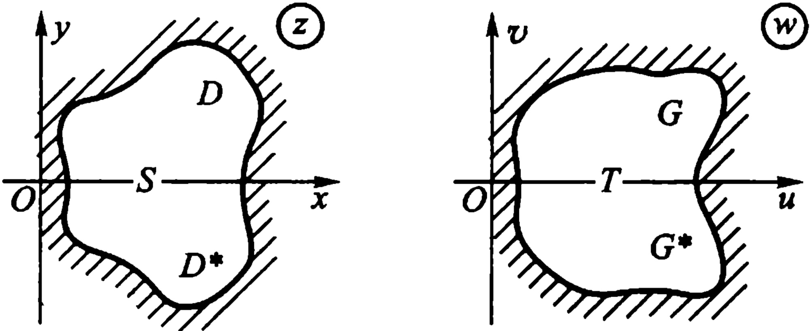

图 8.7
 

<!-- page: 353 -->

(2) G 及  $ G^{*} $ 为 w 平面上的两个区域，分别在上半平面与下半平面，关于 u 轴对称，并且它们的边界都包含 u 轴上一条线段 T；

(3) w = f(z) 在 D 内单叶解析，在  $ D + S $ 上连续，且将 D 共形映射成 G，将 S 一一变换成  $ T = f(S) $，

则存在一个函数 w = F(z) 满足下列条件：

(1)  $ w = F(z) $ 在区域  $ D + S + D^{*} $ 内单叶解析，并将区域  $ D + S + D^{*} $ 共形映射成  $ G + T + G^{*} $;

(2) 在 D 内， $ F(z) = f(z) $;

(3) 在  $ D^{*} $ 内,  $ F(z) = \overline{f(\bar{z})} $.

(即 $ \left\{D^{*},\overline{f(\bar{z})}\right\} $是 $ \left\{D,f(z)\right\} $透过弧S的直接解析延拓).

证 接着定理 8.3 的证明，再补充证明  $ F(z) $ 在  $ D + S + D^{*} $ 内单叶，并将  $ D + S + D^{*} $ 共形映射成  $ G + T + G^{*} $.

根据  $ F(z) = f(z)(z \in D) $， $ F(z) $ 在 D 内单叶解析，并将 D 共形映射成 G；根据  $ F(z) = f(z)(z \in S) $， $ F(z) $ 建立起 S 上的点与 T 上的点的一一对应；根据  $ F(z) = \overline{f(\overline{z})}(z \in D^{*}) $， $ F(z) $ 在  $ D^{*} $ 内单叶解析，并将  $ D^{*} $ 共形映射成  $ G^{*} $。

总起来, $ F(z) $在 $ D+S+D^{*} $内单叶解析,并将 $ D+S+D^{*} $共形映射成 $ G+T+G^{*} $.

##### 定理 8.5 （对称原理的一般形式）设（图 8.8）

(1) d 及  $ d^{*} $ 是 z 平面上关于圆弧或直线段 s 对称的两个区域，它们分居于 s 的两侧，且它们边界都包含 s.

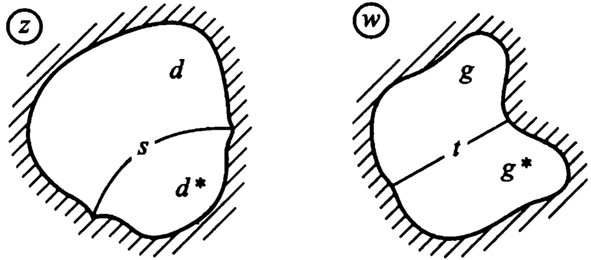

图 8.8
 

<!-- page: 354 -->

(2) g 及  $ g^{*} $ 为 w 平面上关于圆弧或直线段 t 对称的两个区域，它们分居于 t 的两侧，且它们边界都包含 t.

(3)  $ w = f_{1}(z) $ 在 d 内单叶解析，在  $ d + s $ 上连续，并将 d 共形映射成 g，把 s 一一地变换成  $ t = f_{1}(s) $，则存在一个函数 w = F(z) 满足下列条件：

(1)  $ w = F(z) $ 在区域  $ d + s + d^{*} $ 内单叶解析，并将区域  $ d + s + d^{*} $ 共形映射成  $ g + t + g^{*} $.

（2）在 d 内  $ F(z)=f_{1}(z) $.

(3) 在  $ d^{*} $ 内  $ F(z) = f_{2}(z) $.

 $ \{d^{*}, f_{2}(z)\} $ 是  $ \{d, f_{1}(z)\} $ 透过弧 s 的直接解析延拓.

#####  $ ^{*} $ 证

为了证明，我们作线性变换

$$  \zeta=\frac{az+b}{cz+e},\quad\omega=\frac{a w+\beta}{\gamma w+\varepsilon}.   \tag*{(8.5)}$$

它们分别将 s 与 t，这样地变为  $ \zeta $ 与  $ \omega $ 平面（即图 8.7 中的 z 与 w 平面）的实轴上的线段 S 与 T，使得区域 d 与 g 分别共形映射成 D 与 G。将 (8.5) 的逆变换

 $$ z=\frac{-e\zeta+b}{c\zeta-a},w=\frac{-\varepsilon\omega+\beta}{\gamma\omega-\alpha} $$ 

代入函数  $ w = f_{1}(z) $ 的两端，使其化为将 D 共形映射成 G 的函数  $ \omega = f_{1}^{*}(\zeta) $.

我们在  $ \zeta $ 平面的区域  $ D^{*} $ 上定义函数

 $$ \omega=f_{2}^{*}\left(\zeta\right)=f_{1}^{*}\left(\overline{\zeta}\right). $$ 

由定理 8.4,  $ \left\{D^{*}, f_{2}^{*}\left(\zeta\right)\right\} $ 是  $ \left\{D, f_{1}^{*}\left(\zeta\right)\right\} $ 透过弧 S 的直接解析延拓.  $ \omega = f_{2}^{*}\left(\zeta\right) $ 将  $ D^{*} $ 共形映射成  $ G^{*} $. 而函数

 $$ \omega=f^{*}\left(\zeta\right)=\left\{\begin{array}{l}{f_{1}^{*}\left(\zeta\right),\zeta\in D,}\\ {f_{2}^{*}\left(\zeta\right),\zeta\in D^{*},}\\ {f_{1}^{*}\left(\zeta\right)=f_{2}^{*}\left(\zeta\right),\zeta\in S.}\end{array}\right. $$

<!-- page: 355 -->

在  $ D + S + D^{*} $ 内单叶解析，并将  $ D + S + D^{*} $ 共形映射成  $ G + T + G^{*} $.

我们将(8.5)代入函数  $ \omega = f_{2}^{*} $ ( $ \zeta $), 换回到变量 z 与 w, 于是在 d 关于 s 对称的区域  $ d^{*} $ 内得到函数  $ w = f_{2}(z) $, 它在  $ d^{*} $ 内单叶解析, 并将  $ d^{*} $ 共形映射成 g 关于 t 对称的区域  $ g^{*} $.

这时，函数

 $$ \begin{aligned}\omega=F(z)=\left\{\begin{matrix}f_{1}(z),z\in d,\\&f_{2}(z),z\in d^{*},\\&f_{1}(z)=f_{2}(z),z\in s.\\&\end{matrix}\right.\end{aligned} $$ 

在区域  $ d + s + d^{*} $ 内单叶解析，并将  $ d + s + d^{*} $ 共形映射成区域  $ g + t + g^{*} $. 其中  $ \{d^{*}, f_{2}(z)\} $ 是  $ \{d, f_{1}(z)\} $ 透过弧 s 的直接解析延拓.

例 8.7 将上半平面从原点起顺着虚轴割开一条长为 h 的割缝，试求此区域到上半平面的共形映射.

解 z 平面上所述区域可以表成  $ D + S + D^{*} $，其中 S 是从 hi 顺着虚轴到  $ \infty $ 的射线。上半 w 平面可以表成  $ G + T + G^{*} $，其中 T 是上半虚轴（图 8.9）。

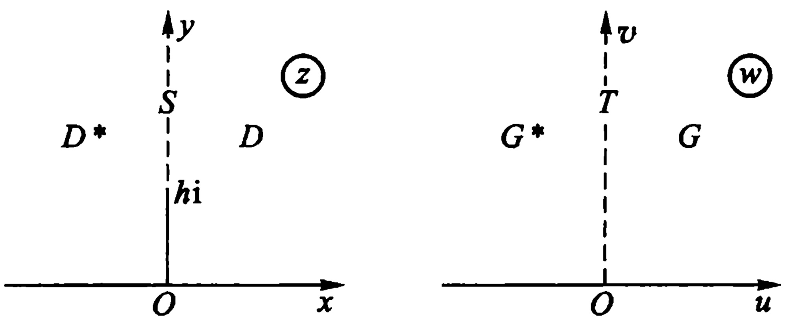

图 8.9
 

我们要作出一个在 D 内单叶解析，在  $ D + S $ 上连续的函数  $ w = f(z) $ 将 D 共形映射成 G，使 S 一一地变成 T.

就作

$$  z_{1}=z^{2},   \tag*{(8.6)}$$

<!-- page: 356 -->

它在 D 内单叶解析，在  $ D + S $ 上连续，将 D 共形映射成上半  $ z_{1} $ 平面  $ D_{1} $，S 一一地变成负实轴上从  $ -h^{2} $ 到  $ \infty $ 的射线  $ S_{1} $.

再作平移变换

$$  z_{2}=z_{1}+h^{2},   \tag*{(8.7)}$$

它在  $ D_{1} + S_{1} $ 上连续，将  $ D_{1} $ 共形映射成上半  $ z_{2} $ 平面  $ D_{2} $， $ S_{1} $ 一地变成负实轴  $ S_{2} $ （如图 8.10）.

再作

$$  w=\sqrt{z_{2}},   \tag*{(8.8)}$$

它在  $ D_{2} + S_{2} $ 上连续，并将  $ D_{2} $ 共形映射成 G， $ S_{2} $ 一一地变成 T.

将(8.6)、(8.7)及(8.8)依顺序叠合得

 $$ w=\sqrt{z^{2}+h^{2}}, $$ 

它在  $ D + S $ 上连续，将 D 共形映射成 G，并将 S 一一地变成 T.

按对称原理， $ \sqrt{z^{2}+h^{2}} $ 在  $ D+S+D^{*} $ 内的解析延拓将区域  $ D+S+D^{*} $ 共形映射成区域  $ G+T+G^{*} $. 但因  $ \sqrt{z^{2}+h^{2}} $ 本身就在  $ D+S+D^{*} $ 内单叶解析，故所求的一个共形映射函数就是

 $$ w=\sqrt{z^{2}+h^{2}}. $$ 

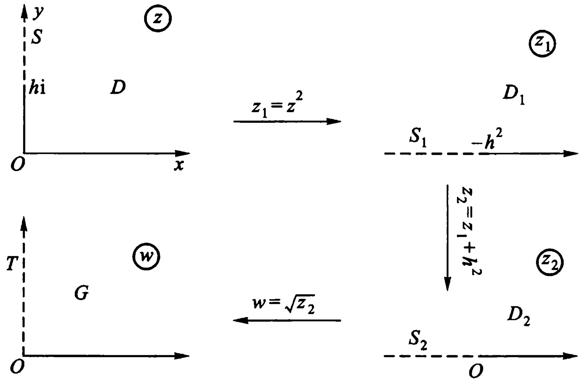

图 8.10
 

<!-- page: 357 -->

#### §3. 完全解析函数及黎曼面的概念

1. 完全解析函数 以前我们所定义的解析函数是局限于一个特定区域的.解析延拓使我们有可能将定义于一个特定区域的解析函数,推广其定义区域,得到在更大区域内解析的函数.

定义 8.6 一个一般解析函数  $ F(z) $ 是由解析函数元素 \{D, f(z)\} 的一个非空集这样组成的：当其非一元集时，任意两个解析函数元素经由一条链而互为解析延拓，其中链的每一环节都是  $ F(z) $ 的一元， $ F(z) $ 的定义区域是各  $ f(z) $ 定义区域之并集（它也是一个区域）。

定义 8.7 一个完全解析函数  $ F(z) $ 是一个一般解析函数，它包含其一解析函数元素的所有解析延拓。 $ F(z) $ 的定义区域 G 称为它的存在区域。G 的边界称为  $ F(z) $ 的自然边界。

根据我们在本章 §1 第 2 段中的论述，可知完全解析函数  $ F(z) $ 的自然边界必为  $ F(z) $ 一切解析函数元素的一切奇点所组成，从而  $ F(z) $ 的自然边界点也就是  $ F(z) $ 的奇点。

一个完全解析函数  $ F(z) $ 显然是不能再扩大的，它可能是单值的（这时，它的存在区域就是通常 z 平面上的区域），也可能是多值的.还可看出，每一个解析函数元素必属于惟一的完全解析函数.

过去讲的孤立奇点(单值性或多值性的)就是函数自然边界上的孤立点.

例 8.8 非常数的整函数的存在区域是 z 平面,  $ z = \infty $ 就是它的自然边界.

例 8.9 函数

 $$ \frac{1}{z-a_{1}}+\frac{1}{z-a_{2}}+\cdots+\frac{1}{z-a_{n}} $$ 

的自然边界是由  $ a_{1}, a_{2}, \cdots, a_{n} $ 等 n 个极点组成；而函数  $ \frac{1}{\sin z} $ 的自

<!-- page: 358 -->

然边界是由无限多个点  $ n\pi(n=0,\pm1,\cdots) $ 及点  $ \infty $ 所组成，在例 8.4 中，我们知道函数

 $$ f(z)=\sum_{n=1}^{\infty}z^{2^{n}} $$ 

就以单位圆周  $ |z|=1 $ 为其自然边界.

2. 单值性定理 设  $ f(z) $ 是区域 D 内的完全解析函数, a, b 是 D 内任意两点,  $ \gamma_{1} $ 和  $ \gamma_{2} $ 是连接 a, b 的两条曲线.  $ f(z) $ 的一个解析函数元素从点 a 出发, 沿  $ \gamma_{1} $ 和  $ \gamma_{2} $ 两条路线进行解析延拓, 如到达点 b 的函数值不同, 也就是说, 如果解析延拓取不同的路线得到不同的解析函数元素, 则函数  $ f(z) $ 就是多值的. 我们先看

例 8.10 设有区域：

 $$ \begin{array}{l}D_{1}:\mid z-1\mid<R,\\ D_{2}:\mid z-\omega\mid<R,\\ D_{3}:\mid z-\omega^{2}\mid<R.\\\quad\omega=e^{\frac{2\pi i}{3}},\\\quad\frac{\sqrt{3}}{2}<R<1.\end{array} $$ 

其中

且

若将解析函数元素  $ \{D_{1},\sqrt{z}\} $ 进行解析延拓  $ (\sqrt{z} $ 已取定一支 $ ) $。从  $ D_{1} $ 到  $ D_{2} $，从  $ D_{2} $ 到  $ D_{3} $，再从  $ D_{3} $ 到  $ D_{1} $，结果所得解析函数元素为  $ \{D_{1},-\sqrt{z}\} $ (图 8.11).

这可以用本章§1、2段幂级数延拓的“圆锥法”来实现，圆锥的各圆圆心可选在一条闭曲线上，这条闭曲线从 $ D_{1} $内的某点a出发，经 $ D_{1} $与 $ D_{2} $的公共区域到 $ D_{2} $，再经 $ D_{2} $与 $ D_{3} $的公共区域到 $ D_{3} $，最后，经 $ D_{3} $与 $ D_{1} $的公共区域又回到 $ D_{1} $的点a.起点a的函数值如为 $ \sqrt{a} $，沿此闭曲线延拓一圈回来后，同一点a的函数值就应改变为 $ -\sqrt{a} $，原因是这条闭曲线包围了原点z=0，a的辐角就要改变 $ 2\pi $.

<!-- page: 359 -->

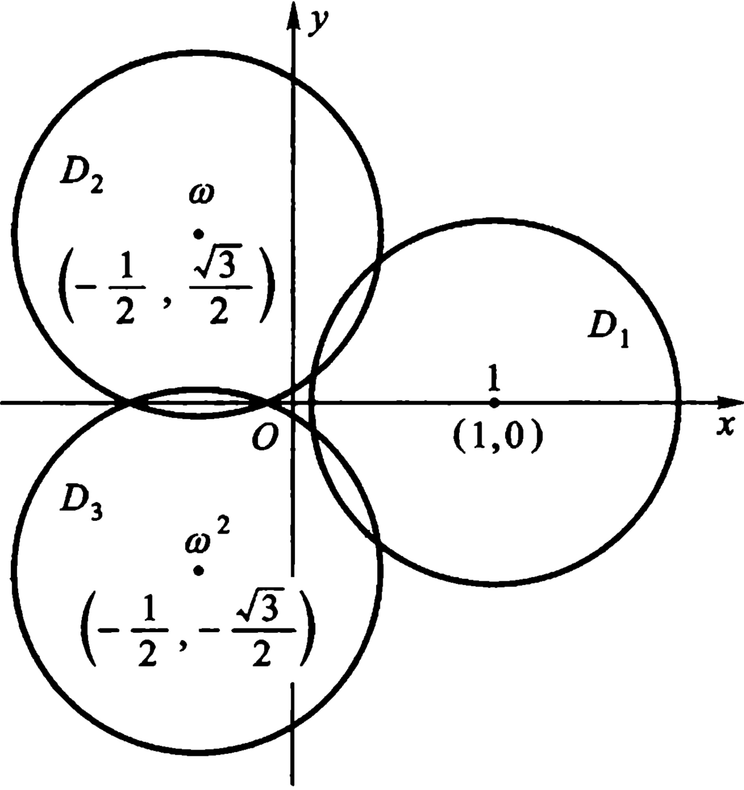

图 8.11
 

另一方面，若将解析函数元素  $ \{D_{1}, -\sqrt{z}\} $ 从  $ D_{1} $ 出发延拓到  $ D_{2} $，从  $ D_{2} $ 延拓到  $ D_{3} $，再从  $ D_{3} $ 回到  $ D_{1} $，结果所得解析函数元素为  $ \{D_{1}, \sqrt{z}\} $。

按这种方式不断延拓，可以看出， $ \sqrt{z} $ 与  $ -\sqrt{z} $ 组成一个二值的完全解析函数，以 z=0 及  $ z=\infty $ 为支点（注意  $ D_{1}, D_{2}, D_{3} $ 无公共部分，但它们含有一条周线围绕原点），其存在区域 D 是个二连通区域.

如果 D 为单连通区域， $ f(z) $ 在 D 内解析，则  $ f(z) $ 就不能像上面那样是多值函数，事实上，魏尔斯特拉斯给出了如下的单值性定理：

定理 8.6 若  $ f(z) $ 在扩充平面上的单连通区域 D 内解析，则  $ f(z) $ 在 D 内单值.

证 设  $ \gamma_{1} $， $ \gamma_{2} $ 是 D 内连接任意两点 a 与 b 的两条简单逐段光滑曲线，使  $ \gamma = \gamma_{1} + \gamma_{2} $ 是 D 内的一条周线.

首先假设周线  $ \gamma = \gamma_{1} + \gamma_{2} $ 不包含 D 的界点于其内部. 由海涅

<!-- page: 360 -->

- 波莱尔覆盖定理，可有有限个圆心在  $ \gamma_{1} $， $ \gamma_{2} $ 上而全部在 D 内的圆足以覆盖  $ \gamma_{1} $ 与  $ \gamma_{2} $。在每个圆内， $ f(z) $ 可以表成泰勒级数。从而  $ f(z) $ 在每个圆内的解析点（圆与 D 的公共部分）为单值。因此  $ \gamma_{1} $， $ \gamma_{2} $ 在每个圆内的弧可以弦来代替。设这些弦所成的折线为  $ P_{1} $， $ P_{2} $，于是  $ \gamma_{1} $， $ \gamma_{2} $ 可以用  $ P_{1} $， $ P_{2} $ 来代替。分多边形  $ P_{1} + P_{2} $ 为若干三角形。如  $ f(z) $ 在  $ P_{1} + P_{2} $ 内为多值，则存在一个三角形  $ T_{1} $， $ f(z) $ 沿  $ T_{1} $ 解析延拓一周得到不同的解析函数元素。将  $ T_{1} $ 最长的一边加以等分，连接等分点与此边的对顶点，得两个三角形。则在此两个三角形中必有一个，命为  $ T_{2} $， $ f(z) $ 沿  $ T_{2} $ 解析延拓一周，将得到不同的解析函数元素。如此继续进行，则得一个三角形序列：

 $$ T_{1}{\sqsupset}T_{2}{\sqsupset}\cdots{\sqsupset}T_{n}{\sqsupset}\cdots $$ 

当 n 无限增加， $ T_{n} $ 缩成 D 内一点  $ \alpha $。由假设  $ f(z) $ 在点  $ \alpha $ 解析，则必在一个圆  $ |z - \alpha| < R $ 内单值解析。因此，只须经过有限次分法，则得一个全含于此圆内的三角形  $ T_{m} $，而  $ f(z) $ 沿  $ T_{m} $ 解析延拓一周，所得的解析函数元素不能为不同，这和  $ f(z) $ 在  $ P_{1} + P_{2} $ 内为多值相矛盾。

其次，假设  $ \gamma $ 包含区域 D 的一个界点于其内部。由于 D 是单连通区域，则  $ \gamma $ 必包含 D 的全部界点于其内部。因此  $ f(z) $ 在点  $ z = \infty $ 的邻域内解析。从而存在一个以原点为心的圆周 C，包含  $ \gamma = \gamma_{1} + \gamma_{2} $ 于其内部， $ f(z) $ 在  $ z = \infty $ 的邻域内的洛朗展式在圆周 C 的外部及其上单值解析。用线段  $ aa' $ 及  $ bb' $ 分别将点 a, b 连接到圆周 C 上，则得两条闭路  $ L_{1}: a'a\gamma_{1}bb'C_{1}a' $ 及  $ L_{2} $:  $ a'ay_{2}bb'C_{2}a' $.  $ L_{1} $ 与  $ L_{2} $ 各不包含 D 的界点于其内部（图 8.12）。由圆周 C 的定义， $ C_{1}, C_{2} $ 两条路线对解析延拓是等价的，即是  $ f(z) $ 从  $ a' $ 出发分别

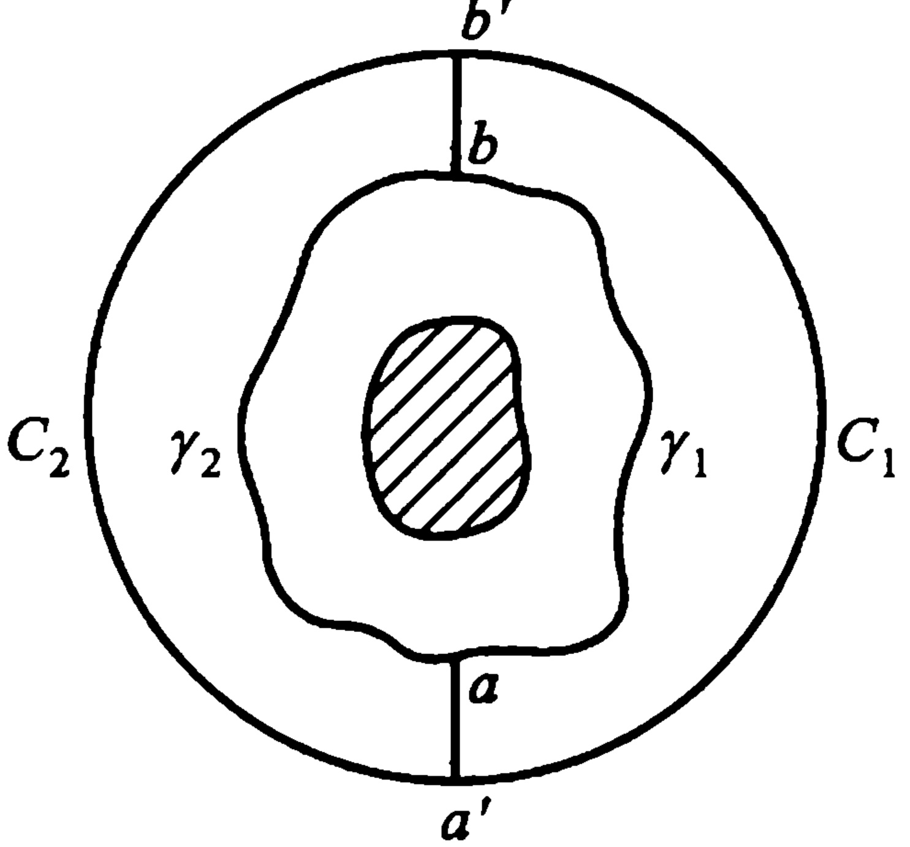

图 8.12
 

<!-- page: 361 -->

沿  $ C_{1} $,  $ C_{2} $ 解析延拓达到  $ b^{\prime} $ 的值是相同的. 由将上面第一步的证明分别应用到闭路  $ L_{1} $ 与  $ L_{2} $ 上, 则得  $ a^{\prime}ay_{1}bb^{\prime} $ 与  $ C_{1} $ 等价;  $ a^{\prime}ay_{2}bb^{\prime} $ 与  $ C_{2} $ 等价; 因此  $ \gamma_{1} $ 与  $ \gamma_{2} $ 是等价的. 所以定理成立.

定义 8.8 若围绕以  $ z_{0} $ 为心的充分小的圆周，延拓一完全解析函数  $ F(z) $ 的解析函数元素  $ \{D_{1}, f_{1}(z)\} $，当变点回转至原来的位置时，若函数值与原来的值相异，则称此  $ z_{0} $ 点为此函数  $ F(z) $ 的支点。具有支点的完全解析函数  $ F(z) $ 称为多值解析函数。

尽管  $ F(z) $ 是一个多值函数，但是如果我们可以限制 z 的变动区域（单连通的），使得当 z 点在这个区域内沿任意周线变动一圈，函数值连续变动回到原来的值，那么我们就说这个区域内所有对应的函数值（即这个区域的像点集）就组成  $ F(z) $ 的一个单值解析分支（如图 2.4 的各  $ T_{k} $ 及图 2.10 的各  $ B_{k} $）。

支点是多值性奇点. 凡多值解析函数的每一单值分支也可以有单值性奇点——可去奇点、极点、本质奇点以及非孤立的奇点. 但一点若为某一支的单值性奇点, 则不必为另一支的单值性奇点.

例如

 $$ \frac{1}{z}\ln\frac{1}{1-z}=\frac{1}{z}\left(z+\frac{z^{2}}{2}+\frac{z^{3}}{3}+\cdots\right),\left(0<\mid z\mid<1\right) $$ 

 $ z=0 $ 为此支的可去奇点（解析点），但为其他每一支

 $$ \begin{aligned}\frac{1}{z}\Big[\left(z+\frac{z^{2}}{2}+\frac{z^{3}}{3}+\cdots\right)+2k\pi\mathrm{i}\Big]\\ (k=\pm1,\pm2,\cdots)\end{aligned} $$ 

的一阶极点.

3. 黎曼面概念 设  $ w = F(z) $ 是多值解析函数，即具有支点的完全解析函数，则对其存在区域中 z 的一个值，w 有多个值和它对应。黎曼采取一种方法，使 w 的值和 z 的值成一一对应。他创造一种模型（称为黎曼面）代替通常的 z 平面。利用黎曼面，可以使以前所说的解析延拓的过程，多值解析函数概念本身、分支、支点及支割线的概念，在几何上有了明显的表示和说明。更重要的

<!-- page: 362 -->

是，可以使多值完全解析函数  $ F(z) $ 成为其黎曼面上的单值解析函数（这时， $ F(z) $ 的存在区域就是一个推广了的区域，即黎曼面）。于是，单值解析函数的理论便可以对它应用了。因此，由于函数多值性所引起的复杂性，利用几何方法可以消除掉。

下面我们举几个简单的例子来讨论黎曼面.一般对于多值解析函数,要用若干叶片来适当地“粘合”成一个黎曼面的工作是相当复杂的,并且需要相当的技巧.

例 8.11 函数  $ w = z^{\frac{1}{2}} $ 的黎曼面.

解 由于对 z 平面上每一个异于零的点，此函数有两个值和它相对应；如对不同函数值的相同的点 z 能加以区别，就能满足我们的要求.

令  $ z = re^{i\theta} $，于是相同的点 z 可以不同的  $ \theta $ 来决定，从而不同的函数值可用不同的  $ \theta $ 来规定。因当 z 绕原点一周，w 的值由  $ \sqrt{z} $ 变为  $ -\sqrt{z} $；当 z 再绕原点一周， $ -\sqrt{z} $ 又变为  $ \sqrt{z} $。所以如  $ \sqrt{z} $ 相当于  $ 0 < \theta < 2\pi $，则  $ -\sqrt{z} $ 相当于  $ 2\pi < \theta < 4\pi $。现在设想两个 z 平面相重叠，原点的位置与实轴的方向都相同。在上的平面用  $ M_{0} $ 表示，相当于  $ 0 < \theta < 2\pi $；在下的平面用  $ M_{1} $ 表示，相当于  $ 2\pi < \theta < 4\pi $。由于 z=0 及 z= $ \infty $ 是 w= $ z^{\frac{1}{2}} $ 的两个支点，我们现在可以选正实轴为支割线，将两个平面各沿正实轴割开，使 z 分别在  $ M_{0} $ 及  $ M_{1} $ 上不能越过支割线在同一平面上变动。再沿支割线使  $ M_{0} $ 的下岸 ( $ \theta = 2\pi $) 与  $ M_{1} $ 的上岸 ( $ \theta = 2\pi $) 粘合，并使  $ M_{1} $ 的下岸 ( $ \theta = 4\pi $) 与  $ M_{0} $ 的上岸 ( $ \theta = 0 $) 粘合。这样的模型就是 w= $ z^{\frac{1}{2}} $ 的黎曼面（如图 8.13 (a)），两叶在截口处互相交叉，其在支割线处的垂直纵截面如图 8.13 (b).

当点 z 在黎曼面的  $ M_{0} $ 叶上，从正实轴上一点出发，围绕支点 z=0 以反时针方向连续变动两圈时，辐角  $ \theta $ 先由 0 增至  $ 2\pi $，并由叶片  $ M_{0} $ 进入叶片  $ M_{1} $，在后一叶片  $ M_{1} $ 中， $ \theta $ 再由  $ 2\pi $ 增至  $ 4\pi $。当

<!-- page: 363 -->

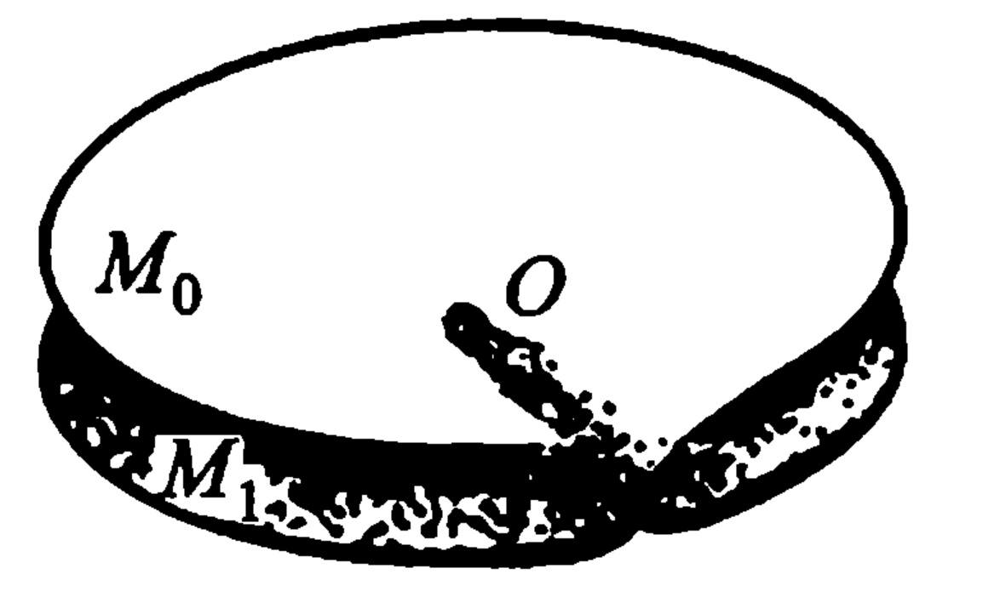

(a)
 

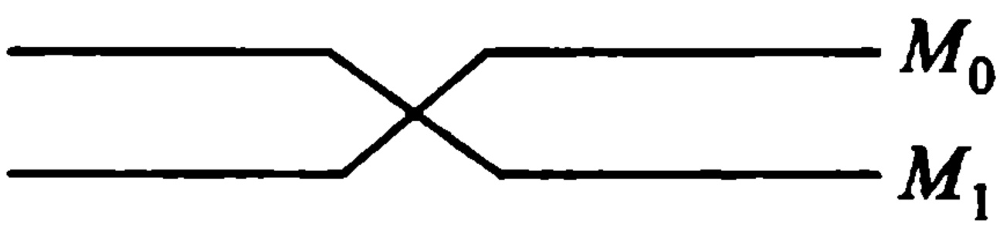

(b)
 

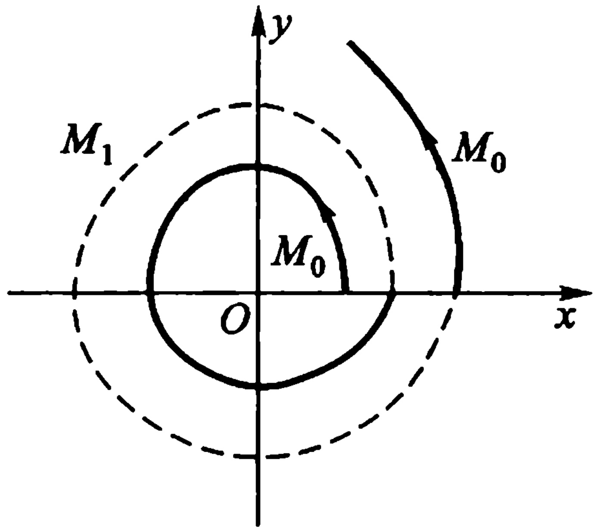

图 8.13
 

图 8.14
 

点 z 再继续转动时，它仍回到叶片  $ M_{0} $ 上（如图 8.14）。在  $ M_{0} $ 上， $ \theta $ 的值可以认为是由  $ 4\pi $ 增到  $ 6\pi $，或由 0 增到  $ 2\pi $，对于函数值没有影响。余可类推。这样一来，函数  $ w = z^{\frac{1}{2}} $ 就是黎曼面上的单值函数了。只是在支割线处，两个叶片的点需要设法去判别。

 $ \uwave{\text{应该注意的是}} $:要想由以上的描述,把黎曼面按通常办法具体地制作出来是办不到的.因为当先把叶片 $ M_{0} $的截口的下岸与 $ M_{1} $截口的上岸粘合以后,再把 $ M_{1} $的下岸与 $ M_{0} $的上岸粘合就无法进行,因为中间已有一个粘合好的平面存在着.尽管如此,我们仍然要想像它们是粘合起来了.

这黎曼面的叶片  $ M_{0} $ 的像是上半 w 平面，而叶片  $ M_{1} $ 的像是下半 w 平面。因为

 $$ \begin{array}{c}w_{k}=\sqrt{r}\mathrm{e}^{\mathrm{i}\frac{\theta}{2}}=\sqrt{r}\mathrm{e}^{\mathrm{i}\frac{\theta_{0}+2k\pi}{2}},\\0\leqslant\theta_{0}<2\pi,k=0,1,\end{array} $$ 

在 $ M_{0} $上

 $$ 0<\frac{\theta}{2}<\pi, $$ 

在 $ M_{1} $上

 $$ \pi<\frac{\theta}{2}<2\pi. $$

<!-- page: 364 -->

每个叶片上所确定的函数都是单值解析的，并可连续到粘合的边界，在粘合的边界上它们是等值的。于是，它们的一个就是另一支穿过支割线的解析延拓（由本章的潘勒韦原理可见）。因此，黎曼面上点的单值函数  $ w = z^{\frac{1}{2}} $ 在除去支点 z = 0 及  $ z = \infty $ 外，到处都是解析的。

例 8.12 函数  $ w=\sqrt[n]{z} $ (n 是正整数, n>2) 的黎曼面.

类似上例的讨论,它的黎曼面是由 n 个沿着支割线正实轴割开的 z 平面粘合而成的,仍只以 z=0 及 z= $ \infty $ 为支点.

令  $ z = re^{i\theta} $，则

 $$ \begin{array}{r}{\omega_{k}=\sqrt[n]{r}\mathrm{e}^{\mathrm{i}\frac{\theta_{0}+2k\pi}{n}},}\end{array} $$ 

 $$ 0\leqslant\theta_{0}<2\pi,k=0,1,\cdots,n-1, $$ 

图 8.15 是 n=4 的情形.

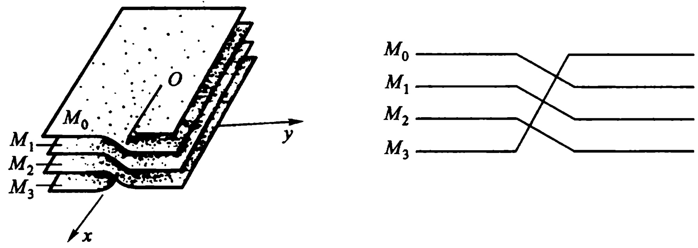

图 8.15
 

例 8.13 函数  $ w = \mathrm{Ln} z $ 的黎曼面.

解 令  $ z = r e^{i\theta} $，则

 $$ \begin{aligned}\varpi_{k}&=(\ln z)_{k}=\ln r+\mathrm{i}(\theta_{0}+2k\pi)\\&0\leqslant\theta_{0}<2\pi,k=0,\pm1,\cdots\end{aligned} $$ 

仍只以 z=0 及  $ z=\infty $ 为支点，取正实轴为支割线，其黎曼面含有无穷多叶（图 8.16 左）. 其在支割线处的垂直纵截面如图 8.16 右.

<!-- page: 365 -->

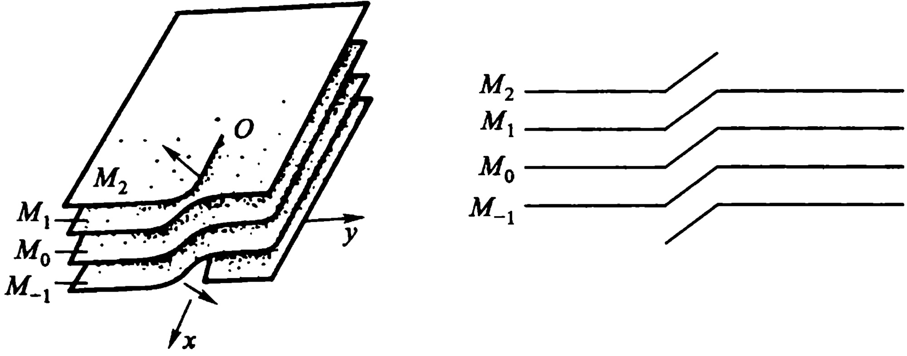

图 8.16
 

上面三个例题是应用透弧解析延拓制作  $ w=\sqrt{z} $ 及  $ w=\mathrm{Ln}z $ 的黎曼面，当然也可应用相交区域的直接解析延拓制作它们的黎曼面.

例 8.14 函数  $ \sqrt[3]{(z-a)(z-b)}(a\neq b) $ 的黎曼面.

解 函数  $ \sqrt[3]{(z-a)(z-b)} $ 以 z=a, z=b 及  $ z=\infty $ 为支点. 从 a 到 b 连接直线段, 从 b 到  $ \infty $ 连接任一射线 (不通过 a) 作为支割线. 这样割开 z 平面后, 可以分出三个单值分支

 $$ f_{k}\left(z\right)=\omega^{k}f_{0}\left(z\right),k=0,1,2, $$ 

其中  $ \omega = e^{\frac{2\pi i}{3}} $， $ f_{0}(z) $ 为  $ \sqrt[3]{(z-a)(z-b)} $ 的一个确定支.

现将三张平面  $ M_{k} $， $ (k=0,1,2) $ 均按前述方法割破，各分支  $ f_{k}(z) $ 分别在  $ M_{k} $ 上是单值的，但在割线两岸之值不同。在  $ \overrightarrow{ab} $ 左岸（顺着 a 到 b 的方向）取值为  $ f_{0}(z) $， $ f_{1}(z) $， $ f_{2}(z) $ 时连续变动到右岸，由于绕 a 转了一周的缘故，增加了一个因子  $ \omega = e^{\frac{2\pi i}{3}} $，就对应取值为  $ f_{1}(z) $、 $ f_{2}(z) $、 $ f_{0}(z) $；在  $ \overrightarrow{b\infty} $ 左岸取值为  $ f_{0}(z) $， $ f_{1}(z) $， $ f_{2}(z) $ 时连续变动到右岸，由于绕 a，b 两点同时转了一周的缘故，增加了一个因子  $ \omega^{2} = e^{\frac{4\pi i}{3}} $，就对应取值为  $ f_{2}(z) $， $ f_{0}(z) $， $ f_{1}(z) $。即前者各分支构成以下置换：

<!-- page: 366 -->

$$ \left\{\begin{matrix}f_{0}(z)&f_{1}(z)&f_{2}(z)\\ f_{1}(z)&f_{2}(z)&f_{0}(z)\end{matrix}\right\} $$ 

后者各分支构成以下置换：

 $$ \left\{\begin{matrix}f_{0}(z)&f_{1}(z)&f_{2}(z)\\ f_{2}(z)&f_{0}(z)&f_{1}(z)\end{matrix}\right\} $$ 

将三个叶片叠起来，并粘合那些取值相同的各岸，即得所求的黎曼面.图8.17表示在割线处的粘合法.

黎曼面的最大优点不仅使 w 平面上的点和 z 平面上的点建立一一对应，而且可使 z 平面上的连续曲线和 w 平面上的连续曲线成对应. 利用黎曼面，所有关于单值函数的性质都可以推广到多值函数.

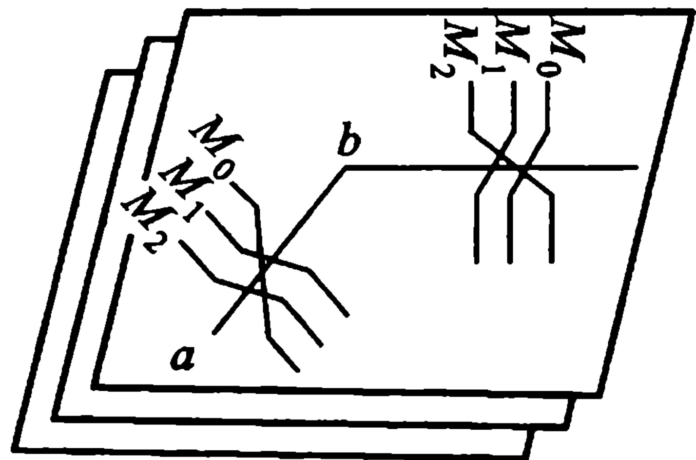

设  $ f(z) $ 是定义于黎曼面上的函

图 8.17
 

数，如 z = a 是  $ f(z) $ 的解析点，则在 a 的一个邻域内， $ f(z) $ 可以展开为泰勒级数。其收敛圆可能有一部分在黎曼面的某一叶上，而另一部分则在与之粘合的另一叶上，但支点不能在收敛圆之内。

最后，我们还必须指出：一个多值解析函数与代表多个函数的一个表达式是有区别的。例如，函数  $ w = \sqrt{z^{2}} $ 相当于  $ w = +z $ 和  $ w = -z $，而这两个单值解析函数不是互为解析延拓的。所以  $ w = \sqrt{z^{2}} $ 仅是表示两个单值解析函数  $ w = +z $ 与  $ w = -z $ 的一个表达式。

####  $ ^{*} $§4. 多角形区域的共形映射

本节我们将介绍在实际构成共形映射时起着很大作用的一个

方法.它在应用上特别重要,因为它使我们能够写出一个函数(固

然,一般地讲,只能写成积分的形状),把上半平面共形映射成预先

<!-- page: 367 -->

给定的一个多角形区域.

### 1. 克里斯托费尔（Christoffel）－施瓦茨变换

定理 8.7 设(1) $ P_{n} $为有界 n 角形，其顶点为  $ A_{1}, A_{2}, \cdots, A_{n} $，其顶角为  $ \alpha_{1}\pi, \alpha_{2}\pi, \cdots, \alpha_{n}\pi $.

 $$ (0<\alpha_{j}<2,\quad j=1,2,\cdots,n) $$ 

（2）函数  $ w = f(z) $ 将上半平面  $ \mathrm{Im} z > 0 $ 共形映射成  $ P_{n} $.

(3) z 平面实轴上对应于 w 平面多角形  $ P_{n} $ 的顶点 A, 的那些点  $ a_{j} $:

 $$ -\infty<a_{1}<a_{2}<\cdots<a_{j}<\cdots<a_{n}<+\infty $$ 

都是已知的.则

$$  f(z)=C\int_{z_{0}}^{z}\left(z-a_{1}\right)^{a_{1}-1}(z-a_{2})^{a_{2}-1}\cdots(z-a_{n})_{.}^{a_{n}-1}\mathrm{d}z+C_{1},   \tag*{(8.9)}$$

其中  $ z_{0} $，C 与  $ C_{1} $ 是三个复常数.

注意，显然有

$$  \sum_{j=1}^{n}\alpha_{j}=n-2.   \tag*{(8.10)}$$

(8.9)的逆变换  $ z = f^{-1}(w) $ 将 w 平面上的单连通区域多角形  $ P_{n} $ 共形映射成标准区域上半 z 平面.

 $ ^{*} $ 证 根据黎曼存在惟一性定理，存在有而且只有一个函数

 $$ w=f(z), $$ 

它将上半 z 平面共形映射成 w 平面上的有界 n 角形  $ P_{n} $ (图 8.18)，而且将实轴上的三个定点（例如， $ a_{1}, a_{2} $ 与  $ a_{3} $）变成  $ P_{n} $ 边界上的三个任意点，例如顶点  $ A_{1}, A_{2}, A_{3} $.

先假设这个函数是我们已知的，尤其是已知 x 轴上与 n 角形的顶点  $ A_{j} $ 对应的点点  $ a_{j}, j = 4, 5, \cdots $，现在来求它的解析式.

因为在 x 轴的任何一段  $ (a_{j}, a_{j+1}) $ 上，函数  $ w = f(z) $ 取直线段  $ A_{j}A_{j+1} $ 上的值，所以对于它可以应用对称原理，因而它可以越

<!-- page: 368 -->

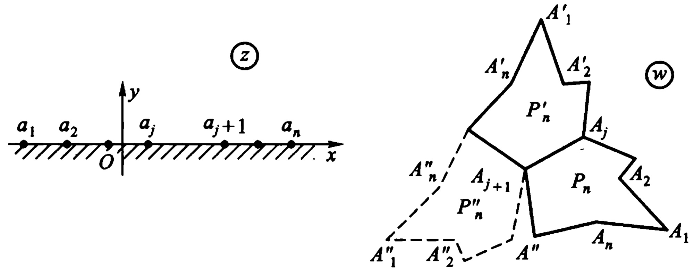

图 8.18
 

过这条线段而解析延拓到下半平面  $ \mathrm{Im}\ z<0 $. 这个解析延拓将下半平面共形映射为与  $ P_{n} $ 关于线段  $ A_{j}A_{j+1} $ 对称的 n 角形  $ P'_{n} $. 它又可以越过任意线段  $ (a'_{j}, a'_{j+1}) $ 而解析延拓到上半平面，而且这个解析延拓将上半平面共形映射成与  $ P'_{n} $ 关于线段  $ A'_{j}A'_{j+1} $ 对称的 n 角形  $ P'_{n} $.

我们可以想像:我们把所有可能的上面所描述的那种解析延拓[在特别情形,越过包含点 $ z=\infty $的线段 $ (a_{n},a_{1}) $都作过了]作了任意多次.结果得到无穷多值完全解析函数 $ w=F(z) $,原来的解析函数 $ w=f(z) $是它的一个单值解析分支.

注意，这个函数的任意两个在上半 z 平面中的单值解析分支  $ w = f^{*}(z) $ 与  $ w = f^{**}(z) $ 由一个极为简单的关系式相互关联着。事实上，这两个分支，按我们的作法，由偶数次越过  $ (a_{j}, a_{j+1}) $ 的解析延拓互相得到，而且将上半 z 平面分别共形映射为  $ n' $ 角形  $ P_{n}^{*} $ 与  $ P_{n}^{**} $。 $ P_{n}^{*} $ 与  $ P_{n}^{**} $ 由偶数次关于边的对称变换可以互相得出。又因每一对称变换都可化为某一平移与旋转，所以多角形  $ P_{n}^{*} $ 与  $ P_{n}^{**} $ 一个由另外一个用平移与旋转相互得出。由此推出：在上半 z 平面上

$$  f^{*}\ast(z)\equiv\mathrm{e}^{\mathrm{i}\beta}f^{*}(z)+b,   \tag*{(8.11)}$$

其中  $ \beta $ 是确定旋转的实常数，而 b 是确定平移的复常数。同样的

<!-- page: 369 -->

结论对  $ F(z) $ 在下半 z 平面上的任意两个单值解析分支也成立.

进一步，函数

 $$ \varphi(z)=\frac{f^{\prime \prime}(z)}{f^{\prime}(z)} $$ 

在上半 z 平面是解析的，因由假设  $ w = f(z) $ 必是单叶解析的，从而  $ f'(z) \neq 0 $（在上半 z 平面）。又， $ \varphi(z) $ 对于  $ f(z) $ 的所有可能的解析延拓都保持是单值的。事实上，无论我们取  $ F(z) $ 的哪两个分支，由（8.11）都可以推出

 $$ \begin{aligned}&f^{**\prime}(z)=\mathrm{e}^{\mathrm{i}\beta}f^{*\prime}(z),\\&f^{**\prime\prime}(z)=\mathrm{e}^{\mathrm{i}\beta}f^{*\prime\prime}(z),\\&\frac{f^{*\prime\prime}(z)}{f^{*\prime\prime}(z)}=\frac{f^{*\prime\prime}(z)}{f^{*\prime}(z)},\end{aligned} $$ 

即  $ \varphi(z) $ 在任意点 z 的值与  $ F(z) $ 的分支的选取无关.

这样，我们可以断言：函数  $ \varphi(z) $ 与它的解析延拓（我们用同一记号来表示它们）在扩充 z 平面上除点  $ z = a_{j} $ ( $ j = 1, 2, \cdots, n $) 以外的所有点上都是单值解析的。（为什么？请读者思考）。我们现在来说明  $ \varphi(z) $ 在这些点  $ z = a_{j} $ ( $ j = 1, 2, \cdots, n $) 上的性质。用  $ a_{j}\pi $ 表示 n 角形  $ P_{n} $ 在顶点  $ A_{j} $ 即 w，的角  $ (0 < a_{j} < 2) $，并来考察变量

 $$ \omega=(\omega-\omega_{j})^{\frac{1}{a_{j}}} $$ 

的辅助平面. 显然, 过渡到  $ \omega $ 平面后, n 角形  $ P_{n} $ 的角“被弄平”(图 8.19), 因而对于将点  $ z = a_{j} $ 的某一个半邻域共形映射为  $ \omega = 0 $ 的半邻域(图 8.19)的复合函数

 $$ \omega=\omega(z)=\left[f(z)-w_{j}\right]^{\frac{1}{a_{j}}} $$ 

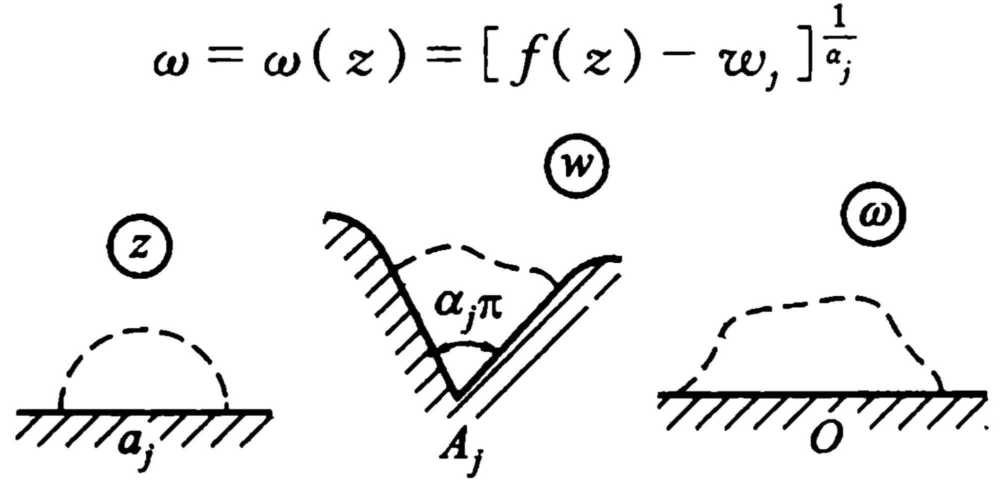

图 8.19
 

<!-- page: 370 -->

我们可应用对称原理. 所以它可以解析延拓于  $ a_{j} $ 的整个邻域，而且在此邻域内可以展成泰勒级数：

$$  \begin{aligned}\omega(z)&=\left[f(z)-w_{j}\right]^{\frac{1}{a_{j}}}\\&=c_{1}\left(z-a_{j}\right)+c_{2}\left(z-a_{j}\right)^{2}+\cdots\end{aligned}   \tag*{(8.12)}$$

其中  $ c_{0}=\omega(a_{j})=0 $; 但  $ c_{1}=\omega'(a_{j})\neq0 $, 因为  $ \omega(z) $ 在 a_{j} 点邻域内单叶解析.

由（8.12），我们进一步得到

 $$ f(z)=w_{j}+(z-a_{j})^{a_{j}}\left[c_{1}+c_{2}(z-a_{j})+\cdots\right]^{a_{j}},c_{1}\neq0 $$ 

但因为方括号的  $ a_{j} $ 次幂在  $ a_{j} $ 的邻域内是解析的（由一般幂函数的意义，再由方括号本身当  $ z = a_{j} $ 时不为 0 即可推出），所以它本身可展为  $ (z - a_{j}) $ 的幂级数. 于是，我们有

 $$ \begin{aligned}{f(z)}&{{}=\mathcal{w}_{j}+\left(z-a_{j}\right)^{a_{j}}\left[c_{1}^{\prime}+c_{2}^{\prime}(z-a_{j})+\cdots\right]}\\ {}&{{}=\mathcal{w}_{j}+c_{1}^{\prime}(z-a_{j})^{a_{j}}+c_{2}^{\prime}(z-a_{j})^{a_{j}+1}+\cdots.}\\ \end{aligned} $$ 

由此而得

 $$ \begin{align*}\varphi(z)&=\frac{f^{\prime}(z)}{f^{\prime}(z)}=\frac{(a_{j}-1)\alpha_{j}c_{1}^{\prime}(z-a_{j})^{a_{j}-2}+\cdots}{\alpha_{j}c_{1}^{\prime}(z-a_{j})^{a_{j}-1}+\cdots}\\&=\frac{1}{z-a_{j}}\cdot\frac{(a_{j}-1)\alpha_{j}c_{1}^{\prime}+\cdots}{\alpha_{j}c_{1}^{\prime}+\cdots},\end{align*} $$ 

其中第二个因子表示在点  $ z = a_{j} $ 解析的函数，因而它在  $ z = a_{j} $ 的邻域内可以展成

 $$ \left(\alpha_{j}-1\right)+c_{1}^{^{\prime \prime}}(z-a_{j})+c_{2}^{^{\prime \prime}}(z-a_{j})^{2}+\cdots. $$ 

所以

 $$ \begin{align*}\varphi\left(z\right)&=\frac{1}{z-a_{j}}\big[\left(\alpha_{j}-1\right)+c_{1}^{^{\prime \prime}}\left(z-a_{j}\right)+c_{2}^{^{\prime \prime}}\left(z-a_{j}\right)^{2}+\cdots\big]\\&=\frac{\alpha_{j}-1}{z-a_{i}}+c_{1}^{^{\prime \prime}}+c_{2}^{^{\prime \prime}}\left(z-a_{j}\right)+\cdots,\end{align*} $$ 

这是  $ \varphi(z) $ 在 z = a; 的去心邻域内的洛朗展开式. 由此可以推得：函数  $ \varphi(z) $ 在 z = a; 有一阶极点，留数等于  $ \alpha, -1 $.

<!-- page: 371 -->

这样，函数  $ \varphi(z) $ 在扩充 z 平面上只有 n 个一阶极点  $ a_{j}(j=1,2,\cdots,n) $. 由  $ \varphi(z) $ 减去其所有的主要部分，我们就得到函数

$$  \psi(z)=\varphi(z)-\frac{a_{1}-1}{z-a_{1}}-\frac{a_{2}-1}{z-a_{2}}-\cdots-\frac{a_{n}-1}{z-a_{n}},   \tag*{(8.13)}$$

它在整个扩充 z 平面上是解析的，由第五章习题(一)9 的刘维尔定理，可知  $ \psi(z) $ 必是常数.

函数  $ f(z) $ 在点  $ z=\infty $ 是解析的 [因为  $ z=\infty $ 是线段  $ (a_{n}, a_{1}) $ 的内点]，由此，在  $ z=\infty $ 的邻域内

$$  f(z)=c_{0}+\frac{c_{-p}}{z^{p}}+\frac{c_{-p-1}}{z^{p+1}}+\cdots,   \tag*{(8.14)}$$

其中  $ c_{-p} $ 是  $ f(z) $ 的洛朗展开式的第一个不等于零的系数. 由 (8.14) 得: 在  $ z = \infty $ 的邻域内

 $$ \begin{align*}\varphi(z)&=\frac{f^{\prime}(z)}{f^{\prime}(z)}=\frac{p(p+1)\frac{c-p}{z^{p+2}}+\cdots}{-\frac{p c_{-p}}{z^{p+1}}+\cdots}\\&=\frac{1}{z}\cdot\frac{p(p+1)c_{-p}+\cdots}{-p c_{-p}+\cdots}=-\frac{p+1}{z}+\cdots,\end{align*} $$ 

由此可见  $ \varphi(\infty)=0 $. 但因在(8.13)中当  $ z=\infty $ 时所有其余的项都变成零, 所以  $ \psi(\infty) $ 也变成零, 即  $ \psi(z)\equiv0 $. 这样,

 $$ \varphi(z)=\frac{\mathrm{d}}{\mathrm{d}z}\ln f^{\prime}(z)=\frac{a_{1}-1}{z-a_{1}}+\frac{a_{2}-1}{z-a_{2}}+\cdots+\frac{a_{n}-1}{z-a_{n}}. $$ 

然后，沿上半 z 平面中的任意路线积分，则得

 $$ \begin{align*}\ln f^{\prime}(z)=&(\alpha_{1}-1)\ln(z-a_{1})+(\alpha_{2}-1)\ln(z-a_{2})+\cdots\\&+(\alpha_{n}-1)\ln(z-a_{n})+\ln C.\end{align*} $$ 

这里，右边的  $ \ln $ 表示对数的主值，而左边则表示它的对应值，因而去对数，我们就得到共形映射的导函数的式子

 $$ f^{\prime}(z)=C(z-a_{1})^{a_{1}-1}(z-a_{2})^{a_{2}-1}\cdots(z-a_{n})^{a_{n}-1}. $$ 

也沿上半 z 平面中任意路线来积分上式，则得所求的克里斯托费

<!-- page: 372 -->

尔－施瓦茨积分公式(8.9).

(8.9)是在这样的假设下得到的:即实轴上的经过共形映射后与多角形  $ P_{n} $ 的顶点对应的点  $ a_{1}, a_{2}, \cdots, a_{n} $ 是已知的,但应用问题只给出多角形  $ P_{n} $ 的顶点,而点  $ z = a_{j} (j = 1, 2, \cdots, n) $ 是不知道的.按共形映射的黎曼存在定理,有三个这样的点(例如  $ a_{1}, a_{2} $ 与  $ a_{3} $)是我们可以任意给定的,而其余的点  $ a_{j} (j = 4, 5, \cdots, n) $ 以及常数 C 与  $ C_{1} $ 应当由问题的条件来决定(常数  $ z_{0} $ 也可任意选定).这种情况造成了利用克里斯托费尔－施瓦茨积分的主要困难.

2. 退化情形 首先,由于线性变换的保圆周性及定义 7.3,我们易得:

定理 8.8 两直线在无穷远点的交角，等于它们在第二交点（有限点）的交角反号.

证 设  $ L_{1}, L_{2} $ 是从无穷远点出发的两条射线，为明了起见，

还设它们在有限点  $ \xi_{0} (\xi_{0} \neq 0) $ 相交。通过反演变换  $ w = \frac{1}{z} $ 后，得到的像曲线为经过 w = 0 的两条圆弧  $ \Gamma_{1} $ 及  $ \Gamma_{2} $，于是其第二交点为  $ w = \frac{1}{\xi_{0}} $。圆弧  $ \Gamma_{1} $ 及  $ \Gamma_{2} $ 在两交点处的交角必互为相反数（图 8.20）。再由  $ w = \frac{1}{z} $ 在点  $ \xi_{0} $ 保角，又由定义 7.3， $ w = \frac{1}{z} $ 在  $ z = \infty $ 处保角，定理就得到证明。

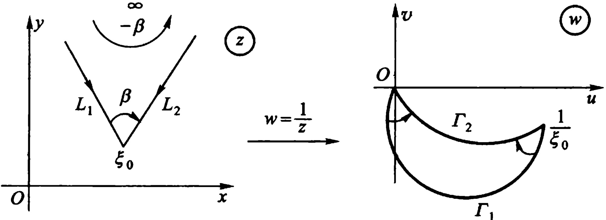

图 8.20
 

<!-- page: 373 -->

其次，上面定理 8.7 的下列两个退化情形是很有用的：

（1）n 角形  $ P_{n} $ 有一个顶点是无穷远点的像. 即  $ a_{1}, a_{2}, \cdots, a_{n} $ 中有一个例如  $ a_{n} = \infty $.

为了要把这种情形化成上面定理的情形,我们作一个分式线性变换

$$  \zeta=-\frac{1}{z}+a_{n}^{\prime}   \tag*{(8.15)}$$

把上半平面  $ \mathrm{Im} z > 0 $ 共形映射成上半平面  $ \mathrm{Im} \zeta > 0 $，且把点  $ a_{1} $， $ a_{2} $， $ \cdots $， $ a_{n} = \infty $ 分别变成有限点  $ a_{1}^{\prime} $， $ a_{2}^{\prime} $， $ \cdots $， $ a_{n}^{\prime} $（见下面注）.

应用公式(8.9)，我们得出

 $$ \begin{align*}\varpi&=C^{\prime}\int_{\zeta_{0}}^{\zeta}\left(\zeta-a_{1}^{\prime}\right)^{a_{1}-1}\left(\zeta-a_{2}^{\prime}\right)^{a_{2}-1}\cdots\left(\zeta-a_{n}^{\prime}\right)^{a_{n}-1}\mathrm{d}\zeta+C_{1}^{\prime}\\&=C^{\prime}\int_{z_{0}}^{z}\left(a_{n}^{\prime}-a_{1}^{\prime}-\frac{1}{z}\right)^{a_{1}-1}\left(a_{n}^{\prime}-a_{2}^{\prime}-\frac{1}{z}\right)^{a_{2}-1}\cdots\\&\quad\cdot\left(-\frac{1}{z}\right)^{a_{n}-1}\frac{\mathrm{d}z}{z^{2}}+C_{1}^{\prime}.\end{align*} $$ 

利用(8.10)经过简单的变换,我们得到

 $$ \begin{align*}\varpi&=C^{\prime}\int_{z_{0}}^{z}\left[(a_{n}^{\prime}-a_{1}^{\prime})z-1\right]^{a_{1}-1}\left[(a_{n}^{\prime}-a_{2}^{\prime})z-1\right]^{a_{2}-1}\cdots\\&\left[(a_{n}^{\prime}-a_{n-1}^{\prime})z-1\right]^{a_{n-1}-1}(-1)^{a_{n}-1}\frac{\mathrm{d}z}{z^{a_{1}+a_{2}+\cdots+a_{n}-n+2}}+C_{1}^{\prime}\\&=C\int_{z_{0}}^{z}\left(z-a_{1}^{0}\right)^{a_{1}-1}(z-a_{2}^{0})^{a_{2}-1}\cdots(z-a_{n-1}^{0})^{a_{n-1}-1}\mathrm{d}z+C_{1},\end{align*} $$ 

其中  $ a_{j}^{0}=\frac{1}{a_{n}-a_{j}}(j=1,2,\cdots,n-1) $ 是实常数. 为简单起见, 我们将  $ a_{j}^{0} $ 就记成  $ a_{j}(j=1,2,\cdots,n-1) $, 于是公式 (8.9) 就退化成下列公式

 $$ \mathcal{w}=C\int_{z_{0}}^{z}\left(z-a_{1}\right)^{a_{1}-1}(z-a_{2})^{a_{2}-1}\cdots(z-a_{n-1})^{a_{n-1}-1}\mathrm{d}z+C_{1}. $$ 

因此,如果 n 角形  $ P_{n} $ 的那些顶点中,有一顶点与无穷远点相

<!-- page: 374 -->

应，则在公式(8.9)中就丢掉那个关于这个顶点的因子.

在实际应用上，可以利用这个事实来简化克里斯托费尔－施瓦茨积分.

注 在(8.15)中， $ a_{n} $是任意实常数，且已假定 $ a_{1},\cdots,a_{n} $都不为零；为了使上半z平面 $ \mathrm{Im}z>0 $共形映射为上半 $ \zeta $平面 $ \mathrm{Im}\zeta>0 $，所以 $ \frac{1}{z} $前面要冠负号，以满足例7.6的条件。如果点 $ a_{j}(j=1,2,\cdots,n) $之一等于零，则必须不取(8.15)，而取

 $$ \zeta=a_{n}^{\prime}-\frac{1}{z-a}, $$ 

其中 a 是一个与所有的  $ a_{j}(j=1,\cdots,n) $ 都不相同的数. 否则  $ a_{j}^{\prime}(j=1,\cdots,n) $ 之一就要成为  $ \infty $ 了.

(2) n 角形  $ P_{n} $ 有一个或几个顶点在无穷远点（这时  $ P_{n} $ 称为广义多角形）.

设  $ A_{j}=\infty $ (图 8.21)

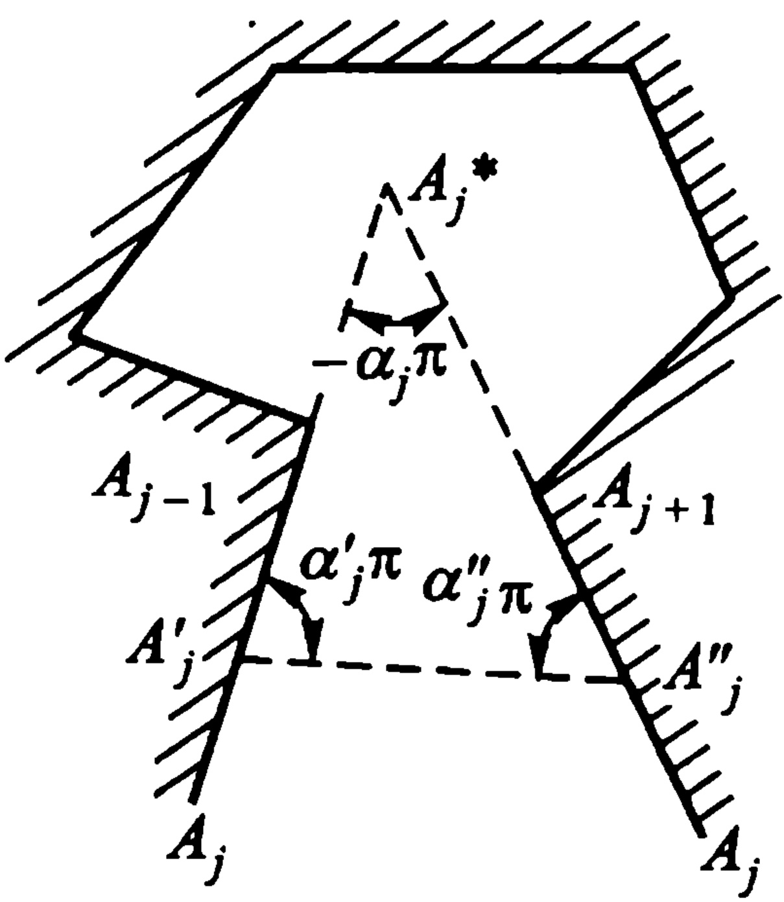

图 8.21
 

在射线  $ A_{j-1}A $ 与  $ A_{j+1}A $ 上任意各取一点  $ A' $，与  $ A'' $，用线段联结这两点，并考查所得到的  $ (n+1) $ 角形。按公式 (8.9)，将  $ \mathrm{Im} z > 0 $ 共形映射成这个多角形内部的函数，可用下列公式表出：

 $$ \varpi=C\int_{z_{0}}^{z}\left(z-a_{1}\right)^{a_{1}-1}\cdots\left(z-a_{j}^{^{\prime}}\right)^{a_{j}^{^{\prime}}-1}\left(z-a_{j}^{^{\prime \prime}}\right)^{a_{j}^{^{\prime \prime}}-1}\cdots $$

<!-- page: 375 -->

$$  \bullet\left(z-a_{n}\right)^{a_{n}-1}\mathrm{d}z+C_{1},   \tag*{(8.16)}$$

这里  $ a', a'' $, 分别为  $ A', A'' $, 的对应点. 当  $ A', A'' $, 趋于  $ A_i = \infty $ 时,  $ a', a'' $, 必趋于某一实数  $ a_i $, 它与  $ A_i $ 对应.

由定理 8.8，射线  $ A_{j-1}A_{j} $ 与  $ A_{j+1}A_{j} $ 在有限点  $ A_{j}^{*} $ 处的那个交角，应等于在  $ A_{j}=\infty $ 的交角  $ \alpha, \pi $ 反号，即  $ -\alpha, \pi $。于是，由三角形  $ A_{j}^{\prime}A_{j}^{\prime\prime}A_{j}^{*} $，我们有  $ \alpha_{j}^{\prime} + \alpha_{j}^{\prime\prime} - \alpha_{j} = 1 $，而这就是说， $ \alpha_{j}^{\prime} + \alpha_{j}^{\prime\prime} - 2 = \alpha_{j} - 1 $。因此，当  $ A_{j}^{\prime}, A_{j}^{\prime\prime} $ 趋于  $ \infty $ 时，(8.16) 仍然化成 (8.9) 的形状：

 $$ \begin{array}{r}{\varpi=C\displaystyle\int_{z_{0}}^{z}\big(z-a_{1}\big)^{a_{1}-1}\cdots\big(z-a_{j}\big)^{a_{j}-1}\cdots\big(z-a_{n}\big)^{a_{n}-1}\mathrm{d}z+C_{1}.}\end{array} $$ 

当多角形有几个顶点在无穷远点时，可以作同样的讨论.

因此，对于一个或几个顶点在无穷远处的那些多角形来说，克里斯托费尔－施瓦茨积分公式仍然有效，只需把顶点在无穷远处的那两条直线间的角度，用这两条直线在有限点处的那个交角反号代替.

### 3. 广义多角形举例

（1）广义三角形（图 8.22）

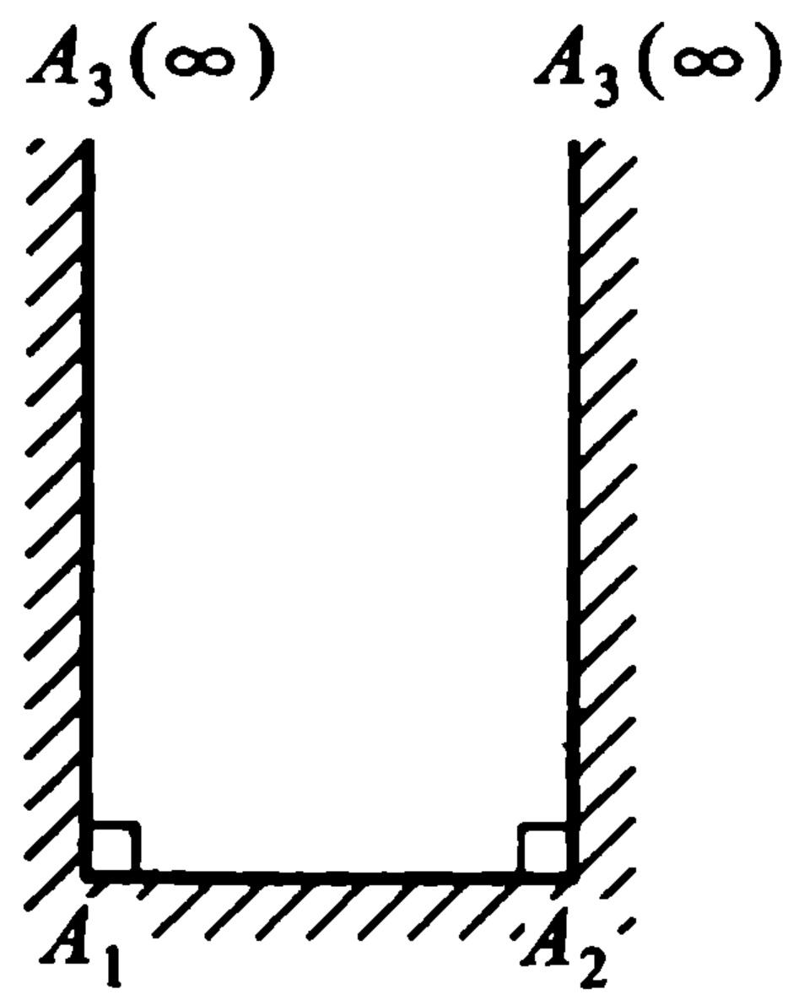

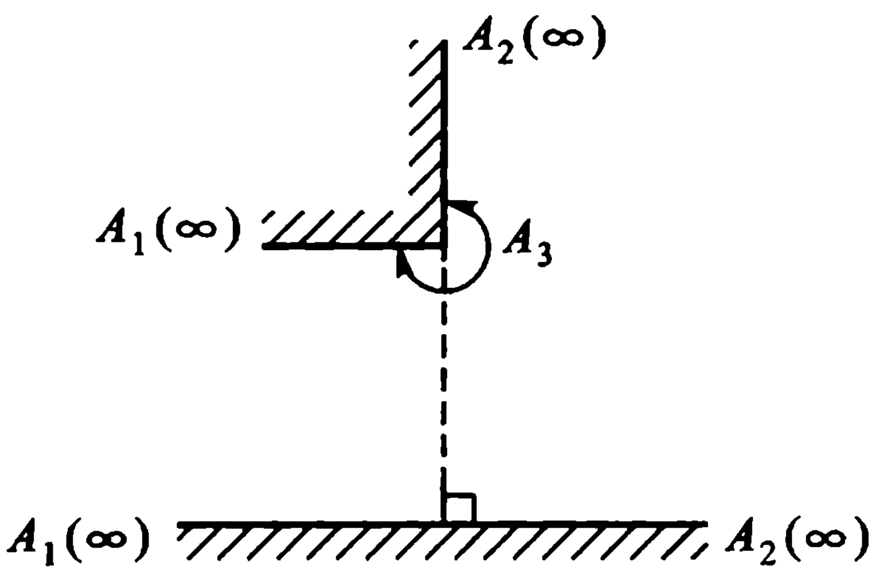

（这里  $ \alpha_{1}=\alpha_{2}=\frac{1}{2},\alpha_{3}=0 $）

合于  $ \frac{1}{2}+\frac{1}{2}+0=3-2 $

图 8.22(a)
 

 $$ \begin{aligned}\left(\begin{aligned}& 这里 \quad\alpha_{1}=0,\alpha_{2}=-\frac{1}{2},\alpha_{3}=\frac{3}{2}\\& 介于 \quad0+\left(-\frac{1}{2}\right)+\frac{3}{2}=3-2\end{aligned}\right)\end{aligned} $$ 

图 8.22(b)
 

（2）广义四角形（图 8.23）

<!-- page: 376 -->

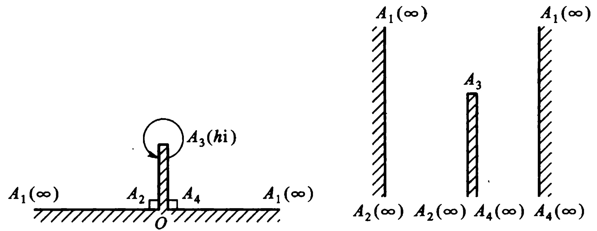

 $$ \begin{aligned}\left(\begin{array}{l} 这里 \quad\alpha_{1}=-1,\alpha_{2}=\alpha_{4}=\frac{1}{2},\alpha_{3}=2\\\\ 合于 \quad-1+\frac{1}{2}+\frac{1}{2}+\stackrel{.}{2}=4-2\end{array}\right)&\quad\left(\begin{array}{l} 这里 \quad\alpha_{1}=\alpha_{2}=\alpha_{4}=0,\alpha_{3}=2\\\\ 合于 \quad0+0+0+2=4-2\end{array}\right)\end{aligned} $$ 

图 8.23(a)
 

图 8.23(b)
 

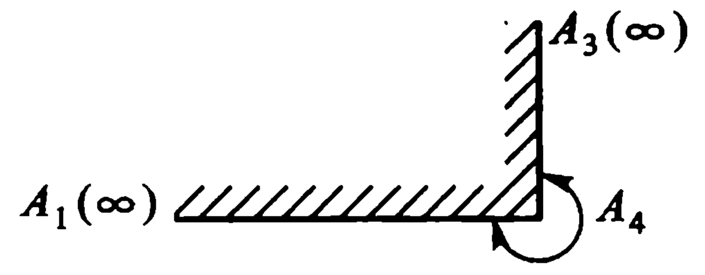

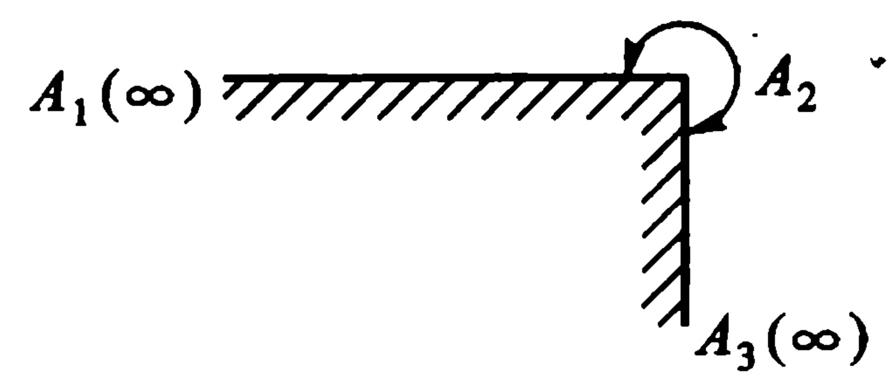

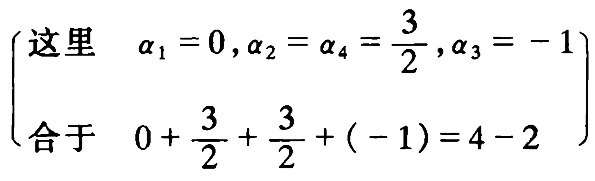

图 8.23(c)
 

例 8.15 半带形区域
 

 $$ -\frac{\pi}{2}<{\mathrm{R e~}}w<\frac{\pi}{2},\quad{\mathrm{I m~}}w>0 $$ 

是顶点为  $ A_{1} = -\frac{\pi}{2} $， $ A_{2} = \frac{\pi}{2} $， $ A_{3} = \infty $ 的广义三角形，其各顶角处

<!-- page: 377 -->

$ \alpha_{1}=\frac{1}{2},\alpha_{2}=\frac{1}{2},\alpha_{3}=0 $，合于  $ \alpha_{1}+\alpha_{2}+\alpha_{3}=1 $（如图8.22(a)）。为了明显起见，我们把数据列成表，在其中指出点  $ a_{j}(j=1,2,3) $，它们共三个，因而我们可以任意给定。

<table border=1 style='margin: auto; word-wrap: break-word;'><tr><td style='text-align: center; word-wrap: break-word;'>$A_{j}$</td><td style='text-align: center; word-wrap: break-word;'>$a_{j}$</td><td style='text-align: center; word-wrap: break-word;'>$a_{j}$</td></tr><tr><td style='text-align: center; word-wrap: break-word;'>$-\frac{\pi}{2}$</td><td style='text-align: center; word-wrap: break-word;'>$\frac{1}{2}$</td><td style='text-align: center; word-wrap: break-word;'>-1</td></tr><tr><td style='text-align: center; word-wrap: break-word;'>$\frac{\pi}{2}$</td><td style='text-align: center; word-wrap: break-word;'>$\frac{1}{2}$</td><td style='text-align: center; word-wrap: break-word;'>1</td></tr><tr><td style='text-align: center; word-wrap: break-word;'>$\infty$</td><td style='text-align: center; word-wrap: break-word;'>0</td><td style='text-align: center; word-wrap: break-word;'>$\infty$</td></tr></table>

克里斯托费尔－施瓦茨积分取形式

 $$ \begin{array}{l}w=C\displaystyle\int_{0}^{z}\left(z+1\right)^{-\frac{1}{2}}\left(z-1\right)^{-\frac{1}{2}}\mathrm{d}z+C_{1}\\ \quad=C^{\prime}\displaystyle\int_{0}^{z}\frac{\mathrm{d}z}{\sqrt{1-z^{2}}}+C_{1}\\ \quad=C^{\prime}\arcsin z+C_{1}.\end{array} $$ 

利用点  $ a_{1}, a_{2} $ 与  $ A_{1}, A_{2} $ 的对应关系, 我们得到

 $$ -\frac{\pi}{2}=-C^{\prime}\cdot\frac{\pi}{2}+C_{1},\frac{\pi}{2}=C^{\prime}\cdot\frac{\pi}{2}+C_{1}. $$ 

由此，

 $$ C_{1}=0,C^{\prime}=1. $$ 

故所求将上半 z 平面  $ \mathrm{Im}\ z>0 $ 共形映射成 w 平面上给定的半带形区域的函数为

 $$ w=\arcsin z $$ 

（取 z=1 时， $ w=\arcsin z=\frac{\pi}{2} $ 的那一支）.

例 8.16 割去线段  $ 0 < v < h $, u = 0 (w = u + iv) 的上半平面 v > 0 是广义四角形 (如图 8.23(a)), 它的已知量以及与顶点对应的点列于下表中 (点  $ a, j = 1, 2, 3, 4 $ 中的三个是任意给定的, 第四

<!-- page: 378 -->

个暂时用  $ \xi $ 来表示). 在无穷远点的顶角等于  $ -\pi $, 因为  $ A_{2}A_{1} $ 与  $ A_{4}A_{1} $ 一个是另一个的延长线, 即它们之间的角等于  $ \pi $; 而

 $$ \begin{aligned}&\alpha_{1}+\alpha_{2}+\alpha_{3}+\alpha_{4}\\&=-1+\frac{1}{2}+2+\frac{1}{2}\\&=4-2=2.\end{aligned} $$ 

利用对称原理可以决定点  $ a_{4}=\xi $。将由 z 平面的第二象限到 w 平面的第二象限，且具有点的对应关系  $ \infty\leftrightarrow \infty $， $ h_{i}\leftrightarrow0 $，的共形映射解析延拓越过 y 轴的结果，就得到所求的共形映射。所以  $ a_{4} $ 应当关于虚轴与点  $ a_{2} $ 对称，即  $ a_{4}=\xi=1 $。

<table border=1 style='margin: auto; word-wrap: break-word;'><tr><td style='text-align: center; word-wrap: break-word;'>A_{j}</td><td style='text-align: center; word-wrap: break-word;'>$ \alpha_{j} $</td><td style='text-align: center; word-wrap: break-word;'>a_{j}</td></tr><tr><td style='text-align: center; word-wrap: break-word;'>$ \infty $</td><td style='text-align: center; word-wrap: break-word;'>-1</td><td style='text-align: center; word-wrap: break-word;'>$ \infty $</td></tr><tr><td style='text-align: center; word-wrap: break-word;'>0</td><td style='text-align: center; word-wrap: break-word;'>$ \frac{1}{2} $</td><td style='text-align: center; word-wrap: break-word;'>-1</td></tr><tr><td style='text-align: center; word-wrap: break-word;'>hi</td><td style='text-align: center; word-wrap: break-word;'>2</td><td style='text-align: center; word-wrap: break-word;'>0</td></tr><tr><td style='text-align: center; word-wrap: break-word;'>0</td><td style='text-align: center; word-wrap: break-word;'>$ \frac{1}{2} $</td><td style='text-align: center; word-wrap: break-word;'>$ \xi $</td></tr></table>

克里斯托费尔－施瓦茨积分取形式

 $$ \begin{align*}\omega&=C\int(z+1)^{-\frac{1}{2}}z(z-1)^{-\frac{1}{2}}\mathrm{d}z\\&=C\int\frac{z\mathrm{d}z}{\sqrt{z^{2}-1}}=C^{\prime}\sqrt{z^{2}-1}+C_{1},\end{align*} $$ 

（我们取不定积分，而未取定积分，是因为常数  $ C_{1} $ 是任意的）. 为了确定常数  $ C^{\prime} $ 与  $ C_{1} $，我们利用点  $ a_{2}, A_{2} $ 与  $ a_{3}, A_{3} $ 的对应关系：

 $$ 0=0+C_{1},\mathrm{i}h=\mathrm{i}C^{\prime}+C_{1}, $$ 

由此， $ C_{1}=0 $， $ C^{\prime}=h $，因而所求的函数为

 $$ w=h\sqrt{z^{2}-1}, $$

<!-- page: 379 -->

（取 z=0 时， $ \sqrt{z^{2}-1}=i $ 的那一支）.

注 从上面关于广义多角形的举例可以看出，广义多角形实际上代表了扩充 w 平面上许多特殊形状的单连通区域（边界不止一点）。而变换（8.9）的逆变换  $ z = f^{-1}(w) $ 就能把这许多特殊形状的单连通区域共形映射成（即“简化成”）标准区域——上半 z 平面。

## 第八章 习题

## (一)

1 证明：函数  $ z^{-2} $ 是函数

 $$ f(z)=\sum_{n=0}^{\infty}(n+1)(z+1)^{n} $$ 

由区域 $ \left|z+1\right|<1 $向外的解析延拓.

2 证明：函数  $ \frac{1}{1+z^{2}} $ 是函数

 $$ f(z)=\sum_{n=0}^{\infty}\left(-1\right)^{n}z^{2n} $$ 

由单位圆  $ \left|z\right|<1 $ 向外的解析延拓.

3 已给函数

 $$ f_{1}\left(z\right)=1+2z+\left(2z\right)^{2}+\left(2z\right)^{3}+\cdots, $$ 

证明：函数

 $$ f_{2}\left(z\right)=\frac{1}{1-z}+\frac{z}{\left(1-z\right)^{2}}+\frac{z^{2}}{\left(1-z\right)^{3}}+\cdots $$ 

是函数  $ f_{1}(z) $ 的解析延拓.

4 试证：

 $$ f_{1}\left(z\right)=\sum_{n=0}^{\infty}\left(-1\right)^{n}\mathrm{i}^{n}z^{n} $$ 

及

 $$ f_{2}\left(z\right)=\sum_{n=0}^{\infty}\left(-1\right)^{n}\frac{\left(1+\mathrm{i}\right)^{n}z^{n}}{\left(1-z\right)^{n+1}} $$

<!-- page: 380 -->

互为直接解析延拓.

5 级数

 $$ -\frac{1}{z}-\sum_{n=0}^{\infty}z^{n} $$ 

与级数

 $$ \sum_{n=0}^{\infty}\frac{1}{z^{n+1}} $$ 

的收敛区域无公共部分，试证：它们互为（间接）解析延拓.

6 已给函数

 $$ f_{1}(z)=\sum_{n=1}^{\infty}\frac{z^{n}}{n}, $$ 

证明：函数

 $$ f_{2}\left(z\right)=\ln\frac{2}{3}+\sum_{n=1}^{\infty}\left(\frac{2}{3}\right)^{n}\frac{\left(z+\frac{1}{2}\right)^{n}}{n} $$ 

是函数  $ f_{1}(z) $ 的解析延拓.

7 设

 $$ f(z)=z-\frac{z^{2}}{2}+\frac{z^{3}}{3}-\cdots\left(\mid z\mid<1\right), $$ 

试证：

 $$ f(a)+f\left(\frac{z-a}{1+a}\right) $$ 

与  $ f(z) $ 互为直接解析延拓 ( $ |a|<1 $ 且  $ \mathrm{Im}a\neq0 $).

8 证明

 $$ f(z)=\sum_{n=1}^{\infty}z^{n!}=z+z^{2}+z^{6}+\cdots+z^{n!}+\cdots $$ 

以单位圆周  $ \left|z\right|=1 $ 为自然边界.

9 假设函数  $ f(z) $ 在原点邻域内是解析的，且适合方程

 $$ f(2z)=2f(z)\cdot f^{\prime}(z), $$ 

试证： $ f(z) $ 可以解析延拓到整个 z 平面上.

10 试作出函数 $ \sqrt{z(z-1)} $的黎曼面.

(二)

### 1 已给函数

<!-- page: 381 -->

$$ f_{1}\left(z\right)=z-\frac{1}{2}z^{2}+\frac{1}{3}z^{3}-\cdots, $$ 

证明：函数

 $$ f_{2}\left(z\right)=\ln2-\frac{1-z}{2}-\frac{\left(1-z\right)^{2}}{2.2^{2}}-\frac{\left(1-z\right)^{3}}{3.2^{3}}-\cdots $$ 

是函数  $ f_{1}(z) $ 的解析延拓.

2 幂级数

 $$ \sum_{n=1}^{\infty}\frac{1}{n}z^{n} $$ 

与

 $$ \mathrm{i}\pi+\sum_{n=1}^{\infty}(-1)^{n}\frac{1}{n}(z-2)^{n} $$ 

的收敛圆无公共部分，试证：它们互为解析延拓.

3 试证：级数

 $$ \sum_{n=0}^{\infty}\left[z(4-z)\right]^{n} $$ 

的和函数  $ f(z) $ 在点 z=0 的邻域及 z=4 的邻域内都可以展成幂级数，且其和函数  $ f_{1}(z) $ 与  $ f_{2}(z) $ 可以从一方解析延拓至另一方.

4 试证：级数

 $$ f(z)=\sum_{n=0}^{\infty}\left(\frac{1+z}{1-z}\right)^{n} $$ 

所定义的函数在左半平面内解析，并可解析延拓到除去点 z=0 外的整个 z 平面.

5 试证：单位圆周  $ |z|=1 $ 是函数

 $$ f(z)=\sum_{n=0}^{\infty}\frac{z^{2^{n}+2}}{(2^{n}+1)(2^{n}+2)} $$ 

的自然边界

6 试证: 如果  $ f(z) $ 在区域 D 内是连续的, 并且除去 D 内一条直线段上的点外, 在区域 D 内的每一点都有导数, 则  $ f(z) $ 在区域 D 内是解析的.

7 试证：如果整函数

 $$ f(z)=\sum_{n=0}^{\infty}a_{n}z^{n} $$ 

在实轴上取实值，则系数  $ a_{n} $ 都是实的.

8 试判定下列函数，哪些是单值函数？哪些是多值函数？

(1)  $ \sqrt{1 - \sin^{2} z} $;

(2)  $ \sqrt{\cos z} $;

<!-- page: 382 -->

(3) $ \frac{\sin\sqrt{z}}{\sqrt{z}}; $

(4)  $ \sqrt{e^{z}} $;

(5)  $ \mathrm{Ln}\sin z $.

9 求将上半平面  $ \mathrm{Im}\ z>0 $ 共形映射成边长为 2 的等边三角形的函数（设三个顶点为  $ -1, 1, \sqrt{3}i $）.

答： $ w=(-1+\mathrm{i}\sqrt{3})\frac{\Gamma\left(\frac{2}{3}\right)}{\Gamma^{2}\left(\frac{1}{3}\right)}\int_{0}^{z}z^{-\frac{2}{3}}(z-1)^{-\frac{2}{3}}\mathrm{d}z-1. $

10 试求由上半平面到图 8.24 所示广义多角形区域的共形映射.

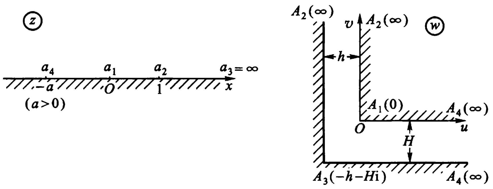

图 8.24
 

答：

 $$ \begin{array}{r}{\varpi=A\int_{0}^{z}\frac{\sqrt{z}\mathrm{d}z}{(z-1)(z+a)},}\end{array} $$ 

其中

 $$ a=\frac{H^{2}}{h^{2}},A=\frac{H^{2}+h^{2}}{\pi h\mathrm{i}}. $$

