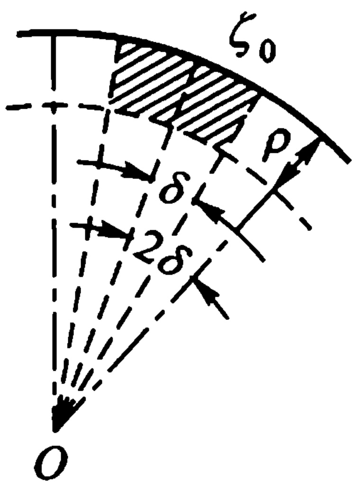
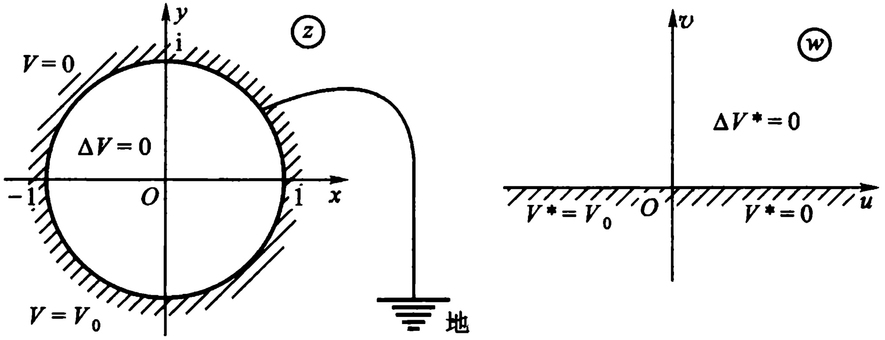

# 09-第九章 调和函数

[返回全书目录](../../README.md)

> PDF 页码：383–394

<!-- page: 383 -->

## 第九章 调和函数

我们在第三章 §4 曾经介绍过解析函数与调和函数这两个概念之间的关系，即定理 3.18 与定理 3.19.

本章我们将进一步研究调和函数的性质. 我们会发现调和函数与解析函数有某些类似的性质. 对于解析函数, 我们有柯西积分公式; 而对于调和函数, 就有下面要介绍的与柯西积分公式性质相类似的泊松(Poisson)积分公式. 解析函数有平均值定理和极值原理; 调和函数也有相类似的结果. 最后给出单位圆内和上半平面内狄利克雷(Dirichlet)问题的解.

为了方便起见,我们有时将用  $ u(z) $ 来代替  $ u(x,y) $,就如同对于含几个变数的函数,用  $ u(p) $ 来代替  $ u(x_{1},x_{2},\cdots,x_{n}) $ 那样,这时 p 被了解为其坐标为  $ (x_{1},x_{2},\cdots,x_{n}) $ 的点.

#### § 1. 平均值定理与极值原理

### 1. 平均值定理

定理 9.1 如果函数  $ u(z) $ 在圆  $ \left|\zeta - z_{0}\right| < R $ 内是一个调和函数，在闭圆  $ \left|\zeta - z_{0}\right| \leqslant R $ 上连续，则

$$  u\left(z_{0}\right)=\frac{1}{2\pi}\int_{0}^{2\pi}u\left(z_{0}+R\mathrm{e}^{\mathrm{i}\varphi}\right)\mathrm{d}\varphi,   \tag*{(9.1)}$$

即 u(z) 在圆心  $ z_{0} $ 的值等于它在圆周上的值的算术平均数.

<!-- page: 384 -->

证 由第三章定理3.19，存在  $ u(z) $ 的共轭调和函数  $ v(z) $ 使  $ u(z)+iv(z)=f(z) $ 在  $ \left|\zeta-z_{0}\right|<R $ 内解析，若  $ 0<R_{1}<R $，于是由第三章的平均值定理得

 $$ u\left(z_{0}\right)+\mathrm{i}v\left(z_{0}\right)=f(z_{0})=\frac{1}{2\pi}\int_{0}^{2\pi}f(z_{0}+R_{1}\mathrm{e}^{\mathrm{i}\varphi})\mathrm{d}\varphi, $$ 

即

 $$ \begin{align*}u\left(z_{0}\right)+i v\left(z_{0}\right)&=\frac{1}{2\pi}\int_{0}^{2\pi}u\left(z_{0}+R_{1}\mathrm{e}^{\mathrm{i}\varphi}\right)\mathrm{d}\varphi+\\&\quad i\frac{1}{2\pi}\int_{0}^{2\pi}v\left(z_{0}+R_{1}\mathrm{e}^{\mathrm{i}\varphi}\right)\mathrm{d}\varphi.\end{align*} $$ 

比较两端的实部，且令  $ R_{1} \rightarrow R $ 即得(9.1).

特别，当  $ z_{0}=0 $ 时有公式

$$  u\left(0\right)=\frac{1}{2\pi}\int_{0}^{2\pi}u\left(R\mathrm{e}^{\mathrm{i}\varphi}\right)\mathrm{d}\varphi.   \tag*{(9.1)^{\prime}}$$

### 2. 极值原理

定理 9.2 设  $ u(z) $ 在区域 D 内是调和函数，且不恒等于常数，则  $ u(z) $ 在 D 的内点处不能达到最大值或最小值.

证 只对于最大值的情形证明定理就够了, 因为调和函数  $ u(z) $ 的最小值点便是函数  $ -u(z) $ 的最大值点, 而  $ -u(z) $ 也是一个调和函数.

用反证法，假设  $ u(z) $ 在区域 D 的某一内点  $ z_{0} $ 达到最大值，在单连通区域 D（若 D 为多连通区域，则须引一组割线，使 D 化成单连通区域  $ D' $，并使  $ z_{0} \in D' $，下面就以  $ D' $ 代 D）内作与 u(z) 共轭的调和函数  $ \dot{v}(z) $，并记  $ f(z) = u(z) + iv(z) $。则函数  $ e^{f(z)} $ 在 D 内单值解析，且其模

 $$ |\mathrm{e}^{f(x)}|=\mathrm{e}^{u(x)}. $$ 

但此函数在点  $ z_{0} $ 与 u(z) 一块儿达到最大值，这便与第四章的最大模原理相矛盾. 因此定理得证.

调和函数的极值原理也有下面的形式：

<!-- page: 385 -->

推论 9.3 设(1)  $ u(z) $ 在有界区域 D 内调和，在 D 上连续；(2) 沿边界 C 常有  $ u(z) \leq M $，则除  $ u(z) $ 为常数的情形外，在 D 内一切点处必常有  $ u(z) < M $。即，如  $ u(z) $ 非常数，则  $ u(z) $ 在 D 内不能达到最大值 M，而只能在边界上达到。

#### §2. 泊松积分公式与狄利克雷问题

1. 泊松积分公式 设函数  $ f(z) $ 在圆  $ K: |z| < R $ 内解析，在闭圆  $ \overline{K}: |z| \leq R $ 上连续，则对于 K 内任一点  $ z = re^{\mathrm{i}\varphi} $，根据柯西积分公式，有

$$  \begin{align*}f(z)&=\frac{1}{2\pi\mathrm{i}}\int_{|\zeta|=R}\frac{f(\zeta)}{\zeta-z}\mathrm{d}\zeta\\&=\frac{1}{2\pi}\int_{0}^{2\pi}f(R\mathrm{e}^{\mathrm{i}\theta})\frac{R\mathrm{e}^{\mathrm{i}\theta}}{R\mathrm{e}^{\mathrm{i}\theta}-r\mathrm{e}^{\mathrm{i}\varphi}}\mathrm{d}\theta.\end{align*}   \tag*{(9.2)}$$

点 z 关于圆周  $ \left|\zeta\right|=R $ 的对称点

 $$ z^{*}=\frac{R^{2}}{\overline{z}}=\frac{R^{2}\mathrm{e}^{\mathrm{i}\varphi}}{r}. $$ 

因为点  $ z^{*} $ 在圆周  $ \left|\zeta\right|=R $ 的外部，所以

$$  \begin{aligned}0&=\frac{1}{2\pi\mathrm{i}}\int_{|\zeta|=R}\frac{f(\zeta)}{\zeta-z^{*}}\mathrm{d}\zeta\\&=\frac{1}{2\pi}\int_{0}^{2\pi}f(R\mathrm{e}^{\mathrm{i}\theta})\frac{r\mathrm{e}^{\mathrm{i}\theta}}{r\mathrm{e}^{\mathrm{i}\theta}-R\mathrm{e}^{\mathrm{i}\varphi}}\mathrm{d}\theta.\end{aligned}   \tag*{(9.3)}$$

从(9.2)减去(9.3)，得

 $$ f(z)=\frac{1}{2\pi}\int_{0}^{2\pi}f(R\mathrm{e}^{\mathrm{i}\theta})\left[\frac{R\mathrm{e}^{\mathrm{i}\theta}}{R\mathrm{e}^{\mathrm{i}\theta}-r\mathrm{e}^{\mathrm{i}\varphi}}-\frac{r\mathrm{e}^{\mathrm{i}\theta}}{r\mathrm{e}^{\mathrm{i}\theta}-R\mathrm{e}^{\mathrm{i}\varphi}}\right]\mathrm{d}\theta. $$ 

经过一些计算，即得

 $$ u+\mathrm{i}v=f(z)=\frac{1}{2\pi}\int_{0}^{2\pi}f(R\mathrm{e}^{\mathrm{i}\theta})\frac{R^{2}-r^{2}}{R^{2}-2R r\cos(\theta-\varphi)+r^{2}}\mathrm{d}\theta. $$ 

比较上式两端的实部，得到公式

<!-- page: 386 -->

$$  u\left(r,\varphi\right)=\frac{1}{2\pi}\int_{0}^{2\pi}u\left(R,\theta\right)\frac{R^{2}-r^{2}}{R^{2}-2R r\cos\left(\theta-\varphi\right)+r^{2}}\mathrm{d}\theta.   \tag*{(9.4)}$$

上式也可写成

$$  u\left(z\right)=\frac{1}{2\pi}\int_{0}^{2\pi}u\left(R\mathrm{e}^{\mathrm{i}\theta}\right)\frac{R^{2}-r^{2}}{R^{2}-2R r\cos\left(\theta-\varphi\right)+r^{2}}\mathrm{d}\theta.   \tag*{(9.4)'}$$

特别，对于单位圆来说，R=1，上式变为

$$  u\left(z\right)=\frac{1}{2\pi}\int_{0}^{2\pi}u\left(\mathrm{e}^{\mathrm{i}\theta}\right)\frac{1-r^{2}}{1-2r\cos\left(\theta-\varphi\right)+r^{2}}\mathrm{d}\theta.   \tag*{(9.5)}$$

公式(9.4)，(9.4) $ ^{\prime} $及(9.5)均称为对于圆的泊松积分.

由此可以得出

定理 9.4 任何一个在圆内调和且在闭圆上连续的函数，圆内的值都可以用圆周上的值的积分即泊松积分表示.

注 泊松积分公式推广了平均值公式，而把后者作为特例 $ (r=0 $的情形).

思考题 试列举调和函数与解析函数还具有什么类似的性质.

2. 狄利克雷问题 $ ^{①} $ 拉普拉斯方程

 $$ \frac{\partial^{2}u}{\partial x^{2}}+\frac{\partial^{2}u}{\partial y^{2}}=0 $$ 

的通解，就是全体调和函数，此方程是最简单的二阶偏微分方程之一。对于常微分方程，给出了一定的附加条件，便可以确定出一个特解来。为了要确定拉普拉斯方程的一个解，也需要一些附加的条件（虽然条件的形式不完全一样），例如，常见的条件之一是表达成边值问题的形状，即表达成所求函数在区域的边界上应当满足的一些已知关系式的形状。这样的边界条件，往往可以由所给问题的解的那些物理条件本身得到。

这类条件中最简单的那一种，引出了所谓第一边值问题，或者

<!-- page: 387 -->

狄利克雷问题：

求出一个在区域 D 内调和并且在  $ \overline{D} = D + C $ 上连续的函数  $ u(z) $，使它在 C 上取已知值  $ \tilde{u}(\zeta) $：

 $$ u\left(\zeta\right)=\tilde{u}\left(\zeta\right),\qquad\zeta\in C. $$ 

例如，在某区域内求流体（无源、无旋）的速度或静电场（无电荷）的电位，当这区域边界上的速度或电位已经知道时，这便是狄利克雷问题.

先来证明狄利克雷问题解的惟一性定理：

定理 9.5 在已知区域 D, 对于给定的边界值  $ \tilde{u}(\zeta) $, 狄利克雷问题的解不能多于一个.

证 假设  $ u_{1}(z) $ 与  $ u_{2}(z) $ 是狄利克雷问题的两个解，则  $ u_{1}(z)-u_{2}(z) $ 在区域 D 内调和，在  $ \bar{D}=D+C $ 上连续，沿 C， $ u_{1}(z)-u_{2}(z)=0 $，(因沿 C， $ u_{1}(\zeta)=u_{2}(\zeta)=\tilde{u}(\zeta) $) 由定理 9.2， $ u_{1}(z)-u_{2}(z) $ 在  $ \bar{D} $ 上的最大值与最小值两个都等于零，因而在  $ \bar{D} $ 上  $ u_{1}(z)-u_{2}(z)=0 $。由此可见，在  $ \bar{D} $ 上  $ u_{1}(z)=u_{2}(z) $，于是定理得证。

3. 单位圆内狄利克雷问题的解 定理 9.4 启发我们来证明，对于单位圆的泊松积分 (9.5) 就是单位圆  $ D: |z| < 1 $ 内狄利克雷问题的解。首先，在 (9.5) 中令  $ u(z) \equiv 1 $，立刻得到，

$$  \frac{1}{2\pi}\int_{0}^{2\pi}\frac{1-r^{2}}{1-2r\cos(\theta-\varphi)+r^{2}}\mathrm{d}\theta=1.   \tag*{(9.6)}$$

其次,我们下面证明  $ u(z) $ 是在单位圆  $ \left|z\right|<1 $ 内的调和函数.

 $$ \zeta=\mathrm{e}^{\mathrm{i}\theta},\qquad z=r\mathrm{e}^{\mathrm{i}\varphi}\qquad(\mathrm{d}0\leqslant r<1). $$ 

我们有

 $$ \begin{array}{c}{\displaystyle\frac{1-r^{2}}{1-2r\cos\left(\theta-\varphi\right)+\bar{r}^{2}}=\frac{\zeta}{\zeta-z}+\frac{\bar{z}}{\bar{\zeta}-\bar{z}}}\\ {\displaystyle=\frac{1}{2}\left(\frac{\zeta+z}{\zeta-z}+1\right)+\frac{1}{2}\left(\frac{\bar{\zeta}+\bar{z}}{\bar{\zeta}-\bar{z}}-1\right)}\\ {\displaystyle=\frac{1}{2}\left[\frac{\zeta+z}{\zeta-z}+\left(\frac{\zeta+z}{\zeta-z}\right)\right]=\mathrm{R e}\left(\frac{\zeta+z}{\zeta-z}\right).}\end{array} $$

<!-- page: 388 -->

$$ \mathrm{d}\boldsymbol{\zeta}=\mathrm{i}\mathrm{e}^{\mathrm{i}\theta}\mathrm{d}\boldsymbol{\theta}=\mathrm{i}\boldsymbol{\zeta}\mathrm{d}\boldsymbol{\theta},\quad\frac{\mathrm{d}\boldsymbol{\zeta}}{\mathrm{i}\boldsymbol{\zeta}}=\mathrm{d}\boldsymbol{\theta}. $$ 

从而  $ u(z) $ 是函数

 $$ f(z)\xlongequal{( 记 )}\frac{1}{2\pi\mathrm{i}}\int_{|\zeta|=1}u(\zeta)\frac{\zeta+z}{\zeta-z}\cdot\frac{\mathrm{d}\zeta}{\zeta}\quad(|z|<1) $$ 

的实部，上式中的积分称为施瓦茨积分.

显然

 $$ f(z)=\frac{1}{2\pi\mathrm{i}}\left[\int_{|\zeta|=1}\frac{u(\zeta)}{\zeta-z}\mathrm{d}\zeta+z\int_{|\zeta|=1}\frac{u(\zeta)}{\zeta-z}\mathrm{d}\zeta\right]. $$ 

即

 $$ f(z)=\frac{1}{2\pi\mathrm{i}}\int_{|\zeta|=1}\frac{u(\zeta)}{\zeta-z}\mathrm{d}\zeta+z\cdot\frac{1}{2\pi\mathrm{i}}\int_{|\zeta|=1}\frac{u(\zeta)}{\zeta-z}\mathrm{d}\zeta. $$ 

等号右端的两个积分都是柯西型积分. 由第三章的定理 3.13' 可见,  $ f(z) $ 在  $ \left|z\right| < 1 $ 内解析. 从而证得其实部  $ u(z) $ 在  $ \left|z\right| < 1 $ 内是调和的.

最后，问题的证明转化为只须证明

$$  \lim_{z\to\zeta_{0}}\frac{1}{2\pi}\int_{0}^{2\pi}\left[u(\zeta)-u(\zeta_{0})\right]\frac{1-r^{2}}{1-2r\cos(\theta-\varphi)+r^{2}}\mathrm{d}\theta=0,   \tag*{(9.7)}$$

其中  $ \zeta = e^{i\theta} $， $ \zeta_{0} = e^{i\theta_{0}} $， $ z = re^{i\varphi} $，

 $$ 0\leqslant r<1,0\leqslant\theta<2\pi,0\leqslant\varphi<2\pi. $$ 

由于  $ u(\zeta) = u(e^{i\theta}) $ 在  $ \theta = \theta_{0} $ 处连续，对于任给一个正数  $ \epsilon $，总可以选取一个  $ \delta > 0 $，使当  $ |\theta - \theta_{0}| < 2\delta $ 时

 $$ |u(\zeta)-u(\zeta_{0})|<\varepsilon. $$ 

我们可得

 $$ \left|\frac{1-r^{2}}{2\pi}\int_{\theta_{0}-2\delta}^{\theta_{0}+2\delta}\frac{u(\zeta)-u(\zeta_{0})}{1-2r\cos(\theta-\varphi)+r^{2}}\mathrm{d}\theta\right| $$

<!-- page: 389 -->

$$  \begin{align*}&\leq\frac{1-r^2}{2\pi}\int_{\theta_0-2\delta}^{\theta_0+2\delta}\frac{|u(\zeta)-u(\zeta_0)|}{1-2r\cos(\theta-\varphi)+r^2}\mathrm{d}\theta\\&<\varepsilon\frac{1-r^2}{2\pi}\int_{\theta_0-2\delta}^{\theta_0+2\delta}\frac{\mathrm{d}\theta}{1-2r\cos(\theta-\varphi)+r^2}\\&<\varepsilon\frac{1-r^2}{2\pi}\int_{0}^{2\pi}\frac{\mathrm{d}\theta}{1-2r\cos(\theta-\varphi)+r^2}\\&\phantom{<\varepsilon\frac{1-r^2}{2\pi}\int_{\theta_0-2\delta}^{\theta_0+2\delta}\frac{1-2r\cos(\theta-\varphi)+r^2}{1-2r\cos(\theta-\varphi)+r^2}}\\&\phantom{<\varepsilon\frac{1-r^2}{2\pi}\int_{\theta_0-2\delta}^{\theta_0+2\delta}\frac{1-2r\cos(\theta-\varphi)+r^2}{1-2r\cos(\theta-\varphi)+r^2}}\\&\phantom{<\varepsilon\frac{1-r^2}{2\pi}\int_{\theta_0-2\delta}^{\theta_0+2\delta}\frac{1-2r\cos(\theta-\varphi)+r^2}{1-2r\cos(\theta-\varphi)+r^2}}\\&\phantom{<\varepsilon\frac{1-r^2}{2\pi}\int_{\theta_0-2\delta}^{\theta_0+2\delta}\frac{1-2r\cos(\theta-\varphi)+r^2}{1-2r\cos(\theta-\varphi)+r^2}}\\&\phantom{<\varepsilon\frac{1-r^2}{2\pi}\int_{\theta_0-2\delta}^{\theta_0+2\delta}\frac{1-2r\cos(\theta-\varphi)+r^2}{1-2r\cos(\theta-\varphi)+r^2}}\end{align*}   \tag*{(9.8)}$$

因为点 $ (r, \varphi) $趋于点 $ (1, \theta_{0}) $，所以对于适合 $ |\varphi - \theta_{0}| < \delta $， $ |\theta - \theta_{0}| \geq 2\delta $的 $ \varphi, \theta $，有

 $$ \begin{aligned}|\theta-\varphi|&=|\theta-\theta_{0}+\theta_{0}-\varphi|\geqslant|\theta-\theta_{0}|-|\theta_{0}-\varphi|\\&>2\delta-\delta=\delta.\end{aligned} $$ 

因此  $ \cos(\theta - \varphi) \leq \cos\delta $，从而

 $$ \begin{align*}1-2r\cos(\theta-\varphi)+r^2&\geqslant1-2r\cos\delta+r^2\\&=1-2r\left(1-2\sin^2\frac{\delta}{2}\right)+r^2\\&=(1-r)^2+4r\sin^2\frac{\delta}{2}\\&>4r\sin^2\frac{\delta}{2}.\end{align*} $$ 

令  $ A = 4r\sin^{2}\frac{\delta}{2} $，M 是  $ \left| u(\zeta) \right| $ 在单位圆周上的最大值. 因此得到

$$  \begin{align*}\left|\frac{1-r^2}{2\pi}\right|&\int_{0}^{2\pi+\theta_0-2\delta}\frac{u(\zeta)-u(\zeta_0)}{1-2r\cos(\theta-\varphi)+r^2}\mathrm{d}\theta\\&\leq\frac{2M}{2\pi A}(2\pi-4\delta)(1-r^2)\\&=\frac{2M}{\pi A}(\pi-2\delta)(1-r^2).\end{align*}   \tag*{(9.9)}$$

当  $ r \rightarrow 1 $ 时，(9.9)式等号右端趋于零。即对任意的  $ \varepsilon > 0 $，有正数  $ \rho < 1 $，使当  $ 1 - \rho < r < 1 $ 时

<!-- page: 390 -->

$$ \frac{2M}{\pi A}(\pi-2\delta)(1-r^{2})<\varepsilon. $$ 

从(9.8)和(9.9)式看到，当 $ 1-\rho<r<1,\vert\varphi-\theta_{0}\vert<\delta $时，即对图9.1中用斜线标出的那个区域内所有的点z来说，就都有：

 $$ \begin{align*}&\left|\frac{1}{2\pi}\int_{0}^{2\pi}\left[u(\zeta)-u(\zeta_{0})\right]\frac{1-r^{2}}{1-2r\cos(\theta-\varphi)+r^{2}}\mathrm{d}\theta\right.\\&\leqslant\left|\frac{1-r^{2}}{2\pi}\int_{\theta_{0}-2\delta}^{\theta_{0}+2\delta}\frac{u(\zeta)-u(\zeta_{0})}{1-2r\cos(\theta-\varphi)+r^{2}}\mathrm{d}\theta\right|+\\&\quad\left|\frac{1-r^{2}}{2\pi}\int_{\theta_{0}+2\delta}^{2\pi+\theta_{0}-2\delta}\frac{u(\zeta)-u(\zeta_{0})}{1-2r\cos(\theta-\varphi)+r^{2}}\mathrm{d}\theta\right|\\&<\varepsilon+\varepsilon=2\varepsilon.\end{align*} $$ 

由  $ \varepsilon $ 的任意性, 知道 (9.7) 是真的.

4. 上半平面内狄利克雷问题的解 为了求出在实轴上取已知值而在上半平面内调和的那个函数  $ u(z) $ 在点 z 处之值，我们作出一个把上半平面  $ \operatorname{Im}\zeta>0 $ 共形映射成单位圆  $ |\omega|<1 $ 的分式线性变换

图9.1
 

$$  \omega=\frac{\zeta-z}{\zeta-\overline{z}}.   \tag*{(9.10)}$$

因为这时点 z 被变成  $ \omega = 0 $，所以根据平均值定理，有

$$  U(0)=\frac{1}{2\pi}\int_{0}^{2\pi}U(\omega)\mathrm{d}\tau.   \tag*{(9.11)}$$

其中  $ u[\zeta(\omega)] = U(\omega) $，而  $ \tau $ 是单位圆周上点的辐角：

$$  \mathrm{e}^{\mathrm{i}\tau}=\frac{t-z}{t-\overline{z}}.   \tag*{(9.12)}$$

这里 t 在实轴  $ \mathrm{Im}\zeta=0 $ 上，因为(9.10)把实轴  $ \mathrm{Im}\zeta=0 $ 变成单位圆周  $ |\omega|=1 $.

在(9.12)这个等式两端微分,我们得到

 $$ \mathrm{e}^{\mathrm{i}\tau}\mathrm{d}\tau=\frac{2y}{\left(t-\bar{z}\right)^{2}}\mathrm{d}t\qquad\left(z=x+\mathrm{i}y\right). $$

<!-- page: 391 -->

因此便有

 $$ \mathrm{d}\tau=\frac{2y\mathrm{d}t}{(t-z)(t-\overline{z})}=\frac{2y\mathrm{d}t}{(t-x)^{2}+y^{2}}. $$ 

将(9.11)代回到原来的变数上去,结果我们便得出了 $ \uwave{\text{对于上半平}} $面的泊松积分公式:

$$  u\left(z\right)=\frac{1}{\pi}\int_{-\infty}^{+\infty}u\left(t\right)\cdot\frac{y\mathrm{d}t}{\left(t-x\right)^{2}+\dot{y}^{2}}.   \tag*{(9.13)}$$

同样，在一定条件下(例如，设  $ u(t) $ 是有界函数等)，我们可以证明(9.13)是上半平面上狄利克雷问题的解.

例 9.1 积出 (9.13) 式中的积分, 我们可得到一个在上半平面内的调和函数  $ u(z) $. 今设  $ u(t) $ 在实轴的一段  $ (\alpha, \beta) $ 上等于 1, 而在实轴的其余部分上等于 0, 则得

 $$ \begin{aligned}u\left(z\right)&=\frac{1}{\pi}\int_{a}^{\beta}\frac{y\mathrm{d}t}{\left(t-x\right)^{2}+y^{2}}\\&=\frac{1}{\pi}\left(\operatorname{a r c}\tan\frac{\beta-x}{y}-\operatorname{a r c}\tan\frac{\alpha-x}{y}\right)^{\textcircled{1}}.\end{aligned} $$ 

例 9.2 设有一个很长的圆柱面是用很薄的导体做成的. 这柱面被过它的轴的平面分为两半, 一半的电位保持为  $ V_{0} $, 另一半接地. 现在要求出柱体内任一点的电位.

由于柱体是很长的,所以内部的电位是只与 x, y 有关的函数  $ V(x, y) $. 可设圆柱的半径为 1. 为求电位函数  $ V(x, y) $, 可把问题化成如下的边值问题, 即狄利克雷问题:

 $ V(x,y) $为单位圆内的调和函数，即

$$  \begin{aligned}&\Delta V=\frac{\partial^{2}V}{\partial x^{2}}+\frac{\partial^{2}V}{\partial y^{2}}=0, 在 x^{2}+y^{2}<1 内 \\&V(x,y)=V_{0}, 在 x^{2}+y^{2}=1 上且 y<0\\&V(x,y)=0, 在 x^{2}+y^{2}=1 上且 y\geqslant0\end{aligned}   \tag*{(9.14)}$$

<!-- page: 392 -->

为解此题，今作分式线性变换

 $$ \omega=\mathrm{i}\frac{1-z}{1+z}, $$ 

它将单位圆  $ |z| < 1 $ 共形映射成上半平面  $ \mathrm{Im} w > 0 $，使  $ -1 \to \infty $， $ 1 \to 0 $， $ i \to 1 $，其边界对应是：下半圆周对应于负半实轴；上半圆周对应于正半实轴（如图 9.2）.

图9.2
 

经变换后的狄利克雷问题是：

 $ V^{*} $  $ (u,v) $ 为上半平面内的调和函数，即

$$  \left.\begin{array}{l}{\Delta V^{*}=0(\operatorname{I m}w>0),}\\ {V^{*}\left(u,0\right)=0\left(u\geqslant0\right),}\\ {V^{*}\left(u,0\right)=V_{0}\left(u<0\right).}\end{array}\right\}   \tag*{(9.14)'}$$

易知，函数

 $$ V^{*}\left(u,v\right)=\frac{V_{0}}{\pi}\arg w $$ 

恰是(9.14)的解.为回答原来的问题,我们应当将解答的 w 平面形式回到 z 平面上,写成 x,y 的函数.为此,先注意

 $$ \arg w=\operatorname{I m}\{\ln w\}, $$ 

故最终的答案是：

<!-- page: 393 -->

$$ \begin{align*}V(x,y)&=\frac{V_{0}}{\pi}\mathrm{Im}\left\{\ln\left(\mathrm{i}\frac{1-z}{1+z}\right)\right\}\\&=\frac{V_{0}}{\pi}\arg\left\{\mathrm{i}\frac{1-z}{1+z}\right\}\\&=\left\{\begin{array}{ll}\frac{V_{0}}{\pi}\arctan\left(\frac{1-x^{2}-y^{2}}{2y}\right),&y>0,\\\frac{V_{0}}{2},&y=0,\end{array}\right.\\\frac{V_{0}}{\pi}\left[\pi+\arctan\left(\frac{1-x^{2}-y^{2}}{2y}\right)\right],&y<0.\end{align*} $$ 

## 第九章习题

(一)

1 设(1)  $ u(x,y) $ 为区域 D 内的调和函数；(2) 圆  $ \left|z-a\right|<R $ 全含于 D. 求证：当  $ z=a+re^{i\theta}, r<R $ 时，

 $$ \begin{align*}u\left(\boldsymbol{r},\boldsymbol{\theta}\right)&=\mathrm{Re}f(a+r\mathrm{e}^{\mathrm{i}\theta})\\&=\frac{a_{0}}{2}+\sum_{n=1}^{\infty}r^{n}\left(a_{n}\cos n\theta+b_{n}\sin n\theta\right),\end{align*} $$ 

且展式是惟一的.

2 如果 u(z) 在 z 平面内是有界的调和函数, 试证 u(z) 恒等于常数.

3 设  $ f(z) $ 为一整函数且不恒等于一常数， $ u(x,y)=\operatorname{Re}f(z) $，则对于任一实数 a，必有平面上的点  $ (x_{0},y_{0}) $ 使  $ u(x_{0},y_{0})=a $.

4 设(1)  $ u(x,y) $ 是区域 D 内的调和函数；(2) 圆 K 全含于 D,  $ u(x,y) $ 在 K 内恒等于一常数 a. 求证  $ u(x,y) $ 在 D 内恒等于 a.

5 设(1)  $ u(x,y) $ 为区域 D 内的调和函数；

(2) $ (x_{0},y_{0})\in D,u(x_{0},y_{0})=a; $

(3) U 是  $ (x_{0}, y_{0}) $ 的一个邻域,  $ U \subseteq D $,

求证: U 内有无穷多个点,  $ u(x, y) $ 在其上的值都是 a.

6 试求在单位圆 K 内调和、在闭圆  $ \overline{K} $ 上（除去其上两点  $ \alpha, \beta $ 外）连续

<!-- page: 394 -->

$$  八 $$ 

的函数，这个函数在圆弧 $ \alpha\beta $上取值1，在单位圆周的其余部分上取值0.

 $$ \left( 二 \right) $$ 

1 试用调和函数的平均值定理证明：

 $$ \int_{0}^{\pi}\ln(1-2r\cos\theta+r^{2})\mathrm{d}\theta=0, $$ 

其中 -1 < r < 1.

提示 当  $ 0 \leq r < 1 $ 时，令  $ z = r e^{i\theta} $，考虑  $ \mathrm{Ln}(1 - z) $ 在  $ |z| < 1 $ 内的一个单值解析分支  $ \ln(1 - z) $。于是  $ u(z) = \mathrm{Re}[\ln(1 - z)] $ 在  $ |z| < 1 $ 内调和。且有  $ u(0) = \mathrm{Re}[\ln 1] = 0 $。再利用第二章习题（一）21 的结果；当  $ -1 \leq r < 0 $ 时，可考虑  $ \mathrm{Ln}(1 + z) $ 在  $ |z| < 1 $ 内的一个单值解析分支  $ \ln(1 + z) $，再作类似于上段的讨论，即可得到证明。

2 如果两个二元实函数  $ u_{1}(x,y) $ 与  $ u_{2}(x,y) $ 在区域 D 内为调和，在闭域  $ \overline{D} $ 上连续，且在 D 的所有边界点处有

 $$ u_{1}\left(x,y\right)=u_{2}\left(x,y\right), $$ 

试证: 在 D 内恒有

 $$ u_{1}\left(x,y\right)=u_{2}\left(x,y\right). $$ 

提示 考虑  $ u(x,y)=u_{1}(x,y)-u_{2}(x,y) $.

3 设二元实函数  $ u(x, y) $ 是在  $ 0 < |z| < \rho $ ( $ < +\infty $) 内的有界调和函数. 试证: 适当定义  $ u(0,0) $ 后,  $ u(x,y) $ 是在  $ |z| < \rho $ 内的调和函数.

