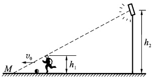

# 03-练习3 运动学中的两类问题

[返回全书目录](../../README.md)

> PDF 页码：5–6

<!-- page: 5 -->

## 练习3 运动学中的两类问题

## 一、填空题

1. 已知质点位置矢量随时间变化的函数形式为  $  \boldsymbol{r} = 4t^{2} \boldsymbol{i} + (3 + 2t) \boldsymbol{j}  $，则质点的轨迹方程为 ___，从 t = 0 到 t = 1 s 的位移为 ___，t = 1 s 时刻的速度为 ___。

2. 一质点沿 x 轴做直线运动，其运动方程为  $ x = 3 + 5t + 6t^{2} - t^{3} $ (SI)，则质点在 t = 0 时的速度为 ___，加速度为零时，该质点的速度为 ___。

3. 一质点沿半径为 0.1m 的圆周运动，其角位移  $ \theta $ 可表示为  $ \theta = 2 + 4t^{3} $ 。当 t = 2s 时，其切向加速度为 ___ ，当切向加速度与法向加速度的大小相等时，t = ___ 。

## 二、计算题

4. 质量为 m 的质点受到力 F = -kv^{2} x（其中 k 为常数）的作用沿 x 轴做直线运动。在 x = 0 处的速率为  $ v_{0}(v_{0} > 0) $，求该质点的速率 v 随 x 变化的关系。

<!-- page: 6 -->

<table border=1 style='margin: auto; word-wrap: break-word;'><tr><td style='text-align: center; word-wrap: break-word;'>班级：</td><td style='text-align: center; word-wrap: break-word;'>姓名：</td><td style='text-align: center; word-wrap: break-word;'>学号：</td><td style='text-align: center; word-wrap: break-word;'>编号：</td></tr></table>

5. 如图3.1所示，一高为 $ h_{1} $的足球运动员，背向某照明灯以匀速 $ v_{0} $带球，灯离地面高度为 $ h_{2} $，求影顶端M点沿地面移动的速率及影长变化率。

图3.1
 

6. 一半径为  $ 0.5 \, m $ 的飞轮在启动时的短时间内，其角速度与时间的平方成正比，在  $ t = 2 \, s $ 时测得缘一点的速度值为  $ 4 \, m/s $。求：(1) 该轮在  $ t' = 0.5 \, s $ 时的角速度，轮缘一点的切向加速度和总加速度

(2) 该点在  $ 2 \, s $ 内所转过的角度。

