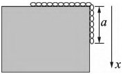

# 04-练习4 牛顿运动定律及其应用

[返回全书目录](../../README.md)

> PDF 页码：7–8

<!-- page: 7 -->

## 练习4 牛顿运动定律及其应用

## 一、填空题

1. 一质量为 m 的质点沿 x 轴正向运动，若该质点通过坐标为 x 处的速度为  $ k x (k $ 为正常数 $ ) $ ，则此时作用于该质点上的力的大小 F= ___，该质点从  $ x=x_{0} $ 点出发运动到  $ x=x_{1} $ 所经历的时间  $ \Delta t= $ ___。

2. 质量为 m 的物体，最初静止于  $ x_{0}(x_{0}>0) $ 处，在合外力  $ F=\frac{k}{x^{2}}(k $ 为正常数）作用下，沿直线运动，则物体在 x 处的速度大小为 ___。

3. 质量为 m 的物体，在力  $ F_{x}=A+Bt $ (SI) 作用下沿 x 方向运动 (A、B 为常数)，已知 t=0 时， $ x_{0}=0, v_{0}=0 $。则任一时刻，物体的速度表达式为 ___，物体的位移表达式为 ___。

## 二、计算题

4. 质量为 m 的子弹以速率  $ v_{0} $ 水平射入沙土中，设子弹所受阻力大小与速率成正比，比例系数为 k  $ (k>0) $，忽略子弹重力，求：

(1)子弹射入沙土后，速率与时间的关系；

(2)子弹射入沙土的最大深度。

<!-- page: 8 -->

<table border=1 style='margin: auto; word-wrap: break-word;'><tr><td style='text-align: center; word-wrap: break-word;'>班级：</td><td style='text-align: center; word-wrap: break-word;'>姓名：</td><td style='text-align: center; word-wrap: break-word;'>学号：</td><td style='text-align: center; word-wrap: break-word;'>编号：</td></tr></table>

5. 质量为 m 的物体自地面以速率  $ v_{0} $ 竖直上抛，重力加速度为常量 g，假设物体所受的空气阻力大小为  $ f = kmv^{2} $ (k 为正常数)，求：

(1)物体上升的最大高度；

(2) 物体下落到地面时速度的大小。

6. 如图 4.1 所示，一根匀质链条，质量为 m，总长度为 L，一部分放在光滑桌面上，另一部分从桌面边缘下垂，长度为 a，试求当链条下滑全部离开桌面时，它的速率为多少？（用牛顿第二定律求解）

图4.1
 

