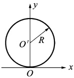
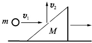

# 05-练习5 动量 功和能

[返回全书目录](../../README.md)

> PDF 页码：9–10

<!-- page: 9 -->

## 练习5 动量 功和能

## 一、填空题

1. 在湖中静止水面上有一长为 L，质量为 M 的小船，船的一端站有质量为 m 的人。当人从船的端走到另一端时，人相对湖岸移动的距离为 ___，船相对湖岸移动的距离为 ___。

2. 一质点在如图 5.1 所示的坐标平面内做圆周运动，有一力  $ \pmb{F} = F_{0}(x\dot{i} + y\dot{j}) $ 作用在质点上。在该质点从坐标原点 O 运动到 (0, 2R) 位置过程中，力 F 对它所做的功为 ___。

3. 一人造卫星绕地球做椭圆运动，近地点为 A，远地点为 B，A、B 两点距地心的距离分别为  $ r_{1} $、 $ r_{2} $，设卫星质量为 m，地球质量为 M，万有引力常数为 G，则卫星在 A、B 两点的势能之差  $ E_{PB}-E_{PA}= $ ___；卫星在 A、B 两点的动能之差  $ E_{KB}-E_{KA}= $ ___。

图5.1
 

## 二、计算题

4. 如图 5.2 所示，质量为 M 的滑块正沿着光滑水平地面向右滑动，一质量为 m 的小球向右飞行，水平速度  $ \pmb{v}_{1} $（对地）与滑块斜面相碰，碰后竖直向上弹起，速度为  $ \pmb{v}_{2} $（对地）。若碰撞时间为  $ \Delta t $，试计算过程中滑块对地的平均作用力和滑块速度增量的大小。

图5.2
 

<!-- page: 10 -->

<table border=1 style='margin: auto; word-wrap: break-word;'><tr><td style='text-align: center; word-wrap: break-word;'>班级：</td><td style='text-align: center; word-wrap: break-word;'>姓名：</td><td style='text-align: center; word-wrap: break-word;'>学号：</td><td style='text-align: center; word-wrap: break-word;'>编号：</td></tr></table>

5. 某人从  $ 10 \, m $ 深的水井中提水，开始时水桶中装有  $ 10 \, kg $ 的水，水桶的质量为  $ 1 \, kg $，由于水桶漏水，每升高  $ 1 \, m $ 要漏去  $ 0.2 \, kg $ 的水，求水桶匀速地从水井中提到水井口的过程中人所做的功。

6. 设相距为 r 的两粒子之间的相互作用力为排斥力  $ f=\frac{k}{r^{3}} $ (k 为常数)，试问：(1) f 是保守力吗？为什么？(2) 若是保守力，求两粒子相距为 r 时的势能（设无穷远处为势能零点）。

