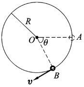
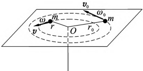

# 06-练习6 质点角动量定理及守恒定律

[返回全书目录](../../README.md)

> PDF 页码：11–12

<!-- page: 11 -->

## 练习6 质点角动量定理及守恒定律

## 一、填空题

1. 在 t=0 时，质量为 3kg 的物体位于  $ r_{0}=5i $ 处，其速度为  $ v_{0}=10j~m/s $，若其不受外力作用，则该物体在 t 时刻的位置矢量  $ \boldsymbol{r}= $ ___，t=0 s 时相对原点的角动量  $ \boldsymbol{L}_{0}= $ ___，t=12 s 时相对原点的角动量  $ \boldsymbol{L}= $ ___。

2. 一质点的角动量为  $ L=6t^{2}i-(2t+1)j+(12t^{3}-8t^{2})k\ kg \cdot m^{2}/s $，则质点在 t=1 s 时所受力矩 M= ___。

3. 质量为 3 kg 的质点位于 x=3 m, y=8 m 处时速度为 v=5i-6j m/s，作用于质点上的力大小为 7 N，沿 x 负方向，以原点为参考点时，质点在此时所受的力矩 ___。

## 二、计算题

4. 一个具有单位质量的质点在随时间 t 变化的力  $ \boldsymbol{F}=(3t^{2}-4t)\boldsymbol{i}+(12t-6)\boldsymbol{j} $ (SI) 作用下运动。设该质点在 t=0 s 时位于原点，且速度为零。求 t=2 s 时，该质点受到对原点的力矩和该质点对原点的角动量。

<!-- page: 12 -->

<table border=1 style='margin: auto; word-wrap: break-word;'><tr><td style='text-align: center; word-wrap: break-word;'>班级：</td><td style='text-align: center; word-wrap: break-word;'>姓名：</td><td style='text-align: center; word-wrap: break-word;'>学号：</td><td style='text-align: center; word-wrap: break-word;'>编号：</td></tr></table>

5. 如图 6.1 所示，一半径为 R 的光滑圆环置于竖直平面内，一质量为 m 的小球穿在圆环上，并可圆环上滑动。小球开始时静止于圆环上的 A 点（该点在通过环心 O 的水平面上），然后从 A 点开始下滑设小球与圆环间的摩擦略去不计，求小球滑到 B 点时对环心 O 的角动量和角速度的大小。

图6.1
 

6. 用绳系一质量为 m 小球使它在光滑的水平面上做匀速率圆周运动，其半径为  $ r_{0} $，角速度为  $ \omega $ 现通过圆心 O 处的小孔缓慢地往下拉绳使半径逐渐减小，如图 6.2 所示。求：

(1)当半径缩小为 r 时小球的角速度  $ \omega $。

(2)这一过程中绳子对小球的拉力所做的功。

图6.2
 

