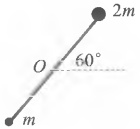
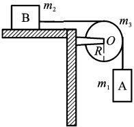
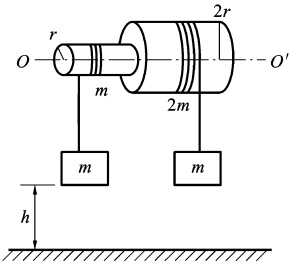

# 08-练习8 刚体定轴转动定律

[返回全书目录](../../README.md)

> PDF 页码：15–16

<!-- page: 15 -->

## 练习8 刚体定轴转动定律

## 一、填空题

1. 转动着的飞轮的转动惯量为 J，在 t=0 时角速度为  $ \omega_{0} $。此后飞轮经历制动过程，阻力矩 M 的大小与角速度  $ \omega $ 的平方成正比，比例系数为 k（k 为大于 0 的常数），当  $ \omega=\frac{1}{3}\omega_{0} $ 时，飞轮的角加速度大小 ___，从开始制动到  $ \omega=\frac{1}{3}\omega_{0} $ 所经过的时间 ___。

2. 一半径 15 cm、质量为 0.70 kg 的光盘从静止开始转动，在 1.5 s 内达到转速  $ n=33.3 \, rev \cdot min^{-1} $，则在此 1.5 s 时间内施加于光盘的转动力矩大小 M= ___。

3．如图8.1所示，长为L的轻质细杆，两端分别固定质量为m和2m的小球，此系统在竖直平面内可绕过中点O且与杆垂直的水平光滑固定轴（O轴）转动。初始时刻杆与水平成 $ 60^{\circ} $角时，由静止释放，杆球这一刚体系统绕O轴转动，系统绕O轴的转动惯量J=___。当杆转到水平位置时，刚体受到的合外力矩大小M=___；角加速度大小 $ \beta= $___。

图8.1
 

## 二、计算题

4. 有一质量分布均匀、半径为 R 的圆形平板平放在水平桌面上，平板与水平桌面的摩擦系数为  $ \mu $，若平板绕通过其中心且垂直于板面的固定轴以角速度  $ \omega_{0} $ 开始旋转，它将在旋转几圈后停止？（已知圆形平板的转动惯量  $ J=\frac{1}{2}mR^{2} $，其中 m 为圆形平板的质量）

<!-- page: 16 -->

<table border=1 style='margin: auto; word-wrap: break-word;'><tr><td style='text-align: center; word-wrap: break-word;'>班级：</td><td style='text-align: center; word-wrap: break-word;'>姓名：</td><td style='text-align: center; word-wrap: break-word;'>学号：</td><td style='text-align: center; word-wrap: break-word;'>编号：</td></tr></table>

5. 将质量为  $ m_{3} $ 、半径为 R 的定滑轮与质量分别为  $ m_{1} $ 、  $ m_{2} $ 的两物体 A、B 按如图 8.2 所示的方式行安装，如果 B 与桌面的摩擦可忽略，且滑轮可视为匀质圆盘，求物体 A、B 的加速度和绳子张力的大小

图 8.2
 

6. 如图 8.3 所示，固定在一起的两个同轴均匀圆柱体可绕其光滑的水平对称轴  $ OO' $ 转动，大、小柱体的半径分别为 2r 和 r，质量分别为 2m 和 m，绕在两柱体上的细绳分别与质量为 m 的物体相连。求圆柱体转动时角加速度及两侧细绳的张力；从静止开始时两质量为 m 的物体离地均为 h，与大、小圆体相连的哪个物体先着地？经多长时间？

图8.3
 

