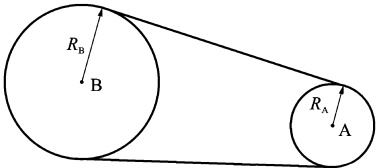
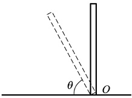
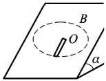

# 09-练习9 刚体定轴转动中的功和能

[返回全书目录](../../README.md)

> PDF 页码：17–18

<!-- page: 17 -->

## 练习 9 刚体定轴转动中的功和能

## 一、填空题

1. 用一条皮带将两个轮子 A 和 B 连接起来，轮和皮带间无相对滑动，B 轮的半径是 A 轮的 3 倍，图 9.1 所示。如果两轮具有相同的转动动能，则 A、B 两轮的转动惯量的比值为 ___。

2. 质量为 m、长度为 l 的匀质杆，可绕通过其下端的水平光滑固定轴 O 在竖直平面内转动，如图 9 所示，设它从竖直位置由静止倒下，当它倾倒到与水平面成  $ \theta $ 角时，角速度为 ___，角加速度 ___。

图9.1
 

图9.2
 

3. 某人站在水平转台的中央，与转台一起以恒定的转速  $ n_{1} $ 转动，他的两手各拿一个质量为 m 的码，砝码彼此相距  $ l_{1} $ （每一砝码离转轴  $ \frac{1}{2}l_{1} $），当此人将砝码拉近到距离为  $ l_{2} $ 时（每一砝码离转轴为  $ \frac{1}{2}l_{2} $ 整个系统转速变为  $ n_{2} $，设没有砝码时系统的转动惯量为  $ J_{0} $，则在此过程中人所做的功为 ___ （假定人在收臂过程中自身对轴的转动惯量的变化可以忽略）

## 二、计算题

4. 如图9.3所示，质量为m、长为l=85cm的均匀细杆，放在倾角为 $ \alpha=45^{\circ} $的光滑斜面上，可以绕通过杆上端且与斜面垂直的光滑轴O在斜面上转动。要使此杆能绕轴转动一周，至少应使杆以多大的初始角速度 $ \omega_{0} $转动？

图 9.3
 

<!-- page: 18 -->

<table border=1 style='margin: auto; word-wrap: break-word;'><tr><td style='text-align: center; word-wrap: break-word;'>班级：</td><td style='text-align: center; word-wrap: break-word;'>姓名：</td><td style='text-align: center; word-wrap: break-word;'>学号：</td><td style='text-align: center; word-wrap: break-word;'>编号：</td></tr></table>

5. 一个半径为 R、质量为 m 的硬币，竖直地立放在粗糙的水平桌面上。开始时处于静止状态，而后硬币受到轻微扰动而倒下。求硬币平面与桌面碰撞前（即硬币平面在水平位置）时质心的速度大小。（已知质量为 m、半径为 R 的圆盘对沿盘直径的轴的转动惯量为  $ \frac{1}{4}mR^{2} $）

6. 一根质量为 m、长为 L 的均匀细杆，可在水平桌面上绕通过其一端的竖直固定轴转动。已知细杆与桌面的滑动摩擦系数为  $ \mu $，求杆转动一周摩擦力做的功。

