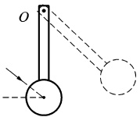
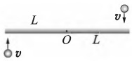
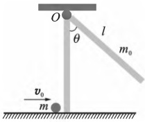
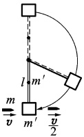
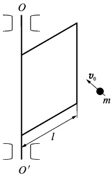

# 10-练习10 刚体定轴转动中的角动量定理和角动量守恒定律

[返回全书目录](../../README.md)

> PDF 页码：19–20

<!-- page: 19 -->

## 练习 10 刚体定轴转动中的角动量定理和角动量守恒定律

## 一、填空题

1. 如图10.1所示，一匀质木球固结在一细棒下端，且可绕水平光滑固定轴O转动。今有一子弹着与水平面成一角度的方向击中木球而嵌于其中，则在此击中过程中，木球、子弹、细棒系统守恒，原因是___。

2. 光滑的水平桌面上有一长为 2L、质量为 m 的匀质细杆，可绕过其中点且垂直于杆的竖直光滑定轴 O 自由转动，开始时杆静止，桌上有两个质量均为 m 的小球，各自在垂直杆的方向上，正对着杆的端，以相同速率 v 相向运动，如图 10.2 所示，当两球同时与杆的两端发生完全非弹性碰撞，则碰后杆的动角速度为 ___。

图10.1
 

图10.2
 

3. 一个质量为 m 的小虫，在有光滑竖直固定中心轴的水平圆盘边缘上，沿逆时针方向爬行，它相对于地面的速率为 v，此时圆盘正沿顺时针方向转动，相对于地面的角速率为  $ \omega_{0} $，设圆盘的半径为 R，对心轴的转动惯量为 J，若小虫停止爬行，则圆盘的角速度为 ___。

## 二、计算题

4. 长为 l、质量为  $ m_{0} $ 的细杆可绕垂直于一端的水平轴自由转动。细杆原来处于平衡状态。现有质量为 m 的小球沿光滑水平面飞来，正好与杆下端相碰（设碰撞为完全弹性碰撞）使细杆向上摆到  $ \theta $  $ 60^{\circ} $ 处，如图 10.3 所示，求小球的初速度大小。

图10.3
 

<!-- page: 20 -->

5. 质量为 m 的子弹穿过如图 10.4 所示的摆锤后，速率由 v 减小到  $ \frac{v}{2} $。已知均匀细棒、摆锤的质都为  $ m' $，细棒的长度为 l，如果摆锤能在垂直平面内完成一个完全的圆周运动，则子弹速度的最小值多少？

图10.4
 

6. 如图 10.5 所示，一宽为 l、质量为 M 的均匀薄板可绕  $ OO' $ 轴转动，有一质量为 m 的小球以速度在薄板边缘与板垂直相碰，若碰撞是完全弹性的，求碰撞后薄板的角速度大小和小球的速度大小。

图 10.5
 

