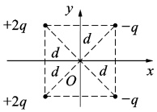
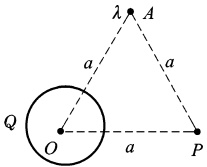
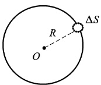
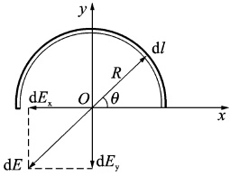
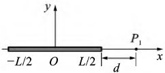
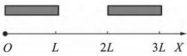

# 14-练习14 库仑定律 电场强度 场强叠加原理

[返回全书目录](../../README.md)

> PDF 页码：21–22

<!-- page: 21 -->

## 练习 14 库仑定律 电场强度 场强叠加原理

## 一、填空题

1. 如图14.1所示，四个点电荷分别位于正方形的四个顶点，它们到坐标原点O的距离均为d，则点电场强度的大小E= ___。

2. 如图14.2所示，一电荷线密度为 $ \lambda $的无限长带电直线垂直通过纸面上的A点，一电量为Q的匀带电球体，其球心处于O处。 $ \triangle AOP $是边长为a的等边三角形。为了使P点处场强方向垂直于OI则 $ \lambda $和Q的数量之间应满足___关系，且 $ \lambda $与Q为___号电荷。

3. 真空中一半径为 R 均匀带电球面如图 14.3 所示，总电量为 Q(Q>0)，今在球面上挖去非常小一块面积  $ \Delta S $（连同电荷），且假设不影响原来的电荷分布，则挖去  $ \Delta S $ 后球心处电场强度的大小 E= ___，其方向为 ___。

图14.1
 

图14.2
 

图14.3
 

## 二、计算题

4. 如图14.4所示，一半径为R的半圆细环上均匀分布电荷Q，求环心处的电场强度。

图14.4
 

<!-- page: 22 -->

5. 如图 14.5 所示，均匀带电的细棒，棒长为 L，电荷线密度为  $ \lambda $，求细棒的延长线上与棒的近端相 d 处  $ P_{1} $ 点的电场强度。

图14.5
 

6. 如图14.6所示，长度为L的两匀质细杆平行于OX轴放置，相距为L，两细杆电荷均匀分布，电线密度均为 $ \lambda $。求两带电细杆间的电场力大小。

图 14.6
 

