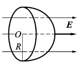
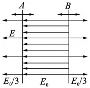
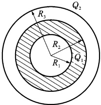
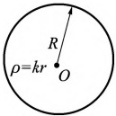
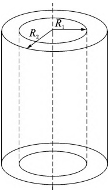

# 15-练习15 电场线 电通量 高斯定理及应用

[返回全书目录](../../README.md)

> PDF 页码：23–24

<!-- page: 23 -->

## 练习 15 电场线 电通量 高斯定理及应用

## 一、填空题

1.（1）点电荷 q 位于一个边长为 a 的立方体中心，则在该点电荷电场中穿过立方体一面的电通量 ___ 。(2)如果将该场源点电荷移到立方体的一个角上，这时通过立方体各面的电通量为 ___ 。

2. 若匀强电场的场强为 E，其方向平行于半径为 R 的半球面的轴，如图 15.1 所示，则通过此半球的电通量为 ___。

3. 如图15.2所示，A、B为真空中两个平行的“无限大”均匀带电平面，已知两平面间的电场强度 $ E_{0} $，两平面外侧电场强度大小都是 $ \frac{E_{0}}{3} $，方向如图15.2所示，则平面A上的面电荷密度 $ \sigma_{A}= $___平面B上的面电荷密度 $ \sigma_{B}= $___。

图15.1
 

图15.2
 

## 二、计算题

4. 如图15.3所示，一个内外半径分别为 $ R_{1} $ 和 $ R_{2} $ 的均匀带电球壳，总电荷为 $ Q_{1} $，球壳外同心罩一半径为 $ R_{3} $ 的均匀带电球面，球面带电荷为 $ Q_{2} $。求空间电场分布。

图15.3
 

<!-- page: 24 -->

5. 如图15.4所示，半径为R的非金属球体内，电荷体密度为 $ \rho=kr $，式中k为大于零的常量，求：

(1)球体内任意一点的电场强度大小  $ E_{1}(r) $;

(2)球体外任意一点的电场强度大小  $ E_{2}(r) $

图15.4
 

6. 如图 15.5 所示，两无限长同轴圆柱面，半径分别为  $ R_{1} $ 和  $ R_{2} $，带有等量异号电荷，单位长度的电量别为  $ \lambda $ 和  $ -\lambda $。求离轴线为 r 处的电场强度：(1)  $ r < R_{1} $; (2)  $ R_{1} < r < R_{2} $; (3)  $ r > R_{2} $。

图15.5
 

