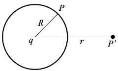
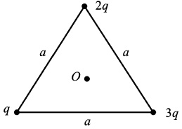
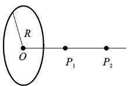
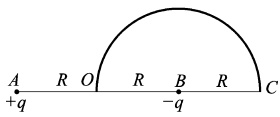
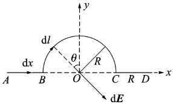

# 16-练习16 静电场的环路定理 电势能 电势 电势差

[返回全书目录](../../README.md)

> PDF 页码：25–26

<!-- page: 25 -->

## 练习 16 静电场的环路定理 电势能 电势 电势差

## 一、填空题

1. 如图16.1所示，在点电荷q的电场中，选取以q为中心、R为半径的球面上一点P处作电势点，则与点电荷q距离为r的 $ P^{\prime} $点的电势为___。

2. 如图16.2所示，一等边三角形边长为a，三个顶点分别放置着电量为q、2q、3q的三个正点电荷设无穷远处为电势零点，则三角形中心O处的电势 $ U_{0}= $ ___。

3. 如图16.3所示，半径为R的均匀带电圆环，环的中心上两点 $ P_{1} $和 $ P_{2} $离开环心的距离分别为R2R，若无穷远的电势为零，而 $ P_{1} $和 $ P_{2} $两点的电势分别为 $ U_{1} $和 $ U_{2} $，则 $ U_{2} $和 $ U_{1} $的比值为___。

图16.1
 

图16.2
 

图16.3
 

## 二、计算题

4. 如图16.4所示，在A、B两点处有电量分别为+q、-q的点电荷，A和B之间距离为2R，现将一正试验电荷 $ a_{0} $从O点经半圆弧路径移到C点，求移动过程中电场力所做的功。

图16.4
 

<!-- page: 26 -->

<table border=1 style='margin: auto; word-wrap: break-word;'><tr><td style='text-align: center; word-wrap: break-word;'>班级：</td><td style='text-align: center; word-wrap: break-word;'>姓名：</td><td style='text-align: center; word-wrap: break-word;'>学号：</td><td style='text-align: center; word-wrap: break-word;'>编号：</td></tr></table>

5. 如图 16.5 所示，绝缘细线上均匀分布着线密度为  $ \lambda $ 的正电荷，两直导线 AB、CD 的长度和半圆的半径都等于 R。试求环中心 O 点处的电场强度和电势。

图16.5
 

6. 有两个带电均匀的同轴圆柱面，内圆柱面半径为  $ R_{1} $，电势为  $ U_{1} $，外圆柱面半径为  $ R_{2} $，电势为 U 求两圆柱面间距轴线垂直距离为  $ r_{1} $ 和  $ r_{2} $ 两点的电势差。

