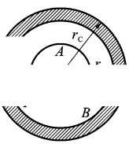
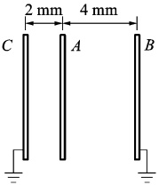
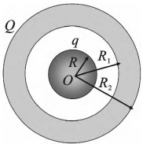

# 17-练习17 静电场中的导体

[返回全书目录](../../README.md)

> PDF 页码：27–28

<!-- page: 27 -->

## 练习 17 静电场中的导体

## 一、填空题

1. 在电量为+q的点电荷电场中放入一不带电的金属球，从球心O到点电荷所在处的矢径为r，金属球的感应电荷净电量 $ q'= $___，这些感应电荷在球心O处建立的电场强度E=___。

2. 一带电量为 q、半径为  $ r_{A} $ 的金属球 A，与一原先不带电、内外半径分别为  $ r_{B} $ 和  $ r_{C} $ 的金属球壳 B 同心放置，如图 17.1 所示，则图中 P 点的电场强度  $ E_{P}= $ ___；若用导线将 A 和 B 连接起来，则 A 球的电势 U= ___。

（设无穷远处电势为零）

3. 有两个大小不相同的金属球，大球直径是小球的两倍，大球带电，小球不带电，两者相距很远。今用细长导线将两者相连，在忽略导线的影响下，大球与小球的带电之比为 ___。

图17.1
 

## 二、计算题

4. 如图17.2所示，三个平行金属板A、B、C，面积均为 $ S=200\ cm^{2} $，A、B间相距 $ d_{1}=4\ mm $，A、C相距 $ d_{2}=2\ mm $，B和C两板都接地。如果使A板带正电 $ q=3.0\times10^{-7} $ C，求：(1)B、C板上感应电荷(2)A板电势。

图17.2
 

<!-- page: 28 -->

<table border=1 style='margin: auto; word-wrap: break-word;'><tr><td style='text-align: center; word-wrap: break-word;'>班级：</td><td style='text-align: center; word-wrap: break-word;'>姓名：</td><td style='text-align: center; word-wrap: break-word;'>学号：</td><td style='text-align: center; word-wrap: break-word;'>编号：</td></tr></table>

5. 如图17.3所示，半径为R的导体球外罩一个内外半径分别为 $ R_{1} $ 和 $ R_{2} $ 的同心导体球壳。若球和球壳分别带有电荷q 和Q，试求导体球和球壳的电势。

图17.3
 

6. 两个半径分别为  $ R_{1} $ 和  $ R_{2} $ ( $ R_{1}<R_{2} $) 的同心薄金属球壳，现给内球壳带电 +q，试计算：

(1)外球壳上的电荷分布及电势大小；

（2）先把外球壳接地，然后断开接地线，此时外球壳的电荷分布及电势；

（3）再使内球壳接地，此时内球壳上的电荷分布以及外球壳上的电势改变量。

