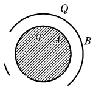
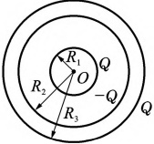
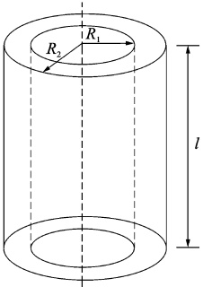

# 18-练习18 电容和电容器 静电场的能量

[返回全书目录](../../README.md)

> PDF 页码：29–30

<!-- page: 29 -->

## 练习 18 电容和电容器 静电场的能量

## 一、填空题

1. 如图18.1所示，金属球A与同心球壳B组成电容器，球A带电荷q，壳B带电荷Q，测得球与壳间电势差为 $ U_{AB} $，可知该电容器的电容值为___。

2. 极板面积为 S 的空气平行板电容器，极板上分别带电量 +q、-q，若不考虑边缘效应，则两极板间的相互作用力为 ___。

3. 真空中，半径为  $ R_{1} $ 和  $ R_{2} $ 的两个导体球，相距很远，则两球的电容之比  $ C_{1}/C_{2}= $ ___。当用细长导线将两球相连后，电容 C= ___。

图18.1
 

## 二、计算题

4. 如图18.2所示，半径为 $ R_{1}=2.0\ cm $的导体球，外套有一同心的导体球壳，壳的内、外半径分别 $ R_{2}=4.0\ cm $和 $ R_{3}=5.0\ cm $，当内球带电荷 $ Q=3.0\times10^{-8}C $时，求：

（1）整个电场储存的能量；

（2）当导体球壳接地时储存的能量；

（3）此电容器的电容值。

图18.2
 

<!-- page: 30 -->

<table border=1 style='margin: auto; word-wrap: break-word;'><tr><td style='text-align: center; word-wrap: break-word;'>班级：</td><td style='text-align: center; word-wrap: break-word;'>姓名：</td><td style='text-align: center; word-wrap: break-word;'>学号：</td><td style='text-align: center; word-wrap: break-word;'>编号：</td></tr></table>

5. 有一空气平板电容器，极板面积均为 S，两板间距为 d。今以厚度为  $ d'(d' < d) $ 的铜板平行地插电容器，求：

（1）此时电容器的电容。铜板离极板的距离对这一结果有无影响？

（2）现使电容器充电到两极板的电势差为  $ U_{0} $ 后与电源断开，再把铜板从电容器中抽出，外力需做少功？

6. 圆柱形电容器由半径为  $ R_{1} $ 的导线和与它同轴的导体圆筒构成。圆筒内半径为  $ R_{2} $，其间为真空长为 l，如图 18.3 所示。设沿轴线单位长度上导线电荷线密度为  $ \pm\lambda $，圆筒电荷线密度为  $ -\lambda $，忽略边缘应，试求：

（1）电容器储存的能量；

(2) 电容器的电容。

图18.3
 

