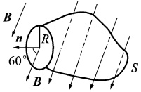
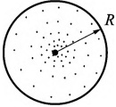
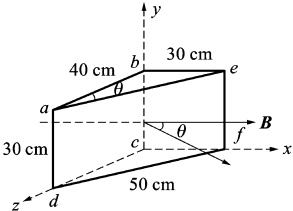
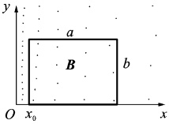

# 19-练习19 磁感应强度 磁通量 磁场中的高斯定理

[返回全书目录](../../README.md)

> PDF 页码：31–32

<!-- page: 31 -->

## 练习 19 磁感应强度 磁通量 磁场中的高斯定理

## 一、填空题

1. 一磁场的磁感强度为  $  \boldsymbol{B} = a \boldsymbol{i} + b \boldsymbol{j} + c \boldsymbol{k}  $ （SI），则通过一半径为 R，开口向 z 轴正方向的半球壳表的磁通量为 ___ Wb。

2. 在匀强磁场 B 中，取一半径为 R 的圆，圆面的法线 n 与 B 成  $ 60^{\circ} $ 角，如图 19.1 所示，则通过以该圆周为边线的如图所示的任意曲面 S 的磁通量

 $ \Phi_{m}=\iint_{S}\overrightarrow{B}\cdot d\overrightarrow{S}= $ ___。

任意曲面
 

3. 由于磁力线是___曲线，所以对于任意闭合曲面，磁通量 $ \oint_{S}B\cdot dS= $___，表明磁场是___场。

图19.1
 

## 二、计算题

4. 如图19.2所示，半径为R=1.2 cm的圆内有一垂直于纸面向外的非均匀磁场，磁场的磁感应度大小为 $ B=\frac{k}{r}+2 $，其中k是常数，求此圆面的磁通量。

图19.2
 

<!-- page: 32 -->

<table border=1 style='margin: auto; word-wrap: break-word;'><tr><td style='text-align: center; word-wrap: break-word;'>班级：</td><td style='text-align: center; word-wrap: break-word;'>姓名：</td><td style='text-align: center; word-wrap: break-word;'>学号：</td><td style='text-align: center; word-wrap: break-word;'>编号：</td></tr></table>

5. 如图19.3所示，三角形柱体置于均匀磁场中，已知磁感应强度大小 $ B=2.0\ Wb\cdot m^{-2} $，方向沿轴正方向，边长ab=40 cm，da=30 cm，be=30 cm，df=50 cm。试求：(1)通过图中abcd面的磁通量(2)通过图中befc面的磁通量；(3)通过图中aefd面的磁通量。

图 19.3
 

6. 如图19.4所示，在xOy平面第一象限内有一长为a、宽为b的矩形回路处于非均匀磁场中，磁应强度的大小 $ B=\frac{k}{x^{2}} $，方向垂直于纸面向外，则该矩形回路的磁通量为多少？

图 19.4
 

