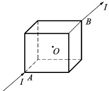
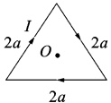
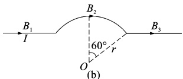
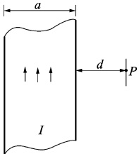
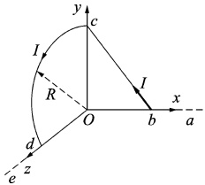

# 20-练习20 毕-萨定律及应用

[返回全书目录](../../README.md)

> PDF 页码：33–34

<!-- page: 33 -->

## 练习20 毕-萨定律及应用

## 一、填空题

1. 真空中有一载有稳恒电流 I 的细线圈，则通过包围该线圈的封闭曲面 S 的磁通量  $ \Phi= $ ___ 若通过 S 面上某面元 dS 的磁通量为 d $ \Phi $，而线圈中的电流增加为 2I 时，通过同一面元的磁通量为 d $ \Phi $ 则 d $ \Phi $: d $ \Phi $'= ___。

2. 将同样的 12 根导线焊成立方体，并在其对顶角 A、B 上接上电源，如图 20.1 所示，则立方体框架中的电流在其中心处所产生的磁感应强度大小等于 ___。

3. 一质点带有电荷 q，以速率 v 在半径为 R 的圆周上做匀速圆周运动。该带电质点在轨道中心所产生的磁感应强度的大小 B= ___，该带电质点轨道运动的磁矩的大小  $ P_{m}= $ ___。

图20.1
 

## 二、计算题

4.（1）如图20.2(a)所示，边长为2a的等边三角形线圈，通有电流I，求线圈中心O点处的磁感强度。

（2）如图20.2（b）所示，一根无限长直导线，中间一段弯成半径为r的圆弧，若导线中电流为I，求心O点处的磁感应强度。

(a)
 

(b)
 

图20.2
 

<!-- page: 34 -->

<table border=1 style='margin: auto; word-wrap: break-word;'><tr><td style='text-align: center; word-wrap: break-word;'>班级：</td><td style='text-align: center; word-wrap: break-word;'>姓名：</td><td style='text-align: center; word-wrap: break-word;'>学号：</td><td style='text-align: center; word-wrap: break-word;'>编号：</td></tr></table>

5. 如图 20.3 所示，一宽为 a 的无限长薄金属板，自下而上通有电流 I，电流沿薄板宽度方向均匀分布。求在薄金属板所在平面内距其右侧为 d 的 P 点处的磁感应强度。

图20.3
 

6. 真空中，一无限长直导线 abcde 弯成如图 20.4 所示形状，并通有电流 I, bc 直线在 xOy 平面内，是半径为 R 的 1/4 圆弧，ab、de 分别在 x 轴和 z 轴上，Ob = Oc = Od = R。求 O 点处的磁感应强度 B。

图20.4
 

