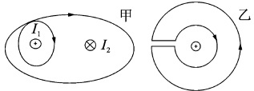
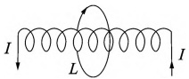
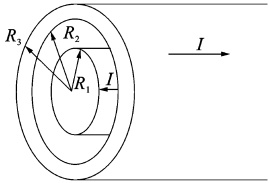
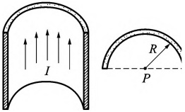
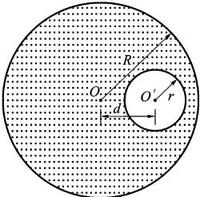

# 21-练习21 安培环路定理及应用

[返回全书目录](../../README.md)

> PDF 页码：35–36

<!-- page: 35 -->

## 练习 21 安培环路定理及应用

## 一、填空题

1. 在图21.1所示的两个闭合回路中环流分别为：

回路甲： $ \oint B \cdot dI = $ ___； 回路乙： $ \oint B \cdot dI = $ ___。

2. 如图21.2所示，在载流长直螺线管外环绕一周，其环流 $  \textcircled{1} B \cdot d l =  $ ___。

图21.1
 

图21.2
 

3. 两根长度相同的细导线分别密绕在半径为 R 和 r 的两个长直圆筒上形成两个螺线管，两个螺管的长度相同，R=2r，螺线管通过的电流相同且都为 I，则螺线管中的磁感应强度大小  $ B_{R}:B_{r}= $ ___。

## 二、计算题

4. 有一同轴电缆，其尺寸如图21.3所示，它的内外两导体中的电流均为I，且在横截面上均匀分布但两者电流的流向正相反，求导体内外的磁感应强度的分布。

图21.3
 

<!-- page: 36 -->

<table border=1 style='margin: auto; word-wrap: break-word;'><tr><td style='text-align: center; word-wrap: break-word;'>班级：</td><td style='text-align: center; word-wrap: break-word;'>姓名：</td><td style='text-align: center; word-wrap: break-word;'>学号：</td><td style='text-align: center; word-wrap: break-word;'>编号：</td></tr></table>

5. 一半径  $ R = 1.0 \, cm $ 的无限长半圆柱形金属薄片（薄片厚度不计）中，自下而上有电流 I = 5.0 通过，如图 21.4 所示，求圆柱轴线任一点 P 处的磁感应强度。

图21.4
 

6. 如图21.5所示，在半径为R的无限长直金属圆柱体内部，挖去一半径为r且与轴线平行的无限圆柱体，两柱体的轴线平行，相距为 $ d(d>r) $。今有电流沿空心柱体的轴线方向流动，且电流I均匀布在空心柱体的截面上。分别求圆柱轴线上和空心部分轴线上O、O'点的磁感应强度大小。

图21.5
 

