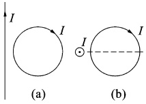
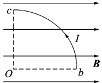
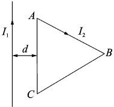
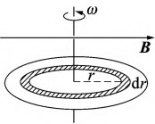

# 22-练习22 磁场对载流导线的作用

[返回全书目录](../../README.md)

> PDF 页码：37–38

<!-- page: 37 -->

## 练习 22 磁场对载流导线的作用

## 一、填空题

1. 如图22.1所示，在一固定的无限长载流直导线的旁边放置一个可以自由移动和转动的圆形的性线圈，线圈中通有电流，若线圈与直导线在同一平面，见图22.1(a)，则圆线圈将___；若线圈平与直导线垂直，见图22.1(b)，则圆线圈将___。

2. 有一半径为 a，流过稳恒电流为 I 的 1/4 圆弧形载流导线 bc，按图 22.2 所示方式置于均匀外磁 B 中，则该载流导线所受的安培力大小为 ___。

(a)
 

(b)
 

图22.1
 

图22.2
 

3. 半径为 R 的圆形电流线圈共 N 匝，通以电流 I，把该平面线圈放入均匀外磁场 B 中，该线圈受的最大磁力矩为 ___。

## 二、计算题

4. 两根平行无限长直导线间的垂直距离为 a，其中电流强度分别为  $ I_{1} $ 和  $ I_{2} $，且方向相同，试求在位长度导线上的作用力的大小。

<!-- page: 38 -->

<table border=1 style='margin: auto; word-wrap: break-word;'><tr><td style='text-align: center; word-wrap: break-word;'>班级：</td><td style='text-align: center; word-wrap: break-word;'>姓名：</td><td style='text-align: center; word-wrap: break-word;'>学号：</td><td style='text-align: center; word-wrap: break-word;'>编号：</td></tr></table>

5. 如图 22.3 所示，电流为  $ I_{2} $ 的等边三角形载流线圈与无限长直流  $ I_{1} $ 共面，等边三角形的边长 l，AC 边距无限长载流直导线的距离为 d。求载流线圈所受的合力。

图22.3
 

6. 如图 22.4 所示，一半径为 R、电荷面密度为  $ \sigma $ 的均匀带电圆盘，放入磁感应强度为 B 的匀强磁中，磁力线与圆盘表面平行，现圆盘以角速度  $ \omega $ 绕对称轴转动。求：

(1) 在距盘心为 r 处取一半径为 r、宽度为 dr 的圆环，则圆环旋转产生的电流强度 dI 有多大？

(2)该圆环所受的磁力矩有多大?

(3)圆盘所受的合力矩有多大？

图22.4
 

