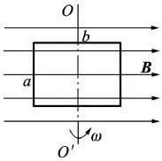
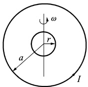
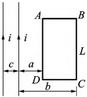
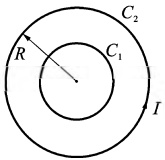
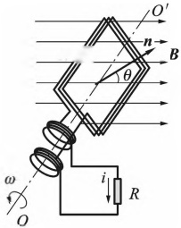

# 23-练习23 电磁感应定律

[返回全书目录](../../README.md)

> PDF 页码：39–40

<!-- page: 39 -->

## 练习 23 电磁感应定律

## 一、填空题

1. 一矩形线框长为 b、宽为 a，置于均匀磁场中，线框绕  $ OO' $ 轴，以匀角速度  $ \omega $ 旋转（图 23.1），设 t= 时，线框平面处于纸面内，则任一时刻感应电动势的大小为 ___。

2. 如图23.2所示，一半径为r的很小的金属圆环，在初始时刻与一半径为 $ a(a\gg r) $的大金属圆环面且同心。在大圆环中通以恒定的电流I，方向如图23.2所示。如果小圆环以匀角速度 $ \omega $绕其任一方的直径转动，并设小圆环的电阻为R，则任一时刻t通过小圆环的磁通量 $ \Phi_{m}= $___，小圆环中感应电流i=___。

图23.1
 

图23.2
 

3. 用导线制成一半径 r=10 cm 的闭合圆形线圈，其电阻 R=10 Ω，均匀磁场 B 垂直于线圈平面欲使电路中有一稳定的感应电流 I=0.01 A，B 的变化率 dB/dt= ___。

## 二、计算题

4. 如图23.3所示，两无限长的直导线载有交变电流  $ i = I_{0} \sin \omega t $，它旁边有一长方形线圈 ABCD，为 L，宽为 b-a，线圈与导线共面，求：(1)穿过回路 ABCD 的磁通量  $ \Phi $; (2)回路 ABCD 中的感应电势  $ \varepsilon $。

图23.3
 

<!-- page: 40 -->

<table border=1 style='margin: auto; word-wrap: break-word;'><tr><td style='text-align: center; word-wrap: break-word;'>班级：</td><td style='text-align: center; word-wrap: break-word;'>姓名：</td><td style='text-align: center; word-wrap: break-word;'>学号：</td><td style='text-align: center; word-wrap: break-word;'>编号：</td></tr></table>

5. 如图23.4所示，一圆形线圈 $ C_{1} $由50匝表面绝缘的细导线绕成，圆面积 $ S=4.0\ cm^{2} $，将它放在一半径 $ R=20\ cm $的圆形大线圈 $ C_{2} $的中心处，两者共面，大线圈共100匝。求：当大圆线圈中的电流50 A/s的速率变化时，小圆线圈中的感应电动势。

图23.4
 

6. 在匀强磁场 B 中，置有面积为 S 的可绕  $ OO' $ 轴转动的 N 匝线圈，如图 23.5 所示。若线圈以角度  $ \omega $ 做匀速转动，求线圈中的感应电动势。

图23.5
 

