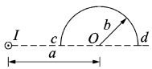
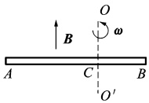
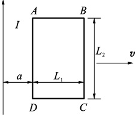
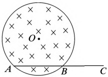
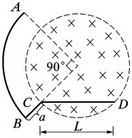

# 24-练习24 动生电动势 感生电动势

[返回全书目录](../../README.md)

> PDF 页码：41–42

<!-- page: 41 -->

## 练习 24 动生电动势 感生电动势

## 一、填空题

1. 载有恒定电流 I 的长直导线旁有一半圆环导线 cd，半圆环半径为 b，环面与直导线垂直，且半圆两端点连线的延长线与直导线相交，如图24.1所示，当半圆环以速率 v 沿平行于直导线的方向下移时半圆环上的感应电动势的大小为 ___。

2. 如图 24.2 所示，导体棒 AB 在均匀磁场 B 中绕通过 C 点的垂直于棒且沿磁场方向的轴  $ OO' $ 转（角速度  $ \omega $ 与 B 同方向），BC 的长度为棒长的 1/3，则 A 点比 B 点电势 ___。

图24.1
 

图24.2
 

3. 无限长直通电螺线管的半径为 R，设其内部的磁场以 dB/dt 的变化率增加，则在螺线管内离开线距离为  $ r (r < R) $ 处的感生电场的强度大小为 ___。

## 二、计算题

4. 如图24.3所示，一长直导线载有电流I，旁边有一矩形线圈ABCD（与长直导线共面），AB长L BC宽 $ L_{2} $，线圈共N匝，令线圈以速度v水平向右平动，求线圈的AD边与长直导线距离a时线圈中动生电动势。

图24.3
 

<!-- page: 42 -->

<table border=1 style='margin: auto; word-wrap: break-word;'><tr><td style='text-align: center; word-wrap: break-word;'>班级：</td><td style='text-align: center; word-wrap: break-word;'>姓名：</td><td style='text-align: center; word-wrap: break-word;'>学号：</td><td style='text-align: center; word-wrap: break-word;'>编号：</td></tr></table>

5. 半径为 R 的圆柱形空间内分布有沿圆柱轴线方向的均匀磁场，磁场方向垂直于纸面向里，变化  $ \frac{dB}{dt}>0 $ 。有一长度为 2R 的金属杆放在如图 24.4 所示的位置，其中一半位于磁场内，一半位于磁场外，该金属杆上的感生电动势。

图24.4
 

6. 如图24.5所示，半径为R的圆形区域内有一均匀磁场B垂直于纸面，且B以均匀速率 $ \frac{dB}{dt} $增大求图中导线ABCD的感生电动势。

图24.5
 

