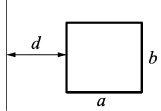
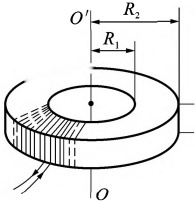
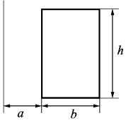

# 25-练习25 自感应与互感应 磁场的能量

[返回全书目录](../../README.md)

> PDF 页码：43–44

<!-- page: 43 -->

## 练习 25 自感应与互感应 磁场的能量

## 一、填空题

1. 真空中无限长密绕直螺线管通以电流 I，管上单位长度绕有 n 匝导线，真空磁导率为  $ \mu_{0} $。则管部的磁感应强度大小为 ___，内部的磁能密度为 ___。

2. 一根长直导线输入电流 I，I 均匀分布在它的横截面上，则导体内部单位长度的磁场能量为 ___。

3. 如图25.1所示，一长直导线旁有一宽为b、长为a的矩形线圈，线圈与导线共面，宽度为b的边与导线平行，则线圈与导线的互感系数为___。

图25.1
 

## 二、计算题

4. 横截面为长方形的环形均匀密绕螺绕环，其尺寸如图25.2所示，共有N匝（图中仅画出少量匝）。试求：

（1）该螺绕环的自感系数；

(2)若导线内通有电流I，则螺绕环内磁能为多少？

图25.2
 

<!-- page: 44 -->

<table border=1 style='margin: auto; word-wrap: break-word;'><tr><td style='text-align: center; word-wrap: break-word;'>班级：</td><td style='text-align: center; word-wrap: break-word;'>姓名：</td><td style='text-align: center; word-wrap: break-word;'>学号：</td><td style='text-align: center; word-wrap: break-word;'>编号：</td></tr></table>

5. 一矩形线圈长  $ a=20 \, cm $，宽  $ b=10 \, cm $，共绕100匝。一根很长的直导线与线圈在同一平面内且线圈的长边平行，此长直导线是闭合回路的一部分，其他部分离线圈都很远，其影响可忽略不计。求在面所描述的两种情况下，线圈与长直导线之间的互感系数：

(1) 长导线与线圈一边相距为 b;

(2) 长导线位于线圈的对称轴处。

6. 一长直导线和一矩形线圈共面，各相关尺寸如图 25.3 所示。求：

(1) 当长直导线通有电流  $ I_{1}=I_{0}\sin\omega t $ 时，矩形线圈中感应电动势的大小；

(2)当矩形线圈中通有电流  $ I_{2}=I_{0}\cos\omega t $ 时，直导线中感应电动势的大小。

图25.3
 

