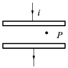
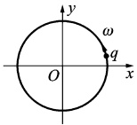
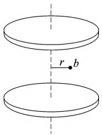

# 26-练习26 位移电流 麦克斯韦方程组

[返回全书目录](../../README.md)

> PDF 页码：45–46

<!-- page: 45 -->

## 练习 26 位移电流 麦克斯韦方程组

## 一、填空题

1. 如图 26.1 所示，圆形平行板电容器，从 q=0 开始充电，极板某点 P 处电场强度方向磁场强度方向 ___。

2. 如图26.2所示，一电量为q的点电荷，以匀角速度ω做圆周运动，圆周半径为R，设t=0时q在点的坐标为 $ x_{0}=R, y_{0}=0 $；以i、j分别表示x轴与y轴上的单位矢量，则圆心处O点的位移电流密为___。

图26.1
 

图26.2
 

3. 写出包含下列意义的麦克斯韦方程组中的方程式：

(1)电场线始于正电荷,终止于负电荷

(2)变化的磁场一定伴随有电场

(3)磁感应线无头无尾___

(4)静电场是保守力场

## 二、计算题

4. 一平板空气电容器的两极板都是半径为 r 的圆形导体板，充电时，板间电场强度的变化率为  $ \frac{dI}{di} $ 略去边缘效应，求两极板间的位移电流。

<!-- page: 46 -->

<table border=1 style='margin: auto; word-wrap: break-word;'><tr><td style='text-align: center; word-wrap: break-word;'>班级：</td><td style='text-align: center; word-wrap: break-word;'>姓名：</td><td style='text-align: center; word-wrap: break-word;'>学号：</td><td style='text-align: center; word-wrap: break-word;'>编号：</td></tr></table>

5. 一平行板电容器的两极板由半径为  $ 5.0 \, cm $ 的圆形金属板组成，两极板之间为空气。忽略边缘应，当电容器充电时，极板间的电场强度变化率为  $ \frac{dE}{dt}=1.0\times10^{12} \, V/(m \cdot s) $，求：

（1）两极板间的位移电流；

(2)两极板边缘的磁感应强度的大小。

6. 一平行板电容器，极板是半径为 R 的两圆形金属板，极板间为空气，如图26.3所示。此电容器与交变电源相接。极板上所带电量随时间变化的关系为  $ q=q_{0}\sin(\omega t)(\omega $ 为常量），忽略边缘效应，求：

（1）电容器极板间位移电流及位移电流密度。

(2)两极板间离中心轴线距离为  $ r(r<R) $ 处的 b 点的磁场强度 H 的大小。

图26.3
 

