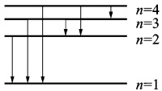
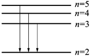

# 45-练习45 玻尔氢原子理论

[返回全书目录](../../README.md)

> PDF 页码：57–58

<!-- page: 57 -->

## 练习 45 玻尔氢原子理论

## 一、填空题

1. 已知基态氢原子的能量为 $ -13.6\ eV $，当基态氢原子被 $ 12.09\ eV $的光子激发后，将处于n=___的量子态，其电子的轨道半径将增加到玻尔半径的___倍。

2. 已知氢原子从基态激发到某一定态所需能量为10.19 eV，若氢原子从能量为-0.85 eV的状态迁到上述定态时，所发射的光子的能量为 ___。

3. 氢原子的部分能级跃迁如图 45.1 所示。在这些能级跃迁中：

(1)从 n= ___ 的能级跃迁到 n= ___ 的能级时所发射的光子的波长最短；

(2)从 n= ___ 的能级跃迁到 n= ___ 的能级时所发射的光子的频率最小。

图45.1
 

## 二、计算题

4. 氢原子光谱的巴耳末线系中，有一光谱线的波长为  $ 434 \, nm $，试求：

(1)与这一谱线相应的光子能量为多少电子伏特?

(2)该谱线是氢原子由能级 $ E_{n} $跃迁到能级 $ E_{k} $产生的，n和k各为多少?

<!-- page: 58 -->

班级： $ \underline{\text{姓名：}} $ 学号： $ \underline{\text{编号：}} $

5. 在气体放电管中，用能量为  $ 12.2 \, eV $ 的电子去轰击处于基态的氢原子，求此时氢原子所能辐射谱线波长。

6. 处于第一激发态的氢原子被外来单色光激发后，在发射的光谱中，仅观察到三条如图45.2所的巴耳末系的光谱线。试求这三条光谱线中波长最长的那条谱线的波长以及外来光的频率。（ $ R\ 1.097\times10^{7}\ m^{-1} $）

图45.2
 

