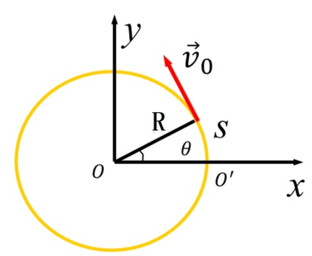

# 02-练习2 曲线运动的描述

[返回全书目录](../../README.md)

> PDF 页码：7–13

<!-- page: 7 -->

### 练习2 曲线运动的描述

1. 一质点沿半径为 $ R $的圆周作匀速率圆周运动，角速度为 $ \omega $，质点的运动方程在直角坐标中表示为 $ \underline{\vec{r}(t)=R\cos\omega t\overrightarrow{i}+R\sin\omega t\overrightarrow{j}} $，自然坐标系中表示为 $ \underline{s(t)=\omega Rt} $。

解：如图建立二维直角坐标系，设计时起点

于是，t=0时，x=r，y=0，则任意时刻有

 $$ x=R\cos\theta=R\cos\omega t $$ 

 $$ y=R\sin\theta=R\sin\omega t $$ 

所以 $ \overrightarrow{r}=R\cos\omega t\overrightarrow{i}+R\sin\omega t\overrightarrow{j} $

以 $ O' $为自然坐标系的原点和计时起点

运动学方程为： $ s(t)=v_{0}t=\omega R t $

<!-- page: 8 -->

2. 一质点沿一半径为  $ 2.5 \, m $ 的圆周运动，其角位置由  $ \theta = 1.5t^{2} $ (SI) 给出，当  $ t = 0.5 \, s $ 时，质点的切向、法向及总加速度大小分别为  $ \underline{7.5 \, m / s^{2}} $、 $ \underline{5.625 \, m / s^{2}} $、 $ \underline{9.4 \, m / s^{2}} $ 解：依题意， $ \theta = 1.5t^{2} \Rightarrow \omega = \frac{d\theta}{dt} = 3t \Rightarrow \beta = \frac{d\omega}{dt} = 3 $

所以  $ a_{\tau} = r\beta = 2.5 \times 3 = 7.5 \, m / s^{2} $

 $ \alpha_{n} = \omega^{2}r = (\frac{3}{2})^{2} \times 2.5 = 5.625 \, m / s^{2} $

总加速度大小为  $ a = \sqrt{a_{\tau}^{2} + a_{n}^{2}} $

 $ = \sqrt{7.5^{2} + 5.625^{2}} = 9.4 \, m / s^{2} $

<!-- page: 9 -->

3. 半径  $ R=2m $ 的飞轮作加速转动，轮边缘一点的运动方程为  $ S=0.1t^{3}(SI) $，当此点的速率  $ v=30m/s $ 时，其切向与法向加速度大小分别为  $ \underline{6m/s^{2}} $、 $ \underline{450m/s^{2}} $。

解：依题意 $ s = 0.1t^{3} \Rightarrow v = \frac{ds}{dt} = 0.3t^{2} $

当 $ v = 30m/s $时，有 $ 0.3t^{2} = 30 \Rightarrow t = 10s $

 $ \therefore a_{r}=\frac{dv}{dt}=0.6t=6m/s^{2} $

 $ a_{n}=\frac{v^{2}}{R}=\frac{30^{2}}{2}=450m/s^{2} $

<!-- page: 10 -->

4. 一质点在水平面沿半径  $ R=2m $ 的圆轨道转动，转动角速度  $ \omega $ 与时间 t 的关系为  $ \omega = At^{2} $ （A 为常数），已知 t=1s 时，质点的速度大小为  $ 4m/s $，求 t=2s 时质点的速率和加速度的大小。

解：依题意  $ \omega = At^{2} \Rightarrow v = \omega R = A R t^{2} $

当 $ t = 1s $时， $ v = A R t^{2} = A R = 4m / s $

又 $ R = 2m $，代入数据得A = 2

 $$ \therefore\ \omega=2t^{2}\Rightarrow\left\{\begin{aligned}\beta&=\frac{d\omega}{dt}=4t\\ v&=4t^{2}\end{aligned}\right. $$

<!-- page: 11 -->

$\therefore t=2s$时，$\left\{\begin{aligned}v&=4\times2^{2}=16m/s\\ a_{\tau}&=R\beta=2\times4\times2=16m/s^{2}\\ a_{n}&=\omega^{2}R=128m/s^{2}\\ a&=\sqrt{a_{\tau}^{2}+a_{n}^{2}}=129m/s^{2}\end{aligned}\right.$

<!-- page: 12 -->

5. 一汽车在半径  $ R=200m $ 的圆弧形公路上行驶，其运动学方程为： $ s=20t-0.2t^{2}(SI) $。求：汽车在  $ t=1s $ 时的速度和加速度大小。

 $$ \begin{aligned}& 依题意 s=20t-0.2t^{2}\\&\Rightarrow v=\frac{ds}{dt}=20-0.4t\Rightarrow\left\{\begin{aligned}a_{\tau}&=\frac{dv}{dt}=-0.4m/s^{2}\\ a_{n}&=\frac{v^{2}}{R}=\frac{(20-0.4t)^{2}}{200}\end{aligned}\right.\end{aligned} $$ 

当 $ t=1s $时，

 $$ \left\{a=\sqrt{0.4^{2}+\left(\frac{19.6^{2}}{200}\right)^{2}}=1.96m/s^{2}\right. $$

<!-- page: 13 -->

6. 一质点在 xoy 平面内作曲线运动，其运动方程为  $ \vec{r} = 5t\vec{i} + (15t - 5t^2)\vec{j} $ (SI)。求  $ t = 1s $ 时质点的切向加速度、法向加速度和轨道曲率半径。

解： $ \overrightarrow{r} = 5t\overrightarrow{i} + (15t - 5t^{2})\overrightarrow{j} $

 $$ \Rightarrow\vec{v}=\frac{d\vec{r}}{dt}=5\vec{i}+(15-10t)\vec{j}\Rightarrow\vec{a}=-10\vec{j}m/s^{2} $$ 

 $$ v~=~\sqrt{5^{2}~+~(15~-10~t)^{2}} $$ 

 $$ a_{\tau}=\frac{d v}{d t}\!=\!\frac{\!-\!10(15\!-\!10\mathrm{t})\!}{\sqrt{5^{2}+(15-10\mathrm{t})^{2}}}\mathrm{~,~} $$ 

当 $ t = 1s $时， $ \vec{\alpha}_{\tau} = -5\sqrt{2}\vec{\tau}m / s^{2} $;  $ \vec{a}_{n} = \sqrt{a^{2} - a_{\tau}^{2}}\vec{n} = 5\sqrt{2}\vec{n}m / s^{2} $

 $$ a_{n}=\frac{v^{2}}{R}\Rightarrow R=\frac{v^{2}}{a_{n}}=5\sqrt{2}m $$

