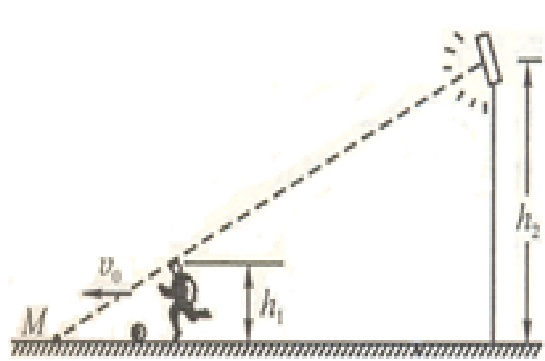

# 03-练习3 运动学中的两类问题

[返回全书目录](../../README.md)

> PDF 页码：14–19

<!-- page: 14 -->

### 练习3 运动学中的两类问题

1. 已知质点位置矢量随时间变化的函数形式为  $ \vec{r} = 4t^{2}\vec{i} + (3+2t)\vec{j} $，则质点的轨迹方程为  $ \underline{x = (y-3)^2} $，从  $ t=0 $ 到  $ t=1s $ 的位移为  $ \underline{4\vec{i} + 2\vec{j} m} $， $ t=1s $ 时刻的速度为  $ \underline{8\vec{i} + 2\vec{j} m/s} $。

解：依题意 $ \begin{aligned}x&=4t^{2}\\ y&=3+2t\end{aligned}\} $  $ \Rightarrow $轨迹方程为 $ x=(y-3)^{2} $

位移$\Delta\overrightarrow{r}=\overrightarrow{r}(1)-\overrightarrow{r}(0)=(4\overrightarrow{i}+5\overrightarrow{j})-3\overrightarrow{j}=4\overrightarrow{i}+2\overrightarrow{j}\text{m}$

 $ \overrightarrow{v} = \frac{d\overrightarrow{r}}{dt} = 8t\overrightarrow{i} + 2\overrightarrow{j} \Rightarrow $ 当 $ t=1 $s时， $ \overrightarrow{v} = 8\overrightarrow{i} + 2\overrightarrow{j} \, \text{m/s} $

<!-- page: 15 -->

2. 一质点沿  $ x $ 轴作直线运动，其运动方程为  $ x = 3 + 5t + 6t^2 - t^3 $ (SI)，则质点在  $ t = 0 $ 时的速度为  $ \underline{5\vec{i}\ m/s} $，加速度为零时，该质点的速度为  $ \underline{17\vec{i}\ m/s} $。

解： $ \overrightarrow{v}=\frac{dx}{dt}\overrightarrow{i}=(5+12t-3t^{2})\overrightarrow{i}\Rightarrow $ 当 $ t=0 $时， $ \overrightarrow{v}=5\overrightarrow{i}\ m/s $

 $ \overrightarrow{a}=\frac{d^{2}x}{dt^{2}}\overrightarrow{i}=(12-6t)\overrightarrow{i}=0\Rightarrow t=2s $

 $$ \begin{array}{l}\text{v}=\left(5+12\times t-3t^{2}\right)\ \overset{\text{ 襬 }}{\mathrm{i}}\\ =\left(5+12\times2-3\times2^{2}\right)\ \overset{\text{ 襬 }}{\mathrm{i}}=17\overset{\text{襬 }}{\mathrm{i}}\ m/\ s\end{array} $$

<!-- page: 16 -->

3. 一质点沿半径为  $ 0.1m $ 的圆周运动，其角位移  $ \theta $ 可表示为  $ \theta = 2 + 4t^{3} $。当  $ t = 2s $ 时，其切向加速度为  $ \underline{4.8\overrightarrow{\tau} m/s^{2}} $，当切向加速度与法向加速度的大小相等时， $ t = \underline{\sqrt[3]{\frac{1}{6}s}} $。

解：
依题意： $ r=0.1m, \theta=2+4t^{3} $
 $ \Rightarrow \omega=\frac{d\theta}{dt}=12t^{2} \Rightarrow \beta=\frac{d\omega}{dt}=24t $
 $ \therefore a_{\tau}=r\beta=2.4t; a_{n}=\omega^{2}r=14.4t^{4} $
 $ \therefore $ 当t=2s时， $ \overrightarrow{a}_{\tau}=2.4t\overrightarrow{\tau}=4.8\overrightarrow{\tau}m/s^{2} $
当 $ a_{\tau}=a_{n} $时，即2.4t=14.4t^{4}
 $ \therefore t=\sqrt[3]{\frac{1}{6}}s $

<!-- page: 17 -->

4. 质量为 m 的质点受到力  $ F = -kv^{2}x $ （其中 k 为常数）的作用沿 x 轴做直线运动。在 x = 0 处的速度为  $ v_{0}(v_{0} > 0) $，求该质点的速率 v 随 x 变化的关系。

解：根据题意有： $ F = -kv^{2}x = m\frac{dv}{dt} $

即： $ -kv^{2}x=m\frac{dv}{dt}\cdot\frac{dx}{dx}=mv\frac{dv}{dx} $

分离变量得： $ \frac{dv}{v}=\frac{-k}{m}xdx $

两边积分： $ \int_{v_0}^{v}\frac{dv}{v}=\int_{0}^{x}\frac{-k}{m}x dx $

得： $ v=v_{0}e^{-\frac{k}{2m}x^{2}} $

<!-- page: 18 -->

5. 如图 3.1 所示，一高为  $ h_{1} $ 的足球运动员，背向某照明灯以匀速  $ v_{0} $ 带球，灯离地面高度为  $ h_{2} $，求人影顶端 M 点沿地面移动的速率及影长变化率。

解：以灯垂直向下投影位置为坐标原点，沿水平向左建立一维坐标

足球运动员在地面投影位置为x,人影顶端M点位置为 $ x_{M} $，

根据三角形相似有： $ \frac{h_{1}}{h_{2}}=\frac{x_{M}-x}{x_{M}} $

即： $ x_{M}=\frac{h_{2}}{h_{2}-h_{1}}x $

所以： $ \frac{dx_M}{dt} = \frac{dx}{dt} \frac{h_2}{h_2 - h_1} \Rightarrow M $点移动速率 $ v_M = \frac{h_2}{h_2 - h_1} v_0 $

影长变化率： $ \frac{d(x_M - x)}{dt} = v_M - v_0 = \frac{h_1}{h_2 - h_1} v_0 $

<!-- page: 19 -->

6. 一半径为  $ 0.5 \, m $ 的飞轮在启动时的短时间内，其角速度与时间的平方成正比，在  $ t = 2s $ 时测得轮缘一点的速度值为  $ 4 \, m/s $，求：（1）该轮在  $ t' = 0.5 \, s $ 时的角速度，轮缘一点的切向加速度和总加速度；（2）该点在  $ 2s $ 内所转过的角度。

解(1) 依题意， $ r = 0.5m, \omega = kt^2 $

当 $ t = 2s $时， $ v = \omega r = kt^2 r = 4 \Rightarrow k \times 2^2 \times 0.5 = 4 \Rightarrow k = 2 $

所以 $ \omega = 2t^2 \Rightarrow \beta = \frac{d\omega}{dt} = 4t $

 $ a_\tau = r\beta = 0.5 \times 4t = 2t $;  $ a_n = \omega^2 r = 4t^4 \times 0.5 = 2t^4 $

当 $ t' = 0.5s, \beta = 2rad/s^2 $;  $ \vec{a}_\tau = 2t\vec{\tau} = 1\vec{\tau} \, \text{m/s}^2 $;  $ \vec{a}_n = 2t^4 \vec{n} = \frac{1}{8} \vec{n} \, \text{m/s}^2 $

总加速度 $ \vec{a} = a_\tau \vec{\tau} + a_n \vec{n} = 1\vec{\tau} + \frac{1}{8} \vec{n} \, \text{m/s}^2 $

 $ \omega = \frac{d\theta}{dt} = 2t^2 \Rightarrow \Delta\theta = \frac{2}{3} t^3 \bigg|^2 = \frac{2}{3} \times 2^3 = \frac{16}{3} rad $

