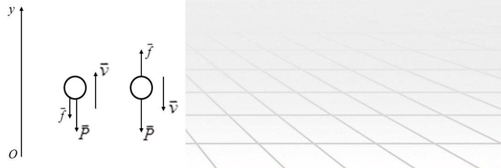
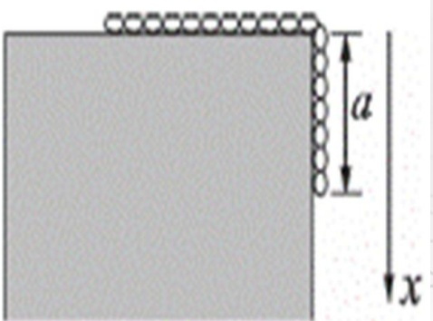
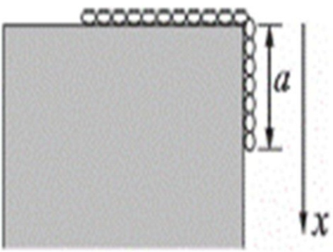

# 04-练习4 牛顿运动定律及其应用

[返回全书目录](../../README.md)

> PDF 页码：20–30

<!-- page: 20 -->

### 练习4 牛顿运动定律及其应用

1. 一质量为 $m$ 的质点沿 $x$ 轴正向运动，若该质点通过坐标为 $x$ 处的速度大小为 $kx$ ($k$ 为正常量)，则此时作用于该质点上的力的大小 $F = \underline{mk^{2}x}$，该质点 $x = x_{0}$ 点出发运动到 $x = x_{1}$ 所经历的时间 $\Delta t = \underline{\frac{1}{k}\ln\frac{x_{1}}{x_{0}}}$。

解：

 $$ v=kx\implies F=m\frac{dv}{dt}=m\frac{d}{dt}(kx)=mkv=mk^{2}x $$ 

 $$ \nu=\frac{dx}{dt}=kx\Rightarrow\frac{dx}{x}=kdt $$ 

两边积分有：

 $$ \int_{x_{0}}^{x_{1}}\frac{dx}{x}=\int_{t_{0}}^{t_{1}}kdt\Longrightarrow\Delta t=t_{1}-t_{0}=\frac{1}{k}\ln\frac{x_{1}}{x_{0}} $$

<!-- page: 21 -->

2. 质量为 $m$ 的物体，最初静止于 $x_{0}(x_{0}>0)$ 处，在合外力 $F=\frac{k}{x^{2}}$（$k$ 为正常数）作用下，沿直线运动，则物体在 $x$ 处的速度大小为 $\sqrt{\frac{2k}{m}\left(\frac{1}{x_{0}}-\frac{1}{x}\right)}$。

解： $ F = m \frac{dv}{dt} = \frac{k}{x^2} \Rightarrow m \frac{dv}{dt} \cdot \frac{dx}{dx} = mv \frac{dv}{dx} = \frac{k}{x^2} $ 分离变量得：

 $ v dv = \frac{k}{m} \frac{1}{x^2} dx $ 两边积分，  $ \int_0^v v dv = \int_{x_0}^x \frac{k}{m} \frac{1}{x^2} dx $

求得： $ v=\sqrt{\frac{2k}{m}\left(\frac{1}{x_0}-\frac{1}{x}\right)} $

<!-- page: 22 -->

3. 质量为 m 的物体，在力  $ F_{x} = A + Bt $ (SI)作用下沿 x 方向运动(A、B 为常数)，已知 t = 0 时， $ x_{0} = 0, v_{0} = 0 $。则任一时刻，物体的速度表达式为  $ \frac{\vec{v} = \left(\frac{1}{2m} B t^{2} + \frac{A}{m} t\right) \vec{i}}{2 m} $。物体的位移表达式为 ___。

解： $ F_{x}=A+Bt=m\frac{dv}{dt} $  $ \Rightarrow $  $ mdv=(A+Bt)dt $

两边积分得 $ \int_{0}^{v}mdv=\int_{0}^{t}(A+Bt)dt\quad\Rightarrow v=\frac{1}{2m}Bt^{2}+\frac{A}{m}t $

<!-- page: 23 -->

3. 质量为 m 的物体，在力  $ F_{x}=A+Bt $ (SI)作用下沿 x 方向运动(A、B 为常数)，已知 t=0 时， $ x_{0}=0, v_{0}=0 $。则任一时刻，物体的速度表达式为  $ \frac{\vec{v}=(\frac{1}{2m}Bt^{2}+\frac{A}{m}t)\vec{i}}{\Delta\vec{r}=(\frac{1}{6m}Bt^{3}+\frac{1}{2m}At^{2})\vec{i}} $。物体的位移表达式为  $ \frac{\Delta\vec{r}=\left(\frac{1}{6m}B\vec{t}^{3}+\frac{1}{2m}At^{2}\right)\vec{i}}{6m}=\frac{1}{6m} $

 $ v = \frac{dx}{dt} = \frac{1}{2m} B t^{2} + \frac{A}{m} t \Rightarrow m dx = \left( \frac{1}{2} B t^{2} + A t \right) dt $

两边积分得  $ \int_{0}^{x} m dx = \int_{0}^{t} \left( \frac{1}{2} B t^{2} + A t \right) dt $

 $$ \Longrightarrow x=\frac{1}{6\mathrm{m}}\mathrm{B t}^{3}+\frac{1}{2\mathrm{m}}\mathrm{A t}^{2} $$

<!-- page: 24 -->

4. 质量为 m 的子弹以速度  $ v_{0} $ 水平射入沙土中，设子弹所受阻力大小与速度成正比，比例系数为 k (k > 0)，忽略子弹重力，求：

（1）子弹射入沙土后，速度与时间的关系；

（2）子弹射入沙土的最大深度。

解：（1）根据题意有  $ f = -kv = m\frac{dv}{dt} $

所以有

 $$ \int_{v_{0}}^{v}\frac{d v}{v}=-\frac{k}{m}\int_{0}^{t}d t\quad\Rightarrow\ln\frac{v}{v_{0}}=-\frac{k}{m}t $$ 

即： $ v = v_{0} e^{-\frac{k}{m} t} $

<!-- page: 25 -->

（2）当子弹在沙子中停止运动时，达到最大距离 x，因而有

 $$ \begin{aligned}&f=-k v=m\frac{d v}{d t}=m\frac{d v}{d x}\frac{d x}{d t}=m v\frac{d v}{d x}\\ &\Longrightarrow d x=-\frac{m}{k}d v\\ \end{aligned} $$ 

两边积分: $ \int_{0}^{x}dx=-\frac{m}{k}\int_{v_{0}}^{0}dv $

得最大深度： $ x=\frac{m}{k}v_{0} $

<!-- page: 26 -->

5. 质量为 m 的物体自地面以速率  $ v_{0} $ 竖直上抛，重力加速度为常量 g，假设物体所受的空气阻力大小为  $ f = kmv^{2} $ （k 为正常数），求：

（1）物体上升的最大高度；

（2）物体下落到地面时速度的大小。

解：分别对物体上抛、下落时作受力分析，以地面为原点，竖直向上为 y 轴。

<!-- page: 27 -->

（1）物体在上抛过程中，根据牛顿定律有：

 $$ -mg-kmv^{2}=m\frac{dv}{dt}=m\frac{dv}{dt}\cdot\frac{dy}{dy}=m\frac{dy}{dt}\cdot\frac{dv}{dy}=m\frac{vdv}{dy}\quad\bigg|_{\substack{\\o\\}}\quad\bigg|_{\substack{\\ \bar{f}\bigg|_{\bar{P}}}}\quad $$ 

依据初始条件对上式积分，有

 $$ \int_{0}^{y}dy=-\int_{\nu_{0}}^{\nu}\frac{v d v}{g+k v^{2}}\quad y=-\frac{1}{2k}\ln(\frac{g+k v^{2}}{g+k v_{0}^{2}}) $$ 

物体到达最高处时，v=0，故有

 $$ h=y_{\max}=\frac{1}{2k}\ln(\frac{g+kv_{0}^{2}}{g}) $$

<!-- page: 28 -->

（2）物体下落过程中，有

 $$ -mg+kmv^{2}=m\frac{dv}{dt}=m\frac{dv}{dt}\cdot\frac{dy}{dy}=m\frac{dy}{dt}\cdot\frac{dv}{dy}=m\frac{vdv}{dy} $$ 

对上式分离变量并积分，有

 $$ \int_{h}^{0}dy=-\int_{0}^{v}\frac{v dv}{g-k v^{2}} $$ 

 $$ \nu=\nu_{0}\left(1+\frac{k v_{0}^{2}}{g}\right)^{-1/2} $$

<!-- page: 29 -->

6. 如图 4.1 所示，一根匀质链条，质量为 m，总长度为 L，一部分放在光滑桌面上，另一部分从桌面边缘下垂，长度为 a，试求当链条下滑全部离开桌面时，它的速率为多少？（用牛二定律求解）。

解：选取向下为坐标轴正方向，将整个链条视为一个系统，

当链条下落距离 x 时，根据牛顿运动方程：

 $$ \frac{m}{L}x g=m\frac{d v}{d t} $$ 

<!-- page: 30 -->

即： $ \frac{m}{L}x g=m v\frac{d v}{d x} $

有： $ \frac{g}{L}xdx=vdv $

两边积分： $ \int\limits_{a}^{L}\frac{g}{L}xdx=\int\limits_{0}^{v}vdv $

可求得当链条下滑全部离开桌面时，

它的速率为 $ v=\sqrt{g(L^{2}-a^{2})/L} $。

