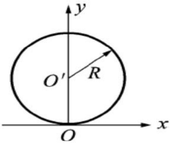
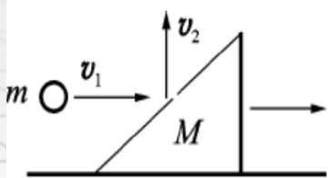
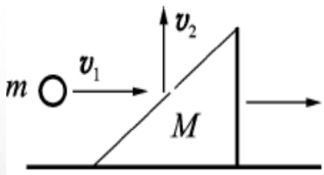
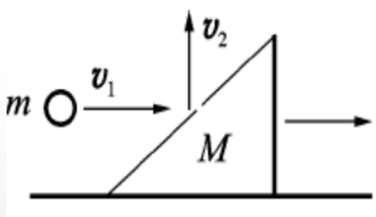

# 05-练习5 动量、功和能

[返回全书目录](../../README.md)

> PDF 页码：31–40

<!-- page: 31 -->

### 练习5 动量、功和能

1. 在湖中静止水面上有一长为 L，质量为 M 的小船，船的一端站有质量为 m 的人。当人从船的一端走到另一端时，人相对湖岸移动的距离为 ___，船相对湖岸移动的距离为 ___。（水对船的阻力可忽略）

解：设人相对于船的速度为  $ \overrightarrow{u} $，船相对于岸的速度为  $ \overrightarrow{v} $，建立水平向右为  $ \boldsymbol{x} $ 轴。由动量守恒定律，可得

 $$ M\overrightarrow{v}+m(\overrightarrow{u}+\overrightarrow{v})=0 $$ 

投影到 x 轴方向，得  $ Mv + m(v - u) = 0 $ 解得： $ v = \frac{m}{M + m}u $

<!-- page: 32 -->

1. 在湖中静止水面上有一长为  $ L $，质量为  $ M $ 的小船，船的一端站有质量为  $ m $ 的人。当人从船的一端走到另一端时，人相对湖岸移动的距离为  $ \underline{\frac{M}{M+m}L} $，船相对湖岸移动的距离为  $ \underline{\frac{m}{M+m}L} $。（水对船的阻力可忽略）

解：船相对湖岸移动的距离为 $ \Delta x_{船} = \int_{0}^{t} vdt = \frac{m}{M + m} \int_{0}^{t} udt = \frac{m}{M + m} L $

式中  $ L = \int_{0}^{t} udt $ 为人相对于船行走的距离，即人从船的一端走到另一端的距离，等于船长  $ L $。

人相对湖岸移动的距离为

 $$ \begin{aligned}&\text{为 }\\&\Delta x_{ 人 }=L-\Delta x_{ 船 }=L-\frac{m}{M+m}L=\frac{M}{M+m}L\\ \end{aligned} $$

<!-- page: 33 -->

2. 一质点在如图 5.1 所示的坐标平面内作圆周运动，有一力  $ \overrightarrow{F} = F_{0}(x\overrightarrow{i} + y\overrightarrow{j}) $ 作用在质点上。在该质点从坐标原点 O 运动到（0，2R）位置过程中，力  $ \overrightarrow{F} $ 对它所做的功为  $ \underline{2F_{0}R^{2}} $。

 $$ \begin{aligned}&A=\int\overrightarrow{F}\cdot d\overrightarrow{r}=\int F_{_{0}}(x\overrightarrow{i}+y\overrightarrow{j})\cdot(d x\overrightarrow{i}+d y\overrightarrow{j})\\ &=\int F_{_{0}}(x d x+y d y)=F_{_{0}}(\int_{0}^{0}x d x+\int_{0}^{2R}y d y)\\ &=2F_{_{0}}R^{2}\\ \end{aligned} $$ 

图5.1
 

<!-- page: 34 -->

3. 一人造卫星绕地球作椭圆运动，近地点为 A，远地点为 B，A、B 两点距地心的距离分别为  $ r_{1} $、 $ r_{2} $，设卫星质量为 m，地球质量为 M，万有引力常数为 G，则卫星在 A、B 两点的势能之差  $ E_{PB} - E_{PA} = \underline{\quad -GmM\frac{r_{1}-r_{2}}{r_{1}r_{2}} \quad} $；卫星在 A、B 两点的动能之差  $ E_{KB} - E_{KA} = \underline{\quad }。 $

解： $ E_{PA} = -G \frac{mM}{r_{1}}, E_{PB} = -G \frac{mM}{r_{2}} $

 $$ E_{_{PB}}-E_{_{PA}}=GmM(\frac{1}{--}\frac{1}{r_{_{1}}}\rbrack=-GmM\frac{r_{_{1}}-r_{_{2}}}{r_{_{1}}r_{_{2}}} $$

<!-- page: 35 -->

3. 一人造卫星绕地球作椭圆运动，近地点为 A，远地点为 B，A、B 两点距地心的距离分别为  $ r_{1} $、 $ r_{2} $，设卫星质量为 m，地球质量为 M，万有引力常数为 G，则卫星在 A、B 两点的势能之差  $ E_{PB} - E_{PA} = \underline{\quad -GmM\frac{r_{1}-r_{2}}{r_{1}r_{2}} \quad} $；卫星在 A、B 两点的动能之差  $ E_{KB} - E_{KA} = \underline{\quad GmM\frac{r_{1}-r_{2}}{r_{1}r_{2}} \quad} $。

解：系统机械能守恒，则  $ E_{kB}-G\frac{mM}{r_{2}}=E_{kA}-G\frac{mM}{r_{1}} $

于是有  $ E_{kB}-E_{kA}=G\frac{mM}{r_{2}}-G\frac{mM}{r_{1}}=GmM\frac{r_{1}-r_{2}}{r_{1}r_{2}} $

<!-- page: 36 -->

4. 如图 5.2 所示，质量为 M 的滑块正沿着光滑水平地面向右滑动，一质量为 m 的小球水平向右飞行，以速度  $ \overrightarrow{V}_{1} $ （对地）与滑块斜面相碰，碰后竖直向上弹起，速度为  $ \overrightarrow{V}_{2} $ （对地）。若碰撞时间为  $ \Delta t $，试计算此过程中滑块对地的平均作用力和滑块速度增量的大小。

解：以 M 和 m 为系统，外力（重力、地面支持力）均沿竖直方向，故水平方向动量守恒。

图5.2
 

<!-- page: 37 -->

水平方向：设滑块碰撞前后速度分别为  $ \vec{v} $ 和  $ \vec{u} $，应用动量守恒定律：

 $$ m v_{1}+M v=M u $$ 

图5.2
 

解得速度增量的大小：

 $$ \Delta\nu=u-\nu=\frac{m}{M}\nu_{1} $$

<!-- page: 38 -->

竖直方向：应用质点系动量定理，

系统动量增量： $ \Delta P_{y} = (mv_{2} + 0) - (0 + 0) $，合外力的冲量：

 $ (N - Mg - mg)\Delta t $，二者相等，解得：

 $$ N=\frac{mv_{2}}{\Delta t}+Mg+mg $$ 

图5.2
 

由牛顿第三定律可知，滑块对地平均作用力为：

 $ \frac{mv_{2}}{\Delta t} + Mg + mg $，方向竖直向下。

<!-- page: 39 -->

5. 某人从  $ 10 \, m $ 深的水井中提水, 开始时水桶中装有  $ 10 \, kg $ 的水, 水桶的质量为  $ 1 \, kg $, 由于水桶漏水, 每升高  $ 1 \, m $ 要漏去  $ 0.2 \, kg $ 的水, 求水桶匀速地从水井中提到水井口的过程中人所作的功。

解:选竖直向上为坐标 y 轴的正方向,井中水面处为原点。

由题意知, 人匀速提水, 所以人所用的拉力 F 等于

水桶的重量 即:  $ F = P = P_{0} - ky = mg - 0.2gy = 107.8 - 1.96y (SI) $

人的拉力所作的功为:

 $$ A=\int dA=\int_{0}^{H}Fdy=\int_{0}^{10}(107.8-1.96y)dy=980J $$

<!-- page: 40 -->

6. 设相距为  $ r $ 的两粒子之间的相互作用力为排斥力  $ f = \frac{k}{r^{3}} $，k 为常数，试问：(1) f 是保守力吗？为什么？(2) 若是保守力，求两粒子相距为  $ r $ 时的势能（设无穷远处为势能零点）。

解：（1）根据问题中给出的力  $ f=\frac{k}{r^{3}} $，只与两个粒子之间位置有关，所以相对位置从  $ r_{1} $ 变化到  $ r_{2} $ 时，力做的功为  $ A=\int_{r_{1}}^{r_{2}}\frac{k}{r^{3}}dr=-\frac{1}{2}k\left(\frac{1}{r_{2}^{2}}-\frac{1}{r_{1}^{2}}\right) $，做功与路径无关，为保守力；

（2）两粒子相距为  $ r $ 时的势能： $ E_P = \int_r^\infty \frac{k}{r^3} dr = \frac{k}{2r^2} $

