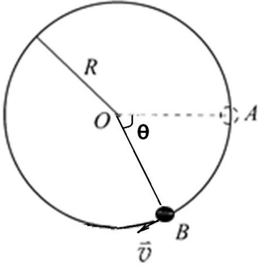
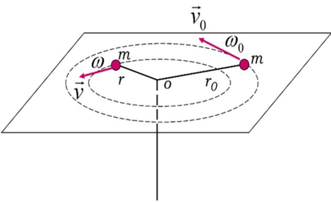
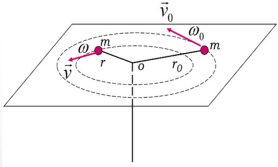

# 06-练习6 质点角动量定理及守恒定律

[返回全书目录](../../README.md)

> PDF 页码：41–48

<!-- page: 41 -->

### 练习6 质点角动量定理及守恒定律

1. 在  $ t=0 $ 时，质量为  $ 3 \, kg $ 的物体位于  $ \overrightarrow{r_0} = 5\overrightarrow{i} $ 处，其速度为  $ \overrightarrow{v_0} = 10\overrightarrow{j} $ m/s，若其不受外力作用，则该物体在  $ t $ 时刻的位置矢量  $ \overrightarrow{r}=\underline{5\overrightarrow{i}+10\overrightarrow{tj}} $ m， $ t=0 $ s 时相对原点的角动量  $ \overrightarrow{L_0}=\underline{150k} $ kg·m $ ^2 $/s， $ t=12 $ s 时相对原点的角动量  $ \overrightarrow{L}=\underline{150k} $ kg·m $ ^2 $/s

解：质点作匀速直线运动， $ \vec{r} = \vec{r}_0 + \vec{v}_0t = 5\vec{i} + 10t\vec{j} $ m

 $ t = 0s $时， $ \vec{L}_0 = \vec{r}_0 \times \vec{p}_0 = mv_0r_0\vec{k} = 150\vec{k} $ kg·m²/s

由角动量守恒： $ \vec{L}_{12} = \vec{L}_0 = 150\vec{k} $ kg·m²/s

<!-- page: 42 -->

2. 一质点的角动量为  $ \vec{L}=6t^{2}\vec{i}-(2t+1)\vec{j}+(12t^{3}-8t^{2})\vec{k} $，则质点在  $ t=1\ s $ 时所受力矩  $ \vec{M}=\underline{12\vec{i}-2\vec{j}+20\vec{k}\ N\cdot m} $。

 $$ \vec{M}=\frac{d\vec{L}}{d t}=12t\vec{i}-2\vec{j}+(36\mathrm{t}^{2}-16\mathrm{t})\vec{\mathrm{k}} $$ 

当 $ t=1s $时， $ \overrightarrow{M}=12\overrightarrow{i}-2\overrightarrow{j}+20\overrightarrow{k} $ N. m

<!-- page: 43 -->

3. 质量为 3 kg 的质点位于 x=3 m， y=8 m 处时, 速度为  $ \overrightarrow{v}=5\overrightarrow{t}-6\overrightarrow{j} $ (m/s)，作用于质点上的力大小为 7 N，沿 x 负方向，以原点为参考点时，质点在此时所受的力矩  $ \underline{56kN.m} $。

解：

 $$ \vec{r}=3\vec{i}+8\vec{j} $$ 

 $$ \overrightarrow{F}=-\ 7\mathbf{i} $$ 

 $$ \vec{M}=\vec{r}\times\vec{F}=(3\vec{i}+8\vec{j})\times7\vec{i}=56k\vec{N}.m $$

<!-- page: 44 -->

4. 一个具有单位质量的质点在随时间  $ t $ 变化的力  $ \vec{F} = (3t^{2} - 4t)\vec{i} + (12t - 6)\vec{j} $ （SI）作用下运动。设该质点在  $ t = 0s $ 时位于原点，且速度为零。求  $ t = 2s $ 时，该质点受到对原点的力矩和该质点对原点的角动量。

当 $ m=1kg $时， $ \overrightarrow{F}=(3t^{2}-4t) $  $ \overrightarrow{i}+(12t-6)\overrightarrow{j} $N

 $$ \vec{a}=\frac{\vec{F}}{m}=\left(3t^{2}-4t\right)\vec{i}+\left(12t-6\right)\vec{j}m/s^{2} $$ 

 $$ \vec{v}=(\mathrm{t}^{3}-2\mathrm{t}^{2})\quad\vec{\mathrm{i}}+(6\mathrm{t}^{2}-6\mathrm{t})\quad\vec{\mathrm{j}}\mathrm{m}/\mathrm{s} $$ 

 $$ \vec{r}=(\frac{1}{4}\mathbf{t}^{4}-\frac{2}{3}\mathbf{t}^{3})\overrightarrow{\mathbf{i}}+(2\mathbf{t}^{3}-3\mathbf{t}^{2})\overrightarrow{\mathbf{j}} $$

<!-- page: 45 -->

4. 一个具有单位质量的质点在随时间  $ t $ 变化的力  $ \vec{F} = (3t^2 - 4t)\vec{i} + (12t - 6)\vec{j} $ （SI）作用下运动。设该质点在  $ t = 0s $ 时位于原点，且速度为零。求  $ t = 2s $ 时，该质点受到对原点的力矩和该质点对原点的角动量。

当 $ t=2s $时，有： $ \vec{r}=-\frac{4}{3}\vec{i}+4\vec{j}m $

 $$ \vec{F}=4\vec{i}+18\vec{j} $$ 

 $$ \overrightarrow{v}=12\overrightarrow{j} $$ 

 $$ \vec{L}=\vec{r}\times m\vec{v}=(-\frac{4}{3}\vec{i}+4\vec{j}\mathbf{\nabla})\times12\vec{j}=-16\vec{k}\mathrm{~k g m}^{2}.\mathrm{~s}^{-1} $$ 

 $$ \overrightarrow{M}=\overrightarrow{r}\times\overrightarrow{F}=(-\frac{4}{9}\overrightarrow{i}+4\overrightarrow{j})\times(4\overrightarrow{i}+18\overrightarrow{j})=-40\overrightarrow{k}N.m $$

<!-- page: 46 -->

5. 如图 6.1 所示，一半径为 R 的光滑圆环置于竖直平面内，一质量为 m 的小球穿在圆环上，并可在圆环上滑动。小球开始时静止于圆环上的 A 点（该点在通过环心 O 的水平面上），然后从 A 点开始下滑。设小球与圆环间的摩擦略去不计。求小球滑到 B 点时对环心 O 的角动量和角速度。

解：小球受重力和支持力作用，在下滑到最低点的过程

中，没有非保守内力做功，机械能守恒

 $$ \begin{aligned}mgR\sin\theta&=\frac{1}{2}mv^{2}\\\therefore v&=\sqrt{2gR\sin\theta}\quad\Rightarrow\omega=\frac{v}{R}=\sqrt{\frac{2g\sin\theta}{R}}\\\therefore\quad L&=mR^{2}\omega=mR\sqrt{2gR\sin\theta}\end{aligned} $$ 

图6.1
 

<!-- page: 47 -->

6. 用绳系一质量为 m 小球使它在光滑的水平面上做匀速率圆周运动，其半径为  $ r_{0} $，角速度为  $ \omega_{0} $。现通过圆心 O 处的小孔缓慢地往下拉绳使半径逐渐减小，如图 6.2 所示。求：（1）当半径缩小到 r 时小球的角速度  $ \omega $。

（2）这一过程中绳子对小球的拉力所做的功。

图6.2
 

<!-- page: 48 -->

解：（1）作用在小球上的竖直方向的力有小球的重力和平面的支持力，这是一对平衡力；水平方向的力只有绳的拉力。以小孔 O 为原点，绳对小球的拉力为有心力，其力矩

为零，则小球对 O 点的角动量守恒，有

 $ m v r = m v_{0} r_{0} $，又  $ v = r \omega $，有

 $$ m r^{2}\omega=m r_{0}^{2}\omega_{0}, 则：\omega=\frac{r_{0}^{2}}{r^{2}}\omega_{0} $$ 

图6.2
 

（2）根据质点的动能定理，绳子拉力所做的功等于小球的动能增量，于是：

 $$ A=\frac{1}{2}mv^{2}-\frac{1}{2}mv_{0}^{2}=\frac{1}{2}m\omega_{0}^{2}r_{0}^{2}(\frac{r_{0}^{2}}{r^{2}}-1) $$

