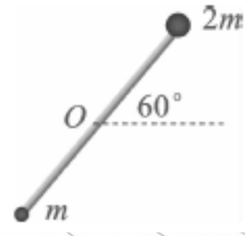
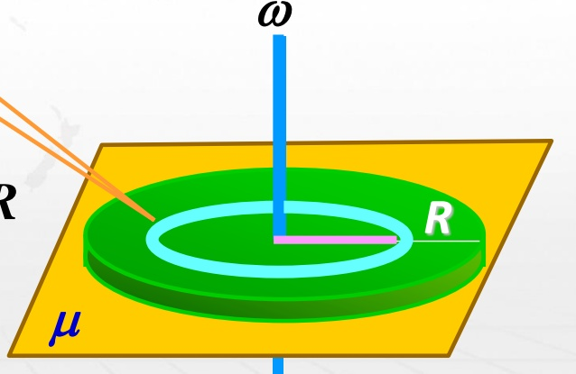
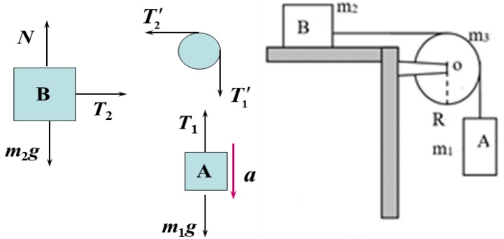
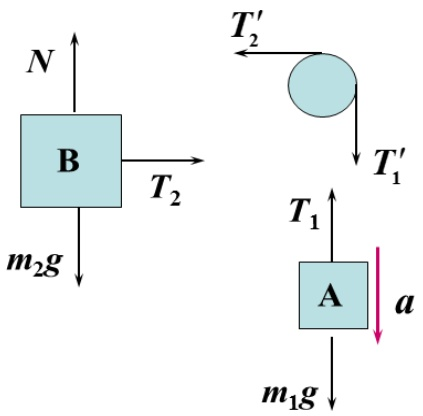
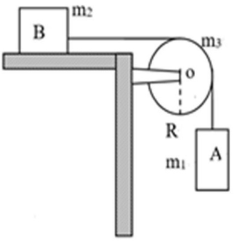
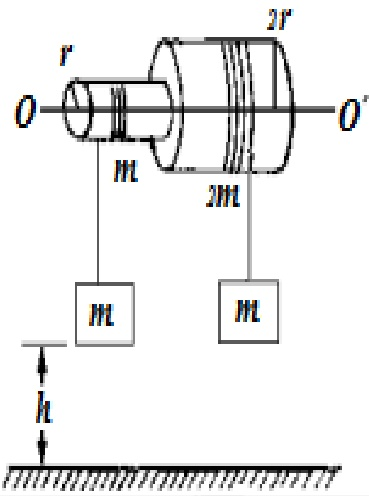
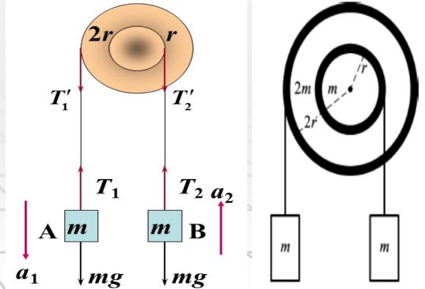
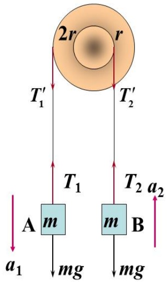
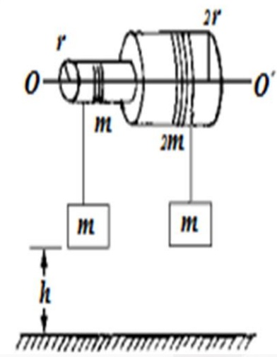
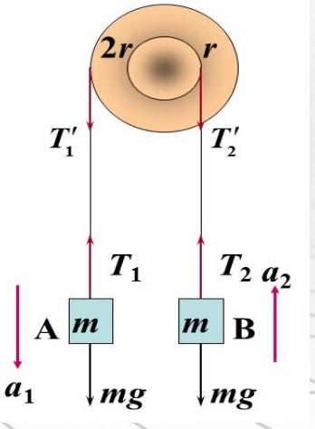

# 08-练习8 刚体定轴转动定律

[返回全书目录](../../README.md)

> PDF 页码：55–64

<!-- page: 55 -->

### 练习8 刚体定轴转动定律

1. 转动着的飞轮的转动惯量为  $ J $，在  $ t=0 $ 时角速度为  $ \omega_{0} $。此后飞轮经历制动过程，阻力矩  $ M $ 的大小与角速度  $ \omega $ 的平方成正比，比例系数为  $ k $（ $ k $ 为大于 0 的常数），当  $ \omega=\frac{1}{3}\omega_{0} $ 时，飞轮的角加速度  $ \underline{\frac{-k\omega_{0}^{2}}{9J}} $，从开始制动到  $ \omega=\frac{1}{3}\omega_{0} $ 所经过的时间  $ \underline{\frac{2J}{\omega_{0}k}} $。

解：由 $M = J\beta = J\frac{d\omega}{dt}$ 得 $-k\omega^{2} = J\frac{d\omega}{dt} \Rightarrow \beta = \frac{d\omega}{dt} = \frac{-k\omega^{2}}{J} = -\frac{k\omega_{0}^{2}}{9J}$

分离变量得 $-\frac{k}{J}dt = \frac{d\omega}{\omega^{2}}$，两边积分

$-\frac{k}{J}\int_{0}^{t} dt = \int_{\omega_{0}}^{\omega_{0}/3} \frac{d\omega}{\omega^{2}}$，解得： $t = \frac{2J}{\omega_{0}k}$

<!-- page: 56 -->

2. 一半径  $ 15 \, \text{cm} $、质量为  $ 0.70 \, \text{kg} $ 的光盘从静止开始转动，在  $ 1.5 \, \text{s} $ 内达到转速  $ n = 33.3 \, \text{rev} \cdot \text{min}^{-1} $，则在此  $ 1.5 \, \text{s} $ 时间内施加于光盘的转动力矩大小  $ M = \underline{0.0183 \, \text{N} \cdot \text{m}} $。

解： $ n = 33.3 \text{ rev} \cdot \text{min}^{-1} \Rightarrow \omega = \frac{33.3 \times 2\pi}{60} = 1.11\pi \text{ rad/s} $

从静止开始转动， $ \omega = \beta t $

 $ t = 1.5\text{s} $时， $ \omega = 1.11\pi \text{ rad/s} \Rightarrow \beta = 2.325 \text{ rad/s}^2 $

 $ M = J\beta \Rightarrow M = \frac{1}{2} \times 0.7 \times 0.15^2 \times 2.325 = 0.0183 \text{ N} \cdot \text{m} $

<!-- page: 57 -->

3. 如图 8.1 所示，长为 L 的轻质细杆，两端分别固定质量为 m 和 2m 的小球，此系统在竖直平面内可绕过中点 O 且与杆垂直的水平光滑固定轴（O 轴）转动。初始时刻杆与水平成  $ 60^{\circ} $ 角时，由静止释放，杆-球这一刚体系统绕 O 轴转动，系统绕 O 轴的转动惯量  $ J = \underline{\frac{3}{4}mL^{2}} $。当杆转到水平位置时，刚体受到的合外力矩大小  $ M = \underline{mg\frac{L}{2}} $；角加速度大小  $ \beta = \underline{\frac{2g}{3L}} $。

解：根据转动惯量的定义得杆和两小球组成的系统：

 $$ J=m\bigg(\frac{L}{2}\bigg)^{2}+2m\bigg(\frac{L}{2}\bigg)^{2}=\frac{3}{4}mL^{2} $$ 

两小球对于 0 点的力矩方向相反，

 $$ M=2mg\frac{L}{2}-mg\frac{L}{2}=mg\frac{L}{2} $$ 

根据转动定律： $ M = J\beta $ 得， $ \beta = M/J = \frac{2g}{3L} $

<!-- page: 58 -->

4. 有一质量分布均匀、半径为 R 的圆形平板平放在水平桌面上，平板与水平桌面的摩擦系数为  $ \mu $，若平板绕通过其中心且垂直板面的固定轴以角速度  $ \omega_{0} $ 开始旋转，它将在旋转几圈后停止？（已知圆形平板的转动惯量  $ J=\frac{1}{2}mR^{2} $，其中 m 为圆形平板的质量）

解：设圆形平板单位面积质量为 $ \sigma $，取一质元dm，有：

 $$ \begin{array}{c}\mathrm{d}m=\sigma\mathrm{d}s=\sigma\cdot2\pi r\mathrm{d}r\\\mathrm{d}M=-r\mathrm{d}f=-r\cdot\mu g\mathrm{d}m\end{array} $$ 

摩擦力矩： $ M = \int_{0}^{R} \mathrm{d}M = -\frac{2}{3} \mu mgR $

由转动定律： $ M = J \frac{d\omega}{dt} $

 $$ -\frac{2}{3}\mu mgR=\frac{1}{2}mR^{2}\frac{d\omega}{dt} $$

<!-- page: 59 -->

$$ -\frac{2}{3}\mu gR=\frac{1}{2}R^{2}\frac{d\omega}{dt}\frac{d\theta}{d\theta}=\frac{1}{2}R^{2}\frac{\omega d\omega}{d\theta} $$ 

即： $ \omega d\omega = -\frac{4\mu g}{3R}d\theta $

两边积分: $ \int_{\omega_0}^{0}\omega d\omega=\int_{0}^{\theta}-\frac{4\mu g}{3R}d\theta $

得： $ \theta=\frac{3\omega_{0}^{2}R}{8\mu g} $

转过的圈数 $ n=\frac{3\omega_{0}^{2}R}{16\pi\mu g} $

<!-- page: 60 -->

5. 质量为  $ m_{3} $ 、半径为 R 的定滑轮与质量分别为  $ m_{1} $ 、  $ m_{2} $ 的两物体 A、B 安装如图 8.2 所示，如果 B 与桌面摩擦可忽略，且滑轮可视为匀质圆盘，求物体 A、B 加速度和绳子张力的大小。

解：分别以  $ m_{1} $、 $ m_{2} $ 和滑轮为研究对象，受力分析如图。

A, B 加速度大小相等，对  $ m_{1} $ 、 $ m_{2} $ 运用牛顿定律有

 $$ \begin{aligned}&m_{1}g-T_{1}=m_{1}a\\&T_{2}=m_{2}a\\ \end{aligned} $$ 

对滑轮运用转动定律，有

 $$ T_{1}^{}{^{\prime}}R-T_{2}^{}{^{\prime}}R=\frac{1}{2}m_{3}R^{2}\beta $$ 

图8.2
 

<!-- page: 61 -->

$$ m_{1}g-T_{1}=m_{1}a $$ 

 $$ T_{2}=m_{2}a $$ 

 $$ T_{1}^{}{^{\prime}}R-T_{2}^{}{^{\prime}}R=\frac{1}{2}m_{3}R^{2}\beta $$ 

又  $ a = \beta R $

根据牛顿第三定律： $ T_{1}' = T_{1}, T_{2}' = T_{2} $，并联立以上4个方

程，得：

 $$ a=\frac{m_{1}g}{m_{1}+m_{2}+\frac{1}{2}m_{3}} $$ 

 $$ \begin{array}{c}T_{1}=m_{1}g-m_{1}\dfrac{m_{1}g}{m_{1}+m_{2}+\dfrac{1}{2}m_{3}}\\T_{2}=m_{2}\dfrac{m_{1}g}{m_{1}+m_{2}+\dfrac{1}{2}m_{3}}\end{array} $$ 

图8.2
 

<!-- page: 62 -->

6. 如图 8.3 所示，固定在一起的两个同轴均匀圆柱体可绕其光滑的水平对称轴  $ OO' $ 转动，大小圆柱体的半径分别为 2r 和 r，质量分别为 2m 和 m，绕在两柱体上的细绳分别与质量为 m 的物体相连。求：圆柱体转动时角加速度及两侧细绳的张力；从静止开始时两质量为 m 的物体离地均为 h，与大小圆柱体相连的哪个物体先着地？经多长时间？

解：截面图如右图所示，设 A 的加速度为  $ a_{1} $，

方向向下，B 的加速度为  $ a_{2} $，方向向上，圆盘的角加速度为  $ \beta $，方向垂直纸面向外。

<!-- page: 63 -->

物体 A:  $ mg - T_{1} = ma_{1} $

物体 B:  $ T_{2}-mg=ma_{2} $

两圆盘粘合视作一个刚体，其转动惯量为

 $$ J=J_{1}+J_{2}=\frac{9}{2}mr^{2} $$ 

由转动定律： $ T_{1}' \times 2r - T_{2}'r = J\beta $

由牛顿第三定律： $ T_{1}'=T_{1} $， $ T_{2}'=T_{2} $

由角量与线量的关系： $ a_{1}=2r\beta $， $ a_{2}=r\beta $

<!-- page: 64 -->

解方程组得： $ \beta=\frac{mgr}{J+5mr^{2}}=\frac{2g}{19r} $

 $$ T_{1}=\frac{15}{19}mg\ ;\ a_{1}=\frac{4}{19}g $$ 

 $$ T_{2}=\frac{21}{19}mg\ ;\ a_{2}=\frac{2}{19}g $$ 

从静止开始时两质量为 m 的物体离地均为 h，松手后，挂在大圆柱体上的 A 向下做加速运动，而挂在小圆柱体上的 B 物体向上做加速运动，所以挂在大圆柱体上的物体 A 先达到地面。根据匀变速直线运动公式

 $$ h=\frac{1}{2}a_{1}t^{2}\Rightarrow t=\sqrt{\frac{2h}{a_{1}}}=\sqrt{\frac{19h}{2g}} $$ 

