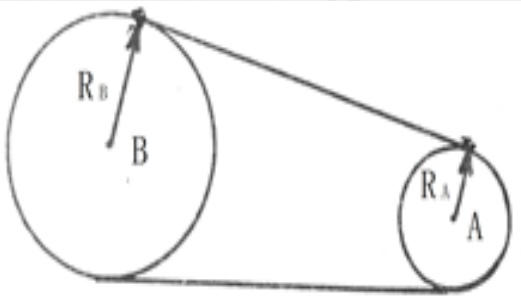
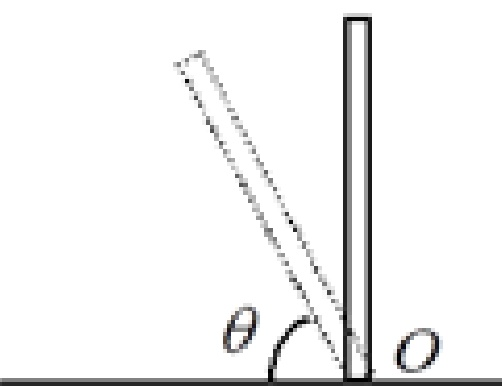
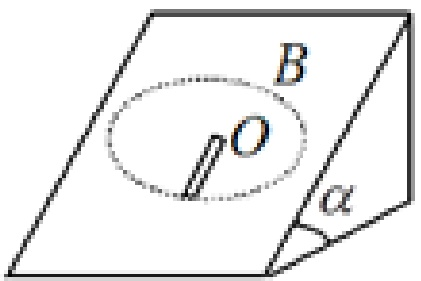

# 09-练习9 刚体定轴转动中的功和能

[返回全书目录](../../README.md)

> PDF 页码：65–70

<!-- page: 65 -->

### 练习9 刚体定轴转动中的功和能

1. 用一条皮带将两个轮子 A 和 B 连接起来，轮和皮带间无相对滑动，B 轮的半径是 A 轮的 3 倍，如图 9.1 所示。如果两轮具有相同的转动动能，则 A、B 两轮的转动惯量的比值为  $ \underline{1:9} $。

解：由A，B轮均与皮带间无相对滑动，所以有

 $$ V_{_{A}}=V_{_{B}}\Rightarrow\omega_{_{A}}R_{_{A}}=\omega_{_{B}}R_{_{B}}\Rightarrow\frac{\omega_{_{B}}}{\omega_{_{A}}}=\frac{R_{_{A}}}{R_{_{B}}}=\frac{1}{3} $$ 

两轮具有相同的转动动能，有：

 $$ \frac{1}{2}J_{_{A}}\omega^{2}_{A}=\frac{1}{2}J_{_{B}}\omega^{2}_{B}\Rightarrow\frac{J_{_{A}}}{J_{_{B}}}=\frac{\omega^{2}_{B}}{\omega^{2}_{A}} $$ 

 $$ \therefore J_{A}/J_{B}=1:9 $$ 

图9.1
 

<!-- page: 66 -->

2. 质量为 m，长度为 l 的匀质杆，可绕通过其下端的水平光滑固定轴 O 在竖直平面内转动（如图 9.2 所示），设它从竖直位置由静止倒下。当它倾倒到与水平面成  $ \theta $ 角时，角速度为  $ \sqrt{3(1-\sin\theta)g/l} $，角加速度为  $ \frac{3g}{2l}\cos\theta $。

解:选杆与地球为系统，机械能守恒. 有  $ \frac{1}{2}J\omega^{2}=\frac{1}{2}mgl(1-\sin\theta) $

即:  $ \frac{1}{2}\times\frac{1}{3}m l^{2}\omega^{2}=\frac{1}{2}m g l(1-\sin\theta) $

由上式可得： $ \omega=\sqrt{3(1-\sin\theta)g/l} $

转动定律： $ M=J\beta $，其中  $ M=\frac{1}{2}mgl\cos\theta $ 是杆在 $ \theta $角

位置杆受重力矩，即

 $$ \frac{1}{2}mgl\cos\theta=\frac{1}{3}ml^{2}\beta $$ 

由上式可求得： $ \beta = \frac{3g}{2l} \cos \theta $

图9.2
 

<!-- page: 67 -->

3. 某人站在水平转台的中央，与转台一起以恒定的转速  $ n_1 $ 转动，他的两手各拿一个质量为  $ m $ 的砝码，砝码彼此相距  $ l_1 $ （每一砝码离转轴  $ \frac{1}{2}l_1 $），当此人将砝码拉近到距离为  $ l_2 $ 时（每一砝码离转轴为  $ \frac{1}{2}l_2 $），整个系统转速变为  $ n_2 $。设没有砝码时系统的转动惯量为  $ J_0 $，则在此过程中人所作的功为： $ \underline{W = \pi^2mn_1n_2(l_1^2 - l_2^2)} $。

（假定人在收臂过程中自身对轴的转动惯量的变化可以忽略）

解：将转台、砝码、人看作一个系统，过程中人作的功W等于系统动能之增量：

$$  \boldsymbol{W}=\Delta\boldsymbol{E}_{_{K}}=\frac{1}{2}\left(\boldsymbol{J}_{_{0}}+2\times m(\frac{1}{2}\boldsymbol{l}_{_{2}})^{2})4\pi^{2}n_{_{2}}^{2}-\frac{1}{2}\left(\boldsymbol{J}_{_{0}}+2\times m(\frac{1}{2}\boldsymbol{l}_{_{1}})^{2})4\pi^{2}n_{_{1}}^{2}\right.\right.   \tag*{(1)}$$

转动过程中无外力矩作用，系统的角动量守恒：

 $$ \left(\mathrm{J}_{0}+\frac{1}{2}\mathrm{m}\boldsymbol{l}_{1}^{2}\right)\ 2\pi\mathrm{n}_{1}\ =\left(\mathrm{J}_{0}+\frac{1}{2}\mathrm{m}\boldsymbol{l}_{2}^{2}\right)\ 2\pi\mathrm{n}_{2}\quad\Longrightarrow\ \boldsymbol{J}_{0}\ =\frac{m\left(\boldsymbol{l}_{1}^{2}\boldsymbol{n}_{1}-\boldsymbol{l}_{2}^{2}\boldsymbol{n}_{2}\right)}{2\left(\boldsymbol{n}_{2}-\boldsymbol{n}_{1}\right)} $$ 

将 $ J_{0} $代入式(1)得： $ W = \Delta E_{K} = \pi^{2}mn_{1}n_{2}\left(l_{1}^{2} - l_{2}^{2}\right) $

<!-- page: 68 -->

4. 质量为  $ m, k $ 长为  $ l=85 \, \text{cm} $ 的均匀细杆，如图 9.3 所示。放在倾角为  $ \alpha=45^{\circ} $ 的光滑斜面上，可以绕通过杆上端且与斜面垂直的光滑轴 O 在斜面上转动。要使此杆能绕轴转动一周，至少应使杆以多大的初始角速度  $ \omega_{0} $ 转动？

解：若要使杆能绕轴转动一周，必须使杆能通过最高点B，即这时杆的角速度 $ \omega_{B} \geq 0 $，对杆与地球系统，机械能守恒，设杆最底端所在平面为零势能面，有

 $$ \frac{1}{2}J\omega_{0}^{2}+mg\cdot\frac{1}{2}l\sin\alpha=mg\cdot\frac{3}{2}l\sin\alpha+\frac{1}{2}J\omega_{B}^{2} $$ 

其中转动惯量  $ J = \frac{1}{2} m l^{2} $

 $$ \frac{1}{2}\times\frac{1}{3}m l^{2}\omega_{0}^{2}=m g l\sin\alpha+\frac{1}{2}\times\frac{1}{3}m l^{2}\omega_{B}^{2} $$ 

 $$ \omega_{_{B}}^{2}=\omega_{0}^{2}-6g\sin\alpha/l\geq0 $$ 

 $$ \begin{aligned}\omega_{0}&\geq\sqrt{(6g\sin\alpha)/l}&=7.0rad/s\end{aligned} $$ 

图9.3
 

<!-- page: 69 -->

5. 一个半径为 R，质量为 m 的硬币，竖直地立放在粗糙的水平桌面上。开始时处于静止状态，而后硬币受到轻微扰动而倒下。求硬币平面与桌面碰撞前（即硬币平面在水平位置）时质心的速度大小。（已知质量为 m，半径为 R 的圆盘对沿盘直径的轴的转动惯为  $ \frac{1}{4}mR^{2} $）

解：对硬币，由动能定理有

 $$ mgR=\frac{1}{2}J\omega^{2} $$ 

其中， $ J = \frac{1}{4} mR^{2} + mR^{2} = \frac{5}{4} mR^{2} $代入上式求得：

 $$ \omega= {\sqrt{\frac{8g}{5R}}}} $$ 

质心的速度大小为： $ v_{c}=\omega R=\sqrt{\frac{8Rg}{5}} $

<!-- page: 70 -->

6. 一根质量为 m、长为 L 的均匀细杆，可在水平桌面上绕通过其一端的竖直固定轴转动。已知细杆与桌面的滑动摩擦系数为  $ \mu $，求杆转动一周摩擦力做的功.

解：细棒运动起来所受到的摩擦力矩

 $$ M~=~-\int_{0}^{L}~\mu~\frac{m}{L}g x d x~=~-\frac{1}{2}~\mu m g L $$ 

棒绕端点转一圈摩擦力矩的功为

 $$ A=\int_{0}^{2\pi}M d\theta=-\int_{0}^{2\pi}\frac{1}{2}\mu mgL d\theta=-\mu\pi mgL $$

