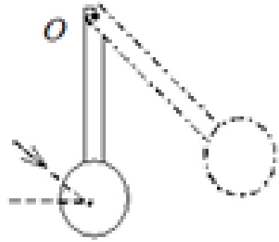
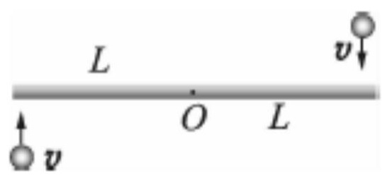
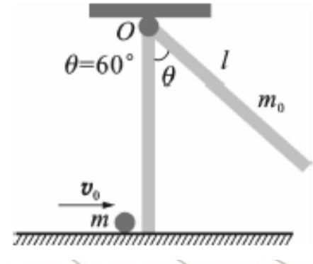
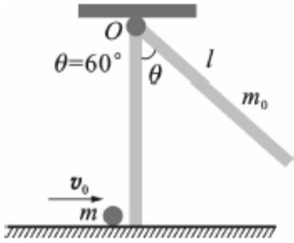
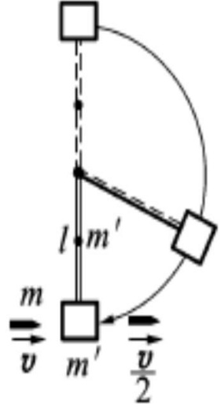
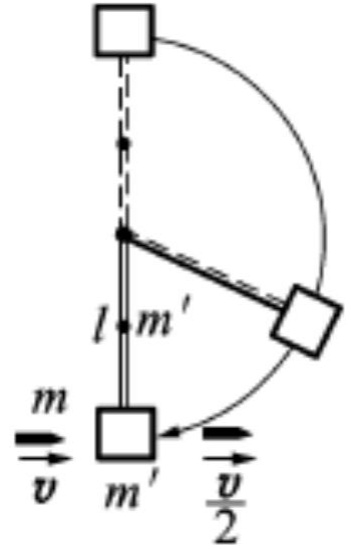
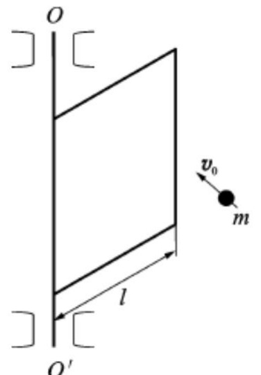
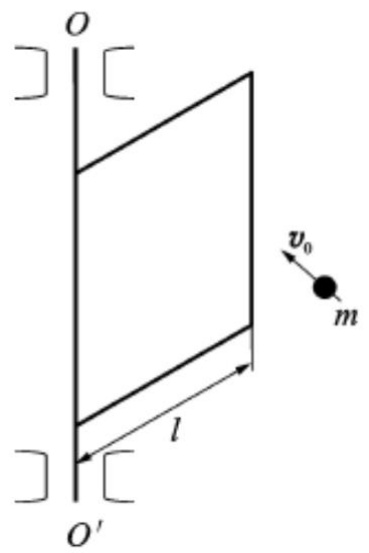

# 10-练习10 刚体定轴转动的角动量定理和角动量守恒定律

[返回全书目录](../../README.md)

> PDF 页码：71–79

<!-- page: 71 -->

### 练习10 刚体定轴转动的角动量定理和角动量守恒定律

1. 如图10.1所示，一匀质木球固结在一细棒下端，且可绕水平光滑固定轴O转动。今有一子弹沿着与水平面成一角度的方向击中木球而嵌于其中，则在此击中过程中，木球、子弹、细棒系统 $ \underline{\text{对0轴的角动量}} $守恒，原因是 $ \underline{\text{系统对该轴的合外力矩为0}} $。

解：略

图10.1
 

<!-- page: 72 -->

2. 光滑的水平桌面上有一长为 2L，质量为 m 的匀质细杆，可绕过其中点且垂直于杆的竖直光滑固定轴 O 自由转动，开始杆静止，桌上有两个质量均为 m 的小球，各自在垂直杆的方向上，正对着杆的一端，以相同速率 v 相向运动，如图 10.2 所示，当两球同时与杆的两端发生完全非弹性碰撞，则碰后杆的转动角速度为  $ \frac{6v}{7L} $。

解：碰撞前后角动量守恒：

 $$ 2m v L=\frac{1}{12}m(2L)^{2}\omega+m\omega L^{2}+m\omega L^{2} $$ 

求得：  $ \omega=\frac{6v}{7L} $

<!-- page: 73 -->

3. 一个质量为  $ m $ 的小虫，在有光滑竖直固定中心轴的水平圆盘边缘上，沿逆时针方向爬行，它相对于地面的速率为  $ \nu $，此时圆盘正沿顺时针方向转动，相对于地面的角速率为  $ \omega_0 $，设圆盘的半径为  $ R $，对中心轴的转动惯量为  $ J $，若小虫停止爬行，则圆盘的角速度为  $ \underline{\frac{J\omega_0 - mvR}{J + mR^2}} $。

解：虫与水平圆盘作为一定轴转动系统，虫与水平圆盘之间的相互作用力为内力，沿竖直轴方向不受外力矩作用，故系统的角动量守恒。小虫停止爬行后，和盘一起运动。题中各物体速度都是相对轴的，而小虫和圆盘的角动量方向相反，因而有： $ J\omega_{0}-Rmv=(J+mR^{2})\omega\Rightarrow\omega=\frac{J\omega_{0}-m}{J+mk} $

<!-- page: 74 -->

4. 长为 l 质量为  $ m_{0} $ 的细杆可绕垂直于一端的水平轴自由转动。细杆原来处于平衡状态。现有一质量为 m 的小球沿光滑水平面飞来，正好与杆下端相碰（设碰撞为完全弹性碰撞）使细杆向上摆到  $ \theta = 60^{\circ} $ 处，如图 10.3 所示，求小球的初速度。

解：研究系统为小球和直杆，系统所受外力对于转轴的力矩为零。系统角动量守恒：

 $$ m v_{0}l=m v l+\frac{1}{3}m_{0}l^{2}\omega $$ 

弹性碰撞系统机械能守恒：

 $$ \frac{1}{2}\boldsymbol{m}\boldsymbol{v}_{0}^{2}=\frac{1}{2}\boldsymbol{m}\boldsymbol{v}^{2}+\frac{1}{2}(\frac{1}{3}\boldsymbol{m}_{0}l^{2})\boldsymbol{\omega}^{2} $$ 

<!-- page: 75 -->

$$ \begin{aligned}\boldsymbol{m}\boldsymbol{v}_{0}\boldsymbol{l}&=\boldsymbol{m}\boldsymbol{v}\boldsymbol{l}+\frac{1}{3}\boldsymbol{m}_{0}\boldsymbol{l}^{2}\boldsymbol{\omega}\\\frac{1}{2}\boldsymbol{m}\boldsymbol{v}_{0}^{~2}&=\frac{1}{2}\boldsymbol{m}\boldsymbol{v}^{2}+\frac{1}{2}(\frac{1}{3}\boldsymbol{m}_{0}\boldsymbol{l}^{2})\boldsymbol{\omega}^{2}\end{aligned} $$ 

碰撞后，直杆绕固定轴转过角度  $ \theta = 60^{\circ} $，直杆重力矩做的功等于直杆动能的增量

 $$ -\frac{1}{2}m_{0}gl(1-\cos60^{0})=0-\frac{1}{2}(\frac{1}{3}m_{0}l^{2})\omega^{2}\implies\frac{1}{2}g=\frac{1}{3}l\omega^{2} $$ 

由以上三式得到：

 $$ \nu_{0}=\frac{m_{0}+3m}{12m}\sqrt{6gl} $$

<!-- page: 76 -->

5. 质量为 m 的子弹穿过如图 10.4 所示的摆锤后，速率由 v 减小到  $ v/2 $，已知均匀细棒、摆锤的质量都为  $ m' $，细棒的长度为 l，如果摆锤能在垂直平面内完成一个完全的圆周运动，则子弹速度的最小值为多少？

解：取子弹与摆为系统，根据系统的角动量守恒，有：

 $$ J_{1}\frac{v}{l}=J_{1}\frac{v}{2l}+(J_{2}+J_{3})\omega_{0} $$ 

式中  $ J_{1}=ml^{2} $、 $ J_{2}=m'l^{2} $ 和  $ J_{3}=\frac{1}{3}m'l^{2} $ 分别为子弹、摆锤和杆对轴的转动惯量。

<!-- page: 77 -->

$$ J_{1}\frac{v}{l}=J_{1}\frac{v}{2l}+(J_{2}+J_{3})\omega_{0} $$ 

取摆锤在最低点处为重力势能零点，根据摆在转动过程中机械能守恒，有

 $$ \frac{1}{2}(J_{2}+J_{3})\omega_{0}^{2}+\frac{1}{2}m^{\prime}gl=m^{\prime}g(2l)+m^{\prime}g(\frac{3}{2}l) $$ 

由以上两式可得子弹速度的最小值为：

 $$ \nu=\frac{4m^{\prime}}{m}\sqrt{2gl} $$ 

<!-- page: 78 -->

6. 如图 10.5 所示，一宽为 l、质量为 M 的均匀薄板可绕 OO'轴转动，有一质量为 m 的小球以速度  $ \overrightarrow{V}_{0} $ 在薄板边缘与板垂直相碰，若碰撞是完全弹性的，求碰撞后薄板的角速度大小和小球的速度大小。

解：薄板和小球构成系统，作为研究对象。撞击的过程中，合外力的力矩为0，内力和外力作功均为0，系统的机械能及角动量守恒。板对轴00’的转动惯量为 $ J=\frac{1}{3}M l^{2} $，设小球弹回来的速度为v，则有

<!-- page: 79 -->

$$ \frac{1}{2}m v_{0}^{2}=\frac{1}{2}m v^{2}+\frac{1}{2}J\omega^{2} $$ 

 $$ m v_{0}l=m v l+J\omega $$ 

求得：

 $$ \omega=\frac{6m v_{0}}{(M+3m)l} $$ 

 $$ \boldsymbol{v}=\frac{3m-M}{3m+M}\boldsymbol{v}_{0} $$ 

