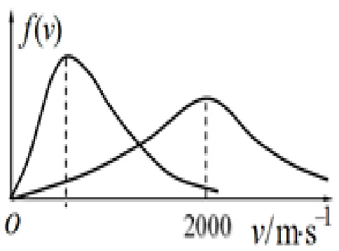

# 13-练习13 麦克斯韦分子速率分布律

[返回全书目录](../../README.md)

> PDF 页码：94–102

<!-- page: 94 -->

## 13 麦克斯韦分子速率分布律

1. 质量  $ m=6.2\times10^{-14}g $ 的微粒悬浮在  $ t=27^{\circ}C $ 的液体中，观察到悬浮粒子的方均根速率为  $ \sqrt{\frac{\sqrt{2}}{v^{2}}}=1.4cm\cdot s^{-1} $，假设悬浮微粒的运动服从麦克斯韦速率分布律，摩尔气体常量  $ R=8.31J\cdot mol^{-1}\cdot K^{-1} $，则阿伏加德罗常数  $ N_{A}=\underline{6.15\times10^{23}/mol} $

解：方均根速率 $ \sqrt{\nu^2} = \sqrt{\frac{3RT}{M_{mol}}} = \sqrt{\frac{3RT}{N_A m}} = 1.4 cm \cdot s^{-1} $可得

 $$ N_{A}=6.15\times10^{23}/mol $$

<!-- page: 95 -->

2. 氢气和氧气在同一温度下的麦克斯韦速率分布曲线如图13.1，则氧气气分子的最概然速率 $ v_{pO_{2}}=\underline{500m/s} $，氢气分子的最概然速率 $ v_{pH_{2}}=\underline{2000m/s} $，两种气体所处的温度 $ T=\underline{481K} $。

解：温度相同时，摩尔质量越大，最概然速率越小。氢的最概然速率 $ v_{pH_2} = 2000m/s $

又最概然速率 $ v_{p}=\sqrt{\frac{2RT}{M_{mol}}} $，所以 $ \frac{V_{pO_{2}}}{V_{pH_{2}}}=\sqrt{\frac{M_{molH_{2}}}{M_{molO_{2}}}}=\frac{1}{4} $

 $ \Rightarrow $氧的最概然速率 $ v_{pO_{2}}=500m/s $

温度 $ T=\frac{V_{P}^{2}M_{mol}}{2R}=\frac{V_{PH_{2}}^{2}M_{H_{2}mol}}{2R}=\frac{2000^{2}\times2\times10^{-3}}{2\times8.31}=481K $

<!-- page: 96 -->

3. 在平衡态下理想气体分子的麦克斯韦速率分布函数为  $ f(v) $， $ v_{p} $ 为最概然速率，m 为分子的质量，请说明下面两式的物理意义：

(1)  $ \int_{v_p}^{\infty} f(v)dv $ 表示一个分子的速率出现在  $ v_p \sim \infty $ 速率区间的概率；

(2)  $ \int_{v_1}^{v_2}\frac{mv^2}{2}Nf(v)dv $ 表示速率在  $ v_1 \sim v_2 $ 区间内分子的总平动动能

解：略

<!-- page: 97 -->

4. 设氧气分子的速率服从麦克斯韦速率分布，在温度为  $ T=300K $ 时，求：（1）氧气分子的最概然速率  $ v_{p} $ 、平均速率  $ \overline{v} $ 和方均根速率  $ \sqrt{\overline{v}^{2}} $ （2）氧气分子在最概然速率附近单位速率区间内的分子数占总分子数的比率  $ f(v_{p}) $ 。

解：由三种速率相应的计算公式可得：

最概然速率 $ v_{p}=\sqrt{\frac{2RT}{M_{mol}}}=\sqrt{\frac{2\times8.31\times300}{32\times10^{-3}}}=395m/s $

平均速率： $ \overline{v}=\sqrt{\frac{8RT}{\pi M_{mol}}}=\sqrt{\frac{8\times8.31\times300}{3.14\times32\times10^{-3}}}=445m/s $

方均根速率 $ \sqrt{\overline{v^{2}}}=\sqrt{\frac{3RT}{M_{mol}}}=\sqrt{\frac{3\times8.31\times300}{32\times10^{-3}}}=483m/s $

氧气分子在最概然速率附近单位速率区间内的分子数占总分子数

的比率就是将温度及最概然速率代入麦克斯韦速率分布函数表达

式中可得。

 $$ f(v_{p})=0.21\% $$

<!-- page: 98 -->

5. 假设有 N 个质量均为 m 的同种气体分子，其速率分布如图 13.2 所示，当  $ v > 2v_{0} $ 时， $ N f(v) = 0 $，求：（1）由图示曲线写出速率分布函数  $ f(v) $ 的表达式；（2）由 N 和  $ v_{0} $ 求常数 a；（3）分子的平均速率  $ \overline{V} $；（4）速率在  $ 0.5v_{0} \sim 1.0v_{0} $ 区间内粒子的平均速率  $ \overline{V}' $；（5）分子的平均平动动能  $ \overline{\varepsilon}_{t} $。

解：（1）由速率分布函数定义式 $ f(v)=\frac{dN}{Ndv}\Rightarrow Nf(v)=\frac{dN}{dv} $

由图可知在不同的速率区间 $ Nf(v) $的表达式为：

 $$ \left\{\begin{array}{l l}{N f\left(v\right)=\mathbf{a}v/\mathbf{v}_{0}}&{\quad\left(0\leq\mathbf{v}\leq\mathbf{v}_{0}\right)}\\ {N f\left(v\right)=\mathbf{a}}&{\quad\left(v_{0}\leq\mathbf{v}\leq2\mathbf{v}_{0}\right)\Rightarrow f\left(\mathbf{v}\right)=\left\{\begin{array}{l l}{\displaystyle\frac{a v}{N v_{0}}}&{\quad\left(0\leq\mathbf{v}\leq\mathbf{v}_{0}\right)}\\ {\displaystyle\frac{a}{N}}&{\quad\left(v_{0}\leq\mathbf{v}\leq2\mathbf{v}_{0}\right)}\\ {0}&{\quad\left(v\geq2\mathbf{v}_{0}\right)}\end{array}\right.}\\ {N f\left(v\right)=0}&{\quad\left(v\geq2\mathbf{v}_{0}\right)}\end{array}\right.\right. $$

<!-- page: 99 -->

（2）由速率分布函数的归一化条件有： $ \int_{0}^{\infty}f(v)\mathrm{d}v=1 $，或： $ \int_{0}^{v_{0}}\frac{av}{v_{0}}dv+\int_{v_{0}}^{2v_{0}}adv=N $

可得： $ \int_{0}^{v_{0}}\frac{av}{Vv_{0}}dv+\int_{v_{0}}^{2v_{0}}\frac{a}{N}dv=1\Rightarrow a=\frac{2N}{3v_{0}} $

（3）根据平均速率计算公式有： $ \bar{v}=\int_{0}^{\infty}vf(v)dv=\int_{0}^{v_{0}}v\frac{av}{Nv_{0}}dv+\int_{v_{0}}^{2v_{0}}v\frac{a}{N}dv=\frac{11}{9}v_{0} $

（4）速率在 $ 0.5v_{0}\sim1.0v_{0} $区间内粒子的平均速率 $ \overline{v} $，

 $ N_{1} $为速率在 $ 0.5v_{0}\sim1.0v_{0} $区间内的分子数

 $$ \overline{v^{\prime}}{}=\frac{\displaystyle\int_{0.5v_{0}}^{v_{0}}vdN}{N_{1}}{}=\frac{\displaystyle\int_{0.5v_{0}}^{v_{0}}vNf(v)dv}{N_{1}}{}=\frac{N}{N_{1}}\int_{0.5v_{0}}^{v_{0}}vf(v)dv=\frac{N}{N_{1}}\int_{0.5v_{0}}^{v_{0}}\frac{av^{2}}{Nv_{0}}dv $$ 

 $$ \therefore\overline{v^{\prime}}=\frac{1}{N_{1}}\int_{0.5v_{0}}^{v_{0}}\frac{av^{2}}{v_{0}}dv=\frac{1}{N_{1}}(\frac{av_{0}^{3}}{3v_{0}}-\frac{av_{0}^{3}}{24v_{0}})=\frac{7av_{0}^{3}}{24N_{1}v_{0}} $$ 

 $$ N_{1}=\int_{0.5v_{0}}^{v_{0}}N f(v)dv=\frac{1}{2}(a+0.5a)(v_{0}-0.5v_{0})=\frac{3}{8}a v_{0}=\frac{1}{4}N $$

<!-- page: 100 -->

$$ \overline{v^{\prime}}=\frac{7av_{0}^{3}}{24N_{1}v_{0}}=\frac{7av_{0}^{2}}{6N}=\frac{7v_{0}}{9} $$ 

（5）分子的平均平动动能为：

 $$ \overline{\varepsilon}_{k}=\frac{1}{2}m\overline{v^{2}}=\frac{1}{2}m\int_{0}^{\infty}v^{2}f(v)\mathrm{d}v=\frac{1}{2}m(\int_{0}^{v_{0}}\frac{a v^{3}}{N v_{0}}d v+\int_{v_{0}}^{2v_{0}}\frac{a v^{2}}{N}d v)=\frac{31}{36}m v_{0}^{2} $$

<!-- page: 101 -->

6. 导体中自由电子的运动可以看成类似于气体分子的运动，所以常称导体中的电子为电子气。设导体中共有 N 个自由电子，电子气中电子的最大速率为  $ v_{f} $ （称作费米速率），电子的速率分布函数为：  $ f(v)=\left\{\begin{aligned}&\frac{4\pi A v^{2}}{N}&(0<v\leq v_{f})\\ &0&(v>v_{f})\end{aligned}\right. $，式中 A 为常数。求：（1）用 N 和  $ v_{f} $ 确定常数 A；（2）电子气中电子的最概然速率  $ v_{p} $ ；（3）证明电子气中自由电子的平均动能为  $ \overline{\varepsilon}_{k}=\frac{3}{5}\varepsilon_{f} $，其中  $ \varepsilon_{f}=\frac{1}{2}m_{e}v_{f}^{2} $ 称作费米能级， $ m_{e} $ 为电子质量。

解：（1）由速率分布函数的归一化条件有： $ \int_{0}^{\infty}f(v)\mathrm{d}v=1 $，

即： $ \int_{0}^{v_{f}}\frac{4\pi A v^{2}}{N}dv+\int_{v_{f}}^{\infty}0dv=1 $

得： $ \frac{4}{3N}\pi A v_{f}^{3}=1\Rightarrow A=\frac{3N}{4\pi v_{f}^{3}} $

<!-- page: 102 -->

(2)由最概然速率的意义可知，电子气中电子的最概然速率为

 $$ \mathrm{V}_{p}=\nu_{f} $$ 

（3）证明：电子气中自由电子的平均动能为：

 $$ \varepsilon_{k}=\frac{1}{2}m_{e}\overline{v^{2}} $$ 

 $$ \begin{align*}\overline{\varepsilon_{k}}=&\int_{0}^{v_{f}}\frac{1}{2}m_{e} v^{2}f(\mathbf{v})\mathrm{d}\mathbf{v}=\frac{m_{e}}{2}\int_{0}^{v_{f}}v^{2}\frac{4\pi A v^{2}}{N}\mathrm{d}\mathbf{v}=\frac{2}{5N}\pi A m_{e} v_{f}^{5}\\=&\frac{3}{10}m_{e} v_{f}^{2}=\frac{3}{5}\varepsilon_{f}\end{align*} $$

