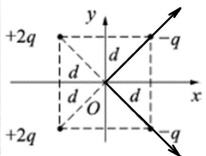
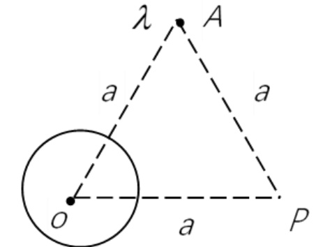
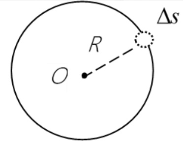
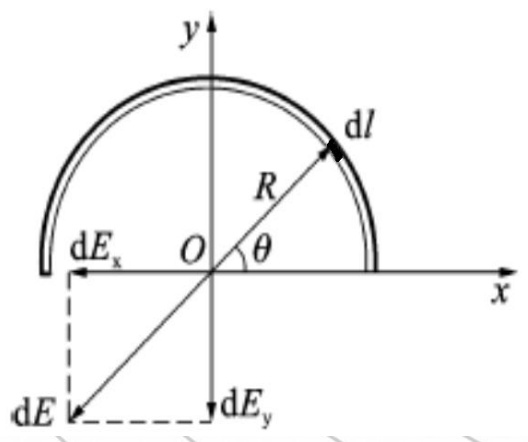
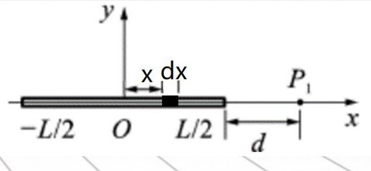
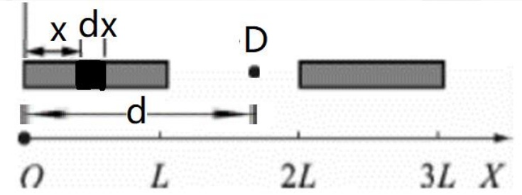
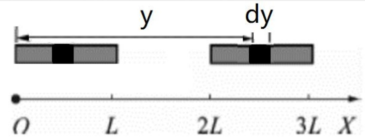

# 14-练习14 库仑定律 电场强度 场强叠加原理

[返回全书目录](../../README.md)

> PDF 页码：103–109

<!-- page: 103 -->

### 练习14 库仑定律 电场强度 场强叠加原理

1. 如图 14.1 所示，四个点电荷分别位于正方形的四个顶点，它们到坐标原点 O 的距离均为 d，则 O 点电场强度的大小  $ E = \underline{\frac{3\sqrt{2}q}{4\pi\varepsilon_{0}d^{2}}} $。

解：场强叠加原理。两对角线上的点电荷的合场强分别沿对角线向右，大小为 $ \frac{3q}{4\pi\varepsilon_{0}d^{2}} $。

此二场强的合场强沿+x方向，大小为 $ \frac{3\sqrt{2}q}{4\pi\varepsilon_{0}d^{2}} $。

图14.1
 

<!-- page: 104 -->

2. 如图 14.2 所示，一电荷线密度为  $ \lambda $ 的无限长带电直线垂直通过纸面上的 A 点，一电量为 Q 的均匀带电球体，其球心处于 O 处。 $ \Delta AOP $ 是边长的 a 的等边三角形。为了使 P 点处场强方向垂直于 OP，则  $ \lambda $ 和 Q 的数量之间应满足  $ Q = \lambda a $ 关系，且  $ \lambda $ 与 Q 为  $ \underline{\text{异}} $ 号电荷。

解：若  $ \lambda $ 和 Q 均为正，则 P 点场强不会与 OP 垂直。因而二者为异号电荷。

要使P点合场强垂直于OP，则 $ \lambda $（设其电荷为负）形成的场强在水平方向的分量大小等于Q在P点的场强大小，即 $ \frac{Q}{4\pi\varepsilon_{0}a^{2}}=\frac{\lambda}{2\pi\varepsilon_{0}a}\cos60^\circ $，解得： $ Q=\lambda a $

<!-- page: 105 -->

3. 真空中一半径为  $ R $ 均匀带电球面如图 14.3 所示，总电量为  $ Q (Q > 0) $，今在球面上挖去非常小的一块面积  $ \Delta S $（连同电荷），且假设不影响原来的电荷分布，则挖去  $ \Delta S $ 后球心处电场强度的大小  $ E = \frac{Q\Delta S}{16\varepsilon_0\pi^2R^4} $ 其方向为从  $ O $ 指向  $ \Delta S $。

解：补偿法：将  $ \Delta S $ 挖去相当于在此处放置面密度大小相同但异号的电荷。因而 0 点的场强就是完整带球面电荷与  $ \Delta S $ 上异号电荷的场强在此处的叠加。

球面电荷在球心处的场强为0， $ \Delta S $上的异号电荷在此处的场强为： $ \frac{\frac{Q}{4\pi R^{2}}\Delta S}{4\pi\varepsilon_{0}R^{2}}=\frac{Q\Delta S}{16\varepsilon_{0}\pi^{2}R^{4}} $，方向从 $ O $指向 $ \Delta S $。

<!-- page: 106 -->

4. 如图 14.4 所示，一半径为 R 的半圆细环上均匀分布电荷 Q，求环心处的电场强度。

解：在半圆细环上取线元$dl$，其电荷$dq = \frac{Q}{\pi R} dl$，此电荷元可视为点电荷，它在点$O$的电场强度$d\overrightarrow{E} = \frac{1}{4\pi\varepsilon_{0}} \frac{dq}{R^{2}} \hat{e}_{R}$，因圆环上电荷对$y$轴呈对称性分布，电场分布也是轴对称的，则有$E_{x} = \int_{l} dE_{x} = 0$，点$O$的合场强$\overrightarrow{E}_{O} = E_{y} \overrightarrow{j} = \int_{l} dE_{y} \overrightarrow{j}$。

 $$ E_{O}=-\int_{l}\frac{1}{4\pi\varepsilon_{0}}\cdot\frac{sin\theta}{R^{2}}\cdot\frac{Q}{\pi R}dl $$ 

由几何关系 $ dl = Rd\theta $，统一积分变量后，有

 $$ E_{0}=-\int_{0}^{\pi}\frac{Q}{4\pi^{2}\varepsilon_{0}R^{2}}sin\theta d\theta=-\frac{Q}{2\pi^{2}\varepsilon_{0}R^{2}} $$ 

方向沿y轴负方向

<!-- page: 107 -->

5. 如图 14.5 所示，均匀带电的细棒，棒长为 L，电荷线密度为  $ \lambda $，求细棒的延长线上与棒的近端相距 d 处  $ \mathrm{P}_{1} $ 点的电场强度。

解：距离原点 x 处取元电荷  $ dq = \lambda dx $，它在  $ P_1 $ 点形成的场强为

 $$ dE=\frac{\lambda dx}{4\pi\varepsilon_{0}(d\quad+L/2-x)^{2}} $$ 

方向沿 x 轴正向。

根据场强叠加原理，所有电荷在 $ P_{1} $点的场强为

 $$ \mathrm{E}=\frac{1}{4\pi\varepsilon_{0}}\int_{-\mathrm{L}/2}^{\mathrm{L}/2}\frac{\lambda\mathrm{d}\mathrm{x}}{(\mathrm{d}+\mathrm{L}/2-\mathrm{x})^{2}}=\frac{\lambda}{4\pi\varepsilon_{0}}\left(\frac{1}{d}-\frac{1}{\mathrm{L}+d}\right) $$ 

<!-- page: 108 -->

6. 如图 14.6 所示，长度为 L 的两匀质细杆平行于 OX 轴放置，相距为 L，两细杆电荷均匀分布，电荷线密度均为  $ \lambda $。求两带电细杆间的电场力大小。

解：首先计算左边段电杆产生的电场的空间分布。距离原点 x 处取元电荷  $ dq = \lambda dx $，在 x 轴上距离原点为  $ d \quad (d > L) $ 的空间点形成的场强为

 $$ d E=\frac{\lambda d x}{4\pi\varepsilon_{0}(d-x)^{2}} $$ 

D点的总场强为

 $$ E=\int_{0}^{L}\frac{\lambda d x}{4\pi\varepsilon_{0}(d-x)^{2}}=\frac{\lambda}{4\pi\varepsilon_{0}}\left(\frac{1}{d-L}-\frac{1}{d}\right) $$

<!-- page: 109 -->

距离原点为y的地方总场强为

 $$ E=\frac{\lambda}{4\pi\varepsilon_{0}}\left(\frac{1}{y-L}-\frac{1}{y}\right) $$ 

距离原点 $ y(2L<y<3L) $处取电荷元 $ dq=\lambda dy $，其所受电场力为

 $$ d F=E d q=\frac{\lambda}{4\pi\varepsilon_{0}}\left(\frac{1}{y-L}-\frac{1}{y}\right)\lambda d y $$ 

则右侧棒受到的合力为

 $$ \begin{aligned}&F=\int_{2L}^{3L}\frac{\lambda}{4\pi\varepsilon_{0}}\left(\frac{1}{y-L}-\frac{1}{y}\right)\lambda dy\\ &=\frac{\lambda^{2}}{4\pi\varepsilon_{0}}ln\left(\frac{4}{3}\right)\\ \end{aligned} $$ 

