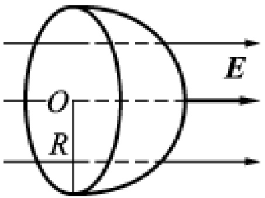
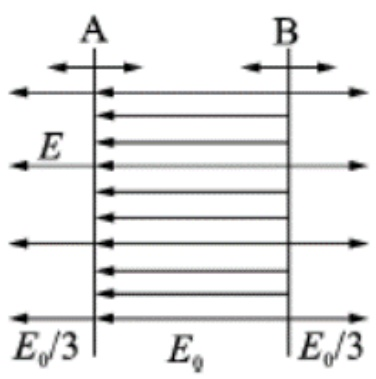
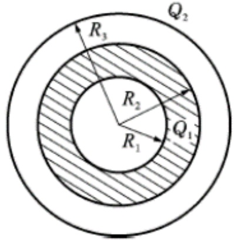
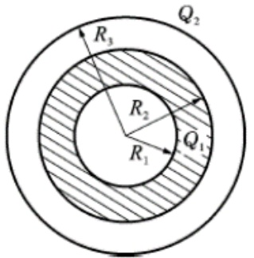
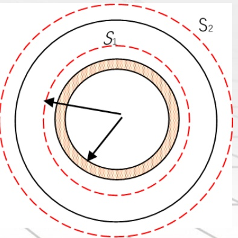
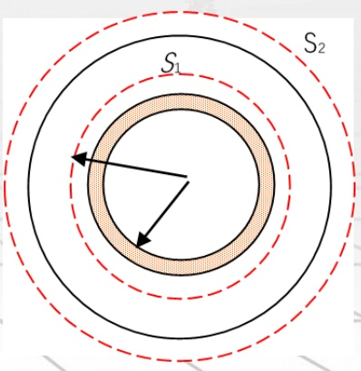
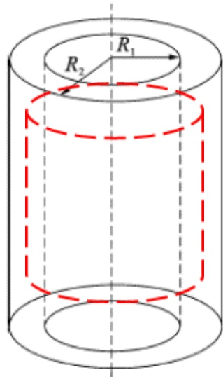
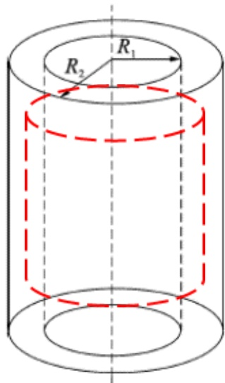

# 15-练习15 电场线 电通量 高斯定理及应用

[返回全书目录](../../README.md)

> PDF 页码：110–118

<!-- page: 110 -->

### 练习15 电场线 电通量 高斯定理及应用

1. （1）点电荷 q 位于一个边长为 a 的立方体中心，则在该点电荷电场中穿过立方体一面的电通量为  $ \frac{q}{6\varepsilon_{0}} $。（2）如果将该场源点电荷移到立方体的的一个角上，这时通过立方体各面的电通量为  $ \underline{0} $、 $ \underline{24\varepsilon_{0}} $。

解：位于立方体中心时，每个面上的通量都相同，为总通量的1/6，即 $ \frac{q}{6\varepsilon_{0}} $。置于一个顶点时，由于电场线掠过共此顶点的3个面，所以此3面上的通量为0，为求其它3各面上的通量，可考虑另有7个同样的立方体拼在一起构成一个较大的立方体。此时，q位于较大立方体的中心，穿过每个大立方体面的通量为 $ \frac{q}{6\varepsilon_{0}} $，而每个大面是由4个小面构成，因此每个小面的通量就是 $ \frac{1}{4}\frac{q}{6\varepsilon_{0}}=\frac{q}{24\varepsilon_{0}} $。

<!-- page: 111 -->

2. 若匀强电场的场强为 $ \overrightarrow{E} $，其方向平行于半径为 R 的半球面的轴，如图 15.1 所示，则通过此半球面的电通量为 $ \underline{\pi R^{2}E} $。

解：通过半球面的电通量与通过半径为 R 的圆平面的电通量相等，故  $ \Phi_{e} = \pi R^{2}E $。

<!-- page: 112 -->

3. 如图 15.2 所示，A、B 为真空中两个平行的“无限大”均匀带电平面，已知两平面间的电场强度为  $ E_{0} $，两平面外侧电场强度大小都是  $ \frac{E_{0}}{3} $，方向如图所示，则平面 A 上的面电荷密度  $ \sigma_{A} = \underline{\frac{-3}{3}\varepsilon_{0}E_{0}} $，平面 B 上的面电荷密度  $ \sigma_{B} = \underline{\frac{4}{3}\varepsilon_{0}E_{0}} $。

解：无限大平面产生的电场强度为 $ E=\frac{\sigma}{2\varepsilon_{0}} $。则 $ E_{A}=\frac{\sigma_{A}}{2\varepsilon_{0}} $， $ E_{B}=\frac{\sigma_{B}}{2\varepsilon_{0}} $

 $$ \left\{\begin{aligned}&\frac{\sigma_{B}}{2\varepsilon_{0}}-\frac{\sigma_{A}}{2\varepsilon_{0}}=E_{0}\\ &\frac{\sigma_{B}}{2\varepsilon_{0}}+\frac{\sigma_{A}}{2\varepsilon_{0}}=\frac{E_{0}}{3}\end{aligned}\right. $$ 

解得  $ \sigma_{A} = -\frac{2}{3}\varepsilon_{0}E_{0} $

 $$ \sigma_{B}=\frac{4}{3}\varepsilon_{0}E_{0} $$ 

<!-- page: 113 -->

4. 如图 15.3 所示，一个内外半径分别为  $ R_{1} $ 和  $ R_{2} $ 的均匀带电球壳，总电荷为  $ Q_{1} $，球壳外同心罩一个半径为  $ R_{3} $ 的均匀带电球面，球面带电荷为  $ Q_{2} $。求空间电场分布。

解：由于电荷呈球对称分布，电场强度也为球对称分布，以球心O为原点，球心至场点的距离r为半径，作同心球面为高斯面，高斯面上电场强度沿径矢方向，且大小相等。由高斯定理

 $$ \oint\overrightarrow{E}\cdot d\overrightarrow{S}=\frac{\Sigma q}{\varepsilon_{0}}, $$ 

可得

 $$ E\cdot4\pi r^{2}=\frac{\Sigma q}{\varepsilon_{0}}。 $$ 

<!-- page: 114 -->

$r<R_{1}$，该高斯面内无电荷，$\sum q=0$，故：$E_{1}=0$；

$R_{1}<r<R_{2}$，高斯面内电荷$\sum q=\frac{Q_{1}(r^{3}-R_{1}^{3})}{R_{2}^{3}-R_{1}^{3}}$，故：$E_{2}=\frac{Q_{1}(r^{3}-R_{1}^{3})}{4\pi\varepsilon_{0}(R_{2}^{3}-R_{1}^{3})r^{2}}$；

$R_{2}<r<R_{3}$，高斯面内电荷$Q_{1}$，故：$E_{3}=\frac{Q_{1}}{4\pi\varepsilon_{0}r^{2}}$；

$r>R_{3}$，高斯面内电荷$Q_{1}+Q_{2}$，故：$E_{4}=\frac{Q_{1}+Q_{2}}{4\pi\varepsilon_{0}r^{2}}$；

电场强度的方向均沿径矢方向。

<!-- page: 115 -->

5. 如图 15.4 所示，半径 R 的非金属球体内，电荷体密度为  $ \rho = kr $，式中 k 为大于零的常量，求：

（1）球体内任意一点的电场强度 $ E_{1}(r) $;

（2）球体外任意一点的电场强度 $ E_{2}(r) $。

解：（1）r<R，建立图示高斯面 $ S_{1} $，其包围的电量：

 $$ q=\int_{0}^{r}\rho\cdot4\pi x^{2}dx=\int_{0}^{r}kx\cdot4\pi x^{2}dx=k\pi r^{4} $$ 

由高斯定理得： $ \Phi_e = \oint_{S1} \vec{E} \cdot d\vec{S} = E \cdot 4\pi r^2 = \frac{q}{\varepsilon_0} = \frac{k\pi r^4}{\varepsilon_0} $

即： $ E(r)=\frac{kr^{2}}{4\varepsilon_{0}} $

<!-- page: 116 -->

（2）r>R，建立图示高斯面 $ S_{2} $，其包围的电量：

 $$ q=\int_{0}^{R}\rho\cdot4\pi x^{2}dx=\int_{0}^{R}kx\cdot4\pi x^{2}dx=k\pi R^{4} $$ 

由高斯定理得： $ \Phi_{e} = \oint_{S1} \overrightarrow{E} \cdot d\overrightarrow{S} = E \cdot 4\pi r^{2} = \frac{q}{\varepsilon_{0}} = \frac{k\pi rR^{4}}{\varepsilon_{0}} $

即： $ E(r) = \frac{kR^{4}}{4\varepsilon_{0}r^{2}} $

电场强度的方向沿失径方向。

<!-- page: 117 -->

6. 如图 15.5 所示，两无限长同轴圆柱面，半径分别为  $ R_1 $ 和  $ R_2 $，带有等量异号电荷，单位长度的电量分别为  $ \lambda $ 和  $ -\lambda $，求离轴线为  $ r $ 处的电场强度：（1） $ r < R_1 $；（2） $ R_1 < r < R_2 $；（3） $ r > R_2 $。

解：根据电荷分布的对称性知，电场关于中心轴成轴对称，且垂直于轴呈辐射

状，因此建立高度为 h 的柱形高斯面（红色）

（1） $ r < R_{1} $

 $$ \phi_{e}=\oint_{S}\overrightarrow{E}\cdot d\overrightarrow{S}=\int_{S_{top}}\overrightarrow{E}\cdot d\overrightarrow{S}+\int_{S_{bottom}}\overrightarrow{E}\cdot d\overrightarrow{S}+\int_{S_{side}}\overrightarrow{E}\cdot d\overrightarrow{S} $$ 

$$=0+0+E\cdot2\pi r h=\frac{\sum q}{\varepsilon_{0}}=0,\text{ 解得 }E=0$$

<!-- page: 118 -->

(2)  $ R_{1} < r < R_{2} $

 $$ \begin{aligned}&\varPhi_{e}=\oint_{S}\overrightarrow{E}\cdot d\overrightarrow{S}=\int_{S_{top}}\overrightarrow{E}\cdot d\overrightarrow{S}+\int_{S_{bottom}}\overrightarrow{E}\cdot d\overrightarrow{S}+\int_{S_{side}}\overrightarrow{E}\cdot d\overrightarrow{S}\\ &=0+0+E\cdot2\pi r h=\frac{\sum q}{\varepsilon_{0}}=\frac{h\lambda}{\varepsilon_{0}},\  解得 \ E=\frac{\lambda}{2\pi\varepsilon_{0}r}\\ & 电场强度的方向垂直于圆柱面的轴 ,\  呈向外辐射状。\\ \end{aligned} $$ 

（3） $ r > R_{2} $  $ \sum q = 0 $，所以  $ E = 0 $

