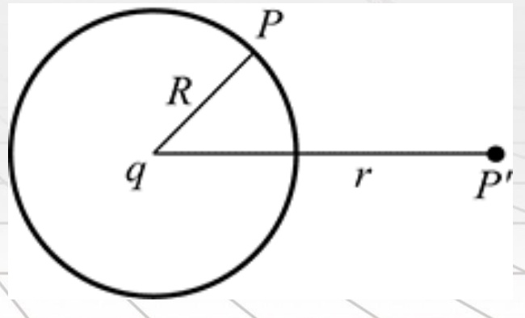
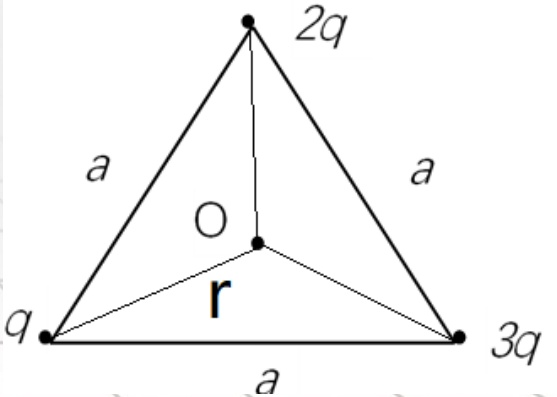
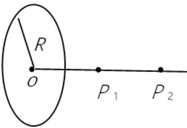
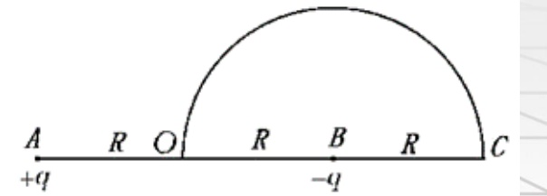
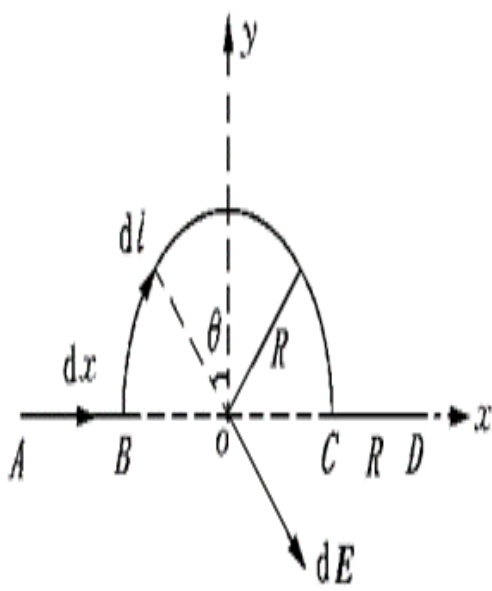
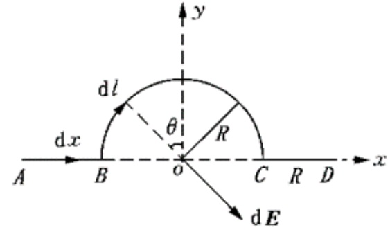
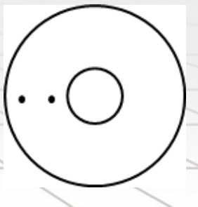

# 16-练习16 静电场的环路定理 电势能 电势 电势差

[返回全书目录](../../README.md)

> PDF 页码：119–125

<!-- page: 119 -->

### 练习16 静电场的环路定理 电势能 电势 电势差

1. 如图 16.1 所示，在点电荷  $ q $ 的电场中，选取以  $ q $ 为中心、 $ R $ 为半径的球面上一点  $ P $ 处作电势零点，则与点电荷  $ q $ 距离为  $ r $ 的  $ P' $ 点的电势为： $ \frac{q}{4\pi\varepsilon_{0}}\left(\frac{1}{r}-\frac{1}{R}\right) $。

解： $ u_{P'} = \int_{P'} \overrightarrow{E} \cdot d\overrightarrow{l} = \int_{r}^{R} \frac{1}{4\pi\varepsilon_{0}} \frac{q}{r^{2}} \overrightarrow{r} \cdot dr \overrightarrow{r} = \frac{q}{4\pi\varepsilon_{0}} \left( \frac{1}{r} - \frac{1}{R} \right) $

<!-- page: 120 -->

2. 如图 16.2 所示，一等边三角形边长为  $ a $，三个顶点分别放置着电量为  $ q $、 $ 2q $、 $ 3q $ 的三个正点电荷，设无穷远处为电势零点，则三角形中心 O 处的电势  $ U_{O}=\underline{\frac{3\sqrt{3}q}{2\pi\varepsilon_{0}a}} $。

解： $ r=\frac{\sqrt{3}a}{3} $，由电势叠加原理，

 $$ \begin{aligned}U_{O}&=\frac{q}{4\pi\varepsilon_{0}r}+\frac{2q}{4\pi\varepsilon_{0}r}+\frac{3q}{4\pi\varepsilon_{0}r}\text{=}\frac{3q}{2\pi\varepsilon_{0}r}\\&=\frac{3\sqrt{3}q}{2\pi\varepsilon_{0}a}\text{。}\end{aligned} $$ 

<!-- page: 121 -->

3. 如图16.3所示，半径为R的均匀带电圆环，环的中心上两点 $ P_{1} $和 $ P_{2} $分别离开环心的距离为R和2R，若无穷远的电势为零，而 $ P_{1} $和 $ P_{2} $两点的电势分别为 $ U_{1} $和 $ U_{2} $，则： $ U_{2}/U_{1} $的值为 $ \frac{\sqrt{2}}{\sqrt{5}} $。

解：带电圆环轴线上一点的电势： $ U_{x} = \frac{q}{4\pi\varepsilon_{0}\sqrt{R^{2} + x^{2}}} $，

可得： $ \frac{U_{2}}{U_{1}}=\frac{\sqrt{2}}{\sqrt{5}} $。

<!-- page: 122 -->

4. 如图 16.4 所示，在 A、B 两点处有电量分别为 +q、-q 的点电荷，A 和 B 之间距离为 2R，现将另一正试验电荷  $ q_{0} $ 从 O 点经半圆弧路径移到 C 点，求移动过程中电场力所做的功。

解：O点的电势： $ U_{O}=\frac{q}{4\pi\varepsilon_{0}R}+\frac{-q}{4\pi\varepsilon_{0}R}=0 $。

C点的电势： $ U_{C} = \frac{q}{4\pi\varepsilon_{0}\cdot3R} + \frac{-q}{4\pi\varepsilon_{0}R} = -\frac{q}{6\pi\varepsilon_{0}R} $

移动过程中电场力所做的为:

 $$ A_{O\to C}=(U_{O}-U_{C})q_{0}=\frac{q q_{0}}{6\pi\varepsilon_{0}R} $$ 

<!-- page: 123 -->

5. 如图 16.5 所示，绝缘细线上均匀分布着线密度为  $ \lambda $ 的正电荷，两直导线 AB、CD 的长度和半圆环的半径都等于 R。试求环中心 O 点处的电场强度和电势。

解：（1）AB 段在 O 点的场强为  $ E_{AB} = \frac{\lambda}{8\pi\varepsilon_{0}R} $，沿着 x 轴正向；CD 段在 O 点的和场强  $ E_{CD} = \frac{\lambda}{8\pi\varepsilon_{0}R} $，沿着 x 轴负向，二者在 O 点的合场强为 0。所以 O 点的场强即为半圆环 BC 在 O 点的场强： $ E = E_{BC} = \frac{\lambda}{2\pi\varepsilon_{0}R} $，方向沿着 y 轴负向。

<!-- page: 124 -->

（2）求电势：AB 段在 0 点的电势为

 $$ U_{O}^{(A B)}=\int_{R}^{2R}\frac{\lambda d x}{4\pi\varepsilon_{0}x}=\frac{\lambda}{4\pi\varepsilon_{0}}l n2 $$ 

CD段在O点的电势为

 $$ U_{O}^{(C D)}=\int_{R}^{2R}\frac{\lambda d x}{4\pi\varepsilon_{0}x}=\frac{\lambda}{4\pi\varepsilon_{0}}l n2 $$ 

BC段在O点的电势为  $ U_{O}^{(BC)}=\int_{0}^{\pi R}\frac{\lambda dl}{4\pi\varepsilon_{0}R}=\frac{\lambda}{4\varepsilon_{0}} $

O点的电势为

 $$ U=U_{o}^{(AB)}+U_{o}^{(BC)}+U_{o}^{(CD)}=\frac{\lambda}{2\pi\varepsilon_{0}}ln2+\frac{\lambda}{4\varepsilon_{0}} $$

<!-- page: 125 -->

6. 有两个同轴圆柱面，内圆柱面半径为  $ R_{1} $，电势为  $ U_{1} $，外圆柱面半径为  $ R_{2} $，电势为  $ U_{2} $，求两圆柱面间距轴线垂直距离为  $ r_{1} $ 和  $ r_{2} $ 两点的电势差。

解：设内圆柱上电荷线密度为  $ \lambda $，两圆柱间的场强为  $ E = \frac{\lambda}{2\pi\varepsilon_0r} $

两圆柱间的电势差为  $ \Delta U = U_1 - U_2 = \frac{\lambda}{2\pi\varepsilon_0}\int_{R_1}^{R_2}\frac{1}{r}dr = \frac{\lambda}{2\pi\varepsilon_0}ln\frac{R_2}{R_1} $

解得  $ \lambda = \frac{2\pi\varepsilon_0(U_1 - U_2)}{ln\frac{R_2}{R_1}} $

则两圆柱面间距轴线垂直距离为 $ r_{1} $和 $ r_{2} $两点的电势差为

 $$ \Delta U=\frac{\lambda}{2\pi\varepsilon_{0}}\int_{r_{1}}^{r_{2}}\frac{1}{r}dr=\left(U_{1}-U_{2}\right)ln\frac{r_{2}}{r_{1}}/ln\frac{R_{2}}{R_{1}} $$ 

