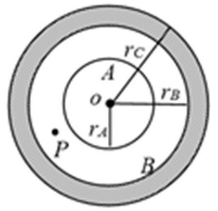
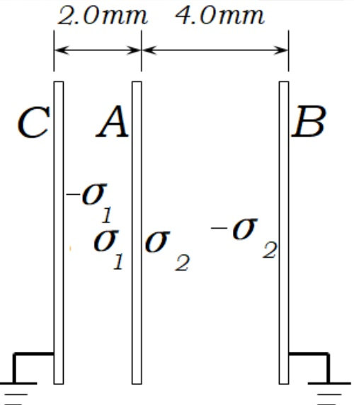
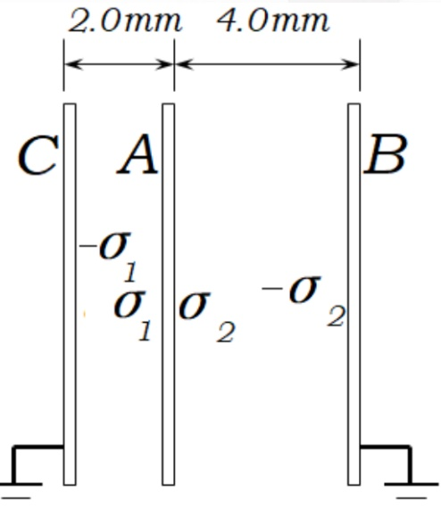
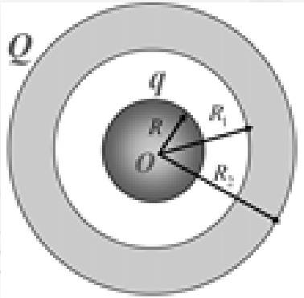
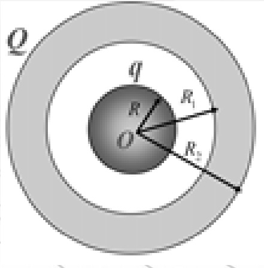

# 17-练习17 静电场中的导体

[返回全书目录](../../README.md)

> PDF 页码：126–134

<!-- page: 126 -->

### 练习17 静电场中的导体

1. 在电量为+q 的点电荷电场中放入一不带电的金属球，从球心 O 到点电荷所在处的矢径为 r，则金属球的感应电荷净电量  $ q' = \underline{\frac{O}{4\pi\varepsilon_{0}r^{2}}} $，这些感应电荷在球心 O 处建立的电场强度  $ E = \underline{\frac{q}{4\pi\varepsilon_{0}r^{2}}}\hat{r} $。

解：净电量为  $ q'=0 $

静电平衡时，金属球内场强E=0，即：

 $$ \vec{E}=-\frac{q}{4\pi\varepsilon_{0}r^{2}}\hat{r}+\vec{E}=0 $$ 

所以， $ \vec{E} = \frac{q}{4\pi\varepsilon_{0}r^{2}}\hat{r} $

<!-- page: 127 -->

2. 一带电量为 q，半径为  $ r_{A} $ 的金属球 A，与一原先不带电、内外半径分别为  $ r_{B} $ 和  $ r_{C} $ 的金属球壳 B 同心放置，如图 17.1 所示，则图中 P 点的电场强度  $ \underline{E_{P}=\frac{q}{4\pi\varepsilon_{0}r_{P}^{2}}} $；若用导线将 A 和 B 连接起来，则 A 球的电势  $ U=\underline{\frac{q}{4\pi\varepsilon_{0}r_{C}}} $。

（设无穷远处电势为零）

解：利用高斯定理可求得P点的电场强度为

 $$ \vec{E}_{\mathrm{~p~}}=\frac{q}{4\pi\varepsilon_{0}{r_{P}}^{2}}\hat{r} $$ 

用导线连接后，称为单一导体，此时电荷分布于球壳外表面，A和B电势相等，为

 $$ U=\frac{q}{4\pi\varepsilon_{0}r_{c}} $$ 

<!-- page: 128 -->

3. 有两个大小不相同的金属球，大球直径是小球的两倍，大球带电，小球不带电，两者相距很远。今用细长导线将两者相连，在忽略导线的影响下，大球与小球的带电之比为 $ \underline{2:1} $。

解：两球连接后为等势体，由于两球相距很远，电荷在金属球表面均匀分布，有：

 $$ U_{ 大球 }=\frac{q_{ 大 }}{4\pi\varepsilon_{0}r_{ 大 }}=U_{ 小球 }=\frac{q_{ 小 }}{4\pi\varepsilon_{0}r_{ 小 }} $$ 

 $$ \Longrightarrow\frac{q_{ 大 }}{q_{ 小 }}=\frac{R_{ 大 }}{R_{ 小 }}=2{:}1 $$

<!-- page: 129 -->

4. 如图 17.2 所示，三个平行金属板 A、B、C，面积均为  $ S=200\mathrm{~cm}^{2} $，A、B 间相距  $ d_{1}=4\mathrm{~mm} $，A、C 间相距  $ d_{2}=2\mathrm{~mm} $，B 和 C 两板都接地。如果使 A 板带正电  $ q=3.0*10^{-7}\mathrm{~C} $，求：（1）B、C 板上感应电荷；（2）A 板电势。

解 ①令A板左侧电荷面密度为  $ \sigma_{1} $，右侧为  $ \sigma_{2} $

B、C 板感应电量分别为  $ q_{B} $ 、  $ q_{C} $

 $$ \because\boldsymbol{U}_{_{AC}}=\boldsymbol{U}_{_{AB}}\quad\therefore\boldsymbol{E}_{_{AC}}\boldsymbol{d}_{_{AC}}=\boldsymbol{E}_{_{AB}}\boldsymbol{d}_{_{AB}} $$ 

且： $ \sigma_{1}+\sigma_{2}=\frac{q_{A}}{S} $

得： $ \sigma_{1}=\frac{2q_{A}}{3S}\quad\sigma_{2}=\frac{q_{A}}{3S} $

<!-- page: 130 -->

4. 如图 17.2 所示，三个平行金属板 A、B、C，面积均为  $ S=200\mathrm{~cm}^{2} $，A、B 间相距  $ d_{1}=4\mathrm{~mm} $，A、C 间相距  $ d_{2}=2\mathrm{~mm} $，B 和 C 两板都接地。如果使 A 板带正电  $ q=3.0*10^{-7}\mathrm{~C} $，求：（1）B、C 板上感应电荷；（2）A 板电势。

而： $ q_c = -\sigma_1 S = -\frac{2}{3} q_A = -2 \times 10^{-7} c $

 $$ q_{_B}=-\sigma_{_2}S=-\frac{1}{3}q_{_A}=-1\times10^{-7}c $$ 

$$  \therefore q_{c}=-2\times10^{-7}c\quad q_{B}=-1\times10^{-7}c   \tag*{②}$$

 $$ \begin{aligned}U_{_{A}}&=E_{_{AC}}d_{_{AC}}=\frac{\sigma_{_{1}}}{\varepsilon_{_{0}}}d_{_{AC}}(=E_{_{AB}}d_{_{AB}}=\frac{\sigma_{_{2}}}{\varepsilon_{_{0}}}d_{_{AB}})\\&=2.3\times10^{3}V\end{aligned} $$ 

<!-- page: 131 -->

5. 如图 17.3 所示，半径为 R 的导体球外罩一个内外半径分别为  $ R_{1} $ 和  $ R_{2} $ 的同心导体球壳。若球和球壳分别带有电荷 q 和 Q，试求导体球和球壳的电势。

解：导体电荷分布在表面，内部导体球表面带 $ \mathbf{q} $的电量，外球壳内外表面分别带 $ -\mathbf{q} $和 $ \mathbf{Q}-\mathbf{q} $的电量。由高斯定理可得场强分布为：

 $$ E=\left\{\begin{aligned}&0&r&\prec R,\ R_{1}\prec r\prec R_{2}\\ &q\Big/\left(4\pi\varepsilon_{0}r^{2}\right)&R&\prec r\prec R_{1}\\ &\left(Q+q\right)\Big/\left(4\pi\varepsilon_{0}r^{2}\right)&R_{2}&\prec r\\ \end{aligned}\right. $$ 

<!-- page: 132 -->

5. 如图 17.3 所示，半径为 R 的导体球外罩一个内外半径分别为  $ R_{1} $ 和  $ R_{2} $ 的同心导体球壳。若球和球壳分别带有电荷 q 和 Q，试求导体球和球壳的电势。

导体球是等势体，导体球电势即为球心电势

 $$ \begin{aligned}U_{ 导体球 }=&\int\limits_{0}^{\infty}\vec{E}\cdot d\vec{r}=\int\limits_{0}^{R}\vec{E}\cdot d\vec{r}+\int\limits_{R}^{R_{1}}\vec{E}\cdot d\vec{r}+\int\limits_{R_{1}}^{R_{2}}\vec{E}\cdot d\vec{r}+\int\limits_{R_{2}}^{\infty}\vec{E}\cdot d\vec{r}\\ =&\frac{q}{4\pi\varepsilon_{0}}(\frac{1}{R}-\frac{1}{R_{1}})+\frac{1}{4\pi\varepsilon_{0}}\frac{q+Q}{R_{2}}\end{aligned} $$ 

球壳的电势

 $$ U_{ 球壳 }=\int\limits_{R_{2}}^{\infty}\vec{E}\cdot d\vec{r}=\frac{1}{4\pi\varepsilon_{0}}\frac{q+Q}{R_{2}} $$ 

<!-- page: 133 -->

6. 两个半径分别为  $ R_1 $ 和  $ R_2 $ （ $ R_1 < R_2 $）的同心薄金属球壳，现给内球壳带电+q，试计算：（1）外球壳上的电荷分布及电势大小；

（2）先把外球壳接地，然后断开接地线，此时外球壳的电荷分布及电势；

（3）再使内球壳接地，此时内球壳上的电荷分布以及外球壳上的电势改变量。

解：(1) 外球壳内表面均匀带-q，外内表面均匀带+q

 $$ U_{_{R_{2}}}=\int_{^{R_{2}}}^{\infty}\frac{q}{4\pi\varepsilon_{_{0}}r^{^{2}}}\mathrm{d}r=\frac{q}{4\pi\varepsilon_{_{0}}R_{_{2}}} $$ 

(2) 外壳接地时，外表面 +q 电荷入地，外表面不带电，内表面电荷为 -q.

 $$ \boldsymbol{U}_{R_{2}}=\mathbf{0} $$ 

(3) 设此时内球壳带电量为  $ q' $，外球壳内表面均匀带  $ -q' $，外内表面均匀带  $ q' - q $，

此时电场分布为：

 $$ E=\left\{\begin{aligned}&0&r&\prec R_{1}\\ &q^{\prime}\Big/\Big(4\pi\varepsilon_{0}r^{2}\Big)&R_{1}&\prec r\prec R_{2}\\ &\big(q^{\prime}-q\big)\Big/\Big(4\pi\varepsilon_{0}r^{2}\Big)&R_{2}&\prec r\end{aligned}\right. $$

<!-- page: 134 -->

6. 两个半径分别为  $ R_1 $ 和  $ R_2 $ （ $ R_1 < R_2 $）的同心薄金属球壳，现给内球壳带电+q，试计算：（1）外球壳上的电荷分布及电势大小；

（2）先把外球壳接地，然后断开接地线，此时外球壳的电荷分布及电势；

（3）再使内球壳接地，此时内球壳上的电荷分布以及外球壳上的电势改变量。

内球壳电势：

 $$ U_{_{R_{1}}}=\int_{^{R_{1}}}^{R_{2}}\frac{q^{\prime}}{4\pi\varepsilon_{0}r^{2}}\mathrm{d}r+\int_{^{R_{2}}}^{\infty}\frac{q^{\prime}-q}{4\pi\varepsilon_{0}r^{2}}\mathrm{d}r=\frac{q^{\prime}}{4\pi\varepsilon_{0}}\left(\frac{1}{R_{1}}-\frac{1}{R_{2}}\right)+\frac{q^{\prime}-q}{4\pi\varepsilon_{0}R_{2}}=0 $$ 

由此

 $$ q^{\prime}=\frac{R_{1}}{R_{2}}q $$ 

 $$ U_{R_{2}}^{\prime}=\int_{R_{2}}^{\infty}\frac{q^{\prime}-q}{4\pi\varepsilon_{0}r^{2}}\mathrm{d}r=\frac{q^{\prime}-q}{4\pi\varepsilon_{0}R_{2}}=\frac{q\left(R_{1}-R_{2}\right)}{4\pi\varepsilon_{0}R_{2}^{2}} $$ 

外壳电势改变量 $ \Delta U = U'_{R_2} - 0 = \frac{q(R_1 - R_2)}{4\pi\varepsilon_0 R_2^2} $

