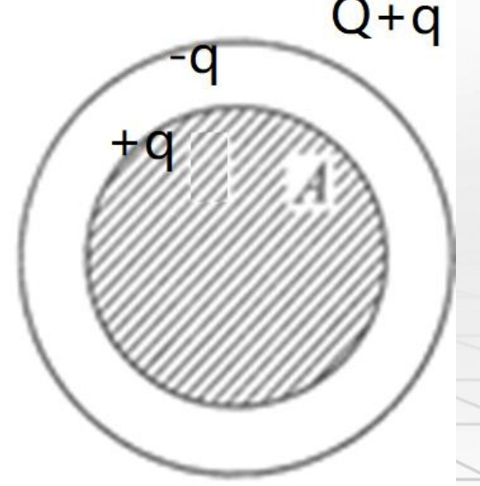
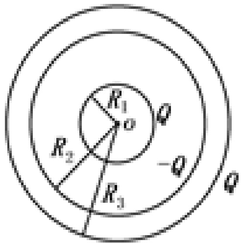
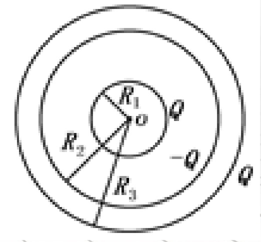
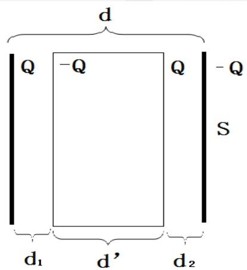
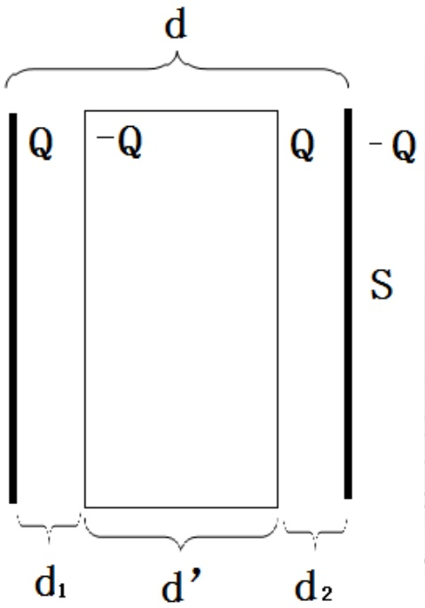
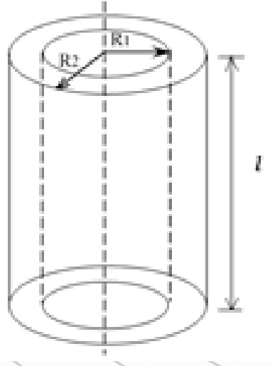

# 18-练习18 电容和电容器 静电场的能量

[返回全书目录](../../README.md)

> PDF 页码：135–142

<!-- page: 135 -->

### 练习18 电容和电容器 静电场的能量

1. 如图18.1所示，金属球A与同心球壳B组成电容器，球A带电荷q，壳B带电荷Q，测得球与壳间电势差为 $ U_{AB} $，可知该电容器的电容值为 $ \underline{\text{\frac{q}{H}}} $。

解：根据电容器的电容公式

 $$ C=\frac{q}{U} $$ 

公式中电容带电量由球A电量q决定。U为球与壳间电势差 $ U_{AB} $，所以电容器的电容值为

 $$ C=\frac{q}{U_{AB}} $$ 

<!-- page: 136 -->

2. 极板面积为 S 的空气平行板电容器，极板上分别带电量 +q、-q，若不考虑边缘效应，则两极板间的相互作用力为  $ \underline{\text{2}} $  $ \frac{q^{2}}{2\varepsilon_{0}S} $。

解：两极板不能看作点电荷。两极板间的相互作用力大小等于将一个极板视为场源，另一极板在此电场中所受的电场力。

+q板在空间产生的场强为  $ E = \frac{q}{2\varepsilon_{0}S} $，在-q板上取电荷元dq’，其受力dF=Edq’，-q板的受力为

 $$ F=\int Edq^{\prime}=E\int_{0}^{q}dq^{\prime}=Eq=\frac{q^{2}}{2\varepsilon_{0}S} $$

<!-- page: 137 -->

3.真空中，半径为  $ R_{1} $ 和  $ R_{2} $ 的两个导体球，相距很远，则两球的电容之比  $ \mathrm{C}_{1}/\mathrm{C}_{2}=\frac{R_{1}/R_{2}}{4\pi\varepsilon_{0}(R_{1}+R_{2})} $。当用细长导线将两球相连后，电容  $ \mathrm{C}= $

解：两导体球相距很远时可以看成是两个孤立的导体球，球形电容器

 $ C = 4\pi\varepsilon_{0}R \propto R $，则 $ C_{1}/C_{2} = R_{1}/R_{2} $

两球相连后，设两球带的总电量为Q，有

 $ \frac{q_{1}}{q_{2}}=\frac{R_{1}}{R_{2}} $，且 $ q_{1}+q_{2}=Q $，则 $ q_{1}=\frac{R_{1}}{R_{1}+R_{2}}Q $

连接体的电势为： $ U=\frac{q_{1}}{4\pi\varepsilon_{0}R_{1}}=\frac{Q}{4\pi\varepsilon_{0}(R_{1}+R_{2})} $

所以 $ C=\frac{Q}{U}=4\pi\varepsilon_{0}(R_{1}+R_{2}) $

<!-- page: 138 -->

4. 如图 18.2 所示，半径为  $ R_{1}=2.0\mathrm{~cm} $ 的导体球，外套有一同心的导体球壳，壳的内、外半径分别为  $ R_{2}=4.0\mathrm{~cm} $ 和  $ R_{3}=5.0\mathrm{~cm} $，当内球带电荷 C 时，求：（1）整个电场储存的能量；（2）当导体球壳接地时储存的能量；

（3）此电容器的电容值。

解：

 $$ \left\{\begin{array}{l l}{E_{1}=0}&{(r<R_{1})}\\ {E_{2}=\displaystyle\frac{Q}{4\pi\varepsilon_{0}r^{2}}}&{(R_{1}<r<R_{2})}\\ {E_{3}=0}&{(R_{2}<r<R_{3})}\\ {E_{4}=\displaystyle\frac{Q}{4\pi\varepsilon_{0}r^{2}}}&{(R_{3}<r)}\end{array}\right. $$ 

 $$ \left\{\begin{array}{ll}\omega_{\mathrm{e}1}=0&(r<R_{1})\\\omega_{e2}=\frac{Q^{2}}{32\pi^{2}\varepsilon_{0}r^{4}}&(R_{1}<r<R_{2})\\\omega_{\mathrm{e}3}=0&(R_{2}<r<R_{3})\\\omega_{\mathrm{e}4}=\frac{Q^{2}}{32\pi^{2}\varepsilon_{0}r^{4}}&(R_{3}<r)\end{array}\right. $$ 

<!-- page: 139 -->

$$ \begin{aligned}&（1）W_{\mathrm{e}}=\int\mathrm{d}W_{\mathrm{e}}=\frac{Q^{2}}{8\pi\varepsilon_{0}}\int_{\mathrm{R}_{1}}^{\mathrm{R}_{2}}\frac{\mathrm{d}r}{r^{2}}+\frac{Q^{2}}{8\pi\varepsilon_{0}}\int_{\mathrm{R}_{3}}^{\infty}\frac{\mathrm{d}r}{r^{2}}\\ &=\frac{Q^{2}}{8\pi\varepsilon_{0}}(\frac{1}{R_{1}}-\frac{1}{R_{2}})+\frac{Q^{2}}{8\pi\varepsilon_{0}}\frac{1}{R_{3}}=1.82\times10^{-4}J\\ \end{aligned} $$ 

 $$ 2)W_{e}=\frac{Q^{2}}{8\pi\varepsilon_{0}}\int_{R_{1}}^{R_{2}}\frac{dr}{r^{2}}=\frac{Q^{2}}{8\pi\varepsilon_{0}}(\frac{1}{R_{1}}-\frac{1}{R_{2}})=1.01\times10^{-4}J $$ 

 $$ (3)C=\frac{2W}{Q^{2}}=4\pi\varepsilon_{0}\frac{R_{1}R_{2}}{R_{2}-R_{1}}=4.45\times10^{-12}F $$ 

<!-- page: 140 -->

5. 有一空气平板电容器，极板面积均为 S，两板间距为 d。今以厚度为  $ d' $ 的铜板平行地插入电容器，计算：

（1）此时电容器的电容，铜板离极板的距离对这一结果有无影响？

（2）现使电容器充电到两极板的电势差为  $ U_{0} $ 后与电源断开，再把铜板从电容器中抽出，外力需做多少功?

解：

 $$ \begin{aligned}&(1)C_{ 总 }=\frac{Q}{U_{ 总 }}=\frac{Q}{U_{1}+U_{2}}=\frac{C_{1}C_{2}}{C_{1}+C_{2}}\\ &=\frac{\varepsilon_{0}S}{d_{1}+d_{2}}=\frac{\varepsilon_{0}S}{d-d^{^{\prime}}}\\ \end{aligned} $$ 

铜板离极板间的距离对这一结果无影响

<!-- page: 141 -->

(2) $ W=W_{2}-W_{1} $

抽出前： $ W_{1}=0.5C_{总}U_{0}^{2}=0.5\frac{\varepsilon_{0}S}{d-d},U_{0}^{2} $

抽出后： $ W_{2}=0.5CU^{2} $

 $$ \boldsymbol{C}_{ 总 }\boldsymbol{U}_{0}=\boldsymbol{C}\boldsymbol{U} $$ 

 $$ \Longrightarrow W_{2}=0.5\frac{\varepsilon_{0}S d}{\left(d-d^{^{\prime}}\right)^{2}}U_{0}^{2} $$ 

 $$ \therefore W=W_{2}-W_{1}=0.5\frac{\varepsilon_{0}S d^{^{\prime}}}{(d-d^{^{\prime}})^{2}}U_{0}^{2} $$ 

<!-- page: 142 -->

6. 圆柱形电容器由半径为  $ R_{1} $ 的导线和与它同轴的导体圆筒构成。圆筒内半径为  $ R_{2} $，其间为真空，长为  $ \ell $，如图 18.3 所示。设沿轴线单位长度上导线电荷线密度为  $ \lambda $，圆筒电荷线密度为  $ -\lambda $，忽略边缘效应，试求：

（1）电容器储存的能量；（2）电容器的电容。

解： $ E = \frac{\lambda}{2\pi \varepsilon_0 r} $ ( $ R_1 < r < R_2 $)

 $$ U=\frac{\lambda}{2\pi\varepsilon_{0}}\int_{R_{1}}^{R_{2}}\frac{\mathrm{d}r}{r}=\frac{\lambda}{2\pi\varepsilon_{0}}\ln\frac{R_{2}}{R_{1}} $$ 

 $$ W_{\mathrm{e}}=\frac{1}{2}\lambda l U=\frac{\lambda^{2}l}{4\pi\varepsilon_{0}}\ln\frac{R_{2}}{R_{1}} $$ 

(2)

 $$ \mathrm{C}=\frac{\lambda l}{U}=\frac{\lambda l}{\frac{\lambda}{2\pi\varepsilon_{0}}\ln\frac{R_{2}}{R_{1}}}=\frac{2\pi\varepsilon_{0}l}{\ln\frac{R_{2}}{R_{1}}} $$ 

