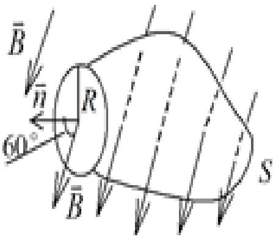
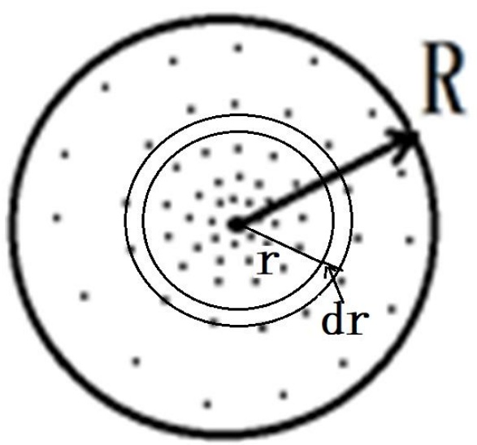
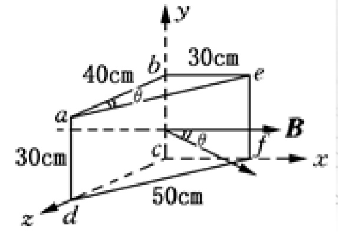
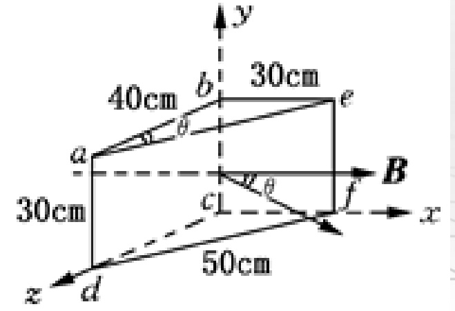
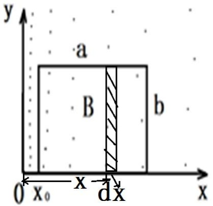

# 19-练习19 磁感应强度 磁通量 磁场中的高斯定理

[返回全书目录](../../README.md)

> PDF 页码：143–149

<!-- page: 143 -->

### 练习19 磁感应强度 磁通量 磁场中的高斯定理

1. 一磁场的磁感强度为  $ \overrightarrow{B} = a\overrightarrow{i} + b\overrightarrow{j} + c\overrightarrow{k} $ (SI)，则通过一半径为 R，开口向 z 轴正方向的半球壳表面的磁通量的大小为  $ \underline{\pi R^{2}c} $ Wb。

解：均匀磁场中，穿过平面的磁通量

 $$ \phi~=~\vec{B}\cdot\vec{S} $$ 

 $$ \begin{array}{l}\phi=\left(\mathrm{a}\overrightarrow{\mathrm{i}}+\mathrm{b}\overrightarrow{\mathrm{j}}+\mathrm{c}\overrightarrow{\mathrm{k}}\right)\cdot\mathrm{s}\overrightarrow{\mathrm{k}}\\=\mathrm{c}\mathrm{s}=\pi\mathrm{R}^{2}c\end{array} $$

<!-- page: 144 -->

2. 在匀强磁场 中，取一半径为 R 的圆，圆面的法线  $ \overrightarrow{n} $ 与  $ \overrightarrow{B} $ 成  $ 60^{\circ} $ 角，如图 19.1 所示，则通过以该圆周为边线的如图所示的任意曲面 S 的磁通量  $ \phi_{\mathrm{m}} = \iint \overrightarrow{B} \cdot d\overrightarrow{S} = \frac{1}{2} B \pi R^{2} $。

解：曲面S和圆面构成闭合曲面，它们的磁通量之和为零均匀磁场中，穿过平面的磁通量

 $$ \phi=\vec{B}\cdot\vec{S} $$ 

通过圆面的磁通量为

 $$ \phi~=~B S\cos60^{\circ}~=~\frac{1}{2}B\pi R^{2} $$ 

通过曲面的磁通量为

 $$ \phi_{_{m}}=\iint\vec{B}\cdot d\vec{S}\;=\;-\frac{1}{2}B\pi R^{2} $$ 

任意曲面
 

<!-- page: 145 -->

3. 由于磁力线是 $ \underline{\text{闭合}} $曲线，所以对于任意闭合曲面，磁通量 $ \underline{0} $，表明磁场是 $ \underline{\text{无源}} $场。

解：略

<!-- page: 146 -->

4. 如图 19.2 所示，半径为 R = 1.2cm 的圆内有一垂直于纸面向外的非均匀磁场  $ B = \frac{k}{r} + 2 $，其中 k 是常数，求此圆面的磁通量是多少？

解：依题意，磁场为非均匀磁场，如图所示在距离圆心r处做一宽度为dr的环带，

环带内磁场视为均匀磁场，环带磁通量

 $ d\phi $ 积分即可求得圆面的磁通量。

通过圆面的磁通量为

 $$ \begin{aligned}\phi^{\prime}&=\iint\limits_{s}\vec{B}\cdot d\vec{S}=\int_{0}^{R}\left(\frac{k}{r}+2\right)\times2\pi r dr\\&=2\pi kR+2\pi R^{2}\end{aligned} $$ 

<!-- page: 147 -->

5. 如图 19.3 所示. 三角形柱体置于均匀磁场中, 已知磁感应强度大小 B=2.0Wb.m^{-2}, 方向沿 x 轴正方向, 边长 ab=40cm, da=30cm, be=30cm, df=50cm。试求: (1) 通过图中 abcd 面的磁通量; (2) 通过图中 befc 面的磁通量; (3) 通过图中 adfe 面的磁通量。

解：(1)由于abcd面与磁场垂直，磁场与面积夹角的余弦 $ \cos\Phi=-1 $，所以通过abcd面的磁通为：

 $$ \phi_{1}=\overrightarrow{B}\cdot\overrightarrow{S}_{1}=-2.0\times0.3\times0.4=-0.24Wb $$ 

(2) 由于 befc 面与磁场平行，通过该面的磁通量为:

 $$ \phi_{2}=\vec{B}\cdot\vec{S}_{2}=0Wb $$ 

<!-- page: 148 -->

5. 如图 19.3 所示. 三角形柱体置于均匀磁场中, 已知磁感应强度为 2.0T, 方向沿 x 轴正方向, 边长 ab=40cm, da=30cm, be=30cm, df=50cm。试求: (1) 通过图中 abcd 面的磁通量; (2) 通过图中 bcfe 面的磁通量; (3) 通过图中 adfe 面的磁通量。

(3)如图，由于adfe面与磁场方向夹角为 $ \theta $，所以通过面积的磁通量为：

 $$ \begin{aligned}&\phi_{3}=\vec{B}\cdot\vec{S}_{3}=2.0\times0.3\times0.5\times\cos\theta\\ &=2.0\times0.3\times0.5\times\frac{4}{5}=0.24Wb\\ \end{aligned} $$ 

<!-- page: 149 -->

6. 如图 19.4 所示，在 x0y 平面第一象限内有一长为 a、宽为 b 的矩形回路处于非均匀磁场中，磁场的大小  $ B = \frac{k}{x^{2}} $，方向垂直纸面向外，则该矩形回路的磁通量为多少？

解：依题意，磁场为非均匀磁场，如图所示在距离y轴x处做一宽度为dx的窄带，窄带内磁场视为均匀磁场，窄带磁通量 $ d\phi $积分即可求得矩形回路的磁通量。

通过矩形回路的磁通量为

 $$ \begin{aligned}\phi^{\prime}&=\iint\limits_{s}\vec{B}\cdot d\vec{S}=\int_{x_{0}}^{x_{0}+a}(\frac{k}{x^{2}})\times bdx\\&=\frac{kb}{x_{0}}-\frac{kb}{x_{0}+a}\end{aligned} $$ 

