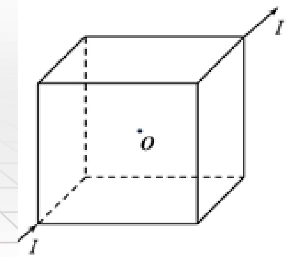
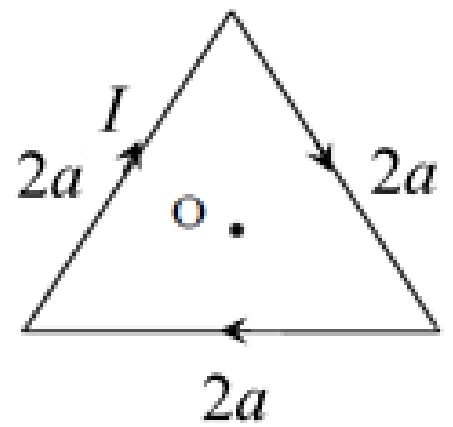
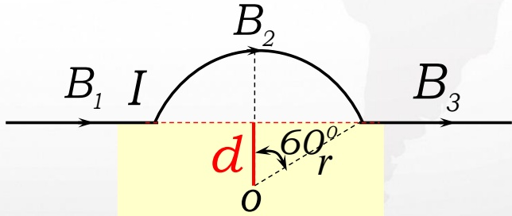
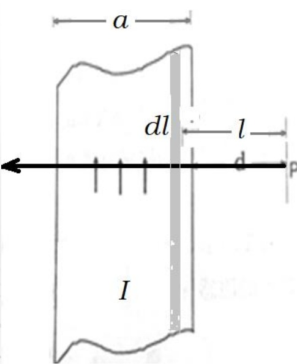
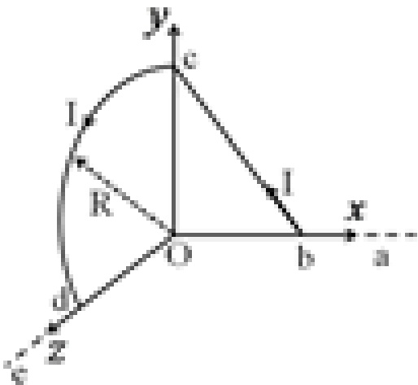

# 20-练习20 毕-萨定律及其应用

[返回全书目录](../../README.md)

> PDF 页码：150–156

<!-- page: 150 -->

### 练习20 毕-萨定律及其应用

1. 真空中有一载有稳恒电流 I 的细线圈，则通过包围该线圈的封闭曲面 S 的磁通量  $ \phi = \underline{0} $。若通过 S 面上某面元 dS 的元磁通为  $ d\phi $，而线圈中的电流增加为 2I 时，通过同一面元的元磁通为  $ d\Phi' $，则  $ d\phi : d\phi' = \underline{1 : 2} $。

解：通过闭合曲面的磁通 $ \phi = 0 $

稳恒电流I在周围空间产生的磁场与电流成正比：

 $ B \propto I $

通过某一面元的磁通量 $ d\phi $也与电流成正比，即 $ d\phi \propto I $所以 $ d\phi : d\phi' = 1 : 2 $

<!-- page: 151 -->

2. 将同样的 12 根导线焊成立方体，并在其对顶角 A、B 上接上电源，如图 20.1 所示，则立方体框架中的电流在其中心处所产生的磁感应强度等于  $ \underline{0} $ 。

解：由于正方体是由12根同样规格的导线组成，通电流后，每根导线电流都有关于0点对称的同向导线电流存在，且相应导线上的电流大小相等，这样的对称导线电流在O处产生的磁感应强度为零。因此O处的总的磁感应强度为0

<!-- page: 152 -->

3. 一质点带有电荷 q，以速率 v 在半径为 R 的圆周上作匀速圆周运动。该带电质点在轨道中心所产生的磁感应强度的大小  $  \mathbf{B} = \underline{\frac{\mu_{0}qV}{4\pi R^{2}}}  $，该带电质点轨道运动的磁矩的大小  $  \mathbf{P}_{\mathrm{m}} = \underline{\frac{1}{2}qvR}  $。

解：带电粒子做圆周运动等效电流

 $$ I=\frac{q}{T}=\frac{q\omega}{2\pi}=\frac{q v}{2\pi R} $$ 

∴ 圆电流在圆心处产生的磁感应强度大小为

 $$ B=\frac{\mu_{0}I}{2R}=\frac{\mu_{0}}{2R}\frac{qV}{2\pi R}=\frac{\mu_{0}qV}{4\pi R^{2}} $$ 

磁矩的大小: $ P_{m} = IS = \frac{qV}{2\pi R} \times \pi R^{2} = \frac{1}{2}qvR $

<!-- page: 153 -->

4. （1）如图 20.2(a) 所示，边长为 2a 的等边三角形线圈，通有电流 I，求线圈中心 O 点处的磁感应强度。

（2）如图 20.2(b) 所示，一根无限长直导线，中间一段弯成半径为 r 的圆弧，若导线中电流为 I，求圆心 O 点处的磁感应强度。

（1） $ B_{ab}=\frac{\mu_{0}I}{4\pi r_{0}}(\cos\theta_{1}-\cos\theta_{2}) $方向朝里 $ \otimes $

 $ \frac{\mu_{0}I}{4\pi r_{0}}\sqrt{3}=\frac{\mu_{0}I}{4\pi\times\frac{\sqrt{3}}{3}a}\sqrt{3}=\frac{3\mu_{0}I}{4\pi a} $

同理： $ B_{\mathrm{bc}} = B_{\mathrm{ac}} = \frac{3\mu_0I}{4\pi a} $ 方向朝里 $ \otimes $

线圈中心处的磁感强度：

 $ B = B_{\mathrm{ab}} + B_{\mathrm{bc}} + B_{\mathrm{ac}} = \frac{9\mu_{0}I}{4\pi a} $ 方向朝里 $ \otimes $

<!-- page: 154 -->

4. （1）如图 20.2(a) 所示，边长为 2a 的等边三角形线圈，通有电流 I，求线圈中心 O 点处的磁感应强度。

（2）如图 20.2(b) 所示，一根无限长直导线，中间一段弯成半径为 r 的圆弧，若导线中电流为 I，求圆心 O 点处的磁感应强度。

（2） $ B_{2} = \frac{\mu_{0}I}{2R} \frac{120^{0}}{360^{0}} = \frac{\mu_{0}I}{6r} $ 方向： $ \otimes $

由图知： $ o $ 点到直导线的距离： $ d = a \cos 60^{\circ} = \frac{r}{2} $

 $$ B_{1}=\frac{\mu_{0}I}{2\pi d}(cos O^{o}-cos30^{o})=(1-\frac{\sqrt{3}}{2})\frac{\mu_{0}I}{2\pi r} $$ 

 $$ B_{_{3}}=\frac{\mu_{_{0}}I}{2\pi d}(cos150^{^{0}}-cos180^{^{0}})=(1-\frac{\sqrt{3}}{2})\frac{\mu_{_{0}}I}{2\pi r} $$ 

则： $  \text{B} = \text{B}_1 + \text{B}_2 + \text{B}_3 = 0.21 \frac{\mu_0 I}{r}  $ 方向：✗

<!-- page: 155 -->

5. 如图 20.3 所示，一宽为 a 的无限长薄金属板，自下而上通有电流 I，电流沿薄板宽度方向均匀分布。求在薄金属板所在平面内距其右侧为 d 的 P 点处的磁感应强度。

解：将薄金属板沿宽度方向分割如图：

dl 对应电流:  $ dI = \frac{I}{a} dl $

d1 在P 点处磁场为：

 $$ dB=\frac{\mu_{o}dI}{2\pi l} $$ 

可知所有分割带在P点处磁场方向相同，

由磁场叠加原理可求得在P点处：

 $$ \mathrm{B}=\int\mathrm{d}\mathrm{B}=\int\limits_{\mathrm{d}}^{\mathrm{d}+\mathrm{a}}\frac{\mu_{0}I d l}{2\pi l a}=\frac{\mu_{0}I}{2\pi a}\ln\frac{d+a}{d} $$ 

方向：

修正：这里磁感应强度方向标反了

<!-- page: 156 -->

6. 真空中，一无限长直导线 abcde 弯成如图 20.4 所示形状，并通有电流 I，bc 直线在 xOy 平面内，cd 是半径为 R 的 1/4 圆弧，ab、de 分别在 x 轴和 z 轴上，Ob=Oc=Od=R。求：O 点处的磁感应强度 B。

解：如图0点处的磁感应强度为各段电流在0处产生的磁感应强度的矢量叠加。

 $$ \begin{aligned}\vec{B}_{ab}&=0\\\vec{B}_{bc}&=\frac{\mu_{0}I}{4\pi r_{0}}(\cos\theta_{1}-\cos\theta_{2})\vec{\mathrm{k}}=\frac{\sqrt{2}\mu_{0}I}{4\pi\times\frac{\sqrt{2}}{2}R}\vec{\mathrm{k}}=\frac{\mu_{0}I}{2\pi R}\vec{\mathrm{k}}\\\vec{B}_{cd}&=\frac{1}{4}\times\frac{\mu_{0}I}{2R}\vec{i}=\frac{\mu_{0}I}{8R}\vec{i}\\\vec{B}_{de}&=0\end{aligned} $$ 

0点处的磁感应强度为

 $$ \vec{B}_{o}=\vec{B}_{ab}+\vec{B}_{bc}+\vec{B}_{cd}+\vec{B}_{de}=\frac{\mu_{0}I}{2\pi R}\overrightarrow{k}+\frac{\mu_{0}I}{8R}\overrightarrow{i} $$ 

