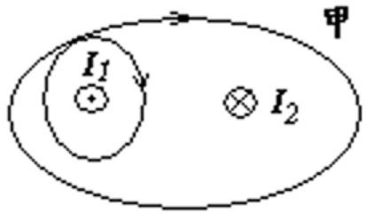
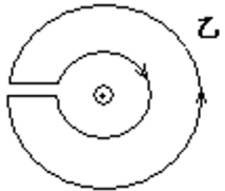
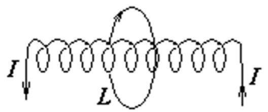
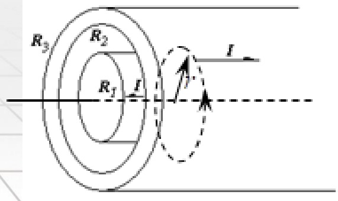
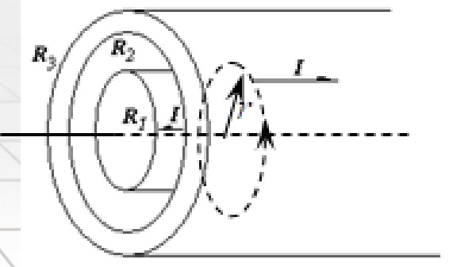
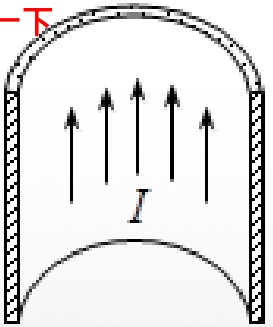
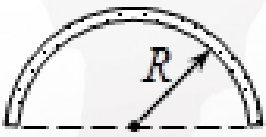
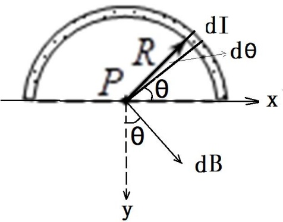
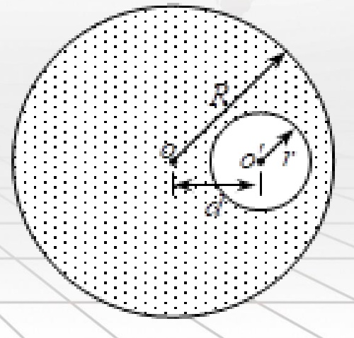
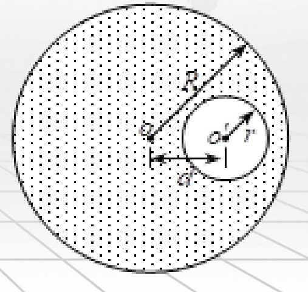

# 21-练习21 安培环路定理及应用

[返回全书目录](../../README.md)

> PDF 页码：157–164

<!-- page: 157 -->

### 练习21 安培环路定理及应用

1. 在图 21.1 所示的两个闭合回路中环流分别为：

回路甲： $ \oint\overrightarrow{B}\cdot d\overrightarrow{l}=\underline{\mu_{0}(-2\ I_{1}+I_{2})} $；

回路乙： $ \oint\overrightarrow{B}\cdot d\overrightarrow{l}=\underline{\quad0\quad} $。

解：回路甲：电流  $ I_{1} $ 被环绕两次，电流方向与环绕方向不满足右手螺旋定则关系. 电流  $ I_{2} $ 被环绕 1 次，电流方向与环绕方向满足右手螺旋定则关系

 $$ \oint\overrightarrow{B}\cdot d\overrightarrow{l}=\mu_{0}(-2I_{1}+I_{2}) $$ 

回路乙未包含电流，故而

 $$ \oint\overrightarrow{B}\cdot d\overrightarrow{l}=0 $$ 

<!-- page: 158 -->

2. 如图 21.2 所示，在载流长直螺线管外环绕一周，其环流  $ \oint \overrightarrow{B} \cdot d\overrightarrow{l} = \underline{\quad -\mu_0I\quad} $。

解：长直螺线管过环流所在平面时，只需算一根导线穿过该平面，环绕方向与电流方向不满足右手定则。

 $$ \oint\overrightarrow{B}\cdot d\overrightarrow{l}=-\mu_{0}I $$ 

若非理想情况的螺线管，有漏磁存在，则外部附近的磁场并不为零。

<!-- page: 159 -->

3. 两根长度相同的细导线分别密绕在半径为 R 和 r 的两个长直圆筒上形成两个螺线管，两个螺线管的长度相同，R=2r 螺线管通过的电流相同且都为 I，则螺线管中的磁感应强度大小  $ B_{R}:B_{r}=\underline{1:2} $。

解：长直密绕螺线管中磁感应强度 $ B = \mu_0 n I $；

两根导线长度相同，而两螺线管半径R = 2r，故有 $ 2n_{R} = n_{r} $。

所以电流大小相同时

 $$ B_{R}\colon B_{r}=1{:}2 $$

<!-- page: 160 -->

4. 有一同轴电缆，其尺寸如图 21.3 所示，它的内外两导体中的电流均为 I，且在横截面上均匀分布，但两者电流的流向正相反，求导体内外的磁感应强度的分布。

解：磁场具有轴对称性，以对称轴为中心作积分环路，如图所示方向为正方向。则沿着闭合回路的环流有安培环路定理：

 $$ \oint_{l}\overrightarrow{B}\cdot d\overrightarrow{l}=\mu_{0}\sum I $$ 

 $ r < R_1 $时，回路包围的电流  $ \sum I = \frac{I}{\pi R_1^2} \pi r^2 $

由安培环路定理得

 $$ \oint_{l}\overrightarrow{B}\cdot d\overrightarrow{l}=B\cdot2\pi r=\mu_{0}\frac{I}{\pi R_{1}^{2}}\pi r^{2} $$ 

 $$ B=\frac{\mu_{0}Ir}{2\pi R_{1}^{2}} $$ 

<!-- page: 161 -->

$ R_1 < R < R_2 $时，回路包围的电流  $ \sum I = I $

由安培环路定理得  $ \oint_l \overrightarrow{B} \cdot d\overrightarrow{l} = B \cdot 2\pi r = \mu_0I $

 $ B = \frac{\mu_0I}{2\pi r} $

$R_{2}<R<R_{3}$时，回路包围的电流 $\sum I=I\left(1-\frac{r^{2}-R_{2}^{2}}{R_{3}^{2}-R_{2}^{2}}\right)$，由安培环路定理得$\oint_{l}\overrightarrow{B}\cdot d\overrightarrow{l}=B\cdot2\pi r=\mu_{0}I\left(1-\frac{r^{2}-R_{2}^{2}}{R_{3}^{2}-R_{2}^{2}}\right)$

$B=\frac{\mu_{0}I}{2\pi r}\frac{R_{3}^{2}-r^{2}}{R_{2}^{2}-R_{3}^{2}}$

 $ R > R_3 $时，回路包围的电流  $ \sum I = 0 $， $ B = 0 $

<!-- page: 162 -->

5. 一半径  $ R = 1.0 \, cm $ 的无限长半圆柱形金属薄片（薄片厚度不计）中，自下而上有电流 I = 5.0 A 通过，如图 21.4 所示，求圆柱轴线任一点 P 处的磁感应强度。

注：解答过程有误，磁感应强度在X和Y轴方向的结果应该交换一下， $ \sin $和 $ \cos $也需要交换

解：如图建立二维坐标，在半圆柱形薄片上图示位置

取元电流dI，对应圆心角为 $ d\theta $。由安培环路定理得dI在P点

产生的磁场 $ \mathrm{d}B=\frac{\mu_{0}dI}{2\pi R} $，其中 $ dI=\frac{I}{\pi}d\theta $

根据电流的对称性可知： $ B_{x}=0 $

P
 

 $$ \begin{aligned}B~&=~B_{_{y}}~=\int dB\cos\theta~=~2\int_{0}^{\frac{\pi}{2}}\frac{\mu_{_{0}}dI}{2\pi R}\cos\theta\\&=~2\frac{\mu_{_{0}}I}{2\pi^{2}R}\sin\theta\Big|_{0}^{\frac{\pi}{2}}~=~\frac{\mu_{_{0}}I}{\pi^{2}R}~=~6.37\times10^{-5}T\end{aligned} $$ 

<!-- page: 163 -->

6. 如图 21.5 所示，在半径为 R 的无限长直金属圆柱体内部，挖去一半径为 r 且与轴线平行的无限长圆柱体，两柱体的轴线平行，相距为  $ d(d > r) $。今有电流沿空心柱体的轴线方向流动，且电流 I 均匀分布在空心柱体的截面上。分别求圆柱轴线上和空心部分轴线上 o， $ o' $ 点的磁感应强度大小。

解：根据题意，圆柱体横截面的电流面密度

 $$ J=\frac{I}{\pi(R^{2}-r^{2})} $$ 

空间各点场强可视为电流密度为J且充满整个圆柱并与I同向的电流 $ I_{1} $，以及充满孔并与I反向的电流密度也为J的电流 $ I_{2} $产生的磁场叠加而成.

利用安培环路定理可知 $ I_{1} $在O点产生的磁感应强度

 $$ \boldsymbol{B}_{1}=0 $$ 

<!-- page: 164 -->

$ I_{2} $ 在O点产生的磁感应强度大小

 $$ B_{_{2}}=\frac{\mu_{_{0}}I_{_{2}}}{2\pi a}=\frac{\mu_{_{0}}}{2\pi a}\frac{I\pi r^{^{2}}}{\pi(R^{^{2}}-r^{^{2}})}=\frac{\mu_{_{0}}Ir^{^{2}}}{2\pi a(R^{^{2}}-r^{^{2}})} $$ 

圆柱轴线上O点产生的总磁感应强度大小： $ d^{''} $

 $$ B_{_{o}}=B_{_{1}}+B_{_{2}}=\frac{\mu_{_{0}}Ir^{2}}{2\pi a(R^{2}-r^{2})} $$ 

利用安培环路定理可知 $ I_{2} $在 $ O' $点产生的磁感应强度 $ B_{2}^{\prime}=0 $

 $ I_{1} $ 在  $ O^{\prime} $ 点产生的磁感应强度大小

 $$ B_{1}^{\prime}=\frac{\mu_{0}I_{1}}{2\pi a}=\frac{\mu_{0}I a^{2}}{2\pi a(\mathrm{R}^{2}-\mathrm{r}^{2})}=\frac{\mu_{0}I a}{2\pi(\mathrm{R}^{2}-\mathrm{r}^{2})} $$ 

空心部分轴线上 $ O' $点产生的总磁感应强度大小：

 $$ B_{o^{\prime}}=B_{1}^{\prime}+B_{2}^{\prime}=\frac{\mu_{0}I a}{2\pi(\mathrm{R}^{2}-\mathrm{r}^{2})} $$ 

