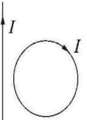
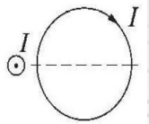
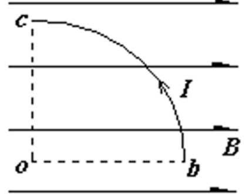
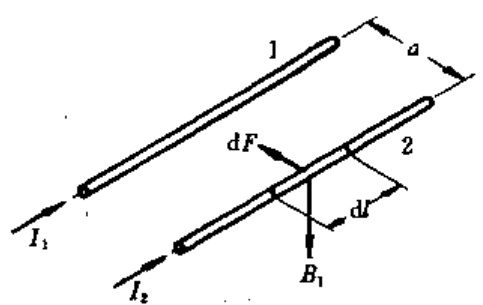
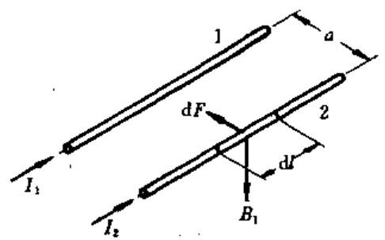
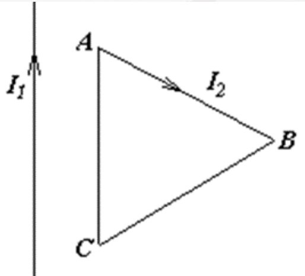
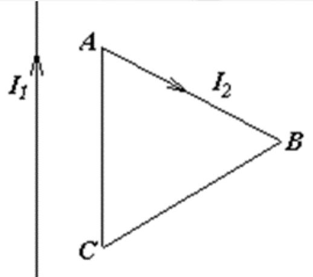
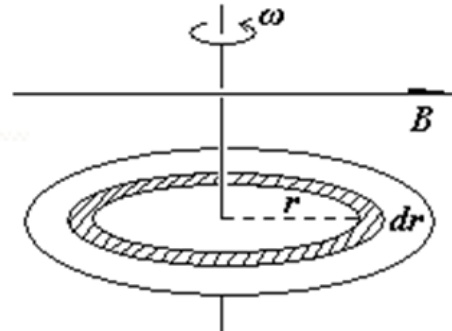
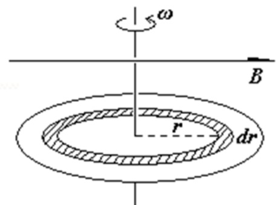

# 22-练习22 磁场对载流导线的作用

[返回全书目录](../../README.md)

> PDF 页码：165–173

<!-- page: 165 -->

### 练习22 磁场对载流导线的作用

1. 如图 22.1，在一固定的无限长载流直导线的旁边放置一个可以自由移动和转动的圆形的刚性线圈，线圈中通有电流，若线圈与直导线在同一平面，见图 22.1(a)，则圆线圈将 $ \underline{\text{平移靠近直导线}} $；若线圈平面与直导线垂直，见图 22.1(b)，则圆线圈将 $ \underline{\text{转动并向左平移}} $。

解：（a）直导线在线圈中产生磁场垂直平面向内。磁场分布不均匀，对线圈有向左的合作用力；磁场方向和线圈法向相同，故而力矩为零。所以，线圈将平移靠近直导线。

（b）直导线在线圈中产生磁场平行平面向上。磁场分布不均匀，对线圈有向左的合作用力；磁场方向与线圈法向垂直，故而力矩不为零。所以，线圈将转动并向左平移。

(a)
 

(b)
 

<!-- page: 166 -->

2. 有一半径为 a，流过稳恒电流为 I 的 1/4 圆弧形载流导线 bc，按图 22.2 示方式置于均匀外磁场  $ \overrightarrow{B} $ 中，则该载流导线所受的安培力大小为  $ \underline{IBA} $。

解：载流曲导线在均匀磁场中所受的安培力等效于从电流起点到终点直线电流所受的安培力。对于圆弧导线电流

I 所受的安培力等效于 bc 直线电流所受安培力。

 $$ \begin{aligned}\overrightarrow{F}&=I\overrightarrow{bc}\times\overrightarrow{B}\\&\therefore F=IBa\end{aligned} $$ 

<!-- page: 167 -->

3. 半径为 R 的圆形电流线圈共 N 匝，通以电流 I，把该平面线圈放入均匀外磁场  $ \overrightarrow{B} $ 中，该线圈受到的最大磁力矩为  $ \underline{M=NI\pi R^{2}B} $。

解：线圈受到的磁力矩 $ \overrightarrow{M} = NI\pi R^{2}\overrightarrow{e_n} \times \overrightarrow{B} $;

显然，当磁场与线圈法向垂直时，力矩取最大值 $ M = NI\pi R^{2}B $

<!-- page: 168 -->

4. 两根平行无限长直导线间的垂直距离为 a，其中电流强度分别为  $ I_{1} $ 和  $ I_{2} $，且方向相同，试求在单位长度导线上的作用力的大小。

解：在导线2上取一电流 $ I_{2}d\overrightarrow{l}_{2} $，根据毕奥—萨伐尔定律知，导线1在 $ d\overrightarrow{l}_{2} $处产生的磁感应强度的大小为

 $$ B_{1}=\frac{\mu_{o}I_{1}}{2\pi a} $$ 

方向如图示，垂直于两导线确定的平面

由安培定律得，电流 $ I_{2}d\vec{l}_{2} $受到的力大小为

 $$ d F_{2}=I_{2}d l_{2}B_{1}=\frac{\mu_{o}I_{1}I_{2}}{2\pi a}d l_{2} $$ 

 $ dF_{2} $的方向在平行两导线确定的平面内，垂直于导线2，指向导线1。

<!-- page: 169 -->

由安培定律得，电流 $ I_{2}d\hat{l}_{2} $受到的力大小为

 $$ d F_{2}=I_{2}d l_{2}B_{1}=\frac{\mu_{o}I_{1}I_{2}}{2\pi a}d l_{2} $$ 

导线2单位长度上受的安培力大小为

 $$ \frac{dF_{2}}{dl_{2}}=\frac{\mu_{o}I_{1}I_{2}}{2\pi a} $$ 

同理可得导线1单位长度上受的安培力大小为

 $$ \frac{dF_{1}}{dl_{1}}=\frac{\mu_{o}I_{1}I_{2}}{2\pi a} $$ 

方向指向2。

<!-- page: 170 -->

5. 如图 22.3 所示，电流为  $ I_{2} $ 的等边三角形载流线圈与无限长直流  $ I_{1} $ 共面，等边三角形的边长为 l，AC 边距无限长载电直导线的距离为 d。求载流线圈所受的合力。

解：对于 AC ： $ B_{AC}=\frac{\mu_{0}I_{1}}{2\pi d} $

 $$ \therefore F_{AC}=BI_{2}l\sin90^{0}=\frac{\mu_{0}I_{1}I_{2}}{2\pi d}l $$ 

对于AB、BC：取电流元 $ Id\vec{l} $，应用安培定理：

 $$ d\vec{F}=I d\vec{l}\times\vec{B}, $$ 

 $$ \begin{array}{c}F_{AB}=F_{BC}=\int dF=\int_{l}\frac{\mu_{0}I_{1}}{2\pi r}I_{2}dl\\=\int_{d}^{d+l\cos30^{\circ}}\frac{\mu_{0}I_{1}I_{2}}{2\pi r}\frac{dr}{\cos30^{\circ}}=\frac{\sqrt{3}\mu_{0}I_{1}I_{2}}{3\pi}ln\frac{2d+\sqrt{3}l}{2d}\end{array} $$ 

<!-- page: 171 -->

$$ \begin{array}{r}{F_{A C}=\frac{\mu_{0}I_{1}I_{2}}{2\pi d}l,F_{A B}=F_{B C}=\frac{\sqrt{3}\mu_{0}I_{1}I_{2}}{3\pi}l n\frac{2d+\sqrt{3}l}{2d}}\end{array} $$ 

 $ \vec{F}_{合} = \vec{F}_{AC} + \vec{F}_{AB} + \vec{F}_{BC} $，大小为

 $$ \begin{array}{r}{F=F_{A C}-2F_{A B}\:c o s\:6\:0^{\circ}=\frac{\mu_{0}I_{1}I_{2}l}{2\pi d}-\frac{\sqrt{3}\mu_{0}I_{1}I_{2}}{3\pi}l n\frac{2d+\sqrt{3}l}{2d},}\end{array} $$ 

<!-- page: 172 -->

6. 如图 22.4 所示，一半径为 R，电荷面密度为  $ \sigma $ 的均匀带电圆盘，放入磁感应强度为  $ \overrightarrow{B} $ 的匀强磁场中，磁力线与圆盘表面平行，现圆盘以角速度  $ \omega $ 绕对称轴转动。求：

（1）在距盘心为 r 处取一半径为 r 、宽度为 dr 的圆环，则圆环旋转产生的电流强度 dI 有多大?

（2）该圆环所受的磁力矩有多大？

（3）圆盘所受的合力矩有多大？

解：（1）取圆环 $ dS = 2\pi rdr $，它等效电流

 $$ d I=\frac{d q}{T}=\frac{\omega}{2\pi}d q=\frac{\omega}{2\pi}\sigma d S=\omega\sigma r d r $$ 

<!-- page: 173 -->

（2）等效磁矩

 $$ d P_{m}=\pi r^{2}d I=\pi\omega\sigma r^{3}d r $$ 

受到磁力矩 $ d\overrightarrow{M}=d\overrightarrow{P}_{m}\times\overrightarrow{B} $，方向 $ \perp $纸面向内，大小为

 $$ d M=d P_{m}\times B=\pi\omega\sigma B r^{3}d r $$ 

(3)  $ M = \int dM = \pi\omega\sigma B\int_{0}^{R}r^{3}dr = \frac{\pi\sigma\omega BR^{4}}{4} $

