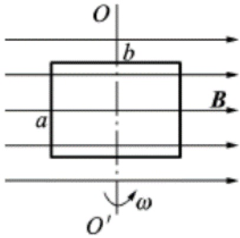
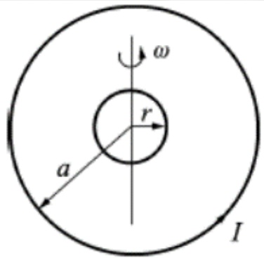
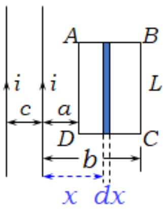
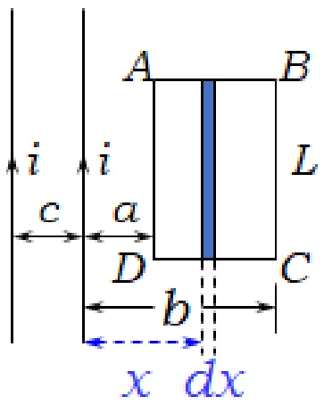
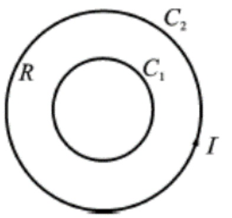
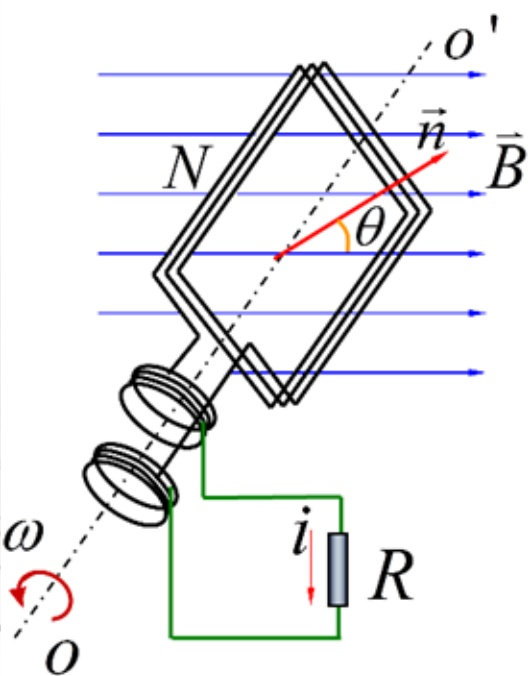

# 23-练习23 法拉第电磁感应定律

[返回全书目录](../../README.md)

> PDF 页码：174–180

<!-- page: 174 -->

### 练习23 法拉第电磁感应定律

1. 一矩形线框长为 b、宽为 a，置于均匀磁场中，线框绕 OO'轴，以匀角速度  $ \omega $ 旋转（图 23.1），设  $ t = 0 $ 时，线框平面处于纸面内，则任一时刻感应电动势的大小为  $ \underline{\text{abB $ \omega $|cos $ \omega t $}} $

解：任意时刻t，穿过线圈的磁通量为

 $$ \Phi=\vec{B}\cdot\vec{S}=a b B c o s(\frac{\pi}{2}-\omega t)=a b B\sin\omega t; $$ 

由法拉第电磁感应定律： $ \varepsilon = -\frac{d\Phi}{dt} = -abB\omega\cos\omega t $

所以，感应电动势大小为： $ abB\omega|\cos\omega t| $

<!-- page: 175 -->

2. 如图 23.2 所示，一半径为  $ r $ 的很小的金属圆环，在初始时刻与一半径为  $ a (a \gg r) $ 的大金属圆环共面且同心。在大圆环中通以恒定的电流  $ I $，方向如图。如果小圆环以匀角速度  $ \omega $ 绕其任一方向的直径转动，并设小圆环的电阻为  $ R $，则任一时刻  $ t $ 通过小圆环的磁通量  $ \Phi_m = \frac{\frac{\mu_0 I}{2 a} \pi r^2 \cos \omega t}{2 a} $，小圆环中的感应电流  $ i = \frac{\frac{\mu_0 I}{2 a R} \pi r^2 \omega \sin \omega t}{2 a R} $。

解：小圆环处视作匀强场，等于大圆环在圆心处的场强  $ B=\frac{\mu_{0}I}{2a} $。

 $$ \phi_{m}=BS\cos\omega t=\frac{\mu_{0}I}{2a}\pi r^{2}\cos\omega t $$ 

 $$ \varepsilon_{i}=-\frac{d\phi_{m}}{d t},i=\frac{\varepsilon_{i}}{R}=\frac{\mu_{0}I}{2a R}\pi r^{2}\omega\sin\omega t $$ 

<!-- page: 176 -->

3. 用导线制成一半径为  $ r = 10 \, \text{cm} $ 的闭合圆形线圈，其电阻  $ R = 10 \, \Omega $，均匀磁场  $ \overrightarrow{B} $ 垂直于线圈平面。欲使电路中有一稳定的感应电流  $ I = 0.01 \, \text{A} $， $ B $ 的变化率  $ dB/dt = \underline{3.18T/s} $。

解：感应电动势大小

 $$ \varepsilon=\frac{\pi r^{2}dB}{dt}=3.14\times10^{-2}\frac{dB}{dt}=IR=0.1V $$ 

故而，B的变化率 $ \frac{dB}{dt}=3.18T/s $

<!-- page: 177 -->

4. 如图 23.3 所示，两无限长的直导线载有交变电流  $ i = I_{0}\sin\omega t $，它旁有一长方形线圈 ABCD，长为 L，宽为 b-a，线圈与导线共面，求：(1) 穿过回路 ABCD 的磁通量  $ \Phi $; (2) 回路 ABCD 中的感应电动势  $ \varepsilon $。

解：（1）在回路中取与直导线平行的面积元(如图)通过面积元的磁通量：

 $$ d\phi=d\phi_{1}+d\phi_{2}=\frac{\mu_{0}i}{2\pi(c+x)}Ldx+\frac{\mu_{0}i}{2\pi x}Ldx $$ 

则通过回路ABCD的磁通量 $ \phi $为：

 $$ \begin{aligned}\phi=\int d\phi_{1}+\int d\phi_{2}=\int_{a}^{b}\frac{\mu_{0}i L d x}{2\pi(c+x)}+\int_{a}^{b}\frac{\mu_{0}i L d x}{2\pi x}\\ =\frac{\mu_{0}i L}{2\pi}(ln\frac{c+b}{c+a}+ln\frac{b}{a})\end{aligned} $$ 

<!-- page: 178 -->

通过回路ABCD 的磁通量 $ \phi $为：

 $$ \phi=\frac{\mu_{0}iL}{2\pi}(ln\frac{c+b}{c+a}+ln\frac{b}{a}) $$ 

（2）回路ABCD中的感应电动势 $ \varepsilon_{i} $为：

 $$ \varepsilon_{i}=-\frac{d\phi}{d t}=-\frac{\mu_{0}L\omega I_{0}}{2\pi}(l n\frac{c+b}{c+a}+l n\frac{b}{a})c o s\omega t $$ 

<!-- page: 179 -->

5. 如图 23.4 所示，一圆形线圈  $ C_{1} $ 由 50 匝表面绝缘的细导线绕成，圆面积  $ S = 4.0 \, cm^{2} $，将它放在另一半径  $ R = 20 \, cm $ 的圆形大线圈  $ C_{2} $ 的中心处，两者共面，大线圈共 100 匝。求：当大圆线圈中的电流以 50 A/s 的速率变化时，小圆线圈中的感应电动势。

解：设 $ C_{2} $上通有电流 $ I_{2} $，因为大线圈 $ C_{2} $的面积比小线圈的 $ C_{1} $的面积大得多，所以小线圈面积内各点的 $ \overrightarrow{B} $都视作相同，其大小都等于 $ C_{2} $中心处的磁感应强度 $ B = N_{2}\frac{\mu_{0}I_{2}}{2R} $，故穿过 $ C_{1} $的全磁通为

 $$ \psi_{12}=N_{1}BS=\frac{\mu_{0}I_{2}N_{1}N_{2}S}{2R} $$ 

 $$ \begin{aligned}&\left|\varepsilon\right|=\left|-\frac{d\psi_{12}}{dt}\right|=\frac{\mu_{0}N_{1}N_{2}S}{2R}\left|\frac{dI_{2}}{dt}\right|=6.28\times10^{-6}\times50\\ &=3.14\times10^{-4}(V)\\ \end{aligned} $$ 

<!-- page: 180 -->

6. 在匀强磁场  $ \overrightarrow{B} $ 中，置有面积为 S 的可绕  $ OO' $ 轴转动的 N 匝线圈，如图 23.5 所示。若线圈以角速度  $ \omega $ 作匀速转动，求线圈中的感应电动势。

解：设 $ t = 0 $时， $ \vec{n} $与 $ \overrightarrow{B} $同向，则 $ \theta = \omega t $

 $$ \psi=N\varphi=N B S c o s\omega t $$ 

 $$ \varepsilon=-\frac{d\psi}{d t}=NBS\omega\sin\omega t $$ 

令 $ \varepsilon_{m}=NBS\omega $，则 $ \varepsilon=\varepsilon_{m}\sin\omega t $

